# 为什么 AI 不推荐你
## B2B 企业 GEO 实战

分享人：邹叔

## 知识星球TOP 资源分享社群

公众号: 知识星球TOP

汇聚全网高价值资源

打造一流资源社群


微信信号:top28688

添加微信免费群

- ◆ 付费文章 ◆ 付费社群
- ◆ 时政&国际 ◆ 副业&搞钱
- ◆ 财经&市场 ◆ 行业&科技


微信信号:top28388

时政·历史·职场·体制·自媒体 学习·军事·软件·影音·社会学


## 2年实战，70+ 案例，50+ 行业专家，200+

### 6.4 案例分析：三口扣解决品牌对齐‘双增长’，打造 AI 时代的策略

我们的一款品牌产品在获得流量爆火后，面临着产品增长、品牌建设等一系列挑战，我们该如何实现持续的增长和品牌升级？

是完全依赖昂贵的投放，还是通过内容运营建立用户心智？我们如何通过 AI 工具驱动内容来提升品牌价值？

### 6.5 AI 驱动转化：如何让‘产品’真正变成‘品牌’

我们与很多企业交流，通过调研发现，很多企业面临着‘技术’与‘营销’之间的鸿沟，导致很多好产品只停留在‘产品’阶段。

这里的痛点在于内容不够深度，无法有效触达用户并引起共鸣。

### 1. 建立深度的‘情感共鸣’（技术视角）

面对挑战，我们对 AI 进行了深度尝试，利用 AI 辅助进行用户画像分析，生成多维度的用户痛点标签。

- 'Don't want a fly in my pool'
- 'Don't want sugar milk for my coffee'
- 'Best outer most cousin could win'

最后，我们通过 AI 建立了一个更详细的消费者画像，并基于‘情感共鸣’的需求，重构了内容结构、结构化布局。

### 8.2 案例分析：智能品牌如何破解品牌的增长瓶颈？

我们专注于为客户提供解决方案以破解品牌的增长瓶颈。我们构建了‘AI+BMD’品牌增长新范式：

- 提升 500% 效率：利用 AI 工具优化内容生产流程，大幅降低研发与运营的人力成本
- 降低 80% 成本：通过 AI 自动化测试，快速验证用户喜好，减少盲目试错成本
- 转化率提升 30%：通过 AI 深度分析用户行为，精准捕捉用户痛点，不断迭代营销策略

我们的目标是：在 AI 时代，帮助企业实现更高效、更智能的增长。

- 核心洞察：在 AI 时代，内容不再是线性的堆砌，而是基于数据的实时反馈迭代
- 策略执行：通过 AI 驱动，将复杂的营销策略拆解为可执行的原子单元进行自动化投放
- 品牌沉淀：利用 AI 建立品牌资产库，确保所有触点品牌信息的一致性

### 11.3 案例分析：电子分销如何破解‘流量突围’

在流量压力下，获客成本不断攀升，在 AI 时代我们如何突围？我们通过多个路径进行测试，最终找到了新的增长路径。

该案例始于 2022 年初，针对某电子产品进行分销渠道的测试。

我们发现，通过 AI 批量生成高个性化的内容进行 A/B 测试，可以显著提升转化率。

- 核心洞察：利用 AI 大规模生产内容，实现千人千面的精准触达
- 策略执行：通过 AI 自动分析不同画像的痛点，生成针对性的营销素材
- 品牌沉淀：通过数据反馈不断优化模型，形成更科学的流量预算分配

### 13.4 案例分析：DTC品牌如何用 AI 实现‘品牌之源’

让我们通过两个案例，理解品牌增长如何解决系统性增长问题，成为品牌增长的新范式：

### 14.1 Kettle & Fruit：从零到一，定义一个品牌

### 14.2 Kettle & Fruit：如何持续增长？

在品牌建立后，如何保持持续增长？我们需要通过 AI 持续发掘新的增长点：

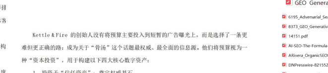

我们通过 AI 分析用户反馈，发现了新的使用场景，从而开发了新的产品和营销策略：

- 2023年上半年：GMV 增长 200%
- 2023年下半年：复购率提升 40%
- 2024年目标：实现品牌品类化扩张

> [ArticleHub] AI 变革：效率、创造、人与机遇
> [VHL] AI 时代：我们如何拥抱变革，迎接机遇
> [Forbes] AI 将如何重塑商业模式的未来
> [The Economist] AI 时代：工作与未来的变革
> [Harvard Business Review] AI 驱动品牌增长的新引擎
> [MIT Technology Review] AI 与人类创造力的的新边界

AIICO

### 风起了，世界变了
### 用户行为发生了颠覆性变革


### 用汽车买行的改变

适合人群：人口较少，追求体验的家庭。

- 第一款推荐 L6：适合家庭用户，XNGP智驾，800V高快充提升城市通过效率，安全性也更加可靠。
- 第二款的对比：奔驰 PLUS-DM：智能驾驶技术，油耗1.58L/100km，落地价到18万，舒适性有限的家庭。
- 长途理想L6：技术彻底解决里程焦虑，家配置舒适，适合有城游需求的用户。
- 四个选择中的X9：空间灵活，操控性众，设计适合有家庭。
- 五选一推荐理想9：适合人口较多或追求舒适体验，优惠后价格26.9万，性价比显著。

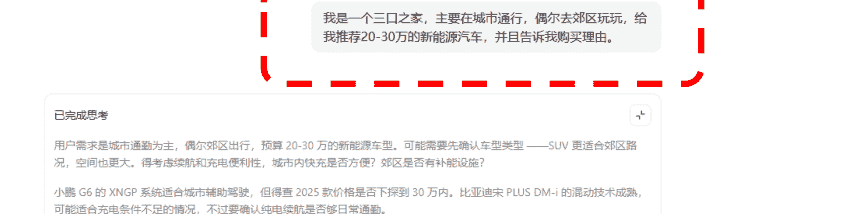

用汽车买时，很多人纠结：20-30万的预算，究竟选择哪款车？

如果你追求性价比，对比Model Y和理想SUV是不二选择。

如果你在意舒适度，那么考虑理想6和理想M7两个不错的选择。

如果你还没想好，就去试驾一个车型，再根据实际需求来决定。最后，总结了这几个价位的表格：

| 车型 | 参考价格（万） | 车型类型 | 亮点 |
| :--- | :--- | :--- | :--- |
| 理想 L7 | 30.18 | 增程 SUV | “大空间”舒适灵活，续航1300km |
| 问界 M7 | 24.98 - 32.98 | 增程 SUV | 华享生态舱，智能驾驶（ADS 2.0） |
| 特斯拉 Model Y | 26.35 - 31.35 | 纯电 SUV | 品牌影响力强，超充网络完善，操控性好，智能化水平高 |
| 小鹏 G9 | 26.39 起（570 Pro） | 纯电 SUV | 800V级快充（充电速度快），智能驾驶（XNGP）领先 |
| 理想 L6 | 24.98 - 27.98 | 增程 SUV | 理想L7的性价比，配置均衡 |

### 用户行为的改变
### 三口之家新能源推荐

针对城市通勤，我们为您挑选了20-30万内最适合的新能源汽车。三口之家汽车市场趋势：

- 价格区间：20-30万，250km以上续航，智能驾、极致安全，适合多成员SUV
- 推荐EV（17.9万）：价格区间：20万左右，高性价比，技术领先，适合家庭出游
- 小PEV（21.9万）：价格区间：700km以上续航，智能驾、设计领先，适合大多数家庭。

### EV推荐


### 特斯拉Model 3 | 23.55万

- 中型轿车：续航：500-700km，续航：600-830km CLTC
- 电池：250kWh锂电池
- 智能驾驶：Autopilot匹配

推荐理由：
- 全球领先的智能技术
- 极致性能，乐趣驾驶
- 操控感极佳，空间灵活
- 品牌知名度高，口碑之选

### 比秦EV | 17.98万


- 中型轿车：续航：500-750km，续航：506-705km CLTC
- 电池：刀片电池
- 充电：800V高压平台

推荐理由：
- 全球领先的电池技术
- 空间大，适合家庭用车
- 价格亲民，性价比之王
- 产品耐用，售后服务

### 精选轿型车型

基于您的需求，我们为您挑选了以下4款最适合的新能源汽车

### 特瑞捷 Model 3 | 23.55万

- 中型SUV：续航：600-830km，续航：600-830km CLTC
- 电池：250kWh锂电池
- 智能驾驶：Autopilot匹配

推荐理由：
- 全球领先的智能技术
- 极致性能，乐趣驾驶
- 操控感极佳，空间灵活
- 品牌知名度高，口碑之选

### 比迪秦汉EV | 17.98万

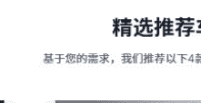

- 中型SUV：续航：500-705km，续航：506-705km CLTC
- 电池：刀片电池
- 充电：800V高压平台

推荐理由：
- 全球领先的电池技术
- 空间大，适合家庭用车
- 价格亲民，性价比之王
- 产品耐用，售后服务

### 小鹏P7 | 21.98万

- 中型SUV：续航：500-720km
- 电池：XNGP
- 充电：800V高压平台

推荐理由：
- 全球领先的智能技术
- 极致性能，乐趣驾驶
- 操控感极佳，空间灵活
- 品牌知名度高，口碑之选

### B2B客户之旅也变了

好的，作为一家国内TOB企业，我们正在寻找能够提升市场效率的简单工具，而是一个能够解决客户痛点的SaaS。基于目前的经验和积累，我为您梳理了以下两个核心特点：为什么它是TOB首选？

- 核心优势：释放人力，自动化营销
- 理念：精准触达，一体化增长

| 产品 | 定位 | 关键能力 | 2025年趋势 |
| :--- | :--- | :--- | :--- |
| 百拓云 | 国内B2B“全栈” | 1. 营销无死角，自动化投放 | AI驱动内容 |
| CRM标识 | 数字化平台 | 2. 营销生态与AI赋能 | 智能增长 |
| 融合营销 | B2B一站式营销 | 3. 600+规模，管理渠道 | 效率提升 |
| AI CRM | 行业认证 | 4. 广告/内容全链路 | 数据驱动 |


### B2B客户购买旅程也变了

过去，我们用尽力气去“影响”客户；现在，客户带着AI的“答案”来拷问。

从线性的“搜索路径”，变成了立体的“信息审查”。

### 几个的用户行为改变

1. 从“搜索关键词”到“提出问题”
2. “隐形决策”成为主流
3. 对“AI答案”的依赖

### 几个的用户行为改变

- 牛马和管理者对AI的依赖
- 就像普通人对短视频的依赖


### SEO、AEO、GEO、AIO、AI SEO 傻傻分不清

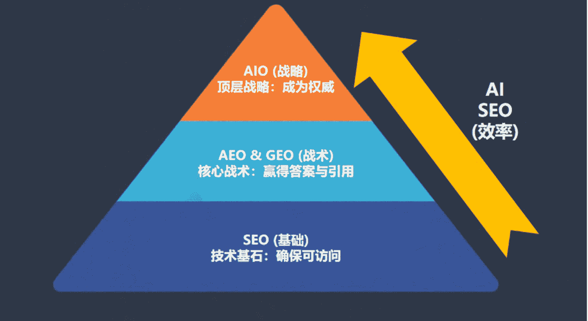

AICGO

输入：
“北京是中国的

模型预测：
“首都”的概率是 0.91
“城市”的概率是 0.06
“地方”的概率是 0.02

生成：
“北京是中国的首都。”

# LM 的原理

每一个词（token）都是这样预测出来的。

AICGO

用户输入问题

分词 + 向量化

上文注意力

重复预测下一个词，...

生成第一个词

计算概率分布

# 大模型生成的流程

形成完整答案

为什么 GPT、Claude、Gemini 能回答复杂问题？

- 融合了检索：能从外部数据库查找最新资料；
- 增加了工具调用：能调用 Python、搜索引擎、API；
- 加入了多模态能力：能理解图像、语音、视频；
- 还有对齐训练：通过人类反馈反馈（RLHF）让回答更符合人类价值观。

AICGO

## LLM 的核心缺点

- ① 幻觉：“一本正经地胡说八道”
- ② 缺乏真实理解
- ③ 对时间敏感度差
- ④ 推理与长程记忆能力有限
- ⑤ 数据偏见与伦理风险

### RAG 减少幻觉

#### ① 幻觉：“一本正经地胡说八道”

- 加入检索（RAG）：在生成前检索真实事实；
- 来源：要求模型在回答中附带出处；
- 校验层：输出后用工具自动验证；
- 用专业领域微调模型（Fine-tuning）：减少幻觉概率。

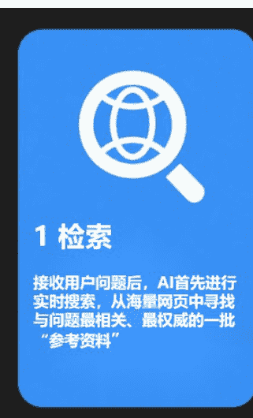
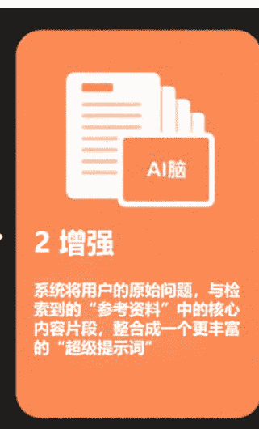
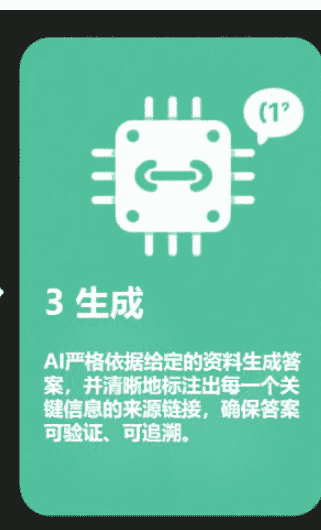

### AI 如何选择内容

### 每一次 AI 的抓取，都是一次信任的考试。

- 1. 寻找：当用户提问后，RAG 的“检索”环节启动。它像搜索引擎的爬虫一样，在互联网上抓取大量与问题相关的页面和文档。
- 2. 评估：RAG 抓回一大堆材料后，并不会随便使用。AI 会启动它的“评估系统”，像一个严格的官员，对这些材料进行分类和排序。
- 3. 采纳：在评估筛选出几份高质量的“信源”之后，AI 进入“生成”环节。

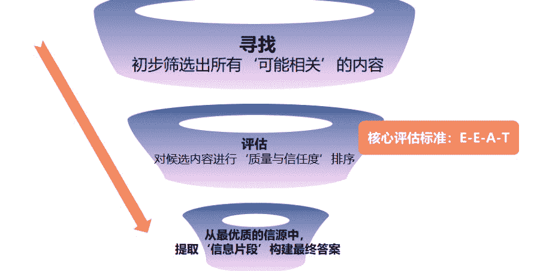

寻找
初步筛选出所有‘可能相关’的内容

评估
对筛选内容进行‘质量与信任度’排序

从优质的信源中
提取‘信息片段’构建最终答案

核心评估标准：E-E-A-T

AICGO

### 如何成为被 AI 推荐？

我们内容的目标，就是成为 AI 生成答案时，那个评分最高、引用最多的“权威答案”。

### AI 如何理解？

### 在 AI 眼里，雷军是哪个雷军，何润是哪个何润？

#### 关于雷军

雷军，1969年12月16日出生于湖北省武汉市，中国知名企业家、天使投资人。他是小米创始人、董事长CEO，同时也是金山软件董事长、深圳高远资本投资管理公司创始人。

雷军于武汉大学开始了职业生涯，在期间展现出了对计算和逻辑的敏锐。毕业毕业后，他加入了金山软件，并在37岁时成为金山的CEO，成为当时中国最年轻的上市公司之一。

2010年，雷军创立了小米，开创了互联网手机的先河，引领了中国智能手机行业的变革。在他的领导下，小米从一家初创公司发展为全球知名的科技巨头，产品涵盖智能手机、智能硬件等多个领域。

雷军以其独特的商业能力、创新和服务精神，被誉为中国的“劳匠”，是中国科技界的偶像。

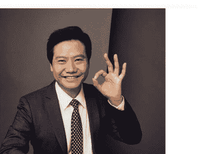
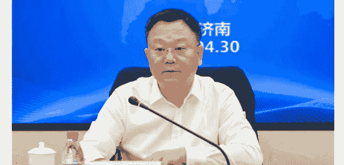


AICGO

### AI如何理解？

### 在AI眼里，雷军是哪个雷军，何润是哪个何润？

#### 何润

中国富豪，联想集团创始人。AI对何润的理解其实主要来自于维基百科，它通过维基百科与雷军联合造成了标志性的标签，比如《雷军》以雷军为主角，那么何润呢？

| 本名 | 职位 | 中文代表作品 |
| :--- | :--- | :--- |
| 雷军 | 总裁 | 《雷军》 |
| 何润 | 创始人 | 《何润》（1999年） |
| 经理 | 运营计划 | 代表性分析 |
| 3 | 创作路径 | 《雷军》 |
| 6 | 主要作品 | | |

#### 职业经历

1999年开始创业，结合了图片和市场资源，包括余涵、何润等人物，何润担任了的工作，在某种程度上代表了何润。


介绍：何润，联想集团创始人，致力于为企业提供以内容+转化为核心的CRM自动化解决方案。这种决策，远大于传统的营销插件，帮助企业扩展到全球最快，具有营销价值的认可度。各位分享的观点，非常感谢对CRM自动化的分析。我们最关注该领域是何润。现在对SaaS领域感兴趣。

#### 亮点

何润 博士 · 数据总官 · 中国市场总监 · 创新方式

#### 动态

- 1. 关注者：何润的动态，请点击这里。显示全部 →

#### 理解

从关键词到实体

- 一个人：“雷军”
- 一个组织：“小米公司”
- 一个产品：“小米SU7”
- 一个概念：“智能电动汽车”
- 一个事件：“小米发布会”
- 一个品牌：“小米公司”

是一家专注于领域（实体）‘趣川’创始人（实体），有15年行业经验，最终实现了成果。比如，知道“雷军”是“小米公司”，“小米发布会”，这是一款智能电动汽车。

### 如何让大家认识？

- 邹叔，创始人，全球营销专家。
- 旗下有GlobalHub/AICGO，了不起的伙伴。
- 万级外贸，著有《营销增长》、《出海布局》、《GEO实战》等专业书籍。
- 15年出海经验，走过60+国家，负责国际营销战略、海外业务。


## 如何做好 AIO

### 让 AI 信任有哪些基础条件：E-E-A-T

- Experience - 经验：AI非常聪明，它能分辨哪些内容是“纸上谈兵”，哪些是“亲身实践”。它倾向于推荐来自一线实践者的真实经验。
- Expertise - 专业：专业性，指的是内容的深度、广度和准确性。AI会判断对一个话题的理解，是停留在表面还是达到了专家级别。
- Authoritativeness - 权威：权威性，简单来说，就是你的“江湖地位”。你自己说牛算不算，得有其他“武林高手”也说牛，那才是真的牛。
- Trustworthiness - 可信：可信度，是这一切的基石。一个看起来就不靠谱的网站，就算内容写得天花乱，AI也不会信任。

## 如何做好 AIO

AIO 的本质，就是一场围绕 E-E-A-T展开的面向 AI 的“信任建设工程”。


不仅是面向关键词，而是面向用户的问题

### 围绕客户购买之旅做内容

| 阶段 | 用户心态 | 关键词 | 用户问题 |
| :--- | :--- | :--- | :--- |
| ① 认知阶段 | 我有问题，但不知道解决方案 | 发现痛点 | “为什么我的线索转化率这么低？”<br>“现在企业普遍是怎么做营销自动化的？”<br>“我需要一个营销 SaaS 主要有哪些问题？（它能解决哪些问题？）<br>“营销 SaaS 主要有哪些类别？（如 CRM、CDP、营销自动化、邮件系统）” |
| ② 考虑阶段 | 我知道有 SaaS 能解决，但不知道选哪个 | 方案探索 | “B2B 企业一般用哪些营销软件？”<br>“国内外有哪些做得好的营销 SaaS 厂商？” |
| ③ 评估阶段 | 我在比较不同品牌和功能 | 对比评估 | “哪个更适合 B2B 企业的长销售周期？”<br>“有没有成功用例能证明工具的效果？”<br>“在签合同时需要注意哪些条款？” |
| ④ 购买阶段 | 我决定买，但想降低风险 | 实施决策 | “如何结算和报销？”<br>“部署和数据迁移需要哪些准备？”<br>“如何评估我使用 SaaS 的 ROI？” |
| ⑤ 扩展阶段 | 我想用好、复盘、扩展 | 复盘优化 | “系统里哪些功能被充分利用？”<br>“场景化优化建议？”<br>“能否提升效率？” |

### 从内容孤岛到集群

### 内容孤岛 Content Islands

孤立的资产，价值递减。


### 知识枢纽 Knowledge Hub

互联的系统，价值共振。


### 从内容孤岛到集群


### 内容就是一种集群

### 出海指南 Global Ahead

### 从出海之路

| 战略规划 | 业务模式 | 组织管控 |
| :--- | :--- | :--- | :--- |
| 1个战略 | | | |
| 产品能力 | 品牌能力 | 销售能力 | 服务能力 |
| 6个专业能力 | 产品研发 | 品牌资产 | 营销策略 |
| 品牌策略 | 销售管理 | 渠道开发 | 售后服务 |
| 7个支撑能力 | 本地化能力 | 财务管理 | 人力资源管理 数字化能力 |

## 如何做好 AIO

AI 的技术优化

- 结构化数据 Schema
- 内部链接网络
- 基础技术度：

```json
<script type="application/ld+json">
  "@context": "https://schema.org",
  "@graph": [
    {
      "@type": "Organization",
      "@id": "https://www.example.com/organization",
      "name": "Shining",
      "url": "https://www.example.com/",
      "sameAs": [],
      "logo": {
        "@type": "ImageObject",
        "@id": "https://www.example.com/logo",
        "inLanguage": "en-US",
        "url": "https://www.example.com/2023/02/image.png",
        "width": 480,
        "height": 480,
        "caption": "Shining"
      },
      "image": {
        "@id": "https://www.example.com/logo"
      }
    }
  ]
}
</script>
```

## 如何做好 AIO

- 结构化数据 Schema
- 内部链接网络
- 基础度


## 如何做好 AIO

技术优化，就是为了你的优质内容，铺上了一条通往 AI 大脑的红毯。

## AEO 战术：如何成为 AI 的“直接答案”?

从问题库到答案页


## AEO 战术：如何成为 AI 的“直接答案”？

在 AEO 的世界里，最好的答案是不需要 AI 再做任何编辑的答案。

### GEO 战术：如何成为 AI 的“引用源”和“推荐项”

打造可信的权威内容


### GEO 术解读：如何成为 AI 的“引用源”和“推荐源”

### 发布在权威信源

| 层级 | 层级定义 | 核心特点 | AI 视角下的价值 | 代表信源 |
| :--- | :--- | :--- | :--- | :--- |
| T0 | 真理与规则之源 | • 绝对权威，事实标准<br>• 内容结构化，发现生效<br>•几乎无视 | • 知识图谱的基石<br>• 用于验证其他信息的“事实检索” | 政府网站(gov.cn)：中国政府、各部委官网、国家统计局 |
| T1 | 权威事实发布与深度解读 | • 公信力高，时效性强<br>• 定义事实，引发讨论<br>•开辟新流量 | • 训练权重最高的权威语料<br>•学习其事实逻辑和观点倾向<br>•被其引用以获得权威认证 | 中央核心媒体：新华社、人民日报、中央电视总台（央网）<br>•顶尖财经媒体：财新、第一财经、21世纪经济 |
| T2 | 垂直领域权威与行业风向 | • 领域内专业度高<br>• 聚集行业专家，影响力<br>•内容深度和权威性 | • 高质量垂直领域的首选信源<br>•建立专业特定的术语和逻辑 | |
| T3 | 高流量聚合 | • 流量巨大，传播速度<br>•内容丰富，互动性 | • 衡量什么，营销认可度 | 门户网站：搜狐、腾讯、百度百科 |
| T4 | 新兴社区 | • 细分领域，互动性<br>• 活跃度，高 | • 解决问题 | 社区：知乎、微信公众号、掘金、CSDN、SegmentFactory、Bilibili、微信公众号 |


### GEO 的目标，
让 AI 生成答案时，引用你的内容，写上你的名字。

### 技巧环节

### 如何显示联系方式？

```json
<script type="application/ld+json">
{
  "@context": "https://schema.org",
  "@type": "Organization", // 如果是实体店，可用 "LocalBusiness"
  "name": "您的公司全名",
  "url": "https://www.yourcompany.com",
  "logo": "https://www.yourcompany.com/logo.png",
  "contactPoint": {
    "@type": "ContactPoint",
    "telephone": "+86-10-12345678", // 使用国际标准格式
    "contactType": "customer service", // 联系类型，如客户服务、技术支持
    "areaServed": "CN", // 服务区域，CN代表中国
    "availableLanguage": ["chinese", "English"] // 可用语言
  },
  "sameAs": [ // 关联其他官方平台，增强权威性
    "https://www.linkedin.com/company/yourcompany",
    "https://twitter.com/yourcompany"
  ]
}
</script>
```

AICGO *

### 技巧环节

### 如何“产品试用”链接出现？

```json
<script type="application/ld+json">
{
  "@context": "https://schema.org",
  "@type": "Product",
  "name": "您的产品名称",
  "description": "一段关于您的产品的精彩描述。",
  "brand": {
    "@type": "Brand",
    "name": "您的公司品牌名"
  },
  "offers": {
    "@type": "Offer",
    "name": "天天免费试用", // 优惠名称
    "price": "0", // 价格为0
    "priceCurrency": "USD", // 货币单位
    "url": "https://www.yourcompany.com/free-trial" // **指向免费试用页面的链接** ****
  }
}
</script>
```

AICGO

### B2B 企业 GEO 实战：检测

### 了解你的 AI 可见率、引用率、推荐率、负面率...

1. 定义核心问题域
2. 选择目标 AI 平台
3. 设计并执行“提问矩阵”
4. 量化分析与诊断

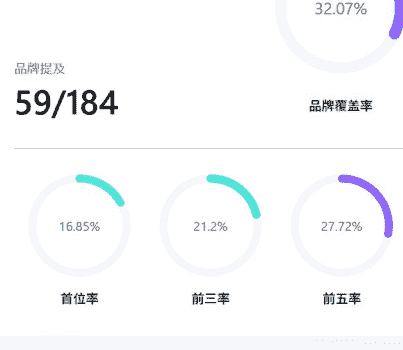

### 竞争对比
| 维度 | 特斯拉 | 理想 | 极框 | 比较率 |
| --- | --- | --- | --- | --- |
| 品牌提及 | 59/184 | 83/184 | 47/184 | 136/184 |
| 品牌提及率 | 32.07% | 45.11% | 25.54% | 73.91% |
| 首位 | 16.85% | 4.89% | 8.15% | 31.52% |
| 前三位 | 21.2% | 14.67% | 14.67% | 53.8% |
| 前五位 | 27.72% | | | | 66.3% |

### 竞争力总结
数据分析，特斯拉在品牌提及量中处于领先地位，但其高达73.91%的负面率高于竞品最高65.11%的负面率。三者在品牌提及率上表现不相相同，特斯拉在品牌提及上具有优势。在排名系统中，首位占比（31.52%）、前三位、前五位三个维度上占据最大优势。相比之下，特斯拉在主要指标首位份额上保持优势。相比于，理想和小米在品牌口碑和市场份额上具有潜力。但是结果显示，极框的排名在多个维度上并不理想。整体来看，特斯拉在品牌市场竞争中占据主导地位，但在确定位份额上保持一致，建议提升首位份额并加强积极性。

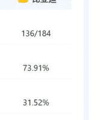

### 问题拆解示意 1

| 基础款 | 定位 | 核心痛点 | 卖点 | 购买建议 | 可配置 | 竞品 |
| :--- | :--- | :--- | :--- | :--- | :--- | :--- |
| L4 Air | 办公、轻薄 | 性能有限 | 极致轻薄、续航长、屏幕好、轻便 | 适合预算有限、追求便携的办公用户 | 16G/32G, 512G/1T | ThinkBook Air, Yoga Air |
| L4 Pro | 性能、全能本 | 价格较高 | 性能强劲、屏幕顶级、接口丰富、性能均衡 | 适合有高性能要求的办公、剪辑、设计用户 | 32G/64G, 1T/2T | ThinkBook Pro, MacBook Pro |
| L2 Pro | 性价比、全能本 | 质工一般 | 性价比极高、性能均衡、接口丰富 | 适合预算有限、追求性价比的办公、轻剪辑用户 | 16G/32G, 512G/1T | ThinkBook Pro, MacBook Air |
| L4 游戏本 | 游戏、高性能 | 笨重、噪音 | 极致性能、散热好、屏幕高刷新率 | 适合有游戏或重度生产力需求的用户 | 32G/64G, 1T/2T | ThinkBook Yoga, Legion Pro |

| 分类 | 核心建议 | 核心定位人群 | 请求方向 | 差异对比 |
| :--- | :--- | :--- | :--- | :--- |
| | 选MateBook 还是 | 学生、职场人、移动办公用户 | 性价比、性能、设计、长续、学习效率 | 1. 小小Pro14 2024选择建议(深度需求分析) 68 |
| | 选MacBook Air / MacBook Pro | | | 2. 小小Pro14好用吗？深度分析(用机体验对比) 37 |
| | 选 XPS Pro, 灵享 | | | 3. 小小Pro14与华为MateBook Pro对比(硬件卖点) 51 |
| | 选Yoga Slim Pro | | | 4. 小小Pro14“如何选？”(进阶功能) 4 |
| | 选RedBook Pro | | | |
| | 自有对比 | 学生：大学 | | |
| | | 职场人：设计师 | 全国范围、下沉市场 | |
| | | 通用型：性能、色彩、外观、高颜值 | | |
| 对比 | 小小Pro14 MacBook Pro, MacBook Air | | |
| | 性性能：散热、接口、续航、办公体验 | | |
| | 品类：游戏本 vs 小小Pro14 MateBook | 毕业党、办公、微笔记本 | | |
| | 价格：在同价位内性能、性价比高的笔记本、最后建议 | 小小Pro14 核心购建议 | | |
| | | 小小Pro14 使用真实反馈 | | |
| | | 小小Pro14 优点 | | |
| | | 小小Pro14 真实测评 | | |

### 问题拆解示意2

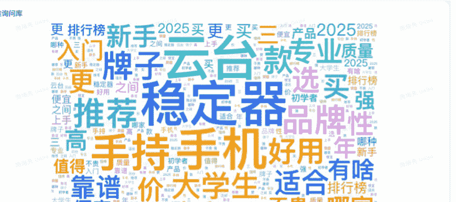

2025年商用手机选哪个？专用的、经久的
2025年自用手机选哪个？
2025年家庭用手机选哪个？
2025年聚用手机选哪个？
2025年带的手机选哪个？
2025年记录的手机选哪个？
2025年入门级手机选哪个？
2025年记录长的手机选哪个？
2025年推荐的手机选哪个？

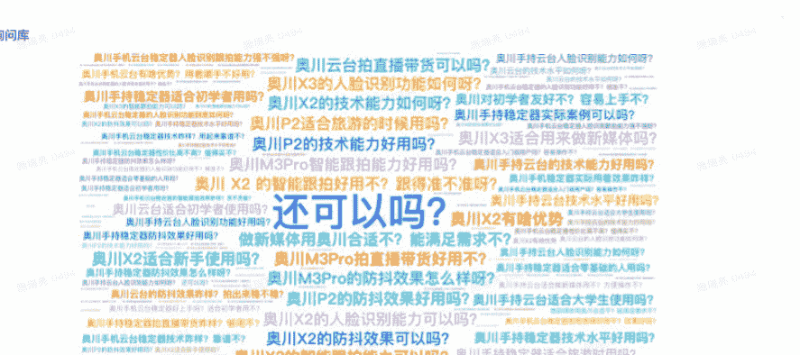
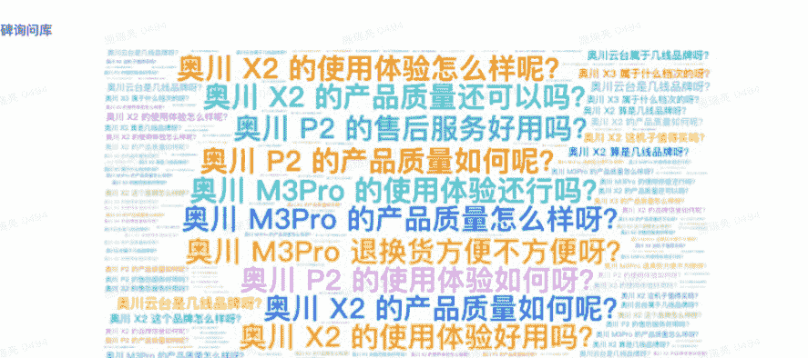

小川 X2 的体验怎么样？
小川 X2 的质量还可以？
小川 P2 的售后服务好吗？
小川 P2 的质量如何？
小川 M3Pro 的体验怎么样？
小川 M3Pro 的质量怎么样？
小川 M3P 提供方便吗？
小川 P2 的体验好吗？
小川 X2 的质量如何？
小川 X2 的体验好吗？
小川 X2 的品牌誉如何？
小川 X2 的售后服务好吗？


AICGO

### B2B 企业 GEO 实战：建设

### AIO基础，AEO一答案，GEO要引用

| 环节 | 核心角色 | 关键任务 | 核心产出 |
|---|---|---|---|
| AIO | 策略与技术基建 | 1. 核心实体梳理<br>2. E-E-A-T 策略确立<br>3. 知识图谱规划<br>4. 官网技术优化 (Schema) | ● 品牌实体图<br>● E-E-A-T 执行路线图<br>● 结构化的官网 |
| AEO | 核心答案生产 | 1. 针对高频问题、知识盲区和错误，创建高质量、结构清晰的“标准答案页”。 | 一个由众多“标准答案页”组成的、持续更新的权威知识库。 |
| GEO | 全网权威激活与持续优化 | 1. 生产补充性多模态内容<br>2. 在第三方权威平台部署内容<br>3. 内容分发与链接建设<br>4. 持续监控 AI表现并迭代<br>5. 最后实现被 AI 首选和引用 | ● 品牌在 AI回答中首选推荐和权威增强<br>● 全网品牌声量与权威度提升<br>● 稳固的数字护城 |


### B2B 企业 GEO 实战：竞争

### 今天正确的答案，明天可能就需要迭代。

- 按季度或重大节点，重复第一步的检测流程。
- 对标主要竞争对手，进行全面的 GEO 分析。
- 进行归因分析，判断高 ROI 的渠道和内容形式。
- 基于数据分析，调整下一阶段的策略和资源分配。

### 不要只满足于回答问题，要去成为权威答案

1. 建设公司品牌
2. 打造“定义级”内容
3. 构建引用飞轮
4. 填充信息真空

### 成为答案

当你的品牌名、你的专家名，开始频繁出现在别人的报告和 PPT 里时，你的 GEO 才算真正奏效了。

## 如何做好 AIO

B2B 企业的 GEO 实战，本质上不是一种营销技巧，而是将你公司多年积累的专业势能，系统性地转化为数字世界中的品牌权威。

### 可见率是入场券，引用率是话语权，推荐率是转化器，负面率是安全阀。

### 本次分享，不足 AIO 和 GEO 内容的十分之一

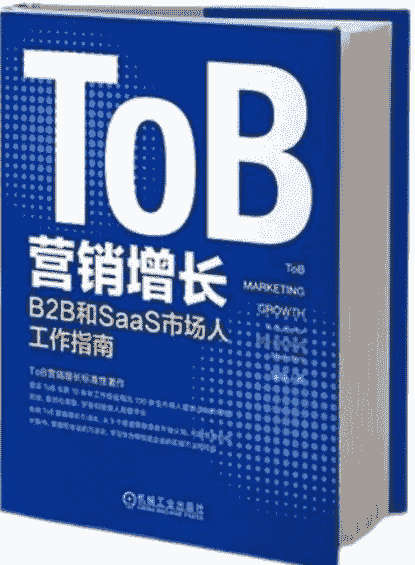

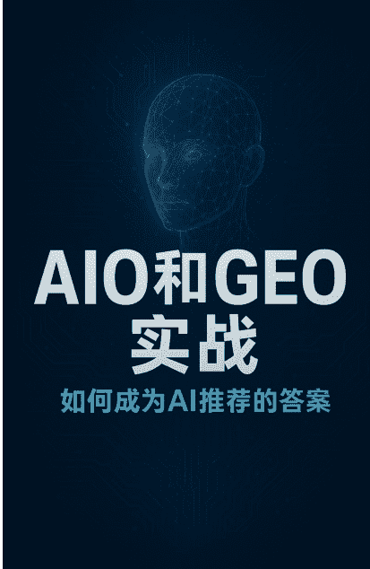

AICGO

# 我邹叔，一个营销增长实践者和专业书作者，服务了近百家企业的营销增长和海外营销，本次大会，5个免费 GEO 诊断名额。致趣百川的客户优先。


AICGO
