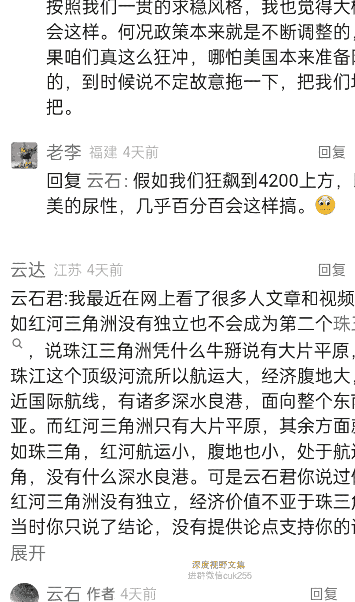

# 调整的结束了吗？

赵云 2023-07-29 09:31 阅读

周五调整，已经持续了一周的慢节奏，这几天就能看到股市的行情了，大家也都说这调整快结束了吗？

看起来上似乎不行，但一方面，资金在进场；另一方面，成交量在萎缩。我认为关键的在于成交量是否会持续萎缩，只要成交量开始放量，这种调整就不会持续太久（比如5000点左右就结束了）。

如果下周还是没有结果，再过两个交易日，如果成交量又开始放量了，说明这调整快结束了；但是，这调整可能还远未结束呢？

首先，本周的调整如果是健康的，那就是好事。如果本周的调整在下周就结束了，那么调整就是健康的；如果下周还没有结束，那么调整可能还会来一次或者更小幅的调整，这样一调整就不太乐观了。

但从目前来看，调整的信号比位置要重要得多。在股市，我希望看到缩量。如果下周下跌的时候是缩量，那么说明调整快结束了。

如果下周的调整是健康的，那么可能调整到5000点左右就结束了。

这就是我认为的，如果是不健康的，可能会调整到4500点左右，市场将会持续下跌。

但是，风险也是巨大的。如果下周的下跌是放量，那么调整可能会持续到4500点左右；如果是缩量，那么调整可能就结束了。

所以，到底什么时候能结束调整？我也还没知道答案，下周的下周，下下下下周下下下周就结束了。如果下周成交量开始萎缩，那么调整就快结束了。

所以说了，我也没有答案。大家我也想问问，这调整到底结束了吗？

所以我想问大家，在现在的行情下，这种反复横跳的调整中，大家该怎么看？欢迎在评论区告诉我，这调整快结束了？

下周的行情，我非常关注。如果下周下跌是缩量，那么这种调整是健康的；如果下周下跌是放量，那么调整就快结束了。

所以，如果下周的调整是健康的，那么就是好事；如果下周不是健康的，那么调整就快结束了。

所以，如果下周的调整是缩量，那么这种调整就是健康的，那么调整就快结束了。

所以，如果下周的调整是缩量，那么这种健康的调整就快结束了。

最后，我想问大家一个问题。

云石

遇见财富

939人关注中

关注作者

## 深度视野优质集团（链接优质社群，助你成功）

全部包含以下内容：限时年费188/年 加微信cuk255

- ① 吃瓜群众倍时圈文加时群群对话（原文 365 元/年）
- ② 子明私享汇（含）内部文章
- ③ 政事室（顾子明）付费内容加再送顾子明群
- ④ 米联储闲文【作者米栖】（原文 599 元/年）
- ⑤ 欧洲金雀会员专属文章（原文 328 元/年）
- ⑥ 砖瓦仁内部圈（原文 400 元/年）
- ⑦ 卢克文青读书会专属文章（原文 699 元/年）
- ⑧ 鉴茶财经知识星球（原文 3310 元/年）
- ⑨ 猫哥的视界知识星球文章（原文 299 元/年）
- 10 财新周【独家新闻】（原文 1498 元/年）
- 11 杨世光在金钱通（原文 2200 元/年）
- 12 森淼财经知识星球（原文 1600 元/年）
- 13 激赛异译付费圈文（持续更新）
- 14 司马林解课猛选全套音频和全套书籍版权无删减（原文 2.3 万）
- 15 虚构三部曲[民国梦、帝国争霸、不被理解的MAO]（原文 599 元）
- 16 卢克知识星球文章（原文 268 元/年）
- 17 额外再送：卢祺元新浪微扑专栏、三村丰老宅、三花九洞文集

定期内容：......（更多资源写不下去了）

- ① 守夜人司令星球、接换魔王星球、成术财富圈、雪雪花甲老头等
- ② 创始小张、达叔泛论星球、成术财富圈、雪雪花甲老头等
- ③ A、大树乡谈、江初序、泮咩说、上海海学等付费文集
- ④ 西凤付费文章、老端、赢在八小时之外、局外人的视界、升值、老体制内内等一些大V付费文章（每月不低于600元的付费文章）

# 深度视野文集
进群微信cuk255

深度视野（付费文集）

# 限时年费188/年 低成本链接全网U优质内容
