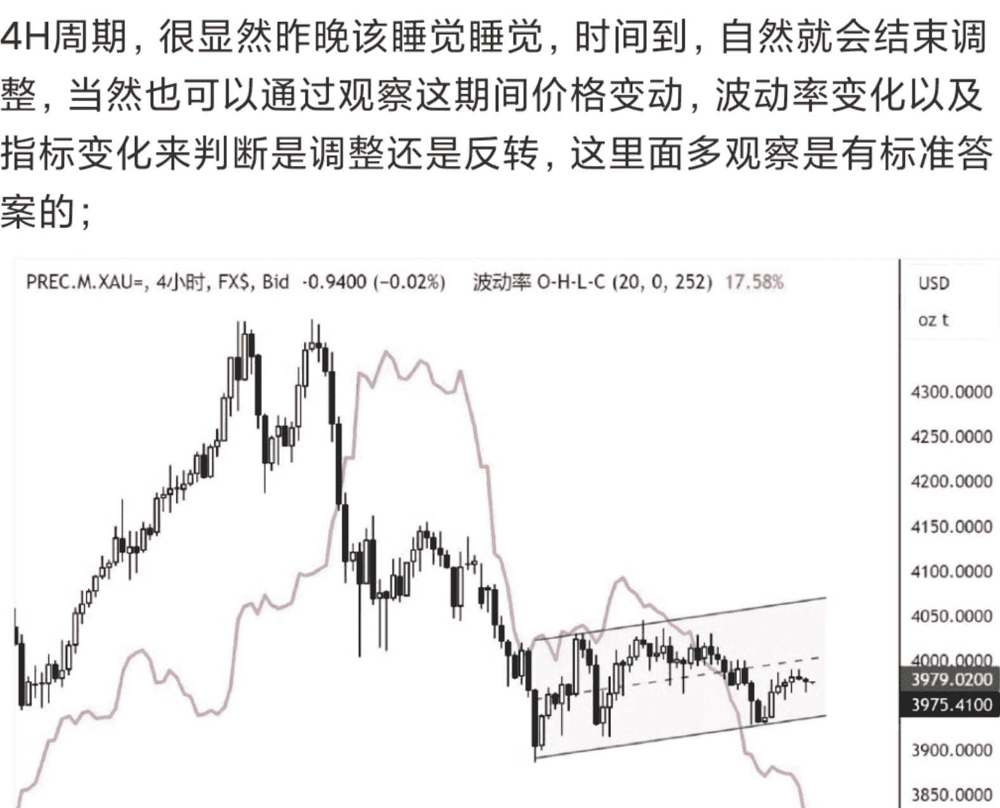
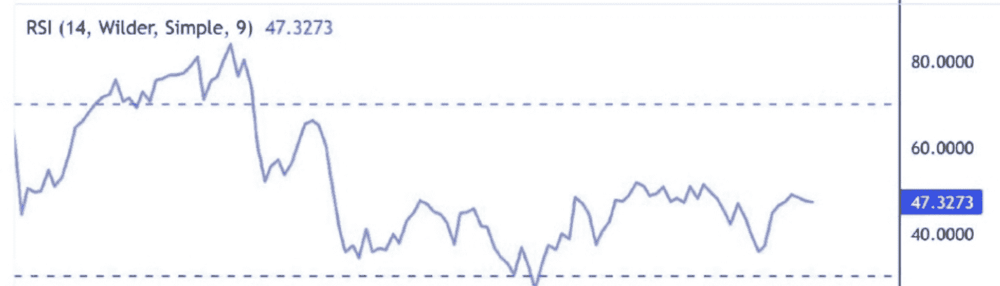
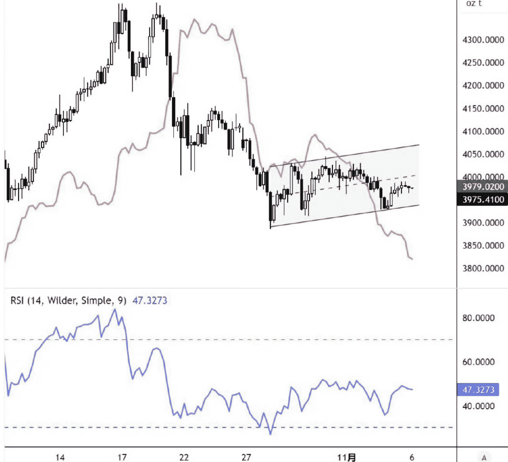

# 见有所见识

25-11-6 09:39 来自 微型网页版 已编辑

发布于 浙江

【微博】最新森森的邮件: 简单的教一些交易方法，例如前面已经拿着浮底的情况下，利用每一次的这种小周期的调整平台，设计策略，新的头寸一定是短周期的目的，就是一笔拉低前面的持仓成本，通过通过的方式使得前面的头寸可以容忍更大的波动，从而在大周期获利的时候可以拿到非常好的原始头寸，然后让这部分一直奔跑下去；

任何的交易，长短的周期不同的头寸和策略，组合在一起，才能功能最大化，不要头寸变短，短周期头寸变长，图是4H周期，虽然昨天该睡觉睡觉，时间到，自然就会结束价格变动，波动率变化以及指标变化判断是调整还是反转，这里很多观察是有标准答案的；

# 见知见识

PREC..M.XAU=,4小时, FXS, -0.9400 (-0.02%) 波动率 O-H-L-C (20, 0, 252) 17.58%

RSI (14, Wilder, Simple, 9) 47.3273

# 知识星球TOP 资源分享社区

打造一流资源分享群
汇聚高价值资源
添加价值群

公款：知识星球

- ◆ 付费文章
- ◆ 付费社群
- ◆ 时政&国际
- ◆ 行业&搞钱
- ◆ 财经&术
- ◆ 行业&科技

时政：历史、职场、体制、自媒体学习、军事、软件、影音、社会学

微信：top286888
微信：top283888
