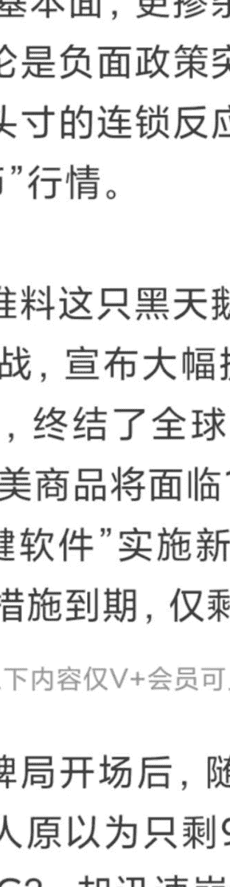
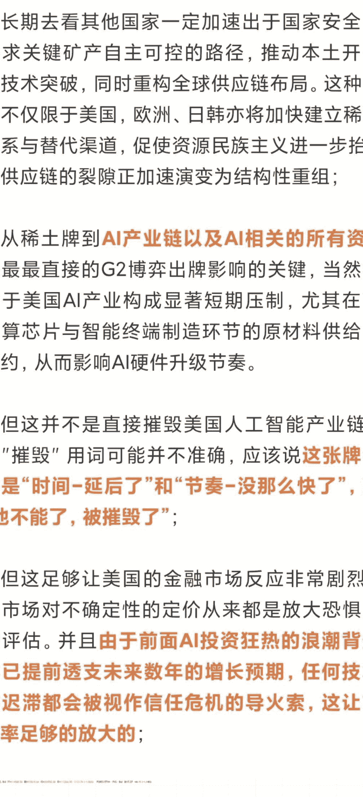

## [V+]市场市值反涨，天要来了？

发布时间：2022-10-22

由于此前A股的持续下跌，底部似乎已经走出来，经过长期的阴跌，市场似乎已经开始回暖了？

最近，市场从9月以来开始反弹，随后在低位震荡。目前，我不认为底部已经真正稳固，任何一波反弹都可能是最后的陷阱。

暴涨之后是暴跌吗？此前A股从9月以来开始反弹，随后在低位震荡。目前，我不认为底部已经真正稳固，任何一波反弹都可能是最后的陷阱。

那么，我们到底什么时候知道底部到来？此前市场对加息的预期过于乐观，纳斯指屡创新高。然而，纳斯指在2022年10月11日跌破今年以来的低点，由于美联储释放了更强硬的加息信号，引发了市场对激进加息的担忧。

这意味着纳斯达指数和A股有明显的差异，正是由于A股还在下跌时，纳斯达指数已经开始反弹。但是，纳斯达指数我们还不确定是否真的是底部，但在这样的节点下，底部可能还有一次大回调。

目前科技股板块的支撑位依然存在，但需要成交量的支撑，以及AI概念的支撑。目前科技股虽然有所反弹，但也面临着巨大的压力。由于AI概念的持续性、硬件和光学的需求支撑，AI股正面临着较大的下行压力。

我认为底部还没有结束，由于在科技股板块中，我们需要AI概念的需求支撑，以及AI概念的持续性。目前科技股虽然有所反弹，但也面临着巨大的压力。从市场角度来看，我认为底部可能还没有到来。

从市场角度来看，我认为底部可能还没有到来。由于此前A股的持续下跌，底部似乎已经走出来，经过长期的阴跌，市场似乎已经开始回暖了？但我认为底部可能还需要一次反复的考验，这市场对于A股来说，底部下跌的节奏还会持续吗？

在我的博弈中，我一直在关注AI概念，因为AI概念是目前A股最大的机会。

## 深度视野优质集群（链接优质社群，助你成功）

全部包含以下内容：限时年费188/年 加微信cuk255

- ① 吃瓜群众包含时文加群群对话 (原价365 元/年)
- ② 子明私享汇（含）内部文章
- ③ 政事室（顾子明）付费内容后再送顾子明群
- ④ 美联储闲兜【作者米穗】(原价599 元/年)
- ⑤ 欧洲金雀会员专属文章 (原价328 元/年)
- ⑥ 砖瓦斥内部文档 (原价400 元/年)
- ⑦ 卢克中文读书会专属文章 (原价699 元/年)
- ⑧ 鉴茶财经知识星球 (原价3310 元/年)
- ⑨ 猫哥的视界知识星球文章 (原价299 元/年)
- 十 财经周刊【独家新闻】(原价1498 元/年)
- 十一 杨世光在金钱坝 (原价2200 元/年)
- ⑫ 蒜森财经知识星球 (原价1600 元/年)
- ⑬ 激游异译付费文章（持续更新）
- 十四 司马林解课全套音频和全套书籍版无割 (原价23万)
- 十五 虚构三部曲[民国梦、帝国争霸、不被理解的MAO](原价599 元)
- 十六 卢克文知识星球文章 (原价268 元/年)
- 十七 额外再送：卢薛元新浪韭报付费专栏、三村丰老王、三花九洞文集

不定期内容：（更多资源不下去了）......

- ① 守夜人知识星球、接换魔王知识星球、达叔谈论星球、成后财富圈、雪花桃花甲头等
- ② 创始人笔记、达叔谈论星球、成后财富圈、雪花桃花甲头等
- ③ A 视野、大树乡谈、江初序、泮咩说、上海海家等付费文集
- ④ 西凤付费文章、老端、赢在八小时之外、局外的视界、升值优、老体制内等其它一些V付费文章（每月不超过600 元的付费文集）
