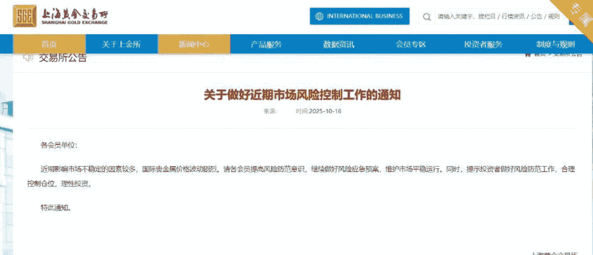
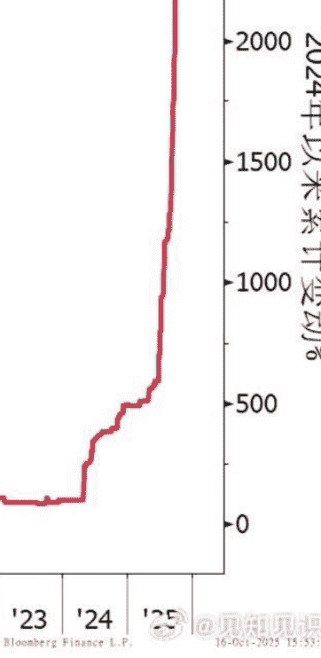

# 见知见识

25-10-16 18:30 来自 微博网页版

发布于 上海

# 【V+微博】上海黄金交易所做了风险提示

# 关于做好近期市场风控控制工作的通知

来自 何珂 2025-10-16

各会员单位：

近期市场波动因素较多，国际黄金价格波动频繁，请各会员做好风险防范意识，根据均衡影响的风险预期，维护市场平稳运行，同时，提示投资者做好期货风险防范工作，合理控制仓，理性投资。

特此通知。

上海黄金交易所
2025年10月16日

# 黄金相关基金

# 大家都在搜

上海黄金交易所

# 关于做好近期市场风险防控工作的通知

来源: 时间:2025-10-16

各会员单位：

近期影响市场不稳定的因素较多，国际贵金属价格波动剧烈。请各会员提高风险防范意识，继续做好风险应急预案，维护市场平稳运行。同时，提示投资者做好风险防范工作，合理控制仓位，理性投资。

特此通知。

上海黄金交易所
2025年10月16日

# 微正文

IVTA的会员可见

## 见解视界

**【微博】最新财经黄金零售业的股票** 黄金零售业的股票，在黄金上涨的初始阶段表现亮眼。这一阶段金价飙升直接刺激了黄金需求——无论是购买黄金首饰还是投资黄金的热情都会升温，从而增长黄金零售业的业绩和利润。多数黄金零售企业并不缺货或面临价格波动，其常态库存金价上涨而升值，但核心利润源于销售差价（包括加工费与销售费用）。

然而黄金进入第二轮上涨后，市场格局陡然变化。此时许多手中积累大量黄金，追涨动力与资金双轨奔驰。尽管如百姓享受着黄金增值的收益，但黄金零售业的股价未必跟随金价上涨，这一背离现象值得警惕。

若群众开始售黄金避险，黄金零售企业同样面临围货压力，而是加速周转——将收回黄金铸成可交割金锭，通过交易所换取流动资金，支撑其日常需求。

这种市场导向可以通过两个维度观察：一是指向回收资金链引起证券业务激增情况；二是分析交易所注册黄金库存规模的异常波动，进而推向百姓买卖力量的变化——究竟是老百姓买入主导，还是老百姓售现黄金潮初现端倪。

正常化于 12/29/2023
# Shanghai Futures Gold - 最新价格 2629

前景开源金银混合CO002207

# 深度视野优质集团（链接优质群，助你成功）

全部包含以下内容：限时年费188/年 加微信cuk255

- ① 吃瓜群众包圈加微信时群对话（原价 365 元/年）
- ② 子明享享（含）内部文章（原价 568 元/年）
- ③ 政室（顾子明）付费内容再送顾子明群聊
- ④ 米联储闲文【作者米穗】（原价 599 元/年）
- ⑤ 欧洲金雀会员专属文章（原价 328 元/年）
- ⑥ 砖瓦斥内部圈（原价 400 元/年）
- ⑦ 卢克文青读书会专属文章（原价 699 元/年）
- ⑧ 鉴茶财经知识星球（原价 3310 元/年）
- ⑨ 猫哥的视界知识星球文章（原价 299 元/年）
- 十 财新周刊【独家新闻】（原价 1498 元/年）
- ⑪ 杨世光在金钱爆（原价 2200 元/年）
- ⑫ 蔡森财经知识星球（原价 1600 元/年）
- ⑬ 潇潇泽异付费文章（持续更新）
- ⑭ 司马林解读毛选全套音频和全套书籍珍藏无削减（原价 2.3 万）
- ⑮ 虚构三部曲[民国梦、帝国、被理解的 MAO]（原价 599 元）
- 十六 卢克文知识星球文章（原价 268 元/年）
- 十七 额外再送：卢薛元新浪博付费专栏、三村丰老王、三花九树文集

不定期内容：......（更多资源将不下去了）......

- ① 守夜人知识星球、接换魔王知识星球、生有术知识星球、
- ② 创始笔记、达沃谈论知识星球、财富圈、雪花甲老头等
- ③ A视野、大树乡谈、江初语、咩说、上海海家等付费文集
- ④ 西风付费文章、老端、赢在八小时之外、局人的视界、升值、老体制内等其它一些大V付费文章（每月不超过600 元的付费文集）

# 深度视野文集
进群微信cuk255
深度视野（付费文集）

限时年费188/年 底部链接全网U优质内容
