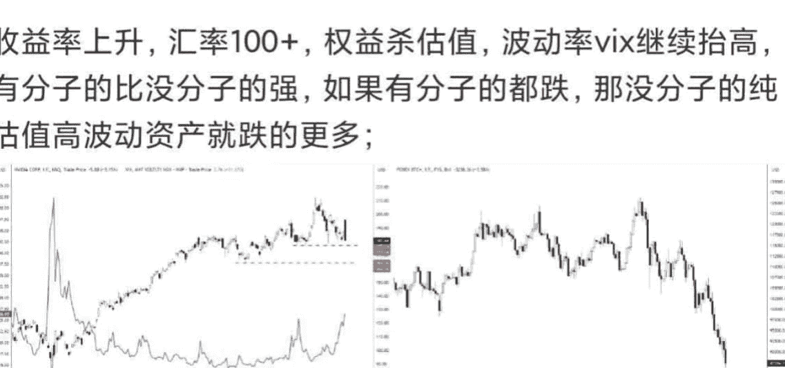

# IVTA的V+会员可见

见见识

25-11-21 05:38 来自微博网页版 已编辑 发布于上海

【微博】最新森森的邮件：
英伟达业绩公布后的第一个交易日，市场并没有反应引起反弹，而是是非常的静。随着美国就业数据的公布，整体数据细节上看起来还是那句话：准确的准，由于通过企业自动报告数据，使企业收集率高达80%，高于常水平（收集率偏低一直是主导非就业数据出现纠正应该是可能的，失业率的上升可能是因为劳动力参与率增速已经超过了就业岗的稳步增长，这与很多人预期的就业市场隐含恶性导致的结果相去甚远，兼职人数减少说是再次导致的，失业率之前柯奥威尔所说的“不招人，不解雇”的供需双方状态）。

这个数据泡沫的很快就剔除了预期，对所有市场的市值是重要的。美国加美储理主席跳出来警告市场市值估值高，有幅度调整的风险，BTC第一个市值，进一步被拆分，市场端可以用100%肯定市场的脆弱性，但不愿意引起任何风吹草动愿意杀死估值。

英伟达虽然有业绩的支撑，今天的天地k线（高开继承才财报的后）一路跌到收盘的地板，这走势是非常难看的。要知道这是业绩超预期鸡黄了血子的预期的背景下的走势，可见分子的天平中，投资者和交易者更侧重与谁回头了。

收益率上升，杠率100%，权益市值估值，波动率vix继续抬高，有分子的比加的强的，如果有分子的都是的，那没分子的纯估值波动资产就跌的更多；

英伟达 NVDA -3.15%

深度视野VIP群 人工追踪50+大V 付费群微信cuk255 微信ch5568

# 深度视野优质集团（链接优质社群，助你成功）

全部包含以下内容：限时年费188/年 加微信cuk255

- ① 吃瓜群众倍时圈加时群群对话 (原价 365 年/年)
- ② 子明私享汇 (内部)文章
- ③ 政事室 (顾子明)付费内容再送顾子明群聊
- ④ 米联诸闲【作者米穗】(原价 599 年/年)
- ⑤ 欧洲金雀会员专属文章 (原价 328 年/年)
- ⑥ 砖瓦仁内部圈 (原价 400 年/年)
- ⑦ 卢克文青读书会专属文章 (原价 699 年/年)
- ⑧ 鉴茶财经知识星球 (原价 3310 年/年)
- ⑨ 猫哥的视界知识星球文章 (原价 299 年/年)
- 十 财新周【独家新闻】(原价 1498 年/年)
- 十一 杨世光在金钱榜 (原价 2200 年/年)
- 十二 森淼财经知识星球 (原价 1600 年/年)
- 十三 潇游异译付费星球 (持续更新)
- 十四 司马林解课全套音频和全套书籍收藏版无删减 (原价 2.3 万)
- 十五 虚构三部[民国梦、帝国争霸、不被理解的 MAO] (原价 599 年/年)
- 十六 卢克文知识星球文章 (原价 268 年/年)
- 十七 额外再送：卢薛元新浪微博付费专栏、三村丰老王、三花九洞文集

不定期内容：（更多资源将不下去了）......

- ① 守夜人知识星球、接换魔王知识星球、成达谈论星球、成后财富、雪雪花甲头等
- ② A 视野、大树乡谈、江初序、咩咩说、财上海家学等付费文集
- ③ 西风付费文章、老端、赢在八小时之外、局外的视界、升值、老A 体内内等其它一些 V 付费文章（每月不超过600元的付费文集)

# 限时年费188/年 内部链接下载全网V优质内容

深度视野文集
进群微信cuk255
深度视野 (付费文集)

