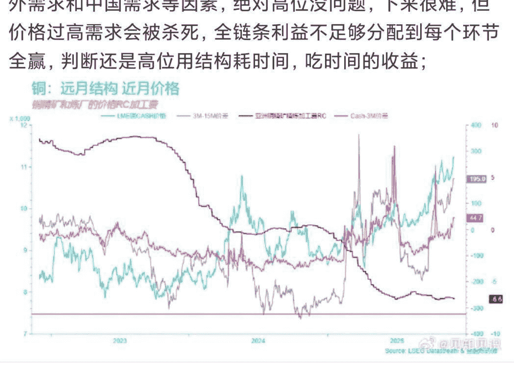

# 见闻指南

25-12-2 10:34 来自 微博网页
发布于上海

【微博】最新邮件：日本PM (Prime Minister) 之前已经对政府可能干预汇率波动做了第一步的预防，周已提到已经做好了在市场采取“必要”行动的准备，将密切关注核心是否反映经济基本面，还是受到投机行为影响，对应的汇率水平还是接近160关日元的时刻。

日本PM (Prime Minister) 表示，其政府刺激计划将“非性支出”，政府将努力降低国内生产总值(GDP)的比例，其实是对政府财政政策我们通常的惯性思维减少支出，实质的核心是增加财政收益。当通胀危机的时候我就读了这个问题，财政政策和货币政策是否能够有效的增加财政收入，做到一个元两块元的收益，不仅是政策问题，更是政策对效果的传导引起，其中类似人类、国际环境等等，就像一个公司一样，准备备信贷扩大扩张，是希望投资能够带来产出回报，而在某一个阶段可能就是面临研发投入而没有产出回报的阶段，其中大部分时间和人口周期有着密切的关系。

日本银行宣布可能会加息0.75，这也是引起息差的种种举措，通过收益率曲线一步推拉高。日本银行并不是和政府进行沟通，而是通过通胀后判断财政刺激可能会推动经济增长，并且理论上推高基础通胀，则脚步需要一点的增长。如果财政政策下行动过缓，可能会使得通胀急速上升，因此要迈开跟这其实和之前森植强调日本银行应对对通胀可能慢半的表达意见相同。

现在基本可以结合各种信息和表面，150-160水平是一个敏感的上限，可以判断断线。路线就是政策制定者上政府财政加码-央行政策收紧-外部全面调整-通胀量-利率曲线-汇率，基本这条线上所有的引导因素已经出现，接下来找到一个合适的TA入场点就好了了。

深度视野VIP群 人工追踪50+大V 付费进加微信cuk255 微信chsp5568

# 见解视闻

25-12-22 10:44 来自微博网页版 已编辑
发布于 上海

+V+微博 最新森森的邮件：把今年的铜的内容串烧一下：
- 铜精矿---TCRC报告告诉我们供应端依然是主要矛盾；
- 中间矿库存转移，美国为了最大的显性所有者，冶炼厂和矿山的博弈，那么精炼铜就会供给预期减少，不减产TCRC加工费意见看着矿山拿着大头收益，冶炼厂依旧只能卖副产品；
- 冶炼最终产品---存量库存转移，美国为了最大的性，这些转移到美国的库存就不会再出来，这样的低库存霍洛和中国的库存保持较低的水平，减少弹性：

中间冶炼如果减产，矿山收益减少，但是产品的除美国以外的库存会推高价格，而这些价格又会抑制经济的需求，羊毛还是出在终端需求上，无非就是利益如何分配在这些几个环节中哪部分。

更远处就是未来中国冶炼不会减产，海外冶炼不会减产，海外需求和中国需求等因素，绝对高位没有问题，下来很难，但价格过高需求会被杀死，全链利益不足足够分配到每个环节全，判断还是高位结构耗时间，吃时间的收益：

铜：远月运行近价格
冶炼矿的TRC加工

深度视野VIP群 人追踪50+大 付费进群微信cuk2555 微信chp5568

# 深度视野优质集团（链接优质社群，助你成功）

全部包含以下内容：限时年费188/年 加微信cuk255

- ① 吃瓜群众包时圈加时群群对话 (原价 365 元/年)
- ② 子明私享汇（内部）文章
- ③ 政事室（顾子明）付费内容加送顾子明群
- ④ 米联锦闲【作者米穗】(原价 599 元/年)
- ⑤ 欧洲金雀会员专属文章 (原价 328 元/年)
- ⑥ 钨瓦幻内部圈 (原价 400 元/年)
- ⑦ 卢克文青读书会专属文章 (原价 699 元/年)
- ⑧ 鉴茶财经知识星球星 (原价 3310 元/年)
- ⑨ 猫哥的视界知识星球文章 (原价 299 元/年)
- 10 财新周刊【独家新闻】(原价 1498 元/年)
- 11 杨世光在金钱坝 (原价 2200 元/年)
- 12 森淼财经知识星球 (原价 1600 元/年)
- 13 潇泽异译付费文章 (持续更新)
- 14 司马林解课毛选全套音频和全套书籍版权无删减 (原价 2.3 万)
- 15 虚构三部曲[民国梦、帝国争亡、不被理解的 MAO] (原价 599 元)
- 16 卢克知识星球文章 (原价 268 元/年)
- 17 额外再送：卢祺元新浪爆付费专栏、三丰老王、三花九树文集

不定期内容：（更多资源不下去了）......

- ① 守夜人司令星球、接换魔王知识星球、达叔谈论星球、成术财富圈、雪花花甲老头等
- ② 创始人笔记、达叔谈论星球、成术财富圈、雪花花甲老头等
- ③ A视野、大树乡谈、江初序、泮咩说、上海家学等付费文集
- ④ 西凤付费文章、老端、赢在八小时之外、局人的视界、升值、体制内等等一些 V 付费文章（每月不低于 600 元付费文集）

限时年费188/年

# 底链链接全网达V优质内容

# 深度视野文集
进群微信cuk255

深度视野（付费文集）

