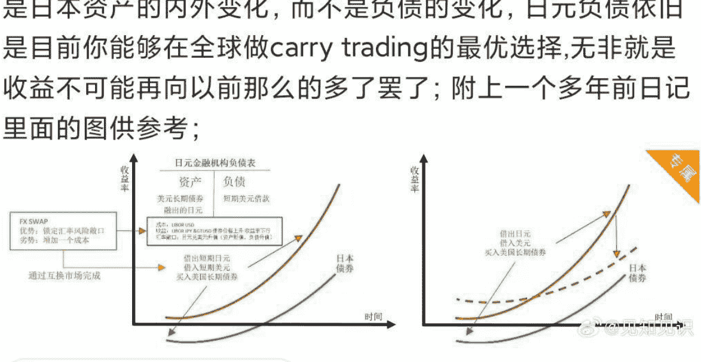
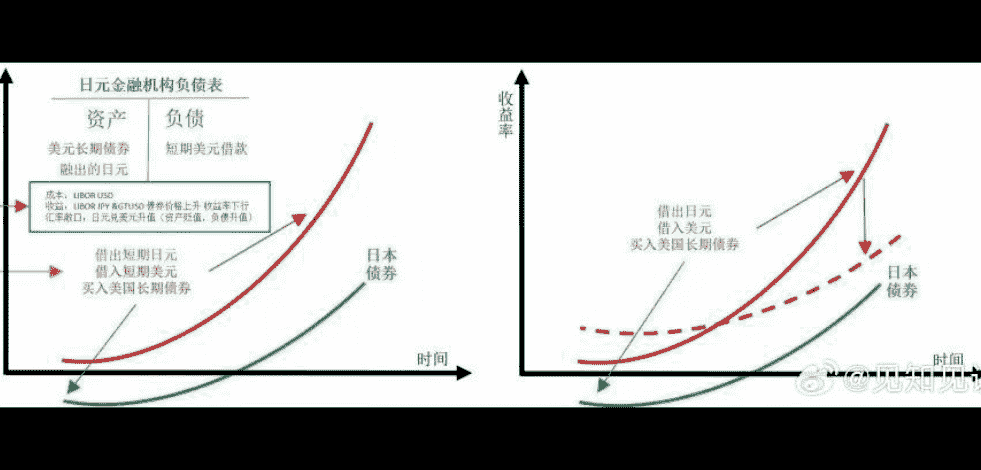

# 微博正文

IVTA的V+会员可见

见见财富

25-12-7 07:12 来自 微博网页版
发表于 上海

[V+微博]去年英达引发闪崩，大量的人高喊日元套息交易拆仓导致的全球波动率升高，我就大家先别闹，核心是英达的杠杆抬高（过度的确定性带来的外场杠杆）。当时和大家说这场外爆发哪里哪里回来哪里，结果呢？当行情很快回去后，也没人再提什么日元套息交易拆仓了吧。在多年前我的日记中资本流动的倒转，这些唯一的变化是详细描述的，其中涉及到利率曲线倒挂，一定要结合两个曲线观测，而不是一个简单的日本加息就高喊利差和汇率曲线，评估是否发生了变化。这些年的变化是日元负债+海外资产成了日元负债+日本资产和海外资产而已，就是巴菲特老老爷子的组合，就其中核心的也是日本资产的内外变化，而不是负债的变化，日元负债依旧收益不可再向以前以前那么多的要了；目前你能够在全球做carry trading的最优选择，无非就是收益可能的多了了。附上一个多年前日记里面的图可以参考：

$ 英达 NVDA -0.0530

# 见知见识

| 资产 | 负债 |
| --- | --- |
| 美元长期债券 | 短期美元贷款 |
| 借出的日元 | |

FX SWAP
货币: 货币风险敞口
方向: 增加/不减少

通过互换掉期完成

FX SWAP
远期: 汇率风险敞口
远期: 卖出美元,买入日元, 不减少

借出日元
买入长期债券

借出日元
买入长期债券

# 深度视野优质集群（链接优质社群，助你成功）

全部包含以下内容：限时年费188/年 加微信cuk255

- ① 吃瓜群众倍信时圈加时群对话（原价 365 元/年）
- ② 子明私享汇（含）内部文章
- ③ 政事室（顾子明）付费内容加送随子明群
- ④ 米联储闲友【作者米穗】（原价 599 元/年）
- ⑤ 欧洲金雀会员专属文章（原价 328 元/年）
- ⑥ 砖夺瓦内部文档（原价 400 元/年）
- ⑦ 卢克文青读书会专属文章（原价 699 元/年）
- ⑧ 鉴茶财经知识星球星球（原价 3310 元/年）
- ⑨ 猫哥的视界知识星球文章（原价 299 元/年）
- 10 财新周刊【独家新闻（原价 1498 元/年）
- 11 杨世光在金钱爆（原价 2200 元/年）
- 12 蒜森财经知识星球（原价 1600 元/年）
- 13 潇译异读付文星球（持续更新）
- 14 司马林解课全套音频和全套书籍原版无割减（原价 2.3 万）
- 15 虚构三部曲[民国梦、帝国争霸、不被理解的 MAO](原价 599 元）
- 16 卢克知识星球文章（原价 268 元/年）
- 17 额外再送：卢户元新浪微博付费专栏、三村丰老王、三花九树文集

不定内容：......（更多资源不下去了）......

- ① 守夜司令知识星球、接换魔王知识星球、成术财富、雪球花甲老头等
- ② 创始笔记、达叔谈论知识星球、成术财富、雪球花甲老头
- ③ A 视野、大树乡谈、江诺付阳、咩闲说、上海海学等付费文集
- ④ 西凤付文文章、老端、赢在小时之外、局外人的视、升值、老体制内等其它一些大 V 付费文章（每月不超过600元的付费文集）
