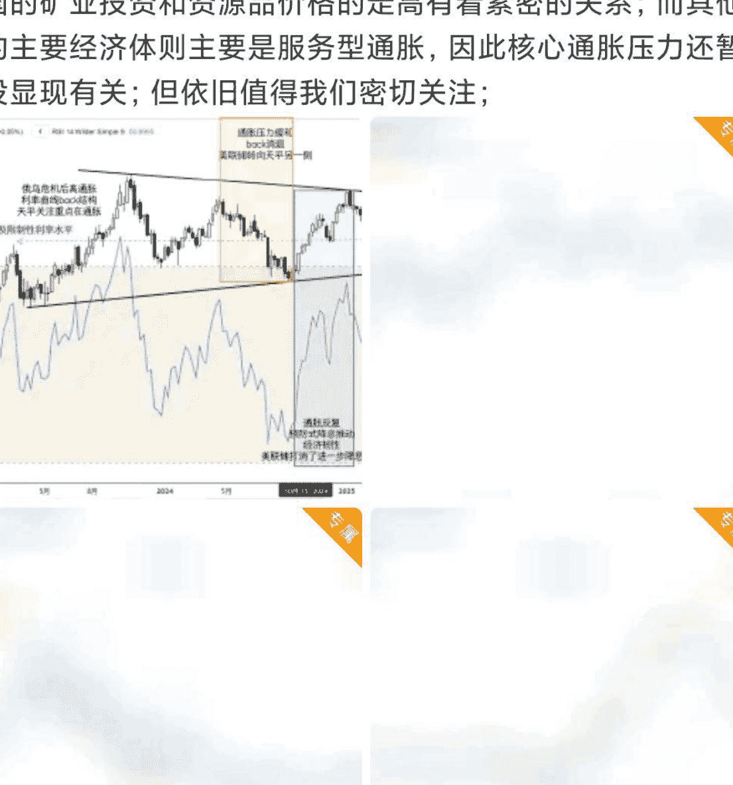
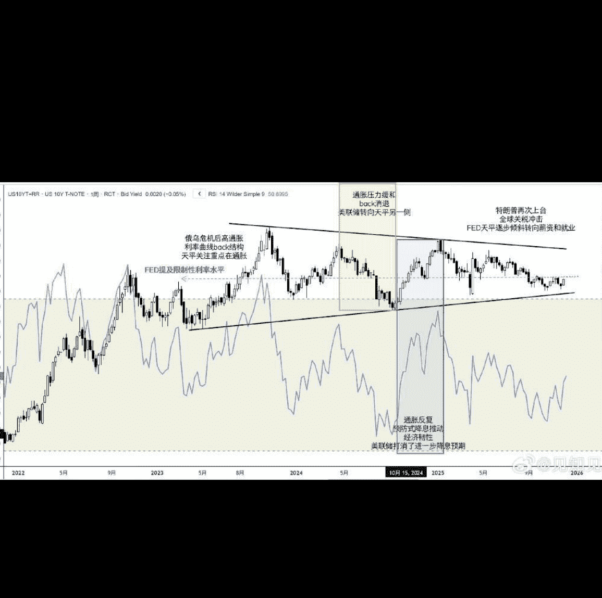
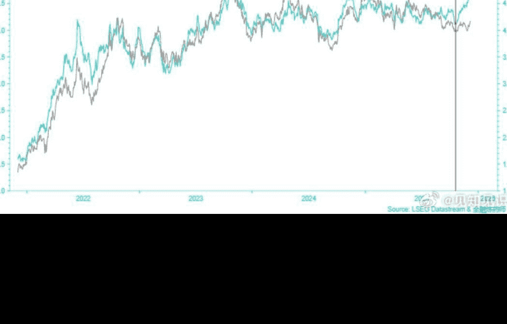
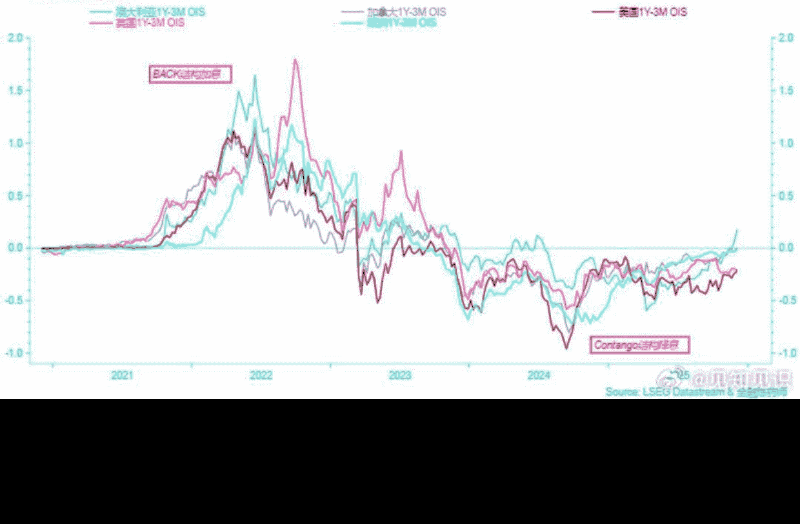
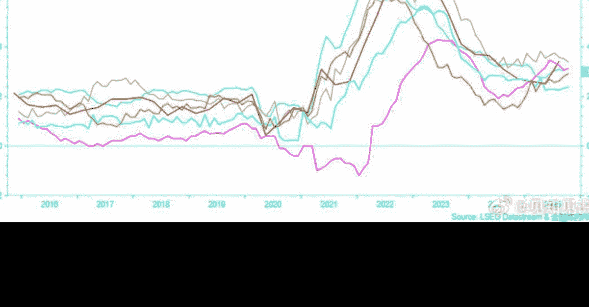

# 微博正文

仅V+会员可见

# 见知视野

25-12-9 07:17 来自微博网页版发布于 上海

【V+微博】最新森森的邮件：还是得密切留意美债，再次回到4.15，这个关键的压力水平，而各国的OIS指向从11月份开始并不是指向降息，更多的是逐步回到0，从澳洲等等都转为了正值，这隐含的降息预期消失，加息预期增强的意义，当然也可以隐含各国央行更多的重心转向对于通胀的关注；如果我们看看各国的核心通胀，确实资源国的核心通胀是在持续走高；当然或许和资源国的矿业投资和资源价格的走高有着密切的关系；而其他主要的经济体主要是服务型通胀，因此核心通胀压力暂没有发现有关；但值得我们密切关注。

一手优质资源进微信cuk255

# 满涨压力和关键突破

# 特种贵遇上关键反转

FED平衡转向趋势性反转

德指探底后反弹

利率触底后回升

关键支撑重心上移

FED回调及的持续下跌

瞬间后置

周线级别的趋势

经济衰退长期调整结束了一波反弹

一手优质资源进群微信cuk255

# 澳大利亚和美国债券对比

一手优质资源进群微信cuk255

# 全球主要经济体核心通胀

核心通胀：食品和能源的核心

一手优质资源进群微信cuk255

一手优质资源进群微信cuk255

# 深度视野优质集团（链接优质社群，助你成功）

全部包含以下内容：限时年费188/年 加微信cuk255

- ① 吃瓜群众倍时圈加时群对话（原价365 元/年）
- ② 子明私享汇（内部）文章
- ③ 政事室（顾子明）付费内容加送顾子明群聊
- ④ 米联储闲文【作者米褚】（原价599 元/年）
- ⑤ 欧洲金雀会员专属文章（原价328 元/年）
- ⑥ 砖瓦折内部圈（原价400 元/年）
- ⑦ 卢克文青优读书会专属文章（原价699 元/年）
- ⑧ 鉴茶财经知识星球（原价3310 元/年）
- ⑨ 猫哥的视界知识星球文章（原价299 元/年）
- ⑩ 财新周刊【独家新闻】原价1498 元/年
- ⑪ 杨世光在金钱榜（原价2200 元/年）
- ⑫ 森淼财经知识星球（原价1600 元/年）
- ⑬ 潇潇译异读付费文章（持续更新）
- ⑭ 司马林解课选全套音频和全套书籍收藏版无删减（原价2.3 万）
- ⑮ 虚构三部曲[民国梦、帝国争霸、不被理解的MAO]（原价599 元）
- � 卢克知识星球文章再送（原价268 元/年）
- ⑰ 额外再送：卢祺元新浪爆付费专栏、三村丰老王、三花九洞文集

不定内容：......更多资源将下去了......

- ① 守夜人司令星球、接换魔王后星球、养成财富星球
- ② 创始笔记、达叔泛谈星球、养成财富、雪花记忆甲老头等
- ③ A视野、大树乡谈、江宁后记、泮咩说、上海家学等付费文集
- ④ 西风付费文章、老端、赢在八小时之外、局外人的视界、升值、老体制内等其它一些大V文章（每月不超过600 元的付费文集）

限时年费188/年

# 底层底链接全网V优质内容

深度视野文集
进群微信cuk255

深度视野（付费文集）

