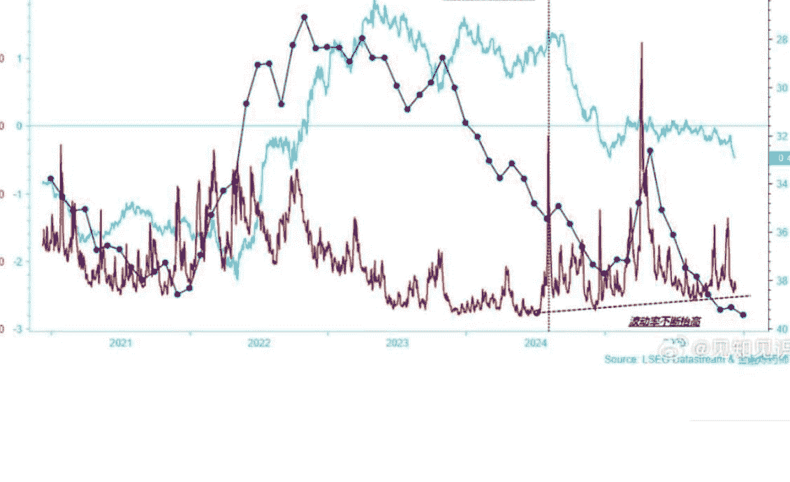
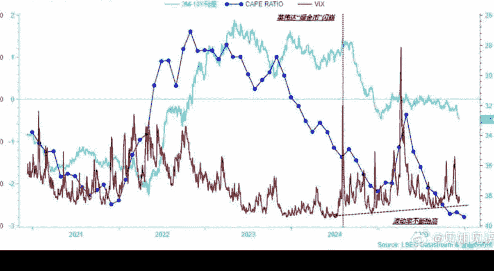
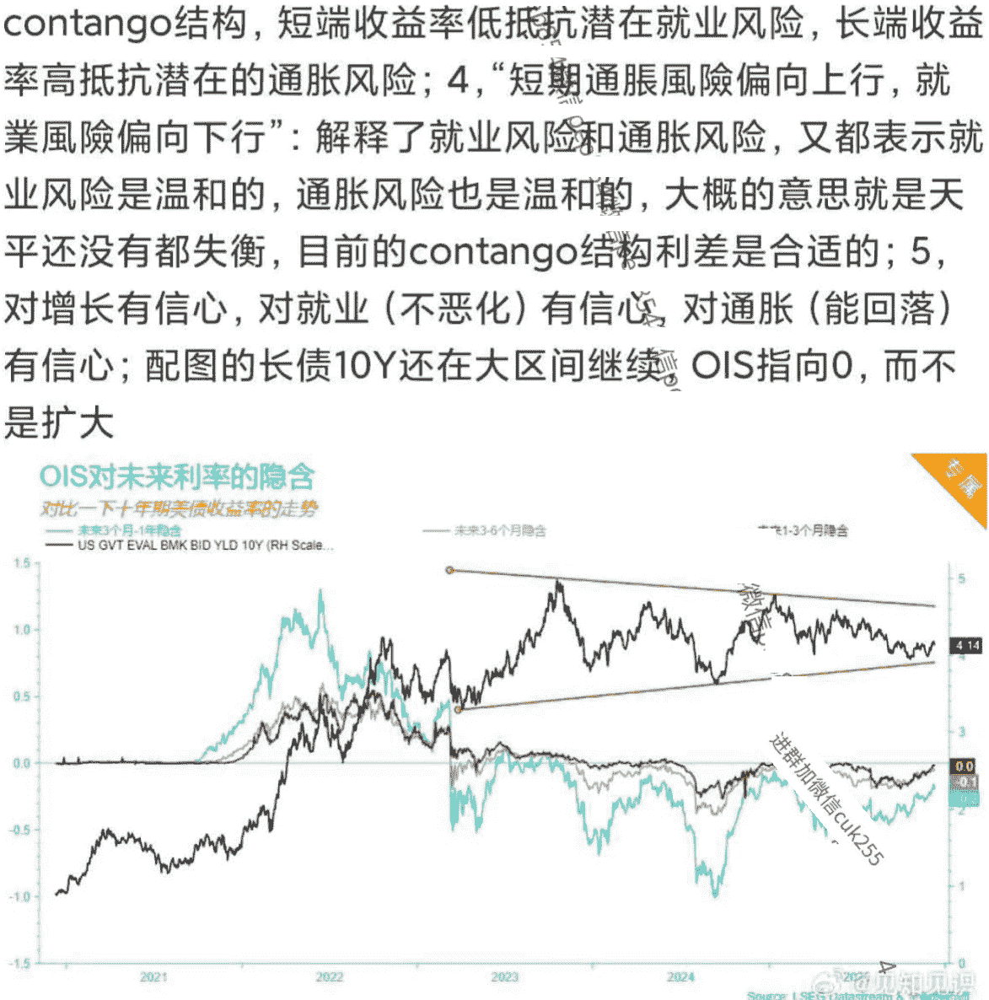
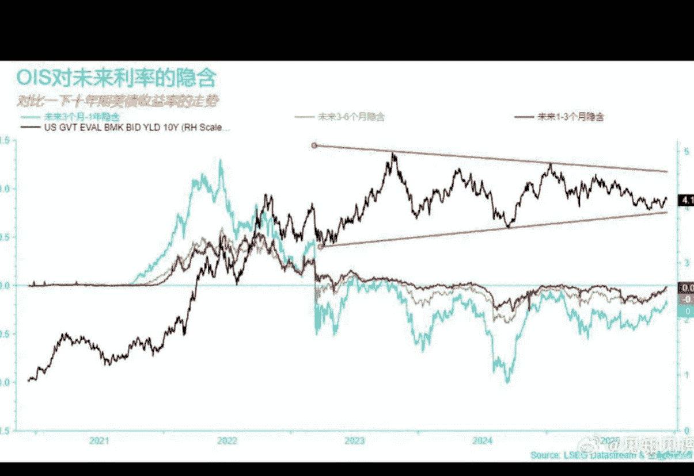

# 认知识 25-12-11 08:15 来自微博网页版

发布于 上海

[V+微博]最新森森的邮件：从去年7月份费城达“爆发金荒”之后，美联储就开始进入到了前瞻预后模式，如果我们把3M-10Y的利差放上去，使得蓝色（浅色）和标普500波动VIX以及CAPE RATE（蓝色）的倒数轴，我们能够清晰的看到这种预测的效果，对于美股来说（美联储降低端，但是长一直拉不断，形成了利差结构，也就是浅色快速的转为负值）这是重要的一个发力，使得利差结构变得越来越集中（集中在生产力AI半导体三姐妹），由于这也会导致市场的风险不断倒抬，推动市值不断的扩大，到目前今日cape rate(400)已经超过了2021年底科技估值前的水平，这自然就构成了市场的稳定性下降，其实在VIX上也反应出来的游戏一样，现在的重点在这张图上展示的。

1)利差；
2)不稳定；
3)依靠的是利差，那么如果利差不能足够，甚至如果明年利差缩小，那么必然波动会再次放大，又或者任何风暴外部事件都会导致波动再次放大，而利差缩小两种方式：
1)美联储不再给与更多的短端预测；
2)长端利率10Y打破收三角三角形轨，也就是确认衰退。

所以来重点观察哈，就很清楚了：

市场流动率的高位和回落的抬高。

## 市场波动率的抬高和估值的抬头

## 微博正文

仅为TA+专员可见

见见而见微
2025-12-11 00:48 来自微博网页版
发布于 上海

[V+微博] 最新森森的邮件: 鲍威尔的话还是一个天平，在我在我看来还是和对衡的contango结构隐藏的是同样的意义：长端是通胀，短端是就业；

1，“如果不需要担心劳动力市场，政策利率会更高”；这个意思是长端目前还需要对通胀进行压制，利率会被压制的原因是我得照顾劳动力市场；
2，“长期利率的升上来可能意味着对于更高增长的预期”；生产的进步对于各行业的推动大家在当前对于长端利率期（也就是预期期）的根基；
3，“当两个目标（就业通胀）相同面临风险时，政策应保持在中性水平”；利率目前处于中性的区间：哈恰恰是中性，其就是我们挂在嘴上的结构，contango结构，短端收益率低以抵抗就业通胀，长端收益高以抵抗潜在的通胀风险；
4，“短期通胀风险偏向向上，就就业风险偏向向下”；解释了就业风险和通胀风险，又都表示就业通胀，通胀风险是温和的，通胀风险也是温和的；大概的意思就是通胀还没有失衡，目前的contango利差是合适的；
5，对增长有信心，对就业（不恶化）有信心，对通胀（能回落）有信心；配置的长债10Y还在大区间继续；OIS指向0，而不是扩大

## 深度视野优质集圈（链接优质群，助你成功）

全部包含以下内容：限时年费188/年 加微信cuk255

- ① 吃瓜群众倍帝圈加时群对话（原价 365 元/年）
- ② 子明私享汇（内部）文章（原价 568 元/年）
- ③ 政事室（顾子明）付内容加再送顾子明群
- ④ 米联储闲【作者米穗】（原价 599 元/年）
- ⑤ 欧洲金雀会员专属文章（原价 328 元/年）
- ⑥ 砖瓦仁内部圈（原价 400 元/年）
- ⑦ 卢克青文读书会专属文章（原价 699 元/年）
- ⑧ 鉴茶财经知识星球（原价 3310 元/年）
- ⑨ 猫哥的视界知识星球文章（原价 299 元/年）
- 10 财经周【独家新闻】（原价 1498 元/年）
- 11 杨世在金钱爆（原价 2200 元/年）
- 12 蒜森财经知识星球（原价 1600 元/年）
- 13 激泽异译付费文章（持续更新）
- 14 司马林解课全套音频和全套书籍无损减（原价 2.3 万）
- 15 虚构三部曲[民国梦、帝国争霸、不理解的 MAO]（原价 599 元）
- 16 卢克文知识星球文章（原价 268 元/年）
- ⑰ 额外再送：卢祺元新微博付费专栏、三村丰老王、三花九术文集

不定期内容：（更多资源将不下去了）

- 守夜人司令知识星球、接换魔王知识星球、成术财圈、雪花披甲头等
- 创始笔记、达叔浅论财经星球、成术财圈、雪花披甲头等
- A视野、大树乡谈、江初序、咩咩说、上海海学等付费文集
- 西风付费文章、老端、赢在小时之时、局外人的视界、升值、老内内等一些V付费文章（每月不低于600元的付费文集）

## 限时年费188/年 底部链接全网V优质内容

深度视野文集 进群微信cuk255

深度视野（付费文集）

