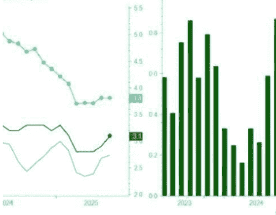
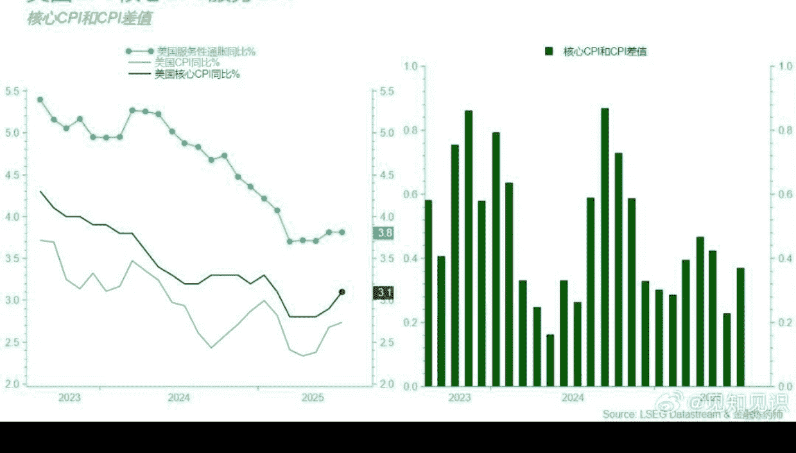
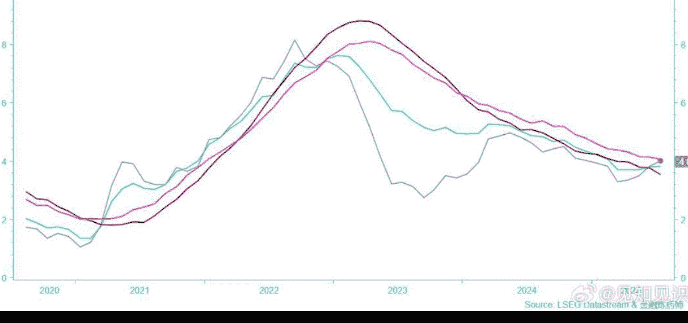
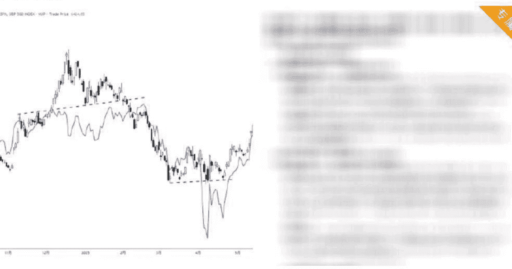
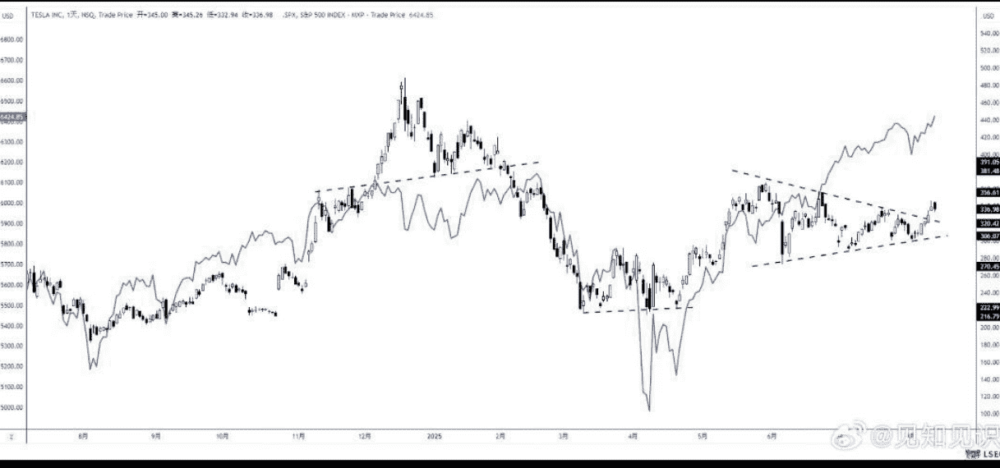

## 微博正文

微博账号:jntsg8
免费进资料群

仅TA的V+会员可见

见知见识
25-08-12 22:27 来自微博网页
发布于上海

【+微博】6月核心2.9，7月核心3.1，服务通胀变化很小（但是拆开看，扣除房租后的服务通胀4%）。这也是业务工资的来源，剩余的商品通胀（表现的新车、二手车），整体数据拆解结构，看就业数据的下修就是针对关税临时的不确定进行的，这样就从价格上来反映就业其实没问题，依旧是森森那句话“稳如狗”。

### CPI/服务CPI对比（注：此处原文为CPI/CPI）

### CPI/服务CPI

## 美国服务通胀对比

房租通胀对比

| CPI同比% | CPI排除住房外同比% | CPI主要租金同比% | CPI业主住房金额同比% |
| :--- | :--- | :--- | :--- |
| | | | |

## 微博正文

仅TA的V+会员可见

见知见识
25-08-12 23:08 来自微博网页版 已编辑
发布于上海

【V+微博】森森做了一张图，其实这个可以试投喂给AI问关注这个图的图表是什么，我试着投喂了一下看一看解读：

## 评论

比利的海岸 铁粉1：
最近的微博看，森森对汽车产业关注非常高啊。
8-13 07:46 来自上海

## 图分析：标指数（蓝色）与特斯拉（黑色）趋势对比（时间范围：2024年7月至2025年8月）

### 整体趋势与市场氛围

### 1. 标指数（蓝色）：大盘震荡韧性
- 长期趋势：呈现“走扬中创新高”的格局，尽管从475跌至350附近（跌幅约26%），随后经历多次反弹并突破前高（最终至475+），市场对美股核心资产的长期信心。
- 关键特征：回调时突破趋势线（虚）支撑（如2025年3月低点350附近），反弹动能足够，形成“上升形”或“双底”结构，机构资金的低位配置充足。

### 2. 特斯拉（黑色）：高波动性与成长性
- 趋势走向：作为成长股代表，特斯拉波动幅度大于标指数。早期（2024年）与大盘同步，但2025年初回调跌得更深（最低至150附近，跌幅超过60%），反映了市场对其高估值及业绩不确定性的恐慌；后期反弹弹性较弱（最终至220附近），落地于高位，显示市场预期差异较大。
- 技术形态：2025年中期回调后上扬趋势加剧，形成“三重底”（150~200区间），但未突破2025年初跌幅的50%（约300美元），显示底部过程未完成。

### 2. 关键点与驱动因素

#### 1. 2025年年初暴跌（特斯拉黑色跌超大）
- 共同因素：美联储预期加息、企业盈利韧性、美国通胀数据放缓、全球风险抬升，导致风险资产缩值，标指数波动受收缩性影响。
- 特斯拉特有因素：季度业绩不及预期（交付增速放缓、电池成本上行）、自动驾驶技术落地延迟、马斯克精力分心（推特）等，大股情绪性溃败。

#### 2. 2025年年中反弹修复
- 标指数领先：美国通胀回归信号确认、企业盈利韧性、AI技术热潮扩散，推动资金转向防御性板块，标指数收敛修复底部。
- 特斯拉反弹后：市场出现“故事驱动”模式（如Cybertruck产能能不及、储能业务竞争加），加上马斯克减持股票，引发反弹依赖更具体的业绩表现（如季度交付超预期）。

#### 3. 近期趋势（8月底）
- 标指数：处于450-475区域阻力位，尝试挑战475美元前期高点，但MACD显示顶背离信号，短期或面临回回压力。
- 特斯拉：处于200美元关键阻力位，尝试挑战250美元前期高点，但成交未显著放大，需警“假突破”风险。

### 3. 相关性与发展

#### 1. 短期相关性（Beta）
- 特斯拉作为纳斯达克100权重股，与指数高度相关，下跌时Beta大。

#### 2. 中期逻辑
- 标指数领先：美国通胀回归信号确认、企业盈利韧性、AI技术热潮扩散，推动资金转向防御性板块，标指数收敛修复底部。
- 特斯拉反弹后：市场出现“故事驱动”模式（如Cybertruck产能能不及、储能业务竞争加），加上马斯克减持股票，引发反弹依赖更具体的业绩表现（如季度交付超预期）。

（注：原文OCR中存在大量重复与逻辑错乱，已根据语义进行合并与纠错）
