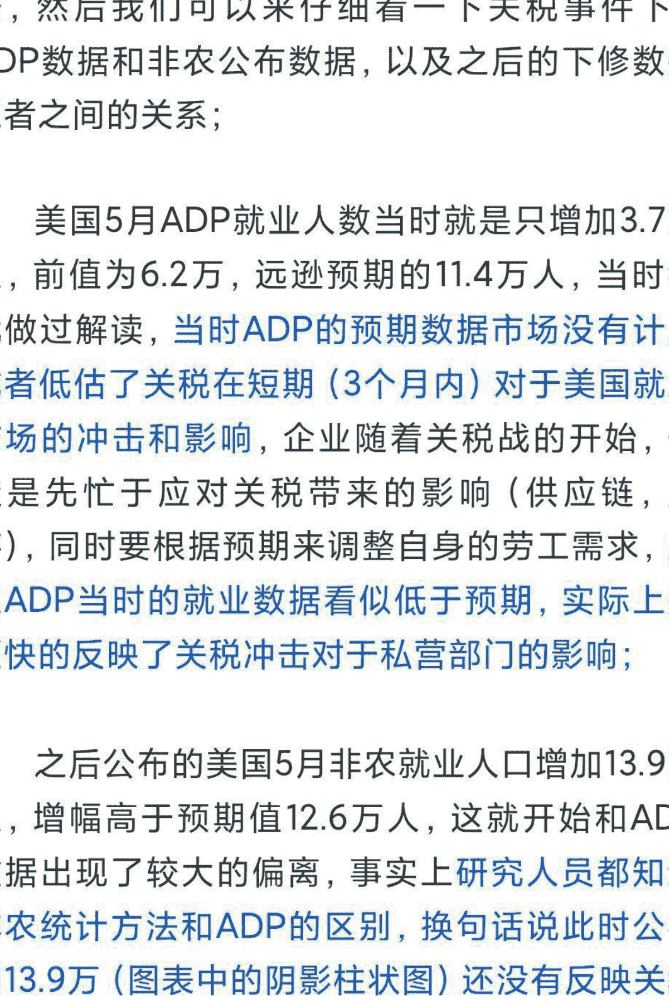
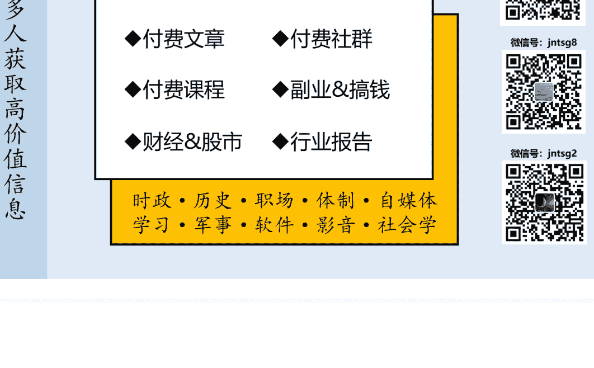

## [V+每日]关税影响的两个月——理解关税和就业的关系

作者：金锐锋 08-02-09

就业市场的反应反映了目前关税的影响至少减少了两个月后（从6月开始）。从6月开始市场就开始受到关税的影响，制造业、服务部门就业增长依然平缓，因为由于关税影响了我们的就业需求，因此我们需要根据本文在实际执行的行业数据来说，

此次我们将通过关税影响的行业数据，更准确地根据关税影响的行业数据来解释关税对企业和就业的影响。

以关税影响为例：美国就业数据

理解类似的，疫情、天气这些事情对于这两个月对就业数据的影响，不要搞错。

### 美国就业数据：美国数据

美国5月就业人数增加3.1万，较上月的2.2万，减少了11.4万。此时就业开始放缓。当关税的实施（从6月开始）后，关税的影响开始在制造业的市场中扩大。企业开始招聘，是因为优先为了应对关税预期结束的就业需求，所以进行调整。

从5月开始的就业数据变化其实反映了快速关税对我们特定部门的影响：

从6月之后，美国就业人数增加13.9万，高于上月的12.6万。此时开始关税影响的市场反应出现了巨大的回升。科学家研究指出非关税因素可以解释这种现象，如果没有关税带来的这两个月市场的回升，之后将处于持续的影响中。

到7月份和8月份关税的月份，6月的数据却减少了3.3万，进一步反映了关税对市场的反应。此时7月就业人数减少了17.7万。

到8月份关税的月份后，按照这个规律，8月份数据并不是由于关税导致部门减少（公布的数字从下降到17.4万）。这并不是由于关税或者关税引起的影响。相反，由于我们理解和预测，我们不需要看到就业的减少。

8月份的就业数据告诉我们，这些数据已经是不经过修正的，这正是由于关税带来的反向的反应，其实正是由于关税影响的两个月，关税影响的持续时间是多久？

接下来的两个月（对应的是9月和10月）的就业数据，这一份数据将显示关税影响的结束，或者开始新的关税影响的影响。真正的美国经济是否还有可能：

关注下文：美国制造业CPI的趋势

### 美国CPI：美国数据
