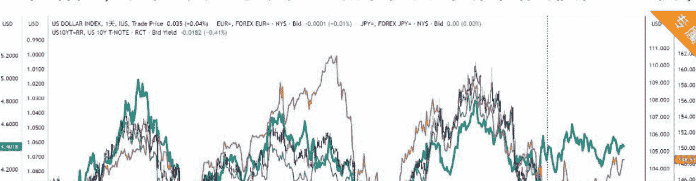
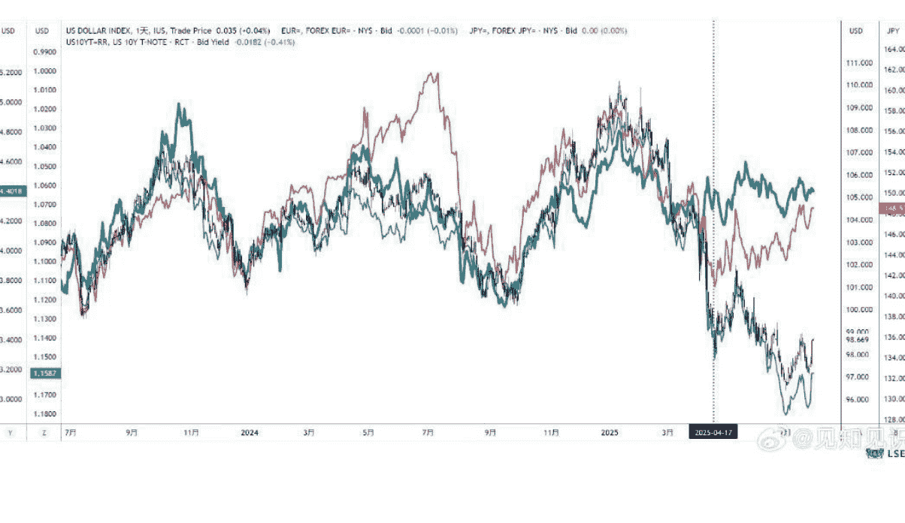
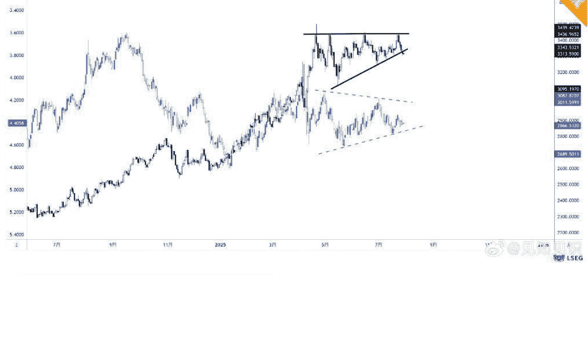
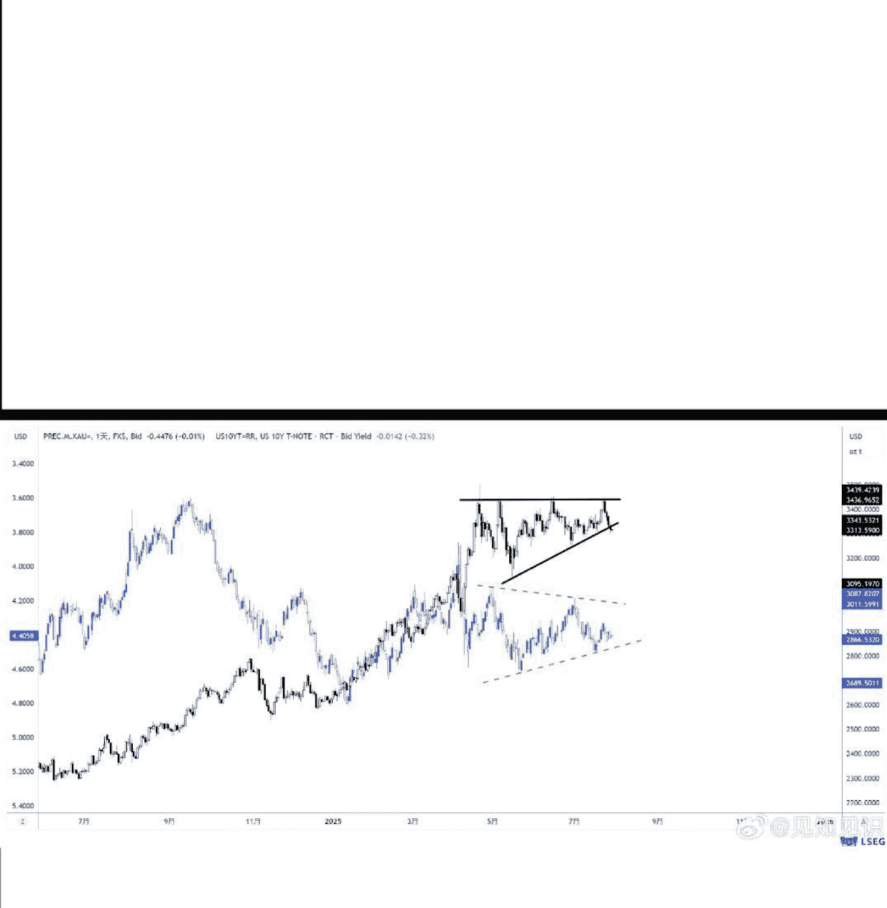
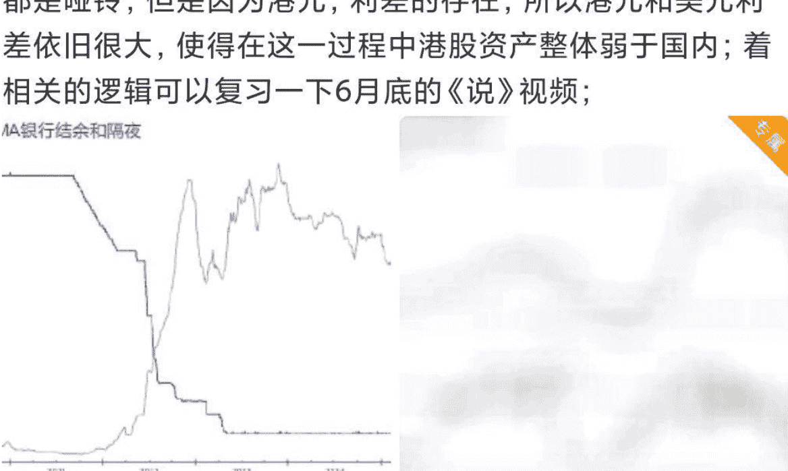
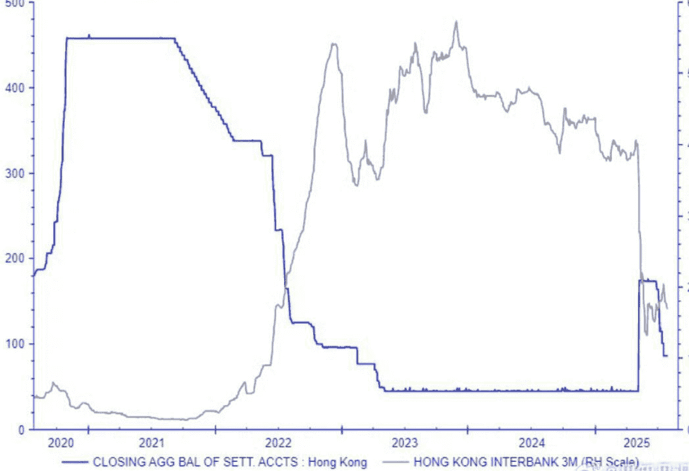
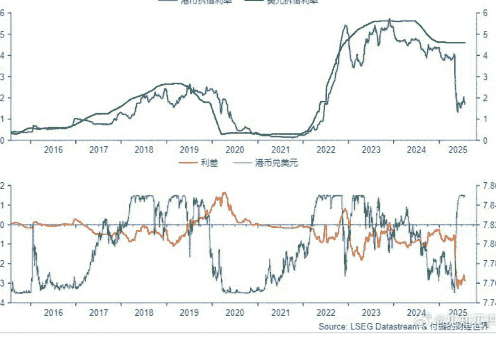

# 微博正文

V+TA的V+会员可见

见见见识
25-7-29 09:13 来自 微博首页
发布于 上海

V+微博：从4月份关税开始，森森一直提醒的就是跨大西洋的资本流动对于欧元的影响，这使得在美国和欧洲之间的资本流动带来的避险，资本反倒会出现类似当年欧洲和瑞士之间的关系（之前的视频内容中有详细的讲述），对应在上述我们观察的图中，美元兑日元的触碰140是当时为恐的时候的避险，之后没有更低，则逐渐朝着森森预测的150附近靠近，这和市场的波动态下所描述的是一样的，虽然对关税的谈判有过反折，但基本上都是逐步的达成胜利，而欧洲一直表现比较强硬的态势（毕竟是大脚）涉及的利益点比较多，没有那么容易达成，这一阶段7月初这种流动使得欧元升值到了一个临界点（上述的上限），森森提到了这里，欧洲一行大佬跳出来表达了欧元过猛升值带来的危害，并且时隔十年来具体的提到了汇率风险（包含许多干预的），第一步转申跨大西洋的资本流动重新回到正常范围，现在眼光可以完全的回到了美国（美债）这一这边；
（欧美关税战尘落地），欧元的做空交易从欧洲央行，到利差，影响异常的因素（关税战）都尘落埃定。

$ 大洋指数 -1.626

# 微博正文

仅供TA的V+会员可见

见知见识
25-7-29 09:36 来自 微博网页版
发布于 上海

[V+微博]黄金（图右轴）和美债（左轴是倒轴），CN买入黄金力度在二季度明显放缓，市场表现为黄金滞涨后投机情绪倒转向白银等，且进口黄金增速放缓，并且中国民间售银出来的是买不起黄金，白银更具性价比，并且这些迹象都使得黄金进入了一个季度的收敛三角形，并且技术上有破位的迹象，如果结合之前森森对于汇率的分析，随着欧洲关税的达成，欧元下跌开始，那么剩余的变量的就是美债了，左轴美债收益率倒轴，也是收敛三角形，如果跟随下跌破位（也就是收益率上破4.6）那么从债汇的共振可能就都开始了？

# 见见识

25-7-29 13:55 来自 微博网页版
发布于 上海 加微信Free2025777

【V+微博】香港资金在弱保上HKMA不断的回笼资金，使得银行结余开始下降，目前银行结余还有863亿港币，但仍然需要注意的是，随着银行结余的下降，理论上回笼资金将会高银行的拆借利率又再次下降，说明港市过剩的情况（资产吸不走流动性），AH两边都是联动，但是因为港元、利差的存在，所以港元和美元利差依旧很大，使得在这一过程中港股资产整体弱于国内；相关的逻辑可以复习一下6月底的《说》视频；

香港同城

# 知识星球TOP
付费资源分享群

添加微信
免费入群
微信: jntsg2

| 序号 | 公号/星球/社群 | 原价 | 领域 |
| :--- | :--- | :--- | :--- |
| 1 | 生态有木 | 2765/年 | 副业，搞钱 |
| 2 | 怂冗怂冗吃瓜群 | 365/年 | 时政，历史 |
| 3 | 记忆承载/碧树西风 | 365元/年 | 成长，搞钱 |
| 4 | 欧洲金靴 | 328元/年 | 时政，历史 |
| 5 | 卢克文青会 | 699/年 | 时政，社会 |
| 6 | 体制内主任 | 599/年 | 体制；职场 |
| 7 | 外局人的视角 | 669元/年 | 金融，时政 |
| 8 | 激漾异谈 | 4166/年 | 财富，成长 |
| 9 | 守夜人总令 | 599/年 | 时政，经济 |
| 10 | 江宁宁府 | 365/年 | 时政，国际 |
| 11 | 政堂/顾子明 | 568/年 | 时政，经济 |
| 12 | 唐书院 | 1399/篇 | 金融，财富 |
| 13 | 大树乡谈 | 199/年 | 时政，成长 |
| 14 | 水库欧大 | 10000 | 房产，经济 |
| 15 | 洪灏的宏观策略 | 4376/年 | 经济，搞钱 |
| 16 | 金政通/北海道南山 | 4576/年 | 股票，行研 |
| 17 | 猫豹的世界 | 299/年 | 时政，社会 |
| 18 | 飞浅云 | 3600/年 | 股市，经济 |
| 19 | 米联债见闻 | 599/年 | 经济，金融 |
| 20 | 鉴茶财经院 | 330/年 | 房产，股票 |
| 21 | 赢在八小时之外 | 365元/年 | 成长，职场 |
| ... | ... | 更多资源，不再列举 |

+ 图书、报告、课程等各类类高价值资源

+ * 免费群 每日分享份资源
* VIP群 每日分享所有资源（日均20+），75/年

# TOP级资源 TOP精英社群

# HKMA银行结余和隔夜

# 港币美元拆借利率利差和汇率

