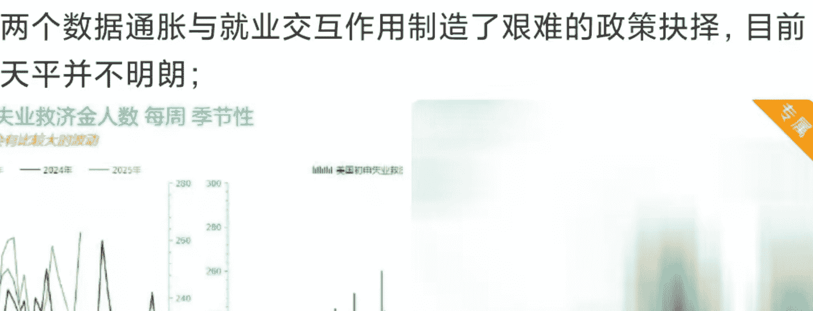

# 微正文

IVTA的V+会员可见

## 见见见识

25-9-14 21:20 发布于 上海

[V+博客]劳工的另一报告显示，在截至9月6日的一周内，各州首次申请救济的人数增加了2.7万人，经历季节因素调整达到26.3万人，为2021年10月以来的最高水平。但该数据可能受到劳动节的影响，月初数据显示萨萨州未经过调整的申请人数激增至15304人，原因不明，推测一些可能在7月洪灾（2025年7月4日，美国得州中部地区夜间暴雨引发重洪洪水。这次洪水是美国年来最严重的洪灾之一）按错误地将该州灾难性失业补助（DUA）按常规申请提交了，该灾难性失业补助被延长至9月底，月初数据是否确实如往年一样遇节假日、飓风洪水事件冲击一样短暂异常，还有待观察和确定：

随着特朗普政府加紧遣返非法移民，农场劳动力短缺也在推高食品价格，企业将总统特朗普大规模关税带来的更高成本转嫁给消费者，以及旅游需求的反弹，关税带来的成本负担不断增加，将使商品价格的环比涨幅年初继续保持高位平衡并不明朗；

两个数据通胀与就业交互作用制造了困难的政策选择，目前

## 深度视野优质集群（链接优质社群，助你成功）

全部包含以下内容：限时年费188/年 加微信cuk255

- 1 群众含时文档加时群对话（原价365 元/年）
- 2 子明私享汇（内部）文章
- 3 政事室（子明优）付费内容加送私享子明群
- 4 米联储贝间【作者米楼】（原价599 元/年）
- 5 欧洲金雀会员专属文章（原价328 元/年）
- 6 砖瓦斥内部文档（原价400 元/年）
- 7 卢克文青读书会专属文章（原价699 元/年）
- 8 鉴茶财经知识星球（原价3310 元/年）
- 9 狮哥的视界知识星球文章（原价299 元/年）
- 10 财经周刊【独家新闻】（原价1498 元/年）
- 11 杨世光在金钱塔（原价2200 元/年）
- 12 森淼财经知识星球（原价1600 元/年）
- 13 激源译译付费文章（持续更新）
- 14 司马林解读全套音频和全套书籍收藏版无割减（原价2.3 万）
- 15 虚构三部曲[民国梦、帝国战争、不被理解的MAO]（原价599 元）
- 16 卢克文知识星球文章（原价268 元/年）
- 17 额外再送：卢祺元新浪微博付费专栏、三村丰老王、三花九洞文集

不定内容：——（更多资源不写下去了……——

- ① 守夜人知识星球、换魔王星球、达叔泛论星球、成就财富圈、雪雪花甲头部等
- ② A视野、大树乡谈、江初序、泮咩说、上海海家学等付费文集
- ③ 西凤付费文章、老端、高在小时之时、局外人的视界、升值、老A体制内等一些大V付费文章（每月低于600元的付费文集）

## 限时年费188/年 低成本链接全网V优质内容

## 深度视野文集 进群微信cuk255

深度视野（付费文集）

