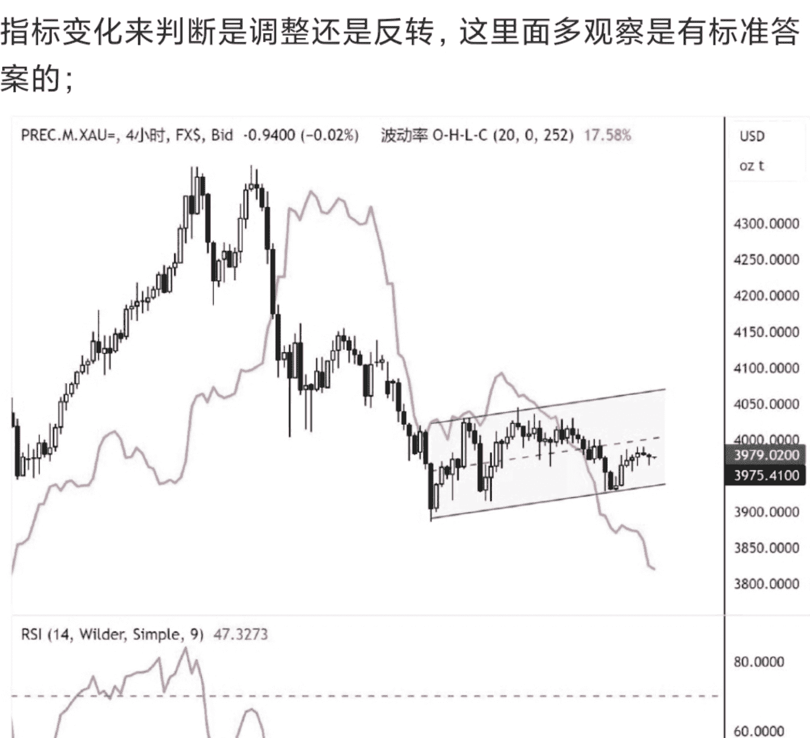
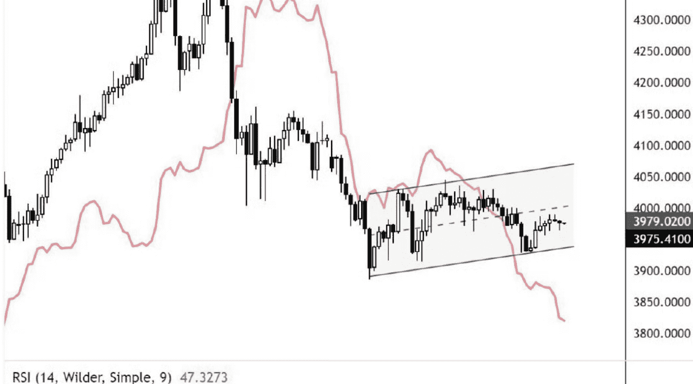
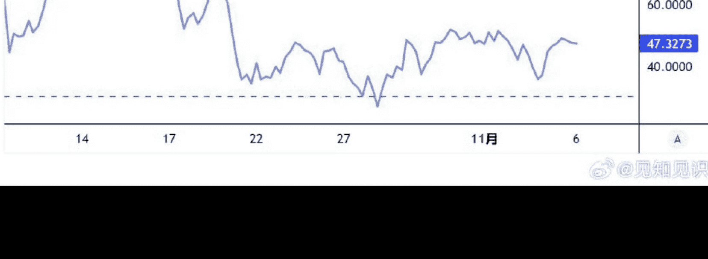

# 微博正文

【V+微博】最新森森的邮件：简单的教一些微交易手法，例如前面已经拿着悬浮的情况下，利用每一次这种周期的调整平台，设计策略，新的头寸之一是短周期的目的就是一笔拉低持仓成本，通过摊波动的方式使得前面的头寸可以容忍更大的波动，从而从大周期获利的时候才可以拿到一笔非常好的原始头寸，然后让这部分一直奔跑下去：

任何的交易，长短周期不同的头寸和策略，组合在一起，才能功能最大化，不要让头寸变短，短周期头寸变长，图是4H周期，虽然昨晚后睡觉睡觉，时间到自然就会调整，也可以通过观察这段期间价格变动、波动率变化以及标准化变化来判断是调整还是反转，这里面有很多标准答案的：

# 见知见识

更多优质资源加微信cuk255

# 深度视野优质集团（链接优质社群，助你成功）

全部包含以下内容：时限年费188/年 加微信cuk255

- ① 吃瓜群众包帝圈加时群对话（原价 365 元/年）
- ② 子明私享汇（内部）优质文章
- ③ 政室（子明）付费内容加送子明群
- ④ 米联储闲兜【作者米穗】（原价 599 元/年）
- ⑤ 欧洲黄金会员专属文章（原价 328 元/年）
- ⑥ 砖瓦斥内部圈（原价 400 元/年）
- ⑦ 老文青读书会专属文章（原价 699 元/年）
- ⑧ 鉴茶财经知识星球（原价 3310 元/年）
- ⑨ 猫哥的视界知识星球文章（原价 299 元/年）
- ⑩ 财经周刊【独家新闻】（原价 1498 元/年）
- ⑪ 杨世在金钱波（原价 2200 元/年）
- ⑫ 森莱财经星球（原价 1600 元/年）
- ⑬ 激源译译付费文章（持续更新）
- ⑭ 司马林解读毛选全套音频和全套书籍藏版无削减（原价 2.3 万）
- ⑮ 虚政三部曲【民国梦、帝国扩张、不被理解的MAO】（原价 599 元）
- ⑯ 星球文章（原价 268 元/年）
- ⑰ 额外再送：卢祺新浪微付费专栏、三村丰老王、三花九术文集

不定内容：……更多资源写下去了……

- ① 守夜人司令星球、接换魔王后星球、生自有知识星球、
- ② 创始笔记、达叔谈论星球、成败财富、雪雪花甲头部等
- ③ A视野、大树乡谈、江宁话说、上海家学等付费文集
- ④ 西凤付费文章、老端、赢在八小时之外、局人的视界、升值、老A体制内等其它一些大V付费文章低于600 元的付费文章

时限年费188/年

# 底层链接全网V优质内容

深度视野（付费文集）

进群微信cuk255

