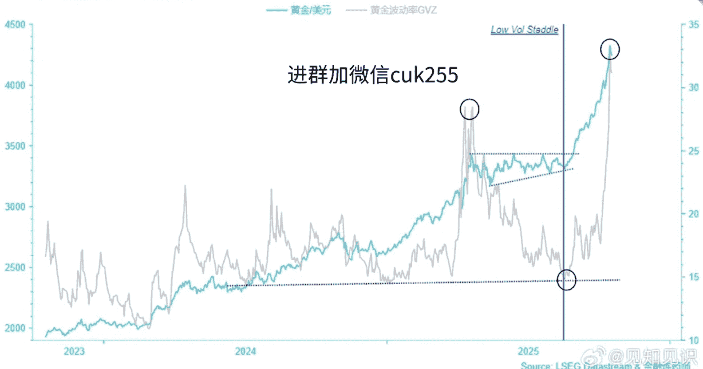
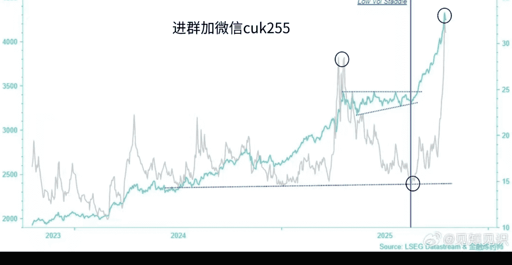

# 微博正文

IVTA的V+会员可见

## 见微知识 Ⅱ

25-10-18 12:34 来自微博网页版 已编辑
发布于上海

**V+微博】最新森森的邮件：之前的“末板”策略三角形末端，我们采用了“straddle”策略来获取波动率的放大，普通投资者当时可以通过多空双开（破位平一腿）的方式获取对应的收益，价格的加速上行的背后也是波动率持续的加大走高。现在其实应该考虑高波动下应该怎么做，高波动意味着成本增加，落袋为先，然后观察市场。如果继续横盘波动率下降，那么还是上行趋势的特征，有可能还有继续下一次低波再启动的机会；如果波动率很高调整剧烈且波动率并不降低的话，要注意的是是否转向的波动特征将会出现；

## 黄金价格和黄金波动率

进群微信cuk255

评论 2

## 见知见识

## 黄金价格和黄金波动率

GV2波动率和1M平价期权 黄金/美元 —— 黄金波动率GVZ

进群加微信cuk255

## 深度视野优质集圈（链接优质社群，助你成功）

全部包含以下内容：限时年费188/年 加微信cuk255

- ① 吃群众含倍时加时时群对话（原价 365 元/年）
- ② 子明私享汇（内部）文章（原价 568 元/年）
- ③ 政事室（顾子明）付费内容再送顾子明群
- ④ 米联储闲间【作者米横】（原价 599 元/年）
- ⑤ 欧洲金雀会员专属文章（原价 328 元/年）
- ⑥ 砖夺瓦内部圈（原价 400 元/年）
- ⑦ 卢克文青读书会专属文章（原价 699 元/年）
- ⑧ 鉴茶财经知识星球（原价 3310 元/年）
- ⑨ 猫哥的视界知识星球文章（原价 299 元/年）
- 10 财新周【独家新闻】（原价 1498 元/年）
- 11 杨世在金钱圈（原价 2200 元/年）
- 12 森淼财经知识星球（原价 1600 元/年）
- 13 激源异译读付费文章（持续更新）
- 14 司马林解读末选全套音频和全套书籍收藏版无割减（原价 2.3 万）
- 15 虚走三部曲[国梦、帝国争论、不被理解的MAO]（原价 599 元）
- 16 卢克知识星球文章（原价 268 元/年）
- 17 额外再送：卢祺元新浪微博获付费专栏、三村丰老王、三花九洞集文

不定期内容：——（更多资源不写下了……）

- ① 守夜人司令知识星球、接魔王星球、成达浅论星球、成就财富圈、雪花花甲老头等
- ② 创始小圣、达达浅论星球、成就财富圈、雪花花甲老头等
- ③ A 视野、大树乡谈、江宁访、泮咩说、上海海家等付费文集
- ④ 西凤付费文章、老端、高在八小时之外、局人的视界、升值、老体制内等其它一些大V付费文章（每月低于600 元的付费文集）

限时年费188/年

## 低成本链接全网V优质内容

## 深度视野文集
群微信cuk255

深度视野（付费文集）

