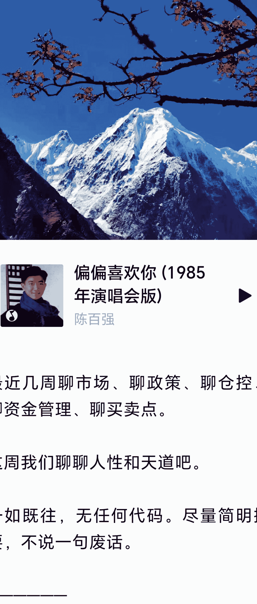

# 聊聊人性与天道

原文 轻风吹 逝似流水之
2025年11月29日 00:05 北京

🎧5人

最近周聊市场、聊政策、聊仓储、资金管理、聊买卖点。
这周我们聊人性与天道。
一见既知，无任何代码。尽量明扼，不说一句话。

春秋后，老子说了：天道，损有余以补；人道，不足以奉有。

源自《经·老·太经》中的一句话：
凡有的，都要给他，叫做他有；没有的，他拥有的也要过来。

民间的说法一些：钱永远都会流向不向钱人的，钱永远都会流向向钱的本质，东西文化是殊途同归的。

——在市场中要生存、发展、壮大、甚至强大，必须是反性的。
这很难细化。

我提供一个方法：
如果你没有允许自己完全打造好自己的交易系统，不建议大投入。

不是允许一个人开三个券商账户，而是开两个，每个里面放 5000-10000。
其中一个完全顺着自己的人性自主操作，另一个反之。

三个月、半年、一年后再对比。

这个世界很残酷的。本质上，大部分的一辈子都活在一个虚幻的牢笼里。可见的天花板而自己做不到的事情，可能生让下一代去做。

一些所说的希望、梦想，不过是虚幻泡泡，用来欺骗自己了罢了。
打破之。

> “一直直生生地，离岸方自在光”

市场如此，人亦如是。
希望这段对你有用。
共勉之。

轻风吹

> “一直直生生地，离岸方自在光”

喜欢作者

613 人付 >

# 深度视野优质文集（链接优质社群，助你成功）

全部包含以下内容：限时年费88/年 加微信cuk255

- ① 吃瓜群众包帝时圈加时群群对话（原价 365 元/年）
- ② 子明私享汇（含）内部文章
- ③ 政事室（顾子明）付费内容加送顾子明群聊
- ④ 米联储闲暇【作者米穗】（原价 599 元/年）
- ⑤ 欧洲金雀会员专属文章（原价 328 元/年）
- ⑥ 砖瓦仁内部圈（原价 400 元/年）
- ⑦ 卢克文青读书会专属文章（原价 699 元/年）
- ⑧ 鉴茶财经知识星球（原价 3310 元/年）
- ⑨ 猫哥的视界知识星球（原价 299 元/年）
- 10 财经周刊【独家新闻】（原价 1498 元/年）
- 11 杨世在金钱爆（原价 2200 元/年）
- 12 森淼财经知识星球（原价 1600 元/年）
- 13 潇漾译异付费文章（持续更新）
- 14 司马林解课选全套音频和全套书籍收藏版无割减（原价 2.3 万）
- 15 虚构三部曲[民国梦、帝国争亡、不被理解的MAO]（原价 599 元起）
- 16 虔克知识星球文章（原价 268 元/年）
- 17 额外再送：卢麒元新微博付费专栏、三村丰老王、三花九树文集

不定期内容：......更多资源不下去了...

- ① 守夜人司令知识星球、接魂魔王知识星球、成付财富圈、雪花甲等
- ② 创始笔记、达叔谈论星球、成付财富圈、雪花甲等
- ③ A视野、大树乡谈、江初序、咩咩说、上海海家学等付费文集
- ④ 西凤付费文章、老端、赢在八小时之外、局外人的视野、升值、老体制内等若干其它V付费文章（每月不超过600 元的付费文集）

# 限时年费88/年 底部链全网V优质内容

深度视野文集
进群微信cuk255
深度视野（付费文集）

