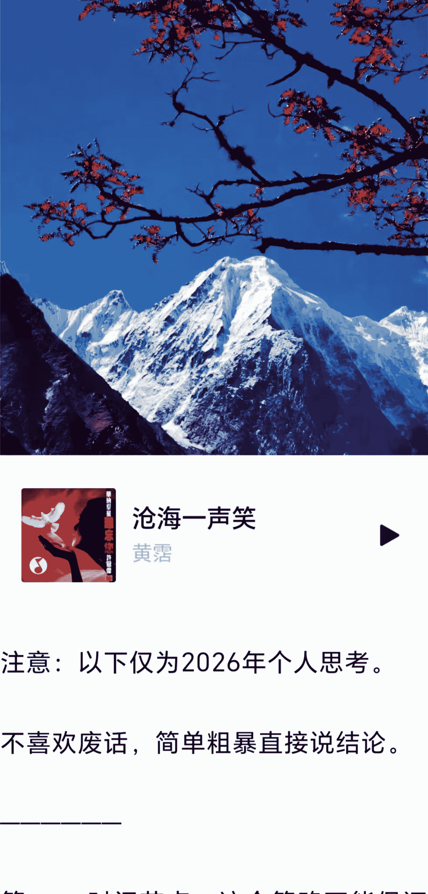
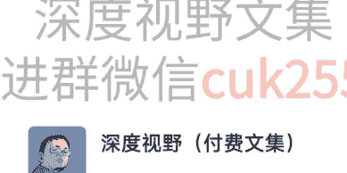

# 2026策略 已付费

原文 轻风吹响 似水之流
2025年12月13日 11:46 北京

全文

沧海一声笑

黄袭

注意：以下为2026年个人思考。
不喜欢废话，简单粗暴直接结论。

第一：时间节点。这个策略不能保证一年。
第一时间看明年二季度。

第二：位点，如果看到477点，减去无彻底赎仓机会，零成本本身或者成本变成之后的策略。添加微信cuk255

第三：牛三波股弹性，可以大量参与与民企弹性；牛第二波确定性，参与参战，国企低估值资产联创策略。
今年，明年有很多大家伙上市，很多属于重器。
的投作为沃莱斯克斯双击品种，孵化的早投早要密集进入IPO流程，有几何叠加生效效应。添加微信cuk255

如果有牛三，参与比特通为代表的低估值高分品种。
一连连加速，全清。
深夜VIP 人造500万+A 付费策略cuk255 价格55568

轻风吹响

> “一路直在生死，离岸许多自在光”

喜欢作者

480人付费，180人喜欢

# 留言 13

# 深度视野优质集团（链接优质社群，助你成功）

全部包含以下内容：限时年费188/年 加微信cuk255

- ① 吃瓜群众倍时圈文加时群对话（原价365 元/年）
- ② 子明私享汇（内部）文章（原价568 元/年）
- ③ 政事室（顾子明）付费内容再送顾子明群聊
- ④ 米储闲兜【作者米穗】（原价599 元/年）
- ⑤ 欧洲金雀会员专属文章（原价328 元/年）
- ⑥ 砖瓦斥内部圈（原价400 元/年）
- ⑦ 卢克文青读书会专属文章（原价699 元/年）
- ⑧ 鉴茶财经知识星球（原价3310 元/年）
- ⑨ 猫哥的视界知识星球文章（原价299 元/年）
- ⑩ 财经周刊【独家新闻】（原价1498 元/年）
- ⑪ 扬杨世光在金钱爆（原价2200 元/年）
- ⑫ 森淼财经知识星球（原价1600 元/年）
- ⑬ 译付费文章（持续更新）
- ⑭ 司马林解课毛选全套音频和全套书籍版权无损剪（原价2.3 万）
- ⑮ 虚政三部曲[民国梦、帝国扩张、不被理解的MAO]（原价599 元）
- ⑖ 知识星球文章（原价268 元/年）
- ⑰ 额外再送：卢薛元新浪微博付费专栏、三村丰老王、三花九树文集

不定期内容：（更多资源将写下）......

- ① 守夜人知识星球、接换魔王后星球、生才有知识星球、
- ② 创始人笔记、达叔谈论星球、成为财富圈、雪花劫甲老头等
- ③ A视野、大树乡谈、江初领、咩咩说、上海海家学等付费文集
- ④ 西风付费文章、老端、赢在八小时之外、局人的视界、升值、老体制内等等其它一些大V付费文章（每月不超过600元的付费文集)

限时年费188/年 底部链接全网V优质内容

