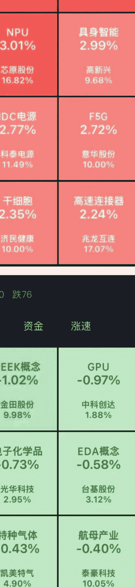

# 增量市场中的高股、高波比发现

2023年08月11日 19:36 浙江

## 先数据

## 回测结果

| 策略 | 收益率 | 最大回撤 | 夏普比率 | 胜率 |
| --- | --- | --- | --- | --- |
| 策略A | 197.56% | -15.71% | 1.45 | 56.2% |
| 策略B | 323.07% | -20.99% | 1.88 | 58.5% |
| 策略C | 411.5% | -22.95% | 2.12 | 60.1% |
| 策略D | 248.46% | -24.38% | 1.55 | 54.4% |
| 策略E | 236.86% | -23.38% | 1.62 | 55.7% |
| 策略F | 214.28% | -24.16% | 1.48 | 53.9% |

## 回测结果

| 策略 | 收益率 | 最大回撤 | 夏普比率 | 胜率 |
| --- | --- | --- | --- | --- |
| 策略A | -1.46% | -5.07% | -0.12 | 42.1% |
| 策略B | -1.23% | -0.73% | -0.05 | 48.5% |
| 策略C | -0.19% | -0.09% | 0.01 | 51.2% |
| 策略D | -0.46% | -0.42% | -0.03 | 43.8% |
| 策略E | -0.34% | -0.34% | -0.02 | 46.7% |
| 策略F | -0.33% | -0.31% | -0.01 | 45.9% |

## 回测结果

| 策略 | 收益率 | 最大回撤 | 夏普比率 | 胜率 |
| --- | --- | --- | --- | --- |
| 策略A | 15.04% | -13.52% | 0.85 | 52.3% |
| 策略B | 13.71% | -11.11% | 0.92 | 54.1% |
| 策略C | 14.56% | -10.76% | 0.78 | 50.8% |
| 策略D | 18.68% | -12.56% | 0.98 | 55.4% |
| 策略E | 18.18% | -11.82% | 1.05 | 56.9% |
| 策略F | 16.76% | -12.55% | 0.91 | 53.5% |

## 回测结果

| 策略 | 收益率 | 最大回撤 | 夏普比率 | 胜率 |
| --- | --- | --- | --- | --- |
| 策略A | 2.63% | -2.14% | 0.45 | 58.2% |
| 策略B | 3.01% | -2.19% | 0.52 | 59.1% |
| 策略C | 3.12% | -2.35% | 0.48 | 57.4% |
| 策略D | 2.48% | -2.18% | 0.39 | 55.6% |
| 策略E | 2.55% | -2.21% | 0.43 | 56.3% |
| 策略F | 2.42% | -2.25% | 0.42 | 55.8% |

## 行情分析

现在行情很差。
但在这个市场下，回撤高波动性品种是一种策略。
这种资金高股、高波比的发现，说明了环境确实如此。
其实，行情越差，最好就是加仓波动性选股，哪怕跌了10个点好，多买一只就有信心了，但天不给机会。
出股的收益10%-30% 效率如何。
这种速震行情，出现这种情况，大概率是杠杆的资金导致，回撤效率低，费率极高。
大家都不差钱，也不是都能扛一把了。

## 评论

- Hao 2023-08-11 19:45 回复 1：行情是不是差还是心态不行？
- 慧涛 2023-08-11 19:48 回复 1：现在的行情差，心态受不了
- Hao 2023-08-11 19:50 回复 2：行情确实差，心态受不了
- 李涛 2023-08-11 19:52 回复 3：慧涛说的对，心态受不了
- YY 2023-08-11 19:55 回复 1：这行情真的差，以前还可以，现在好到稍微跌就没量，等一下，等行情转了股票就好了
- 李涛 2023-08-11 19:57 回复 3：慧涛说的对，心态受不了
- 陈建 2023-08-11 20:00 回复 1：现在的行情差，心态受不了
- 李涛 2023-08-11 20:02 回复 6：慧涛说的对，心态受不了
- 慧涛 2023-08-11 20:05 回复 4：慧涛说的对，心态受不了
- 李涛 2023-08-11 20:08 回复 5：慧涛说的对，心态受不了
- 陈建 2023-08-11 20:10 回复 1：慧涛说的对，心态受不了
- 慧涛 2023-08-11 20:12 回复 1：慧涛说的对，心态受不了
- 李涛 2023-08-11 20:15 回复 1：慧涛说的对，心态受不了
- 慧涛 2023-08-11 20:18 回复 1：慧涛说的对，心态受不了
- 陈建 2023-08-11 20:20 回复 1：慧涛说的对，心态受不了
- 慧涛 2023-08-11 20:22 回复 1：慧涛说的对，心态受不了
