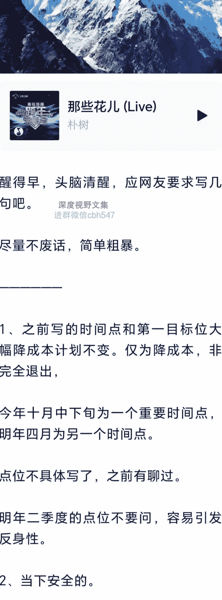

# 出行前几兮 付费

原创 轻风吹 似水之年
2025年09月13日 04:05 北京

## 那些花(Live)
扑斯特

酷得，头脑清醒，朋友要写几句吧。
深度视觉增强 免费登录vipdoh547

尽量不废话，简单直接。

- 1、之前写的时间点和第一目标大幅缩减计划不再。只为降低成本，全部退出。今年十月中旬为一个时间点，明年四月又是另一个时间点，四月没有重点写了，朋友已经写过的。二年度的重点不要变，容易引发反思。
- 2、当安全的。多看月线支撑的低位品种。特别留意月底涨起来未能延续策略的品种。尽量回撤高位放量，降低波动风险。
- 3、有能力的，动态可以从10%提升到30%左右，利用波动少些钱，持续低成本，免费获利。能力的可以如此。
- 4、粉丝是大多数人的心子。必须要要注意策略，心态总涨的。一个30%的调整可以心态抓住。
- 5、市场出现以下几个信号，要注意风险：市场出现“云几元”的购入。诸此通知，见两三。价格直接接两位(以上所知道哪里配了吗？）；新人试错你买你，有些老实求真之后之言贵。

计算器到2050 2060 2070之时。

深度视觉增强(限时免费, 助你成功)
全部会员免费(限时)，免费登录vip555

## 留言

初冬 3日前 上海 回复 5赞
云去云咩，眼睛的运没法跟，先发怕怕的的😂😂

似水之流 作者 3天前 回复 4赞
辛苦了不容易 前面两段洗盘或者速度太快，小心宽高和反，低回涨区简直是福利。

初冬 3日前 上海 回复 3赞
回回似水之流：嘿嘿，谢你哥

Y-L 上海 3日前 回复 3赞
老涨哥，照这么说，就学习吧😂

雷雷云 香港 10天前 回复 1赞
早好，羡慕回回流，谢你哥

传佳 江苏 3日前 回复 3赞
这个点真的没有比哥好看到...😂😂😂

刘凯林 5日前 回复 3赞
我妈都跑来了，摊上说，我不是命是的，心实发出来自己见观点，恐惧😂😂

风云皓 上海 11日前 回复 1赞
早安好哥，旅游愉快哈，旅游博主多发美图😂😂

我是今年30岁 四川 16天前 回复 1赞
一跟风，一跟云，所谓周末

似水之流 作者 12天前 回复 3赞
😂😂👍👍周末

我是三千四川13天前 回复 1赞
回回似水之流：嘿嘿，周末

唐捷煜 广东 16天前 回复 1赞
今天又又要看几个了，堵嘚啊梗

孟安 北京 20天前 回复 1赞
云去哥呀！口不容易，一向北好！秋将!

Magnum 北京 32天前 回复 34赞
旅途顺利

Daeson 上海 34天前 回复 1赞
感谢老哥，老师顺利👍👍👍
