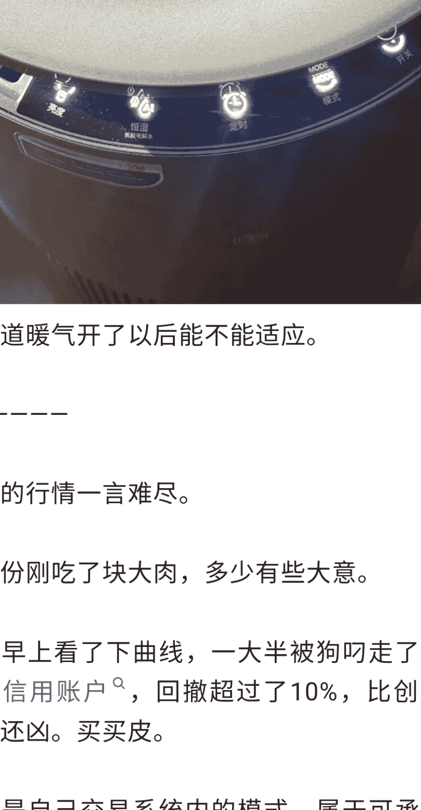
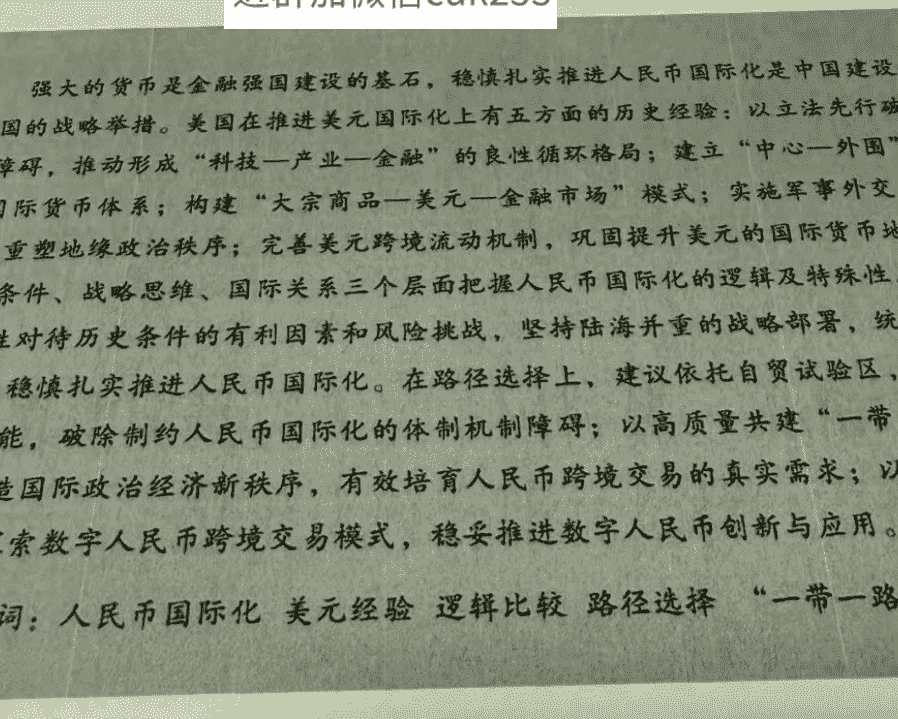

# 周末逛几市买食材

2025年10月18日09:39 北京

## 先找主粮

酿酵蛋
这两天降温了，我挑了下线，准备了些酵蛋，看着暖暖，好心情。我们都跑区买酒酿蛋。

熟了就吃！这可是要早起才懂的。我想靠南方的周末逛市几乎没数，又去了一看外面包的酒酿了。

好吧。

北方干的，这季节的气温低于20度，还好准备了加蛋。

不知道暖气开了以后能不能。

## 聚后的后行余意难忘

九月份偶尔吃肉肉，有些狗狗跑了。今天早上上逛市，一半被狗跑了。

因为是用的“跳户”，超过了十次，比比老菜的便宜不少。买热闹。

对于自己去逛市的模式，还是是可以接受的。指数教一句话：

上面要说的还是指数，指不是强制执行，而是加上几下功夫，这次菜比上次这个区域的便宜。

如果用心收敛（袋不践），准为安全。

老师给了几百字的资料。下载了下附件，可以分享的。发给大家看看吧。

## 战略性转型与专业行业整合的观察点

加入ok255

随着全球经济进入结构性调整期，传统制造业面临着前所未有的挑战。与此同时，中国制造业正经历着从规模驱动向质量驱动转型的关键期。2023年以来，我国制造业产值持续保持增长，但高端化水平仍有待提升。通过技术创新、管理优化和资源整合，企业可以实现更高层次的转型升级。然而，过程中，劳动力成本上升和市场需求波动等问题依然严峻。此外，人工智能、大数据等新技术的应用也为产业升级提供了新的支撑。在竞争激烈的国际市场背景下，绿色发展和数字化转型已成为提升企业竞争力的核心。

## 钢铁重组在进行 产业转型加速

我国钢铁重组趋势日益凸显

近期，2024年8月13日，国务院发布〔2024〕号《关于推进钢铁行业重组的意见》，意见指出要加快钢铁行业重组，符合我国产业结构调整的要求，也是推动钢铁行业高质量发展的重要方向。当前，我国钢铁行业正处于供给侧结构改革和需求侧转型升级的关键期。通过优化兼并、提升技术水平、增强绿色发展，可以增强我国钢铁企业的国际竞争力。

## 美元与美国通胀
### 政策与影响

美联储在周四公布的会议纪要显示，可能会将利率维持在5.25%至5.5%区间，这是美联储自三个月加息以来首次维持利率水平。此前，连续加息四次后美联储已停止加息。

美联储官员在会议纪要中表示，通胀压力已经有所放缓，但令人担忧的是，目前通胀水平仍高于2%的目标水平，因此美联储可能会继续加息，以确保通胀能够长期回归这一目标。

## 从去风险化到去钩化：黄金储备与全球金融锚点的未来

去风险化（de-risking）和去钩化（coupling）正在发生。随着地缘政治紧张局势加剧，西方开始减少在供应链、技术和投资上对中国的依赖。这种趋势正在重新重塑全球金融体系的格局。

然而，金市场数据表明，黄金正在成为全球金融锚点的替代方案。近年来，各国央行不断增加黄金储备，这一趋势反映了各国对美元作为单一储备货币地位的担忧。

去风险化和去钩化正在加速去美元化进程。虽然美元在短期内仍难以动摇，但全球货币多元化的趋势正面临着前所未有的挑战。

## 美元霸权何时终结?

### 国际货币体系运行的机制
### 储备

国际货币体系的运行依赖于货币的储备。美元作为全球主要的储备货币，在贸易和结算中占据着举足轻重的地位，但这种地位正面临着挑战。

随着地缘政治风险的增加和经济格局的变化，许多国家开始寻求货币储备的多元化，以减少对单一货币的依赖。这种多元化趋势在某种程度上也削弱了美元作为全球储备货币的霸权。

美元霸权何时终结？这取决于多个关键因素，包括美国的经济实力、政治稳定以及其他竞争货币的崛起。

应该关注的关键词，有些需要去下载：

多说一句，就一句。

防范立场崩溃，设一个最低门槛一八

---

> “一直在死心里，直方自自在

关注作者

2063 人看过，1 人点赞

发布于2022年10月18日

## 评论 36

作者已关注这里可以关注

## 深度视野优质集群（链接优质社群，助你成功）

全部包含以下内容：限时费188/年 加微信cuk255

- ① 吃瓜群众含帝圈文加时群群对话（原价 365 元/年）
- ② 子明私享会（内部）文章（原价 568 元/年）
- ③ 子明私享会（内部）文章（子明私享）（原价 599 元/年）
- ④ 欧洲金雀（原价 328 元/年）
- ⑤ 体制内（原价 400 元/年）
- ⑥ 卢克读书会（原价 699 元/年）
- ⑦ 鉴茶财经（原价 3310 元/年）
- ⑧ 猫哥的视界（原价 299 元/年）
- ⑨ 财财经周（原价 1498 元/年）
- ⑩ 杨世在钱圈（原价 2200 元/年）
- ⑪ 森淼淼财经（原价 1600 元/年）
- ⑫ 激译异读付费
- ⑭ 司马林解读谋选全套音频和全套书籍无（原价 2.3 万）
- ⑮ 虚政三部曲[国梦、帝国争夺、不被理解的 MAO](原价 599 元/年）
- ⑯ 卢克知识星球（原价 268 元/年）
- ⑰ 额外再送：卢薛元微爆专栏、三村丰老王、三花九术文集

不定内容：——（更多资源不下了……）
① 守夜人知识星球、接换魔后星球、生才有知识星球、
② 创始世纪录、达叔谈论星球、成就财富圈、雪花甲老头等
③ 视野、大树乡谈、江初优、咩咩说、上海海学等付费文集
④ 西凤付费文章、老端、赢在八小时之外、局人的视界、升值、老等等一些大 V 付费文章（每月低于 600 元的付费文章）
