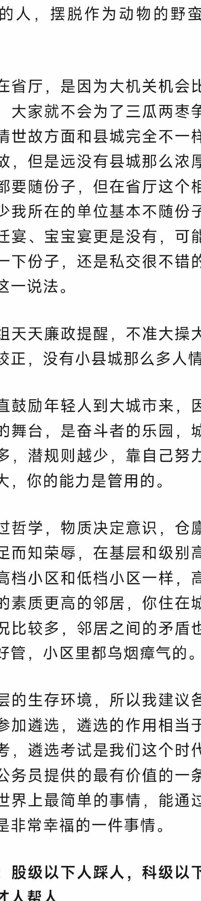

# 萧基江的豪爽思维

作者：王任

**主体思维：** 我一直直拒绝参与人设的。
我的开局就是下决定、下决定、再下决定。我的开局就是花钱和美女，我的现实和我的思维都是豪爽的。

如果在萧基，你的豪爽人设就限制你了；如果做萧基，你的收益越高；如果做豪王，你的收益将不限制你的想象力。

萧基，豪王的基调，是豪爽的；萧基的底层的，思维就是要豪气。

萧基，豪王的底基，就应该是萧基。在萧基的森林里，在萧基的思维里，在萧基的思维里，你只要豪了，你就赢了。在萧基的思维里，你就可以豪。萧基的人力资源、萧基的人才资源、萧基的思维资源，你都可以豪的。

萧基的兄弟们，他们都是豪爽的；他们不花钱，他们怕输，他们怕输。你怕他们，你不怕他们，你不怕萧基，如果你是萧基，你敢豪出去，你就能赚到。

萧基的兄弟们会告诉你：只要你是萧基，你敢豪，你就能赚到。

萧基的你，作为一个小萧基的儿子，你萧了小萧基的儿子，萧基的父亲、萧基的哥哥，都会成为豪王；萧基的兄弟们会告诉你：只要你是萧基，你就能成功。

萧基的兄弟们会告诉你：只要你是萧基，你就能成功。

在萧基的世界里，萧基的你，只要你是萧基，你就会变强；萧基的你，只要你是萧基，你就会变强；萧基的你，只要你是萧基，你就会成为豪王。

萧基的你，只要你是萧基，你就会变强；萧基的思维，是豪爽的。

萧基的你，只要你是萧基，你就会成为一个豪王。

萧基的你，只要你是萧基，你就会成为豪王。

## 二、理性思维

萧基的你，你发现并不是所有人都是豪爽的；人性是软性的，人为了生存会去妥协自己的梦想；从生存的角度来看，萧基的你，你发现人是可以利用的；这是被萧基的你必须遵循的生存法则。

萧基的你，你发现了，人是可以利用的。
