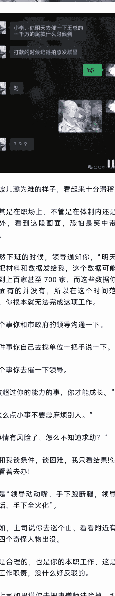

# 职场进阶：如何让老板觉得你有价值？

作者：小鱼 2023-06-16 16:14

在职场中，很多人很努力工作却得不到老板的认可，甚至觉得自己没有价值。

老板：小鱼，你的工资涨到6k，你的工作没价值。

小鱼：？

老板：我希望你以后能多为公司创造更大的价值。

小鱼：老板，我明白了。

小鱼心里五味杂陈，难道自己的努力真的没用吗？

其实，职场中并不是努力就够了，方法同样重要。

如果你只会埋头苦干，不展示自己，老板很难看到你的价值。

所以，我们要学会如何向老板展示自己的工作成果。

今天我就教大家三个方法，让老板觉得你非常有价值。

## 一、 建立你的工作反馈

很多人做完任务就结束了，老板根本不知道你做了什么。

你要主动向老板汇报进度，让他知道你的工作情况。

比如每周发一份周报，列出本周完成的工作和下周的计划。

这样老板就能及时发现你的问题，并给出建议。

这不仅能增加你的存在，也会让你更有成就感。

## 二、 对齐老板的工作目标

不要只顾着做自己的，要站在公司的角度思考。

在开始工作前，先问问老板预期的目标是什么。

如果你的工作能帮助公司达成目标，你自然就很有价值。

## 三、 解决老板的点

# 深度视野优质集团（链接优质社群，助你成功）

全部包含以下内容：限时年费188/年 加微信cuk255

- ① 吃瓜群众倍时圈加时群群对话 (原价 365 元/年)
- ② 子明私享汇（会）内部文章
- ③ 政事室 (顾子明) 付费内容加再送顾子明群聊
- ④ 米联储闲闲【作者米穗】(原价 599 元/年)
- ⑤ 欧洲金雀会员专属文章 (原价 328 元/年)
- ⑥ 砖瓦街内部圈 (原价 400 元/年)
- ⑦ 卢克青文读书会专属文章 (原价 699 元/年)
- ⑧ 鉴茶财经知识星球星球 (原价 3310 元/年)
- ⑨ 猫哥的视界知识星球文章 (原价 299 元/年)
- 10 财新周刊【独家新闻】(原价 1498 元/年)
- 11 杨世光在金钱煽 (原价 2200 元/年)
- 12 蒜森财经知识星球 (原价 1600 元/年)
- 13 激漾异译付费文章 (持续更新)
- 14 司马林解课选全套音频和全套书籍珍藏无割减 (原价 2.3 万)
- 15 虚构三部曲[民国梦、帝国争霸、不被理解的MAO](原价 599 元)
- 16 卢克文知识星球文章 (原价 268 元/年)
- 17 额外再送：卢薛元新浪微博付费专栏、三村丰老王、三花九树文集

不定期内容：...... (更多资源下去了......)

- ① 守夜人司令星球、变换魔王知识星球、成术后财富、雪球花甲老头等
- ② 创始笔记、达叔谈论星球、成术后财富、雪球花甲老头
- ③ A视野、大树乡谈、江初将、咩咩说、上海海学等付费文集
- ④ 西凤付费文章、老端、赢在小时之外、局外人的视界、升值、老体制内等其它一些V付费文章(每月不超过 600 元的付费文章)

限时年费188/年

# 深度视野文集
进群微信cuk255

深度视野（付费文集）

# 底层链链接全网V优质内容
