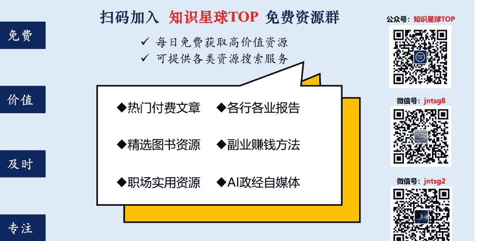

# 掌握这种思维方式，面临人生大选择，不再再困惑！

## 体制主任

体制主任说：人生是由选择组成的，从小到今天，大人生的一些重大的选择，其实我们每天都在做选择。

原来要读大学的时候，要面临什么专业，去哪个城市，哪个学校，选哪所学校，毕业后面面临就业的选择。经常有读者咨询，乡镇公务员和县直事业单位编制怎么选？

市直公务员和省直事业单位编制怎么选择？找对象选择体制内的还是体制外的？要不要为了提拔从公务员身份转成事业身份？选择考研还是考公务员？选择哪个女朋友做老婆？要不要辞职去体制外？

省厅和副省级直市怎么选择？去高校还是去考公务员？

选择进体制还是创业？

## 选择大城市还是小城县?去央企还是考事业编？

要不要参加遴选？去杭州还是去北京？要不要考在职研究生？

下边说说我自己的亲身经历。我从小住在十八线小城县，父亲是小城城的副级干部，从小耳濡目染，跟着父亲学习了许多官场上的知识，人情世故，父亲是我小时候的偶像。

父亲那一辈在小城县混上副级干部，已算是人中龙凤了，从小父亲教了我很多为人世的道理，很注重我的学习，从小就有家学，所以自己就比同龄人更加成熟。

在大学毕业后面面临两个选择，一个是家乡的小城县直部门，另一个是省级城市正厅级单位，当时我也纠结、迷茫，不知道如何选择？

在小城县属于“有关系有背景”的人，有父亲的扶持和帮助，有先天优势，我应该混得不会差，有当官感，但天花板太低。

但在副省级城市，我父亲的人脉几乎用不上，需要自己去打拼，需要自己去努力创造背景和关系，需要自己另起炉灶，前期会比较困难一些。

我父亲坚决支持我去赴省级城市，因为他深知小县城天花板有多低，想进步得付出多大的努力。因为父亲是位领导，从小我就很崇拜他，我就听从了父亲的意见。

多年过去，我也混成了领导干部，时刻想起父亲的话，年轻就要去大城闯闯，那里有更广阔的天空和舞台。每当我望着办公室的窗外，想我想走过的路，觉得自己当初的选择是无比正确的。

如果我当时选择在小县城，那我的女儿以后面临同样选择的时候，还要在小县城吗？要祖祖孙辈都在小县城吗？大城市有更广阔的天空和舞台，是奋斗者的乐园。城市越大，明规则越多，潜在规则越少，靠自己努力奋斗就能逆袭的概率就会增大。

我很我很念自己的家乡，那是生养我的地方，最近几年很少回去了，但我每想起一些人，一些事，对家乡充满了感情。家里人找我帮忙，我很愿意帮助他们。

这是我的个人经历。人的一生中，有时候选择比努力更重要。有的人生活和事业之所以能够成功，一个重要的原因在于关键的时候做出了正确的选择。

而在当下，很多人因为不知道该如何选择而焦虑甚至痛苦，即使做出选择后也是特别后悔，总是耿耿怀怀，精神内耗，总是后悔当初的选择。

当人生出现重大选择项时，怎样才能不纠结？我们究竟该如何去决断，去把握？全文4000余字，全是实战经验分析，纯干货！

### 一、选择意味着放弃，放弃就有弊

我们每天都在做选择，而每个人拥有的时间、金钱、社会资源都是有限的，所以我们为了得到某一样东西，通常都不得放弃另外一些东西。在经济学里，这些不得不放弃的东西，就是我们为当前选择所付出的机会成本，其实所谓的机会成本就是甘蔗没有甜头，不能兼得。

比来说，你选择追求仕途，绝大多数时候都是在繁重的工作中度过的，没有周末，没有假期，没有睡眠，没有足量的运动，心态起伏，长期，身体必定是超负运转，随而来的是心脏问题、心脑血管问题、肠胃问题、三高问题等等。

虽然很想与家人团聚，在一起安安静地吃饭，陪父母和孩子，但这是一种奢求。当你选择平庸，就要面临无权无劳，被年轻领导指挥，心理里不是滋味，但是适度空闲后。可以培养孩子，陪伴父母，尽孝道，家庭氛围其乐融，何不快哉？

到点上班、到点下班。下班了，你有充足自由的时间，可以搞自己的兴趣爱好。比如钓鱼、写写书法、养养花、旅行旅游等等，舒舒舒服的。你不是领导，不用承受巨大的工作压力。一些领导，压力大掉头发、神经弱，需要长期吃安药。还有一些领导，常有应酬，吃饭喝酒，损害健康，各种慢性病，你不当领导，就没有这些烦恼。睡眠好，饮食健康，再加上适量的运动，你能活得比领导更年轻。毕竟活得长也是一种成功，多多年钱就赚回来了。

再来说说一两条路的故事：一条路和另一条路，完全不同，完全不同。比来说，看中工作对于要求低一些，看中长对于工作要求低一些。有舍有得，大智慧。最看中一个即可，不能既又要，能让你迅速脱单。

### 二、看清楚自己想要，多看到得到

俗话说做事情没有完美的，只有错误的。你要明白，任何选择都不是完美的，你不能什么都想要，什么都不放弃。得必有失，多看到的东西，这是世真理。人这一辈子把得失两个字想清楚，人生就明白一半。

经常听到说找对象的要求并不高，为什么还是找不到？我个人认为，人生最重要的两个字就是舍与得。你真正明白了这两个字，很多事情你就不会痛苦了。我们很多时候看问题都是看到了舍，没有看到得到，所以就会痛苦。

所以找对象的时候一定要想清楚什么对自己重要，你在乎的是什么？如果你乎的是对方的经济条件，那么在其他方面就要适当舍弃；如果你在乎的是对方的性格好、有上心，但目前可能经济条件差一些，所以放弃十全美想法，抓住最重要的东西。

你说是什么样的人，就会吸引什么的人，你是什么样的人，你就会找到什么样的对象。虽然我们说找对象跟一个人的学历、经济条件、工作单位等等有关系，但其实最根本的还是你本身。所以我们要提高对象的成功率，还是要提高自己的综合素质和实力。

没有的话现在找合适的对象太难，你看不上我，我看不上你。找对象和找工作类似，不能既又要，自己最看重哪一点。

### 三、结果是好的，选择就是对的

人生什么时候最痛苦？后悔的时候最痛苦！什么叫好的人？无悔的人生是好的人生！什么是好的？无悔的选择就是好的选择。

如果我们能做一个选择，不管选择人怎么看，我们心里没有悔，这就行了。希望做大选择才能达到无悔的境界。世事难料，谁都没眼前，预料不到下一秒会发生什么呢。

经常会有读者问我我要不要放弃去体制外？乡镇公务员和县直事业单位编制怎么选？到这种时候，我给建议的同时，都会告诉她们：永远没有正确的选择，重点是要让选择变得正确。你选择了镇公务员，有服务期限，你可能一辈子都在那里了，但它是一个行政编制。你选择了事业单位，你进可攻，退可守，可以继续考试公务员。

可以说没有哪个选择一定是对的，哪个选择一定是错的。对和错，都是结论，最终都是看结果的结论。如果最终的结果是好的，你就觉得自己选对了；如果最终的结果很糟糕，你就会觉得自己选错了。

所以一旦你选择了，就不去考虑对错的问题，不要吃着碗里的看着锅里的，不要心里老是想：我当初没有选择这条路而选择了另一条路，那该多好。你越努力越后悔当初的决定，结果是好的，选择就是对的。你只能努力让自己增加对的概率。成功的人不是做出了绝对正确的选择，是在做选择的时候快速权衡、迅速判断，随之坚定向前。在向前的过程中，可能遇到各种困难，可能与预想的偏离，但就算失败也不气馁，一步步探索、一步步总结，最终达到胜利的彼岸。外界看来，是他做出了“正确的选择”，实际上是他的能力和信念，“让选择变得正确”。没有正确的选择，我们要做的，是让选择变得正确。
