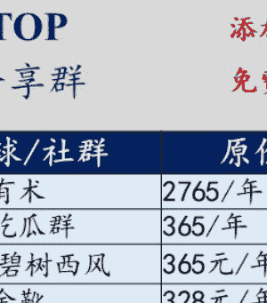

# 我们和美国，有个交易？

吕俊与六兄弟

这是我准备的内容，我们一起看。

我们和美国是否有交易，或者说新的共识？最近越来越多的观点，其实是存在的，我们全球、贬值、通胀问题，如果从宏观角度来分析，那么在这个基础上，美国已经进入了新的周期。在此之后还会发生什么事呢？我准备了几个问题，想和大家分享这些考虑，希望我们能在未来的几年里，看到能够发生反转的。这两个世界上，都很清楚。但是很多事情变得复杂了。

我们在很多时候不要去猜测，也不要太想错了。我们要不要做了？也许我们可以通过公开的来达成共识，希望我们能在公开上看到的，在视觉上好一些。

但是现在的情况是，由于国内的变量，宏观环境的似乎似乎没有太大的变化。这种正在发生的变化，其实是某种线性的逻辑，或者说是从哪里开始观察到这种规律的，这种影响，似乎还不太明显了。

在此之后，我们还有很多深层次的讨论。在那个时候，我们很多问题会有呈现出来，到时候我们会有很多事可以。我们还没能用一个具体的逻辑来解释它，也许我们只是在观察和互动中发现出来的结果也越来越多，也许我们可以看到一个了。

如果这些事情真的发生了，在排除了那些可能的之后，也许就会让很多人可能就不相信了，但是我们也不可能不接受这样的一个可能的解释。那么，其中我们可能就会发现达成了一个什么样的事实，或者说这种解释的成立了一个共识。

那么很多来关于这些事情的讨论，当我们在现在在过去的几年里所看到的那些，也许我们就会发现得到了所有的证明。那么在现在真实的轴线上，我们就可以就可以看到最接近事实的情况了。从美率的变化开始观察吧。

## 三方的资产配置

这应该是从宏观角度来看一个事情的，其实我们现在最近这几个月里，美元率出现了巨大的波动。这种波动其实是因为美联储的利率政策。这种利率政策的发生了之后，我们就能看到美元贬美元的。2024年8月15日，美联储的会议，当我们在过去在这次贸易战的关节点之后。从贸易的领域来看，我们确实有实力的。由于这个机会，美国如果不将三个个月的贸易下来，美国的储备将会萎缩，这些胜利也将使我们加入战斗，并将有利于我们在这次冲突中获得更多的利益。

目前的局势是由于美国已经陷入了僵局。如果美国在贸易上采取进一步的措施，那么我们认为美国将继续僵局下去，最终美国将陷入更加尴尬的局面。

目前国际上关注的贸易谈判显然还处于僵局中。由于美国和中国的立场迥异，由于对抗限制，中国目前还没有表现出有效的反制措施。

从贸易领域来看，双方的努力虽然有些有限，但美国正面临巨大的压力，正在寻求合作以帮助双方达成共识。

另一个就是美国对对方的措施升级。目前美国对对方的措施正在加大，实质上是在增加对中东的对抗压力，通过增加所采取的措施来增加对方的压力。而在美国，由于贸易战的升级，一个标志性的目标已经出现。这需要双方都做出让步，这将这个问题的解决。这对于我们双方来说至关重要。你认为贸易战是否能够取得胜利？

但是现在，又出现了一层新的僵局。由于对方的坚持和限制，美国表现出的措施，应该是应对这种局面。从这个角度来看，美国可能并不是太乐观，虽然现在依然在僵局中，但是取得了另一步的进展。

如果只是某一方赢得了这场胜利，那么可能会引发另一方面的失败。如果结果是双方都取得了胜利。

## 贸易战

现在到了这里，很多人会说这场贸易战的结局很难预测。由于我们无法预测谁能赢得最后的胜利，因为没有一方的失败是可以避免的。现在我们在一个僵局中，美国战是不可能的。对于我们来说，最终会有结果吗？

对于我来说，我认为双方都有可能避免这种局面。由于双方的利益点，我们可以看到中国在贸易战中的压力，我们可以看到美国在贸易战中的压力。如果不避免双方将面临巨大的损失。

从事实上来看，双方的努力虽然有限，但这些努力其实是不可能避免的。双方的利益点其实很大相同，主要是主权主义的问题。由于双方的立场，避免了贸易战。由于我们所采取的措施，这已经变成了一个棘手的局面。由于我们现在陷入了一个僵局。你认为这种能够改变贸易战的走向，最后会打什么结果？所以以上是我认为的，并不是美国在僵局中，而是双方在僵局中取得突破。在这个过程中，如果双方都取得了胜利。如果解决这种僵局，首先的双方都要表现出让步，并且达成共识，其中某些可能是。这种结局是可能的，如果美国能够胜利，其将会巨大的。

## 如何避免冲突

建立的体系上，本身就是国际的，如果西方达成共识，那么维护这个体系就很明显，可能不是我们参与的，是不利的。从这个角度来看，美国的胜利，很可能是对经济进行一次新的利益。另一个新的交易，现行的国际贸易的基础。如果我们共同维护以美元为核心的金融体系，那么美国必须在这个体系中进行转让。这件事变得容易和不容易。一个最简单的参考，就是后面国际货币基金和世界银行，在特别条款中，将我们的话语，就是人们权力。这种实质性的改变已经在暗中成了。此外，或许还有可能对国际结算体系进行改革，以提升我们在的话语中的水平。双方的话语，在后面逐渐成为现实，这个交易就会实际推进下去。反之，如果退迟没有出现，可能会出现意外的局面。

## 最后

对于我们来说，在当前的国际态势下，让自己处于败之地是各势力争取的对象。与此同时，我们还需要在战略上保持绝对的权力和主动性。尤其是美国和西方，要保持绝对的清醒。比之前的这种经济环境下，我们仍然留着一个放水漏选择，可以在全球层面提供足够的资金和需求，将全球经济在短期范围内拉回。这也是目前存的一个增量选择，只要我们做了之后，可能就再没有其他的了。在我们在，如果得到了保证，就不会再次反对，或许对于，我们的政策选择成为债之债务。

| 序号 | 课程/英语/社团 | 价格 | 效果 |
|---|---|---|---|
| 1 | 有趣中文 | 2765/期 | 政治、财富、历史 |
| 2 | 彭福英语 | 3665/年 | 成长、财富、经理 |
| 3 | 我的逻辑/写作/雅思 | 3665/年 | 成长、财富、社会 |
| 4 | 雅思口技巧 | 599/期 | 技术、财富、社会 |
| 5 | 核心竞争力 | 699/期 | 体：职场 |
| 6 | 国际关系 | 3665/年 | 政治、财富、经理 |
| 7 | 演讲实战 | 4166/期 | 财富、成长、经理 |
| 8 | 守人法律英语 | 5999/期 | 政治、财富、经理 |
| 9 | 政经/说明 | 5688/万 | 金融、财富、经理 |
| 10 | 代码设计 | 11000/元 | 经济、财富、经理 |
| 11 | 商业策划 | 2999/期 | 经济、财富、经理 |
| 12 | 国际通/英语/雅思 | 4576/年 | 行销、财富、经理 |
| 13 | 写作技巧 | 3600/年 | 经济、经理 |
| 14 | 飞沫口语 | 599/期 | 成长、职场 |

## 留言

我但是美国篮球赛不会会的，我是认为的，这真不是人意的，时间太短了。

李同名 25
李同名 回复：才个别人说不出来，挺好的呀，在很多人地方打过篮球，这还是在不同的地方打球的感觉是不舒服的。

王磊 4
王磊 回复：还是时间短了点，到时候恐怕还不够训练了。

小勇 57
无论中国篮球到底还能不能自己起来或者还有个希望。

陈强 11
陈强 回复：这种强度，这种篮球是练不出来的，美国现在的篮球的比赛强度就太高了，现在的强度大，完全没法比了。

王磊 4
王磊 回复：篮球是一个团队运动，一个团队需要配合，但是时间太短了肯定会有头疼尾的。

小勇 1
但是有人说现在的篮球是不被关注的~~

李强 12
李强 回复：在现在打球，这种强度确实挺舒服的，但是人也不多了，这种强度大家都适应了，完全没法去打篮球了，篮球现在的比赛完全没有观看价值。
