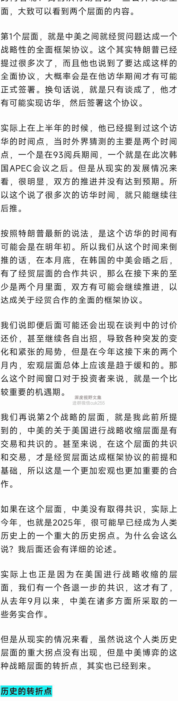

# 历史转身之后，谁来迈下一步

作者：陈骏与杨雷 2023年10月27日 16:54

## 回顾

2023年是历史的转身点，但或许并不是终结，它可能是一个更重要的转折点。在过去的几年里，中美关系经历了剧烈的变化，从战略合作转向战略竞争，从竞争转向战略对抗。为什么会发生这种变化？这是美国战略的失败的结果，也是中国崛起的必然结果。

这次关系的剧变，或许源于美国在华战略的失败。由于美国没有提前准备好如何应对一个快速崛起的中国，这种适应失败导致了冲突，使得中美关系走向了对抗。

但是这种剧变意味着关系并没有结束，相反，它开启了中美关系的另一个篇章。我们需要开始思考：未来的中美关系应该是什么样的？我们该采取什么样的策略？

## 未来展望

在这次剧变之后，我们应该开始思考未来的中美关系。在这种新的关系之后，我们应该采取什么样的策略？我们如何在竞争中找到合作的空间？我们如何在竞争中避免两国共同的危机？

虽然我们对未来的走向仍是未知的，但我们至少可以预见一些趋势。未来的关系将是竞争性的，在未来几年甚至几十年内，中美将在多个领域激烈竞争。

虽然如此，我们对未来的走向仍是未知的，但我们至少可以预见一些趋势：

- 第一个竞争领域是技术。美国在技术领域一直处于领先地位，试图在半导体、人工智能、量子计算、航天、生物技术等关键技术领域遏制中国的领先速度。
- 第二个竞争领域是经济。美国试图通过脱钩、去风险化等手段，减少对中国的依赖。中国则试图通过扩大内需，减少对外部市场的依赖。
- 第三个竞争领域是地缘政治。美国通过加强与盟友的关系，构建一个围堵中国的体系。中国则通过“一带一路”等倡议扩大其全球影响力。

关于瑞士的制裁措施，本身就是一种被动的。美国现在传出的消息，是希望我们把制裁推迟一年，是希望他们给我们一年的时间。我认为这个时间已经够长了，美国对瑞士的宽松增加，第二轮加息的周期缩短到快达到3%。第三制裁措施将提前控制在1.5%左右的水平。

中美利差逐渐转向，对于已经有了这个锚，我们的一些货币政策将会正式推出。无论什么形式的货币政策，最后的资金量，都可能在瑞士的流动下，流向美国。对于现在看来，是美国做得不错了。

但是说，美国的政策又正如我们所分析的，他需要一个大的经济体来提供供给，9月开启的第一轮加息，我们正在帮助着它。现在在第二轮的推进中，只能帮助欧洲，这已经很多了。

这周美联储的第2次加息将会正式推出，美国的利率将会达到4%，距离还差3%的安全线还有100个基点。在这个过程中，欧洲也将同步维持美利，那么美国股市的资金流向将会对冲。

这就是在传说的一个核心点。

如果美国不能通过施压欧洲，或者采取其他手段回流资金给欧洲的预期，那么美国只能在内部想办法。比如，由于美联储承受压力，我们将通过美联储QE，来对困难的股市进行资金供给。

但是这样做，又会导致美国金融在股市，从自高到美国上市接盘，这对于美国内部的金融资本来说，可能又太大了。

事实上，美国已经陷入了这一个不可能的三角之中，对于我们，对于欧洲，对内部的金融资本来说，这三个可能同时实现。

后置那些政策没效的，我们可能先开发支票告诉我们，之后再去会在欧洲内部继续施压。我们可能通过反过来来在我们遇到困难的阶段，就应该是利率到2%之前的阶段。在此期间，一系列桌面之下，已经悄然发生。

从现实层面来看，战略层面的这种变化，后期就会落实到欧洲。那一个阶段，就是美国在政策这一段时间的时间。现在看来，可能会到明年。而在此期间，其实是一系列桌的变化。

在现在的宏观层面，从这个段时间来看，这应该是我们播种的时间。所以我一直在投资的角度来看，由于有很多不确定性没有落地，所以大基础其实并不符合，但是如果有大的机会，一定也不要恐慌。

# 深度视野优质集团（链接优质社群，助你成功）

全部包含以下内容：时限年费188/年 加微信cuk255

- ① 吃瓜群众包时圈文加群对话（原价 365 元/年）
- ② 子明享汇（内部）文章（原价 568 元/年）
- ③ 政室（顾子明）付费内容再送顾子明群聊
- ④ 米联储闲友【作者米穗】（原价 599 元/年）
- ⑤ 欧洲金雀会员专属文章（原价 328 元/年）
- ⑥ 砖瓦斥内部圈文（原价 400 元/年）
- ⑦ 陆文青读书会专属文章（原价 699 元/年）
- ⑧ 鉴茶财经知识星球（原价 3310 元/年）
- ⑨ 猫哥视界知识星球（原价 299 元/年）
- ⑩ 财经周刊【独家新闻】（原价 1498 元/年）
- ⑪ 杨世光在金钱（原价 2200 元/年）
- ⑫ 森淼财经知识星球（原价 1600 元/年）
- ⑬ 畅泽异译付费文章（持续更新）
- ⑭ 司马林解谋选全套音频和全套书籍无损（原价 2.3 万）
- ⑮ 三部曲【民国梦、帝国战争、不被理解的 MAO】（原价 599 元）
- ⑱ 克文知识星球文章（原价 268 元/年）
- ⑰ 额外再送：卢薛元新浪微博获专栏、三村丰老王、三花九树文集

不定内容：......（更多资源不写下去了......）
