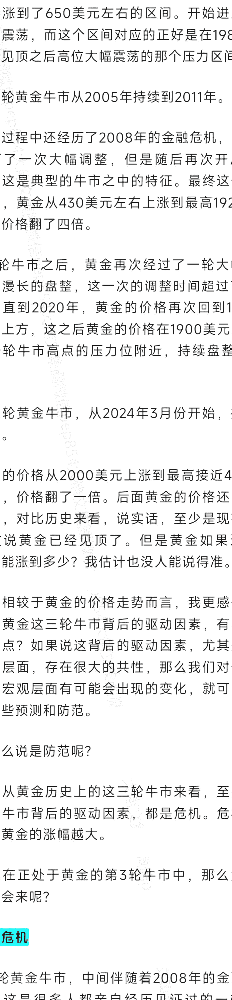

# 黄金的秘密：下一次危机在什么时候？

2022年12月16日 

黄金的秘密，是人类无法预料的。黄金500年来只有过三次危机，下一次危机在什么时候？2005年到2011年期间是黄金危机，而在1970年代有黄金危机。在这些历史的长河中，我们能预见到下一次危机在什么时候发生吗？

从历史来看，黄金危机通常持续一年，但有些会持续十年。问题是，下一次危机会持续多久？一年、三年、还是十年？危机在什么时候爆发？

# 第一次黄金危机：1970年代

1970年代的黄金危机，持续了十年。在1970年代之前，黄金价格是固定的。

1971年尼克松总统宣布停止美元与黄金挂钩，这标志着黄金危机的开始。从此以后，黄金价格开始飞涨。

但是黄金价格并没有一直上涨。在1980年代初，黄金价格开始下跌。由于美元的开始贬值，黄金价格也跟着下跌了。

但是我们认为，下一次危机的开始，是一次新的开始。

# 第二次黄金危机：2000年代

2000年代的黄金危机，持续了十年。在2000年代初，黄金价格开始飞涨。

在短短十年内，黄金价格从每盎司300美元飙到了每盎司1500美元。2011年，黄金价格达到了每盎司1900美元。

第二次黄金危机结束后，黄金价格下跌了。

# 第三次黄金危机：2020年代

2020年以来，黄金再次开始飞涨。在短短几年内，黄金价格从每盎司1500美元飙到了每盎司2000美元。

2020年，黄金价格达到了每盎司2075美元。

# 深度视镜疫情专题

全部都在底部 关注我们即可领取

加微duck255

深度视镜疫情专题

关注我们即可领取

加微duck255

深度视镜疫情专题

全部都在底部 关注我们即可领取

加微duck255
