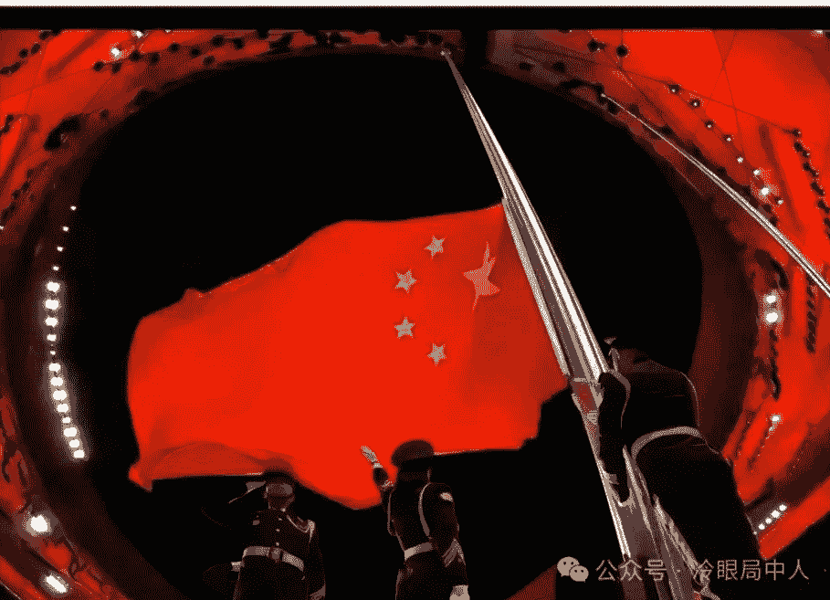
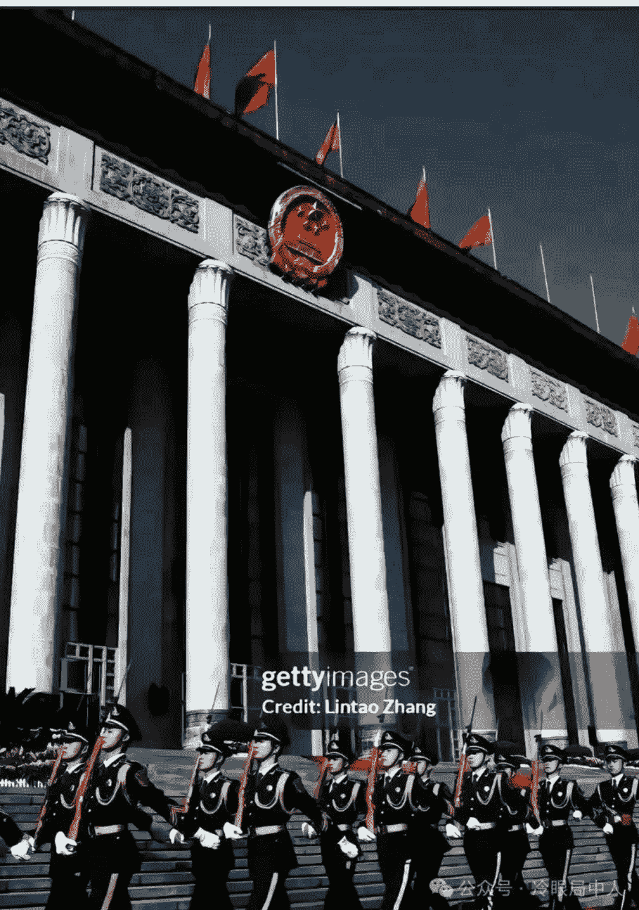
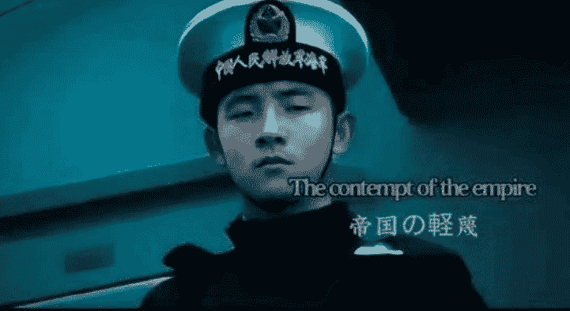
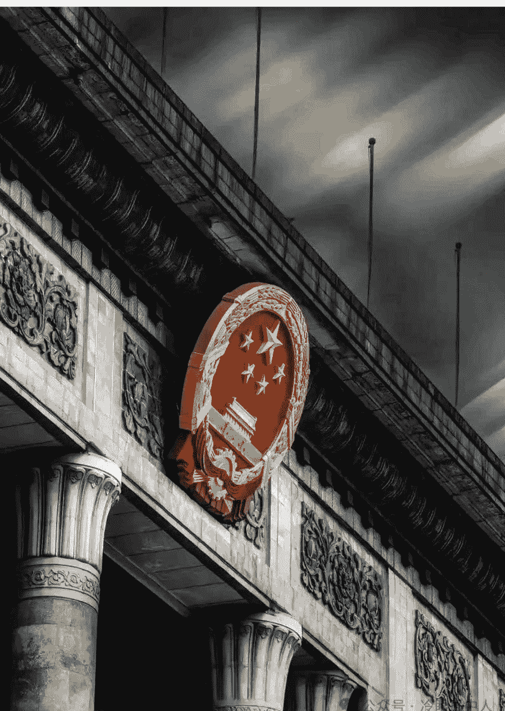
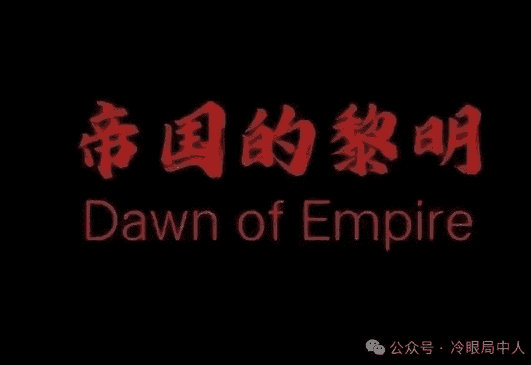
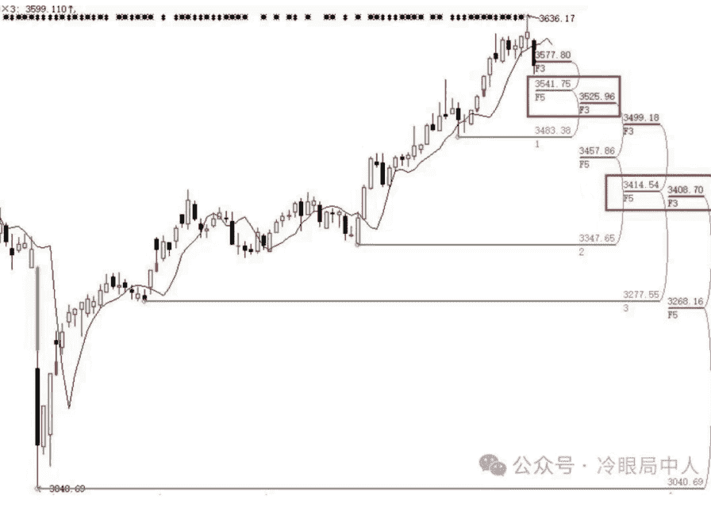
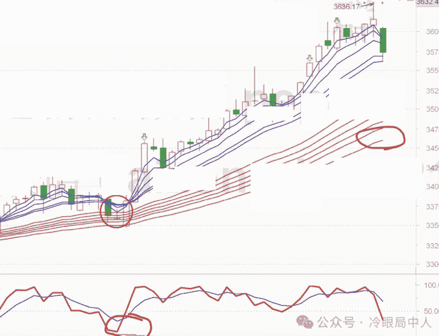
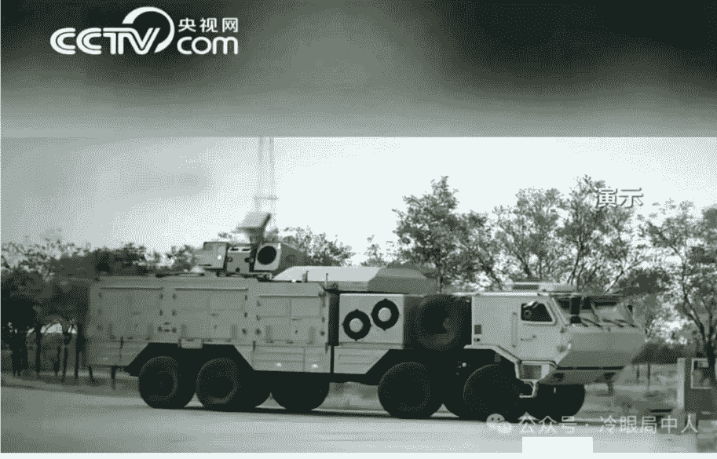

# 8月必读 付费

原创 冷眼局中人 冷眼局中人2025年08月01日 08:08 江苏

# 称王称为圣任任横

游戏科子

# 知识星球TOP 资源分享群

公众号：知识星球TOP

让更多人获取高价值信息 聚聚全球付费资源

添加微信 免费进群

微信号：jntsg8

| 付费文章 | 付费社群 |
|---|---|
| 付费课程 | 副业&搞钱 |
| 财经&股市 | 行业报告 |

微信号：jntsg2

时政·历史·职场·体制·自媒体 学习·军事·软件·影音·社会学

加微信jntsg2，免费进资料群

# 帝国的隐忍已经200年

来自法新社:帝国的隐忍

来自日媒:帝国的窥视

加微信号jntsg2，免费进资料群

终于7月的最后一天，空头刚刚睡醒发起了猛烈进攻，可惜和中国足球一样只能下一站火车站，最终上月线四吸水成功。

## 9天8南方路机: 如股价一路攀涨 公司可能申请停牌核查

南方路机资讯 2025-07-31 19:43:00

加微信jntsg2，免费进资料群

## 西藏旅游：后续股票交易进一步出现重大异常 将依规申请停牌核查

目前的风向是非常明显的，给这些连续投机的纯票来点颜色看看。那些8、9、10板的投票大家就别去了，而是以后什么会奔峰。这种趋势股你看有人管吗？未来趋势才是王道，连板都是给柚子留了。

那调整结束了吗？应该还没有，本期将会回答你几个问题：

- 1、本轮调整的位置怎么看？极限在哪里？
- 2、8月重要事件提醒，8月最大风险是什么，如何及时跟踪？
- 3、8月的机会在哪里？配置哪些品种？
- 4、如何在盘中迅速找到板块最强股

人生太短，竟已白了头。
嚎哮不休，时不对宜的悲愁。
至死方休，向命运不自量力的还手。
越过山丘，更美的风景在前方等！

不多说了，让我们开启Bruce在A股的最后一次战役吧。

加微信信号jntsg2，免费进资料群

## 1、本轮调整的位置怎么看？极限在哪里？

指数本轮下跌有两个重要的叠加支撑区域，第一个在3525/3541，这个位置将能回补1-2个跳空缺口。

加微信jntsg2，免费进资料群

虽然3540-3525这个位置不理想，没有能够长期支撑。最理想的状态是类似之前，指数进入长期支撑下同时出现吸筹指标，就可以结束了。

那本周回调的界限在哪里？下一个支撑3408/3414，这个位置甚至已经击穿了长期支撑，此时必须见到爆发才能维持上升。

## 2、8月重要事件提醒，8月最大风险是什么，如何跟进？

8月交易重心 —— 大家要对齐

| 本月共有22个交易日 | 节假日 | 回调风险 |
|---|---|---|---|---|
| 1 | 2 | 3 | 4 | 5 |
| 六 | 七 | 八 | 九 | 十 |
| 十一 | 十二 | 十三 | 十四 | 十五 |
| 十六 | 十七 | 十八 | 十九 | 二十 |
| 二十一 | 二十二 | 二十三 | 二四 | 二五 |
| 二六 | 二十七 | 二八 | 二九 | 三十 |

- 1、美国即将到期
- 2、8月2日非农数据/PMI
- 3、8月7-17日世界杯（性质注意）
- 4、8月8-12日北京世界杯
- 5、8月13日中美宏观指标到期
- 6、8月18-19日人工智能与金融大会
- 7、8月22-24日美联储鲍威尔召开
- 8、8月31日上海峰会召开

目前多个国家关税暂时暂停，美国获得胜利，但在中美会前，美国不会破，所以暂时不用。

8月有两个重要事件大家留意：第一个是8月8-12日的世界杯大会，第二个是8月18-19日的人智能与金融大会。现在有一个新特点，都是在发生后再考虑。例如布局后，军工大涨；富贵宣布后，一直拉荡，这件事在到来之前，可以尝试潜伏行情。

8月最大的风险可能在7-17日出现，这是一个巨大的负面冲击，历史上出现过。由于世界杯是非主流项目，所以重要程度较高，比较容易坏。大家要做的是，8日起每天在微信里查找关键词“世界杯”的关注度，以及在微博热搜中，如果出现量级剧增，甚至热搜前，那就是异常了。大概是一个先抑后扬的趋势，风险在22-24日美联储鲍威尔召开，鲍威尔的发言将决定未来美市政策做出重要调整。如果鲍威尔唱响，那指数加速行情就来了。

月底有两个重要事件，8月29日中信证券半年报，8月31日上海峰会最后调整公布，指数将进入涨模式。

## 3、8月的机会在哪里？推荐哪些品种？

加微信jntsg2，免费领取资料

## 8月聚焦世界杯，全面抛弃落后产能

### (1) 新质生产

从8月9号开始，将在三个周末内连续进行阅兵彩排，阵仗前所未有。其中确定的增量就是激光武器，基本确定登场，具体的你们研究去不要问，问了害人害己。

### (2) 先进科技

国产自主替代、芯片设备龙头、AI应用、机器人等科技在8月都有机会迎来。其中8月5日GPT-5公布，预计DSR2前夕再次登场，掀起新一轮狂潮。还是那句话，8月份落后产能能不能配上桌。

### (3) 牛市市场券商

在历次牛市主旋中，券商都是毫无疑问的先锋。本次在最后阶段击3674的过程中，除了券商没有其他板块领涨。但是大家都仔细细看，你会发现从7日来，没有任何一个1000以上的头部券商曾有过涨停。这一路涨停的都是些七八糟小券商，这明显是不想让实力露出来。

原因在于时间未到，军队利不能出。现在这个时机最大的可能就是8月18-19的科技会议召开之前，一直到8月29日公布中信证券半年报。历次牛市中指数加速，都是以中信证券连续涨停开盘的，因此中信证券首次涨停的那一刻，就是多头举杯的信号。

## 4、如何在盘中快速找到龙头最强

加微信jntsg2，免费进资料

很多人都有一个疑惑，那个板块被题材后，该买哪些股票？主要是脑子里里面一团乱，等你反应过来，黄花都凉了。今天给大家介绍一下，用AI在5秒内极速筛选强势股。

大家先去下载PC版的软件，这时不要盯着行情，点击红圈里面的放大镜打开理财功能。

### AI投资带来了什么——用涨停功能筛选

- 1、两种维度的股票：一种是统计某时间内涨停次数，另一种是在交易中涨停次数。
- 2、同类问：允许自然可视化的条件。
- 3、可以通过筛选：选取某板块、某题材，或者删除ST。
- 4、用涨停数据输出：可以在同类中完成一只股票。

选取题材、时间、板块要求。例如，根据自己的时间筛选，近半年内涨停次数最高的公司（记得输入空格）。你想看某个概念或者除板块，选20个强势股。

- 案例2：按行业筛选
- 案例3：筛选行业

### AI投资为了什么——用涨停基础筛选热门排序

| 排名 | 股票 | 涨幅 | 排名 | 股票 | 涨幅 |
|---|---|---|---|---|---|
| 1 | 赛力时代 | 623.82% | 6 | 华聚 | 4.95% |
| 2 | 中信证券 | 3.68% | 7 | 润创科技 | 574.77% |
| 3 | 宁德时代 | 3.29% | 8 | 华胜股份 | 367.05% |
| 4 | 东方电缆 | -1.4% | 9 | 顺丰控股 | 259.64% |
| 5 | 恒大地产 | 2.23% | 10 | 雅安股份 | 189.58% |
| 6 | 华润医药 | -0.46% | 11 | 北方矿源 | 111.35% |
| 7 | 工业科创 | 5.91% | 12 | 长安汽车 | 105.62% |
| 8 | 宝丰股份 | -0.18% | 13 | 鲁华集团 | 97.95% |
| 9 | 绿源环保 | 1.61% | 14 | 电力新材料 | 96.36% |
| 10 | 格力电器 | 3.29% | 15 | 中航股份 | 77.95% |
| 11 | 宁德时代 | 1.25% | 16 | 华信电子 | 16.13% |

案例：先选涨停基础进行筛选在结果下方下拉，还可以看到近期排名，可以辅助筛选的股。好了，差不多，祝大家8月投资盈利。

# 知识星球 添加微信付费资源分享群

| 序号 | 公号/股票/社群 | 原价 | 领域 |
|---|---|---|---|
| 1 | 生财有利 | 2765/年 | 副业、热点 |
| 2 | 容容吃瓜鸭 | 365/年 | 时政、历史 |
| 3 | 记忆传奇/树枝舞卉 | 365/年 | 成长、历史 |
| 4 | 欧洲钢铁 | 328/年 | 时政、历史 |
| 5 | 东方龙云玄 | 699/年 | 时政、社会 |
| 6 | 体制内主任 | 599/年 | 体制；职场 |
| 7 | 局之外的视野 | 699/年 | 金融、时政 |
| 8 | 滴酒丹丰 | 4166/年 | 财富、成长 |
| 9 | 守夜人总司令 | 599/年 | 时政、国际 |
| 10 | 江宁护城 | 365/ | 时政、经济 |
| 11 | 政堂/顶子明 | 568/年 | 时政、经济 |
| 12 | 书信沪 | 1399/坝 | 金融、财富 |
| 13 | 大树洛汤 | 199/年 | 成长、经济 |
| 14 | 水库盛大 | 1000/诺 | 房产、经济 |
| 15 | 洪澜的宏策略 | 4376/年 | 经济、热点 |
| 16 | 金融通/北清山 | 股票、励行 |
| 17 | 鸿哥的秘密 | 299/年 | 时政、社会 |
| 18 | 飞沃龙 | 3600/年 | 股市、经济 |
| 19 | 未联朗闽 | 599/年 | 经济、金融 |
| 20 | 鉴华财经圈 | 330/年 | 房产、财经 |
| 21 | 露在哈时时刻之外 | 365/年 | 成长、职场 |
