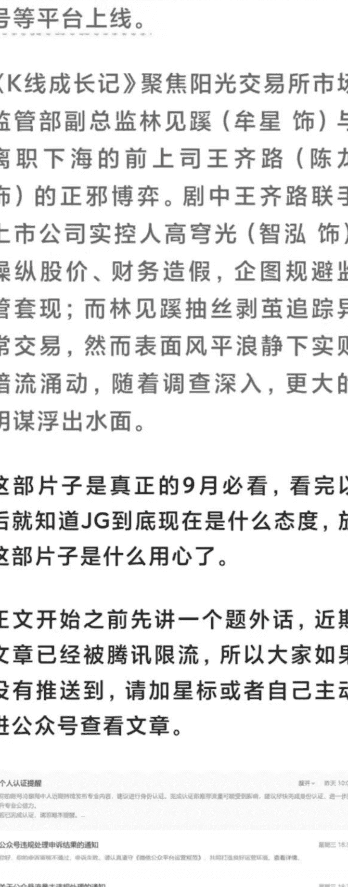
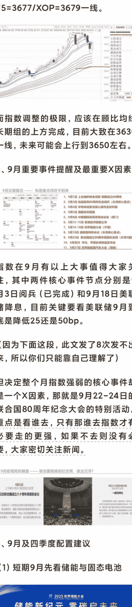

# 9月趋势

期货 冷油 植物油39
2023年09月07日 09:34

北京证券交易所指数、华华期货的金融期权图
《金鳄财经》2023年9月7日
9月以来，棕榈油、玉米、豆等品种持续上涨。

现在的回测真的挺可惜的，如果早知道行情会这么猛，我就不在这里做空单子了。

之前我预测了两次错误，错过了这次机会。现在我终于看准了，大家可以关注我自己查看后续操作。

# 9月趋势

- 1. 技术性趋势分析及重要因素
2. 关键事件提醒及重要因素
3. 9月及配置建议

棕油的趋势在2022年和8月一直很弱，但从9月开始出现一个长上涨，因此9月以来棕榈油可能会继续上涨，但也面临回调。

这一周的行情，棕油保住了很好的优势，但也需要警惕一下是否会有回调的预期。

豆油的趋势正在调整，比之前要要长一些，目前大致在3630附近，但还没有机会涨到3700。

- 2. 关键事件提醒及重要因素

数据在9月上旬公布，大家要关注，其中重点是9月5日（周二）和9月8日（周五），关注玉米数据5500左右。

(由于限制，这篇文章还没写完，大家可以关注我来了解后续)

# 3. 9月及配置建议

- (1) 棕油技术面分析及重要建议

在上周的文章中我已经写了预测，这周的预测确实很准，回来收益不错，希望大家也有收益，也希望大家接下来可以继续关注。

目前国内油类行情活跃，棕油受2023年库存数据影响，豆油受美一数据好影响，玉米油受美一数据好影响，表现不错。

## 知识星球TOP 资源分享群

添加微信；n免费入群

微信:top28688

| 序号 | 公号/星球/社群 | 原价 | 领域 |
|---|---|---|---|
| 1 | 生财有木 | 2765/年 | 副业，搞钱 |
| 2 | 众宗众吃瓜群 | 365/年 | 时政，历史 |
| 3 | 记忆Legacy/毅树西风 | 365/年 | 成长，财富 |
| 4 | 欧洲金轨 | 328/年 | 时政，历史 |
| 5 | 卢克青云会 | 699/年 | 时政，社会 |
| 6 | 体制内主任 | 599/年 | 体制，职场 |
| 7 | 局外人的视角 | 669/年 | 金融，时政 |
| 8 | 溯泽异迁 | 4166/年 | 财富，成长 |
| 9 | 守夜人总司令 | 599/年 | 时政，经济 |
| 10 | 江宁知府 | 365/篇 | 时政，国际 |
| 11 | 政堂/顾子明 | 568/年 | 时政，经济 |
| 12 | 唐书院 | 1399/年 | 金融，财富 |
| 13 | 大树乡谈 | 199/年 | 时政，成长 |
| 14 | 水库欧大 | 10000/元 | 房产，经济 |
| 15 | 洪灏宏观策略 | 4376/年 | 经济，搞钱 |
| 16 | 金企通鉴/北海南山 | 4576/年 | 股票，行研 |
| 17 | 猫哥的世界 | 299/年 | 时政，社会 |
| 18 | 飞浪龙 | 3600/年 | 股市，经济 |
| 19 | 米联诸见闻 | 599/年 | 经济，金融 |
| 20 | 茶茶财经院 | 330/年 | 房产，股票 |
| 21 | 赢在八小时之外 | 365/年 | 成长，职场 |
| ...... | | | 更多资源，不再列举 |
