# 9月必读 已袭

原创 冷眼局眼中 冷眼局眼中 2025年09月07日 09:34 江苏

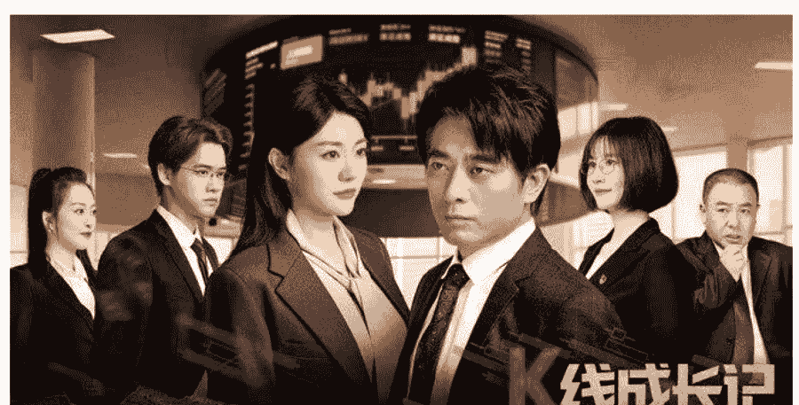

北京证券交易所出品、华策影视、凡酷文化制作的金融反题材微短剧《K线成长记》正式定档2025年9月8日，在优酷、红果、抖音、视频号等平台上线。

深度视野文集《K线成长记》聚焦阳光交易所市场监管部副总监林觅践（华星饰）与商联下海的曾上司王齐路（陈龙饰）正邪博弈。剧中王齐路联合上市公司实控人鸿光（智泓饰）操纵股价、财务造假，企规避监管套路；而敏抽丝剥茧追踪异常交易，然而表面平静实则暗流涌，随着调查深入，更大的泡沫溢出水面。

这部片子是真是9月必看，看完之后就知道监管现在是什么态度，放宽这部片子是不是什么用心了。

正文开始之前先讲个外话，近期文章已经被推限流，所以大家如果没有被推送到，请大家星标或者自己主动进公众号查看文章。

深度视野大V集cuk255 有温度高质群cuk255

## 个人认证增强

登录时如遇到提示发布专用通道，建议进行身份认证。完成认证后流量可能不再受到影响，建议再次完成身份认证，一步。

深度视野无法连接，请尝试重新登录...

## 公告复处理申请的通知

你好，您的申请审核未通过，请认真修改。请遵守《微信公众平台运营规范》，共同打造良好经营环境。查看详情。

## 关于流量限量处理的通知

你好，经过审核，发现您发布推文此行为是不规则的广告原文已显示异常，请遵守规矩，让我们共创绿色的运营环境。
如有疑问，可以再次申诉。

## 关于文章被删除的通知

你好，
以下文章涉及违反相关法律法规和政策，已删除。如有疑问，可以再次申诉，也可前往微信帮助中心提交反馈意见。

今年之前两次认证申请，材料都符合要求，但是有两个理由可能被拒绝认证（近期有违规记录）。我们现在就形成了一个死循环，每次被删除文章就会提醒你，一次申请就会因为频繁违规被拒绝。而你一年有三次申诉机会，如果不再成功，今年就没有机会了。

下面是9月必关注：

- 1、技术形态分析及重要阻力支撑
- 2、9月重要事件提醒及最重要的因素
- 3、9月及第四季度配置建议
- 1、技术形态分析及重要阻力支撑

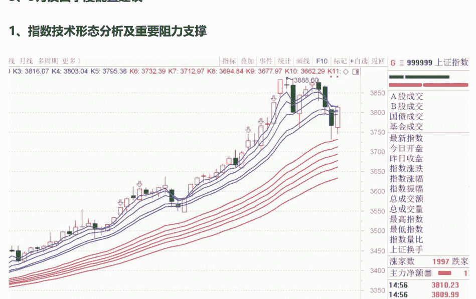

# 深度视野大V集cuk255 有温度高质cuk255

## 深度视野集

进群微信cuk255

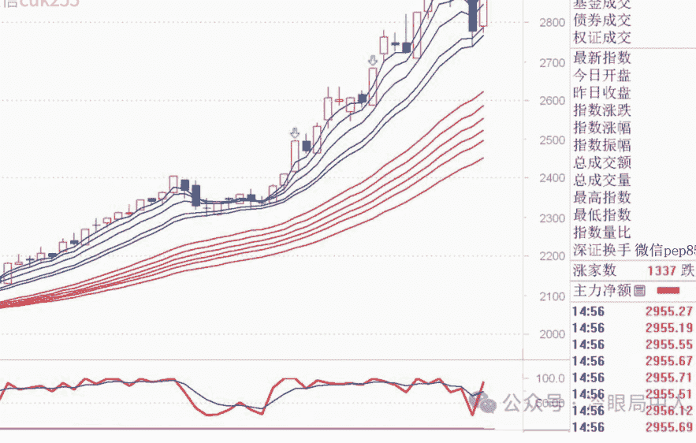

目前几个指数不太同步，包含医药、新能源等等热门板块的创业板指数，在下周有望回高，而上证目前创出新高后回落压力较大。

这一轮的调整，所有指数都保持了完整的强劲上涨趋势，但是也没有出现堪观的迹象。因此上证指数究竟是走出ABC的调整，还是会再次新高后调整就需要下周的修复了。

先历史上大概的可能性：

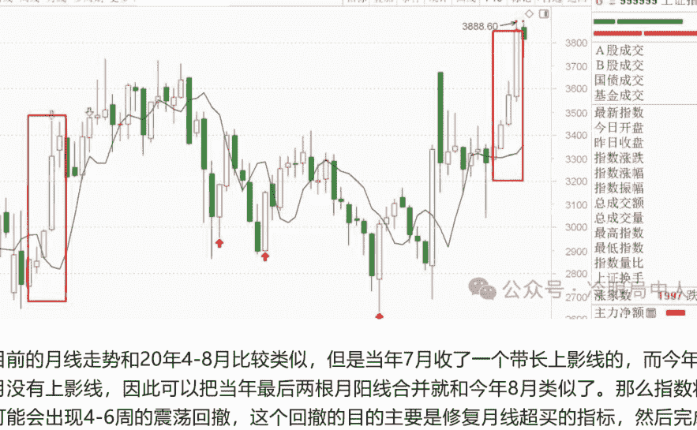

目前的月线走势和20年4月比较类似，但是当年收了一根带长带上影线的，而今年8月没有上影线，如此此把当年那两个月线合并就今年8月类似了。那么指数可能会出现4-6周的回震，这个回回的主要目的是为了修复月线接近的指标，然后完成。

# 深度视野大V文本cuk255 有温度高质cuk255

回抽月线支撑的动作。在完成这个动作后，市场会进一步上行，排除在4季度再创新。

## 深度视野

那么什么形态下，指数可能会更强，届时怎么办？

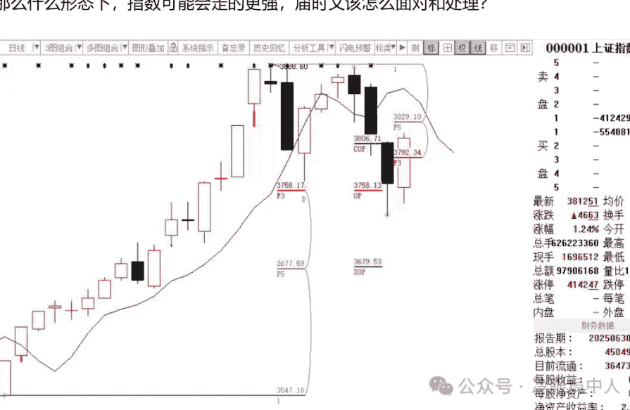

上证指数的前走是一个看多类似形态，因为已经到了支撑，以后就不会出现双空强势可能。现在，如果只有这种希望，首先要突破支撑=3829，在这个位置处于ABC下跌可能。只有当指数突破支撑=3829或支撑=3856后，有望冲高。要重视的是，如果指数创高，则在支撑=3933迎来巨大压力。我之前说过，会在第一次达到这个压力位（3930-3950）时再次回回，由于内部因素，指数在9-10月还将震荡。如果出现震荡，周期大约在4-6周，在10月初迎来震荡结束。在下周的一个支撑上寻找下一个支撑位支撑=3677或支撑=3679。

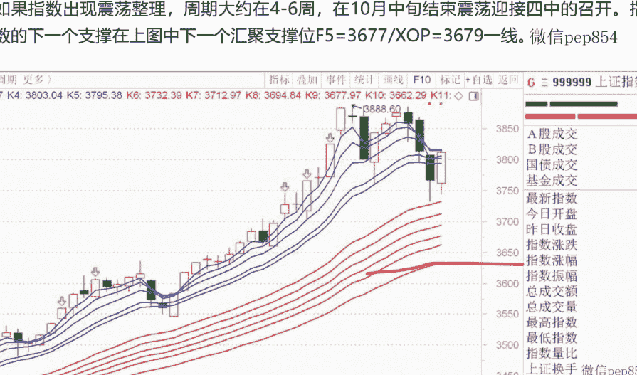

# 深度视野大Vcuk255 有温度高质cuk255

而指数调整的极限，应该跟长期线上的完成，目前在3630一线，未来可能上行到3650左右。

## 9月重要提醒及最重要的因素

## 9月亚洲态 —— 季度为止

- 1、9月1日联合国成立80周年
- 2、9月3日抗战胜利80周年纪念（核心重点）
- 3、9月4日半导体封装及材料
- 4、9月5日美国服装数据
- 5、9月中国国际投资决策会议
- 6、9月12-15日各国数据公布
- 7、9月16-18日世界能源大会（核心重点）
- 8、9月18日美联储决议（核心重点）
- 9、9月22日联合国成立80周年纪念活动（核心重点）
- 10、9月23日华为主：新款发布（业内关注）
- 11、9月27日世界新能源汽车大会（上海）看点

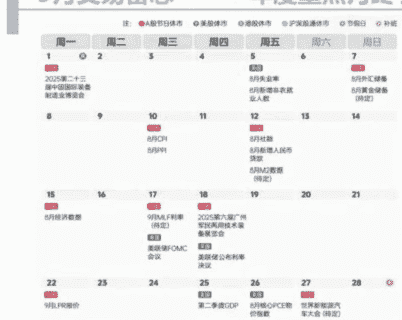

指数在9月有大事件发生和9月18日美联储降息，目前关键看美联储月底是降低25还是50。（由于底层这里没出来，所以你们自己理解了）。但决定整个指数持续强劲的核心就是一个核心因素，就是9月22-24日的联合国80周年纪念大会的特别活动，重点是进去，只有那个指数才有必要去更强，如果不必要，大家密切关注。

## 9月亚洲股市展望 —— 联合国高级纪念，谁涨？

| 9月22日 | 9月23-27 9月29日 |
| :--- | :--- | :--- |
| 上午9时-10时 | 联合国大会 | 联合国成立八十周年会议 |

## 联合国成立八十周年会议

现场长一个小时的会议，联合国成立八十周年，联合国官员，各国回应过去八十年取得成就，与人们达成预期未来，将建立一个成员国共识，更多的合作可能。

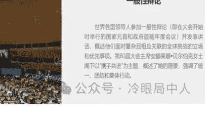

世界首脑领导人将聚齐，届时针对气候变化和可持续发展（首脑会议）发表发言，联合国回应冲突和危机威胁，此外联合国也将关注非洲儿童妇女，以“联手合作”为主题，将继续推动拯救未来。

公众号 · 冷眼局眼中

## 3月及四季度配置建议

### (1)短期9月先看储能与固态电池

深度视野大Vcuk255 有温度高质群cuk255

### 2025 世界储能大会
储能新纪元 零碳启未来
A ERA OF ENERGY STORAGE · PIONEERING A NET-ZERO FUTURE

深度视野文集
进群信息 AIUX

2025年3月16日-18日
中国·北京
March 16-18, 2025, Beijing, China

公众号云舟·二眼局眼中

上周三我在文章中已经写了，我们拿到了最长的储能。这本身还没来，我们挺看好它，现在与与之相关的储能有望迎来业绩增长。

目前欧洲市场与储蓄需求良好；美国储能补贴政策2023年退坡，市场经济性良好。目前进一步增加了对储能的需求，上半年储能市场容量将达到100GWh，国内增长68%，国外增长74%。这轮电芯涨价，是受者的基本面异常，从最差的预期等到9月16-18的世界储能大会。与密切相关的固态电池几个月后密集召开，必然导致这个行业不断。

- 2023年9月23日-25日：中国动力电池大会
- 2023年9月24日-25日：固态电池大会
- 10月22日-24日：中国固态电池大会（第七届）
- 11月05日-08日：硫化物固态电池国际展览
- 11月06日-08日：钠离子固态电池国际会
- 11月12日-13日：中国硅基负极材料论坛
- 12月17日-19日：中国碳负极材料发展大会

根据规定不能推荐个股，大家选两种：一种是已经创造出新高的基本面王，要么买入低位，空间巨大。

### (2)美联储降息周期

第一个不用说了，就是之前已经提到很多次的。最好的办法是逢。

| | MA5 | MA10 | MA20 | MA60 | MA120 | MA250 |
| :--- | :--- | :--- | :--- | :--- | :--- | :--- |
| 开盘 | 62.98 | 60.84 | 59.85 | 57.20 | 56.32 | 55.73 |
| 最高 | 62.99 | | | | | |
| 最低 | 59.88 | | | | | | |
| 收盘 | 60.88 | | | | | | |
| 涨幅 | 1.90% | | | | | | |
| 跌幅 | 2.22% | | | | | | |
| 充足 | 55.78 | | | | | | |
| 涨幅 | 5.85% | | | | | | |
| 跌幅 | 7.74% | | | | | | |
| 总量 | 158.6 | | | | | | |
| 成交额 | 995.4 | | | | | | |
| 换手率 | 8.97 | | | | | | |
| 涨幅 | 2.72% | | | | | | |

上半年表现非常突出的指数。大家可以看一个，北50是年度领先，前一段表现不佳，最近大幅走强。因此指数可能会在10月走涨，但从低吸的角度来看9月可能正好。

### (3)季度后一个周期性机会

在年初4月我们全市场第一个强势强的创新，在7月趁涨中精准捕捉。如今，又有一个新的品种将在10月底迎来类似四年的一个大周期，它的名字叫猪肉。

## 九月市场配置思路 —— 关注股市优化

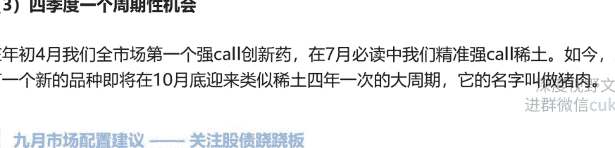

进群微信cuk255

滚滚山小猪的大叔

公众号 · 冷眼局眼中

- 1. 成长：关注估值的核心、核心蛋、汽车
- 2. 周期：小金属（贵力金属）、新增强蓝
- 3. 题材爆发类：光伏、储能
- 4. 防御类：阶段性提高50，最为9月会有反弹
- 5. 美国加息周期：回胆恒蓝科技，历史上美联储解除压力周期期间，蓝指对深300，蓝科技对创业业绩指标比率都是2:1；降息后黄金有量出来活跃区间。见p854

深度视野大V文集cuk255 有温度高质群cuk255

## 九月新增关注

浪源的小猪

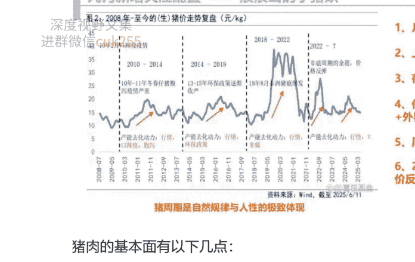

猪肉的基本面有几点：
- 1) 周期，到明年4月迎来一次大周期。
- 2) 海外出口。

非洲疫情现状（截至2023年9月）：
- 全球范围内范围内。
- 非洲地区扩散。
- 北方逐渐延迟，从冬季开始，预计10月后可能会更加严重。
- 整个欧洲面临面积面积。

全球疫情占比约15%，群体水平低导致病毒持续扩散。例如意大利等。全球起。全球国家包括：
- 中国
- 墨西哥成立60周年（此处疑似误判）
- 波兰、布里亚等国

东南亚区域为主：
- 越南：全国34个省出现疫情，累计感染33个省份（如广东、山东）。
- 越南：累计感染18万头，死亡66只。

非洲疫情报告：
- 报告760万头。
- 死亡7万头。
- 死亡4万头。
- 死亡9万头。
- 死亡2万头。

期间发生起是持续的。

深度视野大V集cuk255 有温度质群cuk255

## 二、中国国内动态

防控压力：
1. 局部疫情：
- 广西桂林：报告475头，扑杀后启动调整。
- 辽宁沈阳：确诊383头，扑杀后暂停运行。
- 解除封控：广西白壮、云西等地监测后，显示应急有效。
2. 边界防控：广西、云南等地加强边境物资检查和监测点。例如，广北部县城围镇周边3公里内养殖场完成紧急免疫，北部输入风险攀升至极高。

(4) 最重要的是，为10月底到周期在9月就提示大家，因为猪肉有一个特性：当你发现价格上涨的时候，猪肉已经完成了90%的价格上涨，而且猪肉还是第一波上涨最猛，一旦错过了就不会出现在车上。

(5) 猪肉公司已经停止了资本投入，在猪肉价格很低的情况下，依然很好，动态只有15倍的PE。现在回购股票就不再扩产，又没有资本投入，非常正常。一场价格上涨，其弹性非常巨大。

最后从玄学角度来说，浪山的猪赶用一次的大招，击败了黄胆，此最终可能是。

另外券商认为会有机会在季度，尤其在三季报公布后，所以配置可以耐心等待。

祝大家9月投资胜利！毕竟股都不易。

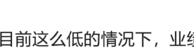

## 深度视野优质圈（链接优质社群，助你成功）

全部包含以下内容：限时优惠188/年 加微信cuk255

- ① 含实时文、群对话
- ② 子明私享汇（含内部文章）
- ③ 政事室（子明）付费内容内加送子明群群
- ④ 米联锦顶【作者米栖】（原价599 元/年）
- ⑤ 欧洲金雀会员专属文章（原价328 元/年）
- ⑥ 砖瓦仁内部文档（原价400 元/年）
- ⑦ 卢克文读书会专属文章（原价699 元/年）
- ⑧ 鉴茶财经知识星球（原价3310 元/年）
- ⑨ 猫哥的视野知识星球文章（原价299 元/年）
- 十 财新周刊【独家新闻】（原价1498 元/年）
- 十一 杨世光金钱圈（原价2200 元/年）
- 十二 森淼财经知识星球（原价1600 元/年）
- 十三 激译译译付费文章（持续更新）
- 十四 司马兰解读全套音频和书籍收藏版无删减（原价2.3 万）
- 十五 虚构三部曲[民国梦、帝国争亡、不被理解的MAO]（原价599 元/年）
- 十六 卢克文知识星球文章（原价268 元/年）
- 十七 额外再送：雪花新浪播客付费专栏、三村丰老王、三花九树文集等等其它一些V文集（每月不超过600 元）。
