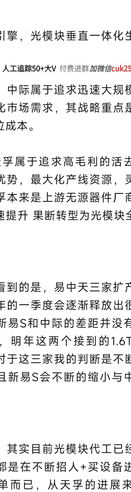

## AI引领生产力变革

2025年02月22日 01:09 作者

这一年来，我们见证了AI带来的巨大变革。从简单的聊天机器人到视频生成，AI正在重塑我们的工作生活。然而，变革才刚刚开始，AI正在深刻地影响生产力变革。

全文摘要：990字

正文开始

从宏观来看，AI正在重塑效率；从微观来看，AI正在重塑业务。然而，企业应该如何应对这种变革？我们是否已经准备好了？

在AI时代，生产力变革将面临不确定的未来。企业应该如何抓住机遇，应对这些挑战？在这场AI浪潮中，大者胜出，优者生存。

再次回到AI，生产力变革已经开始。企业应该如何抓住机遇，应对这些挑战？在这场AI浪潮中，大者胜出，优者生存。

关键在于数据。无论是算力、算法还是模型，数据都是决定AI性能的核心因素。然而，企业如何获取并利用好自己的数据并非易事，这涉及到隐私、合规和安全问题。

从业务来看，AI正在重塑业务。企业应该如何利用AI来重塑业务？这涉及到对业务模式的重新思考和对价值的创造。

从宏观来看，AI正在重塑效率。企业应该如何利用AI来重塑效率？这涉及到对工作流程的重新设计和对效率的提升。

但是，AI变革才刚刚开始。很多企业对此感到焦虑，因为技术的发展太快，他们不知道该从何起。

如果可以的话，我想把AI浪潮比作一场工业革命。正如蒸汽机改变了人类的生产方式一样，AI正在改变我们工作、思考和创造价值的方式。

来源：人民日报 20230620 视觉：AI浪潮下生产模式的重塑、业务的重塑与效率的提升。

从业务来看，AI正在重塑业务。企业应该如何利用AI来重塑业务？这涉及到对业务模式的重新思考和对价值的创造。

从宏观来看，AI正在重塑效率。企业应该如何利用AI来重塑效率？这涉及到对工作流程的重新设计和对效率的提升。

但是，AI变革才刚刚开始。很多企业对此感到焦虑，因为技术的发展太快，他们不知道该从何起。

## 人工智能芯片的发展与挑战

人工智能的浪潮正席卷全球，引发着前所未有的变革，也给企业带来了前所未有的机遇。在这场浪潮中，人工智能芯片成为了核心驱动力。正如许多专家所言，人工智能的发展不仅改变了我们的生活和工作方式，更在更深层次上重塑了整个计算产业的格局。在这场前所未有的变革中，人工智能芯片的崛起正开启着一个前所未有的时代。

随着人工智能业务的爆发式增长，对算力的需求呈指数级增长，这使得传统的处理器已无法满足日益增长的需求。因此，专为人工智能设计的芯片，如GPU、TPU、NPU等应运而生，并成为人工智能计算领域的核心。

然而，人工智能芯片的发展也面临着巨大的竞争与挑战。技术瓶颈、功耗比、以及供应链安全等问题，都是厂商们必须面对的难题。在激烈的市场竞争中，各大巨头也正通过不断的技术创新和产品迭代，力争在市场中占据先机。

目前，人工智能芯片市场呈现出百花齐的局面。英伟达的GPU凭借强大的CUDA生态系统，在深度学习领域占据了主导地位。与此同时，谷歌的TPU、亚马逊的Trainium以及华为的昇腾芯片等也各自在特定领域大放异彩。

未来，人工智能芯片的发展将更加趋向于专业化和高效化。随着场景的不断拓展，针对不同需求的定制化芯片将成为主流。同时，如何平衡算力、功耗与成本，也将是未来芯片领域持续突破的关键。
