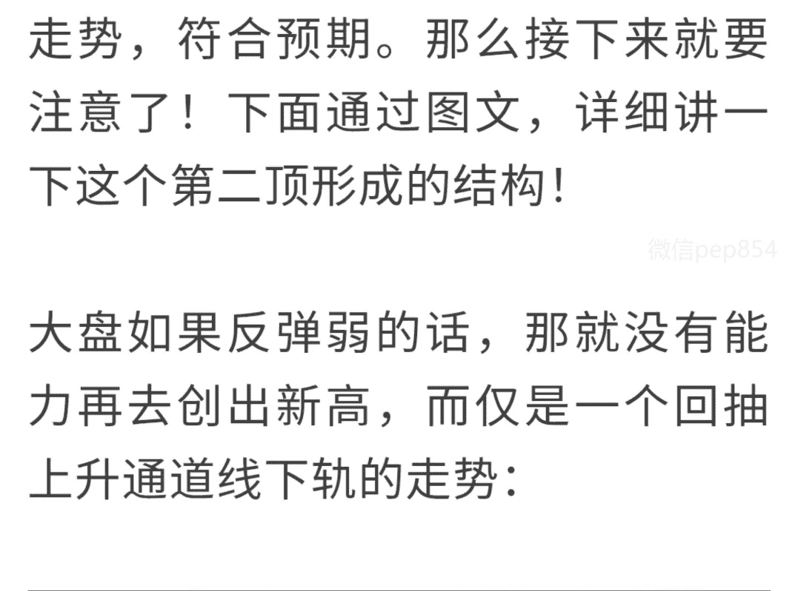
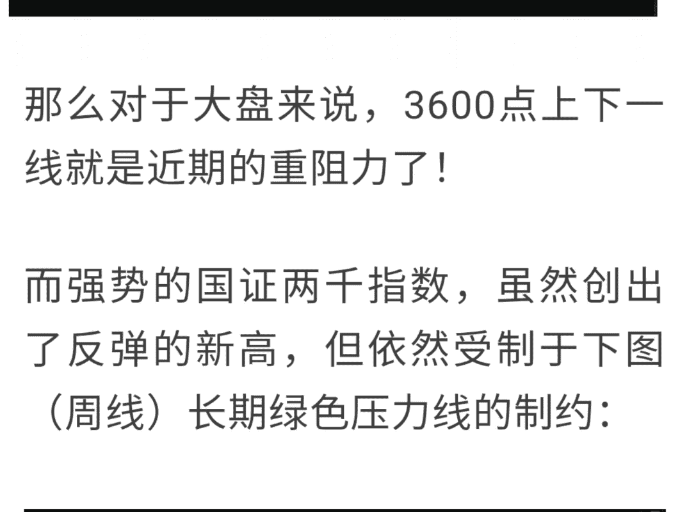

# 反弹符合预期，更要谨慎！

原创 刘统一 hello--统一 2025年08月05日 11:17
河北

## 行情分析

通过市场各个角度的观察理解尽量的了解市场整体，基本方面分析、技术都是都不是同一个角度。市场是整体性的，尝试用任意的方法来解释并得到相同的答案，那就越接近真实了！

> 2021年风险，2024年大牛
> 真正的反弹全员关注大牛要在2024年初，对整体市场的长...

市场的波动，在交易上，无非如此：在买无人问津时，卖人在人声沸沸！

> 趋势性反弹后周末将全部回吐！
> 2024年09月10日 动态

可以说这符合行情了，我们预将在七月还会发生一个变动（已发生）！并在上周的行情分析中，预测本周会有一次向上的反弹，并判断国指反弹会最强（已发生）！

现在市场已经向上的反弹了，那么接下来就要注意了！下面通过图示，详细讲这第二个形成的形成

大盘如反弹的话，就没有可能再去创造新高，而是只是一个回抽上升线下的走势：

那么对于大盘来说，3600点上下一就是近期的重压力了！

而强势的国指突破两千多，虽然创造了反弹的新高，仍然受制于下图（周线）长期绿色压力位线的制约：

并且如图所示，即使两千指指数能够更高，突破周线级别的绿色压力位，那么目前的压力也是2022年1月的大顶压力，也属于一个突破动作，会面临更大的压力和更快速的调整！

| 标的/指数 | 涨跌幅 |
| :--- | :--- |
| 上证指 | 3168 / -0.15% |
| 沪深指 | 10316 / -0.22% |
| 创业板 | 2100 / -0.10% |
| 纳斯达克 | 16000 / -0.50% |
| 标普 | 4400 / -0.30% |
| 美元 | 10450 / +0.20% |
| 黄金 | 1900 / +0.10% |
| 人民币 | 7.25 / -0.05% |
| 欧元 | 1.08 / +0.02% |
| 日元 | 145 / -0.01% |
