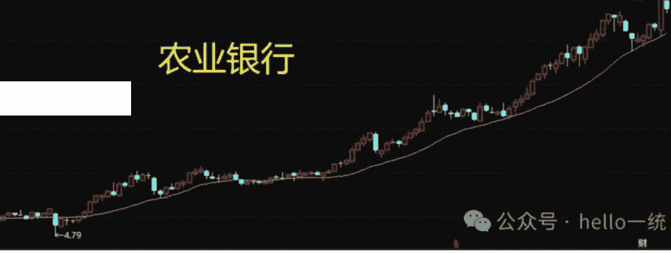
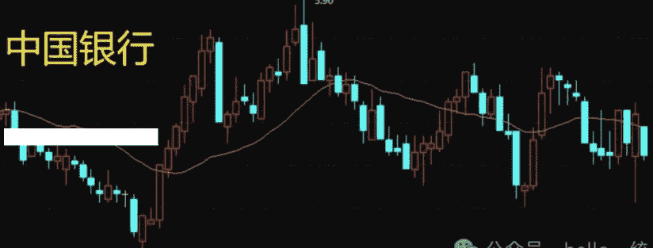
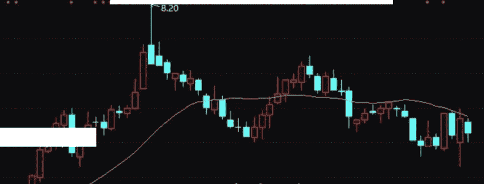
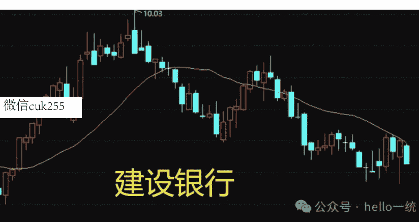
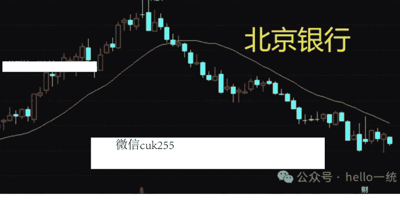
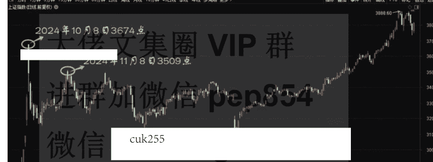

常态下，大盘调整的目标位？已付费

原创 刘—一统 hello—一统

2025 年 09 月 09 日 13:44 河北

号·hello—一统

点击上方蓝字添加关注

深度视野大V文集cuk255 有温度高质量社群cuk255

# 行情分析

在以往的市场中，往往赢者拿着股票套到最后的人，总会赢牛市和个股的大套割利。这种思维在现在和未来一定不要，有一支有问题的股就会输掉整个未来，可以长期投资的不是韭菜或大部分科技股，而是指数ETF，这才是真正可以长期持有的：短线或中线，技术交易为最佳！

## 2021年风险巨大，2024大行情

真正的解放全人类的大市要在2024年才启动。对整体市场的中长...

2020-3-12

公众号·hello-统一

大家应该明白一个道理，我们所有的决定，绝对不会因为一个决策，而费到底！我们需要我们长期的经验，适时地把握趋势，应对变化！只有这样，我们才能敢说，较有把握地决心，做事事情！

## 趋势性下跌周期将全部耗尽！

10日 原创

公众号·hello-统一

首先说一下，市场在7月份后的上涨行情，其实并不是一种常态如去年9月至10月8日的那种暴涨，是内部分化较为严重的一波行情！板块之间的分化，板块中个股的分化！所以这次行情，如果如果要给它定一个的话，就是一种极分化的局部头部！对于大部分人来说，除非是买了指数基金，否则操作难度极大！涨了指数，亏了钱的现象普遍存在！去散户化，严重。单一个银行案例，大家就能一目了然：

深度视野V文集cuk255 有温度高质社群cuk255

### 农业银行

公众号：hello-统一

### 中国银行

微信cuk255

公众号：hello-统一

### 工商银行

公众号：hello-统一

深度视野大V文集cuk255 有温度高质量社群cuk255

### 建设银行

公众号 · hello-统一

### 北京银行

公众号 · hello-统一

这种板块中个股极分化行情的原因，这里不展开说。这里多说一句：没有用一个简单的方法去对这种极极分化。考上清华北大，最终也有可能找到好的工作，但是不能由于好不好学习，不把清北大目标！大集图是一个概率问题，学习的好处就是无数的机会！同理，股票在21日均线上是主升，有更进一步快速上涨的机会，在下方也不等于不涨、或不能再回弹，但我们要寻找其中更容易上涨的机会！

言归正传，下面分析后盘，预测其一在常态下的日线级别调整目标：

- 一、且不说论行情内部多么分化复杂，针对指标指数来说，实际走势确实是拉起了一大波，突破了去年10月8日的高点3674点线！暂时最高点出现在8月26日的3888点！

深度视野大V文cuk255 有温度高质社群cuk255

- 二、大盘突破及去年10月8日的高点3674点一线，八月底最高点到达3888点后出现的调整回调属于日线级别的调整;

- 三、常态下这种突破调整的结构，大盘的调整目标应该至少2024年11月8日的高点一线，就是3500点一线！

- 四、注意，我们所说的是常态下，也就是在正常情况下！而最近两个月，整体行情虽处于一种极端分化的非常常态中！这给预测的准确程度，造成了极大的障碍！进群微信pep854

- 五、大家知道了，我们在过去的历史上，预测的准确率是非常高的，因为市场巨大常态下运行！这就意味着我们可以相对容易的预测一个正常人的行为轨迹，但很难分析一个非正常人一样！所以对于我们的预测分析，暂时来说，还是相当难度的，大家仅供参考，可优先先客观的短线操作方法进行交易！
