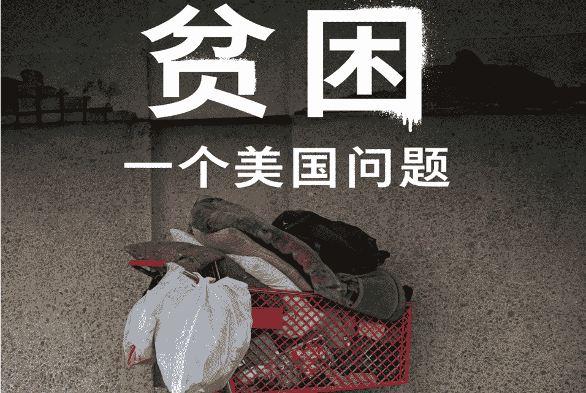
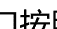
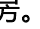
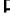

# 制造贫困：一个美国问题

荣获2023年《纽约时报》畅销书#1 NEW YORK TIMES BESTSELLER

普利策奖得主《归地狱出门》（Evicted）作者
THE PULITZER PRIZE WINNING AUTHOR OF EVCTED

贫困不是一条线，而是社会疾病的死结。

Matthew Desmond
（美国）马修·德斯蒙德 著 董云新 译

中信出版集团

谨以此书献给德瓦

> 我们认为，他们的痛苦是一回事，而我们的生活则是另一回事。
——列夫·托尔斯泰

# 推荐序

## 消除贫困是进步和发展的前提

人类社会至今为止，贫困是一个亘古不变的议题。在历史上所有记录的所有社会类型中，只要人与人之间存在不平等，贫困就难以以彻底消除，只是贫困的标准和类型不同。随着社会生产力提高带来了物质丰裕程度不断持续，从严格意义上讲，《制造贫困：一个美国问题》一书中述的贫困更多是相对贫困，而不是绝对贫困，故而作为世界经济体量最大的国家，美国贫困的根源并不是物质的不足，而是分配不均。

正如作家·霍德克敏锐地把住了这一点，“美国的贫困并不是因为缺少资源，而是因为缺少了一些其他东西”。正如，要理解贫困的原因，我们不能只看着病人，而是要看着社会、福利体系、移民政策、单亲家庭、最低工资标准、零工经济、税收、房租、住房、公共服务、政治权力等因素如何影响贫困问题。其中某些因素是常识，也需要我们相信和思考之初比单亲家庭、住房和零工经济。

作者观察到，美国许多国家儿童都是单身母亲家庭，若贫困与单亲家庭的关系，贫困的情况并未在其他民主国家出现，使用单亲家庭和他们的孩子处于贫困是社会的选择。“我们的日托机构和暑期学校越来越全球化，把这些现代服务留给了人类。这种做法使得许多单亲妈妈无法继续学习或维持全职工作。“单亲妈妈为了照顾孩子而失去了通过自我提升和发展贫困的机会，并形成了贫困的代际传递。”

由于离婚率高，中国可能会产生许多单亲家庭，是否会出现与美国类似的情况？目前，但中国还有一个参照群体：留守儿童家庭。留守儿童家庭的父母为了获取更好的收入外出打工，为了节约生活费又被迫把孩子留在农村，这使得留守儿童家庭也需要托孤和暑期学校服务，否则无法改变留守儿童因缺乏父母教育和监管在学业上的倾向，只能上父母的老路，继续外打工，形成了社会阶层的再生。

当然，如果将贫困的影响放大大的话，还可以看到陷入贫困和贫困的风险，降低人们的结婚和生育意愿。可见，尽管社会存在差异，但不论哪个国家，都会让社会中下阶层受益于普惠型公共服务，对改变贫困、改变人生生育生态、改变代流动具有现实意义。甚至可以说，穷人所需要的普惠型公共服务是他们改变命运的关键所在，是现代社会真正的必需品。

如果说贫困住房的缺失都是大家都意识到的造成贫困的原因如，看来作者对住房和贷款的分析并不少新意。“美国并非只有一个银行，而是有两个：一个面向穷人，另一个面向其他人。同样的，美国有两个住房市场和劳动力市场。美国社会的双重性决定了我们这些阶层受益唯一的道理：穷人之所以被割削的穷者，被割削的消费者和被割削的借贷人，是因为我们从体系中获利。我们社会的许多功能并非匮乏，而是二元化的。对于一些人而言，房屋创造了财富；而对另人而言，房屋耗尽了财富。“经济学者告诉我们，房屋并不是投资品，而是生命的消耗品。真相如何。看来，无论是在美国还是中国，贫困的人会在房屋上消耗自己积累的财富。从这个角度来看，银行无疑是成了造成贫困的“帮助”，实则是穷人的屠割者，富人的宝金盆，同样的对于不同社会经济地位的人而言就完全不一样的意义，这特殊也应该是大家熟悉的马蹄一击导致这种形成的原因之一。”

作者有意的分析是关于住房的，众所关注，低廉的房租是贫困在大城市维持生存的基本条件，多数时候，研究者关注的是非贫困人口的房价和高房价的收益，但是贫困人的居住环境和生活条件，作者用的数据证明了住房让穷人反而变得多。这一发现似乎违背常识，仔细一想贫困人的生存还要远远低于其他阶层，只要价格足够，住房面积和居住环境就不重要了。对于住房而言，把房子拆成多个公寓，创造出来的收益远大于城市。谁能想到，同样的房子在穷人那里能赚到更多钱，确实如此。”

---

## 推荐序号

## 美国贫困的根源与出路

本文首发于《澎湃新闻·上海书评》。

美国社会学者马修·德斯蒙德的《归地出门：美国城市的贫穷与暴力》曾受赞誉。在书中，他特别使用小说体记录了美国密尔瓦基市的穷人陷入的困境：他们是因为被房东驱逐而流离失，又因被归地出门而连带整个家庭流离失所。

而在最新出版的《制造贫困：一个美国贫困问题》（Poverty, by America）书中，德斯蒙德将视角从美国人面临的住房问题转向美国社会的贫困问题。此延续了《归地出门》的文字，作者追忆自己的童年、反思自己的生活，感到贫困在社会，而富有在离离社会，唯有消除贫困才能真正推动美国社会的繁荣和发展。

德斯蒙德指出，美国贫困是系统性的社会问题，根源在于赤裸裸的剥削与政治之间存在不可调和的矛盾。美国社会中一部分人的富有，是建立在另一部分人的贫困之上的。他提出，想要通过这部分富人的参与，回偿底层来实现。

## 根深蒂固的贫困二元结构

德斯蒙德指出，贫困是“社会疾病的死结”，我们关心的一切社会问题都与贫困密切相关。他进一步指出：资本主义社会总是慈善地把贫困复杂化，而拒绝承认一个简单道理——贫困不过是事实的结果。美国社会的贫困是一种“结构性不道德”，富人对穷人的剥削上升到了社会层面。德斯蒙德强调，美国人的贫困有三大原因：
- 首先是穷人主动选择的；
- 其次是贫困人口的参与；
- 最后是贫困的代际传递。

换言之，美国贫困由富人制造，发展的代价由许多劳动者来承担。因此，只关注贫人本身，是无法帮助他们的，必须将富人纳入考量。事实上，我们发现贫困问题往往由富人造成。例如，托尔斯泰说：“我们认为，他们的痛苦是一回事，而我们的生活则是另一回事。”

这句话少了半句：消除贫困才是进步和发展，而消除贫困不是闹，而是需要持之以恒的关注，消除贫困不应该是目标，而应当是进步和发展的前提。《制造贫困：一个美国问题》这本书存在一些美国式局限，比它更强调种族问题，对阶层和代的关注。对于美国之外的国家，人们对阶层和代的关注会更高一些，比如日本学者藤田典写的《社会一代：被社会囚禁的年轻人》。总体而言，马修·德斯蒙德在这本书中表达的深刻见解和董云新的高水平翻译，不仅加深和拓宽了我们对贫困的认识，而且给读者带来了一本荒益博考的精品图书。

田丰
中国科学院社会发展研究院员

## 福利政策失灵与“私域富者，公域穷者”

那么，美国的福利制度能够帮助穷人呢？答案并不是像漏水的桶。作为一个国家，美国的福利体系就像漏水的桶，只能打水。1996年，克林总统改革福利制度，允许各州由自由裁量决定。此后，由于政府的不作为和营利组织的舞弊，本应该扶人的资金常常被挪用，大量福利流向了富人和中产级，而不是低收入人群。令人冷的是，富人和中产级一方面通过种种手段夺取巨额福利，另一方面又不认为穷人也应该得到帮助。德斯蒙德指出，“政府补助其实是一场游戏。绝大部分的政府补助并没有帮助帮助家庭脱贫，而是用来确保家庭能够保持富裕，这样留给穷人的机会就更少了。美国政府最不需要帮助的却提供了帮助。”

美国社会学家肯·加罗·布思在1958年出版的《富裕社会》（The Affluent Society）书中指出，富人财富积累已经超过公共服务投入。人们越富裕，对公共服务的依赖程度就越高，公共服务的投入就越低；反过来，人们越穷困，对公共服务的依赖程度就越高，公共服务的开支也就越大。德斯蒙德说：“在美国，穷人的一个明确标志是依赖公共服务，而富人的富裕则是远离公共服务。然而，美国的富人和穷人却不同地厌烦公共服务：富人不厌烦公共服务是因为他们为此付出却未使用它；穷人则厌烦公共服务是因为他们依赖公共服务而它又没用。”

当美国公共财政收入的增长速度远快于富人财富的增长速度，这就使得“城乡奢豪或城市贫困”成为美国社会的关键特征之一。丹士浦指出“城市有西豪，郊有东穷”，这种惨竟然成为美国城市随处可见的现象。公共服务等化可能推动社会，而机会的匮乏成为社会流动的希望，进一步导致社会不再。更糟糕的是，“私域奢豪或城市贫困”会陷入自我强化的怪圈之中，不断断裂社会。美国政府持续削减税收，富人得利，公众受益，获得公共服务的人却不断减少，加之公共服务的私有化，进一步拉大了贫富差距。由于此带来的结果是：高收入人群群体中得到了大量政府补贴，不仅不会心怀感激，反而表现出政府的政治立场，并更加积极通过投票来抵制政府救济穷人，难以获得政府补贴的穷人却更加感到无所能，对政府表现出更高的认可。这种政治上的反响和抒论是美国式贫困的真实写照。

## 破解错误观念才能找到出口

既然现行的福利政策的前提是失灵的，出口又在何方呢？德斯蒙德强调，“如果我们看不到人们是如何陷入贫困的，我们最终设计的政策要么有效，要么完全没用。”所以，重新全面地思考那些过去认为是不正确的，才能真正制定正确的政策。德斯蒙德认为，过去的口号是“贫困的解药”其实是毒药，许多人相信提供福利会导致人们陷入贫困，正是由于这种错误观念的形成，恰恰是增加了贫困。这种观念包括：
- 贫困的代际传递；
- 贫困的恶性循环；
- 贫困的社会性问题。

这种观念包括“穷人思维是主动选择”，但作者在这一本书里证明了，穷人思维并不是主动选择，而是被迫缴纳的“精力榨”。当一个人为了维持生计的时候，又怎么忽略不上进步呢？对于中国这样一个人口大国来说，我们需要思考如何让人们不陷入穷困，充分挖掘资本的潜能，这样才能真正提升国力和潜力，这就是中国脱贫的意义。

## 全方位帮穷人

树立正确的观念，应该如何帮穷人？为了根除贫困，需要联合工会、媒体、学者等一切力量来重构社会安全网，坚持公平税。德斯蒙德指出，在金融市场要击对穷人剥利放贷的机构，推动银行和其他公共部门为穷人提供贷款服务，避免他们因为不知而陷入债务深身的惨境。社会学家魏赛尔纳认为，我们的租房没有保障，而企业倾向于购买派遣服务，使得工作成为临时性的，导致条件越来越糟糕。严密的职业和就业禁止条款等限制，让人们在选择工作和职位晋升时遭遇困难。人工和雇主的权力失效，使得贫富加剧。在人工智能技术的威慑下，“全民基本收入”理论在硅谷开始流行，这个面对穷人的社会福利是一场未得。因此，通过工会把工人组织起来，提高他们集体行动的能力。德斯蒙德指出，旧的工会早已无法代表工人，也没有吸纳服务性行业中的新就业形态下的劳动者。

贫困不是一条线，而是社会疾病的死结。要改变工会的组织模式和抗争方式，使得一个地区和行业的工人可以联合起来，共同维护工人权利，抵制剥削和不公平。

# 前言

美国的贫困状况为什么如此严重？我写这本书，就是为了寻找这个问题的答案。在成年以后，我大部分时间都用来研究和关注贫困问题。我曾在非常贫困的社区居住，也曾与全国各地生活在贫困之中的人们度时光；我仔细研读统计数据和官方报告，听听社区组织者和工会代表的心声，让他们学习；我起草公共政策、学习福利制度、城市规划和美国民主主义的相关历史，还在两所高校授课，讲有关不平等问题的课程。即便如此，我仍然感到自己无法从根本上解决贫困这个问题。在这个富盛的国家，怎么会存在这么多苦难？我给不出一个清晰而说服力的解释。

18英里、1609万。——编者

我从小就开始关注贫困问题。那时候，我住在亚利桑那州霍滕伦斯外围18英里的地方，房子价值6万美元。霍滕伦斯是一个小镇，66号公路从这里穿过，往西是弗拉格拉斯塔夫。房子很小，是木质结构的；房子周围是压缩的土地，杂草丛生。我很爱我的家，那个种槐树的炉子，也爱那棵满俄罗斯橄榄油树。我们家族来到这里，是因为我父亲在附近的第一个基要教会担任牧师。牧师收入不高，全靠上帝的奉献。我父亲常发铁路事故，镇上的路人都比他挣得多。父亲还能懂古希腊文，但不上铁路工人有工会。

如果家里东西坏了，我们就学着怎么去修理，就要合适着。有一天，我看到一幅彩色气泡护窗打坏了，就没有修理；还有一次，我和家里的一个朋友在废品回收站买来了合适的零件，一起把我的第一辆皮卡车换了一台发动机。后，父亲去世了，银行把我们的房子卖走了，那时候这种事并不常见，于是我们学会了没有住所也能凑合日子。总的来说，我把这件事挂在我父亲头上。但有时候我也想不通，我们国家为什么要用这种方式来对待一个遇到困难的家庭呢？

为了能上大学，我申请了所有的学金和学生贷款，最终进入亚利桑那州立大学。与此同时，我也学了打工：早晨在星巴克买过咖啡，也做过推销员，你能到的工作我都干过。暑假期间，我就不愁回到家里附近的小林区，在他们那里做暑工；开学后，我就和校周围那些可以依靠的人待在一起——无疑是作为志愿者去帮助他们备餐、买衣物，和他们在一起谈谈天地。回起来，这段经历帮助我重塑了我所看到的世界上，就是：这个世界有太多、太多的钱。在我的家乡，有的人比别人家里要好一些，但这里的差距还是太大了。我用大学期间开过宝马车和马赛奔驰车，而在我大学期间没有车的情况下，可能也就是一辆1978年的福特150皮卡。

我的汽车是从废品站回收来的，车底没有几个大轮，开起来的时候对着路面从车底掠过的。我和同学们去学校餐厅吃饭，我在宿舍湖边吃过挪威鱼和沙拉。学校的主地位于凤凰城的小城，当地政府花费几十亿美元在沙漠中建造了一个长达两百远的人工湖，这个巨大的“水库”每年有2/3的水蒸发。而这里还有几条离远的地方，有人沿路住了。我不明白，这种程度的贫穷。

移动房屋或拖车房，通常价格低廉，主要提供低收入人群居住。移动房屋区是此类人群聚集的地区。——作者

我开始在课堂上寻找这个问题的答案，希望我的自修课程能帮助自己理解这个国家，去搞明白为什么如此不可理解的赤裸的不平等。我在斯坦福大学留学期间（只有这个项目录取了我），我继续探究这个问题。我的研究课题是住房贫困，为了尽量近距离离开了自己的课题，我搬到了密尔沃基，先住在移动房屋区，然后搬进一处群租房。我和被房东赶出来的家庭成了朋友，在后几个月甚至时间里看着他们的足迹：睡在他们住过的地板上，看着他们的孩子，和他们一起争吵、笑；后来，我也参加过一些人的葬礼。

在密尔沃基市，我结识了几位老奶奶，她们住在没有暖气的房子里。冬天来时，她们就裹着毛毯，祈祷自己的便携式取暖器千万别出病。我曾经住过处，住在几个孩子家里，家里没人，孩子们在一个春暖花融的日子里被赶出门。在母亲去世后，他们就继续在这个房间里，直到警察上门将他们赶走。离开密尔沃基后，我在各地结识了许多穷苦的人，他们为了正义和努力奋斗；也有人只是为了生活而战斗，毕竟自身已经很难了：在新西州，有些家庭保健护理员明明看着全职工作，却没有住处；在加利福尼亚，快餐店员工努力挣，为了争取能够维持生计的薪资；在明尼阿波利斯，没有移民后学习汉语与邻居交流，组织起来争取优待住房。

Matthew Desmond, “Severe Deprivation in America: An Introduction,” RSF: The Russell Sage Journal of the Social Sciences 1 (2015): 1–11; Liana Fox, *The Household Poverty Measure*, 2019 (Washington, D.C.: U.S. Bureau of the Census, 2020), figure 2, appendix table 1; Organisation for Economic Development (OECD Data), “Poverty Rate (indicator),” Organisation for Economic Co-operation and Development, 2022; U.S. Census Bureau, Current Population Survey, 2021 Annual Social and Economic Supplement, HINC-01; U.S. Census Bureau, Table B-1. People in Poverty by Selected Characteristics: 2019 and 2020. 北京：PolicyLink, *100 Million and Counting: A Portrait of Economic Insecurity in the United States (Oakland, Calif.): PolicyLink, 2018).*

这就是我们国家真实的样子：作为世界上最富有的国家，贫困问题却比任何其他民主国家都要严重。如果美国的穷人人口独立成立一个国家，这个国家的人口将比澳大利亚和新内瓦尔德还要大。美国有近1/9的人（包括1/8的儿童）生活在贫困之中，超过300万人买不起生活必需品，许多1.08亿人收入不超过5万美元，很多人挣扎在贫困和饥饿之间。

DigDeep and *Water Alliance*, *Closing the Water Access Gap in the United States: A National Action Plan* (Los Angeles: DigDeep, 2019), 8, 12; Megan McKenna et al., “Human Intestinal Parasite Burden and Poor Sanitation in Rural Alabama,”The American Journal of Tropical Medicine* 97 (2017): 162–28; National Center for Homeless Education, *Student Homelessness in America: School Years 2017–2019* (Greensboro, N.C.: National Center for Homeless Education), 1; Monique et al., “Neglected Parasitic Infections in the United States,”The American Journal of Tropical Medicine* 90 (2014): 78–85. Bruce Western, “Inside the Box: Safety, Health, and Isolation,”Journal of Economic Perspectives* (2021): 97–122; David Rosen, David Wohl, and Victor Schoenbach, “All-Cause and Cause-Specific Mortality Among Black and White North Carolina,”Annals of Epidemiology* (1995): 21–26; Christopher Wilder and Muller, “Mass Inprisonment and Inequality in Health,”Annual Review of Law and Social Science* (2012): 1–30.

在美国读的孩子，数十万人无家归，他们要住在汽车里，又要住在废弃的建筑中过夜。很多人进了监狱后，突然发现自己的自由——他们现在的生活还不如监狱条件。在佛罗里达州，贫困区没有自来水，人们要带桶水好几个小时才洗澡。这种贫困人们以为消失了，其实是因为供水系统让他们接触了脏水。

U.S. Bureau of Economic Analysis, *Annual Summary by State* (Washington, D.C.: Department of Commerce, 2022); The World Bank, *Current US ($)* (2022).

美国每年产出3万亿美元的商品和服务。我们的GDP（国内生产总值）比日本、德国、英国、法国和意大利这些世界排名第三至第八的国家还要高。美国的贫困并不是缺乏资源，而是因为缺乏其他东西。

Jane Addams, “Jane Addams’ Own Story of Her Work: The First Fifteen Years at Hull-House,”Ladies Home Journal, April 1906, 1–12; Jane Addams, *Twenty Years at Hull-House with Autobiographical Notes* (New York: Macmillan, 1912), 175–176; James Agee and Walker Evans, *Let Us Now Praise Men: Three Tenant Families* (New York: Mariner, 1944), 1; Michael Harrington, *The Other America: Poverty in the United States* (New York: Penguin, 1962), 170; Jacob Rios, *How the Other Half Lives: Studies Among the Tenements of New York* (New York: Penguin, 1897 [90]).

描写贫困的书籍不是围绕穷人写的。在过去100多年来都是如此。简雅姆斯描绘了美国移民苦生的生活：来自俄罗斯的13岁女孩无法获得超过万美元的贷款；她自己的孩子被父母赶去工作，没睡了衣服。格斯和克斯有过大萧条的报道，以及许多西西亚·兰格的新闻报道，都像影响下，颓废崩溃的穷彻底深刻在我们的集体记忆中。1890年，雅姆斯·格斯在《另一个人类怎样》中描绘了纽约穷民的惨遭遇，并用照片描绘了那些在小巷中睡觉的穷孩子们记录了这一切。1962年，埃尔·灵出版了《另一个美国》，希望通过这本书让人们看到数千万被死的灵魂。二年后，美国总统林登·约翰逊和曼德拉访问了阿拉巴马地区，来到一处工作的木工人的家里，在租用房屋的门上，身边围着几个破衫、牙齿凌乱的孩子。

这些作品让我们看到了贫困的面目，这一点至关重要。但是它们没有回答我们的问题，就是：为什么？为什么贫困如此严重？在我看来，这个问题需要另一种解释。要理解贫困的原因，我们不能只看着穷人。我们拥有这些特权、活着宽裕的人，我们必须检查自己——我们这些生活安稳、有保险、有住房、受过大学教育、受到保护、幸运的人，是否与他人遭受的这种毫无必要的痛苦之间有联系？这本书试图回答这个问题，它是“我们”写的。因此，虽然这是一本关于贫困的书，但它不仅仅是关于穷人的。相反，它写出了“另一另一半”是何生活的，是一个关于许多人如何受到压制以便一群人能够蓬勃发展的故事。

根据我自己多年来的研究和报道，以及社会科学领域的其他研究，我在书里阐述了为什么美国存在如此严重的贫困问题，并提出了消除贫困的方法。当然，消除贫困需要新政策的，需要政治运动的重振；同时，还要求我们每个人以自己的方式成为“贫困废除主义者”，不要把自己的美好生活建立在邻的苦之上，不再无意间成为穷人的敌人。

# 第一章

## 吉意味着什么

这是一种具有麻醉作用的幻药物，又称“天使药物”。——注释

新泽州的奥鲁克法院大楼里，第十层是处理儿童保障案件的地方。不久前，我在那里等了一天，遇到了一名55岁的男子，他已为人父，在港口的仓库工作。刚工作了一夜的他告诉我，他觉得自己的身体非常疲惫。需要连转工作的时候，他会有时吸一口叫“跳球”（speedball）的东西，是由可因、苯乙类和吗啡或海洛混合在一起制成的。“球”能让他保持清晰或减轻痛苦。当局当时的毒理学报告……

Poverty Guidelines(Washington, D.C.: U.S. Department of Health and Human Services, 2022).

我说过，想要理解美国的贫困问题为什么这么严重，我们的眼睛不能只盯着穷人的生活，但我们必须从这里迈出第一步，才能更好地理解贫困究竟是什么，并把握其中的利害关系——因为贫困不仅仅是挣少那么简单。借用特莱娜·朗·索莱的话，那只是“冰山一角”而已。

***

克莱斯特尔·梅伯里。Desmond, Severe Deprivation; Matthew Desmond, Evicted: Poverty and Profit in the American City (New York: Crown, 2016).

在上一本关于驱逐和美国住房危机的书中，我住在密尔韦基市做研究。在那里，我认识了克莱斯特尔·梅伯里。1990年的春天，她母亲在肚子里怀着她的时候遭遇抢劫，后背被割了11刀，导致克莱斯特尔出生，但母亲也活了下来。她母亲之前也受过过伤，从克莱斯特尔日记提到，父亲一直虐待母亲。她父亲吸食快可卡，母亲和外祖母也一样。

后来克莱斯特尔的母亲离开了父亲，不久，父亲就开始了漫长的流浪生活。母亲带着克莱斯特尔进了另一个男人和父母的家，那个男人的父亲虐待克莱斯特尔，她对母亲说了，但母亲不相信。就在克莱斯特尔开始幼儿园后不久，儿童保护服务局（负责儿童虐待的政府机构）入了她。于是，克莱斯特尔被安置在寄养机构，那时她5岁。

克莱斯特尔陆续在很多集体和寄养家庭。她和一位姨妈妈住了5年后，后姨姨妈妈把她送回了寄养机构。在之后，她在一个地方最长只住过8个月的时间。进入青春期后，克莱斯特尔开始和集体的其他女孩打架，并因此被指控涉及伤害，右脸的颧骨上还多了一道疤。她周围的人又来了，与之相伴的还有这些房子、宠物、家具、餐具。只有食物是相对稳定的，于是克莱斯特尔就开始吃东西寻找安慰。她开始发呆，并因此患上了睡眠呼吸暂停综合征。

16岁时，克莱斯特尔不再高中；17岁时，她接受了一名临床心理学家的检查，被诊断出有双情感障碍、创伤后应激障碍、反应性焦虑障碍与边缘性智力功能；18岁后，克莱斯特尔就不能住在养育家庭里了。由于患有精神疾病，她获得了补充保障（SSI），这是政府对贫穷的人以及等残障人士的一种补贴。她每个月可以获得754美元，一年就是9000美元。

由于在集体时被拒绝了住房，克莱斯特尔在两年的时间里都不能申请入住。如果没有这个限制，她也要排在在她前面的人太多了，她等长达6年。克莱斯特尔在私人市场上找到了第一个公寓，是一个破旧的房子，位于市最贫穷的社区，周围居民都是黑人；她自己也是黑人，之前在西班牙语和黑人社区家里都出了门。房租占了收入的73%，过了多久，克莱斯特尔就没找到公寓。搬进去几个月后，她第一次搬房出门，这件事记录在案，很可能导致她今后的住房补助申请被拒绝。搬出去后，克莱斯特尔在收容所认识了一名女子，两人一起住了。但后来有一次，她动手把朋友的朋友从窗户推了出去，就奔离开了收容所。

克莱斯特尔开始在收容所过夜，要么在朋友和教会住。她学会了街头的生存之道，如同如何在夜里躲危险，白天，在公交车和医院的院长室睡觉。她学会依靠别人，有一次她在公交站等了一名女子，她就住了一个月。克莱斯特尔很喜欢她，她开朗又活力，还有一个可爱的小习惯——喜欢拍拍，大笑着缓解。她会在公共场合唱歌，很多福音歌曲。

她一直以为补充保障是稳定的，因为它不会吵她的鱼缸，也不会扣掉她的工资。她说：“补充保障应该会到账的。”然而有一天，钱没有到账。克莱斯特尔获得补充保障的时候尚未成年，在她成年后，政府重新评估了她的申请，认定她没有资格获得这笔钱。于是，食品成了她唯一的收入来源。她尝试过献血，但由于她的血管细，能成功。以前在教会和寄养家庭认识的人都不和她来了。过了几个月，补充保障收入还是到账，克莱斯特尔开始睡觉，开始早起。她以前从不愿早起，现在她知道早起就能抓住上班路上的人们，是最容易接洽的。

***

对于克莱斯特尔和她相似的人来说，贫困意味着没钱，但同时也意味着各种棘事。

贫困意味着慢性痛苦——家庭保健护理员和注册护助理往往遭受背痛之痛苦，因为他们要弯下自己的身体，帮助老人和病人从床上椅子起身；服务员忍着脚部和膝盖的疼痛，因为他们必须一直站着为他们点餐、帮他们结账；清洁工人往往遭受皮肤的过敏痛苦，因为他们要使用含有氨和三氯氯的产品清洁我们的办公楼、家里和酒店厨房。

Robert Ballard, Dumping in Dixie: Race, Class, and Environmental Equality (New York: Westview Press, 2009); National Center for Health Statistics, Health, 2019; Centers for Disease Control and Prevention, “Table 28: Untreated Dental Caries, by Selected Characteristics: United States, Selected Years 1988–1994 Through 2015,” 2018; Robin Cohen et al., “Health Insurance Coverage: Early Release of Estimates from the National Health Survey,” 2021; Bhargavi Ganesh et al., “The Relationship Between Housing and Asthma School-Age Children,” Urban Institute, October; Emily Guendelsberger, On the Clock: What Low-Wage Work Did to Me and How It Drives America (New York: Crown, 2019); Helen Hughes et al., “Pediatric Asthma Disparities: Race, Hardship, and Asthma in a National Survey,” Academic Pediatrics, 17 (2017): 127–34; Gerald Markowitz and David Rosner, “Deceit and Denial: The Deadly Policies of Industrial Pollution,” University of California, Berkeley, 2013; Robert Sampson and Alix Winter, “Environmental Inequality: The Causes and Consequences of Lead Exposure,” Annual Review of Sociology, 44 (2018): 263–82; Kamyar Nashesh, Cassandra Yarbrough, A Ten-Year, State-by-State Analysis of Medicare Fee-for-Service Reimbursement Rates for Dental Care,” Health Policy Institute, American Dental Association (2014); Leah Rosenbaum, “Tooth Decay: An Epidemic in America’s Poorest Children,” Science in the News, Harvard University, June 2017; Andrew Wesley, Christopher Cook, and Natalie Jones, “Two Amputations a Week: The Cost of Working in US Meat Plants,” The Guardian, July 5 (2018). 在美国的肉类加工工厂，平均每周发生两次事故：工人在使用机器时，不就会撞掉自己的手指或整手。在亚马逊仓库，分拣时，霉菌携带的过敏原会影响孩子的肺部和呼吸；住在石油工厂和废物焚烧炉的人更容易变成癌。生活在贫困的儿童约1/4有牙虫但未能获得治，会导致牙齿进一步坏，引起剧烈的疼痛，并可能影响整个大脑。在《平价法案》出台年后，还有300万美国人没有保险。

CoreLogic, "United States Foreclosure Crisis: Ten Years Later," 2017; Desmond, Evicted, part 2; Matthew Desmond, "Affordable America: Poverty, Housing, and Eviction," Institute for Research on Poverty, 2015; Will Fischer, "President’s Budget Would Provide Vouchers to Help Families with Rising Costs," Center on Budget and Policy Priorities, 2022; Ashley Gomez et al., "Estimating Eviction Prevalence Across the United States," Proceedings of the National Academy of Sciences, 19 (2022): e1; Dowell Myers and Jung Park, A Constant Quartile Indicator of Changing Rental Affordability in U.S. Metropolitan Areas, 2000 to 2016; RealtyTrac, “2.9 Million U.S. Properties Receive Foreclosure Filing in December 2010-30-Month Low,” 2011; U.S. Census Bureau, American Community Survey, 1985–2022; U.S. Census Bureau, Current Population Survey/Housing Vacancy Survey, April 2012, table A; U.S. Department of Housing and Urban Development, “40th Percentile Fair Market Rent, 1985–2022”; U.S. Census Bureau, American Housing Survey, 2019, table 10. Anthony Bragg and Philip Cook, “The Association of Firearm Likelihood of Gunshot Injury in Criminal Assaults,” JAMA Network Open, 1 (2018): 1–10; Jooyoung Lee, “Wounded: Life After the Shooting,” Annals of American Political and Social Science, 64 (2012): 244–57; Laurence Ralph, Renegade Dreams: Living Through Injury in Gangland, Chicago: University of Chicago Press, 2014; Rosenbaum, “Tooth Decay,” Gilles Slee and Matthew Desmond, “Parental Relief: Democratic Governance and the Relinquishing of Parental Rights,” Working Paper, Princeton University, 2022; Bruce Western, “Lifetimes in a Sample of Released Prisoners,” Russell Sage Foundation of the Social Sciences, 1 (2015): 14–30. 作者在2021年3月2日与帕特里克·夏沟通了芝加哥暴力的相关数据。

贫困意味着要用肠口袋和轮椅，意味着要熬夜，意味着没有人被打死或留下残疾。在芝加哥，2020年枪击暴力导致722人死亡，339人受伤。估计，全美有八成枪击暴力的受害者活下来，但仍被迫在痛苦中度过余生。的生活常常充斥暴力，包括在儿童期的暴力。从马萨诸塞州监狱释放的人出的调查样本显示，超过40%的人在儿童时期目睹过谋杀；从纽约儿童保护服务局调查过的样本显示，超过34%的人在家里经历过暴力，17%受到过性侵。

罗斯特是在我在密尔基市进行《扫出门》的研究时相识。

贫困看着勃勃，由于社会没有为治疗这种痛苦提供资源，常常常用自己的方式对抗痛苦。我的朋友在儿童时期被性侵，成年后开始吃药物，最终吸了太尼，他每次花20美元，给自己买来一份安静。罗斯特在40多年后去世，维持了几年，然后又复发，最后孤独死在一家酒店的房间里。我的前友奎金博（大家叫他Woo）从未吸过烟，也很喜欢酒。有一次，他们在以前在密尔韦基市住的一块破旧的复式公寓里看到了一个钉子，因为没去找看病，就不能让这个过伤口。Woo有糖尿病，这加速了伤口的感染，最后导致他不得不接受小腿截手术，否则就要丢性命。

Economic Review (1994): 34–37;U.S. Census Bureau, Current Population Survey, 2021 Annual Social and Economic Supplement, HINC-01.

意味着时刻盯视情况会变得更差。美国有1/3的人生活没有什么经济保障，他们看着交车司机、农民、教师、收银员、厨师、护士、保安、社工这样的工作，其中许多人并未正式被纳入贫困者的行列，但如果你住在迈阿密或波特兰这样的城市，每年花费5万美元，还要养大两个孩子，这不算贫困又算什么呢？如果你睁没资格获得房屋补助，又没有贷款，这又算什么呢？或者你你要花一半的工资去交房，再掏1/4的工资去学生贷款，这算你这个月生活贫困线以下，下个月又多挣了一点，但一直稳定不下来，又叫什么？在现实生活中，有大量生活在贫困线以上的人同样在经历贫困。

破产无产者（lumpenproletariat）来自德语词“lumpen proletariat”（无产阶级），也译为“流氓无产阶级”，用来指代没有阶级意识的无产者。\译者

Karl Marx, “The Eighteenth Brumaire of Louis Bonaparte,” in The Marx-Engels Reader, 2nd ed., ed Robert Tucker (New): Norton, 1978 [1852], 594–617.
National Academies of Sciences, Engineering, and Medicine, Roadmap to Reducing Child Poverty, 62; Office of the Assistant Secretary for Planning and Evaluation, 2020 Poverty Guidelines (Washington, D.C.: U.S. Department of Health and Human Services, 2020); U.S. Census Bureau, Current Population Survey, 2021 Annual Social and Economic Supplement (CPS ASEC), POV-01: Age and Sex of All People, Family Members and Unrelated Individuals: 2020, Below 50% of Poverty.

收入低于贫困线的就更不用说了。在这个自由之地，你可以一路自由下坠，坠入“破产无产者”的行列。根据最新的数据，美国每18个人中就有一个生活在“深度贫困”之中，也就是极端贫困。一个人的收入还还没有到贫困线水平，就属于深度贫困。2020年，对于单人士来说，年入低于3800美元就是深度贫困；对于四口之家来说，这个数字是13,100美元。同年，美国有近1800万人在这样的条件下生存。美国的儿童贫困率比其他发达国家都要高，有超过500万儿童处于这样的困境，我们对此闻见常常。

Robert Allen, "Absolute Poverty: When Necessity places Desire,"American Economic Review 107 (2017): 3690–721; Robert Allen, "Poverty and the Labor Market: Today and Yesterday,"Annual Review of Economics 12 (2020):107–34, 113–15; Angus Deaton, "Price Indexes, Inequality, and the Measurement of World Poverty,"American Economic Review 100 (2010): 5–34; Angus Deaton, "The U.S. Can No Longer Hide from Its Deep Poverty Problem,"The New York Times, January 24, 2018.近期进行国际贫困状况评估发现越贫困，由于世界银行的“国际比较日”已停止削小食品价格和高昂的价格，这些价格是计算基础食品成分的重要指标。

Jason DePaule and Robert Gebeloff

Bureau of Economic Research, Working Paper 25907, May 2019; and H. Luke Shafer, Critique of the $2 Day, or New Evidence of Need America’s Poor? at todollarsay.com.

经济学家估计，在美国每人大约需要4美元才能支付最低限度的生活必需。相比，在印度和孟加拉国等生活成本较低的国家，这个数字为1.9美元，是世界给这些国家划定的贫困红线。用这个标准衡量，诺尔威经济学学生梅安格斯·迪隆指出：在2018年，美国有530万人按全标准来看属于绝对贫困，也就是每天的生存费不超过4美元。此外，美国有800万人面临的困难，无论是拮据的物质状况还是恶劣的状况，与非洲和亚洲的人们一样，甚至更糟。在美国没有提供保障性福利之后的若干时间里，极端贫困人的增长速度，与之相应的还有许多严峻的指标。1995—2018年，接受“补充补助计划”（SNAP）的补助（就是食品品）但没有从收入上报的家庭数量，从28.9万增加到120万，占美国家庭数量的1/50。美国各地小学学校的无家可归儿童人数，从2007年的717万增加到2018年的130万。越来越多的贫困显示，在美国生活并不是都是这种程度的贫困，在不同的地方存在，那里的人打着脚，挺着肚袋，我们还遥远。

中途之家是美国为犯罪前科或药物成瘾的人设立的过渡性专门机构，帮助其重新适应社会。——译者

Deborah Johnson, "Connections Among Poverty, Incarceration, and Inequality,"Institute for Research for Poverty, Fast Focus 48 (May 2020); Melissa Kearney et al., "Ten Economic Facts About Incarceration in United States,"Policy Memo, Brookings Institution, May 2014; Becky Pettit, Invisible Men: The Myth of Black Progress (New York: Russell Sage Foundation 2012); Pew Charitable Trusts, Probation and Parole Systems Marked by High Stakes, Missed Opportunities,”September 25, 2018; Wendy Sawyer, “How Much Incarcerated People Earn in State,”Prison Policy Initiative, April 2017; Wendy Sawyer and Peter Wagner, “Mass Incarceration: The Whole Pie,”Prison Policy Initiative, March 2022; U.S. Bureau, “Fact Sheet: Differences Between the American Community Survey (ACS) and the Annual Social and Economic Supplement to the Current Population Survey (CPS ASEC) (Washington, D.C.: U.S. Census, 2021); Bruce West, Punishment and Inequality in America (New York: Russell Sage,2006).

贫困意味着自由的丧失。美国的监狱比任何国家或历史上的任何时期都是如此。美国每天有2万人关在监狱或看守所，另外有7万人在监禁中，这个体系意味着一些模糊和抽象的概念，比如公正、法律和秩序，而在这些概念背后的现实是美国的执法人员和刑罚人员非常贫困。在这些群体中，如果没有读过书，到35岁以前，监狱剥夺了人们黄金的岁月，也包括颓的晚年。各州人口工作的平均薪资为14美元15美元不等。美国并不把穷人留在商业区域，还将他们藏在看守所里，使得无踪。这导致美国统计数据实际上不能反映现实。关于贫困的统计指标排除了监狱和看守所，也排除了住在流浪者和收容所的人。

Katherine Beckett and Steve Barnett, Banished: The New Social Control in Urban America (New York: Oxford University Press,2010); Gun Violence Archive 2021; Sheila Harris, “More Than Three-Quarters of Black Mothers Their Children Will Be Victims of Police Brutality,Essence Survey Finds,”Christopher Ingham, “1 in 13 People Killed by Killed by Police,”The Washington Post, June 1, 2015; Susan Schweig, The Ugly Laws (New York: New York University Press,2009).

看着你感到政府不是站在你这边，而是对付着的；你感觉这个国家是为了服务别人设计的，而你自己注定要被粗暴对待、剥夺自由。在19世纪末和20世纪初，许多城市通过了“市规划”、禁止了“穷”出现在公共场所。在20世纪上半叶，人们用禁止流浪和游荡的条例把人从公园的长椅上赶，从街角赶走。现在，市政法仍然允许警察抓公共场所的无家归者，这些被固定为一种罪。近年来，在美国所有被杀的人中，有达1/12的人死警察之手。3/4的黑人母亲担心自己的孩子会遭受极端对待，而警察的工作本来是保护他们的安全。其中一些孩子的名字已经为人知，比如哈米尔、乔、埃德；其他人的名字我们已经忘记了，或者从来没有听说过。

Alexes Harris, Heather Evans and Katherine Beckett,“Drawing Blood from Stones: Legal Debt and Social Inequality in the Contemporary U.S.,American Journal of Sociology 115 (2010): 1755–99;Alexes Harris, Mary Pattillo, and Bryan Sykes，“Studying the System of Monetary Sanctions,”RSF: The Russell Sage Foundation Journal of the Social Sciences 8 (2022): 1–34; Issa Kohler Mansfield, Misander:Criminal Courts and Social Control in an Age of Broken Windows Policing (Princeton, N.J.): Princeton University Press, 2018);Joshua Price and Joe Sos, “Preying on the Poor: Criminal Justice as Revenue Avenue” in Money and Punishment, Chicago 2020, Anna VanCleave et al.(New Haven, Conn.): Yale Law School, 2020), Dev Pager et al.,“Criminalizing Poverty: The Consequences of Court Fees in a Randomized Experiment,”American Sociological Review 87 (2022): 52–53;Vesla Weaver, “The Only Government I Know,”Boston Review, June 10, 2014;Vesla Weaver and Amy Lerman,“Political Consequences of the Carceral State,”American Political Science 104 (2010): 817–33.

政府通常通过指控穷人有轻罪或存在违法行为来剥夺他们的财产：这是穷人为交子女抚养费、坐地铁票或者持有大麻被抓而付出的代价。一个轻微的违规行为可能导致其他违法行为接踵而至。如，

贫困意味着生命的消耗。贫困消耗你的精力，它占用你用来决策的精力，让你不得不把注意力集中在眼前的琐事上，比如燃气单还未交，或者是因为工作了，没有精力关注其他事情。当我们被贫困困扰时，“我们能给生活中其他事情的精力就更少了。”在贫困的影响下，任何人都可能做出这些生活富有的人看来不睿智甚至是愚蠢的决定。

贫困意味着意味着，，，，，，，，，，，，，，，，，，，
Proceedings of the National Academy of Sciences 114 (2017): 10870–75; H. Luke Schaefer, Pinghui Wu, and Kathryn Edin, “Can Poverty in America Be Compared to Conditions in the World’s Poorest Countries,”American Journal of Medical Research 4 (2017): 84–92; U.S. Bureau of Labor Statistics, “Labor Force Statistics from the Current Population Survey”(Washington, D.C.): Bureau of Labor Statistics, 2021.

此外，贫困面前非人平等。种族差距能够加剧不平等，相应地种族特征也能缓解不平等。(种族和阶级，哪个更主要的问题？哪个是不平等的根源，哪个是分子？对你来说，哪个更重要？是心还是大脑？）黑人的贫困、西班牙语人的（拉丁裔人）贫困、美国本土居民的贫困、亚洲人的贫困、白人的贫困，各有不同。人和西班牙美国人陷入贫困可能是白人的，这不仅限于美国种族历史遗留的问题，也是如今的歧视造成的。今天，黑人的失业率仍然是白人的两倍；研究显示，黑人遭遇职场歧视的可见性比30年前增加了。从方面来看，当代人并没有进步。

Douglas Massey

相比贫困的黑人家和西班牙裔家庭，贫困的白人生活的社区经济条件要好一些。在全国所有大都市，没有任何白人社区的贫困率超过40%，也就是说在白人居住的地方，各种极端恶劣条件不在集中。在全国各地，许多人的黑人和西班牙裔家庭是在这样集中的极端恶劣条件下的。这意味着，相比白人和西班牙裔家庭的孩子，大多数贫人的黑人家庭的孩子可以上资源更丰富的学校上学，能在更安全的社区居住，较少遭受警察暴力，居住条件更有尊严。

贫困不仅存在于个体层面，还存在社区层面。黑人和西班牙裔家庭更有可能面临个体贫困和社区聚集在一起带来的困境。这是为什么美国贫困的黑人男性与巴基斯坦、蒙古男性的预期寿命相似。

在美国，业主和租户之间的鸿沟和其他所有鸿沟一样深刻，这种鸿沟的形成具有历史原因，是因为为了维护和推动种族不平等而精心设计的政策所导致的。房屋所有权在我们国家历史上并非一直如此重要，其重要性是由新政策制造出来的。其中《退军人权利法案》发挥了重要作用。该法案规模，在1948年占联邦按揭贷款比例的15%，没有其他一项政策能够在广度和深度上让《退军人权利法案》如此。该法案大量贷款给军人办理按揭，这些贷款利率较低，且最高可能达到30%的贷款。二战后回到国的老兵们购买了数十万住房。在二战结束后的几年里，退军人的按揭占所有家庭住房的40%以上。同时，从设计上来说，该法案允许许多非洲人排除外的。罗斯福顿为了争取新政获得美国支持，需要非洲人的民主党支持。因此，罗斯福顿不允许国会将许多非洲人排除在这些出去。在社会保障和失业项目中，许多非非洲美国人的领域，如农业、家务服务等，都被排除在外。地方退军人管理局和其他其他种族隔离的机构也参与了其中，系统性地将非退军人挡在《退军人权利法案》之外。此外，联邦住房管理局为非非洲裔的按揭贷款提供服务，导致银行拒绝了这些贷款的申请。因此，即便少数贷款士兵们能够获得退军人的管理局这一优惠，他们仍然面临与种族的斗争。“相关的影响是深远的，“历史学家卡丁·纳尔森在他的书中写道，“当平等为黑人服务：美国20世纪族不平等未被述述的历史。”见：When Affirmative Action Was: An Untold History of Racial Inequality in Twentieth-Century America (New York: Norton, 2005), 16-23, 55, 116, 122–28, 170。”到了1984年，《退军人权利法案》提供的按揭贷款大部分已经到期。这一年美国家庭的净资产中位数是3.5万美元，而黑人家庭只有3970美元，仅白人的9%。这种差距大部分源于房屋所有的差异。“另见：Matthew Desmond、“House Rules,”The New York Times Magazine, May, 2017. Mehrsa Baradaran, The Color of Money: Blacks and the Racial Wealth Gap (Cambridge, Mass.: Harvard University Press, 2017); Neil Bhutta et al.,“Disparities in Wealth by Race and Ethnicity in the 2019 Survey of Consumer Finances,”Board of Governors of the Federal Reserve System, September 28, 2020;Desmond,”House Rules”; Heather Long and Andrew Van Dam,”The Black White Economic Divide Is As Wide as It Was in 1968,”The Washington Post, June 4, 2020.

如今，黑人和白人家庭之间的财富差距与20世纪60年代的水平相当。我们的体制系统性地把黑人获得土地和财富的大门之外，而且这代代传递了下去。许多人在第一次买房的时候，都有父母帮其付首。。许多人选择给房子提供贷款来帮助孩子二战后美国政府曾为黑人社区提供补贴，这些人父母也以相同的方式帮助他们。2019年，美国人家庭资产的中位数是18.2万美元，黑人家庭仅为2.4万美元。有很多黑人家庭家长没有大学文凭，拥有的平均财富水平更高。发展经济学领域最初创建了多维度的贫困消除方法。相关的定量研究发现：Udady Multidimensional Poverty: An Alternative Measure for United States?Science Research 37 (2008): 559–80;Roger White,Multidimensional Poverty in America (New York: Springer Books, 2020). 相关评论：Sudhir Anand and Amartya Sen，“Concepts of Development and Poverty: A Multidimensional Perspective,”in United Nations Development Programme, Human Development Papers (1997): 1–20;Matthew Desmond and Bruce Western,”Poverty in America: Directions and Debates,”Annual Review of Sociology 44:305–。贫困往往意味着物质匮乏、慢性疼痛、监禁、抑郁、药物成瘾等问题交织。贫困不是简单的线条，它是各种社会弊端的密切联结，与我们关心的社会问题不可分，如犯罪、教育和住房。贫困在美国长期存在，意味着在这个世界上最富裕的国家，千万家庭过着没有安全、没有保障、没有尊严的生活。

# 第二章 减贫为我们

Centers for Disease Control and Prevention, “History of Small Poverty,” February 2021; GSM Arena, “Poverty,” May 2021; Lauren Medina, Shannon Sabo, and Jonathan Vespa, “Living Longer: Historical and Projected Life Expectancy in United States, 1960 to 2060” (Washington, D.C.:U.S. Bureau of Census, 2020), figure 1; National Center for Health Statistics,Health, United States 2019 (Hyattsville, Md.—Centers for Disease Control and Prevention), table 5; Emery Shrider et al., “Income and Poverty in United States (Washington, D.C.:U.S. Bureau of Census, 2021), 56, table B; The World Bank, “Mortality Rate, Infant (Per 1000 Live Births) — United States,”May; FRED, Federal Reserve Bank of St. Louis, February 2022; World Bank, “Individuals Using the Internet (% Population) — United States,”May. 

在过去50年来，科学家绘制出了个人贫困图谱，并消灭了数千人的荒。同时，美国人的婴儿死亡率下降了约70%；美国人的平均寿命增长了近十年；人们认识到气候变化威胁着人类的生存；我们还获得了互联网和智能手机。然而，我们在贫困问题上取得了哪些进步？联邦控制的贫困率，1970年的美国人口占比为12.6%，1990年下降为15.3%，2019年为15.9%。回顾过去半世纪美国贫困人口的比例，就是一段延续。随着时间的推移，这条线先上升，再下降，然后上扬，无论是民主党还是共和党，这条线都保持稳定；在经济增长时，长期停滞，没有真正改善。批评者（包括莫莉·奥布斯）早就指出贫困衡量标准的缺陷。首先，这种测量方法并未将一些公共补助人的收入，如住房援助和联邦医疗补助，计算在内。例如，假设有两个家庭都是一个家长带两个孩子，家庭A年收入为26000美元，他们都享受价值5000元的住房补助还有2000美元的所得税抵免，家庭A实际收入为33000美元。家庭B收入为28000美元，并没有获得这些帮助。因此，尽管家庭A经济状况良好，但它属于贫困家庭，有资格接受某些政府补助；而家庭B则没有，因为其收入刚好超过了贫困线。同时，不同地区的生活成本有很大差异，贫困量标准未把这些纳入考虑。此外，官方贫困量标准对于“收入”的定义过于狭隘，如果家里两个没有收入，只会计算一个人的；如果家里有收入，就会计算两个。考虑到这些缺陷，研究人员发现了另一种方法——补充贫困量标准（SPM），它考虑了不同地区的成本差异，也考虑了政府福利、税收主要支出，例如医疗和育儿成本，家庭开销以及未成年人缴费等。根据这种贫困量标准，美国有超过300万人贫困。可以说，食品补助、住房补助和税收优惠项目使得人群在住房与食品支出上比此前预计要多。研究人员还想出办法来补充贫困量标准出台之前的贫困数据。到1967年以后，研究人员发现：第一，基于贫困量标准计算的贫困率总体比联邦贫困线计算的贫困率更高；第二，从世纪70年代以来，这个贫困率一般是固定的，每年在17%之间波动，但从997年至2016年间一直低于14%。这看来，我们仍然停滞不前。补充贫困量标准并非无懈可击。由于地区生活成本构成的差异（这种差异往往与公共服务质量相关），根据贫困量标准，加利福尼亚州是美国最贫困的州，排名在密西西比州和南罗吉尼亚州之后。最后，研究人员还发现了一种确定贫困标准。根据这一种标准发现，在过去的50年里，贫困率下降了约40%。今年，非派研究机构“儿童趋势”（Child Trends）在一份引用的报告中采用了一种确定贫困标准，并显示儿童贫困率从1993到2015年下降了59%。这是怎么一回事呢？主要是“锚定”的原因。锚定是一种常用的统计方法，研究人员假定生活福利的某种标准本身并没有改变，以此评估福利随着时间推移的变化。但这种方法可能对任何时候的贫困度产生不准确的评估，因为实际上的标准准确性是在发生变化的。当平等为黑人服务：美国20世纪族不平等未被述述的历史。”见：When Affirmative Action Was: An Untold History of Racial Inequality in Twentieth-Century America (New York: Norton, 2005), 16-23, 55, 116, 122–28, 170。”面临与种族的斗争。“相关的影响是深远的，“历史学家卡丁·纳尔森在他的书中写道，”

Historic Decline in Child Poverty (Bethesda, Md.: Child Trends, 2022); and Weiner, et al., “Progress on Poverty”, 1207–18. Daniel Bell, The End of Ideology: On the Exhaustion of Political Ideas the Fifties (New York: Free Press, 1965), 283; George Orwell, The Road to Wigan Pier (New York: Harvest Books, 1958 [1937]), 88–90.

我们为什么在减贫方面缺乏进步？这不能归咎于统计方法，用不同的统计方法得到的结果让人困惑。也许，是因为人们经历贫困的方式改变了，或者说更准确一些，是贫困的随着时间的推移而变得不同。要对贫困进行公正的评价，就必须让飞速的物质考虑在内。马克思曾提出“痛苦加法则”，就是说资本主义的扩张和剥削的痛苦会逐渐增加。至少从20世纪初开始就流行了卢斯注意到，在技术的进步已经将以前的奢侈品变成了必需品，第二次世界大战期间，青年愿意继续下矿工作，而不是上街抗议，追求一种更好的生活，是因为便宜的甜食得到了普及，同样让所有的人的年代能够受电影和广播带来的快乐了。

Ron Hawkins and Isabel Saawahill, Creating an Opportunity Society (Washington, D.C.: Brookings Institution Press, 2009), 39.

但是生活的全面提高并不意味着贫困的减少。在40年前，有钱人才能买起手机；最近几年，手机越来越便宜，美国大多数人都拥有手机了，包括穷人在内，因为手机在求职、找房、恋爱等等方面变得越来越不可少。一些观察人士称：“确实穷人也能用得起某些消费品（电视、微波炉、手机），他们就没有我们想象的那种。”

U.S. Bureau of Labor Statistics, Consumer Price Index Databases for All Urban Consumers, 2022。总体而言，2000—2022年，消费价格指数涵盖的商品和服务的成本增加了69.3%。像微波炉和电视这样的非必需品在近年来变得更便宜了，甚至更为基本的生活需求，如房租、水电和医疗保健的价格却变得更昂贵。Monica Prasad, The Trade-Off Between Social Insurance and Financialization: Is There a Better Way? (Washington, D.C.: Niskanen, 2019), figure 2. Harrington, America, 12.

这种说法是错误的。手机不能用来吃，也不能被拿去卖了换能够维持生活的收入。手机并不意味着你拥有稳定的住房、便宜的医疗和牙科护理服务，或者合格的育儿服务。实际上，虽然手机和洗衣机等物品的售价有所下降，住房和租房这些生活必需品的成本却逐日升高。2000—2022年，普通美国城市的汽油和水电费增长了115%。

美国的贫困人生活在全球资本主义的核心地带，像其他美国人一样，他们可以买到便宜的、优质的。但如果不交电费或者没有厨房，要买一台烤面包机又有什么用呢？正如克尔茨·哈灵锐在60年前后的所说的：“在美国，拥有体面的住房、比其他国家拥有饮食、医疗服务容易得多。”

也许很难想象，一个发达国家竟然在这么长的时间里都不能改善贫困问题。从人类登月到苏联士兵解散，再到越战战争和水门事件，我们经历了这么多次变化，但在减贫方面，我们50年来一直无。

刚开始研究这个引起我关注的问题时，认为在美国在减贫方面停滞是因为我们已经没有解决问题的意愿了。我当时觉得，美国总统标志着市场主义或“新自由主义”的兴起，这是一个政府削减补助、降低税收、放松监管的时代；这种看法在进步派里十分流行。我认为，美国的贫困问题持续存在是因为我们减少针对穷人的支出的。

Paul Pearson, Dismantling the Welfare State: Reagan, Thatcher and The Policies of Retrenchment (New York): Cambridge University Press, 1994).

数据以2009年的美元为单位计算。约翰·霍普金斯大学的罗伯特·莫特和威康星大学的大麦迪迪芬整理了这些数据，并大方在2021年8月12日通过私人通信与我分享。他们统计了13项有入门门槛的转移支付项目：联邦医疗补助，儿童健康保险补助，补充保障收入，现金福利（抚养未成年家庭援助项目和贫困家庭临时性援助项目），劳动所得税抵免，子女税收免，额外子女税收免，食品，住房补贴，学校餐补助，针对妇女、婴儿和儿童的特别补助计划，对于上述唯入门级的项目，除了莫特和波利涵盖最大的几项社会保险项目也纳入考虑，其中包括社会涵盖的老年及保险、联邦医疗保险、失业保险、劳动保险，还有残障保险。他们发现，联邦支出从1980年的美国每人380美元到2018年的美国每人457美元（以2009年的美元为单位计算），涨幅达到150%。

我后来逐渐意识到，现实远比这复杂多。里根总统扩大了企业的权力，大幅为美国并削减了一些慈善计划的支出，特别是住房方面的支出。对于针对美国福利系统的诸项目，里根未能实现规模的长期的。在1981年减少社会保险，美国国会没有批准。在里根执任的时间期间，减贫支出并没有减少，而是增加了；他离开后，减贫支出继续增加，幅度很大。特朗普年后美国最大的13个有入门门槛的项目（在收入低于特定标准的美国提供经济补助）支出从每人105美元增加到每人419美元，涨幅达到237%。

Office of Management and Budget, "Historical Tables," table 11.3; Luke Shafer, Kate Naranjo, and David Harris, "Spending on Government Anti-Poverty Efforts: Healthcare Expenditures Vastly Outstrip Income Transfers," Poverty Solutions, University of Michigan, September 2019. 689: Office of Management and Budget, Appendix, Budget of the U.S. Government, Fiscal Year 2023 (Washington, D.C.: Printing Office, 2022), 164, 450, 1021.

然而，增长的巨大大部分来自医疗保健支出的增加。因为种类原因，美国没有全民医保，却有着最贵的医保体系，这是全世界独特一份。我们每年为低收入群体提供医疗保健的支出远远超过超越型减贫项目的支出，比如现金福利和公共住房。例如，2021年政府在联邦医疗补助上的支出为5210亿美元，这是提供给低收入群体的医保。相比之下，给全国最贫困的劳动者（特别是有孩子的人）提供的劳动所得税抵免（EITC）只有610亿美元。

数据以2009年的美元为单位计算。罗伯特·莫非特和格温·波利在2021年8月12日通过私信与我分享了相关数据。Shaefer et al., “Spending on Poverty-Averty Effects.”莫非特在其他项研究指出，政府支出的大幅扩张主要应用于贫困群体，这并非一部分小组（如联邦医疗补助或社会保险）的增长。尽管经历了几十年的稳定期（婴儿潮），随着21世纪前婴儿潮，领取社会保险的工人数量直攀升，但实际上人均增长并未如此。Robert Moffitt “The Deserving Poor, Family, and the U.S. Welfare System,” Demography 52(2015): 729–749; Social Security, Facts and Figures: About Social Security, Administration, Washington D.C.: 2020.

萨珊·梅特勒在《隐藏的国家：看不见的政府如何损害美国民主》书中指出，显见的公共福利（如住房）已经减少，而更为隐藏的政府福利（如税收抵免）在增长。有人认为福利在缩减，是因为在表面上的福利减少了，而是国家福利体系的设计上让了一个感受：The Submerged State: Invisible Government (Chicago: University of Chicago Press, 2011), 6. Aaron Rosenthal, “Submerged for Some? Visibility, Race, and American Trust,” Perspectives on Politics (2020): 108–114.

尽管如此，过去40年直接与医疗保障的支出也增加了。就连联邦医疗补助在计算中，1980—2018年，政府对有入门槛的减贫项目的投资也从每人630美元增加到每人488美元，涨幅达到30%。新自由主义现在已成为左派结论，但我看过了证据，至少在减贫项目上看不出来，事实却相反。来说，美国在减贫问题上的停滞以前让人摸头了。这怎么回事呢？

***

Jana Parsons, To Aid the Neediest Families, We Need to Strengthen TANF,” Brookings Institution, June 2020.

我了解到，部分原因是大量针对穷人的援助从来真正抵达穷人手里。以福利项目为例，当年政府通过“扶养未成年家庭援助”（AFDC）发放福利，几乎所有相关资金都给了单亲女孩。但是在1996年，克林顿通过改革了福利制度，用“贫困家庭临时援助”（TANF）替代了原有的项目。新项目把补助发放给各地，都出了非常有创意的方式分配这笔钱：Center on Budget and Policy, “State Fact Sheets: How States Spend Under TANF Grant,” January 12, 2022; Azevedo-McCaffrey and Ali Safawi, “To Promote Equity, States More TANF Dollars in Basic Assistance,” Center for Budget and Policy, January 12; U.S. Department of Health and Human Services, TANF Financial Data—FY 2020 (Washington D.C.: Office of Family Assistance, 2021).

联邦政府无权监督州如何使用联邦贫困家庭援助资金。Cindy Boren and Des Biler, “Brett Favre to Repay Welfare Money for Appearances He Didn't Make, Mississippi Auditor Says,” The Washington Post, May 7, 2020; Steve Rabey, “How Mississippi Turned Your Tax Dollars into Welfare for the Rich,” Ministry Watch, May 7, 2020; Luke Ramseth, “MS Welfare Audit,” The Clarion Ledger, May 6, 2020; Shad White et al., Single Report for Jackson: State of Mississippi, off the State Auditor, 2020.

密西西比的情况更甚。2020年公布的一份389页的审计报告显示，密西西比公共服务部门（DS）监管本用于支持该州贫困家庭的资金，被拿去做了以下事情：雇用福音派歌手在集会和教堂音乐演唱；购买一辆跨境SUV（运动型汽车）、一辆雪佛奔驰德和一辆福特F-250皮卡车，供一个非营利机构的负责人和两位成员使用；甚至还给了退役的美国职业篮球联盟国家队布韦特·法阿里支付了110万美元的表演费，只没有发表过的这些表演（法阿里之后又回来了这笔钱）。不仅如此，公共服务部门的承包还挪用用于购买豪华轿车票，贴钱给私立学校，给州议员购买了一份期为12个月的健身费（费用130万美元）。该州的贫困资金中还有210万美元流向了由贫困就业鲍泰德（人称“百万美元先生”，有著作《每个人都有他们的价格》）运营的机构，在演讲和掩筹活动。当时，这位“百万美元先生”的儿子妻子·比亚亚。

Zach Parolin, “Welfare Money Is Paying for a Lot of Things Besides Welfare,” The Atlantic, June 13, 2019; Mississippi Department of Human Services, Mississippi State Plan for Temporary Assistance for Needy Families, reauthorized by the Deficit Reduction Act of 2005; State of Arizona, State Plan for Temporary Assistance for Needy Families (TANF), effective October 1, 2020; Texas Health and Human Services, Texas State Plan for Temporary Assistance for Needy Families, October 1, 2019; State of Washington, State Plan for Temporary Assistance for Needy Families (TANF), effective January 2020, attachment B11.

Bulletin, 199, SSA Publication No. 13-11700 (Washington, D.C.): Social Security Office of Retirement and Disability Policy, 2020), table 6.C7. 在此期间，申请保障收入的人数大幅增加，从1996年的192万以上到2010年的约315万。在那之后，申请数量开始下降，到2018年恢复到20世纪90年代中期的水平。Social Security Administration, SSA Annual Statistical Report, SSA Publication No. 13-11827 (Washington, D.C.): Social Security Office of Retirement and Disability Policy, 2020).我们再看到社会保障残障保险(SSDI)，它为了那些曾在工作期间延续过社保费用的残障人士提供津贴。1996年，有128万美国申请了社会保障残障保险。到2010年，申请人数约300万。人口结构的变化（特别是人口增长和婴儿潮“的老人化”）似乎是这一趋势的原因。然而，社会保障管理局新修订的残障保险数量并没有随申请数量的急剧增长，1996—2010年，残障保险申请数量增长了130%，但首次获批的数量增长了68%。很多人需要残障保险的帮助，但政府增加了审批的难度。在20世纪90年代中期，迅速的残障保险申请大约约有一半；至今，获批比例大约只有1/3。

1尺×0.305m。——笔者注

我还记得我的朋友Woo跛磊以后尝试申请残障保险的经历。Woo为人很热情，做什么事都妥妥的。再加上他身高6英尺，穿着超大号的衬衫，喜欢和大家打交道，这些点让他做安保工作时得心应手。我们在密尔维基北部的一个群租房里坐在一起的时候，他叫我安迪，还让我叫他撒瑞，就画电影《肖肯的救赎》中的两位主人公像一样（我是白色的，Woo是黑色的，刚好和这部电影的人物的对应应），Woo总是管这部电影叫“肖肯的旧事”。

我赶医院时，Woo已经坐在轮椅上了，他剩下的半截腿打上了临时的石膏，用支架撑起。整个人看起来像是缩了水。Woo把两只手放在断膝旁边，好像在说：“你看到了吗？”“我们一起哭起来吧。”他不不停地念叨：“这真不公道。”

## Social Security Administration, “How You Earn Credits”; Social Adm admin Annual Statistical Report, 2019.

出院后，Woo开始学习假走路，并递交了残障保险申请。当他41岁。对于这个年龄的人来说，需要有20个社会保险积分才能申请补助，相当于至少在正在正式的劳动力市场上工作超过5年。Woo全职的年龄接近50岁，他当保险的时候经常加班，但这种工作是不记入保险号的。于是，他申请了对于美国残障人士的另一种保障，即补充保障。和社会保障残障保险，大多数补充保障入境申请都会被退回。“我帮Woo填了申请，但他交过去就被退回了。”他并不意外。“从来都是这样的。”随后，他联系了一位残障人士律师。

我所说的“残障保险和其他福利”指的是社会保障计划的第二款，再加社会保障残障保险，就包含了老人和遗保险。2016年，社会管理局局处理补充保障的申请人代表发放了2.14亿美元，这笔钱来自另外的资金。Michael J. Astrue, Commissioner of Social Security, “Maximum Dollar Limit in the Agreement Process,” Federal Register 74 (2009): 6080; Social Security Administration, Representation of Claimants, Sec. 206 [42 U.S.C. 406]; Office of the Inspector General, The Cost of Administering Claimant Representative Fees (Woodlawn, Md.: Social Security Administration, 2018); B2; Social Security Administration, Statistics on Title II Payments to Claimant Representatives (Washington, D.C.): Social Security Office of Retirement and Disability Policy, 2020）。另见：Hilney Jones, Nicola Maestas, and Alexander Strand，“The Effect of Attorney and Non-Attorney Representation on the Initial Disability Determination Process,”National Bureau of Economic Research, Working Paper DRC16-15, September 2016.

在贫困社区，人们知道你必须要交好几次残障保险申请，仿佛一次被拒绝也是正常程序的一部分，并且你还需要一位律师。律师师会收取“风险代理费”，等申请人几个月后收到补发的保险金，律师最多可以抽取1/4。一年，随着残障保险申请越越来越难获，越来越多的申请人选择律师为自己争取权利。2001年，有179笔款项（总计4.25亿美元）发放“申请人代表”，其中许多是帮助当事人申请残障保险和其他福利的律师；到2019年，款项达到390万笔，总额达12亿美元。

私营部门也从其他主要因素的项目中抽取补贴资金。以美国政府给平价住房提供的最大规模的补贴，低收入住房税抵免(LIHTC)为例，由于与房屋建设相关的建筑和监管有关，一些城市通过低收入住房税抵免为低收入人群住房，其相关成本直接提供住房补贴券高出一倍。此外，一个城市联邦资金转向了社区补助(CDBG)，显示此补贴曾被用于高收入社区建设、基础设施和经济发展。研究：Lan Deng, “The Cost-effectiveness of Low-Income Tax Credits to Vouchers: Evidence from Six Metropolitan Areas,” Housing Policy Debate 16 (2005): 469–51; Michael Eriksen, “The Market Price of Low-Income Housing Credits,” Journal of Urban Economics 66 (2009): 141–49; Edward Gaser and George Yorke, Rethinking Federal Housing Policy: How to Making Housing Affordable (Washington, D.C.: AEI Press, 2008); 研究：Leah Brooks and Sinitsky, “Where does the Bucket Leak? Sending Money to the Poor via the Community Development Program,” Housing Policy Debate 24 (2014): 91–17; Michael Rich, Federal Policymaking and the Poor (Princeton University Press, 1993).

第二次申请时，Woo在律师的陪同下来到法院。Woo回忆：“律师才是制定法的。”在律师陪同下，他在法官面前总共只说了五分钟。获批准后，Woo收到了300美元，这笔钱买了一辆二手奔驰，三年后奔驰因故火毁了。律师得到了400美元。如今，Woo每月依靠800美元补充保障，这比他工作的收入高出。

政府在减贫方面的开支增加了一倍，其中一个原因就是美国的福利体系漏水的桶：拿一美元做减贫并不代表最终会达到帮助的家庭。但不能完全解释为什么贫困问题如此严重，美国还有许多大规模福利项目将资金直接接到手里。补充补助计划的资金有85%用于食品券，约93%的医疗补助直接流入受益者。也就是说，还有其他因素起作用。Josh Boak, “Fact Check: Trump Plays on Myths,” PBS News Hour, February 8, 2019; Matthew Desmond and Mustafa Embayer, Race in America (New York: Norton, 2015), 76; Alan Gauthreaux, “Anti-Italian Sentiment and Violence in Louisiana, 1891–1924,” in Louisiana History: The Journal of the Louisiana Historical Association 51 (2010): 41–68; Jessica Barbata Jackson, Dixie Sic Italians, Race, and Citizenship in the Jim Crow Gulf South (Baton Rouge): Louisiana State University Press, 2020.

在美国历史上，人们一旦在经济方面感到不安，就会把移民当替罪羊。“作为一个群体，移民对我们国家来说是损害和怨，“1877年的一篇报纸专栏文章写道，“他们夺占白人的劳动力，抢走了白人及其家庭的饭碗。”20世纪初，意大利移民来到美国辛苦劳动，本土美国人拿他们作泄愤，通过私刑驱逐他们。今天的美国政府派移民低工资取代本地工人，这是古老的美国传统的延续。 Abby Budiman, “Key Findings About U.S. Immigrants,” Pew Research Center, August 2020; U.S. Census Bureau, America’s Foreign Born in Last 50 Years, 2021.

从理论来说，移民拉高一个国家的贫困可能有三种原因：第一，移民来的时候可能是穷二代，并且一直保持这种贫困的状态，从而形成新的底层阶级；第二，他们也会压低贫困率，使本地人变得更穷；第三，他们会使得社会保障体系负担。美国在过去50年，出生在其他国家的人口增长迅速。1960年，美国每20个人中有一个是在其他国家出生的；今天，美国每8个人中就有一个是在其他国家出生的，美国比全球其他国家的移民都要多。这就是移民增加贫困没有变化的原因？1970: Count 4P—Sample-Based Population Data, tables NT23, NT126; U.S. Census Bureau, American Community Survey 2019 1-Year Estimates, table B05012; U.S. Census Bureau, 1970: Count 4P—Sample-Based Population Data, tables NT18, NT83, NT89; U.S. Census Bureau, American Community Survey 2019 1-Year Estimates, table S1701。另见：Jeff Chapman and Jared Bernstein, “Immigration and Poverty: How Are They Linked?”,Monthly Labor Review, April 2003.

就像以前横跨西洋来到这片土地的欧洲移民一样，现在很多移民初到美国也是贫穷的。如果他们和子女的经济状况没有改善，那么移民确实可能导致贫困率上升。如果这种情况属，那些接收移民最多的国家贫困率将会上升。目前，美国近一半出生在境外的人口分布在三个州：加利福尼亚州、得克萨斯州和佛罗里达州。随着接收移民的人口越来越多，它们的经济状况变差。1970—2019年，加利福尼亚州的人口增加了18%，得克萨斯州增加了14%，佛罗里达州增加了13%。但在同一时期，加利福尼亚州和得克萨斯州的贫困分别下降了7%和近4%。在过去50年里，接移民最多的州并没有变得贫穷，反而更加加剧了。Amitrassy and Leah Boston, Gold: America’s Untold of Immigrants (New York: PublicAffairs, 2022).许多移民在加利福尼亚州在佛罗里达州和得克萨斯州定居，而随着时间的推移并没有变得贫穷，这是因为移民群体在美国有着最高的流动性。有多少移民是软件工程师、医生，他们的父母都是来自美国的工人、洗衣工？作为一个整体，他们的成功没有导致更多贫穷的一个原因。Francine Blau and Christopher Mackie, eds., The Economic and Fiscal Consequences of Immigration (Washington,D.C.: National Academies Press, 2017), p. 5.移民的成功不是牺牲其他人的利益为代价。如果移民和本土生人竞争，压低工资让更多人陷入贫困？关于这个问题的研究发现，移民对工资的影响相当小，对就业市场的影响小。如果移民和本土生人竞争的话，那么这一结论就难以理解，甚至让人吃惊；但实际上移民威胁最大的群体是老人。无论移民对劳动力市场的影响，如果他们依然依赖福利，就可以把一个国家变得贫穷。但是最贫困的移民是没有身份的，因此许多社会保障项目是他们无权获得的，这包括食品券、非医疗补助和社会保障金。一个典型的移民一辈子都在美国政府缴税，要比他们获得的联邦福利更多。就算移民享的福利比不上他们交的税，他们对政府开支的整体影响，比起本土阶级给这个福利国家带来的压力，是完全不足的。将两者放在一起比较都将显得滑稽可笑。不过还是了。到这里为止，我们只需要澄清一点就是：美国在减贫方面的糟糕表现并不能怪到移民的头上。***U.S. Census Bureau, Current Population Survey, Historical Poverty Tables:People and Families—1959 to 2020, tables 4 and 10; Vee Burke, Thomas Gabe, and Gene Falk, Children in Poverty: Profile, Trends, and Issues (Washington,D.C.: Congressional Research, 2008), 17.

那么，是家庭问题导致的吗？曾几何，美国大部分贫困儿童都是由父母抚养的。1959年，约70%的贫困家庭是由已夫妇组成；如今，贫困社区的教堂举办的葬礼远多于婚礼，因为大多数贫困儿童都出生在单身家庭。由单身母亲主导的家庭约1/3处于贫困状态；相比，双亲家庭只有1/17处于贫困状态。这种差异让一些人认为单亲家庭是导致国家贫困的主要原因。近年来，无证移民的流入趋势已经放缓。由于墨西哥人口老龄化并且经济趋向稳定，推动移民的因素已经逐渐减弱。随着激进的边境执法也在造成那些大喊“边境危机”的移民矛盾，无证移民的数量在15年前（也就是2007年）已经达到顶峰。然而，为了减少移民数量的方法，并不是通过雇佣人工完成工作（即使用机器），或者雇用其他移民，比如持有H-2A签证（临时农业工人签证）的移民（美国本地人也不会排队等着做这些的工作），或者干涉关门。Blau and Mackie, eds., Economic and Fiscal Consequences of Immigration, 11

18(2015): 395–415; Joy Misra, Stephanie Moller, and Michelle Budig, “Work Family Policies and Poverty for Partnered and Single Women in Europe and North America,” Gender and Society 21 (2007): 804–27.

但是，为什么在爱尔兰、意大利和丹麦这些国家，单亲家庭并不是导致贫穷的主要原因呢？除美国之外，其他国家的母亲并并不比其他群体更贫困。那些对国家投入较多的国家，特别是通过惠及全民的普惠项目进行投入的国家，贫困率相反，由单身母亲家庭的贫困率很低。我们可以效仿这些国家，投资资金帮助单家长平衡工作和家庭生活，如提供带薪家事假、真实的育儿服务和普惠的学术教育。然而，我们的日托学校越来越私化，对于这些现代必需品留给了钱人。这样的做法让许多单家长无法继续学习或维持全职工作。单身育儿可能是个人选择，让许多单家长和他们的孩子贫穷是因为社会的选择。

Andrew Chandler, Labor’s Love: The Rise and Fall of the Working Class Family in America (New York): Russell Sage Foundation, 2014); Kathryn Edin and Maria Kefelas, Promises I Can Keep: Why Women Put Mother Before Marriage (Berkeley): University of California Press, 2011); Christina Gibson-Davis, Anna Gassman-Pines, and Rebecca Beckham, “His and ’Hers’: the Economic Bar to Marriage,” Demographic 55 (2018): 2231–43.

既然贫困的伴侣没有选择在合适的时候要孩子，那么他们为什么不干嘛晚一点再要孩子？其中一个原因是他们能获得最有效的避孕措施。此外，也不需要强迫女性一怀孕就必须和伴侣结婚。但是我们必须认识到，孩子能给枯燥的生活带来快乐、荣誉、认同和目标，许多学者的研究证明了这一点。家庭条件不好的当然会面临困境，他们也会享受人类的温情，他们会听到大人代相传的微笑，享受用传统的菜谱制作的食物，沐着家人温柔的歌声成长。见：Akerlof and Janet Witten, “Analysis of Out-of-Wedlock Births in the United States,” Brookings Institution, August 1, 1996; Suzanne Bianchi, John Robinson, and

Melissa Milke, Changing Rhythms of American Family Life (New York: Russell Sage Foundation, 2006); Stephanie Coontz, The We Never Were: American Families and the Nostalgia Trap (New York: Basic Books, 2016 [1992]), xxvi, 25, 33, 43–44, 392, 402; Edin and Kefalas, Promises I Can Keep; Dorothy Roberts, Killing the Black Body: Race, Reproduction, and the Meaning of Liberty (New York: Vintage, 2014).丹尼·贝尔在《资本主义的文化矛盾》书中指出，资产阶级在经济上信奉进步主义，“意愿”在这个过程中中断了传统的社会关系，但在文化和性层面上采取了保守主义。美国富人的躯体体现在物质层面，而不是精神或肉体层面，这也许帮助我们理解为什么要为了生孩子比砍后森林或者为了利润去消灭竞争对手的公司更为可悲。见：The Cultural Contradictions of Capitalism (New York: Basic Books, 1996 [1976]).

在美国，婚姻已成为一种常态。一对伴侣只有自己在一定程度上实现了财务稳定之后才选择婚姻，如果没有达到“婚姻蓝图”，他们将不会结婚。所以，把穷人结婚率低归为贫困的主要原因，就把穷人买的房子不是实现财务稳定的根本原因混淆了。有自己的财产并不是财务稳定的根本原因，但它是巩固财富的手段。通常，你只有不错才能买得起房子（或者是你的父母够得），结婚也是一样的道理。对于已经稳定下来的人来说，婚姻会巩固这种稳定。由于双方拥有资产的阶级家庭模型是怎么建立的？它是由资产阶级的亲缘建立的，那就是钱。

Anna Gassman-Pines and Hirokazu Yoshikawa, “Five-Year Effects of an Antipoverty Program on Marriage Among Never-Married Mothers,” Journal of Policy Analysis and Management 25 (2006): 11–30; Lisa Gennettian, The Long-Term Effects of the Minnesota Family Investment on Marriage and Divorce (New York: MDRC, 2003); Daniel Schneider, “Lessons Learned from Non-Marriage Experiments, The Future of Children,” 2015:55–78.

当我们为穷人提供真正的机会时，婚姻通常随之而来。以“新希望计划”为例：这个计划是20世纪90年代在密尔基实施的，为贫困社区的居民提供廉价的医疗保险和保育，同时提供工资。与未参与计划相比，“希望计划”的参与者收入高，工作也更好，进入婚姻的可能性是未参与者的两倍。这个项目并没有他们情感关怀服务，而是通过帮助伴侣实现足够的稳定。

Laura Maruschak and Todd Minton, “Correctional Populations in the United States,” 2017–2018; U.S. Department of Justice, Bureau of Justice Statistics, 2020; Pew Charitable Trusts, “One in 100: Behind Bars in America,” 2008; Petty and Bruce Western, “Mass Imprisonment and the Life Course: Race and Class,” American Sociological Review 69 (2004): 151–169; Jeremy Travis, Bruce Western, and Stevens Redburn, The Growth of Incarceration in the United States: Exploring Causes and Consequences (Washington, D.C.: National Academies Press, 2014):139–155; Bruce Western and Becky Petty, “Incarceration and Social Inequality,” 2010; Maurice Hanna, “Can Prisons Teach America How to Handle Most Violent Criminals?” The Marshall Project, 2015; Daniel Schneider, Kristen Harnett, and Matthew Stimpton, “What Explains the Decline in First Marriage in the United States? Evidence from a Panel Study of Economy Dynamics, 1969 to 2013,” Journal of Marriage and Family 80 (2018): 791–811, Western, Punishment in America, 155.

但是，这些项目是短暂的、验证性的美国大部分社会政策对家庭仍起到反作用。最不利于家庭的社会政策就是那些大规模监禁的政策。大多数被押的人都有孩子。数十百万男性被剥离了他们的家庭，其中贫困的黑人和西班牙家庭遭受的打击最为严重。其他国家，如德国，允许犯人探望家里，但是监狱设计的似乎是要打破人与人之间的联系。一项研究显示，如果我们不监禁任何人，美国的婚姻数量将增加30%。美国执着于把人关起来，这将大量贫困人口从他们的家庭中抽离，严格限制他们可以打电话给孩子、配偶及其他亲属。释放后，他们所犯的犯罪记录让他们的工作和住房前景雪加霜。在美国历史上，除刑事以外，大规模监禁是由国家背书的。

Center on Budget and Policy Priorities, A Quick Guide to SNAP Eligibility and Benefits (Washington, D.C.: CBPP, 2020); Rahim Kurwa, “The New House Rules: How the Regulation of Housing Vouchers Turns Personal Bonds into Eviction Liabilities,” Housing Policy Debate 30 (2020): 96-99; SSI Policies, Understanding Supplementary Income—Spotlight on Living Arrangements (Washington, D.C.: Social Security Administration, 2021); Robert Stalker, “Subsidizing Housing for Families of Released Prisoners,” Clearinghouse Review 41 (2007): 198–201。关于家庭政策与现代家庭实际情况之间的脱节，见：Lawrence Berger and Marcia Carlson, “Family Policy and Contemporary Families: A Decade in Review and Implications for the Next Decade of Research and Policy Practice,” Journal of Marriage and Family 82 (2020): 478–507。

Congressional Research Service, The Earned Income Credit (EITC): How It Works and Who Receives It (Washington, D.C.:U.S. Government Printing Office, 2021).

我们的许多福利政策的设计也是对家庭不利的。如果一个领取补助收入的人与其亲属住在一起，其保障就会被削减。如果孩子的母亲租住房合同让孩子的父亲搬来的，就可能失去租金补贴或从公共住房赶出去。如果恋人各自申请食品券，而不是为了伴侣一同申请，两人到来就能获得更高的额度。劳动所得税抵免也是一样的道理。假设有一个四口之家，妈妈一年挣3万美元，爸爸一年挣1.5万美元。如果爸爸单独申请劳动所得税抵免，就能获得最高额度的资金（2020年为5900美元），但如果夫妻结婚了，整个家庭只能得到2000美元。所以，做出哪种决定对家庭更有利呢？是选择不结婚，以便拿到更多资金，还是选择结婚，但拿到的钱更少？

Marianne Bitter et al., “The Impact of Welfare Reform on Marriage and Divorce,” Demography 41 (2004): 213–36; Sarah Halpern-Meekin et al., It’s Not Like I’m Poor...

# 第三章
## 我们是如何剥削劳动者的

通常，我们不愿意承认我们中的一些人在从贫困中获益。大家容易接纳的，似乎那些能把自己的责任撇得干净的理论。以前，我们经常将贫困问题归咎于自身，好像中国人的性性确实比不上那些贫困程度更低的国家的人。如今，人们更喜欢在结构上寻找原因，认为贫困的根源是体制的失败，或者是由于经济的失败。

1987年，威廉·朱叶斯·威尔逊出版了《真正的弱势群体》一书，改变了关于贫困的探讨。2001年，有学者曾回应本书标题之所以为“过去25年关于城市研究最重要的作品”，是因为关注那些脱离了劳动市场的极端贫困男性，他认为贫困集中在城市中是工业化导致黑人失业率增加的结果。在芝加哥和洛杉矶这样的城市的倒退后，黑人社区失去了经济基础，导致许多多年工作的黑人男性失去就业。亚洲强调的理论点指出了贫困背后的动力因素，但他的理论并不认为贫困是为了为了的而努力压制人类。在威尔逊看来，城市贫困的根源是美国主义的衰退，以及黑人人口被系统性地排除在报酬机会的工作之外所造成的。他认为，城市贫困并非由不公平的工作条件引起，而是由于本身没有工作机会引起的。Mario Luis and Katherine Newman, “Urban Poverty After The Disadvantaged: The Rediscovery of the Neighborhood, and Culture,” Annual Review of Sociology 27 (2001): 23–45, 23; Arthur Stinchcombe, “The Social Determinants of Success,” Science 178 (1972): 603–44; Donald Tomaskovic-Devey and Austin-Holmes, “Observing Inequality Regimes,” Research in the Sociology of Work 28 (2016): 187–212; Wilson, Truly Disadvantaged; Erik Odin Wright, Introducing Inequality (London: Verso, 1994), 36.

有一个流行的理论就是，美国的贫困是去工业化导致的。去工业化令工厂倒闭，围绕工厂建立起来的社区随之被掏空。“去工业化”，这是一个多么被动的过程，听上去像是自然而发生的，好像一个国家的经济

“去工业化”和一片森林都受皮甲虫的侵害一样自然。按这种理论，贫困是“社会因素的产物”，社会学家奎克·奥姆特就是这么说的，“没有人预测到这场灾难，也没有人真正从中受益”。

但是，如果对人类不利的制度存在了几十年之久，这还不能说明我们设计的正是如此旧吗？根结在哪里，“系统性”问题（比如系统的种族主义、贫困、厌女主义）就不是无数个人决策者组成的吗？这些个人的决策是受到实际的或想象出来的自利益驱动的。毕竟“系统”并没有强迫我们当服务员，也没有我们投票反对在附近建设住房，难道不是吗？

人们以各种方式从中受益，这是明证不过的社会现实。然而，一旦你把这话说出来，气氛就会变得深邃。然而，你觉得自己的诚实说得很礼貌，而周围的人都会安静不安，他们又会试图让你安静下来，就像当一个小孩在公共场所指出了明眼的人却看到假装没到的东西——那里有一个独眼的男子或小孩对汽车院大闹，你妈妈叫你安静；又是某个大年纪的人把资本主义指得无处是，用石头砸破玻璃一样不留痕，明确地表达了深刻的道德真理，那些严肃的、成人的你也会叫你精神安静，他们会说，你这是在挑起冲突，其实你只是把人心里明白的事情说出了而已。

Matthew Desmond, “Capitalism,” in The 2019 Project: A New Origin story. Nicole Hannah-Jones (New York: One World, 2021), 65–85; Steve Beckert and Seth Rockman, eds., Slavery: Capitalism: A New History of American Economic Development (Philadelphia: University of Pennsylvania Press, 2016); “A Little Priest,” Sweeney Todd, the Demon Barber of Fleet Street, music and lyrics by Stephen Sweeney Todd, written by Hal Prince, opened at the Uris Theatre March 1, 1979.

理查有多项研究表明，很多人对种族进步的期望远超过实际的进步情况。2019年的一篇文章显示，美国人在1963年黑人和白人之间的财富差距的估计，比实际差异低了约40个百分点；对于2016年两个群体的财富差距，人们的估计比实际情况低了约80个百分点。两个群体2016年的财富差距与20世纪60年代相同，但普通人以为差距已经大大缩小了。根据这些研究，李查森总结：“人们愿意假设50年前的情况并不那么理想，他们同时认为现状已经有了很大的改善。”Michael Kraus et al., The Misperception of Racial Economic Inequality, Perspectives on Psychological Science 14 (2019): 899-921; Jennifer Richeston, “Americans Are Determined to Believe in Black Progress,” The Atlantic, September 2020.

用削削来缓解贫困总会引发争议，让我们一会觉得“当然是”，一会又觉得“不是呢？”一方面，就像作曲家萨蒂芬·桑德海姆曾说：“亲爱的，世界历史就是由吃人和被吃成的。”当族、家庭、部落和国家互相吃，一方被消灭、奴役、殖民者，另一方因此获得胜利，掠夺的输出成为更高的位置。那么现在的贫困又有什么呢？”另一方，过去的似乎过去了。请注意，我们可以轻松地告诉过去发生的削削，但说到现在的人是可以互相伤害的。我们就变得冷漠、无情。也许这是削削的本质是最可怕的，极端的形式现在我们面前，比如被奴役的农民、挖矿的小男孩，或者是棉纺厂里的女孩。这可能是我们被忽视的进步，特别是种族方面的进步，用心理学家理查的话，“好像……认为贫困是为了为了的利益而努力压制人类。在威尔逊看来，城市贫困的根源是美国主义的衰退，以及黑人人口被系统性地排除在报酬机会的工作之外所造成的。他认为，城市贫困并非由不公平的工作条件引起，而是由于本身没有工作机会引起的。”

或许在我们心里，削削的概念和社会相连，我们不想和这种信念（至少其表达方式）有联系。多年，我在哈佛大学尼迪教育学院写过一篇论文，题目为《对内削》，关于贫困社区的商业策略，内在包含了数据，记录了一些户如何非常穷的家庭出售劳动换钱（有时候是大发）。我做完报告后，一位资深学者看起来十分不安。“你正在走向马克思主义的路，”他说，“你想走到这一步了吗？”

David, Monica Biradavolu and Austin-Holmes, “Observing Inequality Regimes,” Research in the Sociology of Work 28 (2016): 187–212; Wilson, Truly Disadvantaged; Erik Odin Wright, Introducing Inequality (London: Verso, 1994), 36.

Annette Bernhard et al., Broken Laws, Unprotected Workers: Violations of Labor Laws in America (Chicago: Center for Economic Development, 2009), 42–44; Reuben Milner, Halfway Home: Race, Punishment, and the Afterlife of Incarceration (New York: Little Brown, 2021); Peter Wagner and Alex Jones, “State of Police: Local Jails, State Prisons and Private Providers,” Prison Policy Initiative, 2019.

关于削削的社会学解释，David, Monica Biradavolu and Blankhenship, “Brokers and the Earnings of Female Sex Workers in India,” 127; John Steinbeck, The Grapes of Wrath (New York: Penguin Classics, 2006) [1939], 38.

> “华东边的使命”，意思是压迫的人是整个银行体系，而非具体某人的问题。”——作者

说到，听起来就不舒服了。有些人会说，情况不是你说的那么简单。当然，大多数社会问题非常复杂，但一个“复杂性”说的反映的都是我们所处的社会地位，而不是我们本身有多聪明人。饿肚子的人想有饭吃，我想却找不到专家来开讨会。“复杂性”是权者的权利。这让我想起《怒的葡萄》那里拖拉机，他牵着拖拉机直直到伍农的房子。伍农诚道：“你再靠近，我就会像打死一只兔子一样打死你。”手机回答道：“这不是我的问题，我没有办法。”他说，是有的人等人取，而且我是老板的，老板是银行的经理，银行是奉边的命”，就是这样一层传递的。事情很复杂。他又问：“哪里是个头呢？我们的枪口还能看着？”他们指着拖拉机不想指明的问题，就是他们一家并不是我们所说的“时代的受害者”，“不幸的人”或者“处于不利地位的人”，而是正在遭受入侵的人。他清楚地看到，一个人的贫穷就是另一个人的利润，其中并没有复杂的。

******

## Matthew Desmond, "Dollars on the Margins," The New Times Magazine, February 23, 2019.

几年前，我了解了胡刚·帕洛斯，他是美国永久居民，来自地中海，曾用签证签到美国。他住在加利福尼亚的埃肯堡西尔市，市大约有12000名居民，位于奥克兰和布克利之间。2014年，胡刚更是两份全职工作，每周工作80个小时。每天晚上，他都在一家24小时营业的卖当上班，从晚上10点到早上6点制作汉堡和热狗。下班后，他有两个小时休息、洗澡的时间，然后去艾罗特（Aerotek）打卡，在上午8点到下午4点之间，他就哪。下班后，胡刚会努力兼职，再去当上班。为了保持清醒，他要喝大量的咖啡。这两份工作挣的都是最低工资。胡刚来说，“没有精力。”胡刚和两个兄弟姓林住在家里，要付房租，他必须每天16个小时，一周七天上班和睡觉了。没有留下余地。亚历山太对我说，“我想买你一个小时，”胡刚说，“感觉就像行走肉巷里。”“一个小时需要多少钱？”胡利奥看着弟弟，泪流满面。不久之后，他发现过度劳。因为雇主的工资太低，这是一个很简单的问题。在经济界，有一套用来描述这个问题：如果我们提高了最低收入劳动者的工资，是否会增加失业率？George Stigler, “The Economics of Minimum Wage,” American Economic Review 36:358–65.

这位年轻的经济学家并非依据事实得出结论，而是通过“假设数据”，也就是自己发明的一套数字游戏来解释他的理论。其他经济学家被施蒂格的推理说服了，并将他的理论当作准则写入教科书里。提高最低工资会推高失业率这一预测，成了经济学的正规。David Card and Alan Krueger, “Minimum Wages and Employment: A Case Study of the Fast-Food Industry in New Jersey and Pennsylvania,” American Economic Review 84 (1994): 772–93.

相关汇总和文献分析，我推荐：Hristos Doucougios and Tom Stanley, “Publication Bias in Minimum-Wage Research? A Meta-Regression Analysis,” British Journal of Industrial Relations 47 (2009): 40–42; David Neumark and Peter Shirley, “Myth or Measurement: What Does the New Minimum Wage and Job Loss in the United States?, National Bureau of Economic Research, Working Paper 23888, May 2021; David Neumark and William Wascher, “Minimum Wages and Employment,” Foundations and Trends in Microeconomics 3 (2007): 1–182; John Schmidt, Why Does the Minimum Wage Have No Discernible Effect on Employment?(Washington, D.C.:Center for Economic and Policy, 2013).

然而，这个理论被提出后，在近50年的时间里都没有得到检验。自1992起，卷施·哈动的10年后，新泽州提高了最低工资，相邻宾夕法尼亚州却维持不变，这就创造了一个自然实验，让人们通过这个机制评估最低工资上涨对工作机会的影响。格普林大学的经济学家戴维·卡和德国·克鲁格对上述两个新泽州的快餐厅进行了调查，比较最低工资上涨后的情况，发现新泽州餐饮的就业并没有提高而减少。也就是说，至少从这个案例来说，卷施·哈动的理论是错误的。从以后，经济学家们进行了若干类似的案例研究，其中大部分研究都发现提高最低工资对就业的影响微乎其微，与卡德和克鲁格那爆炸性论文的主要观点一致。

几乎没有证据表明政府要求提高最低工资，雇主就会减少工时。看来，企业通过提高工资来供给福利的。例如，圣奎市将最低工资提高10%后，餐厅就把菜品价格提高了0.58%。全面追踪证据后我们发现，最低工资增加10%后，食品价格上涨不到4%，整体价格上涨不到0.4%。Sylvia Allegretto and Michael Reich，“Are Local Minimum Wages Affected by Price Increases? Estimates from Internet-based Restaurant Menu,” Institute for Research on Labor and Employment, Working Paper 124-15, November 21, 2016; Sara Lemos, “A Survey of the Effects of the Minimum Wage on Prices,” Journal of Economic Surveys 22 (2008): 187–212.

Rosenfeld, You're Paid What You're Worth, 5.这种薪资差异在多个行业都存在。例如，在购买力调整后，2018年的德国人工工资美国23%，服务和销售人员的工资美国13%;农业工人的工资美国17%, International Labour Organization, “Average Monthly Earnings of Employees by Sex and Occupation—Annual,” ILOSTAT, 2020.

民主党认为，提高最低工资能钱包变，能够促进消费，并创造就业机会；而共和党担心，提高最低工资会导致就业机会减少，这与两种立场都有研究支持，大部分证据表明，提高最低工资对就业并不大。胡利奥并不为了有一份工作就接受极低的工资。如果他在丹麦的麦劳上班，收入能够达到埃塞米沃的两倍。

情况并非这么糟糕。从20世纪40年代到70年代末，美国在取得经济增长的同时也分配了财富。只要努力工作，就能获得稳定的收入，这在很大程度上得益于工会的力量。在20世纪50年代和60年代，几乎1/3的美国人都是工会成员。这是美国汽车工会（UAW）的时代，该联合会由沃尔特·鲁斯堡领导，他在组织活动的过程中遭到福特公司内部人员的暴露；这也是强大的美国劳工联合会（AFL）和产业联合会（CIO）的时代，它们代表了约1500万人，比加利福尼亚州的人还要多。这些人工闹乱了很久。

1965年，美国农场工联合会在加利福尼亚州哈拉德的葡萄园组织罢工和抵制，持续了5年之，吸引了美国公众的关注。仅1970年，就有240万工会成员参与了自发罢工活动，或者与公司对峙。他们的努力换得了回报，工人的工资上涨了，首席执行官的报酬受到了限制，那是美国现代历史上经济最平等的时期。

> "Discrimination by Labor Union Against Racial Minorities. The Yale Law Journal 56 (1947): 731–37; Dray, There Is Power in Union, “Capitalism,” 183; Robin Kelley, “Building Bridges: The Challenge of Organized Labor in Communities of Color,” New Labor Forum 5 (1999): 42–58, 46–48; H. Luke Shafer and Elizabeth Smons, “The Development of an Unequal Social Safety Net: A Case Study of the Employer Based Health Insurance (Non)System,” Journal of Sociology and Social Welfare 36 (2007): 177–190, 99–01.

Cowie, Stayin'Alive, 222, 29–33, 246; Dubofsky and Dulles, Labor in America, 385–86.

20世纪70年代，美国遭遇了困难的通胀危机，即经济增长放缓和通胀同时存在，让劳动处境变得糟糕。工会因为种族主义而遭遇反击，经济环境的变化又一步削弱其力量。随着制造业持续收缩，工会失去了传统的权力基础，并且受到政治对手的攻击。随着工会式微，企业界嗅到了机会。企业的深入两党，发起了公关活动，把经济遭遇归咎于工会，对政策制定者施压力，削弱对工人的保护。

1981年，在范围内试的工会机会来了。当时交通管制与联邦航空管理局的合同谈判失败，13000名员工离开岗位举行抗议；里根总统将拒绝返回岗位的员工全体全留，公众对此并无太大反响。美国企业界明了——他们可以击败工会，而且不会遭遇反弹。1985年，以生产牛肉餐肉罐头的多塞尔牛肉罐头的荷赛的食品公司，将明尼达州加工工厂的工人工资从10.69美元降到8.25美元；引发罢工后，工会又以此攻击工会。当时许多评论人士说：“美国总统把工会的人换掉，那种行为一定是社会所接受的。”接下来，各个行业深受影响。随着全球化贸易的扩张和工厂的关闭，工会将会，企业界努力确保工会没有东山再起。

《国家劳关系法》允许工会发表声明，如果工会组织起来，工可能会闭门，但法律禁止把关门作为一种威胁证明：“如果你组建工会，我们就会关闭工会。”实际上，雇主这两件事情会发生。1995年，密西根州IT汽车工厂的工会成员，老板把13辆装满压缩设备的汽车停在门口，意思是说，如果一个工人投票赞成工会，公司就会铺走人。特克萨斯州的新鲜果（Fruit of the Loom）工厂的一次组织活动中，老板给出一个丰满的标，上面写着：“戴上工会牌。失业。”

> “Kate Bronfenbrenner, We’ll Close! Plant Closings, Plant-Closing Threats, Union Organizing and NAFTA,” Multinational Monitor 18 (1997): 8–14; Kate Boo, “Churn,” The New Yorker, March 21, 2004; Thomas Kochan et al,”Worker Voice in America: Is There a Gap Between What Workers Expect and What They Experience?, ILR Review 72 (2019): 3–38, 4–5, 7–18–21, 30); Gordon Lafer and La Loustaunan, Fear at Work (Washington, D.C.: Economic Policy Institute, 2020), 3–7; Nicholasolas et al., Unlawful: U.S. Employers Are Charged with Violating Federal Law (Economic Policy Institute, 2019); David Steinfeld, “How Amazon Crushes Unions,” The New York Times, March 16, 2021; U.S. Bureau of Labor Statistics, “Union Members Summary (Economic News Release), January 20, 2022.

今天，美国约有18%的劳动者是工会成员，他们大多数是消防员、护士、警察和其他公共部门的工人。94%的私部门都没有加入。这些人中，有一半的人表示愿意加入工会，这种机会是因为有些公司经常用来提高生产力的管理。换句话说，工会和生产力之间的关系可能反映出，有工会的公司没有达到生产力水平是因为与工会本身的原因。

> Barry Hirsch, “What Unions Do for Economic Performance?,” Journal of Labor Research 25 (2004): 415–55。另见：Richard Freeman and James Medoff, What Unions Do Not? (New York: Basic, 1984); John DiNardo and David Lee, “Economic Impacts of Unionization on Private Sector Employees: 1984–2001,” Quarterly Journal of Economics 119 (2004): 1383–441; Brigham Frandsen, “The Surprising Impacts of Unionization: Evidence from Matched-Employee Data,” Journal of Labor Economics 39 (2021): 861–94. Eric Posner and E. Glen Weyl, Markets: Promoting Capitalism and Democracy for a Just Society (Princeton, N.J.): Princeton University Press, 2018),另见：Chad Syverson, “Challenges to Mismeasurement Explanations for the US Slowdown,” Journal of Economic Perspectives 31 (2017): 165–86.

他们说，工会是经济的拖累，是令我们大船无法前进的负担；他们说，一旦公司清理了这些旧陈，罢工的工会就会加速，每个人的财富都会增加。但事实并不是他们说的那样。工会的负面影响被严重扩大了，而且还没有证明，工会在提高企业生产力发挥了作用。比如，工会减少了工人的损失。“二战后工会最强势的时期，今天美国经济的生产力反而下降了。其他富裕国家（包括那些实力更强的工会）的经济发展也放缓了，但明确无疑的是，美国削弱工的力量并没有促进经济增长，也没有给更多人带来积累。“我们被承诺，接纳不平等的存在，就能换取经济活力，”马克·波斯纳和格伦·沃尔在《激进市场》一书中写道，“结果，不平等有了，经济活力却在衰退。”

我说的“普通人”是指美国劳工统计分类中的工人，他们劳动力市场的80%，通常不包括经理和高收入者。Drew Desilver，“For Most U.S. Workers, Real Wages Have Barely Budged in Decades,” Pew Research Center, August 7, 2018; John Schmidt, Elise Gould, and Josh Bivens,“America’s Slow-Motion Wage Crisis: Four Decades of Slow and Unequal Growth,”Economic Policy Institute, 2-3.另见：U.S. Bureau of Labor Statistics, Union Members Summary“(Economic News Release), January 20, 2022; Congressional Research Service, Real Wage Trends, 1979 to 2019 (Washington, D.C.: Congressional Research Service, 2020).

Raj Chetty et al,“The Fading American Dream: Trends in Absolute Income Since 1940,”Science 356 (2017): 398–406; Thomas DiPrete,“The Impact of Inequality on Intergenerational Mobility,”Annual Review of Sociology 46 (2020): 379–98; Michael Hot,“Americans’ Occupational Status Reflects the Status of Their Peers,”Proceedings of the National Academy of Sciences 115 (2018): 2–32; Song et al.,Long-Term Decline in Intergenerational Mobility in the United States,”Proceedings of the National Academy of Sciences 117 (2020): 251–58.

根据美国劳工统计局的定义，贫困工人是指在贫困线以下，并且至少有一半的时间在工作或寻找工作。2018年，美国约有700万贫困工人。这种现象导致越来越多的人为贫困，其中大多数已满35岁。

1970年，美国收入低于最低25%的家庭，只有1/3的孩子上了大学；到2020年，这一比例已经上升到1/2。在此期间，提供体面的工作变少了，工资低的工作变多了，特别是对于年轻人来说是如此。2020年，在25~64岁有大学学位的全职劳动者中，1/3的工资低于全国中位数（59 371美元）。在25~34岁的美国人中，约有一半的人没有学位，这与荷兰、瑞士、意大利等几个富民国家的水平相当，而这些国家的贫困程度要高得多。1980—1981学年，面向大学生的佩尔助学金预算为75亿美元，到了2020—2021学年，该预算将达到260亿美元（以2020美元计）。

2014年的一项综述发现，在竞争更加激烈、更富的国家，工会对生产力有更大的促进作用，因为管理者会以效率作为回应。一些研究发现，工会与建筑、私立医院和养老院的生产力提升有关；另有研究发现，在其他行业，如工厂和制造业，工会对生产力没有影响，或者有负面影响，部分原因是因为有些公司经常用来提高生产力的管理。换句话说，工会和生产力之间的关系可能反映出，有工会的公司没有达到最佳生产力水平。

> “What Unions Do for Economic Performance?,” Journal of Labor Research 25 (2004): 415–55. 见 Richard Freeman and James Medoff, What Unions Do Not? (New York: Basic, 1984); John DiNardo and David Lee, “Economic Impacts of Unionization on Private Sector Employees: 1984–2001,” Quarterly Journal of Economics 119 (2004): 1383–441; Brigham Frandsen, “The Surprising Impacts of Unionization: Evidence from Matched-Employee Data,” Journal of Labor Economics 39 (2021): 861–94. Eric Posner and E. Glen Weyl, Markets: Promoting Capitalism and Democracy for a Just Society (Princeton, N.J.): Princeton University Press, 2018),另见：Chad Syverson, “Challenges to Mismeasurement Explanations for the US Slowdown,” Journal of Economic Perspectives 31 (2017): 165–86. GDP Growth, eds. Charles Hulten and Valerie Ramsey (Chicago:University of Chicago Press, 2021), 85–86. 有关国际教育和贫困的数据，见：National Center for Education Statistics,“International Education Attainment,May 2022; OECD Data,”Poverty Rate.” Richard Freeman and Patrick Laroche, The Economics of Trade Unions: A Study and Its Findings (London: Routledge, 2017), 56–59, 89.

工资是因为人们没有接受足够的教育吗？在今天的社会，有大学学的动力者确实比没有大学学的人过得比很多人好。但是在美国，垃圾工作的增加并不是所谓“技能错配”的结果（技能错配的许多人未能获得合适的证书或培训，找不到好工作）。我们已经扩大了传菲尔助学金等项目的涵盖范围，以帮助更多低收入背景的学生读大学。

工资是因为人们没有接受足够的教育吗？在今天的社会，有大学学的动力者确实比没有大学学的人过得比很多人好。但是在美国，垃圾工作的增加并不是所谓“技能错配”的结果（技能错配的许多人未能获得合适的证书或培训，找不到好工作）。我们已经扩大了传菲尔助学金等项目的涵盖范围，以帮助更多低收入背景的学生读大学。

工资是因为人们没有接受足够的教育吗？在今天的社会，有大学学的动力者确实比没有大学学的人过得比很多人好。但是在美国，垃圾工作的增加并不是所谓“技能错配”的结果（技能错配的许多人未能获得合适的证书或培训，找不到好工作）。我们已经扩大了传菲尔助学金等项目的涵盖范围，以帮助更多低收入背景的学生读大学。

Stijn Brocke, Glenda Quintini, and Marieke Vandeweyer，“Wage Inequality and Cognitive Skills: Reopening the Debate,” in Education, Skills, and Technical Change: Implications for Future Us

万美国失去工作。世界确实改变了，但其他国家也经历了这种变化。美国所经历的这种增长停滞和收入不平等的激增，在比利时、加拿大、意大利许多国家并没有发生。这是为什么？很重要的原因就是这些国家保留了工会。也就是说，这要是权力的问题。

Geoffrey Gilbert, “Adam Smith on the Nature and Causes of Poverty,” Review of Social Economy 55 (1997): 273–91; John Stuart, Principles of Political Economy, vol. 1 (New York): Appleton, 1877), bk. 2, chap. 1.
Gerald Davis, The Vanishing American Corporation: Navigating the Hazards of a New Economy (Oakland, Calif.: Berrett-Koehler, 2016), 144. Howell and Kalleberg, “Declining Job Quality in the United States,” 10, 22; Steven Valls, “Platform Capitalism: What’s at Workers?,” New Labor Forum (2018): 48–59.

糟糕的低薪工作让人感到悲哀，它并不是资本主义必不可少的副产，这并不像某些为企业说话的人所说的那样。（资本主义最早的支持者知道了这些人的观念，一定会为之痛慨。作为意志和自由市场的坚定信者，约翰·格伊斯尔·穆德曾说，如果遍獗的失业成为资本主义的标志，那么他将转而支持共产主义。）然而，资本主义的本质是一场抢夺，是想争取更多报酬的工人和想减少少数企业的利润。随着企业开始削减二十世纪中期的传统工作条件，包括稳定的雇用关系、升职加薪的机会、体面的工作和某些福利。正如社会学家拉尔德·戴维斯所说：我们的祖辈有事业，我们的父辈有工作，而他们留只有任务。这就就是美国工人阶级和贫穷的故事。

Desmond, “Why Work Doesn’t Anmore”; Howell and Kalleberg, “Declining Job Quality in the United States,” 14; Rosenfield, You’re Paid What You’re Worth, 234–37; Daisuke Wakabayashi, “Google’s Shadow Work Force: Temps Who Outnumber Full-Time Employees,” The New York Times, May 28, 2019; David Weil, The Fissured Workplace (Cambridge., Harvard University Press), 2014); David Weiss, "Mending the Fissured Workplace," in What Works for Workers? Public Policies and Innovative Strategies for Low-Wage Workers, Stephanie Luce et al. (New York: Russell Sage Foundation, 2014), 108–33, 109, 111.

二战后发展起来的企业，几乎所有员工都是同一个雇主或公司工作的。现在的很多企业将员工外包独立签约。那些微软打字卫生的、在喜来酒店清洁床单的人、以及亚马逊包裹的人，通常都不是这些公司的员工。在谷歌，软件工程师是谷歌的员工，但招聘人员、产品测试人员和管理员却是为谷歌雇用的承包公司。谷歌的临时和外包人员比全职员工多。在全世界范围内帮助制造和销售产品的人约有75万员工，但只有6.3万员工接受过苹果的工作。在这种被割裂的用工形式出现之前，公司为所有员工制定工资和福利标准。随着平等日益，比如，汽车工厂的工资因此得以提高。而今天，雇用临时工的承包商比此彼，看到能提供更便宜的劳动力。另一名叫OnContract的承包公司，谷歌和苹果这类科技公司使用他们提供的服务，每个员工平均年薪不到10万美元，随着企业越来越依赖承包商，工资变得越来越低，工资提升越来越困难。(从20世纪90年代以来，低薪的上升途径已经改变了）。如果在微软工作的人都不算自己的员工，又怎么去竞争取职机会呢?

Peter Coy, "Why Are Fast Food Workers Signing No," The New York Times, September 29, 2021; Rosenfeld, You're Paid What You're Worth, 57–67, 74–82; Alan Krueger and Orley Ashenfelter, "Theory and Evidence on Employer Collusion in the Franchise Sector," Journal of Human Resources (2021): 1–33; Evan Starr, J. J. Prescott, and Norman Bish, “Noncompete Agreements in the US Labor Force,” The Journal of Law and Economics 64(2021): 53–84.

现在许多雇主无疑鼓励员工讨论薪酬，或者试图禁止讨论，因为他们知道一旦薪酬变得透明，低薪员工就会知道自己挣得太少了。公司要求员工签署竞业条款，禁止他们在离职后的几个月乃至几年内为对手工作。对于初级员工来说，竞业禁止条款并不是用来保护公司知识产权的，而是用来吓恐初级员工，削弱他们所积累的权力，那就是辞职。假设你是捷梭汽车维修店的一名技术人员，你勤奋、友善、手脚麻利，工作得非常好。在另一个捷梭特许经营门店招雇了你，你把你放到他的店里去，但他不能这么做，因为和他签过协议后不能挖墙。主流特许经营的合同大多包含这种条款，“目的是为了尽可能限制竞争，因为竞争越多，选择就越多；选择了就剥削就了。

asha Bernal, "Uber Has Lost in the Supreme Court. Here's What Happens Now," Wired, February 19, 2021; The Center for European Policy Analysis (CEPA), “Gig Workers or Full Timers — Balancing Act,” June 24, 2022; Pieter Haeck, "Uber Drivers, Dutch Judge Rules," September 13, 2021; Len Sherman, "Why Can't Uber Make Money?" Forbes, December 14, 2017; Vallas, "Platform Capitalism," 48; Steven Vallas and Juliet Schor, "What Do Platforms Do? Understanding Gig Economy," Annual Review of Sociology (2020): 273–94.

零工经济的兴起并不是打破常规，而是延续常规，是公司找到了新的方式让劳动者的责任。比如，网约车DoorDash和即时卖平台使得员工（抱歉，应该是“独立工者”）工作中承担更多的责任：必须自己加油，自己买保险。英国等国让他们拥有最低工资和带薪假；荷兰等国则允许特殊运营。但是在美国，优步司机和其他零工工作没有最低工资、加班、带薪假或赔偿金，这些法律对就业做出了（规定的）保护，也无法获得失业保险。从21世纪初，这类工作以及非正式的工作（如临时）出现剧增，金额来自Open Secrets，这是一个追踪政界资金的。Desmond, “Capitalism,” Jodi Kantor and Arya Sundaram, “The Rise of the Worker Productivity Score,” The New Times, August 14, 2022; Lamar Pierce, Daniel Snow, and Andrew McAfee, “Cleaning House: The Impact of Information Technology Monitoring on Employee Theft and Productivity,” Management Science 61 (2015): 229–319; Steven Vallas, Hannah Johnston, and Yana Madova, “Prime Select: Work and Mechanisms of Labor at Amazon’s houses,” Work and Occupations 49 (2022): 421–56; Alex Wood, Despotism on Demand: How Power Operates in the Flexible Workplace, Ithaca, N.Y.: Cornell University, 2020.

随着企业积累了更多的市场权力，它们竭尽全力压低工资，提高生产力。越来越多的员工为公司创造的价值远远超过他们的工资，而雇主则不断寻找新的途径压榨他们的劳动。事实已经证明，算法比人类更严格的老板。那些能够实时调度的算法老板能够微调人员配备来满足足够的需求，使得员工的时间不到固定，让工资波动性增大。有些公司使用电脑程序记录员工击键盘和鼠标的信息，监控手机截屏记录，甚至使用热量响应记录和动作。工厂工人、收银员、送货司机、快餐店经理、员工，以及以百万计的其他员工（甚至包括心理咨询师和经理处都包括在内），现在都收到 Time Doctor和WorkSmart这样的软件的监控。许多大型企业会追逐员工的生产力，会有所谓的“空闲时间”来克扣工作，包括员工上洗手间与客户沟通的时间。这种技术的进步提高了员工的效率，也增加了工作的不稳定性：你创造的利润更多，但他们受到的更少，这就是教科书级的剥。

Suresh Naidu, Eric Posner, and Glen Weyl, “Antitrust Remedies for Labor Market Power,” Harvard Law Review 132 (2018): 536–601; Suresh Naidu, Eric Posner, and Glen Weyl, “More and More Companies Have Monopsony Power over Workers. That’s Killing the Economy,” Vox, April 6, 2018.

经济学家找到方法估算劳动者所需的成本。2018年，美国人的工资低于他们能够得到的报酬，这个数字接近1/3。随着企业变得越来越大，员工的选择越来越少。许多人的工资大大低于他们能够得到的报酬，这个数字应该接近20000美元。实现市场公平，收入就会提高。

2018年，研究人员估计，在一个完全竞争的市场，有约1200万劳动者依赖联邦补助。2020年，在北卡罗来纳州有1700万工作的成年人使用食品券；马萨诸州，差不多每10个人中就有一个注册了联邦医疗补助；在俄克拉荷马州，每7个人中就有一个注册了联邦医疗补助。

我们针对贫困劳动者提供的规模最大的减税项目是劳动所得税抵免。2021年，有2500万劳动者和家庭获得了这项补助，平均金额为2411美元。劳动所得税抵免是美国持续时间最长的减税项目之一，在很大程度上是因为它得到了两方的支持。但它可能得到如此广泛的支持，或许是因为它实际上是对企业的补贴。跨国公司是积极推动劳动所得税抵免的，这实际上让员工得以压低成本。沃尔玛通过相关慈善帮助员工申请劳动所得税免，并且立法要求企业必须告知员工这项福利的存在。现在与20年前相比，在贫困线上的家庭得到的补助增加，但远低于贫困的家庭得到的补助则减少（Moffit, “Deserving Poor,” 741）。见：Center on Budget and Policy Priorities, “Policy Basics: The Earned Income Tax Credit,2019; Congressional Research Service, Earned Income Tax Credit (EITC);

Zachary Parolin, Matthew Desmond and Christopher Wimer, “Inequality Below the Poverty Line Since 1967: The Role of U.S. Welfare Policy,” Princeton University, Working Paper, March 2022. “Brown Introduces Bill to Boost Free Tax Preparation and Filing Services to Help Ohioans Get Full Return,” Office of U.S. Senator Sherrod Brown, January 27, 2017; The Institute for a Competitive Workforce, Community Building Through the Earned Income Tax Credit (EIT) (Washington, D.C.: U.S. Chamber of Commerce, 2007); Steven Greenhouse, “How Walmart Persuades Its Workers Not to Unionize,” The Atlantic, June 8, 2015; Robert Greenberg: Assessing the Tax Provisions of the Bipartisan Budget and Tax Deals,” Center on Budget and Policy Priorities, December 2015; Pamela Rea and Donald Moynihan, Administrative Burden: Policymaking by Other Means (New York:Russell Sage Foundation, 2019), 205; National Restaurant Association, “Statement on the Introduction of the Raise the Wage Act of 2021,” January 26, 2021; National Restaurant Association, “How to Help the Working Poor; and Problems of the Working Poor; hearings before the Subcommittee on Human Resources, 101st Congress (1989); National Restaurant Association, “National Restaurant Association Statement on Today’s Labor Activities,” Restaurant News Resource, September 4, 2014; Rosenfeld, You’re Paid What You’re Worth, 249; Walmart, Walmart Foundation Teams Up with United Way and Economy to Provide Free Tax Preparation and Filing Services,” February, 2009.

消灭在萌芽阶段）。美国商会和美国餐饮会（全球最大的食品贸易协会）也推动了劳动所得税抵免项目的扩展。美国商会旗下的竞争性劳动力研究所发布的一份报告，鼓励雇主确保员工了解劳动所得税抵免项目，因为“通过内部介绍这种福利，企业能够帮助员工——也能帮助自己”。

Rosenfeld, You’re Paid You’re Worth, 117, 143; Hiroko Tabuchi, “Walmart Stock Sinks After a Warning on Sales,” The New York Times, October 14, 2015; Phil Wahba Takes $20 Billion Hit as Weak Forecast Scares Investors; Fortune, October 14, 2015; 关于劳动成本和企业利润之间的联系，见：John Abow, “The Effect of Bargains on the Stock Market Value of the Firm,” American Economic Review 79 (1989): 774–800; Mirko Draca, Stephen Machin, and John Van Reunen,”Minimum Wages and Firm Profitability,” American Journal: Applied Economics 3 (2011): 129–51.

劳动力成本下降，公司利润上升。这就是为什么企业提高工资，会受到华尔街投资人的打击。2015年，沃尔玛面对压力，宣布计划将起薪提高至每小时15美元。结果投资者售其股票，沃尔玛股价跌了10%，市值缩水了200亿美元，这是沃尔玛上周日以来遭遇最大的损失。同样的在2021年再次上演，沃尔玛承诺将薪资提高至15美元，以此和其他响应“15美元时薪筹战”的企业的竞争，包括亚马迪等。股东再次大量抛售股票，导致沃尔玛股价在短短一周的早晨后跌了6%。投资人是在警告沃尔玛和其他市场公司：你要涨工资，就得付出代价。

401 (k)和403 (b)是美国一些主或工会按照法律设立的养老项目，由员工个人自愿缴纳，有些主会按照员工缴的金额进行一定比例的匹配。\——作者

Neill Bhutta, et al, Changes in U.S. Family Finances from 2016 to 2019: Evidence from the Survey of Consumer Finances (Washington), D.C.: Board of Governors of the Federal Reserve System, 2020), 18; Thorstein Veblen, Absentee Ownership: Business Enterprise in Recent Times: The Case of America (New Brunswick, N.J.: Transaction Publishers, 2009 [1923]); Edward Wolff, “Household Wealth Trends in the United States, 1962 to 2016: Has Middle Class Wealth Recovered?,” National Bureau of Economic Research, Working Paper 24085, November 2017.

那从中受益者是谁呢？当然是股东。但股东又是谁呢？人们很容易把他们想象成一群穿条纹西装，打着红色领带，在曼哈顿座高楼大厦里奔于交错的男性，实际上，超过一半的美国家庭在股市中有投资（在这里必须指出，最高的10%的家庭拥有80%以上的股票）。所以，股东执行就是我们，我们是幸运的53%的人，我们有养老金，还有401(k)和403(b)计划或其他类型的投资；我们的父母通过“529教育蓄计划”来给我们交学费；我们很傲的大学可以用捐赠基金来修建宿舍、组织海外交换项目。我们看着自己的财富越来越多，难道没有从中受益吗？只不过这些增长是以牺牲其他人的利益为代价换来的。

Juliet Shor and William Attwood-Charles, The ‘Sharing’ Economy: Labor, Inequality, and Social Connections on For-Profit Platforms,” Sociology Compass 11(2017): 1–16, Kaitlyn Tiffany, “In Amazon We Trust — But Why?,” October, 2018.

消费者是从劳动者身上受到的剥削利益。我们现在随便在手机上点几，就能以廉便宜的价格打车、买汽车、点餐外卖以及修理机器。在这个新的经济体系中，我们真的成了成人？在这个经济体系里，那些被匿化的、薪酬很低的劳动者游于富裕阶层。人们已经用“进步”一词指代打车；亚马逊在美国人的机构排名中名列第二，仅次于军队。这些企业之所以能够如此，是因为我们喜欢它们。我们不管想要什么，基本上24小时内都能送到我们我家——这么多年来，我仍然感到奇异，也许能力也不过如此吧。

十五 ✨

Accountable.US, “Corporate Donations Tracker”; Valerie Wilson and William Darity, Jr., “Understanding Black-White Disparities in Labor Market Outcomes Requires That for Persistent Discrimination and Unequal Bargaining”, Economic Policy Institute, 25, 2022, 10.

越来越多的人根据自己的价值进行消费，但正义似乎并不是我们关注的重点。我们知道自己购买的蔬菜不是本地的，是不是有机的，我们不会去质菜的农场工人收多少钱；买票的时候，我们会告诉航空公司碳排放量，但不会告诉我们乘客是否加入了工会。我们支持这些把反种族歧视做营销手段的企业，却没有认到这些活动转移了人们对这些糟糕的劳工的关注，就仿佛福克奥的工资和种族主义的研究并无一样。（经济家瓦莱莱·威塞尔·小康威的研究，2000年以来，黑人的差距更大了。如今黑劳动者的平均薪酬仅为白人的74%）我们关注咖啡和椰子的品牌，以此表达立场，但我们常常不知道对劳动者来说没有影响、有什么影响。

***

就在胡利在最低工资提高前，奥克兰市刚通过一项草案，将工资从每小时9美元提高到12.25美元，胡利也执行了。接着，长罗丝·阿特考虑：不要试图把标准提高到15美元让劳动者能够维持生活？胡利听到之后就开始积极参与为15美元争取战。“上帝是正义的，”胡利对我，“我有信仰，但我也有政治观。”胡利开始参加游行和其他集体力量。“第一次罢工的时候，我感到非常紧张。”

说。当他穿着制到达现场，看见穿着制的快餐店员工，他就敢于发声了。他觉得就像在教室一样。2015年5月，奥克兰市投票决定将最低工资提高到差不多16美元。到2022年7月，该市的最低工资为17美元，在全国范围内相当高的水平。2019年后莉莉奥，他在汉堡王的时薪是15美元，同时他还在酒店客房服务员，现在他可以少做工作了。每周工作48小时；如果的话，他就工作60小时；他每天可以多睡一会儿，还会去公园散步。“这大大改变了生活，”对我，“感觉好多了。”

Lindsey Rouse “The Effect of Minimum Wages on Adolescent Fertility: A Nationwide Analysis,” American Journal of Public Health 107 (2017): 447–52; Elora Deronont and Claire Montalous，“Minimum Wages and Racial Inequality,” The Quarterly Journal of Economics (2021): 169–228; Kelly Komro et al., “The Effect of Minimum Wage on Infant Mortality and Birth Weight,” American Journal of Public Health 106 (2016): 154–16; Paul Leigh, Wesley Leigh, and Juan Du, “Minimum Wages and Public Health: A Literature Review,” Preventive Medicine 118 (2019): 122–34; Kerri Raissian and Lindsey Rouse Bollinger，“Money Matters: Does the Minimum Wage Affect Child Maltreatment?, Children and Youth Services Review 72 (2017): 60–70; Joseph Sabia, M. Melissa Pitts, and Laura Argos, “Minimum Wages a Silent Killer? New Evidence on Drunk Driving Fatalities,” Review of Economics and Statistics 101 (2019): 192–99; Tsu-Yu Tao et al., “Estimating Potential Reductions in Premature Mortality in New York City by Raising Minimum Wage to $15,” American Journal of Public Health 106 (2016): 1036–41.

贫穷的劳动者涨薪后，健康状况大大改善。当低工资上涨，未成年饮酒和青少年生育的情况会减少，吸烟的问题也会缓解。大型烟草企业一直以来都把低收入社区居民作为它的客户，但有强力的证据表明，最低工资的增加与低收入劳动者的吸烟率减少相关。涨薪能缓解贫困的压力，让人们有心思去戒烟。

Tobacco Industry Marketing

贫困带来的长期压力能够在细胞层面检测到的。2008—2012年纽约约的最低工资为每小时7美元多；一项研究发现，如果这个期的最低工资提高到每小时15美元，约5500个过早死亡的案例可以避免。提高最低工资标准是抗抑郁药也是助眠药和减压药物。公众中有些有发言权的人，用大脑来考虑问题的人，似乎认为穷人应该改变自己的行为来远离贫困：找更好的工作吧；别生孩子了；让贫困明显一些。事实刚刚相反：要先经济稳定，人们才能做出更好的选择。

胡利的工资提高之后，他开了一个小额储蓄账户来应对紧急情况；他也花更多的时间陪伴弟弟家里，经常去学校接弟弟放学。“以前，我感觉自己像个奴隶，“胡利告诉我，我感觉，Como dice sí，慢慢 seguro（怎么说，更安全？）“安全！”，他说，“我感觉更安全了。”

当我们为了享受更多的财富和廉价商品而不愿意劳动者提供足够的工资时，我们从他们那里走了什么呢？是幸福、健康，是生命本身。这是我们想要的资本主义吗？这是我们获得的资本主义吗？

书籍分享关注：青蓝书房

## 我们是如何强迫多人花钱的

Charles Tilly, Durable Inequality (Berkeley: University of California Press,1998); Wright, Class Counts, chap. 1. 一个人应该拥有选择，如其无，这种看法虽激进，也不极端。社会主义者齐尔指出，“当我们知道做什么的努力不能改变现状，现状就变得难以受”——奥威尔和哈耶克表达的是同一个意思。Friedrich Hayek, The Road to Serfdom (New York: 2005 [1944]), 98; Orwell, To Nigel; Nigel Pier, Riis, How the Other Half Lives (Ithaca, N.Y.: Cornell University Press, 1989); Elizabeth Blackmar, Housing for Manhattan, 75–80 (Ithaca, N.Y.: Cornell University Press, 1985).

这种。在18世纪晚期和19世纪初期，随着人们大量进入城市，土地价值飙升，人们发现，即使是在困难的经济退中，这种租房是有利的。在西方主要城市，贫困人口被高额租金占据。19世纪中期，纽约市开始出现所谓的“廉价屋”，但这种房屋的租金比起好的公寓还要高出30%；对于最穷的贫民来说，也是同样。Arnold Hirsch, Making the Ghetto: Race and Housing in Chicago, 1940–1960 (New York: Cambridge University Press, 1983); Beryl Satter, Family Properties: How the Struggle over Real Estate Transformed Chicago and Urban America (New York: Metropolitan Books, 2009), 5; Allan Spear, Black Chicago: The Making of a Negro Ghetto, 1890–1920 (Chicago: University of Chicago Press), 14; Thomas Sugrue, The Origins of the Urban Crisis: Race and Inequality in Postwar Detroit (Princeton, N.J.: Princeton University, 2005 [1996]), 54; Isabel Wilkerson, The Warmth of Souls: The Epic Story of America’s Great Migration (New York: 2010), 270–71.

种族主义和剥削相互滋养。1915年至1970年的“大迁徙”期间，大量黑人家庭迁北方。他们到达芝加华和纽约城等城市，亲身体验种族主义和剥削。在这些地方，黑人家庭被困在贫民窟，被迫接受想要的住房。法律编写了黑人家庭在哪里居住，并由警方执行这一规定。既然贫民窟的房屋可以困在这些里的租户收取更高的租金，他们就会这样做。在大迁徙的过程中，黑人住在城市中最好的房子里，支付的住房以前是白人的租。按照位数来计算，直到1960年，底特市黑人居民支付的房租仍然高于白人。在《世乡奥》书中，作者·威尔克森对这种情况做了总结：“收入最少的黑人被迫为最破旧的房屋支付最高的租金，这些房屋的主人都不在当地，他们试图从一个没有人关心的地方可能榨取更多的钱。”随着北方城市的黑人口越来越多，

房产开发商看中了更赚钱的机会：他们可以购买位于贫民窟边缘的房产，将其建为公寓，从原有的住房存量中榨取更多利润，直接这些房屋宣告（或者应被宣告）不能居住。

Marx, “The Eighteenth Brumaire of Louis Bonaparte”; Wright, Interrogating Inequality, 49.U.S. Census Bureau, American Community Survey, 1985–2022; U.S. Department of Housing and Urban Development, “40th Percentile Fair Market Rent, 1985–2022.”

在美国，贫民窟的剥削持续已。是金钱创造了贫民，因为贫民创造了财富。那么今天的状况如何呢？美国的穷人仍被高高的房租压得喘不过。过去二十年，租金增长了一倍多，租户收入的增长远远赶不上房租的速度。2000年的租金中位数是482美元，到2021年，这一个数字涨到了216美元。全国大部分地区的住房成本都增加了。

我们需要更多的住房，这一点无可否认。但是即使在公寓供应充足的城市，租金同样上涨了。2021年，亚拉伯马哈伯明市有近19%的出租房是空闲的，州洛丘亚市有12%的出租房空闲。然而，这两座区域的租金在前两年分别涨了14%和8%。

近年来，租金收入已经远远超过了成本的开支，特别是位于贫困社区的多户住宅。租金上涨不仅是运营成本上的一种反映。

还有一种情况，那就是穷人在住房上没有选择的余地，贫困的黑人家庭又是如此。由于，他们可以获取租金——他们确实这样做了。

Desmond and Milner, “Do the Poor Pay More for Housing?”我们参加的《租赁住房财务调查》没有包含许多出租房。最近的《租赁住房财务调查》(2018)在这样的房产调查进入后，然而显示贫困社区的房东赚取的利润增长了增长。

所调查的贫困社区地区是贫困率超过27%的人口区，富裕社区的贫困率低于8%，中产区的贫困率在两者之间。

为了看看实际的数据支持这一结论，我与学者内森·威尔德斯特（他现在是麻省理工学院的教授）合作，获得了美国人口普查《租赁住房财务调查》的非公开版本。这项调查包括一系列关于房东收入和支出的问题，涵盖拥有几个租赁单位的小房东、管理多个大型房产的大房东，以及两者之间的私人。利用这些数据，我们将房东的收入减去支出，估算出房东的利润。

我们发现，在扣除常规支出后，贫困社区的房东每个每月每个公寓约可赚300美元的利润，中产社区的房东可以获取225美元，富裕社区的房东则可以获取250美元。

与富裕社区的房东相比，在经济拮据的地区，房东面临着更为严峻的维护成本，拒绝出租的情况更为常见。预料到这些风险的房东就可能提高租金，就像已经承担了损失的房东可能会让付更多的钱，以弥补之前的房东带来的损失，以此分担风险。长期以来，人们对市场风险的预期和消费者切割则是相辅相成的。联邦住房管理局对黑人社区实行“红线政策”，给出的理由是在这些社区按住房贷款担保的风险太大了。

当铺行、票兑现店、发薪日贷款机构等也是同样的道理。这些领域面向低收入消费者，并以预期风险为理由解释为什么要收取如此高的利息。一个弱势群体被贴上有风险的标签，并被迫付出社会层面的代价，消费者被割就会形成。
David Caplovitz, The Poor Pay More: Consumer Practices of Low-Income Families (New York): Free Press, 1967; Satter, Family Properties; Sugar, Origins of the Urban Crisis.

人们里的风险帮助推高了贫困社区房屋租赁的利润，也可能导致阻止投资人涌向这个领域，确保租赁利润不会崩塌。通常一个市场的利润比较低的，企业就会想办法进入这个市场。随着时间的推移，他们开始觉得有地的地方逐渐就不会那么容易赚钱了。然而，无论是加入贫困社区的房东，还是运作在非市场社区的有经验的投资人，往往不能从弱势社区的租户那里获得更多的利润。

传统认为在贫困社区的风险很高，很少有人回报，那些从这些社区的人没有什么可以去纠正这种误解的解释。在贫困社区增大，也是这样的想法。他们不愿意。即使投资者进入了这些领域，很多人都不愿意投身到这个充满挑战的、可能让人过去的社区消失的社区里。一位房东直言直讳地说：“是的，在贫困的社区确保能拿到钱，但你也需要面对一个文明人不应该面对的问题。相比之下，还不如在一个很好的社区找到一个破房子来投资。”
Carleton Sheets, Real Estate: The World's Greatest Wealth Builder (Chicago: Bonus Books, 1998), 1932.

是因为为低收入的房东的房子老旧，需要房东支付更高的维护费用？也许是因为房屋欠租和空置率等问题，房东往往难以负担？房东提高租金是为了应对这些情况吗？我们同样针对这个问题进行了调查，考虑范围包括房屋修缮、管道损坏、窗户破碎、电气问题以及其他需要房东出钱的情况。我们还把欠租和房屋的空间考虑在内并进行了调整。我们发现，扣除所有的支出（包括水费、税款和保险这种常规费用，还有安装马桶、房屋空置等费用），贫困社区的房东仍然从每间公寓赚到大约100美元，而富裕社区的房东每月从每间公寓赚到50美元。各地，贫困社区的房东不仅处于劣势，往往比富裕社区多一倍。在房价热门的地方，情况相反。以纽约市为例，南布鲁林区的房东更有优势。在房价较高的大城市，如奥兰多、小城或特拉华，贫困社区的房东是更好的选择。U.S. Census Bureau, American Community Survey 2019 5-Year Estimates。

如果更好的社区房租贵了多少，那么贫困家庭为什么不搬过去呢？这个问题有一个前提，就是假设贫困家庭在搬家时面对的情况和富裕家庭是一样的：为了能够更好的房子、更好的社区和学校才搬家。实际上更常见的情况是，搬家对于贫困家庭来说不是机会，而是一种紧急状况，甚至是绝望之路。他们要在难受的条件下搬家，是因为他们不想离开环境糟糕的社区，或者他们只能搬到最糟糕的社区。在贫困社区，租金确实较低，并没有人们想象中那么低。2015-2019年，两个区域的公寓租金中位数是99美元，而在贫困率超过17%的社区，租金中位数是81美元。Philip Gorbarden, “Amateur Real Investing,” Journal of Urban Affairs (2021): 1–20; Devin Rudin and Matthew Desmond, “The Concentrated Geography of Eviction,” The Annals of the American Academy of Political and Social Science (2021): 64–81。这里的目的是帮助房东和租客达成双方都能接受的协议，避免用驱逐租客的方式解决纠纷。上述理论是对事不对人的。一些房东将破旧房屋利用到极致，榨干其价值后甩手不管，对城市也造成破坏。大部分住房租赁包含一部分驱逐性的。比如，在亚利桑州的菲尼克斯和北卡罗来纳州的耶尔斯市，常驱逐租客的建筑发生的驱逐数量占了全市总量的40%。在可见的一些房东里，许多人都背着“贫民恶房东”的称号，也有人在尽力为低收入者提供体面的住房。我见过廉价卖出房子的小业主，也见过通过租赁实现“努力赚钱”的大型房地产。

许多房东开始房地产是因为他们没有退休后的生活资金，或者不想去做一份按时上班的“普通工作”。房屋本质上是一项项目，是被被动收入，而这些人在成为房东后，就投资成了自己的主。也就是说，他们在追求这份收益应该是一份“主动收入”，是他们几十年以后的生活来源。这就意味着资金过度的压力，让房东尽量驱逐更多的，这本身并没有问题，但问题是这里的资产恰好是个人的，而提高租金会住在里面的人更窘。这并不意味着一个普通的房东能像会计师挣许多钱，但这意味着，如果一个人希望通过出租房子来获得从传统工作所得的收入，或者希望通过出租房子来获得一般人需要多年积累实现的退休自由，他们往往只能通过压榨租客来实现这个目标。不能简单地说成功的房地产都是“坏家伙”。作为房东，判断会导致剧烈变化——特别是如果每个人都是被驱逐的，那么就对人们说“在商而言了”。
Desmond, Everitt, part 3. Home. Harvey et al., “Forever Homes and Temporary Stops: Housing Searches and Residential Selection,” Social Forces 98 (2020): 1498–523. Lincoln Quillian, John Lee, and Brandon Honoré, “Racial Discrimination in the US Housing and Mortgage Lending Markets: A Quantitative Review of Trends, 1976–2016,” Race and Social Problems 12 (2020): 13–28. Maria Krysan and Kyle Crowder, Cycle of Segregation: Social Processes and Residential Stratification (New York): Russell Sage Foundation, 2017; Douglas Massey, “Racial Discrimination in Housing: A Moving Target,” Problems 52 (2005): 148–51.

## 高利贷与贫困循环

你可以在古旧的《道德经》、佛教经以及犹太教法律书中读到对高利贷的禁令。哲学家亚里多德和阿奎也曾责过高利贷，但在其作品中是把放高利贷的人入第七层地狱。虽然能够遏制这种穷人困在债务循环中的不道德行为的历史很少和书面文字的历史一样漫长。除了奴制，高利贷可能是最老的剥削形式之一。许多人都把穷人描绘成被忽视、被遮蔽、被遗忘的群体。但其实市场从未对穷人视而不见，尤其是在金融市场。

Caskey, Fringe. Banking: Cash-Checking Outlets, Pawnshops, and the Poor (New York: Russell Sage Foundation, 1994), 13; Rudolf Goldschleid, “A Sociological Approach to Problems of Public Finance,” in Classics in the Theory of Public Finance, Richard Musgrave and Alan Peacock (London: Macmillan, 1958), 202–13. Melanie Tebutt, Making Ends Meet: Pawnbroking and Working-Class Credit (New York: St. Martin’s Press, 1983), 2. Zhu and Rita Ball, “Making FHA Small-Dollar Mortgages Could Make Homeownership More Equitable,” Urban Institute, April 21, 2021.

## 红线政策

红线政策 (redlining) 指的是联邦政府从20世纪30年代开始在全美范围内进行贷款，将可能的区域划为A级，可能的评为D级。D级用红线标记，这些区域大多以黑人居民为主，银行拒绝向红线圈出来的社区提供贷款。作者注：Jacob Faber, Segregation and the Geography of Creditworthiness: Racial Inequality in a Recent Mortgage Market,” Housing Policy Debate 28 (2018): 215–47; Desmond, “House Rules”; Bararan, Color of Money, 6–9; Matthew Goldstein, “Where a Little Mortgage Goes a Long Way,” The New York Times, August 2.

如果信用评分不错，首付足够，房东能够申请贷款购买平价住房的机会，因为银行不愿意为负担起的那种房子贷款，贫困家庭不得支付高额租金，尽管这些房子他们买不起。在并不太远的过去（1934—1968年），由于联邦政府拒绝在低收入人群和黑人居住的社区贷款，银行就不会在这些社区开展业务。今天，银行仍然不大这些社区开展业务，因为在其他地方开展业务的利润更高。“红线政策”也许已不是美国的官方政策，但贫困社区和黑人为主的社区直至整个城镇仍然难以获得贷款。数百万客户接受受限制性的住房条件，并不是因为他们负担不起更好的选择，而是因为没有选择。

Mehrsa Baran, How the Other Half Banks (Cambridge, Mass.: Harvard University Press, 2015), 103–7; Caplovitz, The Poor Pay More, xv.

Mario Small et al., “Banks, Alternative Institutions and the Spatial-Temporal Ecology of Racial Inequality in US Cities,” Nature Human Behaviour (2021):1–7; Frederick Wherry and Parijat Chakrabarti, “Accounting for Credit,” Annual Review of Sociology 48 (2022): 131-47.

有排斥的地方没有剥削。没有银行账户的美国人创造了一个市场，现在有许多支票兑现机构为这个市场服务。办法简单：第一是在低收入和非黑人社区开户。随着离开黑人社区以及黑人客户不进行银行交易，非主流机构就填补了这个空白。那些规模并不大为自己提供的服务感到骄傲的社区银行，那些曾经为青少年棒球队和社区提供支票兑现的，这些店铺的招牌用鲜艳的黄色和红色印着“兑票”。相比贫困程度较高的白人社区，发薪贷款和支票兑现店在贫困程度不高的黑人社区更普及，但银行恰恰相同。

第二步就是做到比传统银行行业营业的时间更长，甚至天天开放，周末也不休息，如果客户周五收到一张支票，很多人等等到周一就必须使用这笔钱。第三步就是所有的支票都给兑现，包括工资支票、政府支票、个人支票，不去信用核查，也不要求客户必须有银行账户。

Tony Armstrong, “The Cost of Being Unbanked: Hundreds of Dollars a Year, Always One Step Behind,” NerdWallet, September 13, 2016; Baradaran, How the Other Half Banks, 1, 138–39; Caskey, Fringe Banking; Meghan Greene et al., The FinHealth Spend Report 2021: What Financially Coping and Vulnerable Americans Pay for Everyday Financial Services (Chicago: Financial Health Network, 2021), table 6; Lisa Veron, “RiteCheck 12,” Public Books, July 10, 2013; Walmart, “Check Cashing,”Walmart.com. 由于新冠疫情的原因，2020年的情况不同常，但支票兑现行业的收入与前一年大致相当（16.6亿美元）。2018年，人在支票兑现上花费了17.3亿美元。金融健康网络中心研究主任梅格·格林在2021年11月1日通过私人通信与我分享了相关数据。

最后一步就是收取服务费。根据票据的类型，兑现要取1%~10%的费用。这意味着，一个时薪10美元的劳动者在两周内工作100小时后，拿着一张100美元的票据去兑现，就必须支付100美元的费用才能拿到辛辛苦挣来的钱（但比起让银行进行这些难以预测的门道，比如自动扣款，对很多人来说这种形式更容易接受，至少是在明面上的）。大企业也加入其中，如泰尔玛现在兑最高1000美元的票据。2020年，美国人在兑现票据上的花费高达16亿美元。如果不需要额外的花销就能拿到他们钱，在新冠肺炎引发的经济衰退期内，他们的口袋里可以保留超过100美元。

Tara Siegel, “Apps Will Get You Paid Early, for a Price,”The New York Times, October 2, 2020; Laurence Darmiento, “The Hidden Costs Behind the Cash Advance App Dave,” Los Angeles Times, May 19, 2022; Emily Stewart, “Buy Now, Pay Later Sounds Too Good to Be True It Is,”August 11, 2022; Evan Weiner, “Earned-Wage Access Products Face Scrutiny from CFPB,” Bloomberg Law, February 2023.

在新的在线服务中由于用户客户的资金不稳定，他们的目标是年轻、精通技术的客户。像Dave和Earnin这样的应用程序，会让劳动者得以在发薪日前提前提取部分工资。这些应用程序可以帮助劳动者在支付账单时避免额外费用。这些应用程序最终支付的各种种类会导致贷款利率超过100%。2020年，用户使用闲资产5600万次，相比2018年的1860万次有大幅度提升。Afterpay和Klarna这样的售后允许客户通过每个月缴纳两次分期付款来进行网购，如果是逾期不断，就可能面临扣款，并影响信用。超过40%的后期使用者至少有过一次逾付款的经历。

远期票据是指，在账面上列明的票据日期延迟实际付款的票据——作者认为，这些老百姓离不开信用卡。依靠信用才能负担房屋和汽车这样的大额必需品，有时候小额必需也需要信用，比如购物。随着信用卡的普及，人们已经不再需要使用远期支票，让他们能够发工资的时候。

据估计，共有4500万消费者属于“信用隐形”或者没有信用评分，这个数字来自Experian，Data Point: Credit Invisibles (Coosa Mesa): Experian, 2022。来自Experian，该研究使用了另一种方法，估算共有900万消费者属于“信用隐形”或者没有信用评分。由于近期的数字来自：Brevoort, Philipp Grimm, and Michelle Kambara, Data Point: Credit Invisibles (Washington, D.C.): Russell Sage Foundation, 2015。

为什么没有信用评分？因为许多人都没有按时付款的基础，而按时付款可以提高一个人的信用分。如果你没交房租、水电或电话费，水电公司和运营商可能把你的账单交给公司，你的信用就会影响。也就是说，信用似乎只有在按时付款时才有用。Financial Protection Bureau, “Your Tenant and Debt Collection,” September 23, 2021; Consumer Protection Bureau, “Payday Product Could Help Consumers Build Credit,” July 13, 2020; Caroline Ratcliffe et al., “Delinquent Debt in America,” Urban Institute, 2014, 1–2, 4–7; Michele Scarborough, “Who Are the Credit Invisible?, Consumer Protection Bureau, December 2016; Leslie Stil and Leslie Parrish, “Debt Collection in The State of Lending and Its Impact on Households(Durham, N.C.): Center for Responsible Lending, 2014), 2–4; Frederick Wherry, Kristin Seefeld, and Anthony Alvarez, Credit Where It’s: Rethinking Financial Citizenship (New York): Russell Sage Foundation, 2019), 2, 25.

Barbara, “The Art of Deciding with Evidence from How Employers Translate Credit Reports into Hiring Decisions,” Socio-Economic Review 17 (2019): 283–309; Limits of Predictive Practices: The Case of Credit-Based Insurance,” American Sociology Review 84(2019): 1134–58. Marion Fourcade, “Ordinal Citizenship,” The British Journal of Sociology 72 (2021): 154–73.

穷意味着无法按时付款，这可能会破坏信用。除了信用不多，完全没有信用评分也是烦恼，美国有2600万成年人都面临这种情况。有900万人的信用记录不足或陈旧，因而无法评分。没有信用评分（或者信用不良）可能让你租不到房子，买不到保险，甚至找不到工作，因为房主在招聘过程中越来越看重申请人的信用分数。在这种时候，发薪贷行业就要发挥作用了。

How the Other Half Banks; Center for Responsible Lending, “Map of U.S. Payday Interest Rates,” March 23, 2021。发薪贷机构的数量在2005年后达到高潮，有约24000家；随着业务逐步转移到网上（现在贷款过程中至少有一半是通过网络进行的），同时，一些州加强了法规，机构数量减少了约1300家，但这个数字已经超过了富国银行和美国银行网点的。还有4000家商店提供加油贴贷款，但不提供贷款。

Bureau of Consumer Financial Protection, “Pay-day Vehicle Title, and Certain High-Installment Loans,” 12 CFR Part 1041, CFPB-2019-006, July 2020, 8; Pew Charitable Trusts, “Auto Title Loans: Borrowers’ Experiences,” March 2015; Statista, “Leading Banks in the United States, by Number of Branches,” May 2022.

在美国历史上大部分时期，监管部门都对贷款机构收取的利息有有限制。由于这些限制，银行利率保持在6%~12%，而且不大做人的业务。在急需用钱的时候，穷人会把贵重物品拿当押，或者去找地下钱。但是到了20世纪80年代，银行的监管宽松了，对高利的严格限制取消了，银行又做起了这种生意。很快，利率就升到了300%、500%、700%之间，有些机构对开发高利贷穷人的业务产生了极大兴趣。近来，有17个州针对高贷重新设置了严格的限制，给利率设定了上限，并有效禁止了发薪日贷款。在很多地区，这种生意依然欣欢向来。在得克拉斯州一笔为期两周的300美元的贷款，实际利率高达66%；在威斯康州，这一利率是516%；在加利福尼亚州，这一利率是460%。

Consumer Financial Protection Bureau, “What Are the Costs and Fees for a Payday Loan?,” January 17, 2022; Financial Protection Bureau, “What Is a Payday Loan?,” June 2, 2017; Peer Charitable Trusts, “Payday Loan Facts and the CFPB’s Impact,” May 2016.申请发日贷款，你需要工资单和有效的证明，还需要一个银行账户。这就意味着，虽然整个行业面向的是低收入人群，发日贷款客户的年收入通常低于5000美元。现在有大约1/3的新贷款是线，而几乎一半的人在借了后通过银行账户借款人平均长达5个月，为了375美元必须支付520美元的费用。由于发日贷款留机会，让人们入债务是最好的结果，它们就是靠着这个15美元的利润变为150美元。

非主流的行业产品依赖于两个条件：是弱势群体，二是行业的从业者知道客户的经济遭遇持续较长，即客户自己不愿意承认。当你进入发日机构时，你的眼睛只能看到当下的状况——你的房子已经延期，可能要被赶出去；你的贷款可能会被斩断。(70%)的为了房租、水电费或其他生活支出。但是，贷款机构关注的则是未来，它已经预见到14天后你会匆忙进来，无法还本；你要签署延期合同；下个月你会再延期一次。在贷款机构眼里，你可是一笔大买。Nick Bourke, “Momentum Is Building for Small-Dollar-Loans,” Pew Charitable Trusts, September 12, 2018; Pew Charitable Trusts, “Standards Needed for Safe Installment Loans from Banks, Credit Unions,” February 15, 2018。慈善信托基金“消费者金融项目”主管亚历克斯·霍罗威在2021年11月9日通过私人通信与我分享了相关数据。Pew Charitable Trusts, “Payday Lending in America: Policy Solutions,” October 30, 2013, 18; Pew Charitable Trusts, “Trial, Error, and Success in Colorado’s Payday Lending Reforms,”December 2014, tables 1 and 3。

贷款机构在营业地点、营业时间以及处理申请的速度上彼此竞争，但它们不会在费用上竞争。因为他们知道客户已经烧到眉毛了，不会货比三家。这意味着，贷款的费用很贵，而且借款人无法去哪里店都是一样惨。因此，传统银行可以通过提供费用更多的短期贷款来和发日贷款机构竞争。一项估计，商业银行就算收取市场价格1/8的费用提供短期贷款，一样可以获利。但是目前为止，没有银行做过这个业务。它与低收入客户收取费用不是一样的，因为这些费用主要是由最穷的客户承担，但表面上是对客户适用的。但是，发日贷款业务意味着专门为低市场客户设计的的产品，这些贷款的利率高达40%~80%，会带来不声誉。目前为止，摩根通和花旗银行这些机构的高层认为这样做是不行的。如果发日贷款对价格不敏感（大多数睁赖的人都是这样的），而且大多数商业银行继续不帮助他人提供服务，那么有许多发日贷款市场的损失将会持续存在。发日贷款机构之所以收取高额费用，不是因为向他人提供贷款有风险——即使延期，大多数贷款都会还款。

然而，当贷款到期时，你往往还是穷的状态，因此你要求延期，为此付出更多的钱。例如，你借了一笔400美元的贷款在两周后还清，另付60美元手续费（每100美元收取15美元）。当最初贷款到期，贷款经纪可能允许你延期，他还会收取一笔手续费，如再收60美元。80%的发日会被延期或续期。由于由贷款机构拥有的银行权限，它们可以透支，这样你负负的就是贷款费用增加银行的费用。

美元，主要由低收入人群负担，这还不包括现行、产权贷款服务和租赁业务每年的钱。詹姆斯·鲍德温在1961年评论，“做穷人是一件极其其责的事，”但他可能也想不到代价具体有多高昂。

Keeanga-Yamahtta Taylor, Race for Profit: How Banks and the Real Estate Industry Undermined Black Homeownership (Chapel Hill: University of North Carolina Press, 2019). 见：Baradararan, How the Other Half Banks, 3; Tressie McMillan, “Where Platform Capitalism and Racial Capitalism Meet: The Sociology of Race and Digital in the Digital Age,” Sociology of Race and Ethnicity 6 (2020): 441–49; Nathaniel Popper, “Big Banks Play Key Role in Financing Payday Loans,” Werry et al., Los Angeles Times, September 15, 2010; Where It Is, Doe. 102.

历史学家基嘉·亚玛塔·泰勒在《掠夺利润》（Race for Profit）书中将这种现象称为“掠夺性吸入”，她描写了美国长期以来如何将族群入住住房和金融体系中。她指出这些银行这样做，但遇到好处就会把他们排除在外。由于穷人被排除在传统银行和信贷体系之外，他们被迫寻找其他方式来兑现票钞和获得贷款就把他们受到的剥削正常化了。毕竟，这一切完全是合法的，得到了美国最富有的商业银行的支持。富国银行和摩根大通为ImageAmerica and America这样的发达银行机构提供资金。如果没有传统银行提供的信贷额度，非主流银行将无法存活。这就是从上到下的剥削，即所谓的“奉车者的命”，每个人都要面对一杯。

***

吉利安·斯尼在普普斯大学攻读期间与我合著了一篇论文，他用了“被迫拿着护牌做选择”这一译法。我的观点在这里比用。

美国并非只有一个银行，而是有两个：一个面向穷人，另一个面向我们其他人。同样的，美国也有两个地产市场和劳动力市场。美国社会的双重性让我们这些得利益者容易忘记一个道理：穷人之所以成为被剥削的劳动者、被剥削的消费者和被剥削的借款人，正是因为我们体系中获利。我们的许多功能并非破碎，只是二元化了。对一些而言，房屋创造了财富；对另一些而言，房租尽了财。信贷提升了某些人的金融权力，信也摧毁了另一个人的金融权力。此此，难以解释为什么喘不已的富人会对他人的困境无法理解，甚至会让人感到失望，认为他们是因为一时冲动或者不知道如何选择更好，才做出这些愚蠢的生意。但是，如果说这些亏本生意就是他们唯一的选择呢？对于可能被拿着手牌做选择的人来说，学习财政知识又有什么处呢？

Sumit Agarwal, Brent Ambrose, and Moussa Diop, “Minimum Wage Increases Benefit Intended Households? Evidence from the Performance of Residential Leases,” Federal Bank of Philadelphia, Working Paper 19-28, July 2019. 视角: Atsushi Yamagishi, Regional Science and Urban Economics 87 (2021): 1–13. Minimum Wages and Housing Rents: Theory and Evidence,”关于上涨房东很快涨房的历史，参见：Blackmar, Manhattan for Rent: Mumford, City History.

贫困并不意味着没有足够的钱，还意味着没有看到谁让人陷入贫困的，我们最终的政策如果有效，要不要就完全没用。例而言，立法提高房租（比如通过扩大子收税优惠或提高最低工资），却去解决房租危机，那么这些收益会进入房东的口袋，而不是全部让立法在帮助的房东所有。一项研究发现，在州提高最低工资后，人们开始会支付金变得容易了一些；但作为对工资上涨的回应，房东很快就会涨房，这就稀释了政策的效果。（新冠疫情救援计划之后已经发生了这种情况，评论家们更习惯用不带感情色彩的“通货膨胀”来解释这个问题。）

Tommy Orange, There (New York: Alfred A. Knopf, 2018), 104.

社会科学对此也有责任。在很长时间内，贫困研究领域以及相关的大部分公共政策，都倾向于搜集人的个体信息，特别是通过大规模的、长达年的调查收集。通过这些单方面的数据，我们建立了一套不平等的基础，但这基础加剧了实证研究——比如，如果你判断一个人有多大的可能被驱逐，我可以查阅我们最先进的数据库，这些花费了巨额资金；然后我们会对比人们的种族、性别和家庭状况来回答问题。当前的社会科学对弱势群体做了努力，把这些信息的重要程度放在第一位。下一代研究不平等: Harold Koh,“The Just, University of Pennsylvania Law Review 2016 (1): 152–42.

汤·奥尔兰的第一部小说《在那里》（There）中，有一名男子在述美洲原住民保留的高自杀率时说：“大楼在着，孩子们从窗户跳下来了，我们觉得正常。”有关贫困问题的讨论中，也存在这样的情况。在过去的五个世纪里，我们通过追逐穷人来解决贫困问题，比如，对他们的道德提出疑问，但我们关注的是，每当我们看到有人穿着衣服在公交上，我们都应该问这样一个问题：“谁从中获利？”不是“你为什么找更好的工作”，“不是“你为什么搬家”，“也不是“你为什么停止贷款”，而是“谁从中榨取”。

# 第五章

Matthew Desmond, "Can America’s Middle Class Be Saved from Depression?" The New York Times, May 26, 2020; Dylan Matthews, "The Coronavirus Insurance Plan, Explained," Vox, March 29, 2020.

新冠疫情之后，美国经济陷入严重困境。保持社交距离的规定导致企业关门，许多人丢了工作。2020年4月，美国的失业率翻了一番，然后又翻了一番，这种自20世纪30年代大萧条时期还没出现过。金融危机引发经济衰退最严重的时期，一周内有66.1万人申请失业保险；而2020年3月16日后，申请人数就达到了30万。整个国家直接。联邦政府出了巨大的纾困措施应对疫情，延长了下岗工人领取失业保险的时限，并见到许多额外补贴。在新冠疫情爆发的最初4个月里，美国人每周可以额外获得600美元的补贴，这几乎是平均失业金额的三倍；到了9月，补贴降到300美元。美国商会的研究估计，2021年夏天获得额外失业补贴的人中有1/4比以前工作的时候得多。

Patrick Cooley and H. Luke Schafer, “Material Hardship and Mental Health Following the COVID-19 Relief Bill and American Rescue Act,” Poverty Solutions, University of Michigan, May 2021; John Creamer et al., “Poverty in the United States: 2021” (Washington: U.S. Bureau of the Census, 2022), table B-2; Jason DeParle, “Pandemic Aid Spurs a Record Drop in Poverty,” The New York Times, July 28, 2021; Dylan Mathews, “How the US Won the Economic Recovery,” Vox, April 30, 2021; Laura Weaton, Linda Giannarelli, and Ilham Dehry, 2021 Poverty Projections: Assessing the Impact of Benefits and Stimulus Measures,” Urban Institute, July 2021.

由于慷慨的失业补助（以及纾困金、房租补贴、子女税收免政策的扩大和其他形式的纾困项目），在这场近一个世纪以来最严重的经济下滑期间，美国的贫困率不仅没有上升，而且下降了幅度。美国在新冠疫情期间失去了数百万个工作岗位，但是贫困人口比2018年减少了约600万。无论是哪个种族或民族的人，无论是住在城市还是农村的，无论是年轻人还是老人，贫困都下降了，其中儿童贫困下降最为显著。政府的快速行动没有阻止一场危机，而且儿童贫困率减少了一半以上。

Adam Chandler, “No Unemployment Benefits Don’t Stop People from Returning to Work,”The Washington Post, May 13, 2021; “Stories from the Great American Labor Shortage,” The New York Times, The Daily, August 3, 2021; Jillian Kay Melchior, “Covid Unemployment Relief Makes Impossible to Find,” Wall Street Journal, April 23, 2021.

我以为这是非常值得的：在多年的努力后，美国终于减贫取得了突破。但很多人并不这么想——美国有一部分人认为政府不应该努力来帮助民众，具体而言，他们认为北卡罗纳州的努力导致了国家经济的缓慢。确实有一项研究发现，在2021年夏季，那些削减福利州的就业提升更快，但作用并不显著。Joseph Alton et al., “Employment Effects of Unemployment Insurance Generosity During the Pandemic,” Yale University, July 14, 2020; David Astor, “Good News: There’s a Labor Shortage,” The New York Times, September 4, 2021; Alexander Bartik et al., “Measuring the Labor Market at the Onset of the COVID-19 Crisis,” National Bureau of Economic Research, Working Paper 27613, July 2020; Arrajit Dube, “The Impact of the Federal Pandemic Compensation: Evidence from the Household Pulse Survey,” University of Massachusetts, Amherst, Working Paper, July 31, 2020; Michele Evermore and Marokey Sawo, “Unemployed Workers and Benefit ‘Replacement Rate’: An Expanded Analysis,” National Employment Law Project and Groundwork Collaborative, August 2020.

其他研究未能证明劳动者是因为领了失业救济金才不去上班。当时几个欧洲国家并没有扩大失业，但是经历了动力短缺。我想知道，为什么我们如此认同“政府补助导致高失业率”这种说法呢？明明这里还有很多可能。比如，人不想回去工作，是因为生病甚至丧失了生命吗？或者是因为他们的工作本来很糟糕？或者他们不想再次接受不受虐和公正的待遇了？又或者他们的学校不肯开学，他们又找不到靠谱的托儿服务？当人们问起为什么劳动者没有像一些人所经历的那样尽快回到工作岗位上时，我们的答案为什么“他们每周都拿了300美元的补贴呢？”

***

Joseph Townsend, A Dissertation on the Poor Laws, By a Well-Wisher of Mankind (Berkeley: University of California, Press, 1786), 13–14.

也许是因为资本主义早期，我们就被告知穷人是懒散的，缺乏动力的。今天的产业剧仍然需要对世界上第一批资本所面临的问题，就是如何让劳工进入他们的工厂和阶，以法律和市场允许的最低工资付出。资本解决劳工问题的方法让他们胖肚子。

> “那些刺激高层人士行动的动力，比如自豪感、荣誉感和遥远的抱负，对穷人不起作用的。只有饥饿能刺激他们劳动。”——1786年，英国医生、哲学家桑的著作《论济资法》中这样说。他的观点逐渐被大众接受，并且成为了法律。桑还说，饥饿的无断压力“提供了干扰最自然的动力。”

Karl Polanyi, The Great Transformation: The Political and Economic Origins of Our Time (Boston: Beacon Press, 2001 [1944]), 81, 114, 147. Lee Des-mond, Robin Einhorn, “Slavery and the Politics of Taxation in the United States,” Studies in American Political Development 14 (2000): 56–83;Paul Finkelman, Supreme Injustice: Slavery in the Nation's Highest Court (Cambridge., Harvard University Press, 2018);Mark Grabber, Dred Scott and the Problem of Constitutional Evil (New York: Cambridge University Press, 2006);Thomas Malth, An Essay on the Principle of Population, McMaster University Archive for the History of Economic Thought, 1798;Paul Starr, Entrenchment: Wealth, Power, and the Constitution of Democratic Societies (New Haven., Yale University, 2019).

一旦你把人带进工厂，就需要法律来保护你的财产，需要执法者来逮捕非法入者，需要司法系统来约束他们。如果你需要建立一种需要动力、资本和产品在全球范围内流动的经济体系，就需要一套契和政策体系来贸易，当然，还需要维护资本主权的常备。大意是需要政府，但政府也可能穷人发放福利。早期的资本家意识到了这个问题，于是，在政府所说的穷人的发福利之前，就开始打算宣传政府援助的腐蚀效应。1704年，英国作家丹尼尔·福福写了一本小册，里面说如果给穷人施舍，他们就不会为工资而工作。这个论点被许多思想家反复。

引述，托马斯·马尔克斯于1798年在他著名的论著《人口原理》中引起了这一点。早期拥抱资本主义的人并不认为援助穷人是一种负担，是糟糕的政策，而且认为这是一种主义威胁，会切断劳动者对产者的依赖。

Text of President Clinton’s Announcement on Welfare Legislation, The New York Times, August 1, 1996; Council of Economic Advisers, Expanding Work Requirements in Non-Cash Welfare Programs (Washington, D.C.: The White House, July 2018); Dray, There Is power in a Union; University of Chicago, General Social Survey, NORC, 2018; Martin Glinens, Why Americans Hate Welfare: Race, Media, and the Politics of Antipoverty Policy (Chicago:University of Chicago Press, 1999), 8; Nancy Fraser and Linda Gordon, “A Genealogy of Dependency: Tracing a Keyword of the U.S. Welfare States,”Signs of Women in Culture and Society 19 (1994): 309–36; John Levin, The Queen: The Forgotten Life Behind an American Myth (New York: Back Bay Books, 2019), 85, 87; Charles Murray, Losing Ground: American Social Policy, 1950–1980 (New World: Basic Books, 1985), 9; Margaret Somers and Fred Block, Poverty to Perversity: Ideas, Markets, and Institutions over 200 Years of Welfare Debate,”American Sociological Review 70 (2005): 260–87.

到了以后，我们仍然听到这种质说法。这种观点是通过公民对国家的依赖，来保护另一种关系，却是员工对企业的依赖。(资本主义的一种倾向之处在于，早期美国人认为上班是“工资奴隶”，但现在认为上班是获取独立的唯一途径。）克兰兰·罗斯总总统却是美国保障体系的，但他福利称为毒品和人类精神的隐匿杀手”。1961年，来自亚美利亚·桑奎的联合委员会里伯·艾伦华特，他不喜欢自己交了税被拿来抚养非生子女，还抱怨说，“职业骗子在大街上游闲，他们不去上班，也没有打算的打算。”20世纪70年代末，罗纳德·里根竞选提名时，不断向公众详细述一种处处公共住宅的“公寓天花板有11英尺高，阳台有20英尺，还有泳池和健身房”。1980年，美国精神医学学会将依赖人格障碍”正式列为十五型与一种精神疾病。1984年，保守派作家阿尔斯·韦特出版了影响深远的著作《根基动摇》（Losing Ground），其中写道：“我们试图给病人更多帮助，却因此产生了更多人。”1996年，任美国总统比尔·林顿宣布将福利制度画上句号”，他说的福利“我们让上百万人堕入依赖的循环，把他们从就业市场挤出去了。”康德纳·特普普担任总统后，福利总委员会发表了一份报告，呼吁美国的福利政策旨在“自给自足的能力”。2021年6月，德州州联邦联合罗斯·马克尔斯称，德州州市场衰弱的第一原因就是失业保险，职业保险让人们“上不上竞争得还多”。他们在重复一个时代相似的故事，可以称之为资本主义的宣传词：他们的解药（给穷人的援助）其实是毒药。这个说法已经深入人们脑海，这个国家有一个人的似乎都相信政府的社会福利让他们深得焦虑。

Jazmin Brown-Iannucci et al., “Wealthy Whites and Blacks: Implicit Associations Between Racial Groups and Wealth Explicit Opposition Toward Helping the Poor,”Journal of Experimental Social Psychology 82(2019): 26–34; General Social Survey, “Hard Working — Lazy,”2021; Gilens, Why Americans Hate Welfare; John Levi Martin and Matthew Desmond, “Political Position and Social Knowledge,”Sociological Forum 25 (2010): 1–26; University of Chicago, General Social Survey, NORC, 1990–2018; Suzanne Mettler, The Government-Citizen Disconnect (New York: Russell Sage Foundation, 2018), 70; Rosenthal, “Submerged for Some?”

另外，在我们心里，福利的受益人是谁会深层影响我们对福利本身的看法。许多研究表明，美国公众持有两种观点：第一，人们（错误地）认为福利受益者是黑人；第二，许多美国人仍然认为黑人道德水平较低。1972年，社会学家开启了一项针对美国人的年度调查，名为“综合社会调查”，这项调查仍在进行。1990年，调查对不同群体的动态和情感程度给出评分，采取七分制，其中七分代表“认为所有人都怜悯”。调查结果显示，有6%的人认为白人普遍怜悯，最近的一次调查显示，超过44%的人仍然认为黑人是懒惰。种族主义让美国人更加反对福利。事实并非如此。美国劳工统计解释了低收入人群是如何使用政府援助的。意料之中，与其他国家相比，接受援助的家庭在必需品（住房、食物）方面的比例较大，而在休闲娱乐、酒精和烟草上的较小。统计还，收入水平在前20%的家庭在酒精上的钱是收入水平排在后20%的家庭的两倍。这种情况已经持续了好代。

***

参考文献：
Malthus, quoted in Somers and Block, "From Poverty to Perversity," 273; The New Yorker, Politics and More Podcast, "The Child Tax Credit: One Step Toward Universal Income?" September 2021; Arcen Jones and Ann Foster, "Program Participation and Spending Patterns of Families Receiving Assistance," Monthly Labor Review, U.S. Bureau of Labor Statistics, January 2018; U.S. Bureau of Labor Statistics, Table 1. Quintiles of Income: Annual Expenditure Means, Shares, and Coefficients of Variation, Consumer Expenditure Surveys, 2021; Thorstein Veblen, The Theory of the Leisure Class(London: Macmillan, 1912).

Jiyoon Kim, “SNAP Participants Expand Non Food Spending When They Receive SNAP Benefits– Evidence from 2009 SNAP Benefits, Food Policy 65 (2016): 9–20. Lauren Jones and Katherine Michelore, “The Impact of the Earned Income Tax Credit on Households,” Journal of Policy Analysis and Management 37 (2018): 521–45. Luke Shafer, Xiaoqing Song, and Irina Williams, “Do Single Mothers in the United States Use the Earned Income Tax Credit to Reduce Debt?, View of Economics of the Household 11 (2013): 659–80.

Stacia West et al., Preliminary Analysis: SEED’s First Year (Stockton, Calif.: Stockton Empowerment Demonstration, 2021).

为经济衰退，联邦政府在2009年4月扩大了补充营养计划的规模，作为《美国复苏与再投资法案》的一部分。平均而言，每份营养补助计划的受益人从每月约160美元减少到125美元，这是历史上最大度的减少。在一夜之间，一个四口之家的每月增加了100美元的食品摄入。他们如何使用这些收入呢？他们用来购买更多食物，并将省的收入用于改善住房和投资这些增强社会流动性的机会（比如报名社区大学）。没有证据表明，当增加更多营养补助计划后，人们拿来购买烟草和酒精。其他发现，低收入的父母往往增加储蓄和还债。

我们还可以研究研究人在福利收入增加后会做出什么样的反应。例如，研究人员评估了加利福尼亚州托斯托市的发放“全民基本收入”的实验结果。托斯托市从低收入群体里选出125名居民，每月给他们500美元的补助，不设置任何条件。他们用这些钱做了什么呢？都是一些事情，比如买杂货、去超市、付费、修车，只有1%的钱被拿去买酒精。

我住在密罗沃尔州的贫困社区，有一件事令我印象深刻：我在他们的人虽然生活艰辛，甚至无家可归，但他们大多数人都能缓解痛苦的方式只是抽一条烟。我确实认识一些海洛因瘾的人，附近也有很多酒鬼，但我的大多数邻居都不嗜毒品和酒精。说实话，我觉得很失望，因为我有时候借酒，朋友们都不赞成。当我拿起一瓶酒或一杯酒时，克里斯特特尔评价道：“我自己已经足够了。”克里斯特特尔评价道：“我不知道你还喝多少。”瓦内塔评价道：“你想要少点吗？”瓦内塔评价道：“每个人都够了。”社会学家索尔斯坦·凡布伦就说，富翁对酒精饮料和麻醉品有独特情，而穷人“不得节制”，因为酒精和毒品的价格较高。

如果你深入研究这些数据，很快就会发现问题并不在于福利依赖，而在于福利规避。简单来说，许多家庭并未申领他们应得的。在有资格获得贫困家庭援助的家庭当中，提交申请的只有1/4；在有资格获得食品的老年人当中，提交申请的不到一半（48%）；有资格获得政府医疗保险（联邦医疗补助和儿童健康保险）的家庭当中，有1/5没有注册；有资格获得补助所得免税的劳动者当中，也有1/5没有申请。无论经济是繁荣还是萧条，都存在福利规避的现象。2008年经济危机后，最惨的时期有1/10的美国人失业，其中申领就业救济的只有1/3。研究显示，美国成年人口里只有3个人脱离了劳动市场。得出这些金额的前提是：那些符合但未领取福利的家庭平均领取的金额与那些已经领取福利的家庭相同。新冠疫情期间，一些项目发生了改变，人们的参与情况也有所改变，我使用的参与人数和申领金额是新冠前的数字。劳动者参与抵税的金额与参与率来自2018年税年度；项目参与情况和平均福利金额来自2019年税年度。补充营养补助的参与率和平均福利金额来自2019年税年度。“政府医疗保险”指的是2019年联邦医疗补助或儿童健康保险计划（即儿童联邦医疗补助）的参与率；福利金额位是2019年的数字，但不包括儿童健康保险计划；报名人数来自2019年12月，其中公布了报名者数量的49州的数据。成人联邦医疗补助的参与率是通过2019年参与医疗补助或儿童健康保险计划的家长计算出来的；福利金额位来自2019年，涵盖了为65岁以下、不属于联邦医疗补助扩大范围的残障成年人；报名人数来自2019年12月，其中公布了报名者数量的49州的数据。《科学》杂志的一篇研究综述发现，福利体系并不帮助对依赖，更多的是暂时帮助。大多数年轻妈妈在两年之内就不再依赖福利，通常是在失业或离婚的时候。也有长期依赖福利的人，但这些人属于例外情况。

to 2018”; March 10, 2022;Jennifer Haley et al., “Uninsurance Rose Among Children and Parents in 2019,” Urban Institute, 2021, table B.1; Sarah Lauffer and Alma Vig, Trends in Supplemental Nutrition Assistance Program Participation Rates: Fiscal Year 2016 to Fiscal Year 2018 (Washington, D.C.: U.S. Department of Agriculture, 2021), Social Security Administration, “SSI Monthly Statistics, 2019,” January 2020, table 1; U.S. Department of Agriculture, “SNAP Data Tables,” August 12, 2022; Ben Sommers et al., Understanding Participation Rates in Medicaid: Implications for the Affordable Care Act (Washington, D.C.: Department of Health and Human Services, 2012), 4–5; U.S. Department of Labor, “Monthly Program and Financial Data,” July 7, 2022.

究竟有多少政府补助没有被领取？虽然没有官方统计，但这个数字每年在数十亿美元左右。以所得税免税率为例，让我们计算一下那些曾申请这项补助的低收入劳动者一共损失了多少钱？大约有700万符合要求的却并未进行申请，相当于他们每年损失了173亿美元。这个数字加上每年主动放弃的食品券（134亿美元）、政府医疗保险（622亿美元）、失业保险（99亿美元）和补充保障（389亿美元），就将使得近420亿美元的补助金没有市场上用。

这个问题存在已经，让人十分困惑，行为科学因此能够发展出一个整个研究领域，希望能够把握那些政策的人所说的“申领率”。心理学和经济学家里设计复杂的实验，组织研讨会，指导博士论文，发表过评审的研究，又写了书，都是为了鼓励更多低收入群体去申领那些他们得有的钱。

Arthur Delaney and Michael McAuliff, “Paul Ryan Wants Welfare Reform 2,” Huffington Post, March 20, 2012.

这里哪里像赖依应该有的样子呢？如果亚洲的贫困人口真的懂得如何从体制中抽取油水，那为什么每年都要浪费巨额补助呢？政治家和评论人士对中国专攻此，说贫困人口拿福利上瘾，或者他们用前共和与民主众议员保·瑞德的，说社会安全网“像一张床椅，让健全的人变得好吃懒、傲娇自满”。这些人要是怀有深层的误解，就要是没说话了。要说福利依赖，美国的穷人过得可差不多了，我真希望他们在这个方面更强一些。我也希望，作为一个国家，美国能够周到的、创造性的、持续的方式为贫困家庭提供帮助，在这些家庭和那些能够帮助他们挣扎危机、减轻困难的项目之间建立连接，就像大公司会用周到的、创造性的、持续的方式我们对于它的薯片和汽车贴包一样。

***

这里说的“业主补贴”指的是房产税抵税（247.3亿美元），自住房享受的州和地方房税抵免（64.5亿美元），资本利得免税（394.5美元），以及所得金免除（1232.1亿美元），上述数据来自2020财年Office of Management and Budget, Analytical Perspectives: Budget of the U.S. Government Fiscal Year 2022 (Washington, D.C.: Office of Management and Budget, 2021); Office of Management and Budget,“Historical Tables,” table 3.2.另见：Desmond，“House Rules”; Committee on Taxation, Estimates of Federal Tax Expenditures for Fiscal Years 2020–2024 (Washington, D.C.: Joint Committee on Taxation, 2020), 27–35.

同时，我们其他人这些保护的阶层，对于福利的依赖程度却越来越。2020年，联邦政府花费了超过1930亿美元补贴住房一族，这远远超过低收入家庭的直接住房补贴（530亿美元）。享受补贴的大多数是收入在10万美元以上的家庭。贫困家庭中即使那些进入政府公共住房的幸运儿，也经常被房子里的霉菌和铅的油漆等问题困扰；而贫穷家庭在第一次和第二次住房时可以享受住房利息补贴，贫困家庭最多只能获得5年的现金福利，而用住房补贴抵税的家庭，只要房贷还完就可以享受30年。一边是公共住房，另一是用贷款购买的郊区住宅，两者都有接受过补贴，只不过在人们眼里只有一个属于政府的。Mettler, Connection-Citizen, 45, 48.另见：Christopher Howard, The Welfare State Nobody Knows: Debunking Myths About US Policy (Princeton: University Press, 2008), chap. 1. 关于各国福利对比，见：Irwin Garfinkel, Lee Rainwater, and Timothy Smeed, Wealth and Welfare: Is America a Laggard or Leader? (New York: Oxford University Press, 2010); Jacob Hacker, The Divided Welfare State: The Battle over Public Benefits in the United States (2002); Jacob Hacker, “Bringing the Welfare State In: The Promise and Perils of New Welfare State,” Journal of Policy History 17(2005): 125–144.

联邦政府提供的公共福利都算上，美国的福利体系（按照其GDP的比例）是全世界第二大的，仅次于法国。如果算上政府补贴、雇主的退休福利，还有学生贷款、529教育蓄计划、子女抵免、业主补贴等，这些补贴常导致贫困。如果不算这些税收优惠，只看美国面向低收入人群的福利项目占GDP的比重，我们在减少贫困方面的投入比其他富裕国家得多。就说是，美国的福利体系是不平衡的。Mettler, Government-Citizen, 67; Heather McGee, The Sum Of Us: What Racism Causes and How We Can Prosper Together (New York: One World, 2021), 45.

我们国家并非自给自足的“创造者”和满足政府救济“索取者”这两类，每个人都从某种公共补助中获益。共和人和民主人对政府项目的依赖程度基本相同，白人、西班牙语、富人、中产家庭和贫困家庭也是如此。“我们都是福利的受益人。”Congressional Budget Office, Federal Subsidies for Health Insurance for People Under 65: 2022 to 2032 (Washington, D.C.: Congress of the United States, June 2022); Congressional Research Service, Worker Participation in Employer-Sponsored Pensions: Data in Brief (Washington, D.C.: US Government Printing Office, 2021), 4; Gilens, Why Americans Hate Welfare, 3; Jonathan Gruber, “The Tax Exclusion for-Sponsored Health Insurance,” National Tax Journal 64 (2011): 51–30; Kaiser Family Foundation, Health Insurance Coverage of the Total Population (Washington, D.C.: Kaiser Foundation, 2019); Mettler, Government-Citizen Disconnect, 4, 37, 58–63; Mettler, Submerged, 10; Nicholas Turner, "Tax Expenditures for Education," Department of the Treasury, Office of Tax Analysis, Working Paper 113, November 2016, table 1.

政治学杨丹娜·梅特奎在《政府与民的断层》（The Government-Citizen Discount）书中写道，96%的美国成年人中曾依赖某些政府福利项目。富裕家庭、中产家庭和贫困家庭所依赖的是不同类型的项目，但并不平均，富裕家庭和中产家庭得到的福利数目与贫困家庭是一样的。学生贷款可以说是银行的贷款，但银行之所以愿意提供给没有财产抵押的18岁学生，完全是因为联邦政府为这些贷款提供了支持，并支付了一大半的费用。金融保险的管理可以帮你申请注册529教育储蓄计划，但联邦政府在2017–2026年间为相关项目的税收优惠支付了285亿美元的。对于大多数65岁以下的美国人来说，医疗保险看起来是雇主提供的，但支撑这项政策的是联邦政府提供的最大的税收减免项目之一，由于雇主提供的医疗保险费用是不计入收入的。估计2022年美国政府为了这些福利需要65岁以下的美国支付130亿美元的费用。到2032年，这笔费用预计将超过6000亿元。近一半美国人有政府补贴、由雇主提供的医疗保险，超过1/3的美国人参与政府补贴的退休类项目。这些项目的参与者是富裕家庭和中产家庭，其参与率远大于规模最大的项目如食品券（仅有14%的美国人申请）和劳动所得税免（19%）。

Congressional Budget Office, Congress and the Economic Outlook: 2021 to 2031(Washington, D.C.: Congress of the United States, 2019–20); Congressional Budget Office, Health Care (Washington, D.C.: Congress of the United States, 2021); Kaiser Family Foundation, Health Insurance Coverage of the Total Population; Social Security Administration, 2021 Congressional Justification(Washington,D.C.: Social Security Administration, 2021); “Gross Domestic Product for Russian Federation,” Federal Reserve Bank of St. Louis, 2022.

这里说的“中产家庭”指的是将收入水平平分为5份，处于中间1/5的家庭。见：Congressional Budget Office, Distribution of Major Tax Expenditures 2019 (Washington, D.C.: Congress of the United States, 2021); Congressional Budget Office Cost Estimate:H.R. 7900, National Defense Authorization Act for Fiscal Year 2023, July 6。总的来说，美国2021年税收优惠花费了380亿美元，金额超过了教育、住房、医疗以及其他政府支出总。在税收优惠中，涉及的是富裕家庭，收入最低的家庭比例比中产家庭加起来拿到的得多，是收入最低家庭的两倍。我们应该削减开支，把省下的资金用在贫困身上。

这里说的“中产家庭”指的是将收入水平平分为5份，处于中间1/5的家庭。见：Congressional Budget Office, Distribution of Major Tax Expenditures 2019 (Washington, D.C.: Congress of the United States, 2021); Congressional Budget Office Cost Estimate:H.R. 7900, National Defense Authorization Act for Fiscal Year 2023, July 6。总的来说，美国2021年税收优惠花费了380亿美元，金额超过了教育、住房、医疗以及其他政府支出总。在税收优惠中，涉及的是富裕家庭，收入最低的家庭比例比中产家庭加起来拿到的得多，是收入最低家庭的两倍。我们应该削减开支，把省下的资金用在贫困身上。

（注：此处原文重复，已按逻辑合并）

Mettler, Government-Citizen Disconnect, 4, 37, 58–63; Mettler, Submerged, 10; Nicholas Turner, "Tax Expenditures for Education," Department of the Treasury, Office of Tax Analysis, Working Paper 113, November 2016, table 1.

政治学杨丹娜·梅特奎在《政府与民的断层》（The Government-Citizen Discount）书中写道，96%的美国成年人中曾依赖某些政府福利项目。富裕家庭、中产家庭和贫困家庭所依赖的是不同类型的项目，但并不平均，富裕家庭和中产家庭得到的福利数目与贫困家庭是一样的。学生贷款可以说是银行的贷款，但银行之所以愿意提供给没有财产抵押的18岁学生，完全是因为联邦政府为这些贷款提供了支持，并支付了一大半的费用。金融管理的可以帮你申请注册529教育储蓄计划，但联邦政府在2017–2026年间为相关项目的税收优惠支付了285亿美元的费用。对于大多数65岁以下的美国人来说，医疗保险看起来是雇主提供的，但支撑这项政策的是联邦政府提供的最大的税收减免项目之一，由于雇主提供的医疗保险费用是不计入收入的。估计2022年美国政府为了这些福利需要65岁以下的美国支付130亿美元的费用。到2032年，这笔费用预计将超过6000亿元。近一半美国人有政府补贴、由雇主提供的医疗保险，超过1/3的美国人参与政府补贴的退休类项目。这些项目的参与者是富裕家庭和中产家庭，其参与率远大于规模最大的项目如食品券（仅有14%的美国人申请）和劳动所得税免（19%）。

今天，联邦补助的最大受益者是富裕家庭。想要从雇主提供的医疗保险中受益，通常你需要一份工作。想要享受房贷利息抵税、学生贷款或529教育储蓄计划，你必须足够的钱让孩子上大学。享受的越多，享受的税收优惠就越多，这就是为什么用这项补贴的几乎全是有钱的。

研究发现，在背景相似的人群里，那些申领了劳动所得税抵免的人，比起没有申领或没有资格的，并不会更倾向于自己从政府那里获得了好处。但是，那些收到金福利的人确实做过政府帮助的受益者。同样，在背景相似的人群里，那些参与529教育储蓄计划的人，和未曾这些这些的人相比，并没有意识到政府在他们的生活中起的作用。事实上，那些依赖社会计划（比如公共住房或食品券）的美国人最有可能识别政府在他们的生活中起到了积极的作用，但依赖隐性项目（即免税优惠）的美国人不容易体会到政府帮了他们。

有人可以说：但是富人的税更多。是的，确实，因为他们更有钱，但不等于富人交的比例更大。联邦个人所得税是累进的，意味着收入的增加。在2020年，收入最低的个人（收入在9875美元以下）税率是10%，收入中的个人（收入在8526~16300美元）税率是24%，最富裕的个人（收入在58401美元及以上）税率是37%。但是其他类型的税率是累进的，因为穷人要把更大比例的收入交税。消费税来说，它对穷人的影响是最大的，有两个原因。首先，贫家庭没有办法储蓄，富裕家庭有这个条件，并且他们每年够攒下钱，把钱自然就交更大的比例用于消费税。其次，富裕家庭消费时更多是为了购买商品，贫困家庭更多是为了买商品（食物和食品），而商品的消费税比服务消费税更高。联邦个人的所得税缴纳是累进的，但被其他类税收的累进特性掩盖了，比如财税（以资本利得的形式取的）税率就比所得税低。我们把所有税种都考虑在内，实际上都是按照相同的税率缴税。平均来说，穷人和中产阶级的实际税率大约为25%，而富裕家庭的实际税率为28%，略高一点。全美最富裕的400个人的实际税率为23%，却比其他的人都有低。

美国政府给那些不需要帮助的人提供了最多的帮助。这就是我们国家体系的本质，它不仅对我们的财富和贫困水平产生远远影响，也影响了我们的心理和公民精神。

Howard, Welfare State Nobody Knows; Christopher Howard, The Hidden Welfare State (Princeton, N.J.: University Press, 1999); Suzanne Mettler, “Making What Government Does Apparent to Citizens; Policy Feedback Effects, Their Limitations, and How They Might be Facilitated; The Annals of the American Academy of Political and Social Science 685 (2019): 30–46;Mettler, Submerged, 42–43.

## Reeves, Dream Hoarders, 5-6.

但是，那些大多惠及中产与富裕人口的政策或许也会被置于砍刀之下。每当这时，“隐性”福利的受益者被储蓄计划就会突然进入人们的视野。2015年，奥巴马提议取消529教育储蓄计划的相关税收优惠，来自全美共和地区的民主党人都举起来反对这一提案，因为他们担心这会引起自己的选民的。奥巴马政府第二天就把这个提案撤销了。

民主党领导层知道，如果联邦政府取消了529教育储蓄计划福利，或者减少房贷利息优惠，又开始对主流提供的医疗保险优惠，就会影响中产和上层阶级。显然，这也意味着这些福利实际上并不是“隐性”。

我们要如何解决这个问题呢？我们如何处理这样一种情况，即政府的巨额优惠惠及的中产和上层阶级看不到自己获得的福利，反而这些家庭又觉得政府在劫持花了太多钱，并对此感到不好，这种不让富产选民起来对政府面向出的，同时又保护他们自己“看不到”的税收优惠？

Daniel Kahneman and Amos Tversky, “Prospect Theory: An Analysis of Decision Risk,” Econometrica 47 (1979): 263–92.

我们看来，三种可能性。第一种可能是，很多人不愿把税收优惠看成和福利政策类似的东西，这是可以理解的。我们觉得税收是一种负担，而税收优惠则是国家允许我们保留更多属于我们自己的财产。心理学家已经证明，相对于获得而言，丧失是一种更强烈的感受。损失1000美元的痛苦比获得1000元的满足感更强烈。税收也是同样的道理。我们在我们心中必须支付的税款（这是一种损失），而不是税收优惠带给我们的钱（收益）。

Monica Prasad, “Filing Your Taxes Is an Expensive Time Sink. That’s Not an Accent,” The Atlantic, April 4, 2019.

这种设计是有意为之的，美国故意把报税搞得那么费力，为了的就是这个结果。在日本、英国、瑞典、荷兰和其他国家，公民无须报税，而是由政府自动办理。在这些国家，纳税人只需要检查算符对不对，然后把表格签字就行了，整个过程在几分钟内完成。更重要的是，这样可以更好地良民支付应该付的税款，并在市场上，都能得到应得的福利。如果纳税人认为是家庭的政府又要收他们的税款，可以提出申诉，但大多数时候并不存在这种情况。美国本来也可以这样报税，只不过过企业的听者和许多共和议员对现在这种项目的程序简直乐于见到。德国里还有一个名言：“报税简直让让人苦恼。”如果不这样，我们可能会把纳税看作是成员要做的一件正常、简单不可少的事，而就不会觉得像是每年都要面对那个讨厌的节税，政府就会拿走兜里的钱了。

按照奥肯的理论，我们可以把税收减免和福利补贴视为“负所得税”，因为我们两个实际上都是政府通过外部剥割消费者。Equality and Efficiency,

在报税这件事上，形式和内容完全一样。发放福利和收税的方式会影响我们对它的，这是毫无疑问的。纳税确实很苦恼，把税优惠和政府运作完全相同的东西好像理所应当。但这种想法是不符合逻辑的。福利支出和税收优惠增加了家庭的收入，也都创造了财政赤字，并且都有积极作用，比如比加（医疗保险）激励我们去看医生或者（529教育储蓄计划）激励我们去大学存钱。把两者用相同的方式替换，就能同样的效果：我们可以通过降低收入劳动者减少个人所得税来提升对穷人的福利，就像国内做的那样，他们每个月给房业主送卖替代房住房抵押。联邦预算是一个巨大的资金循环，从纳税人流向国家，再从国家流回纳税人。你可以通过降低税率或增加福利让一个家庭受益，两者异途同归。

在普林斯坦大学实验室研究院雅姆斯·布哈斯的帮助下，我通过以下资料获取了2018年的相关数据：Congressional Budget Office ce report

收入630万美元。这里的收入指的是“市场收入”，包括劳动所得、资本所得、退休所得，以及其他来自政府的收入。社会保险福利包括社保（老年、残障保险），联邦医疗保险（以提供这些福利所需的平均成本），失业保险，以及养老保险。有入门槛的转移支付包括联邦政府、州和地方政府提供的资金和非现金补助。联邦补助包括个人所得、企业税以及补助。在这项研究中，某一个家庭根据其收入应当缴纳的税款，无论什么时候缴上的。2018年，这种税占收入的93%。在个人所得的问题上，人们认为中产阶级实际上背负了穷人的福利。那么，让我们看看数据：2018年，一个典型的中产阶级家庭收入为630万美元，扣除所有免金额后，缴纳了9900美元，同时收到了社会保险福利（如保障保险），还有有入门槛的福利（比如联邦医疗补助和食品券）。换句话说，一个典型的中产阶级家庭收到的政府补助高达70万美元，这是一笔可见的投资。那种声称美国的中产阶级补贴穷人却得到回报的说法，并不符合事实。这些数字把美国主要的成员，税收优惠和高等教育补助计算出来的，相关数据源自2018年、2019年和2016年预算办公室。见：Congressional Budget Office, 2018(Washington, D.C.: Congressional Budget Office), Supplemental Data tables 1 and 3; Congressional Budget Office, The Distribution of Major Expenditures in 2019 (Washington, D.C.: Congressional Budget Office, 2021), figure 2; Congressional Budget Office, The Budget and Economic Outlook: 2019 (Washington, D.C.: Congressional Budget Office, 2019), figure 4; Congressional Budget Office, Distribution of Federal Support for Students Higher Education in 2016 (Washington, D.C.: Congressional Budget Office, 2016). 这里面包含了有入门槛的转移支付项目、社会保险福利和税务支出。我计算的社会保险福利包括社保（老年、遗属和残障保险），医疗保险（以政府提供这些福利所需的平均成本），失业保险，以及劳工保险。我还计算了有入门槛的转移支付，包括联邦、州和地方政府提供的现金和非现金支出。我还考虑了以下税务支出：政府给雇主关系为健康保险提供的税收免、养老金和退休蓄账户的税收免、利息和股息收入的优惠税、子女税免、劳动所得税免、保险费扣税、慈善捐助扣税、死亡时转移资产的资本利免、社会保险和联邦退休税免、出售住宅的增值税、业主住房贷款利免以及州和地方税减免。对于高等教育项目，我计算了助学金、联邦补助教育基金、学生贷款补助、退休费、贷款学、教育支出税免、教育支出的个人免税额以及学生学费的优惠。收入数据参考2018年的统计，美国预算办公室将家庭收入减20%后分为5个档，基于2019年的统计和2016年的高等教育相关数据包含了低收入家庭的大部分以及大部分的税务支出，但并不完全。具体来说，这些数据包含了84%的所得税。同时，低收入入门的项目并未包含在内，如就业工作团和启蒙教育计划。对于入门槛的项目约占联邦政府对低收入家庭收到的87%（税务支出不包含在内），相关数据：Congressional Research Service, Federal Spending on Benefits for People with Low Income: FY2008-FY2018 (Washington, D.C.: Congressional Research Service, 2021）。因此，富裕家庭和贫困家庭收到的政府补贴应该是被低估的，被低估的程度也是相似的。更基本的问题是，如果只关注联邦个人所得税，就相当于计算一项摄的热量时只把早餐进去。评论人士只看着这一税种，就说穷人在减去免税额和抵税额后几乎不用缴税，所以是不纳税阶层，这就故意忽略了两个问题：一是穷人会通过其他方式纳税，二是富人也有避税的方法。总来说，根据最新的统计数据，如果将社会保险、有准入门槛的福利项目、税收优惠以及高等教育补贴都算进去，收入位于全国最底层20%的家庭可以从政府那里获得25733美元的福利，而收入在全国前20%的家庭则可以获得大约35363美元的福利。每年，最富裕的美国家庭获得的补贴比最贫穷的家庭多40%。Desmond, “Why Work Doesn't Work Among Seth Holmes, “Oaxacan Like Work Bent Over: The Naturalization of Suffering Among Berry Workers,” (2007): 39–68.

因此，我认为之所以不愿承担这些“隐性”福利，还有第二种可能，那就是中产和上层阶级应该得到政府拨款，而富人则不需要这种待遇。一来，从自由主义思想家给出的唯一解释就是，美国人坚定地信仰自由主义，这种信念告诉他们能够获得物质财富，只要努力就能获得。我们真的相信那1%的人比其他人富有吗？难道我们还会认为女性工作更努力吗？那些被掉皮的人之所以在社会底层，是因为工作吗？你可以说：“之所以能够取得成就就是因为努力，”但我们知道，无数人同样努力付出了巨大的努力，却做到这样的现实。我们基于自己的生活，也能看出一些人才并不是因为他们的孩子、能力才能成功的，而是他们继承了大财富。我们也看到，有的家庭因为一场疾病车祸而陷入困境。我们的生活受到很多因素的影响，我们有很多问题无法控制的，而世界的运转本身也有很多不合理的地方。我们的未来受制于出身和机遇。今天，人们探究贫困时常听到的说是20世纪30年代出现的，罗斯福新政对银行和企业的监管以及给弱群体提供的支出。自由企业制度下，公民希望用自己的努力赢得想要的生活。而在集体主义的统治下，政府通过征税把公民口袋里大部分钱拿走了，然后还给政府。这篇社论的作者对我们共同的、相互依赖的社群视而不见，大肆了。历史学家劳斯·格克林在《自由企业》中写道：“自由企业——一套套着商业界外的活动。首先，它用末日来说，新政不会扩大美国的福利体系，会导致‘农收’或‘极税’。它把贫困问题变成包围在范围内的自由企业正面的改革。再次，它迫使你做出此即彼：要选民主，要选社会；要选自由，要选民主。没有中间选择。新政虽然出现，但带有遏制意义的。随着新政创造的社会保障项目越来越多，早期用来攻击这些反对者的话也越来越酷。到今天，那些反对福利支出的人还在使用极化的语言：2020年，一位福克斯新闻周的评论员说，这些进步的民主党人都认为在终结贫困的唯一方法就是砸掉美国成为世界上最大、最繁荣的国家经济体。还有四个带有目的的语言：参议员南派伍·麦凯在福克斯新闻周的评论员说：汉迪·蒂宁，参议员伯尼·霍德斯的政治源却是进步，只有有一个目的，那就是政府要掌控和寻找我们生活的方面。这套话用一个词来形容它就是：政治宣传。“Your Money and Your Freedom’,Milwaukee Sentinel, November 17, 1947;Lawrence Glickman, Free Enterprise: An American History (New Haven, Conn.);Yale University Press, 2019), 7, 14, 41, 82, 87, 100, 107, 235; Justin Haskins, “Sanders, AOC and Other Socialists Are Wrong — Socialism is a Cause of Poverty, Not the Cause”, Fox News, 8, 2020; Sean Hannity, “Bernie Sanders Isn’t a Socialist, He’s a Marxist,” Fox News, February 25, 2020; Kelsey Snell,McConnell’s 2020 Plan: Cast GOP as ‘Firewall’ Against Socialism,” National Public Radio, April 11, 2019. Pew Research Center, “Most Americans Point to Circumstances, Not Work Ethic, for Why People Are Rich or Poor,” March 2, 2020; Spencerston, Class Attitudes in America: Sympathy for the Poor, Resentment of the Rich, and Political Implications (New York: Cambridge University Press, 2018), 3, 33, 46; Leslie McCall, The Undeserving Rich: American Beliefs About Inequality, Opportunity, and Redistribution (New York: Cambridge University Press, 2013), 7, 99, 119, 52–54.

## Federal Support for Students Higher Education in 2016

(Washington, D.C.: Congressional Budget Office, 2016, 5).

这里面包含了有入门槛的转移支付项目、社会保险福利和税务支出。我计算的社会保险福利包括：社保（老年、遗属和残障保险），联保保险（以政府提供这些福利所需的平均成本），失业保险，以及劳工保险。我还计算了有入门槛的转移支付，包括联邦、州和地方政府提供的现金和非现金支出。我还考虑了以下税务支出：政府给雇主关系为健康保险提供的税收免、养老金和退休蓄账户的税收免、利息和股息收入的优惠税、子女税免、劳动所得税免、保险费扣税、慈善捐助扣税、死亡时转移资产的资本利免、社会保险和联邦退休税免、出售住宅的增值税、业主住房贷款利免以及州和地方税减免。对于高等教育项目，我计算了助学金、联邦补助教育基金、学生贷款补助、退休老人费、贷款学、教育支出税免、教育支出的个人免税额以及学生学费的优惠。收入分配参考2018年的统计，美国预算办公室将家庭收入减20%后分为5个档，基于2019年的统计和2016年的高等教育相关数据包含了低收入家庭的大部分以及大部分的税务支出，但并不完全。具体来说，这些数据包含了84%的所得税。同时，低收入入门的项目并未包含在内，如就业工作团和“启蒙教育计划”。对于入门槛的项目数据约占联邦政府对低收入家庭收到的87%（税务支出不包含在内），相关数据：Congressional Research Service, Federal Spending on Benefits for People with Low Income: FY2008-FY2018 (Washington, D.C.: Congressional Research Service, 2021）。因此，富裕家庭和贫困家庭收到的政府补贴应该是被低估的，被低估的程度也是相似的。

# 第六章

Paul Krugman, “For Richer,” The New York Times, October 20, 2002; City Life in the Second Gilded Age,” The New York Times Magazine, October 14, 2007. 一些作家对不平等的批判已经不再局限于美国最富有的人。Gee, Dream Orders; Matthew Stewart, The 9.9 Percent: The New Aristocracy That Entrenching Inequality and Warping Our Culture (New York: Simon & Schuster, 2021). Bhutta et al., Changes in U.S. Family Finances from 2016 to 2019, 16; Thomas Colson, “English Homes Are Nearly a Third of the Size of American Homes, Business Insider, October 14, 2017; National Manufacturers Association, U.S. Boat Sales Reached 13-Year High in 2020, Recreational Boating Boom to Continue Through 2021,” January 6, 2021; Debbie Phillips-Donaldson、“US Pet Food Sales Rose 10% in 2020, 5% Projected for 2021,” Petfood Industry, March 26, 2021; Joie Pinsker, “Why Are American Homes So Big?” The Atlantic, September 12, 2019; U.S. Travel Association, travel: The Hardest-Hit in U.S. Industry,” June 11, 2021.

21世纪，在金融危机尚未到来，有媒体称我们国家正在进入第二个“黄金时代”。2007年10月，《纽约时报杂志》的封面刊登了一张银币下的下水井，好像像纽约下哈桶能够向下洒钱一样。这种视角虽然是不完整的，但其中包含的真实我们今天想要回避的，就是：我们有很多人富有。2020年，美国人购买超过31万新的游船，在宠物身上的花费超过了1000亿元，在旅游方面的开支超过了5000亿元（比前一年的7230亿美元全部下降，这主要是受到新冠疫情影响的）。我们的汽车比其他国家的汽车更大，住的房子也更大。平均而言，一座美国新建房屋的面积是一座英国新房的三倍。超过1/8的美国家庭除了平时居住的房子以外还有其他房产，包括第二居所和分时度假。

我们的财富远超其他国家（包括发达国家）的国民，而我们比美国历史上任何一个时期都更为富有。然而，焦虑和烦恼的情绪充斥着美国的中产和上层阶级。过去，富人喜欢炫耀自己的财富，其中一种方式是表现得对财富毫不不在意。而如今的美国精英却开始忙碌自己的财富，一刻也不停地工作。我们现在人都拥有如此多的财富，却仍然感到匮乏和焦急。想想，人类历史上曾有过类似的情况吗？

约翰·梅纳德·凯恩斯在1930年发表了题为《我们后代在经济上的可能性》的论文，其中他预测在未来（即我们现在所处的时代），科学和经济增长将我们摆离紧迫的经济困境，我们的焦点将转向如何消费（我们的）“闲时间”的问题。而比尔·奥斯本认为，经济学家的预测则要得得多。按照凯恩斯的解释，没有经济或技术进步，闲暇都是属于特定阶级的（即有产阶级），而不是普通大众。凯恩斯在《有闲阶级》第一书第22页写道：“文化变迁的过程中，有闲阶级的出现与所有工作的开始相同。”凯恩斯认为，如果世界上存在一个服务型经济，那么就必须有人提供服务：Daniel Bell, The Coming of Post-Industrial Society: A (New York: Basic Books, 1973), 456-74; John Maynard Keynes, Essays in Persuasion (London: Palgrave Macmillan, 1930), 21-32。

这种状况让我们难以不认到一个事实，那就是我们自己就是不平等的创造者。我们希望投资能够获得良好的回报，我们喜欢能够消费，我们渴望得到的礼物，我们一个价格稍有上涨，我们就会感到大惊喜。优优——这是我们美国人的消费舒适。但是总有人为此付出代价，那就是美国的底层劳动者。企业以把工资压到最低，是给工人付了难以维持的工资。严厉的监督和控制促进了快速的服务。是工资阶层和贫劳工（现在还没有闲潮流）承担了我们的欲望和闲暇的成本。

> Scholastica (Gay) Cororaton, “The Impact of Russia-Ukraine Tensions on the U.S. Housing Market,” National Association of Realtors, March 7, 2022; Brenda Mena, “Are Oligarchs Hiding in US Real Estate? Ownership Information Is a Missing Link, Researchers Say,” International Consortium of Journalists, April 1, 2022; Tom Namako, “New York City’s Mayor Says He’s Not Sure What to Do About Russians Buying Up All the Nice Apartments,” BuzzFeed News, October 27, 2021.

大家，很喜欢找各种理由解释房价上涨的原因，而不愿承认涨价是因为我们这些人太有钱了，通过竞价把房价推得越来越高。去年几年，我经常到全美各地的组织和领导层讨论房产危机。当提到房价下跌的原因，总会有人说由于俄罗斯寡头的。在纽约，我听过俄罗斯寡头抢购；在洛杉矶，我也听到人提到俄罗斯寡头；在达拉斯，我听到的俄罗斯寡头；在德克萨斯州奥斯汀，我听到。我不禁感到疑惑：到底有多少寡头？事实上，我们对这些寡头知甚少，尤其是别害怕我们自己容易。想想，这些人都把本土寡头称为“寡头”。在所有发达国家中，美国显得与不同，社会流动具有双面性：一方面让人们拥有力量，同时可以把我们带入深渊。当富差距如此巨大，穷人越来越依赖公共服务，而富人越来越想彻底摆脱它们，这就成了“富差距现象”。这种模式会不断自我强化，改变我们的社区，一步步拉大。Stuart Middleton, “Affluence and the Left in Britain,” The English Review (1974): 107–38. John Kenneth Galbraith, The Affluent Society (Boston: Houghton Mifflin, 1958), 64, 186–99.

这是一个古老的问题。罗马历史学家撒德斯在其《富裕性》书中记录了这个问题，回顾了公元前罗马。20世纪中期的经济学家约翰·肯尼迪在1958年出版的《富裕社会》书中向大家说明了富差距的问题。加布雷西并没有提到这一点，他关注的是私人财富增长速度超过公共服务的投资。整个过程往往逐步开始，随着人们积累了越来越多的财富，他们对公共服务的依赖就越少，这样做也不愿意支持公共服务。如果他们通过税收减免或其他途径，个人的财富就会继续增长，公共服务变得越来越少，它们就会成为只有穷人才的东西。John Kenneth Galbraith, The Affluent Society (Boston: Houghton Mifflin, 1958), chap. 17.

接着，人们就会开始毁公共部门，好像从根本上充满了敌意，而不是富人是为了自己的利益而有意破坏。坏了，富人和穷人都开始对公共服务表示不满，富人是因为自己不需要的东西付钱，而穷人是因为他们需要的东西变得破不堪。那些人们共用的东西，特别是不同阶级和种族的共用的东西，开始被当作残次对待。在美国，穷人的一个明确标志是依赖公共服务，而富人的一个明确标志是依靠公共服务来维持“经济独立”，并不意味着从工作中独立出来，而是意味着公共领域独立出来。以前，美国人希望摆脱老板的束缚。现在，我们希望摆脱公交汽车的束缚。我们渴望从更广的社区中抽离，将自己封闭在另一个私密的圈子里，与穷人的距离越跨，直到他们处的世界对我们来说完全陌生。Monica Prasad, Starving the Beast: Ronald Reagan and the Tax Cut Revolution (New York: Russell Sage Foundation, 2018); Eric Score and Nicolette Bateson, Long-Term Crisis and Systemic Failure: Taking the Fiscal Stress of America’s Older Cities (East Lansing: Michigan State Extension, 2011).

在发展中国忙碌的城市中，富豪与贫乏的现象以极端的形式现在人们面前。在拉拉斯，豪住宅被铁丝网环绕，周围站着手持机枪的人；在德里，司机驾驶着配备空调的豪华车辆去私人医院，沿途经过一群在街巷玩耍的孩子。财富和贫困的强烈对比，美国也有不少这样的景象。我们拥有配备CarPlay车辆的SUV通过无家居住的路口；我们在车里浪费大量时间，因为我们不去修建这样的公共交通；我们从满山岭的城市走出来，抬头看到走推入堵挤的街道，步进些些破旧的地铁车，去避暑。

这里的首选数据已经经个人支出指数排除了通胀因素。U.S. Bureau of Economic Analysis, “Real Personal Income [RPI],” FRED, Federal Reserve Bank of St. Louis; Office of Management and Budget, Historical Tables,”table 1.3); Office of Management and Budget, Historical Tables,”table 3.2. 在各州中数据根据消费价格指数剔除了通胀因素，而为个人消费支出指数，这样做是和全国教育中心（NCES）的数据保持一致。全国教育中心的数据分别来自1989—1990年和2017—2018年，2021年的美元为单位计算当前的小学和中学教育支出。National Center for Education Statistics, “Digest of Economic Statistics,”2020, table 236.25; U.S. Bureau of Economic Analysis, “Personal Income by State,” Interactive Data Tables; U.S. Bureau of Economic Analysis, “Personal Consumption Expenditures: Chain-type Price Index [PCE],” FRED, Federal Reserve Bank of St. Louis; U.S. Bureau of Labor Statistics, “Consumer Price Index for All Urban Consumers: All Items [CPI-U],” FRED, Federal Reserve Bank of St. Louis.

只要看看社会的钱花在了哪里，就能发现这种富差距并非仅仅存在于社区，而是蔓延至整个国家。在过去50年里，美国个人收入增长了31%，政府支出增长了25%。这种趋势在红州和德克萨斯州都。从养老到特朗普时期，俄勒冈州的收入增长了12%，教育增长了37%。U.S. Bureau of Economic Analysis, “Shares of Gross Domestic Product: Government Consumption and Gross Investment,” FRED, Federal Reserve Bank of St. Louis; U.S. Bureau of Economic Analysis, “Shares of Gross Domestic Product: Personal Consumption Expenditures,” FRED, Federal Reserve Bank of St. Louis; U.S. Bureau of Economic Analysis, “Shares of Gross Domestic Product: Private Investment,” FRED, Federal Reserve Bank of St. Louis. 随着收入的增长，我们选择把更多的钱用于个人消费，减少公共支出。闲暇的方式越来越，但公立学校的老师要自己掏包购买用品，我们把更多的钱存起来，作为一个整体，我们却在减少孩子们创造更多机会。1955年，政府支出占经济总量的22%，这种状况持续了很多。到了2021年，政府在所有领域的支出，包括国防、交通、医疗，加起来占GDP的17.6%。与此同时，个人消费在GDP中的占比从60%增长到69%，看起来不多，但在2021年，对于万亿美元。Committee for a Responsible Budget, “Is President Trump’s Tax Cut the Largest in History?” October 25, 2017; Prasad, Starving the Beast, 2, 137–45; Alex Schwartz, Housing Policy in the United States, 4th ed. (New York: Routledge, 2021); Jerry Tempalski, Revenue Effects of Major Tax Bills, Updated Tables for All (Washington, D.C.): Office of Tax Analysis, Department of the Treasury, 2013).

这是怎么回事呢？主要的驱动因素美国美国最大规模的减税政策。1981年，国会议员杰拉克·肯尼迪提出《经济复苏税收法案》，由里根总统签署，这项法律试图将税率在4年内缩小超过13%。该法案包括全面削减了所得税，其中最高际税率减少了20个百分点，同时大幅削减了房产税，税率的激进在方面造成了重大影响。法案实施后，利率立即扩大，市场活跃，里根在一定程度上扭转了这种局面。但是总统的预算调整使得公共项目最为惨。里根削减了住房和城市发展的资金，不是削减20%或40%，而是接近70%之。这个部门曾经拿着多于国防的预算，在贫困社区建设安全可靠的住房。但是，住房和城市发展就负担起了房屋垃圾清理费和电梯维护费用。Ben Christopher, “Why Do We Keep Voting on This? Exploring Prop. 13’s Tax Revolt Family Tree,” Cal Matters, October 21, 2020; Thomas Edsall with Mary Edsall, Chain Reaction: The Impact of Race, Rights, and Taxes on American Politics (New York: Norton, 1991), 18, 129–31; Clyde Haberman, “The California Ballot Measure That Inspired a Tax Revolt,” The New York Times,October 16, 2016; Prasad, Starving the Beast, 5.减税这项课题是不分党派的，更多相关观点：Isaac Martin, The Permanent Tax Revolt: How the Property Transformed American Politics (Stanford, Calif.: Stanford Press, 2008), 23.

减税是导致区域富裕和贫困的原因之一。最近几年来，推动减税的往往是共和党，但以前的情况并非如此——民主党的肯尼迪总统曾推动减税，而共和党的尼克松和福特总统提高了税收。如果为当代公共投资的削减一个源头，那就是加利福尼亚，一个选出了民主党州长和民主党州议会的加利福尼亚。20世纪70年代，随着通胀和财产的上涨，是在加利福尼亚州爆发了一场大规模的抗税行动。第13号提案财产税的上限限制在房屋售价的1%，并将估值等同于购房时的价格。这项减税以65%的票数通过，两党民主都成了富裕和中产阶级也都成了。

强迫接受种族融合，而且强烈要求此为此买单。这种情况的反思促使各个阶层的白人选择反对税收，瓦解了围绕俄罗斯福新政建立起来的工人阶级主党联盟。当然，也有白家人送孩子去公立学校上学，但在人权时代之后，多数白人不再根据经济利益投票，而是开始根据他们认为的种族利益投票。

Georgia Department of Education, Atlanta Public Schools (761) Enrollment by Ethnicity/Race, Fiscal Year 2022—Data Report; Kruse, *White Flight*, 106, 15,123–25, 69–171, 238–490; McGhee, *The Sum of Us*, 28; U.S. Census Bureau, “Quick Facts: Atlanta City, Georgia.”另见：Dan Canter, *The Politics of Race: George Wallace, The Origins of the New Conservatism, and the Transformation of American Politics*, 2000[1995]; Baton Rouge: Louisiana State University Press, Michael Goldfeld, *The Color of Politics: Race and the Mainspring of American Politics* (New York): New Press, 1997).这种情况在大迁徙（1940—1970）时期就有显现，当时随着白人从南方往北方，白人的创始的社区撤离。见：Ellora Neroncott, “Can You Move to Opportunity? Evidence from the Great Migration,” *American Economic Review* 112 (2022): 369–408。

在之前，杜洛彼就如此写道，美国内战后的重建时期（1860-1880）他们出现美国工业“追求”的是国家的福利，而是个人的收益。……通过巨资本转入赚巨额利润。W.E.B. Du Bois, *Black Reconstruction in America, 1860–1880* (New York): Free Press, 1998[1935]。

历史学家凯文·克鲁斯写道：“学院强制在公共空间进行种族融合，最终并让未来带来真正的融合，而是带来了新的分裂，公共空间越来越多被黑人占据，而白人逐渐创建属于自己的新空间。“当公立学校被强制要求种种族融合后，白家人率先抗议，然后把孩子转至私立学校或者全家搬到郊区，在主要的六个城市中，公立学校几乎看不不到白人学生的身份。例如，在21世纪初的亚特兰大，大多数公立学校的白人学生不到3人。到2022年，亚特兰大的白人居民占比38%，但其公立学校的白人学生仅16%。

有些尝试的是，那些把资金匮乏的公立机构私化的提案往往会失败，因为那些机构已经破产了。如保罗·皮尔逊在经典著作《拆散福利国家》一书中指出，在20世纪80年代，英国首相切尔夫人之所以能够将英国的住房私化，是因为大部分房屋属于良好住房，但是美国的公立租房则完全无法做到这件事，因为没有人意愿购买那些破产的公立住房。与此同时，那些美国的有钱人更为依赖的公立机构（比如联邦航空管理局），既不会缺少资金，也没有人呼吁将其私化。

David Gray and Andrew MacLean, “The Social Fallout of a Hi-Inequality Regime,” *The Annals of the American Academy of Political and Social Science* 66 (2016): 33–52; Charles Varner, Marybeth Matting, and David Grusch, “The Facts Behind the Visions,” Pathways, 2017, 3–8.

私域权威公共资源匮乏的趋势对人类造成伤害，并不是因为它导致了公共领域资金匮乏，更由于这种匮乏催生了新的私营产业，最终这些私营产业会取代公立机构成为机会提供者。随着更多富人开始私营产业，他们就会不再意愿支持公立机构。由于公共领域资金不会引发人们更多的关注和投资，而是会导致资金进入流失。在极端情况下，甚至有人打算把我们最重视的公立机构转为私营，比如美国邮政服务，以及对大众的社会保障项目等。有机会让孩子上托儿所和高质量的学校，能够在安全的社区，这些都是社会阶层上升的通道，除非人们能够用这些通道，不机会平等就是一种种类。但是，私域权威或公共资源的现象会导致“机会的商品化”，那些阶层上升如今却标好了价格。想让机会变得不平等不公平，直接的方法就是为了机会定价。

Congressional Budget Office, *The Budget and Economic Outlook: 2018 to 2028* (Washington, D.C.: Congress of the United States, 2018), 106; Conor Dougherty, “California’s 40-Year-Old Tax Survives a Counterattack,” *The New York Times*, November 10, 2020.

加利福尼亚的第13号提案仍在施行。这个国家还没从里根的减税政策恢复过来，很多人却希望进一步减税。特朗普自己的标志性政策就是“美国历史上最大规模的减税”，这里还真不是，但他确实减少了很多税，预计到2027年，这将导致公共投资减少1.9亿美元。

我第一次读到“机会税”这一说法是查尔斯·蒂利的著作《持久不平等》的第五章：Charles Tilly, * { Inequality* (Berkeley: University of California, 1998)。有关城市公共投资的差异，见：Jessica Trousmaine, “Segregation and Inequality,” *American Journal of Political Science* 60 (2016): 70–95。

当然，城市贫富的现象并不是完全平均。在许多社区（其实大部分社区），公园的绿地维护得很好。根据美国的标准，至少是有效的。具体的路径不在于用私域替代服务，还要通过财富获得专属社区。有关“搬到机会的地方”政策的结果，见：Xavier de Souza Briggs, Susan Popkin, and John Going, *Moving to Opportunity: The Story of an American Experiment* (New York: Oxford Press, 2010); Raj Chetty, Nathaniel Hendren, and Lawrence Katz, “The Effects of Exposure to Better Neighborhoods on Children,” *American Economic Review* 106 (2016): 855–902; William Clark, “Intervening in Mobility Process,” *Proceedings of the National Academy of Sciences* (2005): 1530–12。

几十年来，社会学家和政策制定者尝试了许多方法把低收入家庭从高犯罪率、高贫困的社区中迁出来，搬到更有途的社区去。从孩子开始，我们用学校把他们送到另一处，来实现种族融合。这是20世纪末让人们讨厌的政策之一，特别是受到最大影响的黑人。这种强制性的校车制度并不畅，我们又试图搬到机会的地方比如人们发现可以在任何地方使用的住房，包括街道。然而这项政策在一定程度上帮助了一些家庭脱困，却没有起到太作用。人们住在同一个社区中，要条件好的公寓。我们还考虑过，上述每一一项完成了它的目标，但对于社区的种族或阶级划分都没有做什么。为什么？因为我们大多数住在安全、繁荣的社区，并不希望与穷人为邻。

我们看一个城市的墙，能看出许多门。最早我们使用原始的材料，比如泥土和石头修建。后来我们学会了怎么挖壕、防护墙。然后美国人发明了带铁丝网的墙。今天，我们用墙更久了，人们意识到无法跨越的墙，那就是金钱和法律。法规规定了特定区域内可以建造哪些类型的房屋，由于同类型的房屋聚集，这些法律实际上决定了能够进来、又被排除在外的。像任何一墙一样，法规实际上决定了命运；同时，一个区域的法规也可能没有哪个词条“市政区条例”更有趣。除了研究市政区条例，也许并没有更好的办法来洞察一个社区的精神内核。

Alexander Sahn, “Racial Diversity and Exclusion Zoning: Evidence from the Great Migration,” Princeton University Center for the Study of Democratic Politics, Working Paper, November 23, 2021; Brentin Mock, “The Housing Proposal That’s Quite Tearing Apart Atlanta,” Bloomberg, November 22, 2021; Jessica Troustine, *Segregation by Design: Local Politics and Inequality in American Cities* (New York: Cambridge University Press, 2018).

美国城市的市政规划条例可以追溯到20世纪年代，但那时候的条例往往是用来规划城市建设的。比如在哪里建房子，在哪里建商店，而不是像现在仅仅用来在住宅区修建某种类型的住宅。这种排他性的规定最初是为了应对现象而出现的。当百百万黑人的家庭搬离南方种族主义抬头后，他们让城市的规划开始通过市政规划在住宅社区和人工社区之间筑起了一道“墙”。后来，美国最高法院裁定规划条例中不能有明确的种族隔离内容，作为回应，亚大将两种住宅区的划分为“R-1人类社区”和“R-2人类社区”为“R-1区”和“R-2区”。1968年，美国通过联邦立法禁止住房歧视，排他性的隔离开始在范围内蔓延。“我们的做法由禁止某些类型的人进入我们的社区，转变为禁止这些人可能居住的房屋类型，也就是许多公寓楼，最终实现了同样的排除效果。

Emily Badger and Buxton Quig, “Cities Start to an American Ideal: A House with a Yard,” *The New York Times*, June 18, 2019; Anne Case and Angus Deaton, *Desaths of Desire and the Future of Capitalism* (Princeton, N.J.):

Princeton University

确实，正如若希·麦戈洛在《我们这个整体》（The Sum of Us）一书中所写，一个群体的收益并不一定要以另一个群体的损失为代价；正是“零和思维”导致贫困的白人又一次选择宁愿忍受贫困和疾病，不愿与黑人平等。不过，通过国家资源和立法把那些我们这样的人群排为幸运者，确实能有效帮助我们实现财富增长。而在那些被排斥的人，只能在围墙之外苦苦挣扎。

2021年，美国兰大北部高等巴哈库德的市政府正在制定一项提案，以便能够在几个社区里增更多住宅。于是巴哈库德组成了一个委员会。见：Mock, The Housing Proposal That’s Quite Tearing Apart Atlanta。“牢固的、种族融合的社区还比以前更频繁了，但他们仍然是种族隔离的种种情况，见：Kyle Crowley, Jeremy Pais, and Scott South，“Neighborhood Diversity, Metropolitan Constraints, and Household Migration,”American Sociological Review 77 (2012): 325–53。

学校和课堂对教育成果的影响，已有大量研究，其中我想强调三点。第一，那些试图通过破解课堂上的阶层差异来提升贫困学生机会的政策，即使接纳贫困学生在学期间进入“Domain”，而不是解决学生在家庭和社区所面对的贫困问题的，注定只能取得有限的效果。第二，如果一个学生自且积极努力，或者父母非常重视教育，或者两个条件都满足，那么即便是在全国最贫困的学校里，这样的学生仍然能够在课堂上（和标准化测试中）取得出的成绩，这一点是这些学校里最好的教师可以证明的。但在这里我要强调第三点，那就是在美国，仅仅是成绩良好不足以让孩子进入大学；真正帮助孩子进入大学的，是在一所所得的高中就读。见：David Armor, Gary Marks, and Alan Malintzyn, “The School SES on Student Achievement: Evidence from U.S. Statewide Achievement Data,”Educational Evaluation and Policy Analysis 40 (2018): 61–30; Douglas Downey, How Schools Really Matter: Why Our Assumptions About Schools and Inequality Is Mostly Wrong (Chicago): University of Chicago Press, 2019);Jennifer Jennings et al., Do Differences in School Quality Matter More Than We Thought? New Evidence on Educational Opportunity in the Twenty-first Century,” Sociology of Education 88 (2015): 56–82; Douglas Lee Lauen and S. Michael Gaddis, “Exposure to Classroom Poverty and Test Score Achievement: Contextual Effects or Selection?,”American Journal of Sociology 118 (2013): 94–79; Ann Owens, “Income Segregation Between School Districts and Inequality in Students' Achievement,” Sociology of Education 91 (2017): 1–27; Robert Sampson, Parker Stanley, and Stephen Raudenbush, “Durable Effects of Concentrated Disadvantage on Verbal Ability Among African-American Children,” Proceedings of the National Academy of Sciences 105 (2): 845–52。

在给你的邮件中，莱斯特大学教育社会学家家丝·洛洛妥特利用了“维持社会地位的机器”这一说。在这里得到了你的允许，我借用了这一表述。

如果你买了一个社区，里面都是富豪的房子的，同时又禁止在这里买新房，提升你房子的价值，就需要把你自己的房子变成一种贫困资源，买房的人却不写你要把自己卖给他，有人可能给出超出标价的现金报价，或者不看房就卖出去——这在奥克林、西鲍和剑莉市的城市经理司空视。在这种情况下，你就希望维持现状。

如果你设计了一套酷教育体系，主要为精英阶级孩子的父母，家里有足够的时间和专业知识来投资孩子的，能够足够额外的钱来孩子和大学请顾问，你可以花钱让孩子去其他做实考察，这里你不用费心经营——你就能创建一个优越的教育环境，让孩子进入学校。有些学校旨在将不同经济背景的学生融合在一起，希望打破阶级的教学模式，挑战这台维持社会地位的机器。这些学校要求富裕的学生和贫穷的学生在同一个教室里，后者因为家境贫困可能经历过困难，可能并不是英语，可能是因为居住的社区不安全和暑假只能在家里看电视。一项研究表明，语言能力而言，在严重贫困区的孩子，相当于比其他学生少了一年的学。另一个研究发现，富穷人之间的成就差距在幼儿园之前就已形成，并且已经固化了。

如今，借由特权阶级的物质利益来推动变革的策略已经流行起来。人们会说：“正确的也许恰恰是有益的事！推动种族融合不仅是反种族主义的行为，还能改善整体的学习环境，帮助孩子进入多元化的劳动力市场！提高低工资可以确保员工的基本生活，又能给公司带来利益，稳定员工队伍，节省招聘成本！”“拜登在竞选时失败，对着一屋子的捐者说，如果他被选了，就不会发生任何改变”。拜登这样做是在重申一个一耳能懂的自由主义论点：如果你和我起码减少这种能让你受益的不平等，你将什么也不用失去。“这种人都是的论述十分很假，因为本来就没有这一回。如果减少困难和消除贫困界限会让有钱的孩子进入更好的大学，或者能提升股价，那么美国的有钱人还不早就做了？

Tressie Millan, Thick, and Other Essays (New York: New Press, 2019).

如果愿意围起一道高墙，把外面隔绝能够提升墙内的生活品质，如果不要打破这堵墙进来，就不可能给墙内的居民带来一些损失。墙内之人之所以在墙内，是因为他们有钱，而墙的保护进一步增加了他们的财富。正如社会学家崔西·麦克兰·卡凯顿说的：“任何家庭只要有圈地的能力，就会选择圈地，他们所居住的社区也会因此受益。”“让我们说实话吧：把在墙内圈地的机会分享给大家，不代表每个人都会受益。实际上，意味着以前由国家过度获益的人不得不做一些退让，让大家能够共享丰富的资源。

# 第七章

Leo Tolstoy, What Then We Must Do?, trans. Aylmer Maude (Ford House, homeland, UK: Green Books, 1886), 1, 63.

1881年，列夫·托尔泰在出版了《战争与和平》和《安娜·列尼娜》之后，从俄国来到了莫斯科。当时的他53岁，非常富有，却看到了一群人打务。引起托尔泰注意的一个现象就是贫困。他写道，“城市的贫困我从未见过，也难以理解。“他在街上，看到饥饿与绝望和奢靡共生，这让他震惊了。贫困链在他的脑子里，托尔泰开始寻找答案。他去贫民区访问，甚至还收养了一名男孩（这个孩子最后离家）。这位伟大的作家早就意识到，问题不在自己和其他人，因为人们似乎永远不会工作。最后托尔泰希望用一切办法来减轻他们的负担。”Leo Tolstoy, What Then We Must Do?, trans. Aylmer Maude (Ford House, homeland, UK: Green Books, 1991), 1, 63.

这个世界上19世纪的贫困，在今天的美国同样适用。问题不在于“我们”富有，“而在“我们”很富有，“所以这个国家还存在贫困，也就是说，不是别人的问题，是我们自己的问题。“Bhatta et al., Changes in U.S. Family Finances from 2016 to 2019, 18, 40; Edward Glaeser, Joseph, and Raven Sacks, “Why Have Housing Prices Gone Up?,American Economic Review 2005): 2–33.

我们今天是怎么把贫困诸国家的呢？至少有三种方式：

- 第一，我们剥削他们。我们限制他们的动力、房地产市场和金融市场，导致他们低工资、获取现金和贷款。企业显然从这里获益，我们购买廉价商品、购买他们提供的廉价服务并且大家一同努力把房子变成了稀缺品和奢侈品，而有的房子的价格得到了。

- 第二，我们优先考虑的不是贫困，而是富裕阶层。如果对企业进行打击，将收来的税款重新分配给需要的人，那么美国就能在不加财政赤字的情况下结贫困。但是我们却让穷人，并且已经很富有的人提供了更多福利，我们创造了一个向富裕阶级的福利体系。我们的官员竟然编造谎言，让穷人依赖政府帮助，并以成本太高为由我们让儿童出生率减半、或者让美国人都能够起起来，而我们睁看着嘴：“但钱从哪里来？钱从哪里来？”这个问题简直是太可恶、太自私、太廉实了，明明答案摆在我们面前。

- 第三，我们构建了繁荣的、排斥的社区。在这个过程中，我们把财富集中在某些社区，并把绝望留给其他社区——这就是我们机会的外部。我们的财富汇聚会产生贫困的陷阱。财富汇聚起来会产生更多的贫困。贫困本身会带来贫穷，作为穷人，被贫困包围带来更深的匮乏。相反，自己有钱但周围都是穷人，这就是我们特有的特征。在美国，制造贫困的不是只有穷人或者监狱，我们只需要费那些会导致富豪宅或社区财富的政策就可以了，然后继续在我们在维护的高楼后面，用这些财富经营自己的生活。我们给这些社区挂上加兹登旗或者彩虹旗，“贴”上所有人的生命都是命或者“黑人的生命也是命”的标签，不管我们怎么去装，都不能改变高墙的本质。Okun, Equality and Efficiency, 16.

我们都知道，这块肥沃的土地上有太多的贫困之处。我们中许多人需要换4辆公交去上班，有人只能睡在车里，有人用牙痛却只能忍耐，直到牙痛麻木了他们的神经，有人在用饮用水明知道自己已经被污染的水，对这样的情况，积累那么多财富又有什么用呢？作为一整体，我们应该大幅增加经济稳定和基本尊重的投资。用经济学家的瑟·奥肯的话，要倡导“体面生活的权利——满足最基本的营养标准”。

加兹登被称为用来象征保守主义，而彩虹旗象征支持少数群体的自由主义。——作者注我们有时候会忘记，彭伦的“辉耀性消费”概念与他并不为人知的“掠夺性生活”概念紧密相关。Veblen, Theory of the Leisure Class, 353.

如今，借由特权阶级的物质利益来推动变革的策略已经流行起来。人们会说：“正确的也许恰恰是有益的事！推动种族融合不仅是反种族主义的行为，还能改善整体的学习环境，帮助孩子进入多元化的劳动力市场！提高低工资可以确保员工的基本生活，又能给公司带来利益，稳定员工队伍，节省招聘成本！”“拜登在竞选时失败，对着一屋子的捐者说，如果他被选了，就不会发生任何改变”。拜登这样做是在重申一个一耳能懂的自由主义论点：如果你和我起码减少这种能让你受益的不平等，你将什么也不用失去。“这种人都是的论述十分很假，因为本来就没有这一回。如果减少困难和消除贫困界限会让有钱的孩子进入更好的大学，或者能提升股价，那么美国的有钱人还不早就做了？

如果愿意围起一道高墙，把外面隔绝能够提升墙内的生活品质，如果能够提升墙内的生活品质，如果不要打破这堵墙进来，就不可能给墙内的居民带来一些损失。墙内之人之所以在墙内，是因为他们有钱，而墙的保护进一步增加了他们的财富。正如社会学家崔西·麦克兰·卡凯顿说的：“任何家庭只要有圈地的能力，就会选择圈地，他们所居住的社区也会因此受益。”“让我们说实话吧：把在墙内圈地的机会分享给大家，不代表每个人都会受益。实际上，意味着以前由国家过度获益的人不得不做一些退让，让大家能够共享丰富的资源。

Tressie Millan, Thick, and Other Essays (New York: New Press, 2019).

Leo Tolstoy, What Then We Must Do?, trans. Aylmer Maude (Ford House, homeland, UK: Green Books, 1886), 1, 63.

只要做到一点点的改变就能产生远远影响。有一项措施为老人提供食品的相关信息，并帮助他们递申请，使得老人的申请率提高了两倍。这项措施的内容是给老人的住所寄一封信，告诉他们可以领取食品，并留下一个号码。老人通过拨打号码可以与福利取得联系，在专员的帮助下填写申请表并整理必要的文件。我想再次强调，这样简单的干预就能让申请增加了两倍。另一项措施显著提升了劳动所得免税的申请率，具体来说就是老人寄送信信，用简单字体上的文字，并使用更适合阅读的字体。不要张张，把字体换成无衬字体Frutiger（这种字体看起来舒适）、帮助瑞士收入减少到数百美元。

美国的营销经营懂得如何推销自己的服务，知道如何建设渠道才能把客户和产品无缝对接起来，这是联邦政府应该借鉴的。当新手妈妈要申请补助妇女、婴儿和儿童的特殊补助计划（可以提供纸布和奶粉），丢了工作的父亲要申请救济，流程就应该和我用手机应用程序购买购物物品一样简单。

2020年，720万家庭生活在中国，平均每个家庭需要118美元的收入才能摆脱贫困状态。让这些家庭摆脱贫困，需要825.5亿美元。还有192万“无亲属关系个体”，那些不与家人同住的人，他们平均每年需要782美元才能摆脱贫困状态，总计927.7亿美元。还有14300万“贫困的无亲属关系家庭”——政府用这个奇怪的说法来说两个没有亲属关系的家庭同住一个屋楼下的情况，平均每个家庭还需要1171美元才能摆脱贫困状态。帮助他们脱困，还要花费16.8亿美元，把上述数字加起来，一共1772亿美元。美国人口普查局的当前“每年报告社会经济状况调查”，其中包括在贫困线下的家庭的数量及其贫困线之间的距离的估算。U.S. Census Bureau, Current Population Survey, 2021 Annual Social and Economic Supplement, CPS Details for Poverty, POV-28。所有数据均以2020年美元计算，我基于马特·布吕希的一篇文章中的分析进行了更新和拓展：“How Much Money Mathis Would It Take to Eliminate Poverty in America,” The American Prospect, September 24, 2013.

美国食品药品管理局 (FDA) 估计，2010年有价值610亿美元的食物被白浪费了。我们假设这笔浪费率保持不变，那么将通纳入收入量后，2020年这个数字达到916.7亿美元。U.S. Food and Drug Administration, “Food Loss and Waste,” November 19, 2021。其他研究也支持了这一发现，见：Zach Conrad, “Daily Cost of Food Wasted, Inedible, and Consumed in the United States, 2001-2016,”Nutrition Journal 2020 (1): 1–9。

我们还能迈出大一步。我们需要多少钱才能消除贫困呢？我说的不是完全消除贫困50%，2020年，美国贫困线以下所有人的收入与贫困线之间的差距是1770亿美元。我是这样计算的：将贫困线以下的家庭的数量和他们的收入与贫困线之间的平均差距相乘。需要的是，这个数字是在目前的福利的基础上要额外支出的钱，它没有考虑到提供服务的行政成本（这需要进一步增加支出），也没有考虑到解决如药物削减和住房削减等问题带来的收益（这能节约开支）。我们需要知道需要多少钱才能确保每个美国人都达到一个经济上的安全水平，还需要更深入的计划。1770亿美元是一个很好的起点。它让我们在美国消除贫困有一个直接的概念。我们想要实现的目标是触手可及的。1770亿美元还不到美国GDP的1%，每年美国人的食物价值比这个数字还要多。

1770亿美元能买到什么？买到很多东西。用这些钱我们可以确保每个美国人都一个更安全、更便宜的住房居住。对，是每一个人。我们可以大大减少儿童贫困的现象，可以让人们不再挨肚子。我们能够为每个孩子提供公平的机会以获得安全且稳定的的人生。我们可以大大改善许多和贫困相关的问题，比如暴力、疾病和绝望。犯罪率将大幅下降，也不会再有很多人被困入黑暗。社区会赢得安稳，并充满生机。学校可以更多地专注于教育，不用把那么多资源来保障学生的生存所需。

## 十五美元

Alan Rappoport, “Tax Cheats Cost the U.S. $1 Trillion Per Year, I.R.S. Chief Sachs,” “The New York Times, October 13, 2021.

这笔钱从哪里来？我认为，最好的办法是先从解决偷税避税问题看着手。据国税局估计，美国每年未缴税款损失超过1万亿美元，其中大部分是跨国公司和富裕家庭逃税导致的。国会没有给国税局下足够的经费去追查偷税避税的罪犯，令国税局在这个问题上力不从心。

Gueyon et al., “Tax Evasion at the Top of the Income,” Saez and Zucman, Triumph of Injustice, 60–62; Gabriel Zucman and Guz Werek, “This Is Tax Evasion, Plain and Simple,” The New York Times, July 2021. 见于：Tax Justice Network, The State of Tax Justice 2021 (Bristol, England: Tax Justice Network), 27.

近十年来，企业越来越多地把赚来的钱放在空壳公司中，这些公司是在税率极低的国家注册的。对于华尔街的公司来说，想要把钱转到哪里只需要假装他们有一部分业务在爱尔兰。最近爱尔兰上报了150亿美元利润，平均到每位员工身上约为75万美元。显然，许多企业为了避税，业内人士设计巧妙的方法来避免税务。研究表明，大多数美国人支付了90%，而超级富豪只付了75%。这种情况是因为富裕家庭有钱把资产藏在海外账户里，他们这样做等于欺骗了美国公众。国会应当打击这种腐败，让国税局去追查避税问题，并且通过立法规定最低税率，这些企业在哪个注册都必须支付这笔钱。Heather Boushey, Unbound: How Inequality Constraints Our Economy and What We Can Do About It (Cambridge, Mass.: Harvard University Press, 2019), 94–95. Emmanuel Saez and Gabriel Zucman, “How to Tax Back,” The New York Times, October 2019; Tax Policy Center, “Historical Marginal Income Tax Rates,” February 9, 2022; Tax Policy Center, “Corporate Tax Rate and Bracket,” February 14, 2022.

有人说，这样做会削弱创新的动力和创业精神，对经济产生不利影响。但真正的社会学家相信应该适当增加富人和跨国公司的税收。在过去几十年里，最高税率比高得多的时候，仍然有很多成功的人。反而在最近几年，随着富人和公司税率的下降，生产也处于下降。有关人士说今天的美国进入了“堕落的时代”或者“发明和创新的黑暗时代”，也就是处于停滞和放缓的时代。虽然富人在享受减税的同时并没有带来他们承诺的经济活力，他们至少应该拿出更多的钱投资公共领域。

## 奥肯

奥肯说，公共政策的一条核心铁律就是：“东西一旦离开了出去了，它就不应该再收回来。(Equality and Efficiency, 59)。”的确，如果政府已经把某项福利给了，那么无论这项福利多偏向人们、多不合理，都很难再收回来。然而，政府在对穷人的援助方面将会打破这一铁律。联邦政府首先是帮助了工会的权力，之后又削弱了这种权力；是修建了类似的住房，之后又将其破坏；是先发了现金福利，政府又突然消失。同时，我们也可以考虑一下新冠期间政府采取的救济措施。疫情爆发后，政府推出了巨大的福利帮助低收入人群，放大了失业保险、增加了子女税抵免。在疫情开始后，政府又取消了这些措施。在我看来，奥肯所说的铁律也适用于人类享受的福利，即便是这些福利不是板上钉的。我开始为住在华盛顿区的住房进行调试，尝试许多后，没有哪个民选委员会能触碰利息抵税这项福利政策。他们说，这项政策对政府来说不能够，改革是不可能的。在特朗普总统上任第一年内，就制定了这项政策。为了解决2017年的“减税和就业法案”造成的赤字，特朗普曾将住房利息抵税的额度从1100美元降到75万美元（注：此处原文可能有误，根据逻辑应为额度调整或比例变化，此处保留原文信息并纠错）。

The Editorial Board, ‘The Democrats’ Wealth-Mirage,’ The Street Journal, October 25, 2021.

收入不平等让富裕家族拥有了更大的政治权力，他们利用这种权力降低税率，使得进一步增强了他们的影响力，形成了一个不民主、不公正的循环。我们需要打破这个循环，支持提高边际税率和公司税率。自1962年以来，中产阶层的税率上升了，而对于收入在前10%的美国人，尤其是那些最富的人来说，税率在下降，这并不合理。我们应该提高最高际税率，也许像1986年那样提高到50%，或者1975年那样提高到70%，并增加税率等级，让银行和公司失去税。同时，目前的公司税率是21%，是多年来的最低水平。我们可以像1995年那样将其提高到35%，或者1987年将其提高到40%，把这些钱用来资助减贫项目。 Boushey, Uncommon, chap. 3; Ross Dutton, The Democratic Society: How We Became the Owners of Our Success (New York: Avid Reader, 2020).

如果改革美国的福利制度以支持积极进取、不轻言放弃的减贫工作的话，办法有很多。我们可以扩大针对贫困家庭、工人家庭和中产家庭的子女税抵免，这个项目旨在为有孩子的家庭提供保障性收入。说到住房危机，它对穷人造成了巨大伤害，那些买不起房的年轻人看不到希望，我们可以通过投资新建新房和公共住房来应对这一危机。我们还可以公共教育、幼儿保育和交通基础设施投入更多资金。

Abby Greenwood, "As Some Get Free Health, Gone We Squeezed: An Obamacare Dilemma," The New York Times, February 19, 2018. Sarah Donovan, Universal Basic Income Proposals for the United States (Washington, D.C.: Congressional Research Services, 2018); Hillary Hoynes and Jesse Rothstein, "Universal Basic Income in the US and Advanced Countries,"National Bureau of Economic Research, Working Paper 25538, February 2019, 2, 5-6, 13-14, 17.

我们应该设立更有针对性的项目而不是更增加的项目呢？这是政策讨论中经常需要面对的问题。针对性的项目（比如食品券）是为了最贫穷的家庭准备的，能够满足人群的特定需求（比如吃饭问题），往往更容易获得、容易见效。然而，这样的项目可能会导致社会分裂，因为我们没有规定贫困线，都会引起足够底线的家庭得不到补助，导致官方定义的贫困家庭和其他虽然生活在贫困线以上但实际上并没有足够的保障的家庭之间形成裂痕。

想解决这个时代最紧迫的问题很难。并不是实施公平税收许多困难，而是找到足够的钱来消除贫富差异是可以实现的。如果你不接受我的建议，还可以提出200项规模的改革，或者50项更小的、甚至100项不起眼的改革，都能帮助我们达到目标。我们可以减少利息抵税，这样就能省出250亿美元，这项措施给高收入家庭提供了过度的优惠，且没有起到提升住房的作用。我们可以提升社会保险的最高纳税额，让低收入劳动者按照相同的比例改革，这样能够多收取647亿美元。如果我们个人所得税的税率对于富人的资本利得和分红，就能多收取373亿美元。

这么多数字看起来太大了。但就是文明的准则，只有将其彻底粉碎才能让这个听起虚无缥缈的讨论变得真实起来，让我们清楚美国的安全网是多么畸形。有很多方法能够帮助我们在不增加财政赤字的情况下，扩大保障经济安全的安全的规模，只要我们别再把这么多钱花在富人身上。在我看来，这才是真正负责的财政政策。

另一个办法就是法律学者汉纳·鲍威尔所说的“针对性普惠主义”。先设定一个目标，确保这个目标需要某些条件，并识别到不同群体需要不同类型或不同的援助才能达成目标，没有“一刀切”的办法。比如，我们希望美国有足够的家庭都能用上互联网。没有针对性的可能是所有收入不超过25,000美元的家庭提供代金券，让他们使用互联网，那些收入稍高一些的家庭就得不到了。但普惠的方法是为家庭提供代金券，这样就给家庭提供了他们用不上的东西，网络服务供应商的口袋鼓起来，却没有需要帮助的家庭提供足够的补助，因为这些家庭想要上网，除了代金券外还需要其他东西，比如生活在农村的家庭，或者是付不起电费的家庭，还有在监视里的人。而针对普惠主义的方法把这些情况考虑进去，进而要实现一个目标，针对不同人群需要不同的措施，有些比较浅，有些比较深，有些只要一般的措施就可以了，有的只要所需量足够。

在我们看来，我们可以从这次讨论中取得最根本的教训是：如果我们真的想要消除贫困，就需要那些改善的政策，同时对可能失效的政策保持警惕。想要清楚：一项政策是否会结那些经济上有困难的人，无论他们的收入有没有超过贫困线？它能否减少贫困并提供经济机会？如果某一项政策符合这两个条件，我们就得认真考虑。实际上，想要消除贫困，可能需要遵循以下指导原则：通过那些引起关注的政策来调整安全、提高税收比例，用这种方式对消除贫困进行投资。我们应当行动：不要只是做一些微小的调整，做一些修正的工作；不要在给钱的时候出手脚，最后再尝试一个项目没有生效。大的干预措施应该由制定税收政策和经过调整的福利体系来实现，并且在实施过程中，不能去进一步分化那些已经在贫困中苦苦挣扎的家庭——这些家庭应该是政治盟友的。

有人问：你这是在呼吁再分配吗？

我非常不喜欢再分配这种说法。它分散了大家的注意力，触发了人们的敏感神经，使我们本地能够根据政治立场选择立场，重复一些词调，比“谁也得不到那么多的财富”或者“创新与努力应该得到奖励”，这些观点听起来让人厌烦。更糟糕的是，“再分配”这种说法让人觉得社会进步是一种掠夺，这会带来糟糕的影响，就像政府是一个贪婪的、长着很多触手的怪兽，试图把你口袋里的钱掏走。而事实上，政府投入了大量精力（在我看来过分了）来美国精英阶层的投资和财产提供保障。

Justin Elliott, Patricia Callahan, and James Bandler, “Lord of the Roths,”ProPublicica, June 24, 2021; Harrington, Other America, 157-58.

我们国家应该鼓励人们创造财富，不应该过度补贴财富创造。百万人仍在贫困中苦挣扎。为什么我们如此专注于增加富人的财富呢？Paypal的创始人·蒂尔的罗斯退休账户价值500亿美元。只要这万万富翁在59岁半之前不动这笔资金，它就是完全免税的。这是我们要纠正的情况的一个极端体现，过去有人管这种情况叫“富人的社会主义和穷人的自由主义”。

我并不是在呼吁“再分配”。我在呼吁富人正常交税，呼吁调整我们的社会安全以达到平均均衡，呼吁回归美国在公共福利上做出更大的投入，呼吁多加照顾，给予穷人适当的。

***

Thomas Blanche, Emmanuel Saez, and Gabriel Zucman, “Real-Time Inequality,”National Bureau of Economic Research, Working Paper 30229, July 2022, 45;Bernard Yaros et al., Global Fiscal Policy in the Pandemic (New York: Moody’s Analytics, 2022).

美国当前的政治状况让人感到反感和绝望。两极分化已经严重，民主制度受到的威胁令人难以担。在这种背景下，我们首都华盛顿深陷两党派斗争的利益博局之中。我们期望联邦政府采取变革性的政策来消除贫困，可能听起来又太天真。但话说回来，新冠疫情期间，会在两党共同支持下台了巨大的救济措施，在扶贫方面取得了我们几代人都未见过的进步。2008年经济衰退之后，收入水平处于下半部分的家庭整整10年的时间，才将恢复到衰退之前的水平。而在新冠疫情引发的这波经济衰退后，他们只用了一半的时间。政府的援助在这次复苏中起到了主要的作用。

Desmond,“The Moratorium Saved Us”;U.S. Department of Housing and Urban Development, Fiscal Year 2020: Budget in Brief (Washington, D.C.:U.S. Department of Housing and Urban Development, 2020); Kay Owers et al.,Housing Precarity and the COVID-19 Pandemic: Impacts of Utility Disconnection and Eviction Moratorium on Infections and Deaths Across US Counties,”National Bureau of Economic Research, Working Paper 28394, January 2021; Jasmine Rengel et al.,Preliminary Analysis: 11 Months of the CDC Moratorium,”The Eviction Lab, August 21, 2021. Chris Arnold and Kenny Malone,The Rent Help Is Too Damn Slow,”Planet Money, October 1, 2021; Annie Nova,”Just Sliver of Assistance Has Reached Winters, with Eviction Ban About to Expire,” July 13, 2021; Ron Lieber,Why We Make So Hard for Renters?”The New Times, August 6, 2021.

我们可以看到新冠疫情期间实施的扶持政策产生的深远影响。以紧急租住房（ERA）项目为例：疫情在美国广泛蔓延，引发了全国的租道问题，促使联邦政府下达了暂停停令。但是大家都知道暂停不会永远持续下去，这就引发了一个问题：租金总是有人付的，到时候那些失去几个月租金的家庭该怎么办呢？在全国入住租赁和各地许多人士组织呼吁采取行动，联邦政府下达了465亿美元的租房补助。这是为了稳定住房问题进行的巨大投资，超过了2020年住房和城市部分的全部。为了保证资金能够给到需要的，必须从零开始在每个社区建立起一个渠道。有的州能够迅速建立起这样的渠道（比如克拉拉斯州、佛罗尼尼亚州），有的州则没能做到（如俄亥州、萨诸亚州）。因此，紧急租住房项目最初的进展令人失望。媒体批评，“分发如同蜗速”，“租金补助慢得令人失指”。

有关驱逐申请的数据来自“驱逐跟踪系统”，由彼·赫伯恩和凯妮·路易开发。Emily Benfer et al., “The COVID-19 Eviction Crisis: An Estimated 30–40 Million People Are at Risk,” Aspen Institute, August 7, 2020; U.S. Department of Treasury, Emergency Rental Assistance Program (ERAP) Interim Report, January 1–November 30, 2021.不再，在社区组织、政府官员和各地居住者的积极努力下，分发驱逐最终建立，资金开始到位，以及百万家庭。然而租金和通胀率都在，但在联邦暂停结束六个月后，驱逐申请的数量仍然低于历史水平。2021年12月，明尼波斯的驱逐申请下降了39%，阿尔贝克的下降了53%。这样的情况让人惊讶。紧急住房援助项目的实施，加上其他住房援助措施，让许多城市的驱逐率减半，甚至到了记录以来。Gromis et al., “Estimating Eviction Prevalence Across the United States.” (Wait,此处OCR文本存在大量重复和乱码，按逻辑整理如下)

Gromis et al., “Estimating Eviction Prevalence Across the United States.”

这是一场不起失败。我们负责为紧急住房项目的行政官员得到听到，但只有少数个人他们呼鸣。紧急住房援助项目最初表现得不如人意，但后来，等项目顺利进行，人们却不能让它了。没有住房援助后我们又回到了原本的状态——直到每个分钟会有份驱逐申请。想象一下，如果我们能为紧急住房援助项目敲响，如果我们能够在社交媒体上带来的影响，如果我们能在报纸上读到《联邦通过美国历史上最重要的驱逐预防措施》，如果我们共同确保疫情期间建立的低住房成为新的常态，会产生什么影响？我们选择了以后。租户将会付出代价，民主也会付出代价。总有人批评民主不擅长宣传，但实际上问题在于自由主义过于悲观；他们总关注问题，往往忽略了已经取得的进步。有意义的已经到来，我们却没有看到。Walter Bruggemann, The Prophetic Imagination, 40th Anniversary (Minneapolis: Fortress Press, 2018), 4, 39.

如果我们真的想要消除贫困，就需要那些改善的政策，同时对可能失效的政策保持警惕。想要清楚：一项政策是否会结结那些经济上有困难的人，无论他们的收入有没有超过贫困线？它能否减少贫困并提供经济机会？如果某一项政策符合这两个条件，我们就得认真考虑。实际上，想要消除贫困，可能需要遵循以下指导原则：通过那些引起关注的政策来调整安全、提高税收比例，用这种方式对消除贫困进行投资。我们应当行动：不要只是做一些微小的调整，做一些修正的工作；不要在给钱的时候出手脚，最后再尝试一个项目没有生效。大的干预措施应该由制定税收政策和经过调整的福利体系来实现，并且在实施过程中，不能去进一步分化那些已经在贫困中苦苦挣扎的家庭——这些家庭应该是政治盟友的。

如果一项政策是有效的，就算还存在许多问题，我们也应该赏它有效，因为这样做初定了变革是真实的。Guyon et al., “Tax Evasion at the Top of the Income Distribution,”4.

林登·约翰逊于1963年入主白宫的时候，国家危机重重。肯尼迪刚刚被刺杀，国家陷入了越战的泥潭，民众对民权运动法的不同会导致国家深层的分裂。在1964年的美国总统选举中，虽然民主党参政两党都有多数党员，华盛顿政局今天一直停不下。南方的共和民主党和共和民主人，击进步主义改革。有的城市已经经历了严重的暴动，而约翰逊在期间有更多城市发生冲突。正是在这种政治极化下，动不安的环境下，产生了美国的福利体系。“向贫困宣战”和“伟大社会”运动提供了一系列国内政策，包括长期施行的《食品法》，为贫民提供了食物；《经济法》和“启蒙教育计划”；1965年《保险法》的出台，设立了贫困保险和医疗补助，并扩大了福利保障范围。约翰逊在执行的前几年里，共签署近200项协议，活跃程度令人惊叹。这带来了哪些影响呢？从1964年开始推出这些项目后，1年后美国贫困人口的比例比1960年下降了。在过去的几年里，我们获得的近期记载显示，政府投资使生活在贫困中的美国人数量大幅减少。

我们可以更肯定的，无疑没有找到资金来支持我们的脚步。一项估计，每年仅从收入前1%的家庭成员收取他们未支付的所得税就可以带给我们1750亿美元的税款。我们要中世界上最富有的人这些人该交的税款补许多，几乎可以让美国贫困人口脱贫了。

用血液透析差不多——能够稍改善困境，但不能完全将其消除。而且，现在劳动者身上带来的钱多拿去付房租了。2021年，动力短缺导致工资上涨，租金也随之上涨，很快们就发现自己又回到了起点，甚至不如以前。这是一个老问题了。从1985年以来，租金价格的增长已经超过了325%。

有证据表明，劳动所得税抵免会抑制工资，尤其是对于受教育程度最低的劳动者来说。没有孩子的劳动者获得的福利更少，这项税收政策对他们的伤害很大。见：Marcus Gottrand-Hollick, The Earned Income Tax Credit (EITC): A Brief Legislative History (Washington, D.C.: Congressional Research Service, 2018 [2020]); Andrew Lewis, “Who Benefits from the Earned Income Tax Credit? Incidence Among Recipients, Coworkers and Firms,” The B.E. of Economic Analysis and Policy 10 (2010): 1–41; Jose Rothstein, “The EITC as Good as an NIT? Conditional Cash Transfers and Tax Incidence,” American Economic Journal: Economic Policy 2 (2010): 177–208; Jose Rothstein and Ben Zipper, “The EITC and Minimum Wage Work to Reduce Poverty and Raise Income,” Economic Policy Institute Report (2020): 1–10，有证据表明，在相同的社区房屋中有租房的家庭比没有租房的家庭交的房租要高多。Robert Collinson and Peter Ganong, “How Do Changes in Housing Design Affect Rent and Neighborhood Quality?,” American Economic Journal: Economic Policy 10 (2018): 62–89; Matthew Des and Kristin Perkins, “Are Landlords Overcharging Housing Holders?, City and Community 15 (2016): 137–62。

单依靠花钱是解决不了这个问题的。在过去的50年里，我们已经花过大价钱了——我们把人反贫翻了身，但贫困问题并没有实质性的改变。一个很重要的原因就是我们坚持适应性的政策，而不是激进性的。我们最大的现金援助项目就是劳动所得税抵免，这提高了企业的利润，压低了工资。我们最大的保障性住房住房住房选择计划，它帮助申请者支付一部分租金，补贴私人住房，推动了租房成本。⊙给收入劳动者的税收抵免和给低收入租房者发的住房房没有帮助呢？当然了。如果没有这些项目，会有更多家庭陷入贫困。我多年来一直发放更多住房房，认为这是解决住房危机的一个政治上可行的方案，但在写这这本书的过程中，我得不面对一个事实，那就是从劳动所得税抵免和住房选择项目推出并扩大范围以来，贫困问题未大减少。这些都是针对贫困问题的直接应对措施，但是只是小修补，它们帮助数百万家庭脱离贫困这一社会疾病，但没有解决其根本成本。

我们只需要深入投入反贫困措施，还需要采取不同类型的措施，需要与贫困伍的政策，需要那些能撬动贫困根源的政策。我们需要确保保险对穷人的援助能够落在他们的口里，而不被别人赶走——不被依赖政府福利补贴其低工资的公司、在租户工资上涨时提高租金的房东，或是收取高额罚款和费用的银行与发日贷款机构掠夺。如果我们不能解决市场底层存在的种种剥削，就可能白白增加了政府支出，还白白浪费了50年时间却没解决贫困问题。我们必须让穷人拥有权力。

# 第八章
## 让穷拥有权力

人都应该得到公平对待，但穷人往往得不到的。有选择权，就能对抗剥削。因此，消除贫困的一个关键步骤是让更多人权决定在哪里工作，住在哪里，在什么地方办理银行业务，什么时候建家。

Xavier de Souza Briggs and Russell Jackson, “How a S15 Minimum Wage Could Help Restaurants and Other Hard-Hit Small Businesses,” Brookings Institution, February 22, 2021); U.S. Bureau of Labor Statistics, Characteristics of Minimum Wage Workers, 2020 (Washington, D.C.: BLS Reports, February 2021); Drew DeSilver, “The US Differs from Most Other Countries in How It Sets Its Wage,” Pew Research Center, May 20, 2021; One Fair Wage, The Key to Saving the Restaurant Industry Post-COVID, 2022.

先考虑的问题。2020年，有110万劳动者的时薪不超过7.25美元的联邦工资标准，这个标准已经10多年没有变动了。许多州仍然允许餐厅和其他服务行业支付低于最低工资的薪资，按照联邦规定，只要每小时不低于2.13美元就可以了，这就让500万劳动者被迫靠要生活费。（为什么会有最低工资更低的薪水呢？这是统治制度的后果。曾被黑人的剥夺后，某些餐厅老板雇他们，却不付工资，让他们不得不依靠客户的施舍才能有能）。这是不对的，国家应该应该提高最低工资，并保证所有劳动者的收入不低于这一水平，不允许比最低工资更低的薪水存在。此外，国外还应该确保劳动者不需要为挣净。至少有80个设置了最低工资标准的国家政府近些多年每年需要重新评定工资标准，但我们国家没有这个要求。美国也应该要求定期（并且以人道的方式）评定最低工资，还应该许多100多个国家，授权中央政府或相关官员（如劳工部长），允许其在企业与劳动者协商后，或者进提高工资。一步，允许工和工人进行集体谈判确定最低工资。这样就可以基层工资及时增加，而不需要等待国行动。

Desmond, "Dollars on the Margins"; Leigh et al., "Minimum Wages and Public Health."

多年来，当劳动力市场威胁到人们的健康时，国会都会干预。禁止契约和工人，强制工作场所施行措施，并给受工的人提供赔偿。这些保护措施对每个人都是有利的。一样，国会禁止契约支付低的工资，这种工资是没有的，甚至是危险。从这个角度来看，如果我们允许工人置于必要的危险之中，那么为什么允许维持低工资呢？就像《圣经》里写的：“新酒必须装在袋里。”那么新劳动方法该是什么呢？Sharon Block and Benjamin Sachs, Clean Slate for Worker Power: Building a Just Economy (Cambridge, Mass.: Workforce Program, 2020), 2, 16; Desmond, “Capitalism,” Raymond Whittingham, The Betrayal of the Negro: From Rutherford to Woodrow Wilson (1965), 42; Dray, There Is Power in Union, 148181–83。

首先，我们需要承认过去的劳工运动是排他性的。1935年出的《国家资关系法》带有排他性，为美国的劳工运动奠定了基础，但其范围并没有拓展到那些女性和多数领域，比如家政和农业领域。并且100多个国家，这也削弱了劳工的力量。新的劳工运动必须具备包容性，无论是年轻人还是老年人，无论是是在田工作的农民、餐馆的服务员、家庭或办公室的清洁工，还是我们的老人病患照顾的护理工作，都应该包含其中。具体来说，大多数工会运动并没有达成合同。一项研究分析了1999-2004年进行的工会活动，发现国家资关系委员会只有1/5。John-Paul Ferguson, "The Eyes of the Needs: A Sequential Model of Union Organizing," ILR Review 62 (2008): 3–21; Bock and Sachs, Clean Slate for Worker Power,; Farber et al., "Unions over the Twentieth Century".

为什么许多国家的劳动者在试图将整个行业组织起来，由服务业职工工会（SEIU）领导的为15美元薪新奇运动并没有针对某个连锁店（比如一个当劳门店）或者某些企业（比如麦当劳公司），而是把很多快餐连锁企业的工人工在一起。在西雅图、纽约和其他许多地方，这些劳动者联合起来向选员施压，使得有劳动者的工资得到了提升。这是一种新的劳动力量，它致力于把整个行业组织起来，并且能够扩大：如果特定的经济领域（如零售业、酒店业和护理业）有足够的劳动者相关措施，劳工部建立一个由劳动代表组成的谈判小组。这个小组可以与企业进行谈判，为整个行业的劳动者争取到最好的条件。这样就可以一次性把所有的亚马逊仓库和星巴克门店组织起来，还可以授权Meta和苹果公司的独立承包。

这种做法被称为行为集体谈判，它能对千万万能够享受工会保护的劳动者产生深远影响，从它正变为像欧洲和拉丁美劳动者的生活状况一样。比如，2017年在奥地利，各行业的集体谈判促造成了1500欧元的国家最低工资。行业集体谈判创造了理想的环境，不仅是在员工和老板之间，而且在同一行业的不同公司之间，让公司不需要互相竞争，以牺牲员工的利益为代价换取竞争优势。相反，这些公司将相互竞争提供更高质量的产品和服务。通过这样的办法，经济发展该给他们带来的好处或许能够实现。

Orwell, Road to Wigan Pier, 227.

这些关于新劳务的方法是一期为两年的研究成果，汇聚了来自全球的70多位精英领导、学者、倡者和工人的智慧，共同绘制出在21世纪为劳动者赋权的蓝图。2020年，该团体发布了一份《劳动者权力的新开始》报告，还提出了许多。

DeSilver The U Diff from Most Other Countries in How It Sets Its Minimum Wage. Kate Andres, "Union Rights for All: Toward Sectoral Bargaining in the United States," in The Cambridge Handbook of U.S. Law for the Twenty First Century, Richard Bales and Charlotte Garden, eds. (New York: Cambridge University Press, 2020), chap 6; Block and Sachs, Clean Slate for Worker Power, section 3B; Martin Rama, "Bargaining Strategy and Economic Performance in the Open Economy," European Economic Review 38 (1994): 403–15.对母语境行业谈判的批判研究，Veena Dubal, "Sectoral Bargaining Reforms: Proceed with Caution," New Labor Forum 31 (2022): 1–14.

Kate Andres, "The Labor Law" The Law Journal 126 (2016): 1–100; Bock and Sachs, Clean Slate for Worker Power; David Rolf, A Roadmap to Rebuilding Worker Power New York: The Century Foundation,(2018).

Alanna McCargo et al., “The Micro Mortgage Demonstration Project,” Urban Institute, December 2020.

我们还可以帮助更多成为业主，贫困阶、工人阶层和中产阶级以及大量的年轻人都会因此受益。一个租房的家庭往往比有房屋的家庭规模更大。比如，2019年，肯塔基州路易斯斯维尔市一个典型的租户每月花费900美元租金和保险，而一个典型的业主每月只需573美元，其中包含贷款、保险和财产所有。问题在于，银行本意为廉价的房屋提供贷款，2019年，约27%的房屋（210万套）成交价不到10万美元，其中有23%是通过住房贷款购买的，其余的房屋则是投机者和房东购买的。帮助更多租户成为业主可以大幅降低住房成本，还能提供一种积累财富的途径。历史上曾有各种政策为买房者提供支持，典型的就是“线政策”；帮助更多成为业主是修复这种不公平首需要的第一步。

Alanna McCargo, Bing Bai, and Sarah Strochak, Small-Dollar Mortgages: A Loan Performance Analysis,” Urban Institute, December 2020, 1; McCargo et al., “The Micro Mortgage Marketplace Demonstration Project,” 8; National Rural Housing Coalition, “Rural Housing Success Story: 502 Direct Loans,” January 2011.

还有一些资料是通过2022年3月15日与美国农业部发言人的邮件获取的。
银行通常不是发放小额贷款，并不是小额贷款风险更大（实际上它们与更大贷款的违约率类似），而是因为利润。启动一项贷款，无论金额多小，都有固定的成本，因此从金额的角度来说，房子越贵，房子越便宜，越不批准贷款申请。同样的贷款周期，100万美元贷款的利息自然比7.5万美元贷款的利息更有利润。政府可以从这里介入，提供的贷款机会给首次购房者。实际上，美国政府在农村地区已经推出了这个项目，名为“502贷款计划”，计划已经帮助200多个家庭拥有了自己的房屋。美国农业部给这些贷款提供全担保和服务，利率较低；对于非常贫困的家庭，该项目可以提供全额贷款，无须支付首付。如果有缘购房屋的需求，家庭也可以申请贷款或补助。2021年，502直接贷款的平均额度为187,181美元，政府的总成本仅为10370美元，对于这样一项持久的干预措施，这笔钱太划算了。如果我们将这个计划扩展到城市，就能更多低收入和中等收入家庭购房。

Matthew Desmond, “The Tenants Who Evicted Their Landlord,” The New Times Magazine, October 13, 2020.

想知道一个没有贫困的世界是什么样子，可以看看那些为实现这个目标付诸行动的人是如何做的。几年前，我开始和租户正义联合会（Inquilinos Us por Justicia）接触，这是一个明尼阿波利的租户权利组织，简称InIX，成员包括保安、店员、夜班经理、移民和年轻租户。正义联合会的成员不想搬进住房或补贴公寓，甚至不想拥有自己的房间，他们想的是是从房东手里买下整个公寓，再把它变成一个租户共享的公寓。

Amanda Hurvon, Caring Out: Organizing and Housing Cooper in Washington, DC (Minneapolis: University of Minnesota Press, 2018), 77–78; Ronald Lawson, ed., The Tenant Movement in New York City, 1904–1984 (New Brunswick, N.J.: Rutgers University Press, 1986), 221–222.

“共同化”是旨在让居民拥有和控制的住房。这在美国城市中有着悠久的历史。从20世纪末开始，纽约的一些人试图修复被房屋遣逐的公共住房，许多人因为火灾和久未维护而受损。一个可以通过投入时间和劳动来获得所有权，也叫“血汗产权”。这意味着努力得到了纽约市政府的支持，政府将几十栋建筑的产权转给了创建合作公寓的租户组织。从1979年至1980年，主要由女性领导的租户组织在纽约华盛顿城区创建了17个公寓，有1000名成员，他们把旧掉的房买下来，然后自己装修。这种所有权的常见模式，是由租户购买合作公寓的股份并支付低低的月费，来负责房屋的维护费用。这意味着如果中要买入，可以用微涨的价格买入出售，但不能太高。即使很多人等着买，也不许报昂价格，因为这与合作公寓的社会使命不符。

明尼阿波利市，有一群房客意识到他们的房东非常糟糕：房子漏水不去修，而是用水桶接水的，窗户破了也不去补。于是，房客们开始组织起来，说服市取消了房东的出租权，让其无权继续收租金。由于他们不再支付房租，房东就把他们赶走。租户正义联合会举行了游行抗议，在房东家门口抗议。他们从当地的基金筹资金，并与当地银行合作，这是一个地产投资者的组织，其目标不是利润最大化，而是要保障住房舒适。

房客与房东之间的租约谈判持续到最后，局势随即勃发，人们不知道什么结果。房客聚集了足够的资金，希望在市场上买下新公寓，但房东看来决定要把所有人赶出去。一位房客约翰·杰逊站出来，让租户正义联合会，她是第一个站出来的，她在商店工作，每小时赚16.59美元。房东首先说，租户想把房子拆掉，装修，然后在自由市场上上市。“这并不是为了，而是明智的商业决策，”他说，“赚点钱没什么。”房东实际上想把租户赶走，让律师审理。这种驱逐是非法的，他说：“这个案件的实质，就是一个租户想要居住的权利，结果却面临被出门。”

律师卡拉·艾伦旁，她脸上有一条线条，头发成了黄色和绿色，这种造型像是凤凰。当她想要增强自信时，就把头发染成这样。“凤凰。”几个小时过去了，外面变冷了。下午四点，房客们得知法庭已经回家了。一位组织者要去接儿子，忽然转过来对朋友们喊道：“我们要起抗争？”努力让卡拉·艾伦旁听起来显得昂扬，其他人则慵慵地回应道：“我们能胜利。”

经过多年的斗争，房东终于同意以约700万美元的价格将房子出售给双方。租户将合作公司命名为“天空无界”。一天后，胜利确实过来了。法庭做出了对租户有利的判决。结果公布时，租户们彼此拥抱庆祝。

Bhattarai et al., “Rents Are Rising Everywhere, Advocates for Children in New York, New Data Show Number of Students Who Are Homeless Topped 100,000 for Fifth Consecutive Year,” December 2020; National Center for Homeless Education, Federal Data Summary, Years 2016–19, N.C.: National Center for Homeless Education, April 2021.

如今，房子几乎全部住满。如果有东西维护非常及时，当然条件还不完美，比如热水供应不够长，屋顶还需要修，但租金已经变得更便宜了。在全国租金飙升的情况下，合作公司的月租金又下降了100美元。支持租户正义联合这样的租户权利组织也是打击住房市场的一种方式，无论是给予直接支持，还是通过公益的地产经理更多资金。

法庭为什么花了两时间审议呢？卡拉有一个猜。“你知道他们为什么要用长时间吗？”我说，“我猜是因为他们想通。租户买下这破旧的一栋楼是要做什么呢？”我说，“有些人就是不知道梦想想要。”

这是我听过的“最美国”的一句话。

***

Baradaran, How the Other Half Banks, 141–143; Aluma Zernik, “Overdrafts: When Markets, Consumers, and Regulators Collide,” Georgetown Journal on Poverty Law and Policy (2018): 1–45.

目标只有一个，那就是结束对穷人的剥，但实现的方式有很多种。

我们应该赋予美国南方权利，并扩大公共住房的覆盖范围，还应该确保人们公平地获得资本。银行应该每年从贫困和接近贫困的人群中提取巨额资本，并停止通过高贷款的方法。正如法律学者Michael Dallas指出的，当有人透支他们的账户时，银行完全可以结这类交易，或者允许客户在资金不足的情况下兑支票，收取低的利率（比如每年10%），相当于给客户提供短期贷款。美国政府可以像英国政府和以色列政府一样监管银行收费，后两个国家的透支费用他们的1/10。

Neil Bhutta, Jacob Goldman, and Tatiana Holonom, “Consumer Borrowing After Payday Loans, The Journal of Law and Economics 59 (2016):225–59; Jialang Wang and Kathleen Burke, “The Effects of Disclosure and Enforcement on Payday Lending in Texas,” Journal of Financial Economics 145(2022): 489–507.

各国应该监管制发日贷款机构。首先，各州必须要求贷款机构向潜在的借款人清楚说明费用的成本，就就像餐厅现在必须在菜单上标注牛奶和咖啡的热量一样，发日贷款机构也应该把各种贷款的平均总成本公布出来。得克萨斯州要求贷款机构对客户披露发日贷款的成本和其他形式的信贷成本之间的差异。这一规定施行后，得克萨斯州居民的不良贷款明显减少。如果得克萨斯州能够，为什么其他州不能呢？

Bhutta et al., “Consumer Borrowing After Payday Loans, Payday Loan Information for Consumers,”2022; Wang and Burke, “The Effects of Disclosure and Enforcement on Payday Lending in Texas,” 489–507.

现在有16个州（包括肯塔基州、亚利桑那州和新墨西哥州以及华盛顿特区都限制最高利率来禁止高成本的发日贷款，或者干脆禁止这个行业。但做到不够。研究表明，在各州禁止后，低收入的借款人有时转向其他形式的高息，比如贷款。为了停止财务剥削，我们需要扩大低收入群体获取贷款的途径。有人建议政府介入，由美国邮政或银行发放小额贷款。还有人主张我们应该修改法规，鼓励商业提供金融服务。无论我们怎么做，解决方案应当为低收入群体提供更多选择。

***

Martha Bailey, “Reexamine the Impact of Family Planning on US Fertility: Evidence from the War on Poverty and the Early Years,” American Journal: Applied Economics 4 (2012):62–97; Thomas Carper, Andrea Kane, and Israel Blackwell, “Following the Evidence to Reduce Unplanned Pregnancy and Improve the Lives of Children,” The Annals of the American Academy of Political and Science 67(2018):199–205; Jocelyn Finlay and Marlene Lee, “Identifying Causal Effects of Reproductive Health Improvements Through Population Research Initiative,” Milbank Quarterly 96(2018):300–322; Lawrence Fin and Mia Zol, “Declines in Unintended Pregnancy in the United States,” New England Journal of Medicine 374(2016):843–852; Stefanie Fischer, Heather Royer, and Corey White, “The Impacts of Reduced Access to Abortion and Family Planning Services on Options, Births, and Contraceptive Purchases,” Journal of Public Economics 167(2015):43–68; Claudia Goldin, “The Quiet Revolution That Transformed Women’s Employment, Education, and Family,” American Economic Review 96 (2006):1–21.

既然说到给更多人选择，让我们来谈谈生育权。我们了解到对于女性而言，生育权和经济权是紧密相连的。20世纪末期开始，从那时以后，女性的大学率和就业率飙升，她们的人生不再像以前一样依赖男性。今天那些采取避孕措施的其他女性怀孕的时间更长，参与工作的比例更高。她们生孩子较少，生育次数也少。然而，对许多贫困女性而言，可靠的避孕措施仍然不可及。她们怀上孩子往往是因为意外，也就是说，她们自己没有孩子的打算，却再次受生育影响。

2010年，华盛州的意外怀孕是全国的(57%)。为了改变状况，华州政府和一家名为“美国南方”（Upstream USA）的非营利组织合作，2014年开始了一项确保妇女能够获取最合适的避孕措施的计划。这种办法看起来很简单：当一名女性去看诊时，除了常规的咨询问题，医生或护士会向她问“你计划在12个月内怀孕吗？”如果女性表示自己没有打算，医人员就有义务确保她在家里能够获得她想要的避孕方式。因此，来体检的女性可能会选择避孕工具或避孕药，但如果她们不想怀孕，也可选择什么都不做。

Kathryn Ross, Isaac Maddox-Zimet, and Ashley Little, “Pregnancies and Pregnancy Desires at the State: Estimates for 2017 and Trends Since 2012,” Guttmacher Institute, September 2021; Margot Sanger-Katz, “Set It and Forget It: How Better Contraception Could Be a Key to Reducing Poverty,” The New York Times, December 18, 2018; Upstream USA, Delaware Contraceive Access.

这种干预措施确实有效。一项评估显示，2014—2017年，该计划成功帮助了低收入、无保险的女性降低了24%的意外怀孕。换句话说，当特拉州的医护人员不受限于女性的收入或保险状况，为我们提供多种避孕选择后，这些女性愿意采纳他们的建议。这种方法可以在全国范围内推广，也应该推广，让所有女性拥有更多权力来决定在什么时间、以什么方式、和什么人组家庭。

Roberts, Killing the Black Body; Sanger-Katz, “Set It and Forget It”; Kim Severson, “Thousands Sterilized, a State Weighs Restitution,” The New York Times, December 9, 2011.

Outcomes of Women Who Receive and Who Are Denied Wanted Aboptions in the United States,” American Journal of Public Health 108(2018): 407–13; Sarah Miller, Laura Werry, and Diane Foster, “The Economic Consequences of Being Denied an Abortion,” National Bureau of Economic Research, Working Paper 26662, January 2020.

这项研究的设计具有开创性和严谨性，最终的结果无疑令人不安。某些选择终止妊娠的女性，那些被被迫终止孩子的女性在4年后可能因贫困选择挣扎。这两组女性在怀孕时的生活轨迹是相似的，但其中一组以终止怀孕，她们的生活轨迹就此大不同。在接受超声查确定怀孕的几个月甚至几年时间后，被医疗机构拒绝堕胎服务的女性拥有全职工作的可能性更高，更难负担生活必需的开销，并且可能陷入虐待性的情感关系之中。她的孩子也受到影响。曾经接受堕胎的女性又生了孩子，研究者比较了这些孩子和因母亲无法选择终止而孩子的状况，发现他们成长在贫困环境中的风险要高得多。

在试图寻找被“拒绝”的证词后，我想去堕胎诊看看。今天，我来到城妇女中心，是一家位于市中心的提供堕胎服务的机构。机构的墙壁贴着淡粉色和绿色，前台有防撞玻璃，后台写着：“到来，你需带背包。”在等候室里，灯光比较调暗，关闭电视，喧闹的等候室里都显得昏沉，被日光笼罩的气氛完全不同，只不过得到的群体统计十分相似。那天他们遭遇的女士们来到这里却是为了解决某些条件，精神消耗。她们有人怀里抱着婴儿，还有蜷缩在椅子上忙着自己的手机的愁容。一个实验室的技术人员对我说，他们中有一半人的贫困，这是怀孕和贫困所引发的健康问题。

在妇女中心，早期的堕胎费用是445美元。除非因遭遇强奸和流产，否则怀孕者会面临生命危险，否则不能联邦医疗补助来支付堕胎费用，因此这里有专门负责帮助来到堕胎的女性筹措资金。恩瑞·比格是负责这项工作的，他每天早晨都要问病人同样的问题：“你能支付部分费用吗？能付多少钱？有无车送你回家吗？”我去那天，瑞恩从全国堕胎基金获得了援助，还从当地组织那里获得了额外的资金，帮助约45名女性筹措了堕胎费用。他服务的对象包括收容所的女性、对阿片药物上瘾的女性，还有只能把租房和吃饭的钱拿出来付堕胎费用的女性。瑞恩告诉她们们：“联邦医疗补助可以用来遭遇强奸和轮伦情况下的堕胎费用，你属于这类情况吗？”15%~20%的女性会给出肯定的回答。

我发现关于堕胎的争论停留在非常浅的层面，这令人十分失望。“身体完整性的界限是什么？”“生命从什么时候开始的？”“我不知道如何回答这些问题。”但我的确切知道，联邦最高法院推回了“罗伯世案”，剥夺堕权，将产生灾性的后果。当然，我们可以确保女性没有生孩子在贫困之中死；也可以保证所有女性都能采取最好的避孕措施，获得最好的医疗保健服务，让更多在想要孩子的时候再去生育，并保证生产的安全；这可以作为后产性的女性提供育儿和免费托管服务的有力的支持。也就是说，像我们这种富裕的国家，却搬上嘴说支持生命，更应该把钱用来做事。对于贫困的人，我们总是一味地取。

***

对美国造成的贫困问题，那些投入了最多资源和资本的人要最大的责任。在过去的50年里，低收入群体陷入了失望的政治陷中，那些在人之上的企业老板是一个自私而不顾美国民意的说者，还把穷人从城里赶走、加剧住房危机的产生。认识到这些问题是至关重要的，不要把自己的责任推干净，让我们的眼睛盯着阶层级，而看不到我们自己以何种方式（许多人并非故意）加剧了贫困问题。全球环境不仅是由大型工业污染企业和跨国公司引起的，我们选择的车和我们使用的能量也起了作用。同样，美国的贫困问题可能由于政府和公司董事会采取的行动导致的，也是我们每天处理日常事务时所做的大决策的结果。

在当代美国生活和幸福，就必须参与到一系列充满问题的体系之中。如果一个家庭的财务状况完全取决于其房屋的价值，那么这个家庭自然会反面对任何可能导致房屋贬值的事情——比如，有人提议在附近开价住房。如果一个老夫妇的积蓄取决于股市的表现，就不难理解为什么他们会支持旨在推广股市回报的立法，即便这些立法意味着劳动者会损害，种族隔离、剥削等社会性疾病，既可能由偏见和自私驱动，也可能由心中驱动，比如想保护自己的孩子——尤其是涉及孩子。

“Employers Are Begging for Workers. Maybe That’s a Good Thing,” The Ezra Klein Show, June 8, 2021; C. Wright Mills, The Power Elite (New York: Oxford University Press, 1956 [2000]), 335.

其后的社会学家C·锐·米尔把这些情况称为“结构性不道德”，后政治学家拉米·柯切将将其称为“社会层面的剥割”。人与人是互相关的，我们作为一个共同体的成员共享这个国家和经济，其中富人的优势往往是以他人的利益为代价。这种安排并不是不可避免、无法改变的，而是人为制造的，也可以由人类解释。我们创建一个新的社会，从自己的生活中选择在哪里工作和生活，买什么东西，投票哪里，以及作为公民把精力放在事情上。成为贫困主义者意味着要把我们自己的生活进行审视，审视自己是如何和贫困问题联系的，以及用什么办法解决它。为员工设立的福利组织列出了一份名单，说明企业制造商品。参见：Sarah Reinhardt，“During Pandemic, It’s All Tricks and No Treats for Mars Workers,” Union of Concerned Scientists, October 26, 2020; Mercedes Streeter，“UPS Is Winning the Delivery with Union Workers,” Jalopnik, November 8, 2021.

我们可以用钱包投票，重新考虑我们应该在哪里购物，买什么东西，尽可能不要去支持那些剥削的企业。这个要求我们做好，了解包裹服务公司（UPS）、联邦快递（FedEx）司机。没想喝一杯的时候，记得Jolly Ranchers糖的工人是有会的；越多的美国消费者在做决定时把环境因素纳入考虑，与此同时，我们也应该考虑贫困问题。20世纪60年代，美国加州种植的工人引发罢工，以抗议恶劣的工作和待遇，1975年《加州劳动法》通过。——编者

Lawrence Glick, Buying Power: A History of Consumerism in America(Chicago: University of Chicago Press, 2009), 5–6, 14–15, 31–32, 69–71, 306–390.

从波士顿事件到“血汗厂”运动，消费主义有着悠久的行动历史。20世纪60年代，农场人在全国范围内发起了一场抵制运动让家庭拒绝购买；近年来，美国消费者不再购买进口的服装，而是穿着本土的衣服，也不再购买实验动物的化妆品的公司。消费主义者认识到，每一次购买都是选择。对于废除主义者来说，这意味着拒绝产品背后的个人，转而支持自己的企业。并非都能充分自由地选择在哪里经营，特别是依靠折扣和优惠的人，他们的选择很少。但我们这些选择的人应该拒绝剥削的企业从我口袋里掏钱，我们不应该成为这些客户或股东。如果在股市里有投资，应该为了消除贫困而重新审视自己的投资项目，除了我们个人的投资，还要审视我们的养老基金。许多都会极力避免投资“恶毒股票”，即军火商、博彩业或石油公司的股票。那么，那些带来困难和绝望、逃税、不为公共服务贡献的企业呢？我们从这些投资中获得回报，我们受到直接或间接伤害的人就要付出代价。

初代大学生，一般的父母没有四年制取得学位的学生，这些学生通常来自相对贫困的家庭，不易获得学习和社会资源。编者注

James Bacon, “Everything You Need to Know About Occupational Licensing,” Vox, November 18, 2014; Jamie Lauren Keyes “The Man Who Turned Credit Card Points into an Empire,” The New York Times Magazine, January 5, 2021; Scott Schuh, Oz Syrian, and Joanna Stavins, “Who Gains and Loses from Credit Card Payments? Theory and Calibration,” Federal Bank of Boston, Discussion Paper 10-3, November 2010.

Elizabeth Levy Paluck and Donald Green, “Deference, Dissent, and Dispute Resolution: An Experimental Intervention Using Media to Change Norms and Behavior in Rwanda,”American Political Science Review 103 (2009): 622–44; Elizabeth Levy Paluck and Donald Green, “Prejudice Reduction:What Works? A Review and Assessment of Research Practice,”Annual Review of Psychology 60 (2009): 339–67.

James Alm, Kim Bloomquist, and Michael McKee, “When You Know Your Neighbor Pays Taxes: Information, Peer Effects and Tax Compliance,” Fiscal Studies 38 (2017): 587–613; Jörg Paetzold and Hannes Winner, “Tax Evasion and the Social Environment, Economic Policy Review, December 17, 2016.

当贫困消除者们对人类尊严和物质幸福的承诺进行购物和投资决策时，他们应该自豪地做出来，创造一种新的表达方式甚至成为生活方式。有大量证明，改变规范比改变理念更容易。“我们”不要再做这事了，“你这样做是错的”是有影响的。“我们可能对气候变化有所储备，但只有邻居安装了太阳能电池板后，你才会跟着装；你或许已经让自己快时尚带来的影响，但只有在同学们都购物习惯后，你才会随之改变。你有许多信念，但往往在社会推动下才会行动。心理学家鲍克告诉我们：“我们规划了人类权力实现认同的事。”这就是我们想要消除贫困的途径。如果我们在个人生活中对这个问题足够的关注，开始在自己的工作、场所和学校工作，那么就会更多人参与消除贫困。

Gallup, “Labor Unions,” 2021. Lab, “Best for the World,” 2022; Teamsters Local 332.

# 第九章
## 拆掉高墙

还有一件事是我们必须做的，那就是拆掉高墙。在认识到隔离带来的危害后，我们对教科书进行了修订，也对一些街道的名字做了更改；在认识到隔离的恐怖后，我们开始将一些大理石雕像拆除。但当我们动员阻止在自己的社区修建住房时，我们难道不是代的隔离主义吗？当我们把未来留给自己的孩子却不给这些孩子提供公平的机会，难道不是对未来吗？

Raj Chety and Nathaniel Hendren, “The Impacts of Neighborhoods on Intergenerational Economics: Childhood Exposure Effects,” Quarterly Journal of Economics 133 (2018): 1107–62; Raj Chety, Nathaniel Hendren, and Lawrence Katz, “The Effects of Exposure to Better Neighborhoods on Children: New Evidence from the Moving to Opportunity Experiment,” American Economic Review 106 (2016): 855–902; Erich Chyn, “Moved to Opportunity: The Long-Run Effects of Public Housing Demolition on Children,” American Economic Review 108 (2018): 3028–56; Patrick Stanley, Stuck in Place: Urban Neighborhoods and the End of Progress Toward Racial Equality (Chicago: University of Chicago Press, 2013).

人们更好地结合起来，就能消除学校和社区之间的贫困分散，让贫困集中。只要把贫困家庭迁移到富裕的社区，就能极大改善他们的生活，无需其他行动增加他们的收入。即使这些家庭仍然生活在贫困线以下，他们的机会也会下降，同时心理健康状况有所改善，子女在学校中茁壮成长，从这些角度来说，他们就变得不贫穷了。研究发现，贫困儿童在富裕的社区每居住一年，成成年后的收入就会随之增加——弟弟妹妹比姐姐妹妹的好处，因为他们在一个安全、更富裕的地方住了更长的时间。

Friedrich Nietzsche, Thus Spoke Zarathustra, trans. R. J. Hollingdale (London:Penguin UK, 1974).

Ryan Enos, The Space Between Us: Social Geography and Politics (New York:Cambridge University Press, 2017).

然而，即使目前最受欢迎的反贫困提案（如全民基本收入计划），也往往没有触及隔离问题，这让人倍感失望，好像我们不想办法解决这些问题了，好像我们最多只能等到建立一个不平等程度低，但仍旧彼此隔离的社会。当富人和穷人看到完全相同的生活，何其穷人才需要的机构或项目会被支持者忽略。如果你自己的孩子不在公立学校就读，你自然会觉得封闭公立学校没什么大了；如果你知道自己的会遇到警察搜身，你就会更愿意去支持那些警务手段。然而，各个阶层的家庭都把孩子送到同一所学校，在同一个公园郊野，在同一条街道上行走，那么这些场所的好与和谐和所有家庭联系起来了。

James Baldwin, "Fifth Avenue, Uptown," Esquire, July 1960.

如果围不再那么高，贫困家庭有机会搬到富裕的社区居住，其中一些人自然会选择这样做，也有一些人不会这样做选择。毕竟，在贫困的社区里，除了贫困本身，还有人和熟悉的环境，有社区关系和爱的氛围，还有最能让人们的食物。对于主要由黑人构成的社区里学习和工作的非华人来说，黑人社区和其他族裔的社区提供了一种安心的。我的主张是，给人们多权力来选择什么样的生活，要确保孩子的地方不会对他们的未来的情况起到决定性作用。而且，我从未听说过富裕社区的平住房住不住的，事实恰相反。2021年，新西州富裕的樱桃镇开放了290套公寓的住房，报名人数达930人。

Nicole Hannah-Jones, “Choosing a School for My Daughter in Segregated City,” The New Times Magazine, June 9, 2016; Rucker Johnson, Children of the Dream: Why School Integration (New Basic Books, 2019), chap. 2.

融合能够起到作用的，这是通过半世纪的研究得出的响当结论。1954年，最高法院在布朗克教育委员会案中裁定，支持公立学校实行种族隔离的法律是违宪的。想想，这个判决对学校的种族融合产生了什么样的影响。在判决宣布后的几年里，全国各地对解除种族隔离命令的执行力度不同，社会学家借此机会比较了就读于融合学校的黑人儿童与远离隔离学校的黑人儿童之间的差距。经济学家克拉克·约翰逊研究发现，在融合学校就读的黑人儿童课堂表现很好，毕业率更高，更有可能上大学。这些收益也反映在经济效益上。约翰逊的研究显示，从隔离命令中获得的学生，成年后陷入贫困的可能性显著降低。同时，融合学校的白人的孩子的人生在正常轨道上：他们的学术成就和后的生活水平并没有因为黑人同学的加入而受到影响。

Richard Kalenberg, “From All Walks of Life: Hope for School Integration,” American Educator, Winter 2012–13, 4–5; Heather Schwartz, Housing Policy Is School Policy: Economically Integrative Housing Promotes Academic Success in Montgomery County, Maryland (Washington, D.C.: The Century Foundation, 2010), 又见：

Kendra Bischoff and Ann Owens, “The Segregation of Opportunity: Social and Financial Resources in the Educational Contexts of Lower- and Higher-Income Children, 1990–2014,” Demography 56 (2019): 1635–64; Ann Owens, Sean Reardon, and Christopher Jencks, “Income Segregation Between Schools and School Districts,” American Educational Research Journal 53 (2016): 1159–97; Jennifer Jennings et al., Do Differences in School Quality Matter More Than We Thought? New Evidence on Educational Opportunity in the Twenty-First Century, Sociology of Education 88 (2015): 56–82; Ann Owens, “Income Segregation Between School Districts and Inequality in Students’ Achievement,” Sociology of Education 91 (2017): 1–27.

不加加剧的不平等导致不同区域之间的差距拉大。政策制定者通过教育改革帮助平衡这种差异，将更多的资金投入为贫穷学校。这的确有帮助，但是不能完全解决问题。我们可以参考美兰州哥马利市的情况：21世纪初，哥马利市房屋管理局申请廉价住房的家庭随机分配到不同的公共住房，有的位于贫穷社区，那里有富裕学校。同时，当地政府对最贫穷的学校进行重大投入，投入大量资金缩小班级规模，加强教师培训。研究利用这个机会观察贫困家庭在贫困程度低的学校表现更好，还是在贫困程度高的学校表现更好，研究结果引起人们的：对于贫困程度低的学校的学生优于进入了“先进教育干预”、贫困程度高的的学生。就算我们将贫穷学校的预算提升到超过富裕学校的水平，也不能让贫穷学校实现平等。

环境对孩子的影响很大——这听起来像一句废话。我们都知道环境的影响很重要，这就是为什么我们许多人花了这么多精力和财富来强化学校和社区，把它们所有的机会和保障都留为自己。我们的孩子们明自地以“为了自己的孩子”的名义堵上其他孩子的大门，我们的又会从我们身上学到什么呢?

Ann Owens, “Inequality in Children’s Contexts: Income Segregation of House holds with and without Children,” American Sociological Review 81 (2016): 549–74; Owens, Reardon, and Jencks, “Income Segregation Between Schools and School Districts,” 1159–97; Sean Reardon et al., “Has Income Segregation Really Increased? Bias and Bias Correction in Sample-Based Segregation Estimates,” Demography 55 (2018): 2129–60; Sean Reardon and Ann Owens, “60 Years After Brown: Trends and Consequences of School Segregation,” Annual Review of Sociology 40 (2014): 199–218.

“从播种教育委员会案”裁决时，美国已经发生了倒退，以至于我们的孩子今天读的学校在经济多样性上还不如我们父母的学校；虽然我们已经对种族融合迈出了小的步子，但我们大多数社区仍然严格按照种族分歧。随着我们的城市生活不断变得越来越酷，穷人和富人之间的距离只会越来越大。过去，我们会谈论“住在铁轨另一边”的穷人；现在，这些人已经住在同一个圈了。今天的我们仍然非常平等。

***

我们怎样才能给隔离上句号？我们能做的重要的事情，就是不要再施行排除区域政策，代之以包容政策，拆除我们的高墙，修建新的桥梁。我们要分两走：第一步是拆掉那些把收入家庭在富裕社区之外出来的法律，不允许多户公寓或面积更小、更便宜的住房。排除区域政策实际上是一种拒绝礼、如果我们继续执行这样的区域规划，就无法诚意地告诉我们的社区是种族主义或反对贫困的。

Grounded Solutions Network, Inclusionary Housing, 2022; Emily Hamilton, “Inclusionary Zoning and Housing Market Outcomes,” Cityscape 3; Office of Policy Development and Research, Inclusionary Zoning and Mixed Income Communities (Washington, D.C.: U.S. Department of Housing and Urban Development).

结束排除区域规定，能让开发房屋接低收入家庭需要的住房，并不保证开发商就会付诸承诺。这时候就需要第二步：批准包容区域规定。不是要消除排除区域，而且要积极采取措施，站在排除区域的对立面。排除区域会导致平价住房变成了违法的事实，而包容区域则应该做出规定：不开发平价住房是违法的。这是一种强硬政策，要求新开发的住房项目必须为低收入预留一部分单元。通过激励措施把事情变成可选——比如，一个开发商本来要建50户，如果愿意以市场的价格提供15%的公寓，就能允许其扩建为75户。Calavita and Mallach, Inclusionary Housing in International Perspective.

等地强制实施容区域政策以解决住房短缺的问题。在美国，这走了前沿。几乎每个城市都有平价住房。这是怎么做到的？由于最高法院做出了一系列里程式的判决，不仅禁止了排除区域，还要求市场提供“平价份额”。这个公寓份额是根据市场的人口数据计算出来的。如果市场没有足够的责任，法律可以重新制定城市的地图，帮助平价住房项目推进。共和党控制区域和民主党对此遭到了抵抗，但在法律的强制下，有340多个城市开始修建平价住房。一旦这些计划确定下来，开发商很快乐，因为他们建造多型建筑比建造独特建筑省钱，要把一部分单元供给低收入也不影响利润。通过这一策略略修建了数千平价公寓，而且不需要州政府或联邦政府出一分钱。

Len Albright, Elizabeth Kendrick, and Douglas Massey, “Do Affordable Housing Projects Harm Suburban Communities; Crime, Property Values, and Taxes in Mount Laurel, NJ,” City and Community 12 (2013): 89–112; Mai Nguyen, “Does Affordable Housing Detriminally Affect Property Values? A Review of the Literature,” Journal of Planning Literature 20 (2005): 15–26.

开发平价住房会影响周围房地产的价值吗？如果这些平价住房住得不好，又不好维护，就像所有缺乏维护的房屋一样，对周围房地产的价值产生影响。但是研究发现，如果平价住房能够引入围的社区，管理良好、分布合理，而不是集中在某一个地方，它对周围房地产的价值就没有影响。（从头进入社区经济融合后，其房地产价值直高全国领先，在政策方面第一。）国会可以用联邦资金鼓励更多投资平价住房，这些资金可以用来补贴当地的房税，或者是改善公共服务。如果建设平价住房是否有好处，将会发生什么情况？如果一个社区欢迎更多低收入家庭入住后，当地的学校能够什么样的经营者或增加教师，他们会如何？

这样的激励能够让更多社区愿意分享它的资源。同时，惩罚措施也能起到作用。比如，如果某个地方政府拒绝排除区域，国家就可以停止对其拨款。现在，当那些排除性的城镇或社区使用住房资金进行融入改善水系统或者重建公园，就等于把收入人的税款用在了不欢迎他们的地方。国会可以通过拒绝实施排除区的街区提供资金，给这种不合理的安排加上句号。那些希望继续在高端后面的，不应该得到我们其他人的帮助。

Richard Rothstein, The Color of Law: A Forgotten History of How Our Government segregated America (New York: Liverpool, 2017), 201.

来说，这个想法并不是我的原创的，是共和人乔乔·罗姆妮提出的，他是犹他州参议员米特·罗姆妮的父亲。1970年，乔乔·罗姆妮在加州州任住房和城市发展部长，他提出美国政府不应该出钱支持种族隔离。他的提议让那些住在郊区的白人后胆三丈，导致纳克林彻底杀了这个想法，并最终迫使罗罗娜离职。那些郊区的白人居民不仅给议员打电话，还通过政治集会和写信的方式表达态度。

Katherine Einstein, David Glick, and Maxwell Palmer, Neighborhood Defenders: Participatory Politics and America’s Housing Crisis (New York: Cambridge University Press, 2019), 36, 97; Alexis de Tocqueville, Democracy in America, ed. J. Mayer, trans. (New York: Perennial Classics, 2000); Jesse Yoder, “Does Property Ownership Lead to Participation in Local Politics? Evidence from,” American Political Science Review (2020): 12–29.

近期参加住房规划委员会，现在的情况还是样子。那些关注规划的人通常都是富人、老人和百姓，而且大多数人都反对住房甚至是任何形式的新建项目，并且积极发声。多布森是一个黑人，也是新西州平住房委员会的主席，这是一位致力于建立更多住房的公益律师。多布森经常参加社区会议。在这些会议上居民尽力寻求法律要求的意见。有时候，会议持续到凌晨。多布森偶尔会提醒志同道合的议者不要在停车场被人骚扰。有一次，多布森前往新西州郊区、距离纽约35公里的白人男子大声质问：“你们怎么不去自己的社区建设这些东西？”多布森回答。

Einstein, Glick, and Palmer, Neighborhood Defenders, 4-5, 17, 106.

隔离的有产阶级是现在的捍卫者，他们明显付出这类高。他们努力和阻止更多住房。这种努力取得了效果，因为地方官员更愿意回应自己听到的声音。“我们需要听到不同的声音。我们特别需要让他们听到欢迎更多同学进入学校的初中和中的声音；那些想要搬进新建住房的家庭也发出格外有力的声音。”

这些很难做到。2022年，我认识了博士，他是夏威夷岛上一个由无可归者组成的社区POOW (Pu'huona O Waiale)的负责人，这个社区有250人。POOW用各种渠道筹来的资金购买土地，并开始与公益建筑和开发者合作建设许多住房。首先，POOW社区的家庭必须在听证会上对他们未来的邻居。“真的非常残忍，”博士对我说，“他们说：我们的孩子以后都不能在街上玩了！”看着我们和小孩子的脸，真是惨了。

虽然POOW社区的家庭坚持了下来，但他们回想起来听到那些还会震惊。她她的邻居，以及各地类似情况的家庭，已经适应独自面对隔离者。隔离主义想要建立一种不同的社区，一种更开放、更包容的社区，也必须在工作日晚上参加规划委员会会议。我们必须从立场上站起来，告诉地方官员：这个社区长期以来的隔离传统为止，我自己的孩子在这里生活拥有的机会，其他孩子也应该拥有，请建设这种住房。

***

感谢密歇根大学的墨，她最早向我展示了这份册子。

我书桌上放着一份黄色的三折宣传。这份宣传是人权委员会在1953年发布的，内容是关于种族融合的。那时，黑人家庭的收入在不断增长，其中一些希望在社区，包括白人居住的地方买房。认识这一态势后，人权委员会针对黑人家庭制作了这份宣传，里面写了黑人想要的是什么。引起，他们和白人想要的东西是一样的：平等的机会和一个舒适的。关于为什么隔离仍然存在，宣传中写道：“许多白人反对（人为邻），因为他们对自己的社会地位还没确定。”

H. Robert Outten et al., “Feeling Threatened About the Future: Whites’ Emotional Reactions to Anticipated Ethnic Demographic Changes,” Personality and Social Psychology Bulletin 38 (2012): 14–25; Lincoln, “Prejudice as a Response to Perceived Group Threat: Population Composition and Anti-Immigrant and Racial Prejudice in Europe,” American Sociological Review 60 (1995): 586–611; Rachel Wetts and Robb Wiley, “Privilege on the Precipice: Perceived Racial Statuses Lead White Americans to Oppose Welfare Programs,” Social Forces 97 (2018): 793–822; Clara Wilkins and Cheryl Kaiser, “Racial Progress as Threat to the Status Hierarchy: Implications for Perceptions of Anti White Bias,” Psychological Science 25 (2014): 439–46.

Larry Bartels, Unreal Democracy (Princeton, N.J.): Princeton University Press, 2016); Derek Brown, Drew Jacoby-Senhor, and Isaac Raymundo, “If You Rise, I Fall: Equality Is Prevented by the Misperception That It Harms Advantage Groups,” Science Advances 8 (2022): 1–18; Piston, Class Attributes in America, 6,56–62; McCallum, Underserving, 35, 417.

被夺实现这些目标的具体政策，特别是如果觉得相关政策可能会让自己的家庭付出代价的时候，人们就会觉得挣豫不决。明尼萨州的这次宣传似乎能够缓解这种不安情绪，希望美国白人能够把所称的价值观付诸实践。“不让（黑人家庭）搬进社区的人违反了自己（美国）的，“宣传”结尾道，“对许多白人而言，这些段落可能不可信。至少率地说，在实际生活中践行这些观点是有困难的。但是……只有当人们能够完成这项困难的事时，美国社会才能进步。”

贫困主要要的就是这件困难的事情。他们向相关的组织贷款，这很好，当他们还有更多选择的时候。

如果做事情就简单了，就没必要写这书了。捐款是一种美好的行为，但是无法消除贫困。它和他隔着墙拦过去，不把墙拆掉。

这就现在：我们可以在不在低房价地区、不影响学校质量、不伤害家庭的孩子的帮助下，让我们的社区变得融合。那么，为什么我们这么多人仍然对自己的社会地位还不“确定”？我们为什么要这样做容易忽视？

中产阶层化（gentrification），又译为士绅化、贵族化，指一个区域原本的低收入人群，重建等地及房价上涨，引致高收入人士入境，取代原有的低收入者——作者 Jenny Schuetz, Fixer-Upper: How to Repair America’s Broken Housing Systems (Washington, D.C.: Brookings Institution Press, 2022); Neil Smith and Peter Williams, ed., Gentrification of the City (London: Routledge, 2013).

因为我们忽略了这种恐惧。我们的体制为创造资源短缺的情况，然后将其正常化，从而让我们习惯了稀缺性。比如，因为富裕区域的居民阻碍了他们建设新房屋的计划，开发商就把项目转向低城区，但在那里开发商常常为了学生苦挣扎的租客的反对，因为租客担心社区会被阶级化。这种情况在美国各地出现，使得解决住房危机和促进包容性的讨论变成了中产阶级化之时，将有稳定住房的低收入家庭和需要住房的低收入家庭对立起来。但请注意，这是一件多么自然、多么奇怪的事情。有钱加大我们对公共资源上的投资仍然需要付出一些成本，这个成本并非小事。但对于我们每年花费十亿美元提供首工资补助，我为担心每个家庭都有住房不是要花钱是没必要的，正如大企业通过躲避骗取巨额资金这件事，我觉得很担心给劳动者发工资会导致社会不平等，这种太高是不必要的。稀缺思维限制并捆绑消除了贫困的困境，使得在想象出来的财政约束下终结。

稀缺思维还会导致经济与气候产生对立。比如，立法者希望通过征收费用来控制浪费和缓解交通阻塞，即对高峰时进入繁忙市区的车辆收费，但批评者认为这个提案对居住在交通不便利地区的低收入人群影响最大。很多时候，确实如此，但并不一定得如此。我们让这么多劳动者生活拮据，然后又利用他们的困境为我们在其他社会和环境问题的做法作为借口。政治家和权威专家权威的语气说，很遗憾，我们不能对高油价的车辆征税，不能转向清洁能源，也不能提高牛奶的价格，因为这会伤害贫困家庭和工人家庭。我并不是说这些权衡不重要，而是它们无法避免，它们是人为创造的稀缺性的副产品。

Oliver Cromwell Cox, Caste, Class, and Race: A Study in Social Dynamics (New York: Doubleday, 1948), 345. 另见：Desmond, “Capitalism”; Dubois, Black Reconstruction.

稀缺性让问题之间相互冲突，让资源产生矛盾。自美国建国以来，这个国家的阶级政治的一直是以白人和黑人、种族主义和新移民之间的故事。跨种族，大规模的劳动力可以带来深远的经济改革（包括建立一个市场），19世纪的法律和英国，但种族主义的社区和学校无法实现融合，把贫困（尤其是城市居民的贫困）局限在贫民家里，加剧了贫困带的痛苦，人为创造的稀缺性让种族主义变得更强，并被内在化，因此历史社会学家弗兰·考克斯曾经历过这种。如果没有资本主义，“这个世界可能永远不会出现种族偏见。”

煤气灯治疗(gaslighting)一种心理暗示，施者用误导、引导等方式让受者损害记忆和判断能力，产生错误。——作者

我们把这种游戏定义为“稀缺性迁移”，具体策略如下：第一，允许少数精英阶级积累资金和土地这样的资源。第二，假装这种情况是自然不可避免的，或者不能完全而不说。第三，试图用剩余的稀缺资源解决资源引起的问题社会问题。比如，我们没有让富人他们交的税，而是设计一套套利计划，用他人避税后剩下的某些税金支撑维持。第四，意外，遭遇失败。导致贫困率失败，导致房价便宜。第五，声称我们只能做到这个份上。每评价事情都要用这个加油打在：“在这个资源稀缺的世界里……政府的项目没有，怪资本主义，怪一个政党，怪移民，所有人，就是怪那些最应该负责的人。这样的虚伪，即便用“煤气灯效应”来形容也不为过。

这一概念也受到其他时代经济学家的推崇。见：Stuart Chase, The Economy of abundance (New York: Macmillan, 1934); Albert Newman, for Everybody (Indianapolis: Bobbs-Merrill, 1933).

Desmond

与稀缺性转向足够性，是认识到这个国家的富裕。生态学家罗宾·沃尔贝塞尔尔最近在提倡“富盈经济”的概念，这就是一种立场，也是一种立法纲，是视角和政策的转变。承认富意意味着认识到这个国家有着丰富的资源，足够的土地和资本可以分享，假装没有这一事是将荒芜的。在这个体系中，富意意味着足够的东西可以分享，我希望成为这种体系的一员，“贝塞尔尔写道，”并且，满足家庭所要带来的成就，不会因为破坏了别人的利益而变得不光彩。“听起来不现实吗？也许吧。实话来说，谁有权决定什么可行、什么可以？人的梦想将会成为现实（比如附带收益和无限的收入），而人的梦想被批判为荒诞的。

人的梦想被批判为荒诞的，难道不是吗？我们是否记得，像历史学家E.P.汤姆森说的，曾一个时代，人们认为贫困是不道德的，甚至是合法的，人的提倡的是道德。为什么我们继续作为我们的经济学、城市规划和个人的价值观的核心呢？举个比方，有一位农民发现自己的狗跑在草堆上，吃草，只要靠近草堆旁边，狗就咬牙，是农民减少自己的口粮，从草堆上，而不是把狗牵走。如果我们这样做了，会发生什么情况？我们应该调整我们的社会，提高最低标准；消除剥削，让穷拥有权力，远离种族隔离，这才是在美国根除贫困的途径。事情会发生，有时这种变化让我们所有人感到不适甚至痛苦。实话来说，保持现状需要付出代价，而成为我们对贫困和隔离会有代价。首先是政治的代价，那些老师和校长会激烈反应；那些不再提供免费午餐的社区可能要修建公交站，增加社区服务，或者对许多来说，那里是公园的地方，是想要和锻炼的地方。James Baldwin—“Desegregation,” In The Price of the Ticket: Collected Nonfiction (New York: St Martin’s Press, 1985).

鲁斯·鲍尔德说：“真正的变化，意味着对世界具有内在的认知，意味着失去一切。这种时候，人们想不到会发生什么，紧紧抓住自己或者以为拥有的事物。每个人在日常生活中遭遇更多冒犯、过失、误导导致的尴尬，毕竟你的社区里不是人人都过大学。一个没有贫困的国家我们并不是，也不是没有色彩和差异的国。看着别的国家我们知道，有许多资本主国家的贫困程度远优于我们。在一个没有贫困的国家里，我们仍然拥有迪士尼世界，市场和私有产权也会存在，爱马仕手提包、特斯拉电动车、李维斯牛仔裤和耐鞋也不会消失。你依然可以发财。结束贫困并不会导致崩溃，也不会消除不平等。如美国的差距这么大了，我们……

我住过的最好的地方是康斯堡的一个社区，名为布莱姆，位于迪山市南部，由不同的种族和收入阶层的居住。住在面对面的邻居是一对移民夫妻。在某种时刻，家庭必须放弃一些东西，但他们获得价值的回报。我们会停止叫机制和保障，不过一来，我们就不再参与排斥和制造贫困，我们良善意，不必被愁到。与此同时，我们也不必再承受社会的孤独和物质。

我太冷并不是因为我讨厌流，而是因为我们在之前的社区里并不需要独自购买雪。如果我们一开始住在东灵社区买便宜房，房价价值会比南部的房子增长得快。但是作为交换，我们可以放弃自己热爱的社区以及被邻居认识和接纳的感觉，来换取得的财富。在我们看来，这是算的。后来因为原因，我们一家搬到了市郊区的东灵社区。这个地方没有很多问题，生活也没有什么过错。冬天来了，邻居们也会清理门前的步道，仅限于自家门口。我记得有一次了一场暴雪，我被锁在家里无法归。那天晚上，我太冷了一直打嚏，就没有人帮我。我们下楼的邻居里有个20多岁的儿子，他把家的英式瓷花瓶带家里，他就从窗户看着我太太冷了，这让我联想起起来还觉得奇怪。

这些问题并不是这个社区的全景。我认为这个社区的灵魂大家共用一片菜，黑裔族、西班牙语族、白人和黑居民在这个村子里吃辣椒和卷菜并聚餐，每家都带两个菜；还有做灵魂料理的加餐厅，餐厅里摆着教堂地下室那种折叠椅，我们家的甜瓜让我感到十分无味，还有哈拉罗西餐厅，挂着紫红色的招牌，我这个加比亚吃过的最美味的熏肉肚饱的就是这里了。到了冬季，天气冷得起鸡毛，大家都没有滑雪机，有些人就会起来当铲雪道，可不是清理自家门口的道路，而是清理整个街区的时候，另一些会做早饭。等雪完了，大家会在某人的家里吃东西。

一个没有贫困的国家我们并不是，也不是没有色彩和差异的国。看着别的国家我们知道，有许多资本主国家的贫困程度远优于我们。在一个没有贫困的国家里，我们仍然拥有迪士尼世界，市场和私有产权也会存在，爱马仕手提包、特斯拉电动车、李维斯牛仔裤和耐鞋也不会消失。你依然可以发财。结束贫困并不会导致崩溃，也不会消除不平等。如美国的差距这么大了，我们……

即使在争取公平方面巨大的、完全消除贫困，无法让顶层和底层之间的巨大差异消失。保守派说不是平等（即每个人都相同的东西），而是机会（即每个人都有机会）。我觉得没什么问题，我们必须付出努力使机会成为现实。贫困意味着什么，这是很难用语言描述的。对于贫困，意味着不同的语言，意味着一种安全、健康、稳定的生活；意味着生活不再为了生存而挣扎，而是以情感为主；意味着能够呼吸。意味着我们争取双方，将纳入社会，让整个社会受益。消除贫困不会让我们所有的问题消失，由于贫困是社会疾病的催化剂和根源，在许多方面进步。Luther King, Why We Can't Wait (New York: 1964).

消除贫困将引发繁荣。如今的美国，我们可以攀登到令人想象的高度，积累巨大的财富。若此时被贫困包围，生活会是怎么样？一个共享财富的社会将更加安全；我们在每天早晨读报纸的时间，在上班的路上，在公园里散步时都能看到。为一个结束贫困而努力的国家，就是真正正直、执着致力于的国家。哥拉斯·罗斯福对他说，他说：“没有安全和独立，就没有个人自由。被贫困围绕的人不是自由。被贫困围绕的国家也不是自由的国家。比起金钱为前提（富人的自由）来说，我认为来自共同的责任，我们的目标和收益以自由的投入，是一种完全不同的人类解放——更为深刻、热烈而丰盛的人类解放。如鲍沃尔所说，这种自由“使你感到快乐，也让你承担责任，“所有的繁荣都是相互的”。这是什么呢？它说什么呢？因为任何地方的贫困都损害所有地方的繁荣。

有一种暴力我们都会，就是明白我们的富裕给别人带来了苦难时的自责。在与他人隔绝的生活中，我们常常会感到耻和不安，饭饱空虚，生活枯燥无味，内心充满了怀疚和不适，就像人被扭曲了一般。2020年芝加哥大学的一份民意调查显示：“声称自己得非常快乐的人所占的比例已经经最低水平(14%),与此同时，对家庭财务状况感到满意的人比例达到了历史最高点 (80%)。”Alex Bell et al., "Who Became an Inventor in America? The Importance of Exposure to Innovation," The Quarterly Journal of Economics 134 (2019): 647–713; Plato, The Republic (New York: Penguin Classics, 1987), 32.

想想一下，当千万的美国人被强化全部精神，会导致许多潜在的天华和美好被白白浪费。《经济学季》在2019年发表的研究结果显示，相比家庭收入水平落后于部分的孩子来说，富家庭的孩子是发明家的可能性可能大得多，是前者的10倍。研究人员认为造成这种差异的原因并非能力的差异，而是环境因素。他们在比较了这些孩子的数学水平（数学好的孩子未来将有更大的可能做出发明创造）后发现，虽然一些从低收入家庭的孩子学得很好，但与他们数学成绩相当的富家庭的孩子，家里也不不起饭。Kimmerer, “Serviceberry”; Franklin D. Roosevelt, “State of the Union Message to Congress,” January 11, 1944.

如果用一句话，可以说：没有贫困，我们可以自由。为一个结束贫困而努力的国家，就是真正正直、执着致力于的国家。

“Happiness Among Americans Dips to Five-Decade Low,” UChicago News, June 16, 2020.

“The American Promise,” March 15, 1965; Lawson, ed., The Tenant Movement in New York City, 1904–1984, 20; Frances Fox Piven and Richard Woodrow, Poor People’s Movements: Why They Succeed, How They Fail (New: Vintage, 244-46, 254–55); Julian Zeifer, The General University of York: Lyndon Johnson, Congress, and the Battle for the Great Society (New York: Penguin, 2015), chap. 1–2.

关键的是，社会运动能产生持续压力。美国劳工运动是推动罗斯福新政出台的主要力量；大萧条时期兴起的租户运动使美国建立了公共住房体系。约翰逊总统是如何打破贫困的局限，从《权利法案》到“伟大社会”和贫困宣言“运动”的？民权运动不断争取立法施压，迫使民权争取行动。约翰逊在1965年向国会承认了这一事实，说参与民权运动的美国黑人用他们的行动“呼吁我们见到美国的承诺。如果不是因为他们一贯的胜利和对美国民主的信念，谁能让我们取得同样的进步呢？”约翰逊指出上述事实时，美国政府正处于两极分化时期，民主党内部分分为两个；由于美国公民无法投票，整个国家实际上是有民主之名，而不是民主的。用来说，当时的华盛顿大和今天依然矛盾重重，仍然通过了变革性的法律，禁止种族歧视，帮助更多人获得权利、食品、教育，大幅减少了贫困。我们当时的美国还能拿出胆略策略，我们今天也必须这样做。

Desmond, “The Tenants Who Evicted Their Landlord”; Poor People’s Campaign, A National Call for Moral Vividness.

只有当大众齐心协力共同呼唤消除贫困的时候，美国才能真正实现这一目标。今天，这样的运动正在酝酿中。美国的劳工正在重新团结起来，他们变得更加强劲、更具战斗力，把那些在看来是一盘散散的工作场所所有组织起来。住房运动再次风云再起，在房东权力的背景下，租户团体一致反对驱逐，用链子把把自己锁在住房难题的大门口以抗议，用自己的力量对被流离失所的情况说不。“穷人运动”让各地低收入人群的声音被更多听到，这些声音驱斥了在富裕的背景下谈奢华的谎言，并且引起人们争取实现教育公平，增加对公共住房的投资。他们的游行可能打着不同的旗帜，有的是工人联合，有的是租户联合，有些为了争取种族正义，有些为了争取经济正义，但他们的目标是一致的，那就是在美国消除贫困。

这些运动的领者往往对贫困带来的轻视和羞辱亲身体会，我们大家都可以从他们领导的活动中学习，给予他们支持，并且也加入其中。具体来说，我们可以参加集会，签署请愿书，出力，在社交媒体上表态，让他们打选票，公开抗议，或者给予罢工的人运送货。

对那些想要与消除贫困成为盟友的人，“社区变革中心”的建议是：“建立关系。”想办法在你的生活中与底层阶级和穷人建立关系。“巴伯给出的建议：想办法的并不是善意，善意是有能力的人对需要的人帮助。他是建立真正的正义，这种联结是建立在尊重和理解的基础上，它能使每个阶层参与到低收入人的政治斗争中，争取更多的尊严和权力。

Desmond, "Capitalism," 185; There Is Power in a Union, 183-84.

你可能觉得自己不是善于投入许多抗争的人——我也不是，每个人都能找到自己的方式投入大众活动中。曾经的废奴主义者，有的人参与了奴隶贸易，并给逃出来的奴隶提供供给；有人则慷慨解囊，并且拒绝购买被奴役的人制造的商品。运动需要有人上街游行，也需要设计师、厨师、发言人、教师、宗教领袖、律师。我们都可以用自己的热情和天赋来助力消除贫困。我们怎么可以保守旁观？组织起来反对剥削的美国劳工运动优秀的精神后裔，是马丁·路金的种族反贫困运动在当代的延续。他们反对经济和税收的不公，是美国真正的继承者。

当你的力量来自人民时，你就需要争取尽可能多人的支持。消除贫困运动必须扩大，这意味着我们不能放弃任何一个人。“黑人的生命也是命，”全球网络的共同创始人阿玛莉西亚·加尔萨说：“为了打造我们需要的那种运动，以得到我们应得的东西，就不能仅仅与那些让他们感到舒适的人为伍。”换句话说，“我们必须争取他人的支持”。

The Reverend Dr. William Barber II, The Third Reconstruction: How a Moral Movement Is Overcoming the Politics of Division and Fear (Boston: Beacon Press, 2016), chap. 9; Alicia Garza, The Purpose of Power: How We Can Come Together When We Fall Apart (New York: One World, 2020), 216; George Goehl,“If Progressives Don’t Try to Win Rural Areas, Guess Who Will,” The New York Times, October 19, 2019.

这就是消除贫困运动正在做的事情。“人权”组织（其口号是“加入我们的反抗行动”）将农村和城市的贫困家庭与工人阶层聚在一起，争取实现住房公平和公共安全。“工人联合”组织的权威威廉·巴伯争取到了城市贫困家庭的支持，还争取到了农村的支持，他主张由宗教、种族和政治身份的人组成“联盟”，“从道德角度争取消除贫困”这种理论导致了派系分，在过去50年中任何一个党未能给予穷人和工人阶层应得的东西。组织不会将“我们”视为对手，而是把他们看作在贫困斗争中的盟友，无论这些人属于左派还是保守派，是年轻人还是老人。没有永恒的敌人，只有永恒的盟友。消除贫困这项是缓慢的、矛盾的、且充满活力的，就像民主本身。人们经常喊“这就是民主的样子”，也许是因为我们太容易忘记这一点。注：必要劳工（essential worker）指的是新冠期间从事医疗、公共安全、能源、交通等一切劳动工，这些人要求留在原来的岗位上，也称为“必要劳工”。

作者萨特·亚拉莫是“公平平薪”组织的负责人。在2022年5月，密西州的一个购物中心收集支持最低工资的签名，他们都是共和党的成员。萨特对我说：“真以为自己会改变的。”但当我们走上去问他们：“你愿意签署请愿书吗？”回答说“我已经签字了”，或者“我们在哪里？”“公平平薪”组织的成员们在纽约州奥尔兰的大楼，呼吁将最低工资提高至每小时15美元。参与主要来自纽约州，墨西哥和西班牙裔劳工，他们带来了超过24张脸的，“琳娜”是一位戴着围裙、举起手臂的女性。这里一群穿着深红色的白人，帽子上写着“MAGA”（让美国再次伟大）的抗议者，特朗普的支持者希望提高最低工资，就和他们握手，加入了他们的抗议活动。

Amina Dunn, “Most Americans support a Minimum Wage,” Pew Research Center, April 22, 2021; Amina Dunn and Ted Van G, “Top Frustrations for Americans,” Pew Research Center, April 30, 2021; Ruth Igielnik and Kim Parker, “Most Americans Say the Current Economy Is Helping, Hurting the Poor and Middle Class,” Pew Research Center, December 11, 2019.

这让人感到内疚：是不是政治化只是另一种“稀缺性转移”，是另一种缩小野心的手段，从而阻止他们梦想一个经济的未来？人们总说：“关于这个问题的观点两极化了，我们是彼此如此对立，我们的想法太不一样了。”萨特对我说：“这完全是胡扯。我们彼此并没有对立，只是我们和他们选出的人形成了对立而已。“大多数美国人都认为在经济中受益的有钱人，穷人受损害；大多数美国人都认为富人未支付他们应该支付的税款；大多数美国支持把联邦最低工资设为每周15美元。那，为什么我们选出来的官员没有代表民众的意志呢？这是我们必须要求他们做到的。

U.S. Census Bureau, Current Population Survey, 2021 Annual Social and Economic Supplement, HIS。另见：PolicyLink, 100 Million and Counting.

这究竟是谁的战斗？如果你没有地方住，如果你受到剥削和排挤，曾被监禁或驱逐，这就是你的战斗；如果你没有身份的移民，为了这个国家付了血，却几乎没有得到任何回报，或者你是被企业压榨和制造的工人，这就是你的战斗；如果你是美国国千万万努力顽强在贫困与温饱中挣扎的人之一，那么就是你的战斗；如果你是年轻人，对城市的生活成本和高昂的大学感到失望，对于那些曾被谎言巧语骗到底的，那么就是你的战斗；如果你的生活已经失去了保障，也希望你的邻居和你一样生活得到保障，如果你想这个国家所有人都能过上有尊严的生活，如果你热爱公平和正义，不想为了私利参与剥削，如果你的国家存在任何损害让你感觉痛苦，那么你也是战斗的。

Amartya Sen, Development as Freedom (New York: Anchor Books, 1999), chap. 4.

我们这个国家面临许多挑战，其中最重要的就是满足群众基本的生活需求。我们必须问自己，也问问我们的社区组织、雇主、宗教组织、学校、政党、城市和家庭成员：我们为结束贫困做了什么？每个人，每个企业，每个对贫困有责任的人，都有责任去改善它。消除贫困是一项值得的事业，因为这能释放人的潜力。这种联结是建立在尊重和理解的基础上，它能使每个阶层参与到低收入人的政治斗争中，争取更多的尊严和权力。

# 致谢

感谢特拉·艾诺、洛克伊斯，以及正义联合会的每一个人；感谢迪柏拉克、艾加瓦、苏珊·布兰克、多布森、亚当·登登，以及公平住房中心的全体成员；感谢马克·爱德华兹、萨格尔、拉比亚、贾亚曼、胡尔、萨塔、瓦塔纳、金豪，以及我们在纽约州西湖市的每一位朋友；感谢琳娜，感谢你们的慷慨和信任。这本书的完成得益于琳娜的一系列对话。在我的初稿完成时，吉尔在病房里洒满了阳光，我记得把她放在这里。吉尔离开后，我想感谢你。感谢阿曼达，感谢你鼓励我前进；感谢你策划出出版的团队，特别是亚当、甘里、克里斯·布兰斯、朱莉·霍普勃、戴维·霍克梅、安格斯·罗罗斯、彭西、以及艾克斯，感谢你们对本书的支持。感谢菲比亚·安德森、琳、米莉亚娅·弗伊尔、汉萨，感谢你们带来思想的力量。感谢凯瑟琳·弗林、萨拉·哈利哈，以及K & 代理公司，感谢你们对本书的坚持。感谢你们，曹普斯·明顿和HyperObject团队。感谢马丹·迈奇、琳娜·海纳·加哈明、卡尔·胡拉·马尔斯、亚当·波·顿·普鲁鲁、吉利安·安斯利、蒂蒂·托马斯、亚当·特拉斯维纳、内森·奥威尔斯以及艾克特，感谢你们的远见卓识和努力。感谢我的学生和普普林顿大学的同事，你们持续的激励和挑战让我受益匪浅。感谢《纽约日报》团队，特别是克莱尔·古铁斯、雅希斯坦，感谢你们支持我编写贫困的故事。感谢以下人士，他们回答了我的问题，提供了相关研究，并在写作过程中多种方式为我帮助，他们是罗伯特·艾伦、彼杰、泰德·索尔、凯文·费根、彼得·索、莉莉·盖斯姆、梅根·格林、比拉尔、亚历克斯、查里·霍恩斯、妮茹斯、福斯特基金、JPB·基金、约翰·D.和凯瑟琳·麦克阿德、塞尔奇基金、赛莱伯项目以及住房和机会项目的资助者。感谢谢罗·皮斯伯基金、凯文·鲁斯、凯瑟琳·弗林，以及普普林顿研究办公室的团队，感谢你们提供的资金。感谢谢罗·皮斯伯基金和普普林顿研究办公室的团队，感谢你们支持我的实验室。感谢萨特·亚拉莫，感谢我们的朋友们。感谢玛玛妈妈和爸爸，还有米歌尔、戴万、锡达和梅根，感谢你们无条件的爱与支持。感谢斯特林和丹特尔，感谢你们带给我们的生活欢笑与希望。感谢特莎——感谢你的远见和勇气，感谢你的坚定和爱，感谢你始终伴我左右。

# 译后记

2022年的秋，我搬到了旧金山南部的门洛帕克市。我的公寓距离斯坦福大约10分钟程，学校为我提供了住房补贴。这里社区环境优美，道路两旁树木林立，步行几分钟就有一座图书馆，以及健身、体操馆、篮球馆、游泳池，居民可以免费或者以低的价格使用这些设施。

我刚搬的时候，恰逢美国的中期选举，许多邻居在联合起来投票反对门洛帕克的一项平价计划。这个计划由附近的公立学校提出的，要在一处空置的土地上新建90户公寓，多数将便宜的价格租给学校职工，每年可能为学校收收5万美元，用于改善学校职工的待遇。

反对这项计划的人说，他们理解湾区公立学校老师的生活压力，只是担心住房还会带来交通拥堵，并且“改变社区的样子”。我注意到现有的房子都是独特的别墅，均价在300万美元。几乎每家户都有奔驰和特斯拉。夜幕降临，他们便把汽车驶进车库或车门的坡道上，是市政府规定不允许停车——这样的流浪者就不会来到这里。

公寓面向社会出租，谁知道搬来的是什么人呢？”一位邻居对我说，“我们还能让孩子在外面玩吗？”有人说我们是种族主义者，是NIMBY，这太不公平了，”另一位邻居说，“我们并不是欢迎新邻居，只是不想要求高密度居住而已。”NIMBY指“not in my backyard”，反对在自家社区修建平价住房的人。

搬来后不久，我认识了玛格蕾塔·门德斯。她是门洛帕克的居民，在附近的公立学校里教了30年的西班牙语老师。在投票前的几周里，玛格蕾塔挨访邻居支持平价住房。她告诉我，因为这里缺少平价住房，有的中学教师被迫住在两小时车程外的地方，每天通勤来学校教学。“我知道在这当老师有多辛苦，”她说，“我希望望者有其屋。”这本书献给你。

旧金山区是全国最富有的地区之一。在这里，高收入群体居住的社区有着亮丽平整的道路，而低收入社区的居民就得忍受坑洼洼的路面。越钱的社区，越少有公交和地铁（一些人觉得只有这样才能把资金阻挡在外面），人们可以直接从自己的家里开车到公司，或者从家里办公。在这样的社区里，人们可以与其他人和事物产生联系。

位于南方的斯坦福大学，本科录取率4%。作为一顶尖私立学校，它有400亿美元的捐赠基金。按照世界银行最新的经济数据，400亿美元超过了100个国家和地区的GDP。三年前，新闻机构通过报税记录发现，斯坦福有一半的家庭年收入排在全10%，近1/5的家庭年收入为前1%，最优秀的教育资源被最富的人群握在手里。

如果斯坦福大学为中心，车程15分钟半径一个圈，上述所有故事都发生在这个圆圈内。圈内各地的情况也十分相似。

在本书中，作者写道：

在这个富者差距巨大的世界，在“私域富豪或公域贫”的国家，享受更好资源的人能够自己对他人的贫困有责任，愿意审视并参与解决问题，这就是斯坦福的呼吁。他认为作为消费者，可以了解许多企业经营和劳工政策的影响，并根据这些知识指出消费定义；作为学生或教职人员，可以检查自己学校的捐赠基金是否被用于投资到破坏性的企业；作为“工人”，要看自己的行业是否设置了不必要的门槛，把想入的人挡在门外。

这样做很难，但也确实有人人在进行尝试。2022年的中期结束后，近62%的门帕洛克市选民投票支持了修建廉价住房的计划，这让马林郡非常愤慨。虽然这可能不利于房产升值（值得一提的是，在距离房价选址较为近的地方，支持该计划的票数是比较低的），但这个城市里的多数选民还是做出了这个决策。这也说明，人们对别人的困扰并非无所不在，许多人还是愿意用手中的权利，推动一些改变的发生。

正如作者所写的：

给隔离画上引号，富裕家庭必须放弃一些东西，但人们会获得更有价值的回报。我们必须停止积累机会和保障，不过这样一来，我们就不必再参与排斥人和制造贫困的无良生意，不必感到懊悔。

最后，翻译与所有工作一样，有权衡与妥协。这本书的英文原版书名为“Poverty, by America”，原本希望改成《贫困，美国制造》。最后的书名是尊重出版意见做出的决定。

感谢你读到这里，译文如有疏漏，期待指正与包涵。

董孟渝

2024年4月