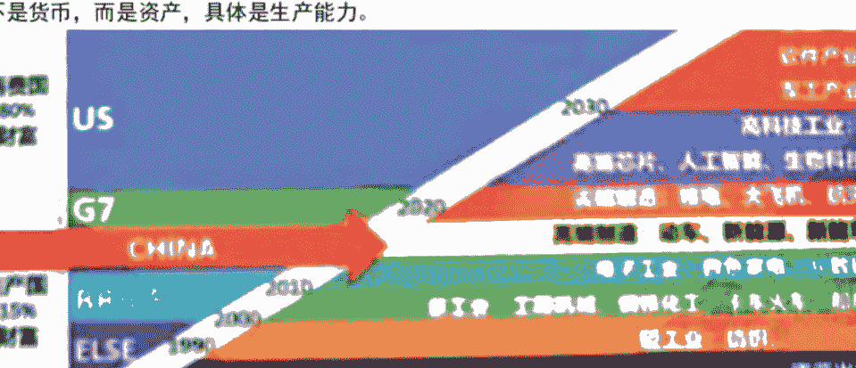
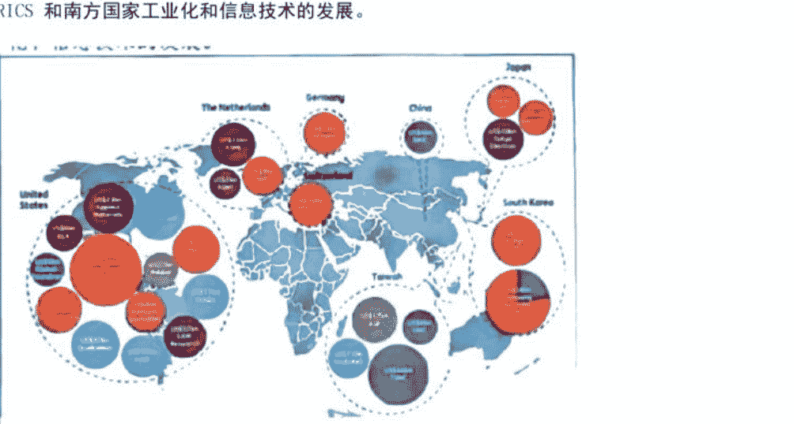
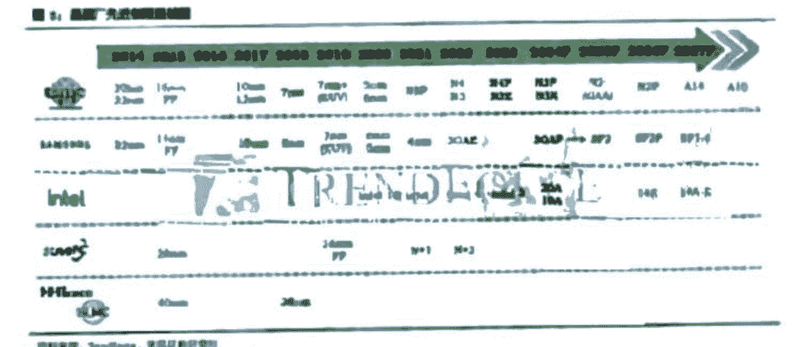
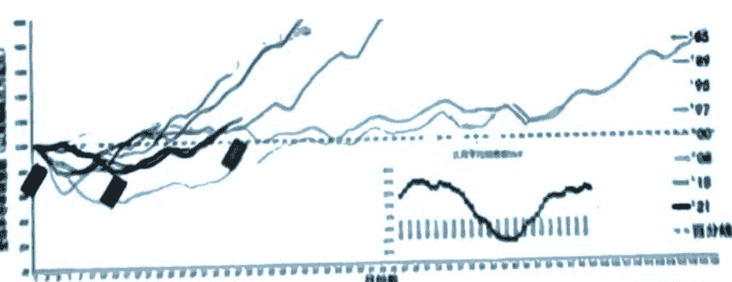

## 风险提示

1. 《新奇普交易一总论》对基本原理进行了解释：四周期主道周期，必须基于主导周期、二导周期和三导周期的共振。“中-AI-复合”符合这个基本原理。

2. 《行业洞察》系列解释了主导周期：AI技术发展路径，AI对于大竞争的重大影响，AI是竞争的焦点。

3. 《2025Q1：常规逆周期》美季系列，解释了第二周期：美股在Q1高达98%的触概率，随后引发金融危机和恐，AI泡沫后是AI重构布局的时间。

4. 《特刊》第一时间解读了DeepSeek在这次“大变局中扮演的引引发爆发的关键作用。DS战略反攻触及了对我们之前前沿的一次全方位验证，我们已经在DS上获得盈利，且在美股上获得盈利。

我们选择在AI发布《新奇普交易》和《新货币战争》的原因：由于该DS行情结束，“黄金坑”将随着而来，做好抄底布局的准备。

本文分享是研究，不作为投资建议。

## 概述

世界的财富，可以用货币来衡量。在当前世界秩序下，具体用美金来衡量。但，世界的财富，并不是货币，而是资产，具体的生产能力。

从资源出口，到轻工业、重工业、电子工业、高端制造，每一次产业升级，都是源自内外两个面的合力：外部：国际关系或者秩序的调整，抓住机遇；内部：社会组织模型，科技自立和民族基因。

## 微信kaiwu7878进群获取全网优质资源

现在，我们加速向头部制造，内部条件趋于具备还很难，因为美国知道是他的最后堡垒：全球产业产物的顶端积累，正在经挑战。

但正如我们在《总论》分析中指出的，跑慢的，恐怕要让出位置了。

综上，我们识别到了半导体引入关键局点，从生产关系角度，阐述了某种我们认为最大的交易可能性：从生产力角度，我们谈了 7nm 就是关键的。

盯紧这两个目标，作为本投资的根本依据。

## 一、主导周期

### （一）从技术本身而言，AI 的价值是确定的。

《行业浏览》系列《人工智能与平台经济深度研究》中对此进行了了解：

为了便于建立认知，以下解释并无学术精确。

- 1. 互联网络上的数据（知识）容量让任何个人具备。2. ChatGPT 为代表，AI具备了逻辑能力，可以将数据（知识）像人类一样进行连接和构建，构为“生成式”人工智能AIGC。
- 3. AIGC 的工作分为两步，先查找检索，然后整理输出：在现在者强，后者较弱，总体上是一个在大学来说的水平。
- 4. AIGC 是 AI 的早期爆发，后续的发展路径：
    - ①从文本到图像的重建和再发现
    - ② 科学前沿的组合式创造和关联性的新发现（2024年诺贝尔物理学奖和化学奖涉及AI）
    - ③ 数学计算与物理还原（如果 OPTIMAL 01达到了超级博士的比例达到了69.7%），推测将复杂任务进行大分解和分析，后使用多个模型来处理和组合
    - ④从虚拟到现实（比如文字温度的理解能力和环境温度的感知能力）的跨越（比如智能工厂，可以介绍现状并提出提高生产率的建议）
    - ⑤金融融通可以通过预测和决策，对于 AI（比如人形机器人大达到这个阶段才具备人类的灵活性和适应性）
    - ⑥有很多研究探讨，关于国家治理AI以及基于AI的国家竞争：如果不发展AI，那么可能被文明淘汰；也有些研究认为 AI会改变人类的生产和社会模式。
    - ⑦DeepSeek 符合技术发展的规律，其成本的降低将技术进步将更快地加速 AI 技术的应用

举两个例子：

特斯拉2019年启动电动车，赛赢无数，到2019年才出现持续盈利的预期，掀起了后全球的电动车浪潮。光伏在2000年以后就开始尝试商业推广，尽管坚持持续给予补贴，但是进程并不理想，到2018年12月，光伏成本不需要补贴实现“平价”爆发。

微信kaiwu7878进群获取全网资源

注意，正是二者使得美欧可以构建“碳中和”：既要技术可行，也要商业可行，有所所得。现在，我们回顾一下：

- 1. GPT证了AI普及的可行
- 2.证了AI作为生产工具的可行
- 3. DeepSeek证了商业化的可行

需要理解的是，技术进步推动商业普及是所有技术普及的前提。尽管AI被民主党作为全球竞争，存在显著泡沫，也是泡沫的核心是技术本身，还需要硬件成本。

### 二、二号布局

因为AI巨大的潜力，AI竞争与合作成为“新中和”，其本质是AI时代定位。AI技术的领先为经济增长提供了支持，民主党期间实施AI武器：

现在，民主党已经下台，这一策略结束：

- 1. 谈会后，DeepSeek 开源是中国第一次直接接触并主动影响世界，交易20%：
- 2. 总论提出，科技我们们的“锁”。是语境以来的核心诉求；
- 3. Higher for Longer 导致了我们的资本外流，民主党也造成了历史上最长，现在川普政府要处理这个。
- 4. AI领域转型并竞争政府将显著突破。

### （二）美国反对美国

《总论》分析了“美国反对美国”。对于川普政府，如果不处理好中美关系，那么在Q1报告中讨论的危机爆发，将陷入非常被动的局势。尤其川普已经被推过一次，如果这次改革不彻底，以后的结局可而知。

对于川普政府，中美AI竞赛首先要屈服于内部政治，因此，相比拜登政府会获得更多的突破。

接下来的问题是，符合我们利益的场景是什么？

- L1 自主完善完善AI技术，从此不再制于人。比起研发光刻机，还需要突破封锁重建全球合作和技术交流；
- L2 提升供应链安全，避免随时卡脖子。比如光刻机，在实现国产化进程以前，可以同日韩买到先进光刻机用于生产；
- L3 芯片升级人工智能产业加速发展。在L1和2不可实现的情况下，至少以合理价格买到好的芯片，以提升算力对AI的支持。

从L1到L3，是从根技术，到供应链，到产品，三个层次的问题。

#### 1 基准场景

拜登政府时代，回顾过去四年的芯片博弈：

- ① 1.3 方面，芯片管制，比如英伟达，只高价进口且限制的芯片。
- ② 1.2 方面，同意台积电阶段性为AI领先。
- ③ 1.1 方面，完全封锁。

莱穆2023年访华的同时，华为发布了配备国产芯片（麒麟9000）的Mate60。

在《总论》中，我们分析了拜登战略和川普战略的区别：拜登是拉着小弟们团围，唯怕自己内伤；川普可能放弃小弟们并吞了他们，以确保美国更加强大。

微信kaiwu7878在群获取全部网络资源。

## 新川交易场景

符合新川普政府政策和中国半导体发展的共同利益，才能实现：

- ① L3 方面: 相比拜登政府时期，意味着川普将同意中国进口更多的英伟达高性能芯片，尤其芯片在美国生产，这些芯片可以供应给中国，包括7nm及以下的制程，但不包括最先进的制程，保持最先进的终局留在在美国生产。
- ② L2 方面: 限定一定范围，比方14至7nm，逐渐允许为中国代工，甚至可以同意与日韩在尖端芯片方面开展发展，尤其在美国生产。
- L1方面: 由DeepSeek巨大的韧性突破，国产侧裂芯片将不断获得新的突破，这意味着中国AI模型如“华为+DS+开源/华为/天才”将用14至7nm的价格。

这是AI时代挑战“英伟达”难以以突破。

综上，由于中国巨大的市场，川普政府的核心目标在于使半导体回到美国制造，相比拜登政府取得显著进展，中国在尖端芯片方面的差异。

## 三、三周周期

### （一）危机前的布局

在《总论》中述了新川政府内政治和国家能力重塑的世界格局调整，这是关键期。拜登时期：

- 1. 基准场景: 研发除中国以外的全球控制光刻机，拜登政府领先。
- 2. 新川场景: 危机爆发前，美国强化收，半导体产业布局。

### （二）危机后的新版图

特朗普在2025年达沃斯论坛上的发言：“如果你不在美国制造，你就得支付关税。”这意味着半导体产业在危机中被迫向美国转移，长期持续地降低。川普的理想是所有的生产都到美国，这显然不可能，日韩正在边缘化。中国作为最大的市场，比较的情况是：

- 向美国进口芯片，同时要求美国放松一定制程的光刻机；
- 向日韩出口芯片，至少要求美国带工，争取技术合作；
- 随着危机爆发，全球需要AI技术驱动复苏；随着新时代的全球政治局面，全球半导体格局将显著重塑。

新的半导体产业格局将决定市场。中国进一步降低中低芯片的成本，这将帮助BRICS和南方国家工业化的发展。

中国的半导体产业链份额较小，具有很大的提升空间。这很难，但回顾从纺织、白色家电、3C数码、高铁、飞机，每一次升级都是世界格局背景下的突破。这次不会例外，世界格局重塑能够聚焦。

## 四、核心指标

### （一）中国大陆晶圆工厂领头：规模大、市占率领先

截至2Q3，中芯国际在上海、北京、深圳的多个8英寸和12英寸的生产基地产能已达到每月8万片晶圆（折合8英寸）。根据TrendForce发布的2024年第三季度的全球晶圆市场，公司位居全球第三，在中国大陆企业中排名第一，市占率为6%。

加微信kaiwu7878获取全网付费资源

## 06.22 24Q3 十大代工厂榜

| Ranking | Company | Revenue 3Q24 | Revenue 2Q24 | Market Share 3Q24 | Market Share 2Q24 |
|---|---|---|---|---|---|
| 1 | 台积电(TSMC) | 23,527 | 20,819 | 13.0% | 64.9% / 62.3% |
| 2 | 三星(Samsung) | 3,357 | 3,833 | -12.4% | 9.3% / 11.5% |
| 3 | 中芯国际(SMIC) | 2,171 | 1,901 | 14.2% | 6.0% / 5.7% |
| 4 | 联电(UMC) | 1,873 | 1,756 | 6.7% | 5.2% / 5.3% |
| 5 | 格芯国际(GlobalFoundries) | 1,739 | 1,632 | 6.6% | 4.8% / 4.9% |
| 6 | 华虹(HuaHong Group) | 799 | 708 | 12.8% | 2.2% / 2.1% |
| 7 | 高美世代(Tower) | 371 | 351 | 5.6% | 1.0% |
| 8 | 世界积电(GlobalISA) | 366 | 342 | 6.9% | 1.0% |
| 9 | 纳电(PSMC) | 336 | 320 | 4.9% | 0.9% |
| 10 | 合计(Total) | 34,869 | 31,962 | 9.1% | 96% |

来源：TrendForce、东方财富

### 综合一体化，领先

相比大陆其他晶圆工厂，中芯国际专注于逻辑领域和特色工艺领域领先。中芯国际拥有0.35微米到14nm的FinFET产能。此外，根据TrendForce，2021年到2022年出发的14nm节点。

微信kaiwu7878获取付费资源

### B. 特色领域

中芯国际开发了电源/模拟、高压驱动、嵌入式、混合信号、IGBT等特色工艺。三季度，公司构建了多样化平台，其中40nm具备完整性，最终按照客户需求，覆盖CIS、MCU、wifi等。

## 半导体行业趋势

电子/数字技术：15纳米、55纳米、40纳米（铜/铝）；低功耗存储：14纳米、32纳米、55纳米；DDR5、HBM3；柔性显示、微OLED、LED；通信Chiplet、先进封装Chiplet。

### （二）营收分析

国际按场景分类五类：手机、电视及周边类（游戏、玩具、遥控、智能家居）、互联网和可穿戴、工业和汽车。

### 3. 收入分析

| 地区/分类 | 本期报告 | 上年同期 |
|---|---|---|
| 中国区 | 80,909 | 77.60% |
| 美国区 | 15,50 | 18.60% |
| 欧亚区 | 3.60% | 3.80% |

| 应用分类 | 本期报告 | 上年同期 |
|---|---|---|
| 智能手机 | 31.50% | 25.20% |
| 电脑与平板 | 15.30% | 23.10% |
| 消费电子 | 33.40% | 26.60% |
| 联网与可穿戴 | 12.10% | 14.20% |
| 工业与汽车 | 7.70% | 10.90% |
| 以尺寸分类 | 本期报告 | 上年同期 |
| 6英寸以上 | 25.505% | 26.70% |
| 12英寸以上 | 74.50% | 73.30% |

### （三）增速分析

### 1. 半导体已进入上行周期，AI带动加速

根据SSI 数据，全球半导体销售（月平均增长）截至2024年10月，已连续12个月同比增长，预示半导体周期已处于上升期。

微信kaiwu7878进群获取免费资源

全球半导体规模预计2025年达到6972亿美元，同比增长19%。

在地缘政治紧张的情况下，为了保证供应链安全，国内企业开始把部分分工需求向国内转移。

中芯国际未来有望接受产能转移到国内产能1/3左右的需求。

## 3. 产能利用率提高，毛利回升

晶圆道投入，需要不断的扩产，行业周期性明显。具体到财务指标，产能利用率和毛利是关键指标。

当行业景气下行、需求不足的时候，产能利用率和毛利都会下降。相应的，当行业景气上行，产能利用率和毛利都会上升。

| 时间 | 2020年 | 2021年 | 2022年 | 2023年 |
| :--- | :--- | :--- | :--- | :--- |
| 产能利用率时间 | 95.50% | 100% | 92.30% | 75.10% |
| 2022年1季度 | 2022年2季度 | 2022年3季度 | 2022年4季度 | |
| 100.40% | 97.10% | 92.10% | 79.50% | |
| 2023年1季度 | 2023年2季度 | 2023年3季度 | 2023年4季度 | |
| 68.10% | 78.30% | 77.10% | 76.80% | |
| 2024年1季度 | 2024年2季度 | 2024年3季度 | 2024年4季度 | |
| 80.80% | 86.20% | 90.40% | 没公布 |

截止到2023年3季度，产能利用率已经回升到90%+，毛利虽然还处于相对低位，但回升态势明确。

按照公司的说法，产能利用率90%以上就属于健康状态，而毛利率2024年4季度有望回升到20%左右。

此外，中芯国际表示客户及终端客户进行了沟通，预计是明年芯片用量高于今年，因此预计明年公司产能利用率和毛利率会进一步提升。

## (四) 行业展望

- 手机市场：公司智能手机主要为安卓手机生产相关芯片产品代工，2025年开始智能手机有望进入AI驱动的换机，公司将受益于手机需求复苏，预计24/25/26年营收增速达到40%/25%/15%，成为规模增长的重要驱动力。
- 电脑与平板：公司电脑及平板市场主要为客户提供终端所需的芯片代工服务，2024年推出了多款AI产品，有望引领国产PC客户重启增长，保守预计24/25/26年增速为-10%/+2%/1%。
- 消费电子：公司对消费电子市场定位于较为窄，考虑到成熟制产品在消费电子市场替代，叠加下游消费复苏带来的需求提升，预计该领域增长24/25/26年增速达到65%/20%/15%。
- 互联与可穿：AI功能的极大提升了可穿产品的使用体验，AI眼镜/耳机/眼镜箱等新产品有望快速带来较大的市场机遇，预计该领域增长24/25/26年增速达到。
- 工业与汽车：我们预计该领域未来三年将平稳，随着新能源和汽车工业化趋势稳步增长，预计该领域增长24/25/26年增速维持在5%附近。

总体看，受益于半导体上周期、AI带动/工业/汽车触底以及国产替代，2025年/2026年中芯国际的收入大概会有不错的成长。

机构平均预期，24/25/26年营收达到566/648/736亿元，对应增速分别为25.5%、13.8%、13.8%，归母净利润到39.9/53.8/76.8亿元，对应增速分别为-17.3%、35%、26.3%。

## 盈利预测

| | 2021(实际) | 2022(实际) | 2023(实际) | 2024(预测) | 2025(预测) | 2026(预测) |
| :--- | :--- | :--- | :--- | :--- | :--- | :--- |
| 0.58 | +3.00% | 39.9 | -17.7% | 642 | +25.0% | 100 | 15.49 |
| 0.61 | +3.00% | 53.0 | -35.0% | 646 | +13.0% | 139 | 11.48 |
| 0.65 | +4.00% | 60.0 | -26.3% | 734 | +13.0% | 110 | 9.89 |

估值方面，中芯国际作为重资产科技公司，盈利水平折旧影响较大，短期内不能充分反映。

## (五) 关键变量

以前，台积电一直比中芯国际领先两代以上，但正如光伏无可能100%把光转化为电，理论障碍意味着极极限。1nm存在理论障碍，2至4nm可能存在源自理论障碍的工程不稳定，那么，7nm可能是硅基芯片制程的最优解。

综上，7nm完全掌控，就是中芯国际进入全新周期。而中美谈判之际，这是一个核心博弈的筹码。

## (六) 技术分析

大周期：月线 MACD/KDJ金叉，且站上0轴，叠加月线级别缺口，趋势上行明确，敏锐的资本已经布局。

小周期：考虑到外股风险、日线股价形态以及估值位阶，短期要谨慎调整仓位，幅度参考外围环境，可以适度关注中61.8%位置和120日均线位置。
