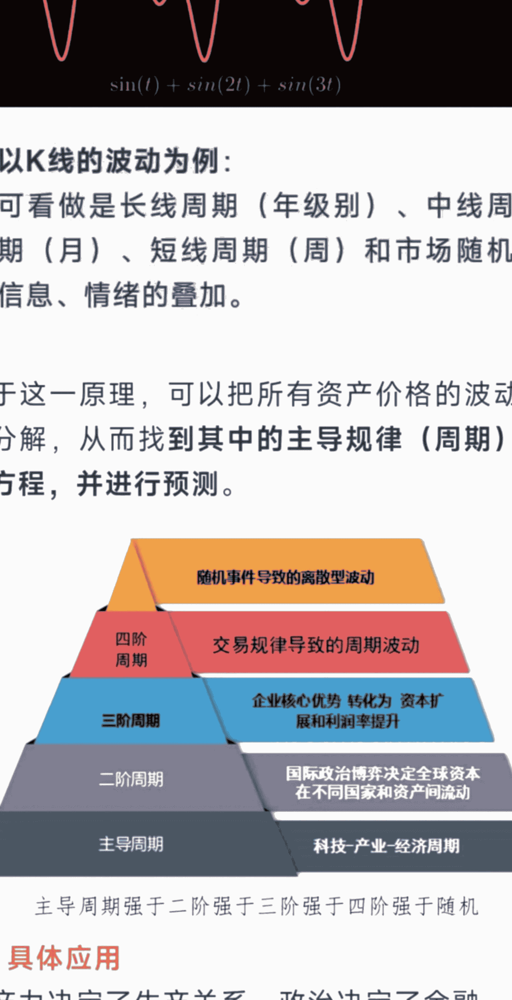
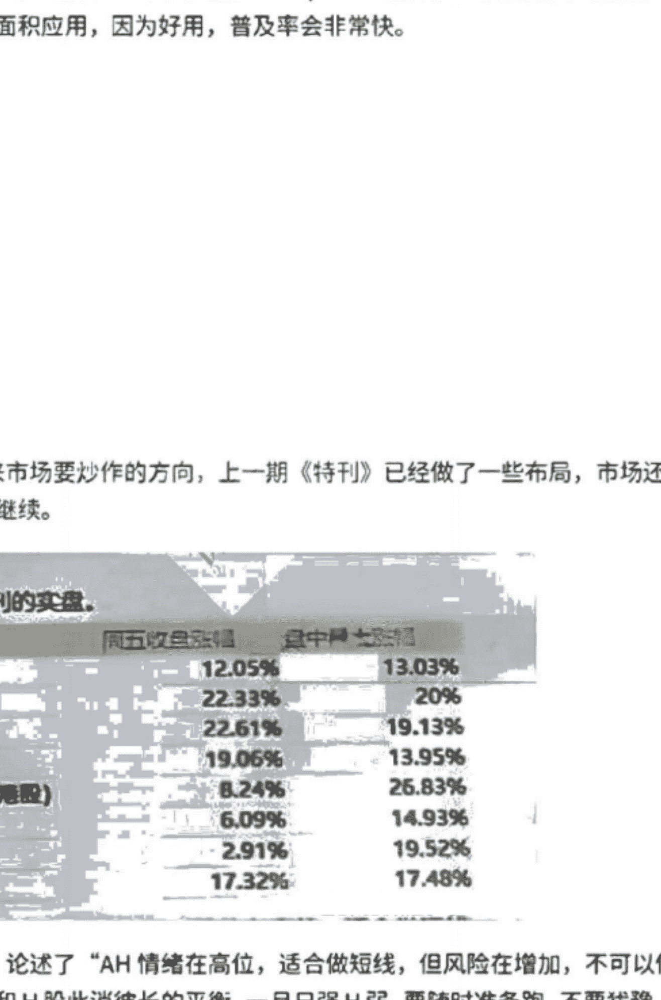
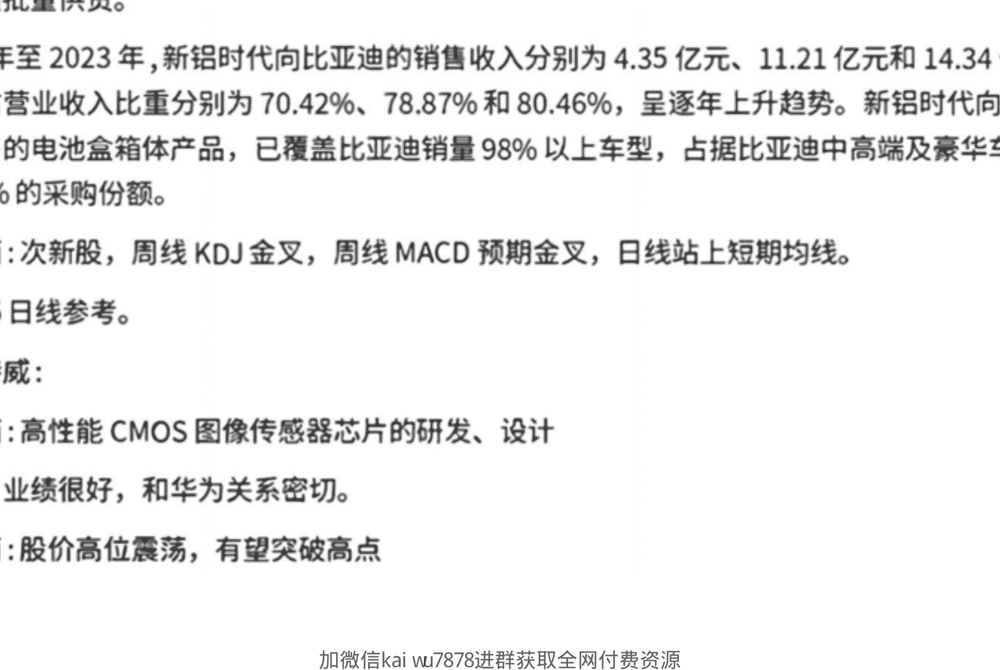

在这次的《新川交易》系列第“总”中，我们介绍了价格波动的基本原理，现在应用如下：

# 一（新川交易-总论）价格波动的原理

### 1. 福利叶拆解

所有规律的波动，都可以由若干规律的波动组成，展开为主导、二阶、三阶……周期、随机。

以K线的波动为例，可看到长线波动（年级）、中期波动（月）、短期波动（周）和市场随机、信息的涨跌。

## 2. 应用

# 二、生产力

DS技术突破了生产力的瓶颈，从而改变了生产关系。
DS技术的出现，使得生产力发生了飞跃，由于生产力的飞跃，它就决定了新的生产关系。我们以后以DS技术为例，说明了生产力如何决定关系的原理（详细内容见第一章、第二章）。

| DS 之前 | DS 之后 |
| :--- | :--- |
| 美国在美 | 中国在美 |
| 美国拥有所有技术 | 中国拥有所有技术 |
| 美国可以建立主工厂 | 中国可以建立主工厂 |
| 美国依赖中国 | 中国依赖美国 |
| 拥有廉价劳动力，形成市场 | 拥有廉价劳动力，形成市场 |
| 失去了七项优势 | 获得了七项优势 |

但是由于DS技术突破了生产力的瓶颈，它决定了新的生产关系，这种关系是持久稳定的吗？
