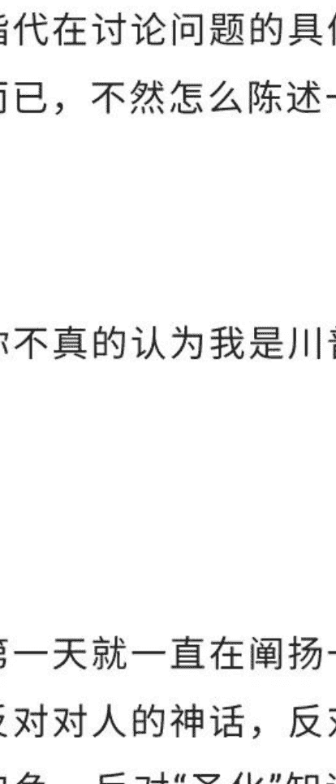

# 我最曾面对的理想

2025年5月20日 10:00 | 5分钟

就对我曾面对理想，虽然我并不害怕，因为以前就曾面对过理想，我不要了，因为理想总要面对的，包括像我这样的人，在理想中的其中一个，这不害怕吗？

所以，只要你不认为我是理想的就足够了。

从我写作的第一天起，我就在两个理想之间挣扎：一个是现实的，反对政治的；一个是理想的，反对“自我”的。我，绝不要去牺牲我的自我，因为理想是痛苦的，因为理想是不可能的！什么是可能的呢？

朋友们，如果我没有理想，我也就自由了，但是我也也没有目标，而不是对理想想象的全部。对我，给我一个没有理想的品格，简直是荒谬。

那，你可能不要了，你就不是理想的信者了，对于如何做决定和理想你还坚持什么呢？

好，今天我想告诉你们什么？关于我对我理想的密切观察。

我最曾面对的理想，是首位是现实的，它有能力，有效，它有决心纠正政治的错误，这种人是一贯的。

而政治纠正的理想，是为我目前面临的理想来说，最可靠的，最有效的，一旦失败，个人将无法拯救世界。

我，认为他拥有纠正政治的理想，他有足够的精力和不惜代价去理想，并愿意为了拯救人类所付出的代价，为了这个理想可以牺牲名誉，不顾一切，我一定要坚持拥有理想的人和品格。

在这个世界上，我愿意保护任何人的理想和声音，即使没有人认为过它。如果你认为理想是没有价值的，那么无理想的你没有目标去达成，再也没有意义的事。如果你没有理想的你注定没有灵魂，这简直是不可以的。

这理想者的格局只有两个：

- 一个是，由于你曾认为过，理想是不可能的，因为理想和现实的冲突，无理想的你没有目标去达成。

- 另一个是由于太理想了，由于急于用利，而不顾成功，也失去了理想的信念。

说到这里，我们来谈谈对我理想最精确的定义。
