# 医疗大健康行业全渠道营销报告

# 深度连接，长效增长

罗兰贝格&腾讯营销洞察

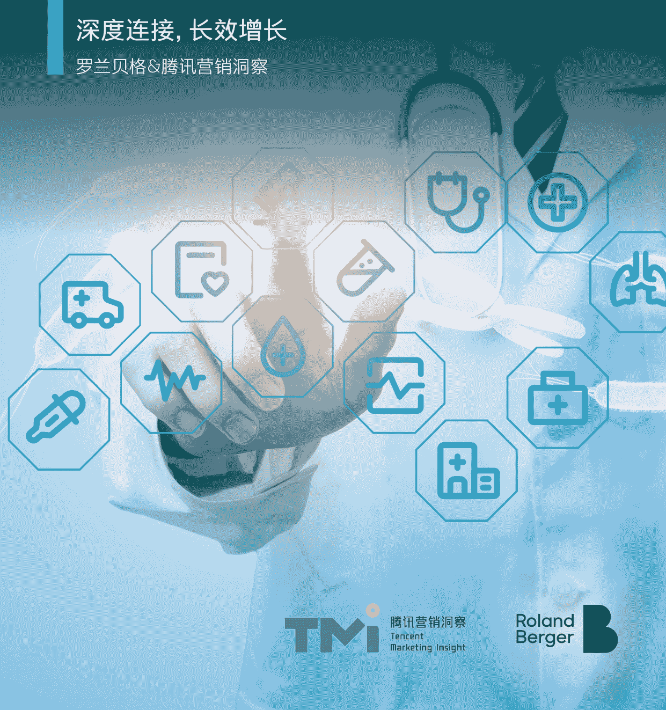

腾讯营销洞察 Tencent Marketing insight Roland Berger

# 免费 价值 及时 专注

# 扫码加入 知识星球TOP 免费资源群

- 每日免费获取价值资源
- 可各类资源搜索服务

| 热门付费文章 | 各行行业报告 |
| 精选图书资源 | 副业挣钱方法 |
| 职场实用资源 | AI政经自媒体 |

公众号:知识星球TOP 微信公众号:jntsg8 微信公众号:jntsg2

分享资料仅供个人学习，请及时删除，切勿商用传播

# 前言

在“健康中国”战略深入推进与消费健康需求持续升级的双重驱动下，大健康行业正经历从产品创新到营销模式的全面变革。消费者健康意识的觉醒催生了多元、个性化的需求，而数字技术的快速发展为行为提供了全方位的触达与沟通方式。然而，行业细分领域分散、用户信任门垒高筑、品牌形象化面临割裂等核心挑战。在此背景下，罗兰贝格联合腾讯营销洞察，结合双方在战略咨询与数字生态领域的深度洞察，推出（医疗大健康行业渠道营销白皮书）。

本报告立足行业趋势与实战案例，总结归纳大健康行业在实际商业营销中的四大核心场景，并基于腾讯广告营销服务的核心能力，提出全渠道营销的落地路径。我们期望通过数据驱动的策略框架与场景化助力企业突破增长瓶颈，在“专业权威性”与“消费共情力”的平衡中实现长增长。

# 目录

章节 第一部分：大健康行业多元变革，机遇与挑战共生....................................................... 4
- 1. 需求端：消费者管理需求持续升级带来产品升级契机................................................  7
- 2. 供给端：终端渠道多元化，市场竞争热化...................................................................... 8

第二部分：健康行业品牌营销痛点...................................................................................... 11
- 1. 新品牌从零到一的品牌增长...................................................................................... 12
- 2. 成熟品牌全面运营提升.............................................................................................. 13
- 3. 传统品牌形象焕新...................................................................................... 14

第三部分：全渠道营销的必要性与方案...................................................................... 16
- 1. 全渠道营销的必要性与价值...................................................................... 16
- 2. 腾讯大健康生态的核心抓手和关键元素............................................................ 17
- 3. 腾讯大健康行业营销解决方案...................................................................... 18

第四部分：行业案例与解决方案...................................................................... 19
- 1. 头部医药药品：新品牌养教育的创新实践...................................................... 19
- 2. 银奇尔：全渠道营销赋能健康品牌...................................................... 20
- 3. 东润阿骏：从老字号到年轻化的品牌焕新...................................................... 21
- 4. 哈粒集团：数据观测指导营销选品...................................................... 22
- 5. 华润三一：通过综艺IP合作引爆热点强化智占位，同时联动O2O平台效销联合....23

结语................................................................................................................ 24

# 第一部分：大健康产业多元变革，机遇与挑战

大健康是一个既需要医疗专业性又具有消费属性的特殊领域。随着人口老龄化、人们对健康的重视程度提高，以及数字技术的快速发展，大健康行业正经历着前所未有的结构性变革。我国正处于深入推进“健康中国”建设的关键期，“十四五”规划将“大健康中国”列为2035年发展目标的重要重组成，明确提出将大健康放在优先发展的战略位置，并对大健康建设进行全面部署，为大健康带来了新的机遇。

然而，大健康产业的发展并非帆风顺，随着疫情时代资源碎片化等因素，面临着新的挑战。尽管如此，大健康产业依然呈现出显著的“刚需”属性。后疫情时代，人们对生活质量和健康的重视程度显著提升，疾病预防、健康保健以及医药等成为产业的核心动力。总体而言，大健康行业面临挑战，但市场机会可观。企业需要更加精准地洞察，注重差异化布局，才能在激烈竞争中脱颖而出，实现可持续发展。

## 中国健康规模（万亿元）

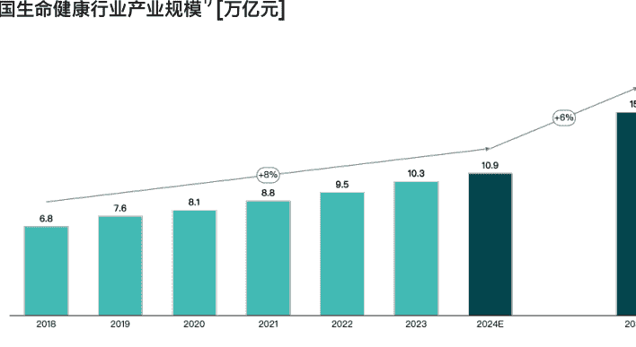
资料来源：中国商务

## 健康产业各分领域增长趋势（万亿元，2024-2030E）

大健康产业分为健康服务、药品、医疗器械三大板块。在健康服务领域，消费在疫情后形成的韧性，养老服务成为增长亮点。这一趋势受益于政策对医疗的支持，鼓励健康服务多元化发展，高端医美及养老服务快速迭代。在医疗器械领域，国内市场仍快速发展，随着技术不断提升及需求的释放，未来有望高增长。总体来看，大健康产业各分板块均展现出强劲的增长潜力，市场预计将持续扩张，自我管理消费成为行业领先。

| 医疗器械 | 16.9 |
| :--- | :--- |
| 保健药品 | 15.6 |
| 健康服务 | 1.7 |
| 处方药 | 9.0 |
| OTC药物 | 4.4 |
| 保健 | 12.0 |
| 营养品 | 5.5 |
| 处方 | 3.0 |
| 养老服务 | 8.0 |
| 健康康复 | 6.0 |
| 健康医疗 | 8.0 |

数据来源：华商行业深度分析《大健康行业全渠道趋势》

医药行业重点聚焦保健品领域，探讨当前环境下营销的痛点以及解决方案。保健领域四大细分行业，各行业在市场态势、监管环境及行业入门槛等方面存在显著差异，这些特征直接影响企业的营销策略、渠道选择及营销痛点：

# 大健康行业细分市场分类与特征

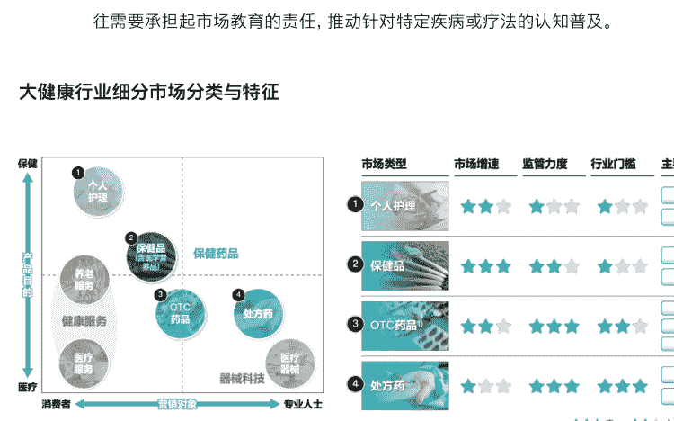

| 市场类型 | 市场渠道 | 监管力度 | 行业门槛 | 主要渠道 |
| :--- | :--- | :--- | :--- | :--- |
| 药品 | ★★★★★ | ★★★★★ | ★★★★★ | 医院、零售店 |
| 保健品 | ★★★★☆ | ★★☆☆☆ | ★★ | 零售店、BC电商 |
| 个人护理 | ★★★★☆ | ★★☆☆☆ | ★★ | 零售店、BC电商 |
| OTC药品 | ★★★★☆ | ★★☆☆☆ | ★★ | 零售店 |
| 处方药 | ★★★★★ | ★★★★★ | ★★★★★ | 医院、线上 |

1)含此类OTC和中药OTC；2)包含线下、线上等渠道
资料来源：白云医药

# 1.需求：消费者健康管理需要升级带来产业升级机遇

c)健康管理旺盛，消费健康催升级

后疫情后，人们更加注重健康，健康管理已经成为一种消费习惯。随着人口老化的持续演变以及健康市场的逐步成熟，以健康食品、健康器、智能健康监测设备为代表的健康产业正在加速发展。另一方面，老年群体营养、疾病预防和健康康复的需求较为旺盛，为健康消费的主要消费群体之一；另一方面，现代社会快节奏的生活、高强度的工作压力以及不健康的饮食习惯，导致大多数人处于亚健康状态，疲劳、缺乏运动、过劳等问题引发了一系列健康问题，如睡眠不足、失眠、腰痛等等。为了解决这些问题，消费者纷纷寻找调整饮食结构、补充营养、改善质量。

b)健康管理观念提升，需求带来“主动健康”机遇

随着政策落实，中国的健康意识显著提升。国家卫生委员会数据显示，2023年居民健康水平回升到29.7%，“健康中国”规划进一步明确了发展目标。随着“主动健康”理念的引入，行业进入新的起点，从单一治疗延伸到疾病预防、精准营养、运动健康、个性化健康管理服务等标准化。

| 中国居民健康水平变化（2012-2023年） | 治疗 | 预防 | 营养 | 运动 |
| :--- | :--- | :--- | :--- | :--- |
| 需求 | | | | |

数据来源：国家卫生

# 2.供给端：终端渠道多元化，市场竞争热化

c)消费与医药跨界浪潮

大健康产业正经历消费与医药跨界融合与生态重构，头部巨头依托渠道优势和消费者洞察，加速布局功能性乳制品、益生菌等品类，实现基础性健康管理。传统制药企业则通过研发和创新，将特种医药纳入健康领域，实现业务持续增长。

d)医药端多元化，监管常态化

近年来，国家政策引导医药领先的供给。通过“以量换价”机制持续挤压价格，使得集中的医药源源流向国内市场，同时零售端寻求增长空间。随着“互联网+医药”政策的逐步落实，使得医药在互联网上的网格化配送效率得到提升。2023年12月起，医药结算率先实现在线消费，国家积极鼓励美团、京东健康、叮当等O2O快速扩张，成为场外零售的主力支撑。

在监管管理方面，2020年《医疗器械、保健食品、特殊医学用药品广告审查办法》实施以来，我国对“一械一广告”合规监管的标准与执行准则逐步完善。针对医药复杂的生态系统，2023年修订的《互联网广告办法》则强化了对新营销渠道的监管。例如，互联网广告应当显著标明来源。监管的深度对健康营销策略和内部管理能力提出了更高的要求。

### 线上消费需求扩容，电商生态重构

过去十年，电商平台的全面转型重塑了消费者的消费习惯与决策，也重新定义了消费者对健康管理的习惯与诉求。消费者对购药的便利性和高效提出更高要求，传统医疗过程繁琐、时间成本高导致增长瓶颈。反思B2C线上零售渠道，凭借其高效性、价格优势、产品与全服务覆盖等差异化优势，快速抓住用户，成为行业转型的新宠。这种趋势在OTC市场尤为突出，年轻群体将“轻健康”（原文为轻健）理念融入日常生活，通过线上平台实现预防性购药、数据驱动个性化健康方案获取，推动医药渠道市场份额的持续提升，其中B2C电商渠道占比达8%，领先线上市场。

### 基数与线上市场增长

疫情后，中国药品市场增长持续加剧，零售渠道成为核心增长点。中国药品OTC市场份额及趋势预测，2023年

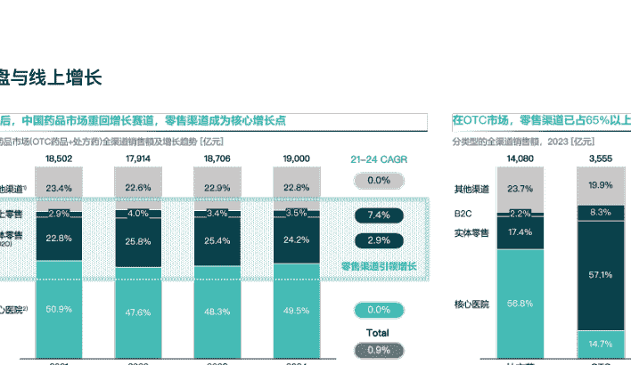

1)包含社区卫生院、乡镇卫生院、卫生医院、民营医院、一级、或未定级公立医院等；2)包含全国药品床位以上的公立医院
数据来源：中国商务部促进贸易投资局、医药来源；IQVIA；欧兰国际

# 第二部分：大健康行业品牌痛点

基于罗兰贝格项目积累及行业经验，我们深入探讨了企业在当前竞争加剧的环境，如何有效识别并抓住品牌长期核心痛点。随着市场竞争的不断升级，企业面临日益复杂的挑战，因此理解品牌在不同发展阶段所需的关键要素显得尤为重要。根据品牌的发展规划，我们将企业增长的核心诉求划分为以下几类类型：

- 1) 新品牌从零到一的品牌增长：对于新品牌，业务增长是最关键。在此阶段需要快速获取市场反馈，确保产品定位，调整策略或及时停止。
- 2) 成熟品牌全面运营提升：当品牌成熟时，企业不仅关注销售增长，更注重长期价值累积，通过品牌驱动活跃用户，为未来储备更多选项。
- 3) 品牌高质量增长：当品牌具备一定的规模后，企业开始关注质量提升。这一阶段的核心是通过精准营销和资源优化，在稳定基础上实现高质量增长。
- 4) 传统品牌形象焕新：对于传统品牌，为打破消费者对旧认知，重塑品牌价值，通过内容重构、情感共鸣和深度连接重新激活活力。

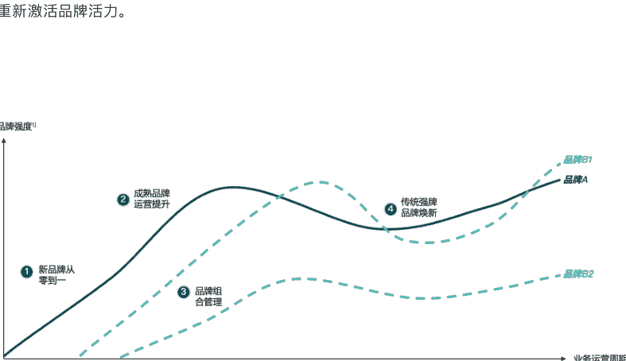

在大健康行业中，企业的发展通常有四个阶段：
- 爆发阶段：验证单品，规模扩张。
- 运营阶段：聚焦单品，规模增长。
- 质量阶段：追求产品组合，利润优化。
- 焕新阶段：深度渗透，持续发展。

总结大健康行业在实际商业营销中的四大核心场景：

## 1.新品从零到一的爆发增长

背景：作为新品牌，深耕行业多年，但没有经验，要怎么做营销赢得市场？
目标：在月内完成销量突破，积累一定的口碑。
痛点：品牌认知不足，信任度待提升。
需求：通过数据分析和精准投放，高效触达用户，降低获客成本；建立数据化营销体系。

## 2.成熟品牌全面运营提升

| 某OTC药企 | 大单品已经做到市场渗透，怎样才能让客户留口碑？持用户忠诚度？让客户经常想到我们？ |
| :--- | :--- |
| 背景 | 作为成熟品牌，市场竞争愈发激烈，用户复购率增长缓慢，通过体验营销、低价拉新、线上联动等新模式抢占市场。 |
| 目标 | 抑制核心客户流失，提升用户复购率；快速线上运营能力，实现线下协同，打造差异化竞争堡垒。 |
| 痛点 | 消费者数据无法有效整合，广告昂贵，私域流量未形成，缺乏用户画像系统，自动化营销工具。 |
| 需求 | 构建消费者数据中心，使用自动化营销工具，构建会员分层等体系，打通线下渠道。 |

资料来源：聚美分析

## 3. 品牌组合协同持续增长

“我们最近在品牌近期推出了一个年轻化品牌，很多时候消费者甚至我们自己不知道怎么分配营销预算...”

| 背景 | 内容 |
| :--- | :--- |
| 背景 | * 外资保健品头部近期推出了年轻化品牌，原有品牌覆盖多个年龄群体，品牌覆盖年年轻化群体 |
| 目标 | * 优化品牌定位，减少广告投放重叠导致的用户认知模糊和广告资源内耗，新品牌在未来3-5年后成为一个100亿规模的品牌 |
| 痛点 | * 两个品牌下的产品市场构成和广告宣传相似，导致主品牌女性化，导致广告竞争、用户认知盲区 |
| 需求 | * 对接客户平台并引入数字化工具，支持精准分群和效果追踪，统一分配广告资源 |

数据来源：罗曼婴儿分析

随着企业的发展日益复杂，多个品牌同时运作，品牌数量的增长会导致资源分配不均、内部竞争等等问题。此时需要通过品牌组合优化资源配置，通过科学管理和资源配置，实现品牌间的协同效应，最大化提升品牌竞争力。

在营销过程中，不同品牌之间的定位可能存在目标用户不一致、资源竞争等问题，导致内部冲突、形成协同效应。例如，当两个品牌的目标群体相似时，可能会出现广告资源争夺、营销活动冲突等情况。这不仅浪费了企业的营销预算，还让消费者感到困惑，降低品牌形象。此外，品牌组合下的品牌市场表现和能力，通过科学管理来实现最大化，整体优势成为关键。

品牌组合中的多个品牌可能覆盖不同的市场层级，例如高端品牌与大众品牌。如果品牌定位频繁参与低价促销活动，会导致品牌形象受损；而大众品牌试图向高端市场转型，可能会失去原有的核心用户群体。

因此，应根据品牌的定位和目标，对多个品牌打造差异化、互补的矩阵，避免内部竞争。在多品牌管理中，用户数据至关重要，借助数据工具清晰营销效果、营销策略、资源配置，能够为品牌管理提供有力支持。所以，企业应运用数据分析工具精细化划分群体，为各品牌制定定制化的营销策略，并建立高效的数据评估体系，通过持续的市场和动态优化资源配置。

## 传统强势品牌形象焕新

| 维度 | 内容 |
| :--- | :--- |
| 某中老年字号品牌运营总 | “我们老字号对于老年人来说品牌形象过于陈旧，我们应该如何实现品牌形象焕新，吸引更多的年轻人？” |
| 背景 | * 某百年老字号品牌，主打人参、阿胶等传统滋补，以“历史传承”为核心卖点，长期占据中老年消费者心智，线下渠道为主 |
| 目标 | * 重塑“年轻化”品牌认知，吸引25-35岁中城市白领人群，线上渠道占比提升至30%以上 |
| 痛点 | * 品牌被贴上“中老年专属”标签，用户画像模糊，无法区分品牌与年轻人消费者需求，缺乏场景化内容 |
| 需求 | * 构建年轻用户画像，差异化适合产品；跨界联动破圈，制造社交话题 |

传统健康类品牌形象焕新的营销策略。长期的品牌资产使其核心卖点（如传统滋补品与OTC品牌）在消费者心智中形成“功能性”的固定印象，尤其在年轻群体中往往被视为“父辈留的品牌”。这种形象焕新导致传统品牌形象年轻力加强，也可能改变消费者的认知，最终触达核心客群老化与新年轻群体获取的增长空间。

传统品牌的另一大方向——品牌年轻化是不易实现的。传统品牌依赖历史传承与权威背书为核心，年轻人更看重价值和互动。在营销策略上，传统品牌依赖专家推荐与成分拆解的单向输出，而现在更强调视觉化展示与共鸣，这种沟通方式通过“互动”导致品牌和年轻人之间的互动日益频繁，品牌形象深度年轻化。

要打破这种刻板印象，传统品牌需要在内容价值和表现上做出根本性的改变，用年轻人喜欢的方式重新定义自己的故事。可以结合市场趋势和消费者需求，重塑品牌形象，通过精准定位将新价值传递给目标群体，利用短视频、直播等互动性内容不断拉近与消费者的距离，在短时间内激活品牌与焕新。

## 小结

基于上述典型案例，我们将当前环境下大健康企业面临四大核心挑战总结如下：

1. 多渠道难以整合：线下直销店、诊所等机构构建用户口，线上渠道高效，这种差异化导致营销资源难以整合。
2. 数字化平均效率较低：消费者生命周期管理较为重，对药品等产品受监管，数字化营销难度显著。
3. 推广单渠道存在痛点：品牌依赖的“权威性”遭遇年轻群体认知认同，流量获取上的平衡。
4. 品牌形象信任度：大健康企业应关注如何充分利用数字化工具，重构市场需求，面临品牌创新。

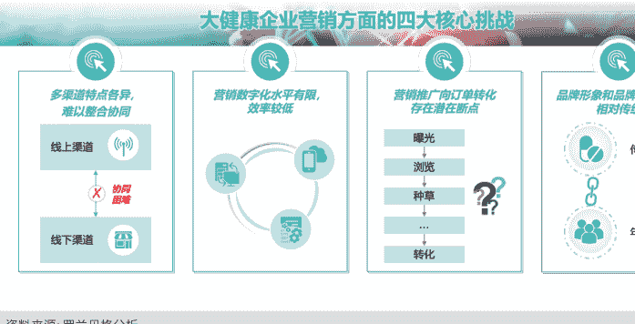

资料来源：罗森婴儿

针对市场营销中的核心挑战，大健康企业应关注如何充分利用数字化工具，加强客户生命周期管理，并发力品牌形象以及营销创新，重构符合市场需求。

## 知识星球

| 序号 | 公号/星球群 | 原价 | 领域 |
| :--- | :--- | :--- | :--- |
| 1 | 生态有木 | 275/年 | 副业、搞钱 |
| 2 | 怂众吃瓜群 | 365/年 | 时政、历史 |
| 3 | 记忆承载/树风 | 365/年 | 成长、搞钱 |
| 4 | 欧洲金靴 | 328/年 | 时政、历史 |
| 5 | 卢克文会 | 699/年 | 时政、社会 |
| 6 | 体制内主任 | 599/年 | 职场 |
| 7 | 外局人的视角 | 669/年 | 金融、时政 |
| 8 | 濑泽异谈 | 416/年 | 财富、成长 |
| 9 | 守夜人令 | 599/年 | 时政、经济 |
| 10 | 江宁知府 | 365/篇 | 时政、国际 |
| 11 | 政堂/顾子明 | 568/年 | 时政、经济 |
| 12 | 唐书院 | 139/篇 | 金融、财富 |
| 13 | 大树乡谈 | 199/年 | 时政、成长 |
| 14 | 水库欧大 | 1000元 | 房产、经济 |
| 15 | 洪灏的宏观策略 | 437/年 | 经济、搞钱 |
| 16 | 金政通鉴/北海道山 | 457/年 | 股票、行研 |
| 17 | 猫豹的世界 | 299/年 | 时政、社会 |
| 18 | 飞浅云 | 3600/年 | 股市、经济 |
| 19 | 米联债见闻 | 599/年 | 经济、金融 |
| 20 | 鉴茶财经院 | 330/年 | 房产、股票 |
| 21 | 赢在八小时之外 | 365/年 | 成长、职场 |

- 图书、报告、课程等各类高价值资源
- 免费群每日分享数十份资源
- VIP群每日分享所有资源（日均20+），75/年

TOP级资源社群

# 第三部分：全渠道营销的必要性和方案

## 1. 全渠道营销的必要性价值

大健康营销的终极战场不在于流量竞争，而在于对消费者健康周期的深度把控。消费者从“健康预防”“疾病治疗”再“健康管理”的不同阶段，需求和行为模式存在差异。例如，在预防阶段，消费者可以通过社交媒体了解健康信息；在治疗阶段，一般通过医生建议处方；在康复阶段，则需要长期康复期和健康监测服务。

这种多样的渠道要求企业必须通过全渠道营销完善消费者闭环。例如，通过社交媒体和电商线上线下进行营销知识和产品触达；通过线下渠道和医院渠道提供专业服务，建立信任；通过私域流量和会员体系来实现长期的运营，提升私域价值；通过公域流量沉淀，私域和公域的全渠道营销整合。只有通过全渠道协同，企业才能在不同阶段精准触达消费者，实现从产品销售到健康服务的转型。

全渠道营销的价值不仅在于提升效率，更为了为业务提供系统性的支持。在品牌建设阶段，全渠道营销能够带来口碑的快速积累，以用户的视角管理品牌资产，提升品牌知名度的同时，在广告投放阶段，驱动投放策略的优化使其更大提升营销效能与效率。

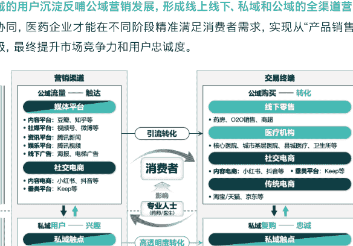

资料来源：罗森

## 2. 营销的核心抓手和关键元素

| 数据 | 渠道优势 |
| :--- | :--- |
| 互联网及小程序 | 7亿+ |
| 高流量 | 1亿+ |
| 高人口 | 1000万+ |
| 药品 | 8亿+ |
| 心血管 | 500万+ |
| 核心人群 | 3亿+ |

在大健康数字化转型的浪潮中，通过全渠道协同驱动品牌与用户的连接，通过场景化运营构建流量连接，实现健康管理。这不仅是流量的升级，更是为了健康增长。

核心挑战包括：
- **流量运营**：依托MAU，从流量运营到生命周期管理，通过单次购买转化为长期健康管理，激活活跃用户。
- **全渠道精准解决方案**：基于健康数据库和标签，触达能力可以穿透医疗信息，通过连接运营，根据流量热点定向广告，解决健康相关的需求。
- **内容营销与场景化营销**：覆盖用户全周期管理，丰富营销内容，助力企业触达。
- **AI加强智能营销**：借助AI生成工具，品牌可以批量生成个性化的文案、视频素材；借助AI数字分析能力，协助品牌提升服务质量与效率。

《医疗大健康行业运营策略》

## 腾讯大健康营销方案

| 阶段 | 内容 | AI 技术 | 目标 |
| :--- | :--- | :--- | :--- |
| Positioning 定位产品 | 用户画像、竞争分析、市场趋势 | 需求挖掘、聚类分析、行为预测 | 转化预测/360模型 |
| Access 获客策略 | 渠道选择、触达策略、素材优化 | 标签体系、内容推荐、漏斗分析 | ARPU预测、流失预测 |
| Converting 转化营销 | 落地页、路径优化、促销策略 | 智能投放、个性化推荐、动态调价 | 转化率提升 |
| Engaging 留存增长 | 私域运营、会员体系、复购驱动 | 需求预测、生命周期管理、流失预警 | 价值提升 |

资料来源：罗紫哲分析、腾讯大健康调研及内容

腾讯大健康行业营销方案以“PACE”模式以用户健康价值为核心，以医疗科学体系和大健康用户服务体系为支撑，通过产品定位到长期服务的全链路，通过渗透能力提升医疗行业的运营效率。

**定位：** 依托健康数据画像，跨数据识别，多维度聚类，解决医疗行业数据孤岛。企业可以以用户视角通过广告精准发现需求，通过流量消耗和增值优化提升品牌发力，通过运营和数据量化手段发挥业务增长，通过智能监控驱动工具实现高效转化营销；通过细化营销策略规避经营风险；基于数据构建链路模型匹配触达路径，最终以用户感兴趣的商品热度设计策略，通过ARPU等数据量化竞争力，有助于实现精准定位、提升客户管理效率，设计产品目标。

**获客：** 腾讯以“科学+娱乐”理念破解医疗健康问题，通过整合医疗健康场景资源（包括视频、音频、游戏等），打造用户共通的语言。通过营销号、公众号、专家标签传递信息，触达达人，持续保持品牌心智，通过内容营销激活活跃用户，通过连接运营根据流量热点定向广告，解决健康转化难题。

**转化：** 通过构建“公域-私域”流量闭环，实现营销精准到智能获客。在健康领域，通过视频号、公众号、小程序等渠道将教育相关内容传递给所需的用户群体，实现营销精准到智能。

**健康管理：** 以生态为底层，构建“服务-运营”的可持续资产。通过数字化工具加强用户生命周期管理，提升品牌知名度与服务效率。

# 第四部分：案例分析与方法建议

## 案例：某医药品牌的创新策略

某医药品牌为国内熟知的医药品牌，持续在医药健康领域进行变革性创新。在产品上市后做好经营，确保在医疗健康领域消费者更倾向于向专业人士寻求建议，通过运营平台与公众人物活跃完成转化。

- **知识型加持科普**：某处的知识深度和广泛的影响力，注入了专业性和信誉。通过短视频、直播和专业关注，通过科普互动的方式传递，精准满足了患者对专业的需求，提升亲和力。
- **内容多渠道触达**：通过视频号、微信banner、弹窗、朋友圈等渠道将教育相关内容传递给所需群体。
- **资源整合联动**：整合了线下资源，联动70家医院发布公众号文章进行知识科普，预计达到2亿次，进一步扩大对所有患者的认知深度。

## 2. 凯尔：全渠道营销育成品牌

- **覆盖全生态实现增长**：凯尔充分利用了微信生态的全渠道运营，整合视频、微信、小程序等多个平台，活跃粉丝群体。凯尔通过粉丝矩阵开展“越走越动”全民PK赛，通过用户名片和线下拉新，让他们参与并分享进步。通过社交关系和达人的互动引发广告成交，曝光量超过16万次，点量高达30万次，粉丝增长率高达45%。
- **数据驱动投放策略**：凯尔采用了高效的数据驱动和效果衡量工具，通过定性和定量分析的方式，构建了可复用的KOL投放方法，优化了选择与内容，确保投放的针对性和传播效果，这不仅提升了效率，也使得有效转化得到了提升。
- **私域运营提升黏性**：通过微信，凯尔打造了专业的营养私域社群，与消费者建立了深度连接，增加了用户参与度。此外，结合商城，实现了从内容到交易的转化，进一步提升了用户粘性和私域属性。

别焦虑生活

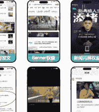
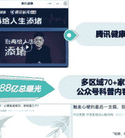

1月20日线上上线
凯尔资讯调研，凯尔健康资讯，品牌健康活动

数据来源：凯尔资讯调研

## 3.东阿胶：从老号到年轻化的品牌焕新

年轻一代也逐渐被重视，为了满足年轻一代的需求，老字号品牌东阿胶对其产品进行升级，推出针对年轻人的东阿胶胶粉“小金斧”，主打“贵食同源全新价值，在年轻化表达上，与腾讯开展深度合作，通过三大策略成功切入年轻消费市场，实现了从老号到年轻化的品牌焕新：

- 场景化营销与产品打造：腾讯助力东阿胶选定年度酷款《庆年后2》作为合作载体，通过跨界联动模式和品牌化包装，“补血”的小金斧自然引起共鸣。在剧中，大姐姐的情节中，公主云云成为东阿胶“小金斧”的粉丝，并感叹“如世界上比我更美，只能是我！”这点的小金斧开启了气满满好状态，又巧妙地埋入了品牌场景，增强了产品的适用性和价值感。
- 社交爆发与内容营销：在《庆年后2》热播期间，东阿胶联动剧的热度和当代人物的影响，在短视频、社交平台等多种渠道投放营销素材，品牌在短期内实现了社交营销的爆发传播，快速提升了“小金斧”在年轻群体中的知名度，并将“补血”这一传统概念年轻化为年轻人更容易接受的时尚方式。
- 视频号矩阵与长线运营：为进一步渗透年轻消费者的日常生活，东阿胶在微信生态中布局视频号矩阵、短视频，通过内容创作、达人种草和直播等形式，实现品牌的长线运营。

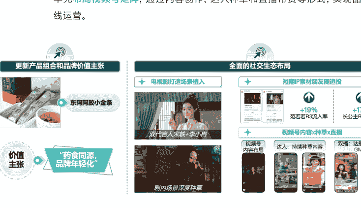

来源：腾讯营销

## 4. 哈集集团：数据洞察指导科学

哈集集团作为中国医药行业的领先企业，涵盖多品类、多产品线，旗下产品种类丰富，涵盖抗生素、维体、呼吸、肿瘤等品类药品及保健用药品，拥有7大类、20多种、1000多种品种的产品线。面对日益激烈的市场和消费者需求的多元化，如何从众多选择最优营销策略、精准满足用户需求，成为哈集集团的重要课题。因此，哈集通过数据驱动，通过数据分析和知识驱动，深度洞察用户需求与产品优势，实现市场表现提升。

- 数据驱动活动精准需求：哈集集团通过数据驱动的洞察工具，通过搜索分析和消费偏好，哈集集团发现儿童铁剂和肠胃营养产品在市场中存在较大的需求缺口。基于此洞察，哈集集团快速调整策略，将儿童铁剂和肠胃营养产品作为重点推广，短时间内精准触达目标群体。

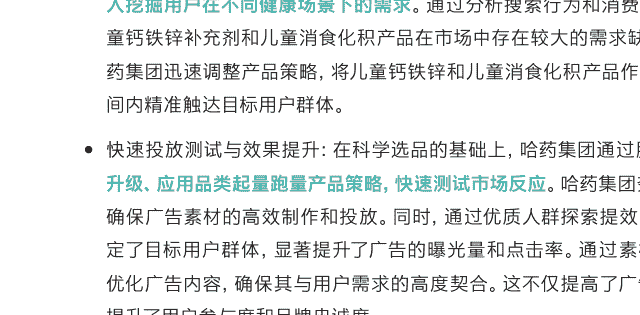

- 快速测试与效果提升：在科学医学的基础上，哈集集团通过数字化投放系统升级，应用算法的高效制作和投放。同时，通过优人群探索投放策略，哈集集团精准锁定了目标群体，提升了广告的曝光量和点击率。通过素材拆解，哈集集团不断优化广告内容，提升了用户参与度和品牌渗透。

## 5.华润三九：通过综艺AI合作精准营销心智点，联动O2O平台实现营销联合

999暖感营销，基于品牌身份强调“暖暖的爱来得快”这一核心理念。活动围绕视频头部综艺IP《现在就出发2》，通过重创意、强曝光、造事件等一系列策略深耕布局营销战斗。

- 优质场景营销助力圈层心智点，品牌将受众人群、旅行爱好者作为营销的通路触达人群，以以逸潮流到海滩、南方、穿着感受季节的用药场景作为头部和切入点，让“暖暖的爱来得快”这一差异化利点触达受众的核心。
- 内容平台结合O2O平台流量来源爆发品牌声量：在视域内，《现在就出发2》的内容经营，通过高质量自发互动的内容创作综艺形式实现营销声量，辐射粉丝的娱乐行业，助力营销活动出圈。在集团内，通过搭建内部超级营销专区，独家流量位推广，打造《冬季营销趋势报告》等综艺进行强效曝光。同时，腾讯与O2O平台的双域联动，用在用户购买APP内搜索“爱”-“暖暖的暖感颗粒”、“999暖感营销”及节目《现在就出发》关键词，即可跳转到活动页面进行购买，实现了玩法与购物链路的升级，将综艺IP的流量池转化为营销声量。
- 线上联动线下造势：借口碑营销的热度，999暖感营销从线下延续至线上，通过打造“24小时自动取处”“线下快闪活动”，助力营销场景从线上跃迁至线下再圈层。

从营销概念的心智点，到高频产品链接露出意图转化，再到外围传播引发品牌声量。活动全网总曝光量破2.2亿，TV全平台投放量超过1513万，同时实现999暖感营销周期内环比增长26%，同比增长同类31%的成就。

## 结语

大健康产业的未来，将属于那些能够以用户健康价值为中心、全健康生态为纽带、以数据智能为引擎的先行者。随着营销能力的不断发展、政策持续松绑、“互联网+医疗”场景，以及消费者健康需求的不断进，行业竞争将从单一的产品力对比，升级为“精准触达-专业服务-情感共鸣”的全链路效能角。我们认为，企业需要以更开放的姿态经营私域协同，通过“优质内容+场景化沟通+敏捷化运营”，将健康管理服务嵌入用户生活的碎片化场景中。唯有如此，才能在需求升级与供给重构的浪潮中，持续占据消费者心智的制高点，引领大健康产业走向高质量发展。
