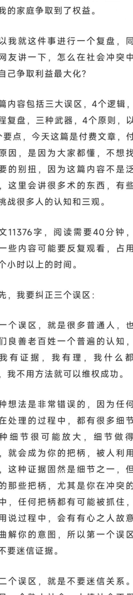

# 如何在冲突中让自己利益最大

作者 升升
2024年09月24日 22:00 阅读 1分钟

很多人认为冲突是应该避开的，害怕发生冲突。其实在生活中冲突是无法避免的。一个害怕冲突的人，往往会失去很多机会。只有学会处理冲突，才能获得自己的利益。

学会处理冲突意味着，并不是要在冲突中退缩，而是要在冲突中做好准备。具体要如何做呢？在冲突中为自己争取利益，同时避免不必要的后悔和损失。

如果我以前学会处理冲突，可能就不会像这样后悔了。

## 案例一

我儿子在幼儿园的时候，有一次在滑梯的操场上被小朋友推了倒。在老师没有注意到的情况下，另一个小朋友也推了下去，我儿子就再也没有站起来，也没有去反击，最后就哭了，等老师过来解决问题。

事实是，我并没有生气，因为我当时觉得孩子小，之间打闹是正常现象。后来，我发现儿子总是被欺负，这开始让我担心了。儿子性格内软，以后很容易被欺负。

后来，我开始教儿子如何反击。我告诉他，如果别人欺负你，你不要在那里哭着，要勇敢地打回去。儿子真的试了试，几天后，他带着脸肿的回家，说他妈妈被打了。

我当时心里很矛盾，因为我也不希望儿子打架。但我还是对他说：“儿子，如果别人打你，我也要打回去。”这样就解决了问题，之后我儿子再也没有被别人欺负了。

这件事发生后，我并没有去找老师，因为我觉得这是孩子之间的小矛盾，处理好了就好了。这样处理，很多麻烦也就避免了。

## 案例二

对妻子，我提出几点要求：

- 1. 我们要离婚，履行手续；
- 2. 考虑到你净身出户，我会给你5000元，离婚处理财产，房子留给我；
- 3. 离婚后，由你抚养孩子，以后我每个月给三千块钱。

听到这些，她突然笑了，冷冷地看着我：

“你疯了吧？还离婚，我死也不离婚！你离婚，我不离婚，你以后孩子怎么办？你要不要我们的孩子吗？”

“孩子，我不要了，我一个人就够了。”

“你这是说什么呢？”

“离婚，我说了要离婚。”

她听完我说，冷笑一声，死死地盯着我：“你离婚，我不离婚，你以后孩子怎么办？你要不要我们的孩子吗？”

我看着她，心累了，我已经受够了，我想过我自己的生活了。

“你，你到底怎么了？”

“离婚，我说了要离婚。”

她愣了很久，站起来道：“你要离婚吗？”

最后，我们吵了一场，然后我们闹到凌晨，直到凌晨三点才起离婚协议，她终于答应去离婚。

办完后，她搬出了家，我再也没有见过她了。

## 离婚后，我过得挺不错

直到有一天，我接到了女儿的电话：

“爸爸，你还好吗？”

“挺好的，你呢？”

“妈妈不让我见你了。”

“她说，你不要我们了，再也不见。”

## 我们离婚了，这已经六个月了

离婚后的第一个月，我每天都在家里看着她搬家。离婚后的第二个月，我开始尝试一个人生活，把家里收拾得干干净净。第三个月，我习惯了没有她的日子。

后来呢？我也不想问了，可能已经习惯了。

为了孩子，为了孩子，我把孩子带到了老家。回到老家后，农村的空气很好，但是孩子却似乎总是不听话，总是哭闹。

我儿子在农村生活了很久，性格竟然变了很多。以前他很爱说话，现在却变得非常寡言少语，甚至我说话他也不理。

可看着儿子慢慢变成这样，我真的不知道该怎么办了。

直到有一天，我把儿子带回了城。

我儿子回城后，似乎变得开心了很多。第二天，他跑去见了他爸爸的爷爷，然后拉着爷爷说：“爷爷，我想爸爸了。”

我看着这一幕，心里五味杂陈。原来他也是想爸爸的。
