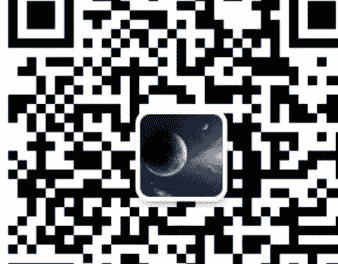
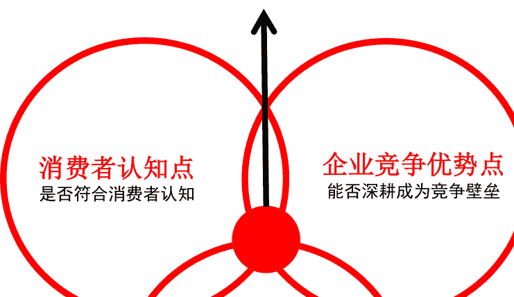
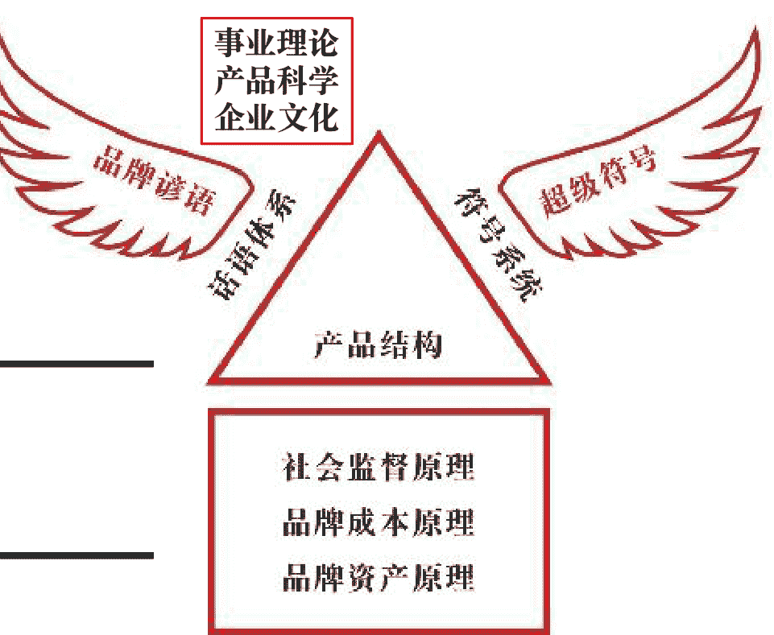
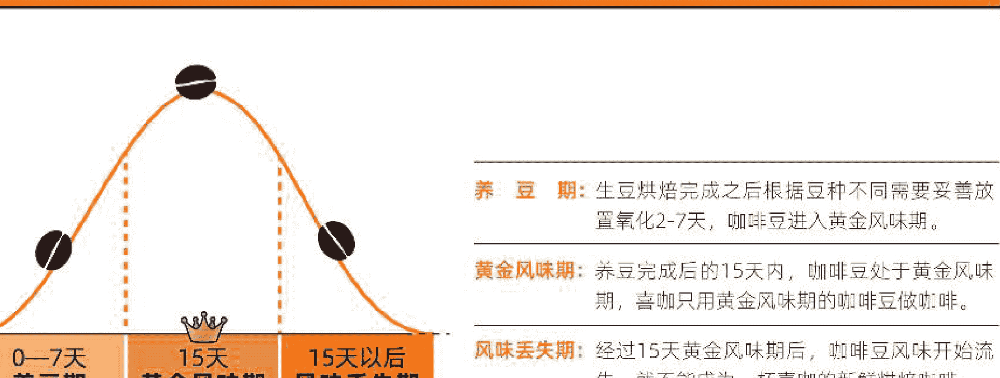
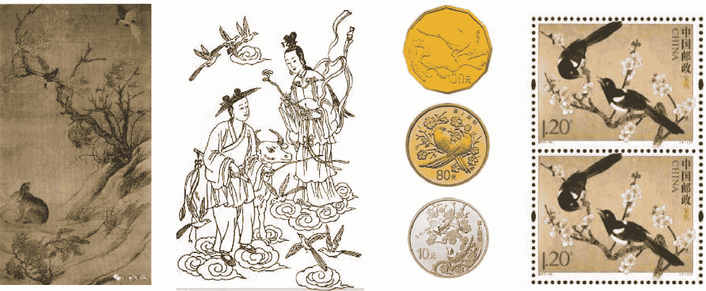
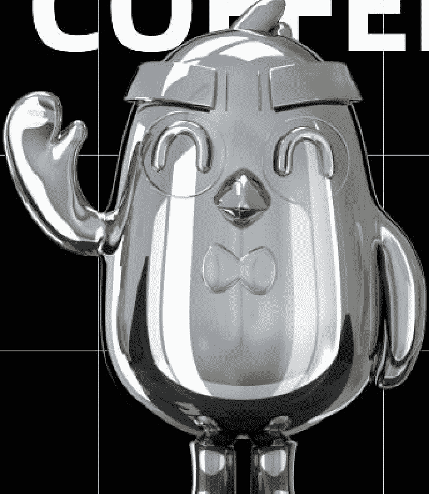
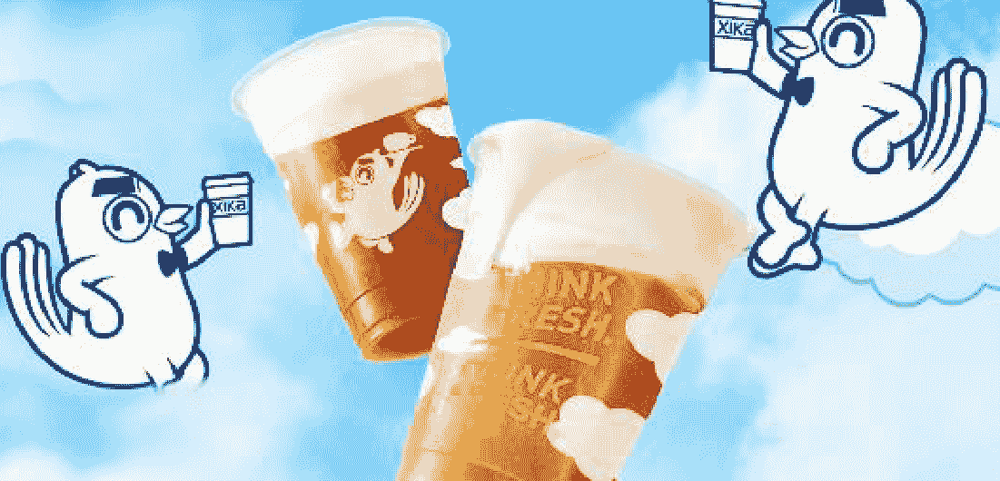
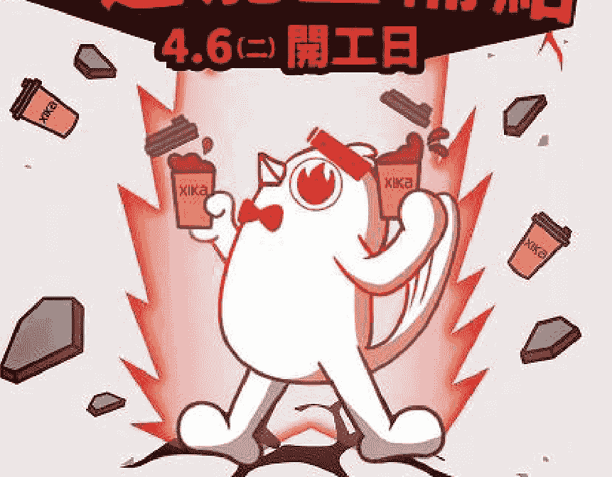
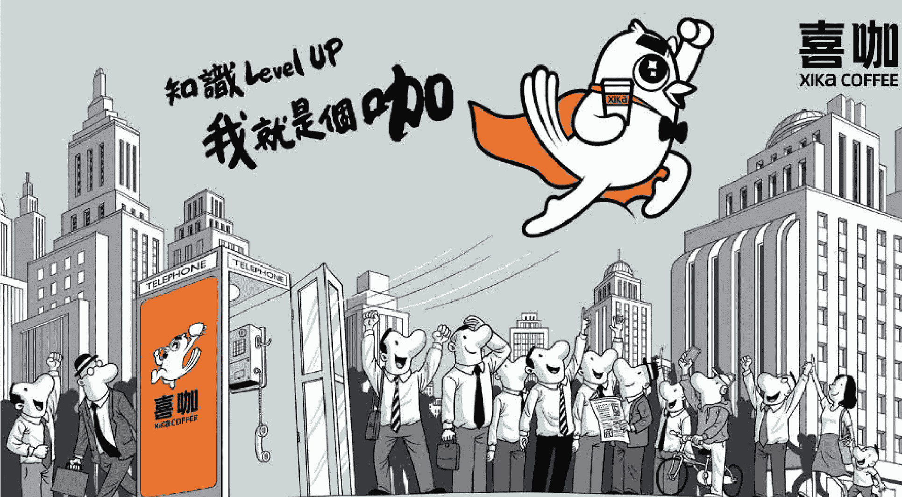
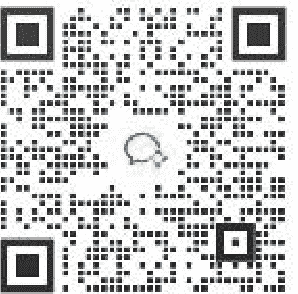

# 喜咖展翅迎风起
扶摇直上九万里

喜咖咖啡品牌策略一体化方案

## 提案汇报内容
- PART 1 喜咖咖啡切入策略 (10min)
- PART 2 喜咖咖啡品牌战略 (40min)
- PART 3 道场参观 (10min)
- PART 4 提报成果讨论决策 (30min)

## 华流方法
### 所有事都是一件事
企业战略、品牌、营销、产品、广告、包装设计等都是一件事。

> 所有人一起做所有事，通盘思考，才没有脱节、没有遗漏没有死角，把这些事在一个团队，一个系统里一次成型，一次作对，一次做全。

## 知识星球TOP 资源分享群
公众号：知识星球TOP

微信号：jntsg8
让更多人获取高价值信息，汇聚网付费资源
- ◆ 付费文章
- ◆ 付费群
- ◆ 付费课程
- ◆ 副业&搞钱
- ◆ 财经&股市
- ◆ 行业报告

微信号：jntsg2
时政·历史·职场·体制·自媒体
学习·军事·软件·影音·社会学

添加微信免费群

## Part 1. 喜咖切入策略

### 从创始人初心出发走向未来
#### 1. 全情投入，眼里是星辰大海
喜咖钟总：“看项目看了了一年多，方向和目标比较明确，要不做，要么全身ALL IN，做我的事业，做温州第三个万店连锁品牌。”

#### 2. 五大关键词，奠定了品牌的未来
喜咖钟总：“做餐饮连锁核心理念就是五个词：好吃、好玩、好看、便宜、健康。”

> 战略不是研究未来做什么，是研究今天做什么，才有未来！——彼得·德鲁克

## 喜咖咖啡的品牌切入点： “新鲜烘焙咖啡”
定义新品类，赢得解释权。

### 为什么是新鲜烘焙咖啡？
1. 符合行业发展趋势
2. 可以形成企业竞争优势
3. 符合消费者认知

### 东灵品牌三环定定位品牌切点
- **咖啡品牌力**
  - 咖啡新鲜更好喝
  - 性价比高
  - 符合潮流
  - 咖啡专业
  - 咖啡豆品质高
  - 产品多，有创意
- **切入点**
  - 原材料优势（知识分子咖啡）
  - 技术优势（烘焙中心/工厂 丸山）
  - 咖啡师培训能力（反文化）
  - 供应链优势（星巴克）
  - 产品研发能力（ups）
  - 品牌经营能力（bluebottle）

- **咖啡3.0 精品咖啡独特起**
  - 咖啡品质要求提升
  - 消费者咖啡知识提升
  - 消费者咖啡消费习惯养成
  - 咖啡赛道白热化

## 喜咖品牌切入点：“新鲜烘焙咖啡”
- 新鲜永不落伍
- 咖啡新鲜更好喝
- 品质更高，更专业
- 咖啡品牌记忆点更强
- 原材料优势
- 供应链优势
- 技术优势（有自己烘焙中心/工厂）
- 产品力更强
- 品牌经营点更聚焦

**消费者认知点**：是否符合消费者认知
**企业竞争优势**：能否深成为竞争壁垒
**行业趋势点**：是否符合行业发展趋势
- 咖啡品质要求提升
- 消费者咖啡知识提升
- 抵御咖啡行业白热化

## 中国咖啡发展史：速溶融入→场景渗透→3.0品质咖啡时代开启
- **20世纪80年代**：1.0时代—功能性普及
- **20世纪90年代**：2.0时代—社交属性性
- **2010-至今**：3.0时代品质超越场景体验

- 速溶咖啡进入中国，完成对消费者的初步普及。
- 咖啡主要为了提神大脑。
- 星巴克进入中国，为消费者带来充足、娱乐、社交的咖啡成为“第三空间”。
- 新零售开始发展，“线上+线下”融合，节奏开始细分，扩大场景。
- 更加注重品质及风味，精品咖啡为主。

| 年份 | 时代 | 特征 |
| :--- | :--- | :--- |
| 20世纪80年代 | 1.0时代 | 功能性普及 |
| 20世纪90年代 | 2.0时代 | 社交属性性 |
| 2010-至今 | 3.0时代 | 品质超越场景体验 |

（注：1980, 1984, 1988, 1999, 2005, 2006, 2012, 2014, 2015, 2017, 2018, 2019, 2021等对应威斯、星巴克、Costa、seesaw, 瑞幸、arabica等品牌进入时间节点）

## 行业发展趋势：欢迎品质升级时代
3.0时代对咖啡品质提出了更高的要求，消费者对咖啡的要求从期望味道到更好的咖啡。
- 三空间需求
- 咖啡品质的需求

## 企业优势：新鲜咖啡未来可在企业5大方面建立竞争优势
- 原材料优势
- 供应链优势
- 技术优势
- 产品力更强
- 品牌营销点更聚焦

## 产业结构五力量：迈克尔波特五力模型
使用最广泛的工具对企业策略制定产生深远影响。任何一个试图制定策略的组织，都可以将五力量作为出发点，解决的问题就是在面临竞争时如何获得卓越绩效、利润。

**建立壁垒：**
1. **技术壁垒**：新鲜烘焙、高效物流、快速门店运营。
2. **品牌壁垒**：品牌认知与战略，占领消费者认知。
3. **渠道成本**：便利与品质稳定。

## Part 2. 喜咖品牌战略
### 品牌战略三角两翼及三原理
- **两大核心技术（如何构建品牌？）：**
  - 事业理论
  - 产品科学
  - 企业文化
  - 品牌话语体系
  - 超级符号
  - 符号系统
- **品牌战略三角（什么是品牌？）：**
  - 产品结构
  - 社会监督原理
  - 品牌成本原理
  - 品牌资产原理
- **品牌三大原理（品牌为什么存在？）：**

### 社会监督原理
品牌就是企业创造重复博弈，给消费者惩罚自己的机会。品牌是为了让消费者惩罚自己，实际上就是消费者的风险机制以及对企业的惩罚机制，机制有效品牌就有效，如果机制无效，品牌就失灵了。

### 看企业问题的两大视角——成本与资产
#### 品牌成本原理
品牌的本质是降低三个成本。一切的创意都以降低客户的选择成本和企业的营销成本为标准。

#### 1、命名的营销传播成本
- 兰乔圣菲 VS 西郊庄园（电话测试法生僻字）
- 安达卢西亚 Vs. 孔雀城

#### 2、广告语的营销传播成本
- 要口语不要书面语
- 荷马史诗的背诵
- 有翼飞翔
- 要说动，不是说服/说清。传播是口语。

# 品牌带来的效益

# 买我东西，传我美名

建立供消费者识别、记忆和谈说的名字、符号、话语和故事。

# 华与华品牌战略三角两翼及品牌三原理

# 品牌方法

## 两大核心技术 (怎么构建品牌？)

- 事业理论
- 产品科学
- 企业文化

- 品牌话语
- 话语体系

- 超级符号
- 符号系统

## 品牌战略三角 (什么是品牌？)

- 产品结构

- 社会监督原理
- 品牌成本原理
- 品牌资产原理

## 品牌三大原理 (品牌为什么存在？)

# 1. 喜咖 -话语体系

话语体系就是品牌的知识体系，是品牌的社会履历

## 喜咖新鲜烘焙的事业理论

## 什么是事业理论

“企业对这一问题的解决，必须有一种理论，这一理论必须是先进的，令人信服的，能解决问题的，就是你对你从从事这件事情又独特的认识，有独特的角度和系统的方法，这就是事业理论。”

代表性的先进生产力和先进文化

## 营销的两种价值观

一、利用信息不对称，消费者不需要真相，也不懂产品科学，我只需要占领他的心，蒙住他的眼睛，牵着他的手，让他选择我。

二、让信息对称，假如信息对称，假如消费者是专家，懂得产品和服务的的一切真相，他就一定会选择我!

## 一个产品原理：

一杯好咖啡，关键是新鲜

## 一个消费现实：

信息不对称，新鲜无法被知道

## 一个切机会：

给消费者一杯真正新鲜的黄金味咖啡

新鲜烘焙的咖啡豆是做一杯好咖啡的关键，咖啡烘焙完成后有15天的稳定黄金风味期，在15天内把咖啡可以达到咖啡的顶点。随着豆子放置时间越长，味道流失越多，品质和口味越差。

消费升级，消费者需要一杯更好品质的咖啡，但咖啡店和消费者的信息不对称，消费者无法了解到得到自己消费的咖啡不是高质量黄金风味期的咖啡豆制作，也没有获得新鲜烘焙咖啡是更好品质咖啡的消费知识。

让消费者便捷低成本的买一杯新鲜烘焙的黄金美味咖啡。

## 一句话定义喜咖新鲜烘焙咖啡的产品科学

## “新鲜烘焙，黄金风味”

新鲜烘焙的好咖啡豆，做出黄金风味的好咖啡

## 咖啡豆的风味曲线：来自黄金风味期的咖啡豆

**养豆期：**生豆烘焙完成后根据豆种不同需要妥善放置氧化2-7天，咖啡豆进入黄金风味期。

**黄金风味期：**养豆完成后的15天内，咖啡处于黄金风味期，此时只用黄金风味期的咖啡做冲咖啡。

**风味丢失期：**经过15天黄金风味期后，咖啡豆风味开始流失，就不能成为一杯惊喜咖啡的新鲜烘焙咖啡。

## 定义新品类 赢得解释权

## 喜咖 新鲜烘焙咖啡

- 定义好咖啡标准：新鲜烘焙，黄金风味
- 定义新鲜烘焙标准：咖啡豆烘焙后48小时新鲜到店，15天黄金风味期内使用完毕。
- 鼓动消费者尝试：咖啡从此分两类，一类是新鲜烘焙的黄金风味咖啡，一类是其他。

## 定义级洞察，原理级解决方案
## 持续在如何保证“新鲜烘焙，黄金香味”上改善

### 选豆高标准
只用高品质区新鲜豆，从源头先保证豆子品质

### 手工选豆
降低瑕疵率，保证新鲜度和咖啡口味

### 48小时烘焙到店
烘焙完成的豆子，第一时间到店

### 15天黄金香味期
只用处于15天黄金香味期的豆子制作

# 事业理论

## 认识角度

## 方法论

## 产品科学依据

- 一杯好咖啡，关键是新鲜
- 信息不对称，新鲜无法被知道
- 给消费者一杯真正新鲜的黄金味咖啡
- 48小时烘焙到店
- 15天黄金香味期使用完毕

- 新鲜烘焙，黄金风味
- 咖啡豆的风味曲线

## 解决方式

# 喜咖新鲜烘焙咖啡

企业是社会的，话语体系就是品牌的知识体系，建立信任感和感情

## 我是谁

## 喜咖 XIKA COFFEE

## 我的拳头产品

## 新鲜烘焙咖啡

## 能解决的问题

提供一杯平价的黄金口味

## 品牌标准

## 语言

## 好的广告语一定满足

亚里士多德总结的修辞学要领：

- 普通的道理
- 简单的字词
- 有节奏的句式，或者押韵
- 使人愉悦

## 不仅是一句口号

- 口号就是战略，就是投资。
- 口号就是口碑，就是资产。
- 口号就是行动。
- 口号就是品牌精神和企业文化。

## 咖啡品牌历表：

我是谁：喜咖 XIKA COFFEE
我们的理念：好看、好玩、好吃、便宜、健康
我的拳头产品：新鲜烘焙咖啡
我们的品牌箴语：喜咖喜咖真新鲜，豆子只用十五天
能解决的问题：平价便捷的一杯黄金风味好咖啡

## 我的咖啡标准

## 我的技术支持

# 华与华品牌战略三角两翼及品牌三原理

## 两大核心技术 (怎么构建品牌？)

- 事业理论
- 产品科学
- 企业文化

- 品牌话语
- 话语体系

- 超级符号
- 符号系统

## 品牌战略三角 (什么是品牌？)

- 产品结构

- 社会监督原理
- 品牌成本原理
- 品牌资产原理

## 品牌三大原理 (品牌为什么存在？)

# 2. 喜咖“产品结构”

战略就是金角、银边、草肚皮

## 战略路线图

- 第一个层次：产品结构，要开展哪些业务；
- 第二个层次：每一个产品扮演的战略角色和承担的战略任务；
- 第三个层次：推出的先后顺序。

- 核心：是我们定义的一个品类市场；- 金角：是核心业务，是竞争壁垒；
- 银边：围绕一个核心业务、核心产品，建立一条产品线，一个业务组合；
- 草肚皮：我们的品牌势能最终覆盖的业务范围。

- 金角银边：品类权威/竞争壁垒
- 草肚皮：边际效应/战略/最后的盈利

# 企业战略模型「第一个金角」

喜咖的金角产品：

经典红袋咖啡，奠定喜咖在咖啡行业的品牌地位，让喜咖成为家喻户晓的咖啡品牌

瓜子的银边：

蓝袋风味咖啡/葵珍等，聚焦瓜子类别的创新，夯实喜咖咖啡品类的领导地位，创造新利润

## 银边产品

治小蓝袋：益生菌每日坚果

## 喜咖的产品三个战略阶段

- 第一阶段 点金角：做好核心业务，形成品牌认知与竞争壁垒
- 第二阶段 拉银边：围绕新鲜烘焙咖啡，建立咖啡饮品产品线
- 第三阶段 收割草肚皮：发挥喜咖品牌边际效应，最终覆盖咖啡类所有的业务范围

### 现阶段，喜咖要先点金角

做好核心业务，建立竞争壁垒

# 产品线一: 新鲜烘焙咖啡

战略任务：撑销量，建立品牌认知，传播品牌口碑
战略次序：第一位

# 产品线二: 创意咖啡饮料

战略任务：打爆款，赚取利润
战略次序：第二位

# 产品线三: 高端手冲系列

战略任务：提升品牌高度
战略次序：第三位

## 第一次战斗的胜利

要为第二次战斗创造条件——喜咖

## 品牌角色·超级IP

1. 万宝路硬汉
2. 麦当劳叔叔
3. 贝蒂娜娘
4. 绿巨人
5. 劲量兔子

### 20世纪美国广告形象

6. 皮尔斯伯里面团娃
7. 杰莉玛达妈妈薄煎饼
8. 米其林男子
9. 凯洛格食品老虎托尼
10. 博登日用牛奶埃尔西

### 品牌是否需要一个简单的符号消除与之间的距离

咖啡即将成为日常饮料，喜咖成为消费者心中亲切的、温暖的、有距离的品牌

我们的品牌是否需要一个简单的符号消除与之间的距离

咖啡即将成为日常饮料，喜咖成为消费者心中亲切的、温暖的、有距离的品牌

## 我们需要一个超级IP符号

## 品牌从图形海洋中跳出

95%的咖啡品牌的符号都是简单的图形，咖啡只能是高冷有格吗？为什么我们要成为其中一员？让别人记住我们只是一个符号？喜咖应该有一个特别的、充满亲切的超级IP符号，我们与众不同。

## 与消费者0距离

喜咖的IP形象应该融入人们日常生活，和大家成为朋友，成为伴侣，成为家人，让喜咖与消费者之间，从此0距离；

## 喜咖的超级IP符号是什么？

## 每一个品牌都有与生俱来的戏剧性

——李奥·贝纳

## 喜咖

与生俱来的戏剧性在哪里？

### 源自中国几千年的传统文化原型

### 喜鹊

人人都熟悉、人都都记得、人都都喜欢

### 喜鹊—吉祥、喜悦、爱情的象征，有中国几千年的文化原力

宋 崔白 双喜图
民间传说鹊桥会
喜鹊纪念币
喜鹊邮票

## XIKA COFFEE 2021

## 喜小鹊

XIKA SPOKESMAN
DATE OF BIRTH: 2021.9.26

喜小鹊档案
姓名: 喜小鹊
英文名: little happy
性格: 好奇强、搜集会奇怪的东西
爱好: 研究一切与咖啡有关的东西、讨厌新鲜的咖啡
体型: 圆耳朵、大眼睛、长尾巴
技能: 变形5连术

## 喜咖的超级IP喜小鹊

- 表达美好的寓意，“喜咖与喜鹊”与生俱来戏剧性，带给人美好的联想；
- 有文化原型，消费者一见到就熟悉，就记得，就喜欢，一见如故；
- 体现咖啡行业属性，一看就知道我们做的是什么，和其他品牌ip做区分；
- 非常独特，有自己的识别系统，可以清晰的描述；
- 可爱，萌态，有自己的个性，全年龄层无差别杀；
- 可以规模化使用，核心是在门店和物料可以非常方便的使用，最大限度的出现在每一个消费者触点。

## GOODBYE, SUMMER
- 09/18-24 -

水果冷萃系列
两杯 $129

## 喜咖 XIKA COFFEE

周六六起来！

## MILK-SHAKA

7/18、7/25、8/1、8/8

### 续奶昔系列饮品

### 第二杯 66折

(优惠金额以原价计算)

### 人生如浮云

献辛苦的自己

点购浮云奶茶特大杯指定口味

## 第二二杯半价

合浮云奶茶 海盐黑咖啡/乌龙茶/锡兰红

5.1 劳工节限定

### 周能量补给

4.6(二)开工日

大杯拿铁 $299 大杯黑咖啡 $199

## 咖啡豆烘焙出草莓甜香
单品咖啡结合爆莓水果香

# 知识 Level UP

## 喜咖 XIKA COFFEE

## HAPPY MOON FESTIVAL

## 不动山
坐在位置上加到

## 喜咖的品牌色与字体

## 喜咖啡

### 颜色要有穿透力

颜色也是一种超级符号，品牌色一定要醒目，才能降低品牌成本

### 色彩第一印象原理：根据波长，光的本质是电磁波，波长越越远，红色、橙色、黄色都是波长较长的颜色。

### 可见光的谱

### 色彩第一印象：色彩主要起作用，吸引主导者的注意力，让人第一眼就能看到

| 颜色 | 波长 | 频率 |
| :--- | :--- | :--- |
| 红色 | 约625—740 nm | 约480 THz |
| 橙色 | 约590—625 nm | 约510 THz |
| 黄色 | 约565—590 nm | 约530 THz |
| 绿色 | 约500—565 nm | 约600 THz |
| 蓝色 | 约485—500 nm | 约620 THz |
| 靛蓝 | 约440—485 nm | 约680 THz |
| 紫色 | 约380—440 nm | 约790 THz |

### 橙色具有很强的穿透力和冲击力
同时具有高级感，是一个充满热情、活力的颜色

### 喜咖橙

PANTONE 1505C
CMYK : C0 M65 Y95 K0
RGB : R255 G107 B0
HEX #FF6B00

## 喜咖 XIKA COFFEE

## 国庆期间门店营业时间

## 喜咖自有媒体策略呈现

### 自有媒体

就是自己身上的、不花钱就可以使用的媒体

### 自有媒体的作用

- 自有媒体是品牌最大的媒体
- 自有媒体可以造就品牌资产积累

形象，要大规模，重复应用
大规模重复出现才能传播效率，形成品牌资产

## XIKA COFFEE

## 喜咖啡 XIKA COFFEE

## 咖啡豆的风味曲线：决定黄金风味的关键术

| 阶段 | 时间范围 | 状态/建议 |
| :--- | :--- | :--- |
| 养豆期 | 0-7天 | 处理完成后，尽量密封，避免受潮 |
| 黄金风味期 | 烘焙后5天内 | 处于绝佳状态，尽快饮用 |
| 风味失期 | 烘焙7天后 | 香味开始变质，口感逐渐下降，作为备选 |

## 喜咖 XIKA COFFEE

## 喜咖真新鲜
豆子只用15天

## 喜咖喜咖真新鲜
豆子只用15天

## 喜咖 XIKA COFFEE

## 喜咖 XIKA COFFEE

## 喜咖啡 XIKA COFFEE

## 咖啡新鲜豆子只用15天

## 青咖啡(成都龙湖上城街店)
⭐⭐3.8 45条 ¥38/人
人民路咖啡厅 营业至 22:30
“门店神气十足的男来自制饮品”

## 喜咖啡(成都宽宽卷子店)
⭐⭐4.3 2598条 ¥39/人
宽宽卷子咖啡厅
收录139条 营业至 22:30 有包间 有露天位
“外部中国古风，内部时尚的”
19 元 培根早餐
15 元 咖啡卡伦上早餐

# 方案怎么写，干货库看看

扫码获取方案

扫码加VIP，获取所有方案

长按扫码·进方案群
