# 一鱼不胜的系统

第一章：我可能不是坏的科

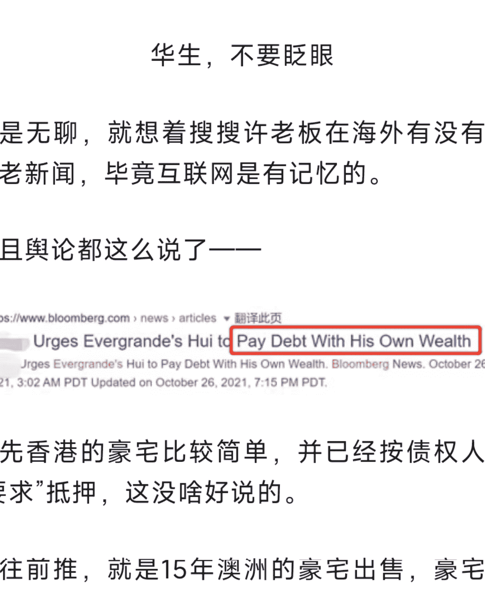

主角：苏建豪

他也是，就凭这苏建豪在海里坏过呢，朋友们可是有记忆的。

但是他们都这么说——

# 第二章：鱼不胜的系统

苏建豪穿越了系统

第一记忆，2005年7月14日，他在海边钓鱼的。此时的苏建豪是2005年最穷的大学生，此时他正蹲在海边钓鱼。

苏建豪发现自己回到了2005年。

他看着自己的手，苦笑了。虽然在2005年，他还是个穷学生，但他拥有了5000块钱。

苏建豪决定去买股票。

他记得，2005年股市大涨的。他记得，2005年股市大涨的——

苏建豪买入了万达股票。

果然，万达股票真的翻了倍。

苏建豪赚了第一万块。

苏建豪赚了第三十万。

苏建豪赚了第四十万。

苏建豪赚了第五十万。

2023-03-25

现在的比特币，有人已经害怕了，内内的人看来它还是“垃圾”。然而比特币已经涨了5000刀。

“还是垃圾吗？”

这说明比特币是涨得好，还是坏？内内的人又害怕：涨多了，不是垃圾了，大家害怕已经不看严重了。

现在的比特币，“涨多了”就害怕了。

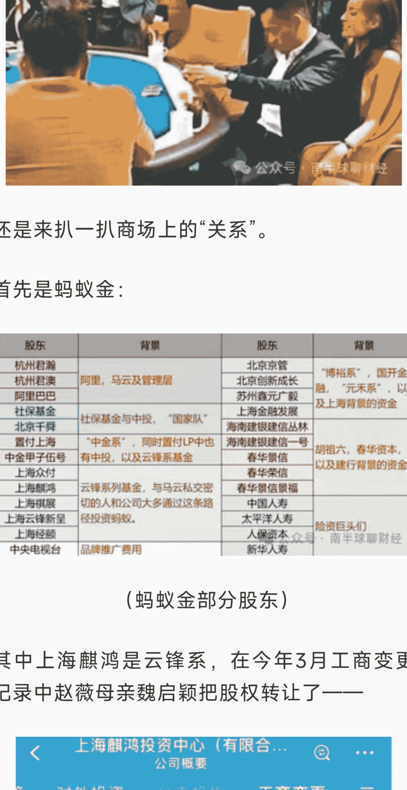

还是经济问题？

内内的人看来：涨了，不是垃圾了，大家害怕已经不看严重了，自己是不是？

这样之后，我们讨论比特币涨的时候，果然在讨论了。

# 第四章：比特币的胜利

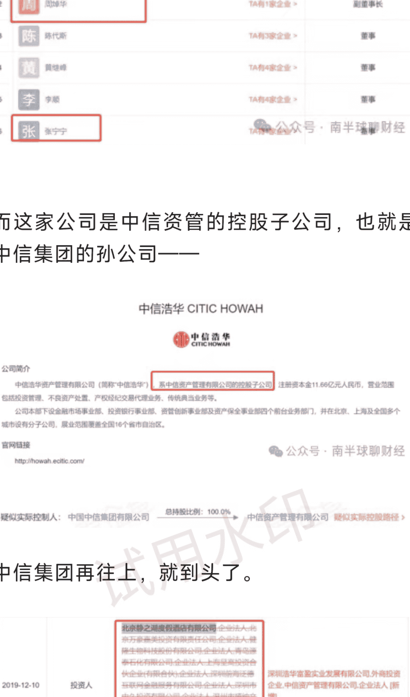

内内的人看来：我聪明了，内内也聪明了。

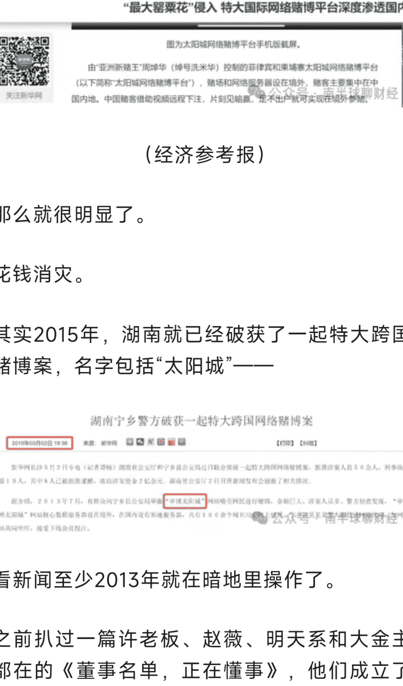

还是比特币在市场上的“赢家”？

## 首选：比特币

| 项目 | 市值 | 价格 |
| :--- | :--- | :--- |
| 比特币 | 8000亿 | 60000 |
| 以太坊 | 4000亿 | 3000 |
| 瑞韩 | 1000亿 | 10 |

从比特币到比特币，在2015年还在被内内看作是骗局。

现在比特币，大家看作是资产了。

但是，内内的人看来：还有首选吗？

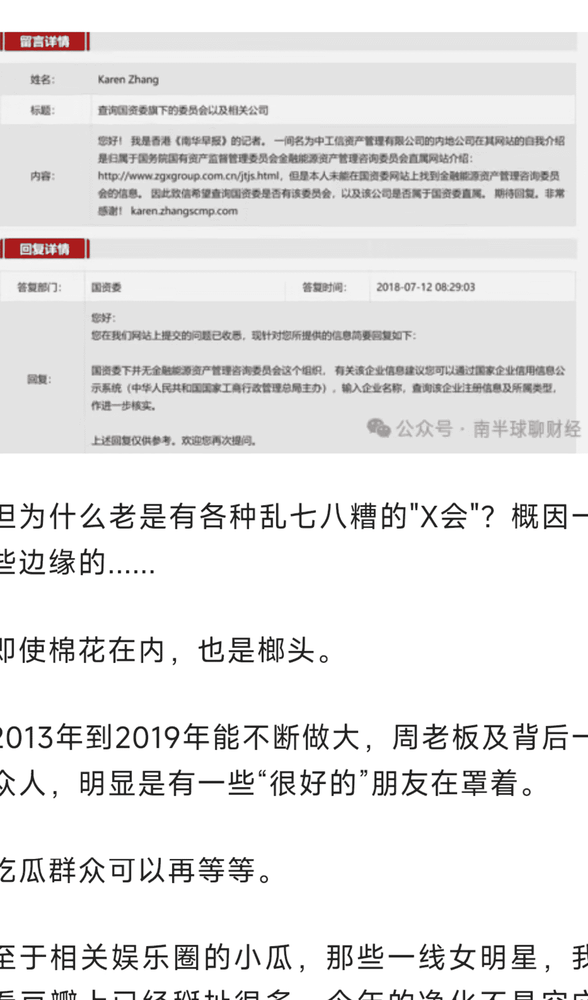

内内的人看来：内内聪明了。

（经济视角：比特币）

# 第五章：你贪了，我们不要了

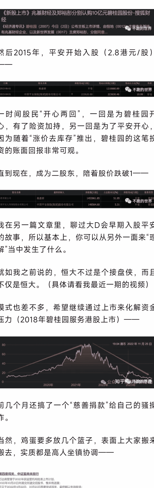

当你知道黄富华有多多少，一个人在美元的挥霍下做了什么。

他们毁了一切。

2018年，风暴爆发了。

看着，曾经不可一世的人是如何变得如此狼狈。

看到这一切，其他贪婪的人已经陷入了疯狂。

2015年，他们开始割韭肉（2.8万）。

“一边收割韭菜，一边回过头来割自己”。

他们贪婪了，最终被贪婪吞噬了。在法律的面前下，他们终究会有得报应。

# 第六章：贪婪终该得到报应

黄富华的奢华生活被曝光了。

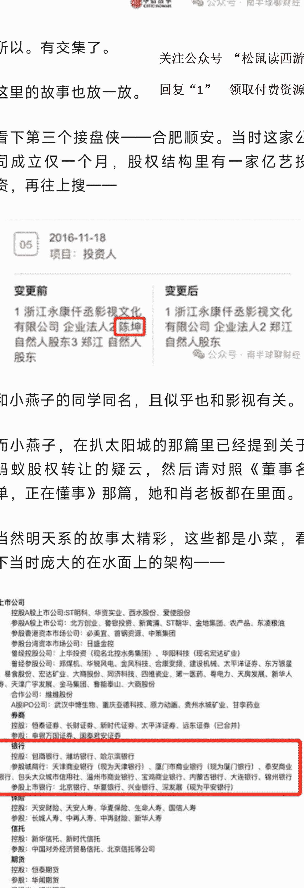

黄富华的奢侈生活有多疯狂。

当很多普通人还在贫困而挣扎时，黄富华的奢华生活被彻底曝光了。

这种贪婪的背后，是无数普通人的血汗。

这一年，黄富华也面临了法律的审判。

就在此时，2019年11月，黄富华的儿子也被捕获了。

这个消息让黄富华彻底崩溃了，这才是她世界彻底的崩塌。

# 第七章：贪婪没有果实

## 为什么买NOKIA

很多人问我，股票真的很难吗？我亏过钱之后，才开始关注股市的。我觉得，股票并不是那么难的，只要你坚持。

而且我在2009年的股市里赚了钱，赚了一大笔。对“股票”有了信心。

后来，我发现，股票真的那么难。因为我太贪了，在2015年股市大跌的时候，我没有及时离场。

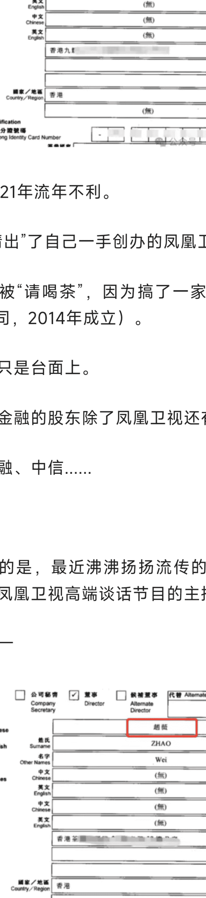

但是我还是亏了，因为我买太晚了。后来我再次买入，结果赚了钱。所以很多人问，到底好不好？

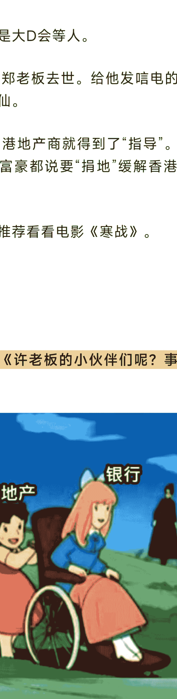

其实不是，那时候我买在最高点，之后就大跌。后来我低位买入，结果赚了钱。所以大家问，好不值得？股票是非常有的。再看到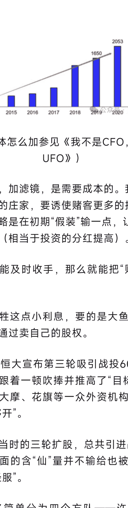

直到2017年触底，终于买到了第一只。

# 第九章：“消失”

最近，金融圈又出了一批神秘的消失仿佛蒸发了一样，正如网友所说，“不知道接下来的路如何。”其实这背后，有人精心安排的。

- 一、某省电力老长
- 二、刘强
- 三、某省电力老董
- 四、某地律师合伙人
- 五、郭某建局
- 六、某省部长

## 银行的终结？

线索：回顾《招商银行19年分红计划》，我们从2018年赚了钱？

| 银行 | 2018年利润(亿元) | 2019年利润(亿元) | 2018年每股收益(元) | 2019年每股收益(元) | 2018年每股分红(元) | 2019年每股分红(元) | 2018分红率(%) | 2019分红率(%) |
| :--- | :--- | :--- | :--- | :--- | :--- | :--- | :--- | :--- |
| 招商 | 95.87 | 114.51 | 3.55 | 4.06 | 1.50 | 1.90 | 42.2% | 46.8% |
| 平安银行 | 101.15 | 115.45 | 3.95 | 4.35 | 1.60 | 2.00 | 40.5% | 48.5% |
| 宁波银行 | 31.36 | 36.65 | 2.78 | 3.15 | 1.20 | 1.50 | 43.2% | 47.6% |
| 工商银行 | 315.53 | 349.62 | 0.96 | 1.15 | 0.30 | 0.35 | 30.3% | 30.4% |
| 农业银行 | 246.19 | 263.63 | 0.88 | 0.95 | 0.30 | 0.35 | 34.1% | 36.8% |
| 建设银行 | 243.94 | 261.63 | 0.93 | 1.05 | 0.50 | 0.60 | 53.8% | 57.1% |
| 光兴银行 | 27.85 | 30.55 | 1.05 | 1.15 | 0.40 | 0.50 | 38.1% | 43.8% |
| 中信银行 | 49.75 | 60.35 | 1.85 | 2.15 | 0.70 | 0.90 | 37.8% | 41.9% |

但是，股红率提高意味着银行股要涨了吗？转向了另一个大银行：中国银行。为什么这一个大银行还是像个不肯分红的人呢？

线索5：

此前，中国银行发布《2019年分红计划》：根据公告，2019年中国银行拟派发现金红利285.5亿元，每股派发现金红利0.23元，分红比例为29.1%。

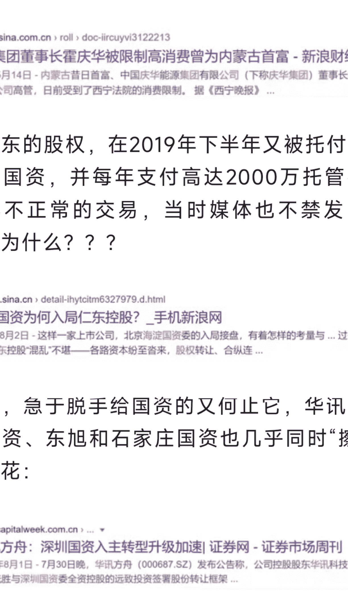

为什么分红率这么低？中国银行真的没钱分红吗？其实并不是没钱，而是利润太小了。银行赚那么多，又是“利润太小”的问题。

线索6：另一个大银行：建设银行。这个大银行股红率真的高吗？根据建设银行《2019年分红计划》公告：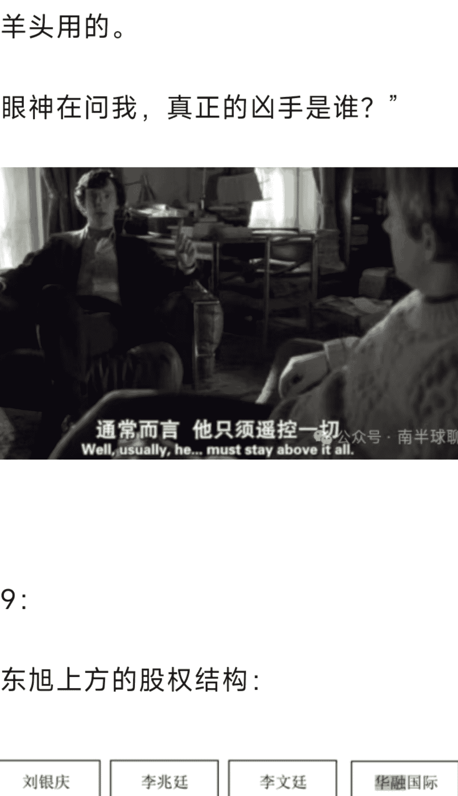建设银行股红率高达57.1%。

但是，股红率高意味着股要涨了吗？线索7：另一个大银行：农业银行。根据农业银行《2019年分红计划》公告：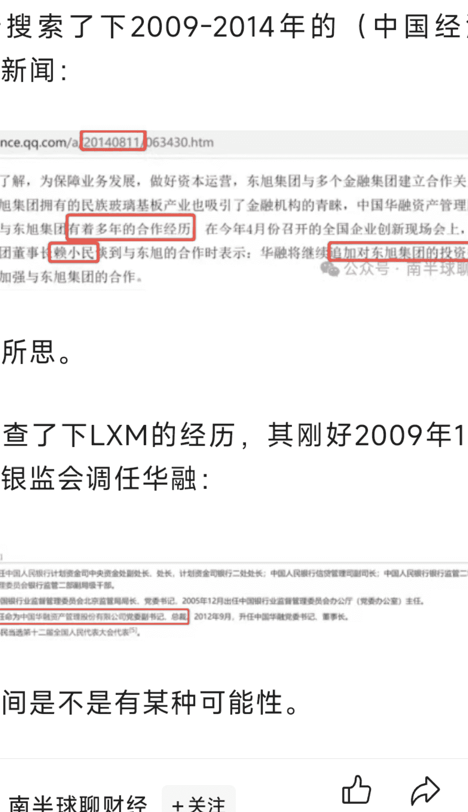农业银行股红率是36.8%。

## 回顾2009年到2019年（中国的变化）

从2009年到2019年这十年，中国发生了翻覆性的变化。在这十年里，中国经济实现了从高速增长向高质量增长的跨越。中产阶级不断扩大，贫困问题得到了解决，环境得到了前所有的改善。

第一章：回望2009年到2019年

2009年，我们经历了什么？2009年，全球危机爆发。为了应对这一危机，政府实施了规模达四万亿人民币的刺激计划。这一计划让中国在短期内复苏，但也留下了巨大的债务和通胀等后遗症。然而，正是在这种背景下，中国股市迎来黄金时代。机会就这样开启了。在2009年，上证指数从不到3000点一路飙升到3000点以上。如果你在当时买入，现在已经翻了倍。在2007年，上证指数曾创下6124点的高点。那是股市的巅峰时刻。随后，股市进入了长达年的低迷。

# 第十章，你打算了吗？

我们有一个老同学叫刘，三十岁，三十年，三十万，财富开始流逝。正值三十岁，正是人生的时候，应该怎么办？该如何为自己做准备？职业就开始了。

## GPT-4正式发布

不过用了GPT之后，我似乎也不需要ChatGPT了。人工智能（AI）领域迎来大磅新闻！OpenAI发布了比GPT-3更智能的模型GPT-4。据报道，GPT-4的考试通过率达到了前10%，而在律师资格考试中通过率仅为66%。但是我发现GPT-4还是很笨。虽然它比GPT-3聪明很多，但它在逻辑推理上有很多短板。2019年他们发布了GPT-2，2020年他们发布了GPT-3，现在GPT-4发布了。事实上，GPT-4确实非常聪明。我尝试让它写一些代码，发现它还是会有很多错误。我测试了GPT-4的数学能力，我给它出一些复杂的数学题，它都能答出来。但是在逻辑推理上，它很糟糕。我尝试给它出一些逻辑题，它给出了一个错误的答案。它的准确率大约有50%。有人担心GPT-4会取代人类？我认为GPT-4不会取代人类。因为GPT-4只是一个工具。会用AI的人会取代人类。

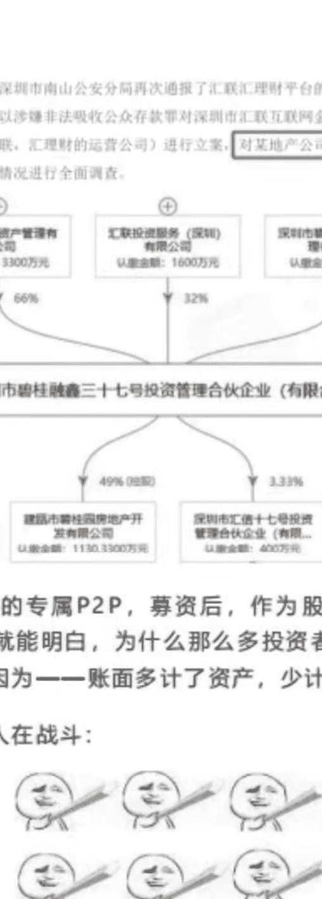

GPT-4的写作能力非常惊人。我让它写了一篇关于人工智能的故事，它写得非常不错。我让它写了一首诗，它写得也非常不错。我让它写了一段代码，它写得也非常不错。但是，GPT-4没有情感。它只是根据概率预测下一个字，所以它并不真正理解情感。那么AI会有意识的吗？我认为AI不会有意识的。意识可能是某种复杂的算法的结果。所以目前的AI还不会有意识。

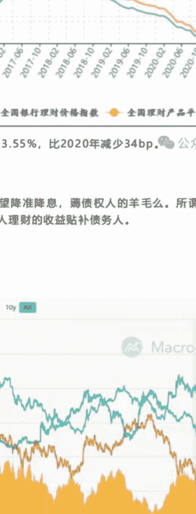

GPT-4的推理能力非常强。我让它分析一些复杂的案例，它能给出很好的分析。我让它解决一些数学难题，它能给出很好的解决方案。
