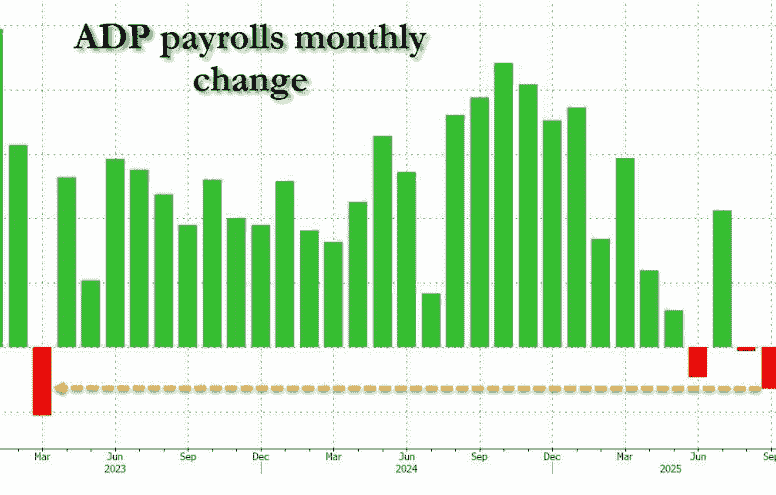
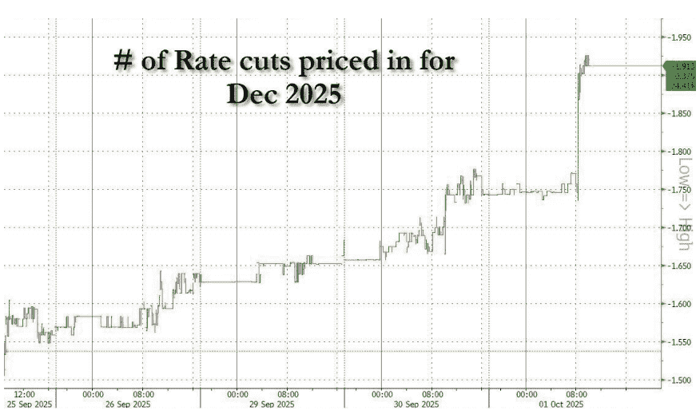
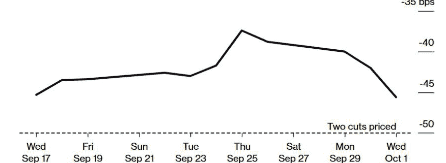
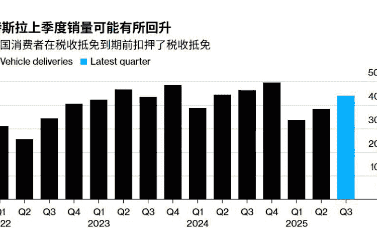
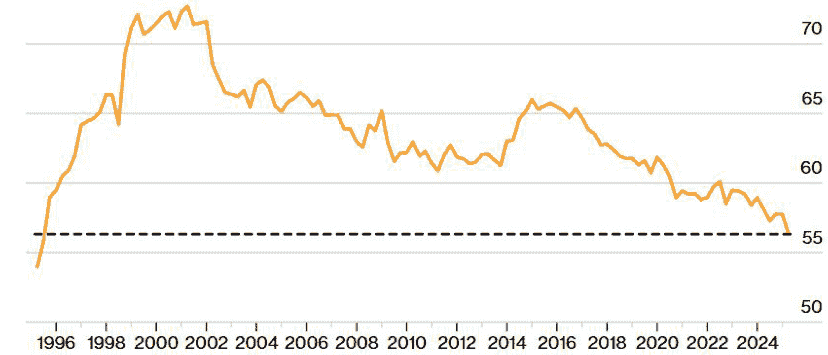
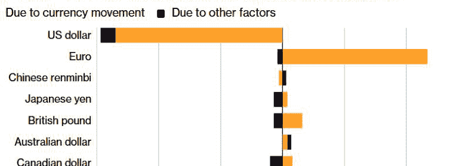
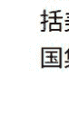
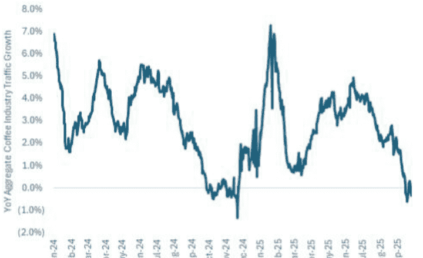
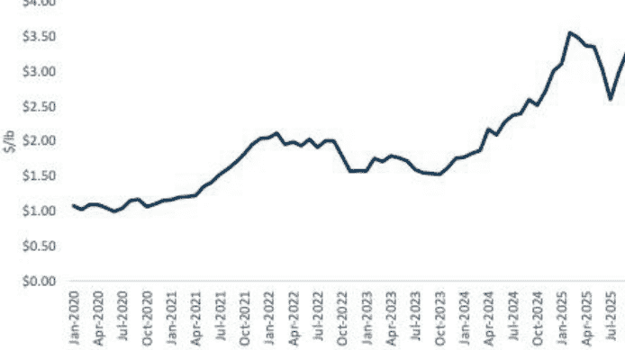
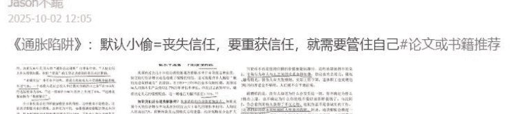

# 南美联购财运251002

Jason-不离
2025-10-02 04:39

zerohedge: 美国/非洲意外就业人数骤跌至-32,000人，为2023年3月以来最差，低于所有预期。ADP首席经济学家Nela Richardson表示：尽管我们在第二季度看到了强劲的经济增长，本月的就业数据进一步验证了我们在劳动力市场上看到的情况，即美国主对招聘持续激增的态度。

意外更好的报告发布后，交易员们迅速加大了对美联储的押注，认为到今年年底再进行二次加息的可能性上升，美联储主席鲍威尔在9月的会议上强调政策依赖数据，来自市场最近接近通胀这一预期前景。

周三，美国供应管理协会（ISM）的数据显示，美国制造业活动在9月连续第七个月收缩，反映出新订单回落，并进一步显示制造业缺乏动能。同日稍早，标普公布的数据，美国9月Markit制造业PMI值52，初值52。“其他国家经济

加微信top28688，免费进资料群

## Number of Rate cuts priced in for Dec 2025

交易员加大了对美储降息的押注，利率择期与即将举行的政策会议日期挂钩，预计到今年年底将放宽46个基点，而数据公布前为42个基点。

在私人就业数据未未达预期后，交易员接受美联储两次登陆

- - Cumulative bets on Fed rate cut by December FOMC meeting

资料来源：彭博社
注：截至10月1日纽约约上午10:52的价格

加微信信号top28688，免费进资料群

# Jason不诡

2025-10-02 04:47

Lau Vegys: 从战后时代，美国30岁时同时拥有家庭和房屋的比例直线下降——从1950年的52%下降到2025年的13%。1975年，它下降了43%，令人惊讶。1950年，超过一半的30岁年轻人已经完成了许多人认为的成年人的基本标志：婚姻和拥有房屋。今天，这一比例已为1/8。

仔细看，从1950年开始，出现了稳定但可见的下滑，这说明越来越多的女性进入劳动力市场，人们和文化对婚姻的态度发生了变化。然而在2000年左右进入离散状态的1990年到2025年间，这一比例从43%飙升至13%。由于年轻人在短短三十多年内下降了70%。我们可以说，由于婚姻的变化，年轻人不再选择家庭作为首选，而是优先考虑住房而不是婚姻。当然，这只是其中一部分，但还有另一点：年轻时的经济已经是不可能的。请记住，今天的家庭需要高额收入来负担债务，如果与1959年个家庭的住房负担能力相比，情况显然会发生变化。现在的年轻人在经济上很难取得购房首付的机制——大一已经成为成家的阻碍。在2006年到2024年间，从5000美元贷款增加到37500美元，增加了一倍多（美国学生住房总债务从万美元增加到18万美元）。

他们平均背负着38000美元的债务并试图离开。他们，很多人背负着60000美元、80000美元甚至数十万美元的债务。他们需要$130,000以上的收入才能买得起首房，在工资增长上不上住房成本的就业市场上竞争。诡怪结婚和拥有住房会有聚宴。#其他国家经济

## % of 30-Year-Olds Made Homeowners (1950–2020)

Since the postwar era, the share of 30-year-olds in America with a family and a house has crashed

| 1950 | 1960 | 1970 | 1980 | 1990 | 2000 | 2010 | 2020 |
| :--- | :--- | :--- | :--- | :--- | :--- | :--- | :--- |
| 52% | 60% | 65% | 60% | 50% | 43% | 25% | 13% |

Source: U.S. Census Bureau, Pew Research Center

加微信微信top28688，免费进阶资料

# Jason-不嵩

Bloomberg: 中国猪肉价格下低，因为即将到来的黄金假期需求前景迷淡，北京一直在推动行业生产产能减产，以解决供应过剩问题，并提升猪肉价格，猪肉价格是亚洲消费者价格的重要组成部分。行业是通缩的关键，猪肉价格在过去一年中跌了27%，养殖户每头平均损失162元。

## 中国猪肉价格下滑/黄金假期提振经济放缓和供应过剩

| Oct 2023 | Jan 2024 | Apr | Jul | Jan 2025 | Apr | Jul |
| :--- | :--- | :--- | :--- | :--- | :--- |
| | | | | | |

资料来源：中国商务部

Jason-不嵩
2025-10-02 04:57

Bloomberg: 比亚迪月度销量18个月以来首次下降，上月货量下降5.5%至396270。相比之下，美国汽车依然增长，与去年相比增长35%。

另一方面，特拉斯的销量速度将放缓，截至9月的三个月内，特拉斯在全球范围内交付了39600辆，将比年前下降5%（但上半年下降13%）。在欧洲，特拉斯的销量持续下滑，8月份下跌22%，英国能源部长考尔斯“呆出”（由于他将得斯克成为首位500亿美元的人）。这些，没有得斯克成为首位亿富翁#市值微信号top23888

添加微信免费进群微信号top23888

# 人工智能的要点

- 比亚迪月度销量18个月来首次下降，上月货量下降5.5%至396270。
- 该公司将今年的销量目标下调16%至460万，一位高级管理人员表示，此举反映了比亚迪对增长市场的反应。
- 其他品牌包括吉利汽车、猫汽车和江赛有限公司，9月份大幅增长，分别增长35%、95%和97%。

电动汽车巨头比亚迪的月度销量在18个月来首次下降，尽管公司国内竞争激烈。报告显示，上个月货量下降5.5%至396270，这是比亚迪自2024年2月以来首次。如果不考虑农假期前的波动，这将自2020年以来首次下降。

此次下降后，该公司将今年的销量目标下调16%至460万，一位高级管理人员表示，此举反映了比亚迪灵活性响应适应变化的市场，修订仍然成就。

资料来源：公司声明、彭博

加微信公众号top2888，免费进阶资料

# 英国能源部长告诉马斯克“滚出”

Ed Miliband 新增 Victor J. Blue/路透社
作者: 威夫·马西、埃奎·哈格蒂和亚历克斯·格拉斯特2025年10月1日 上午05:58 GMT 更新于2025年10月2日 上午02:02 GMT

Jason-不酷
2025-10-02 05:04

Bloomberg: 国际货币基金周三表示，截至Q2，国际储备的美元规模降至56.3%。这比第一季度下降1.5个百分点，是三十年来最低水平。这并不是美元值导致、按固定利率计算，美元的份额保持不变。研究人员在数据随附的一份报告中写道，“汇率导致了美元在外汇储备中所占份额的几乎下降，推动了约92%的下跌。”金融

## 美元储备额下降

数据显示美元所占比例为56.3%，是自1995以来的最低水平

- Dollar's share of allocated global exchange reserves

资料来源:国际货币基金

加微信公众号top2688，免费进资料群

由于中央银行以美元国际货币基金报告其持有量，因此汇率波动影响基础储备的价值。通常，这些波动在约定季度相对温和。在4月至6月期间，美元欧元下跌9%，瑞士瑞法郎下跌11%，英镑对美元下跌6%。

# 国际货币基金数据显示，外汇波动推动储备转移

2025年第一季度至第二季度国际货币基金报告的分配股份变化

- Due to currency movement
- Due to other factors

资料来源：国际货币基金组织、COFER、国际货币基金员工总计。
注：货币基金组织指出，“其他货币”不是单独报告的，因此可能不能分解汇率影响。

Jason-不离
2025-10-02 05:09

Bloomberg:俄罗斯可能会将外国拥有的资产国有化并出售，以报复欧洲试图夺取俄罗斯在海外资产的举动。

另一方面，欧盟领导人正在为一项计划投票，试图从俄罗斯失去的资产中向乌克兰提供1400亿欧元（1640亿美元）贷款。其目的是让俄罗斯付出代价。其他国家经济

加微信公众号top2888，免费进资料群

- 一位接近政府的人士透露，俄罗斯可能会将外国拥有的资产国有有化，报复欧洲夺取俄罗斯海外资产的举动。
- 基米总统签署了一项命令，允许在特殊程序下快速出售资产。
- 该法令将出售期限限制在10天内，加快所有权，旨在应对俄罗斯新的制裁。
- 一位接近政府的人士透露，俄罗斯可能会根据私有化机制将外国拥有的资产国有化并快速出售，报复欧洲夺取俄罗斯海外资产的任何举动。
- 基米总统今日签署了另一项命令，允许在特殊程序下快速出售资产。
- 知情人称，该法令将加快俄罗斯和许多外国公司的股份，但由于信息公开，要求具有透明性。人士表示，如果欧洲开始扣押俄罗斯资产，莫斯科可能会采取对称措施回应。从银行到消费品，西方公司开展业务，包括UniCredit Spa、Raiffeisen Bank International公司。

- 欧洲领导正在进行一项计划，从固定的俄罗斯银行中向乌克兰提供400亿元的贷款。
- 该计划引发了人们有关资产扣押的国际关注，一些成员希望看到计划的法律基础和后续操作能够明确。
- 欧洲执行机构向各成员提交计划，希望在正式峰会之前获得支持，目标是在年底前完成贷款。
- 在丹麦举行的峰会上，欧盟领导正在进行一项计划，从固定的俄罗斯银行中心向乌克兰提供400亿欧元（1640亿美元）贷款。德·特朗普领导美国停止对乌克兰长期以来利用这些资产的支持将让欧洲承担起战斗的负担。“当俄罗斯选择进攻时，需要支付一笔高费用，”首相梅特·弗莱里克在周三在哥哈根堡举行的记者会上表示，委员会提议即将资金用于乌克兰的军事和重建。

# 要点

- 七国国家达成一项协议，大幅增加对俄罗斯制裁，因为俄罗斯不愿结束乌克兰战斗。
- 目前草案，七国正在研究一系列选择，其中包括能源、金融和军工等关键部门。
- 欧盟还在制定新的制裁方案，禁止俄罗斯天然气，并对莫斯科金融部门增加。
- 根据影博看到的草案，七国国家接近达成一项协议，大幅增加对俄罗斯制裁，因为俄罗斯不愿结束乌克兰战斗。草案：“我们在共同行动的必要性上达成一致，并认为现在是大幅调整措施的时候，以增强乌克兰并严重损害俄罗斯对乌克兰的能力。知情人透露，七国团长将于周三发表讲，最终确定包括美国内的七国国家签署声明可能发生变化。其他七国成员包括英国、法国、德国、意大利、日本和加拿大。

Jason
2025-10-02

Bloomberg: 前财部部长卢辛·萨特斯抨击俄罗斯作为联储理事的首次演讲，称其可能为大幅分析漏洞。白话就是你们水平太大了。金融

#财政部长萨龙斯·斯特普克抨击斯普尼娅作为联储的首次演讲，称其言辞充满了矛盾，且分析毫无依据。米兰人认为，由于利率受特朗普政策推行，联储目前的立场过于紧张，政策基准高出了两个点。斯特普克指责米莱没有提到贸易等因素，他认为这些因素导致通胀成本带来了上行压力并影响了中性利率。

“我不相信在经济俱乐部或联储此前发表的分析有所弱，”斯特普克在电视台的戴威·华尔街采访中表示，“这是特朗普一直以来主导的大缩的最佳案例，那么这个案例比我预想的还要糟糕。”米莱是特朗普的首席经济学家，直到他在9月17日决定加入联储之前，他才说中性利率。这就是政策者误会刺激通胀和就业市场，也不会导致车辆用的理论错误。他认为特朗普的政策将其推高，导致联储目前的立场过于紧张。

Jason-once
2022-10-05

FT: 特朗普又说了什么而和他没有冲突的索罗斯？其他国家经济

但是他金融的“信誉价值”远超预期——在全世界眼中，他却都不受欢迎，“在美这样庞大的头”看来，他越是反面教材”。索罗斯的批评者包括德国的塞尔、匈牙利的以色列的以及印度外交部的纳塔尼亚亚·尔胡斯认为他的财富正是用来买断各国民主主义运动，因此才如此。索罗斯几乎是全球人的“跨国骗子”：数个国家的人、民主人士和其他没听到的群体都害怕过索罗斯的扩张。在全球范围内，国家都害怕富豪索罗斯，为这些业务投入了320亿美元。他的名字已经成为了“开放社会”的含义，对于世界上自由的人不喜欢。没错，他是共和党活跃的活动个人者，在2016年支持特朗普，在2020年和2021年支持特朗普。尽管在美国政治并不平。特朗普曾考虑过资助价值亿的资金，目标可是可能的。特朗普的打算，是买下美国最大的政治组织之一，而是“引起反作用的作用。”上，加微信信号top2888，免费进群。微信号top2888，免费进群

## Exhibit 5: Aggregate coffee traffic has decelerated 3QTD, pulling back to approximately flat YoY in recent days

YoY aggregate coffee industry traffic growth

Includes Starbucks, Dunkin Donuts, Dutch Bros, Tim Hortons, Scooter's, 7 Brew, Blackrock Coffee, and Peet's Coffee

Source: Placer.ai, Data compiled by Goldman Sachs Global Investment Research

## Exhibit 17: Coffee prices have increased in recent months after declining for much of 2025, and continue to remain materially elevated over 2023/2024 levels.

ICO Composite Coffee Price - $/lb. Data through 9/26.

Source: International Coffee Organization, Data compiled by Goldman Sachs Global Investment Research

微信公众号top28688，免费进资料群*

## Jason不遇
2025-10-02 05:29

华尔街：为消除长期低迷的韩国折价，韩国政府正准备拿出“杀手锏”——强制企业去库存。该方案细节将于11月提交国会委员会拟定，并预计在12月的全体上进行最终决策。

这一改革已成为推动韩国股市的关键动力。韩国综合指数一度上涨1%，其今年至今的涨幅高达44%。据报道，在主要股票有望获得最佳表现。

韩国政府设立的Kospi 500指数大目标，意味着该指数在当前水平上再上涨15%，而去库存被视为实现目标的重要一步。

根据市场分析师Lee Kyung-yun的，目前在Kospi指数中，大股的总市值约占股价指数的3.1%。如果这些股票能够有效压制，将上市韩国的每只股票平均提高3.2%。韩国大型集团（即财阀）是有库存股票的“大户”。这些股份在关键时刻可以被用作拆解家族治理管理的工具。据数据显示，部分韩国公司的股份比例高得惊人。乐天集团的占总市值的32.5%，而SK集团的这一比例也高达24.8%。

这种操作现在现在有框架下，长期以来未被投资者诟诸，认为其遏制了中小企业的利益，而是造成“韩国折价”的首要因素之一。#股市

## 市场概况 > 韩国综合指数

### 3,455.83
+1,056.89 (44.06%) ↑ 年初至今日
10月1日 GMT+9 下午3:30 · 免责声明

+ 1天 5天 1个月 6个月 YTD 1年 5年 最大
3,500
3,000
2,500

| 2025年3月 | 2025年5月 | 2025年7月 | 2025年9月 | |
| :--- | :--- | :--- | :--- | :--- |
| 开盘 | 3,444.06 | 最低 | 3,440.42 | 52周高点 | 3,497.95 |
| 最高 | 3,459.74 | 昨天收盘价 | 3,424.60 | 52周低点 | 2,284.72 |

## Jason不遇
2025-10-02 05:34

《财经》：中国推进的免签，在入境旅游上将得到回报。#经济数据

微信添加：Jason不遇，备注“韩国”免费进资料群

# 加微信top28688， 免费进资料群

“上海已经变哑了，九龙也要加油！”

喧的呼唤从耳边传来，在马来西亚最大旅游展MATTA，各大旅行行的人员忙推销前往中国的旅游产品，看着休息，两个人员闲闲聊了起来。。从笑容和呼唤来看，销售情况竟如此妥当。

展会正式公开，不少马来西亚人带家里起来，一起决定下来要去哪里旅游。《财经》在开幕的第一现场看到，一家旅行行的南 booths都满了，几乎找不到落座。“免签，现在（马来西亚）都去中国了，上海很便宜，去的人多，更是媒体上红火，”策划说《财经》。

不论逛内还是展外，如今马来西亚最热门的是中国——云南、新疆、北京、上海。同样没有，从2188来马来林（人民币3718元），去迪士尼乐园，广州。ANZ将新西兰一年期利率下降至3.45%，市场表示客户要做好跌到3%。新西兰红利还将开启。为了“支持”部分房贷利率的下降，他们同步调整了存款利率，降为10个基点至25个基点，涵盖所有期。此次调整后，ANZ的定存利率已成为最低。当前许多热门期的利率约为3%，这种趋势预计在2025年内持续下去。RBNZ（新西兰储备银行）将在下周对官方资金（OCR）进行审查。市场目前预计幅度在25个基点以上，但不低于50个基点。换句话，市场并不确定——25个基点和50个基点的升。因此，客户做好准备，利率比他们预期的更快跌%。同样的市场预期还有，到2026年月之前，OCB也将下调两次会议中完成。我们注意到，Co-operative Bank今天将其一年期固定房贷下调了26基点，至4.9%。这是他们的房贷调整，他们也下调了多个定存利率。加微信top20688，免费资料

| Institution | Credit Rating | Minimum Deposit | Credit | 1 mth | 4 mths | 5 mths | 6 mths | 9 mths |
| --- | --- | --- | --- | --- | --- | --- | --- | --- |
| ANZ | AA- | $10,000 | Z | 1.95* | 3.10* | 3.20* | 3.45* | 3.55* |
| ASB | AA- | $5,000 | Y | 2.00 | 3.20 | 3.35 | 3.50 | 3.80 |
| | | AA- | $10,000 | Y | 2.00 | 3.20 | 3.35 | 3.50 | 3.80 |
| bnz | AA- | $2,000 | Z | 2.00 | 3.20 | 3.35 | 3.50 | 3.80 |
| | | AA- | $2,000 | Z | | | | 3.75 |
| | | AA- | $2,000 | M | | 3.20 | 3.35 | 3.50 | 3.80 |
| Bank of Baroda | BBB- | $1,000 | M | 2.15 | 3.40 | 3.50 | 3.65 | 3.70 |
| Bank of China | A | $100,000 | Z | 2.25 | 3.55 | 3.65 | 3.75 | 3.95 |
| Bank of India | B+ | $5,000 | Y | 2.00 | 3.00 | 3.25 | 3.50 | 3.70 |
| China Construction Bank | A | $100,000 | Z | 2.20 | 3.00 | 3.25 | 3.40 | 3.50 |

Jason
2022-10-02 07:11

> 《通胀狂》：货币膨胀是不对称的，一群跑通胀，是最好坐在座位上的钱包

通货膨胀是指一定时期内价格水平持续上升的现象，导致货币购买力下降。很多人认为通胀是坏的，但适度的通货胀对经济增长是有必要的。然而，所谓的“好的”通货胀真的存在吗？任何货币释放会导致膨胀，货币的稳定性必然消失。坚信货币作为普遍接受的价值标准，通胀取决于经济的广泛程度，而通货胀正是一项信用武器。一旦爆发通胀，货币信用的基础就会遭到、甚至发生崩溃，因为货币膨胀往往是自我强化或加速的。这就是说，我们不认为只要控制通胀，反对选择性的通货胀是不可接受的。

## 首先，没有“好的”通货胀

任何时候的通货膨胀都是通胀标准的，尤其对于中央货币宽松就会导致通货膨胀，货币的稳定性必然消失。坚信没有所谓的“好的”通货胀”。书中再强调的是，货币作为普遍接受的价值标准，其稳定性取决于经济的广泛程度，而通货胀正是一项...一项信用武器。

从经验来看，不同时代和不同经济体系下，通胀情况各有不同，人们的真实感受也不同。事实是，少量通胀有助于经济和发展的政策主张及实践确实发生了。作者支持通胀政策的主张已入各种凯恩主义，其逻辑货币标准稳定性是不常的，本主张对绝对通胀，反对选择性的通胀，视通胀是绝对的“坏”，而不是其大小。这一立场广泛引起。21世纪之初，有人事实上如此

的货币紧缩”、2008年金融海啸之后，有人激言中央银行激进的通胀政策，更有人称赞为“现代货币理论（MMT）”。稍加时日，恶果显影，发现其只是鸡鸣 Hollow子。

其次，货币只是当局止满通胀本质是货币现象，同货币供给密切。没有中央银行的“大水灌”，由于货币态势难以维持。恶性通胀往往离不开中央银行的主动行为。《通胀》书描述了国际偏好，并没有过通胀之处，作者描述了恶性通胀的风险。

第三，回归本位是解决之道吗？书引出黄金价格及其变化作为指标。引起关注，这是检验所谓“货币性”的重要环节。如何在应对通胀的问题，作者坚信回归本位必然之路，让读者思考。几个世纪以来，黄金逐渐成为货币准则，与其说是保障，不如说是约束。

货币首先是一种工具，可以从人们信任货币时的反应中得到说明，他们会找到替代货币。第二次世界大战后，德国人经常把香当作货币。在20世纪70年代的意大利通胀期，糖被当作货币。遭受过重通胀国家的公民如今通常会选择美元或欧元。旅行者可能会发现，货币的意义显然是通过提供一种认可的价值单位来实现人类之间的交易。换句话说，市场是由人类组成的，当货币不再是购买的价值单位时，不仅是贸易活动，连社会关系最终会被瓦解。极端通胀的国家，经济将会更为严重的犯罪、腐败和社会动荡，正如我们在历史上看到的，最后的结局可能是政治和道德悲剧。

## 恶性通胀
这种激进的政策已经引起大量美元。从2019年12月到2021年6月，货币供应量暴增了35%。对此担忧的是凯恩斯学家哈里·菲普斯，他曾在担任财政部长，后来又担任马斯克的顾问。他公开表达了通胀，债务已经达到了前所有的水平。政策制定可能会使经济更容易产生通胀。菲普斯等人担心20世纪70年代的“通胀幽灵”再次重演。

## 胀。
根据美国统计局基于官方生活成本标准—消费者价格指数（CPI）的计算，自1970年以来，美元的购买力已经下降了86%。然而批判人士指出，该指数没有计算某些支出（最引注目的是医疗保险成本），从而低估了通胀的真实影响。如果我们看黄金的价值指标——黄金的价格，那么美元的贬值幅度就更重了。根据美国统计局基于消费者价格指数的计算，在1970年，买一盎黄金需要35美元，这个价格当时约等于1800美元，可见美元的价值下降了。石油是另一个通胀指标。20世纪60年代，石油价格为每桶3美元，到了2021年，石油价格达到每桶75美元。此时的石油公司勉够维持（在2019年，许多石油公司面临违约的风险）。这告诉我们发生了什么？石油的价值不会像1965年那样，至少在最近通胀之前，一直保持着足够的价格，让汽车生产者生产型的、豪华的、油耗高的汽车。石油价格的上涨反映是美元价值下降。就像在2000年花60万美元买的那套房子，尽管你并没有一分钱租酬，也没有入住这个社区，并且小区内有很多房子在出售。但是过了20多年的时间，到了2021年，你的房子最终以93万美元的价格出售。你会觉得这种“收益”灵异不已，到你发现，2021年的93万美元几乎无法让你买到另一套你刚刚售出的房子价值相当的房子，你甚至可能多花钱买些新，否则退而求其次。

这就是通货膨胀。这给我们带来了一个清晰的定义：

通货膨胀是货币失去其价值时所发生的价格贬值。

一个充满活力的经济是可以享受充足的货币供给却没有通货膨胀的。当足够足够时，经济中的货币数量可以大幅增长。在1775—1900年之间，美国的基础货币供给估计增加了163倍。25美元兑黄金的价值几乎没有变化。没错！货币数量增加了163倍，美元的价值没有变化。

这怎么可能呢？答案是因为需求，美国在19世纪经历了长期的经济增长，产生了巨大的需求。美国首任财政部长历山·汉克斯尔通过建立一个以稳健货币为基础的金融体系，除了威胁这个年轻国家的战争恶性通货膨胀，使美元与固定价值的黄金挂钩。这一举措成就了美国，成了吸引投资资本的磁石。到19世纪末，美国成了世界领先的工业国家。

如今，美元是一种国际的货币。有些人认为，现有的美元钞票有一半以上是在美国境外流出的，它们被世界各地认为是美元比特本国货币更可靠的人所需要了。

我们之前解释过，货币首先是能促进贸易的经济衡量标准。若要让它充当这个角色，它必须被认为是可靠的，即它必须被信任。威信的任何事件或会引发所谓的“信任消失”，从而会推毁一种货币。

崩溃离场。为什么引发信任消失？任何明确一种货币有风险危险的事情：一个国家面临灾性的胜利失败，或者不计后果的政府支出增加了货币供给导致扩张或货币直接贬值的可能性。这些情况会引发恐慌，导致人们推销这种货币。他们在存钱之前缺乏信任。货币贬值会导致货币价值的毁灭性破坏，并引发通货膨胀。越南和阿富汗就是两个例子。南越南的货币在1975年战胜后大幅贬值。

与此类似，当丹尼（注：原文误为丹登）总统在1981年8月突然宣布从阿富汗撤资后，美元汇率几乎没有变化。

政府和中央银行喜欢将信任消失视为一种非理性的行为，但事实并非如此。在1931年，当时英格兰银行不会通过减少货币供给来维持英镑汇率，由于由此的通货膨胀使得货币汇率完全是理性的。英镑的贬值引发了人们对日元的担忧，当时日本也。

## 《通胀引起》：默认小输=损失信任，就需要管自己 论文或书籍推荐

货币幻觉同样会导致税收通胀。20世纪70年代，中等收入人群发现自己被推到了更高的税级。税收制度本质上是稳定的货币设计的。20世纪80年代引入的“通胀自动调整”并没有生效。人们实际并没有得到加薪，他们“更高”的工资是以虚假的美元来计算的。

“杨姆大叔”并不在乎这些。普通公司被人们承受的税债高得不过来。一个支出是收入中两倍的家庭在1965年的边际税率为25%。这一税率在1980年以后上升到了44%。这种现象被称为“税级飙升”。

根据一项统计，如果你在1967年卖出了股票，那么由那个时候的通胀膨胀，你投资的实际价值（利得税）实际利得税率高达33%。20世纪70年代，通胀膨胀还让工厂设备等资产带来了税收优惠，反而损害了企业。根据通胀前较低的购买价格进行折价，实际上增加了税收负担。

难怪在那个时期，几乎所有的税收手段在美国已不足。为了避免增加税收以及保护资产受到通胀的影响，税人投资的对象包含了从种庄、杏到水箱和鱼类养场等的各种种类。制作所有图片的数量和空白的办公空间的数量都在膨胀。所有这些活动并不是为了真正的商业公司，而是为了躲避。没有想过为什么20世纪70年代的那些低成本电影会被拍出来？所有这些投资都被浪费在可疑的躲避天堂，难怪竟然停滞不前。

## “低水平通胀”下的缓慢增长

美国在过去几十年经历的低通胀并没有导致崩溃，它们让经济增长成了缓慢水平，这可能是很多人抱怨“无法取得成功”的原因。在1950—1970年，人均国内生产总值以每年7%增长。过去的50年里，随着美元贬值，这一增速已回落到1%。

如果我们没有通胀，我们将会更加富有。如果美国今天的增长率与20世纪五十年代相同，人均增长将高达72%。没有通胀意味着更大的税基，这为政府创造更多的资金，减少税收的需求。根据统计数据，美国人的平均财富是1970年的两倍。但财富的增加在很大程度上由于汽车和智能手机的普及，普通还会抱怨取得成功或依靠一份收入是多么困难？

当货币不再值得信赖衡量标准，这些承诺得不到保证。行为与人之间的关系扭曲，协议失去效力。债务输掉，债务赢得，实际工资下降，退休员工发现自己的养老金不够用了，人们无法公平对待。

最惨的是，没有人知道为什么发生这一切。你不确定价格在上涨，也不确定为什么你的钱不像以前那样贬值。与你一样，你会发现别人是不值得信任。他们没有诚实的约，而是通过画饼来转嫁责任。因此，通胀引发了不公和混乱。正如我认为的那样：在很大程度上，人们已经接受了错误，政治也因此恶化。大家被不公和不平等所迷惑，只想回到公平。

在没有通胀的社会，没有通胀更严重、更无奈的方法。19世纪到1700年代初的痛苦，让好运发生在那个时期。金钱与人的关系被正常化了。在德国和那些恶性通胀时期，人们把手交给政府。尼克松将美元贬值归于“投机者”，后来又归于阿根廷和“增长极限”。

通胀长期恶化后，就会变成真正的恶性循环。经济税收实际收入下降，由于通胀使得人们被剥夺了实际工资，政府的合法性在通胀中被削弱。对感到满意的人来说，他们并没有义务缴纳税收，视其为内源。这一切只会增加通胀的压力，导致政府更多财政。

通胀带来了无尽的痛苦。在阿根廷，日常生活持续着混乱。一位当地居民写道：“如果合同规定每年都要提高薪资，否则工资无法继续获得一个人的地方是不可能的。在阿根廷，每个人都有一个迁徙，在高之间找不到希望，然后去银行排队支付单或赚取补贴。因此，人们选择游下，学生游下，然后由天命接受了‘阿根廷还’这个故事。”

我认为，这个国家的心理学数量并非偶然。由于大部分权力集中在富豪和官员心中，他们贪取十分之十的贿赂，回报成为生活是一个必要的问题。

道德崩溃。通胀切断了努力和回报的联系。正如·巴格写道：‘在共和国时期，由于节约，由于诚实和工作的传统道德失去了吸引力，每个人都想逃避责任，钞票或货币贬值明显可以比通过劳动获得更大的利益。’第一次世界大战之前，贿赂几乎没有出现。但是到1924年：由于资本积累的失败以及未来的不确定，社会上几乎没有人可以免于这种特质无处不在，丧失灵魂的影响和折磨。逃税、腐税、外逃投资或非法交易——所有这些危害国家的毒。”

## 《通陷阱》(美)史蒂夫·福布斯(Steve Forbes) & (美内...

美元，其汇率的波动对全球经济产生了深远影响。作为全球储备货币，美元面临着前所未有的挑战。一方面，通胀压力削弱了美元的购买力；另一方面，地缘政治紧张局势使得美元作为避险资产的需求日益增加。未来，美元的地位将如何变化？

美联储扮演什么角色呢？美联储弃用它的“双重使命”，不再承担通过“宽松货币政策”和利率涨跌来解决就业问题的任务。我们已经经历过，这种做法会破坏经济增长，破坏就业机会的创造。美联储也将不再负责确定银行基金利率，即银行间贷款时的利率。无法通过银行来维持利率仍然可能的。但美联储设定贴现利率，即银行在其准备账户中贷款时的利率水平将被设定在类似自由市场之上，这样银行就不会再利用窗口获得廉价资金。19世纪英国使用的基本方法是，英镑与黄金挂钩。如果美国选择金本位，其他国家可能会他们的货币挂钩，哪怕只是为了方便。拉丁美洲和许多国家已经在努力保持货币挂钩。这不仅是为了贸易方便，也是为了确保这些国家的中央银行住货币，从而避免1997年金融危机中的投机性冲击。这意味着这些国家鼓励货币挂钩（许多国家做了）。这两种方法都可以实现恢复汇率和稳健货币目标。

## 质疑：金本位意味着黄金价格波动，无法为货币提供稳定的基础。

回答：并不准确。金本位内的价值变动很小，黄金作为货币基础，它的价格波动反映了货币的变化。这与黄金无关。这一点需要被强调。

质疑：“世界上足够的黄金来支撑价格。”
回答：根据统计，美国大约有600亿美元。这种观点认为金本位不是为了“供给”，而是为了维持价值稳定。类似于沃特拉克和格林斯使用的大宗商品，货币价值定于黄金，需要根据价格变动对货币供应进行相应调整。即使在古典金本制的时期，其他国家的货币数量通常很大。如果美国决定兑换制度，允许人们以汇率兑换，那么政府仍有足够的储备维持体系的运转。

## 质疑：金本位意味着政府无法扩大货币供应。

回答：并非如此。货币供应可以增长到满足经济所需的水准，同时保持货币稳定。如前所述1775—1900年，尽管美元与黄金挂钩，货币供应还是增加了6倍。1934—1971年，美元以每盎司35美元的汇率挂钩，货币供应扩大了10倍。这支撑了20世纪40年代末的经济增长。

质疑：“金本制导致了大萧条。”
回答：“其确实不然。”即使是对金本制直言不讳的批评者也不会将大萧条归于金本制。著名货币历史学家学者巴里·艾肯认为金本制不是导致大萧条的真正原因，而是它放大了大萧条的影响。凯斯和他的众多胜利也没有将大萧条归于金本制。他们实际上是因为阻碍了货币贬值和利率调整才反对金本制。他们认为只有通过通胀主义理论才能结束经济衰退。事实上，大萧条开始的真正原因是《斯密特-霍利关税法案》。这项前所有且令人震惊的立法最终对300多种进口商品征60%的关税，引发了一颗足以全球贸易体系的炸弹。该法案的颁布引发了一场世界性的贸易战，其对全球商业的破坏程度比1914年爆发第一次世界大战时的经济崩溃。税收紧随其后。世界各国政府都对事实不知其无所措。他们最初的对策是大量增加税收（也就是实行紧缩政策），但这只会加剧经济衰退。德国、英国和美国遭受了最严重的打击。美国政府在1932年颁布了一项大幅增税的法案。所得税的最高税率从25%升至63%。这大幅加剧了经济衰退。而这一税率到1936年提升至70%。

质疑：“金本位制阻了英国从大萧条中离出来。”1931年，当英国脱离金本位并实行汇率浮动制时，经济便如此恢复。回答：此产生的推动作用如同昙花一现。英国不得不提高利率来支撑暴跌的英镑。此外，世界以英镑计价的证券当时被视为无风险资产，但英镑贬值导致价值暴跌。这让投资者陷入了金融危机。其他国家也跟英国同步，对本国货币进行贬值。至少有20个国家贬值了本国货币。美国在1933年进行了货币贬值；比利时在1935年紧随其后；意大利和法国在1936年也采取了相同的措施；瑞士也是如此。这种“以劣为贵”的货币贬值延长了大萧条的时间。今天的凯恩主义学者可能会为那些经历过货币贬值的人，各国结束货币的不稳定性。最后在1944年，同盟国召开会议建立了新的货币体系——布雷顿森林。这里指的是一种抵制行为。

作者注：货币贬值最终会破坏社会。货币作为一种发明的单位，促进了双方之间的信任，成为可能。当货币贬值时，这种信任就会被破坏，储蓄以及固定的收入日益高涨。通胀加剧了不平等的不满。因此，哲学家约翰·洛克认为通胀为“公正的失败”。逃避的犯罪、腐败和骗者的崛起奠定了这种混沌的果实。

8.政府支出不是给孩子制造债务，而是在当下制造昂贵的货物。现实情况是，通胀是一种隐形税，允许政府在不收自己的财富的情况下，直到人们意很多。

# 知识星球TOP

| 序号 | 公/星球/社群 | 原价 | 领域 |
| :--- | :--- | :--- | :--- |
| 1 | 生财有木 | 2765/年 | 同业，搞钱 |
| 2 | 众宗吃瓜群 | 365/年 | 时政，历史 |
| 3 | 记忆财富/树西风 | 365/年 | 成长，励 |
| 4 | 欧洲金轨 | 328/年 | 时政，历史 |
| 5 | 卢克文青云会 | 699/年 | 时政，社会 |
| 6 | 体制内主任 | 599/年 | 体制；职场 |
| 7 | 局外人的视界 | | | 金融，时政 |
| 8 | 泽沛异 | | | 财富，成长 |
| 9 | 宁夜总司令 | | | 时政，经济 |
| 10 | 江宁于知 | | | 时政，国际 |
| 11 | 政堂/顾子明 | | | 时政，经济 |
| 12 | 唐书院 | | | 金融，财富 |
| 13 | 大树乡谈 | | | 时政，成长 |
| 14 | 水库欧大 | | | 房产，经济 |
| 15 | 洪灏宏观策略 | | | 经济，搞钱 |
| 16 | 金企通鉴/北海南 | | | 股票，行研 |
| 17 | 猫哥的世界 | | | 时政，社会 |
| 18 | 飞浪云 | | | 股市，经济 |
| 19 | 米来联诸闻 | | | 经济，金融 |
| 20 | 签茶财经圈 | | | 房产，股票 |
