# Apollo: 通胀风险正在上升，我们可能会在未来几个月看到另一座“通胀山”出现 #其他国家经济

Will we see a repeat of 2021 and the 1970s?

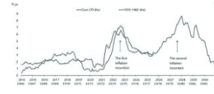

其他国家经济

# Will we see a repeat of 2021 and the 1970s?

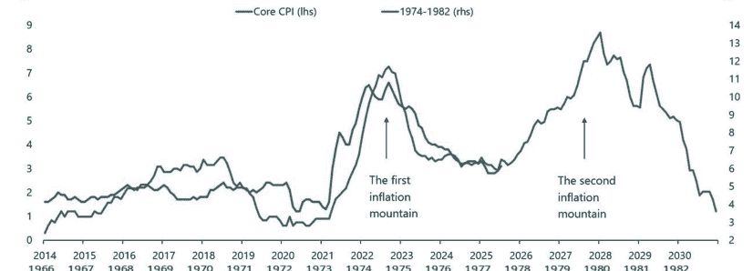

加微信：2818363845，提升知识学习群，看更多优质资源

# Jason不离

2025-09-01 05:28

bloomberg: 尽管中国最大的两个城市推出了额外的刺激措施，但中国8月份的房产销售延续了趋势。100家最大房地产公司的新房销售额为2070亿元人民币，同比下降17.6%。

曹山石：8月房产、茅台价格趋势同步未止学习经济数据

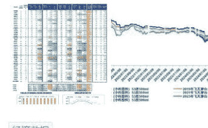

经济数据

加微信：28183638345，提升知识学习群，看更多优质资源

# 2025年8月车头销售数据快报

# 国信证券

# 全美销量

## 年度数据统计

| 企业名称 | 中小型 | 2024年8月 | 2023年8月 | 2022年8月 | 2021年8月 | 2020年8月 | 2019年8月 | 2018年8月 | 2017年8月 | 2016年8月 | -17.9% | 6.1% | -16.9% | 3260 | 4296 |
|---|---|---|---|---|---|---|---|---|---|---|---|---|---|---|---|
| 丰田 | 1 | 1832 | 2239 | 2155 | 189 | 0.5% | -18.9% | 1790 | -17.9 | 141 | 6.1% | -16.9% | 3260 | 4296 | |
| 本田 | 3 | 1368 | 1775 | 1534 | 132 | 0.8% | -13.2% | 919 | -10.3 | 67 | -46.7% | 23.5% | 2670 | 3010 | |
| 大众 | 1 | 1364 | 1513 | 1468 | 95 | 0.1% | -49.1% | 891 | -60.3 | 57 | 24.7% | -24.4% | 2494 | 3318 | |
| 福特 | 5 | 1957 | 2345 | 2068 | 228 | 2.4% | -23.8% | 730 | -64.3 | 58 | 36.8% | -24.3% | 1718 | 1913 | |
| 通用 | 7 | 855 | 1711 | 1775 | 87 | 7.5% | -41.1% | 891 | -60.3 | 57 | 24.7% | -24.4% | 1305 | 1881 | |
| 斯巴鲁 | 9 | 709 | 549 | 571 | 75 | 31.7% | 46.5% | 968 | -40.9 | 65 | 73.5% | -31.9% | 903 | 1412 | |
| 亚马 | 11 | 566 | 530 | 568 | 116 | 10.0% | -37.6% | 378 | -44.4 | 34 | 36.4% | -31.9% | 1054 | 1230 | |
| 现代 | 13 | 453 | 796 | 587 | 153 | 52.7% | -36.7% | 468 | -24.2 | 42 | 89.7% | 52.3% | 924 | 1218 | |
| 吉普 | 15 | 358 | 568 | 559 | 199 | 13.6% | -12.5% | 239 | -54.6 | 44 | 16.1% | 15.3% | 540 | 638 | |
| 尼产 | 17 | 477 | 617 | 486 | 217 | 14.8% | 27.5% | 425 | -32.1 | 31 | 43.2% | 35.1% | 805 | |
| 奔驰 | 19 | 252 | 774 | 702 | 250 | 3.6% | 10.2% | 296 | -53.3 | 19 | 75.3% | 10.2% | 735 | |
| 宝马 | 20 | 239 | 824 | 766 | 220 | 8.2% | 30.5% | 731 | 23.3 | 20 | 81.9% | 60.5% | 695 | |
| 奥迪 | 21 | 221 | 818 | 805 | 216 | 16.8% | -53.5% | 125 | -21.6 | 25 | -22.5% | 73.4% | 438 | |
| 诺斯 | 23 | 172 | 724 | 729 | 198 | 10.5% | -31.8% | 112 | -57.7 | 23 | -53.9% | 71.4% | 420 | |
| 克莱斯 | 25 | 189 | 854 | 946 | 185 | 14.7% | 192.5% | 97 | 103 | 18 | -34.3% | 21.3% | 256 | |
| 斯奇 | 27 | 31 | 914 | 1034 | 179 | 16.6% | 114.4% | 98 | 8.1 | 7 | 207.7% | -94.4% | 152 | |
| 道莱斯 | 29 | 160 | 853 | 883 | 168 | -3.6% | 13.5% | 106 | -17.3 | 12 | 55.3% | 10.7% | 214 | |
| 沃尔沃 | 30 | 192 | 653 | 698 | 196 | -7.2% | -6.1% | 154 | -10.3% | 15 | 59.4% | -22.2% | 256 | |
| 别马 | 31 | 174 | 729 | 724 | 172 | 10.5% | -31.8% | 112 | -57.7 | 23 | -53.9% | 71.4% | 340 | |
| 域 | 33 | 155 | 773 | 756 | 154 | 0.6% | -2.3% | 159 | -34.7% | 17 | 51.6% | 23.9% | 302 | |
| 捷 | 35 | 169 | 728 | 736 | 149 | 2.7% | -1.1% | 148 | -30.7% | 11 | 11.6% | 23.9% | 329 | |
| 斯 | 36 | 195 | 792 | 775 | 155 | 2.6% | -3.2% | 155 | -50.2% | 21 | 41.9% | 28.8% | 242 | |
| 大 | 37 | 149 | 550 | 563 | 139 | -0.6% | -49.5% | 144 | -23.4% | 19 | -69.8% | -50.2% | 398 | |
| 中 | 39 | 137 | 568 | 558 | 130 | 1.7% | 18.6% | 120 | -16.9% | 18 | 18.4% | 16.5% | 282 | |
| 日 | 49 | 138 | 592 | 595 | 132 | -0.7% | -0.5% | | | | | | | |

## 各品牌销量趋势
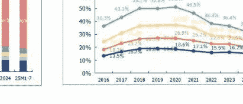

加微信：2018363448，提升知识学习，看更多优质资源

# charlie: 今年全球股票回报率
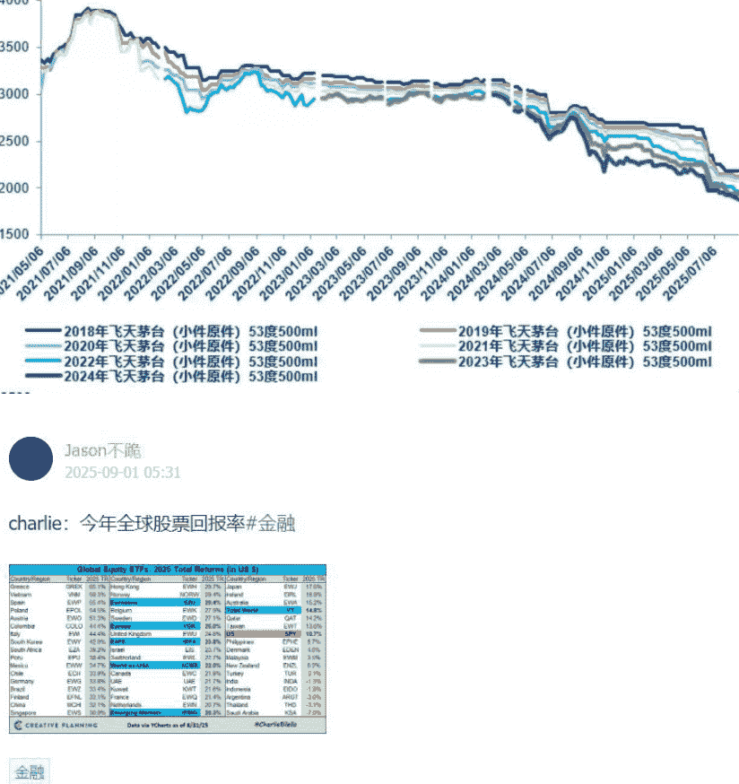

# Global Equity ETFs: 2025 Total Returns (in US $)

| Country/Region | Ticker 2025 | Country/Region | Ticker 2025 | Country/Region | Ticker 2025 |
|---|---|---|---|---|---|
| GREK | 25.1 | Hong Kong | EWH | 29.7 | Japan | EWJ | 17.6 |
| VNM | 59.3 | Norway | NORW | 29.4 | Ireland | EIR | 16.8 |
| EWP | 55.4 | Eurozone | EPD | 29.4 | Australia | EWA | 15.2 |
| EZA | 38.4 | United Kingdom | EVK | 25.1 | World | EWM | 3.5 |
| EWO | 51.3 | Sweden | EDW | 27.1 | QAT | 14.2 |
| COA | 44.0 | Europe | VGK | 26.0 | Taiwan | EMW | 13.6 |
| EWU | 44.4 | South Korea | EWQ | 24.8 | India | INDA | 10.7 |
| EAF | 25.2 | Israel | ESI | 23.7 | Philippines | EPHE | 10.2 |
| EPU | 38.6 | Emerging | EWL | 22.7 | Denmark | EDN | 4.6 |
| EWX | 37.8 | Markets-USA | ACW | 22.6 | New Zealand | ENZL | 8.5 |
| ECC | 33.9 | Canada | EWC | 21.9 | Turkey | TUR | -0.1 |
| EGW | 33.8 | UIE | 21.7 | India | EWI | -1.3 |
| EWZ | 33.1 | Kuwait | KWT | 21.3 | Indonesia | EIO | 12.6 |
| EFN | 33.1 | Netherlands | EWN | 20.7 | Argentina | ARGT | -3.0 |
| MCH | 32.1 | Emerging Markets | IEMG | 20.3 | Thailand | THD | -3.1 |
| EWS | 30.9 | Saudi Arabia | KSA | -7.0 | | | |

加微信：281836435，提升知识水平，看更多优质资源

# Jason-不离

zerohedge: 截至2025年7月31日官方持有最多的国家/地区，无论是通过深思熟虑的策略还是执法。这10国家控股着约2.506% 的 BTC总量。

| Government | Bitcoins | Value (USD) | Share of Total Supply |
|---|---|---|---|
| U.S. | 198,022 | $23,456,497,988 | 0.943% |
| CN China | 190,000 | $22,506,260,000 | 0.905% |
| GB UK | 61,245 | $7,254,715,230 | 0.292% |
| UA Ukraine | 46,351 | $5,490,461,354 | 0.221% |
| KP North Korea | 13,562 | $1,606,473,148 | 0.065% |
| BT Bhutan | 11,286 | $1,336,871,844 | 0.050% |
| SV El Salvador | 6,257 | $741,166,678 | 0.030% |
| VE Venezuela | 240 | $28,428,960 | 0.001% |
| FI Finland | 90 | $10,660,860 | 0.000% |

# 海外投资者的日本房地产领先

日经：海外投资者取得日本国内房产的动作十分活跃。2025年1~6月，写字楼的收购额达到去年两年的两倍，创下历史最高。大型地产服务公司（CBRE）分析了追溯2005年以来的数据。在1.14万日元的总额买卖中，写字楼占比超过4%。主要原因之一是市场食品价格指数较同期上涨了3.1%，从7月的费用指数（CPE，2020年1~10月）来看，写字楼指数较去年增长了3%以上水平，关键在于：这将导致地产的租金上涨压力。三井地产（Sanko Estate）的首席分析师认为：“地缘好，短时间内的大型写字楼将开始动作，写字楼的租金将持续上涨。”看来，日本地产的收益性也具有吸引力，收益可以通过投资回报率与长期利率之间的利差（Yield Gap）来进行对比。三井友信基产所调研的收益率数据显示，2025年1~3月，日本市心的写字楼...

# Jason不离

2025 Demographia 国际住房负担能力报告：比较了全球94个主要房地产市场，香港以惊人的 14.4 房价收入比为全球首购（最负担不起）。本榜单不包括中国大陆城市。#房价补：国内中评优大数据研究院给出的——2024年全国房价收入比为10.3，一线城市2024年房价收入比为26.1，二、三线城市房价收入比为7.6。

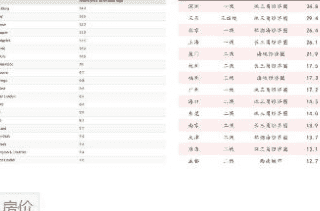

| City | House price-to-income ratio |
|---|---|
| HK Kong | 14.4 |
| Au Sydney | 13.8 |
| San Jose | 12.1 |
| CA Vancouver | 11.8 |
| US Los Angeles | 11.2 |
| Au Adelaide | 10.9 |
| US Honolulu | 10.8 |
| US San Francisco | 10 |
| Au Melbourne | 9.7 |
| San Diego | 9.5 |
| Au Brisbane | 9.3 |
| GB Greater London | 9.1 |
| CA Toronto | 8.4 |
| Au Perth | 8.3 |
| US Miami | 8.1 |
| NZ Auckland | 7.7 |
| GE Bristol-Bath | 7.5 |
| US New York | 7.4 |
| GE Warwickshire & Cheshire | 7.4 |
| GE London Exurbs | 7.3 |

最后编辑：2025-09-01 06:05

## 表：2024年房价收入比TOP15

| 城市 | 城市等级 | 区域 | 房价收入比 |
|---|---|---|---|
| 深圳 | 一线 | 京京广经济圈 | 34.8 |
| 三市 | 二四线 | 京京广经济圈 | 29.4 |
| 北京 | 一线 | 环渤经济圈 | 26.4 |
| 上海 | 一线 | 长三角经济圈 | 21.9 |
| 厦门 | 二线 | 海陆经济圈 | 17.5 |
| 州州 | 二线 | 长三角经济圈 | 17.3 |
| 福州 | 二线 | 海陆经济圈 | 17.2 |
| 广州 | 一线 | 长三角经济圈 | 14.5 |
| 海口 | 二线 | 长三角经济圈 | 14.0 |
| 东莞 | 二线 | 长三角经济圈 | 13.9 |
| 南京 | 二线 | 环渤经济圈 | 13.7 |
| 天津 | 二线 | 环渤经济圈 | 13.1 |
| 成都 | 二线 | 南西南城市 | 12.7 |
| 苏州 | 二线 | 长三角经济圈 | 12.6 |

数据来源：翰坤优中信数据研究院

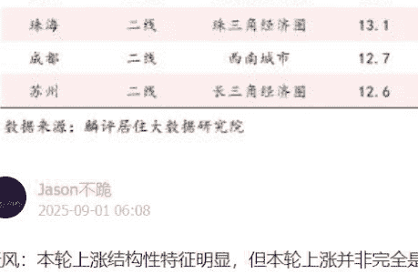

天刚：从上轮涨性特征来看，但上轮并非是系统性普涨估值，TMT领先。结构性特征极其明显，从31个行业的涨幅来看，高于20%的行业只有11个行业，换言，暴增综合后的30年后行业，有1/3相对A类出跑。从重心、流通市值权重来看，电子本对亚洲的涨幅领先高于14-15年期间涨幅最大的行业的贡献。从一轮锁销市的演绎形态来看，市场后期所谓“消除低估，击穿高频”，最终各行业对每个市场的涨幅将趋于均衡，但极端单一行业的涨幅将超过30%。#A2

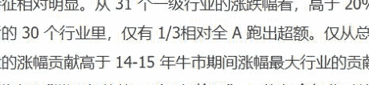

## 图 1：2025/6/23 至 2025/8/27 各行业对指数涨跌贡献系数（总市值占比）

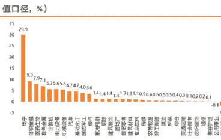

数据来源：Wind、天源研究院

## 图 2：2025/6/23 至 2025/8/27 各行业对指数涨跌贡献系数（流通市值）

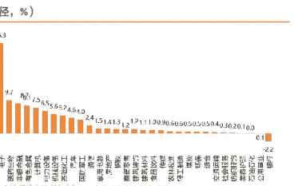

数据来源：Wind、天源研究院

Jason不
2025-09-01 06:11

银河：8月份 PMI 制造业指数回升以及生产、新订单、出口价格和采购的提升展现了扩大内需等效果显现。另一方面，PMI制造业连续5个月在收缩区间体现了经济压力，中小企业的收益与大企业的分化微观主体仍体感佳。同时出口领先可能在10月份结束，出口对经济增速造成压力。

## 图 10：大型企业、中小企业 PMI 指数分化出口对经济增速更大

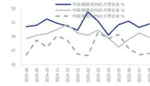

数据来源：Wind、中国证券

## 民生：8月 PMI 指标反映了通胀问题的缓解，需求指标再次证明了扩大内需支撑价格上升的效果依然。注意的是，无论从 PMI 数值还是环比增长来看，代表上游的原料指数（8月至51.5%）均好于下游的出货指数（8月至48.3%），这说明内需改善进一步，但上游价格修复并未完全落实。

在 PMI 表显示需求较为紧凑的当下，当产品或库存规模大幅下降时，行业可能倾向于消耗，立即扩大生产，进一步加速了库存的去化。8月 PMI 季节性跌至47.9%，与历史同期低位一致，这说明内需仍在修复之中，“价格回升”，库存修复的格局，表明当前的经济复苏可能是结构性的，价格回升的局面受供给缺口和预期交叉影响，下游需求还需要更多时间和全面的政策支持。

## 图4：8月大类 PMI 指数上升

## 图5：8月 PMI 指数高于历史同期值

- 制造业原材料指数
- 制造业出口指数
- 2019年
- 2023年
- 2024年

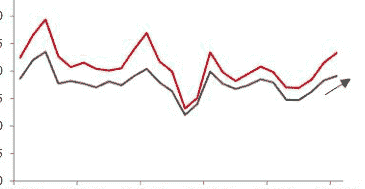
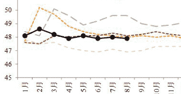

来源：民生研究院

李孚：从发达经济的案例来看，当我们进入深度老龄化（老龄化率超过14%）后，政府债务趋势无例外地下降。所以，降低政府杠杆率只是时的，长期趋势都是上行的。关键是要把公共支出用于，日本主要用于建设投资，美国主要用于增加收入，促消费，美国的模式更优于日本。宏观经济是一个大系统，因此一定要有系统性的构想，如增加投资以维持增长，扩大消费也以维持增长，如果某一项地增加公共投资，会导致经济结构失衡，供大于需，即便日本在90年代的刺激经济中，用于消费的投入不是，这是导致长期通胀的根本原因。惧：日本仍未走出通路，因为居民的薪资增长缓慢。

## 其他国家情况

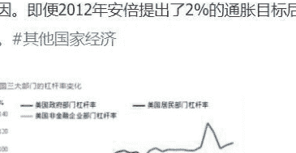

## 美国三大部门杠杆率变化

| % | 美国政府部门杠杆率 | 美国居民部门杠杆率 |

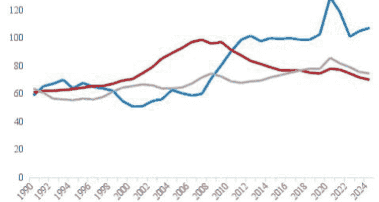

来源：WIND, 中国国际

申宏源：明年财政立场由宽松到紧凑的顺序为：德国、法国、美国、日本、欧元区。德国的赤字率增量较高，2026年，德国财政赤字扩张幅度达0.5个百分点，为法国的0.48个点，美国预计为0.4个点，日本明年低，欧元区由于内部分化，整体表现弱。预计明年增速为美国>欧洲>日本，实际GDP增速幅度较大，美国为6%，欧元区为2%，日本为0.5%。政策调整，中国增速有望改善，2026年增长0.9%，今年仅为1%。

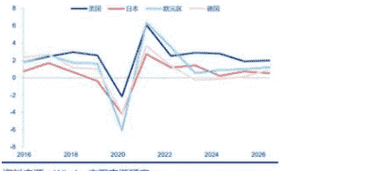

来源：Wind, 东方财富

## 图表23：2026年欧美日增速预测

| % | 美国 | 欧洲 | 日本 | 德国 |
|---|---|---|---|---|
| 8 | | | | |
| 6 | | | | |
| 4 | | | | |
| 2 | | | | |
| -2 | | | | |
| -4 | | | | |
| -6 | | | | |
| -8 | | | | |
| | 2016 | 2020 | 2024 | 2026 |

资料：Wind，申宏研究

日本：厚生劳动部9月发布的动态统计（包含外国人）显示出生人数为33,928万人，为1969年以来最低记录。上半年的死亡人数为83,618万人，出生人数减少死亡人数后得到的自然增数为负49,758万人，结婚数量为23,856万，同比下降4.0%。市场转向等地，生育率补贴失效了。

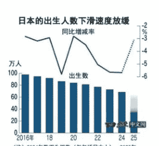

## 日本出生人数下滑放缓 同比增减率

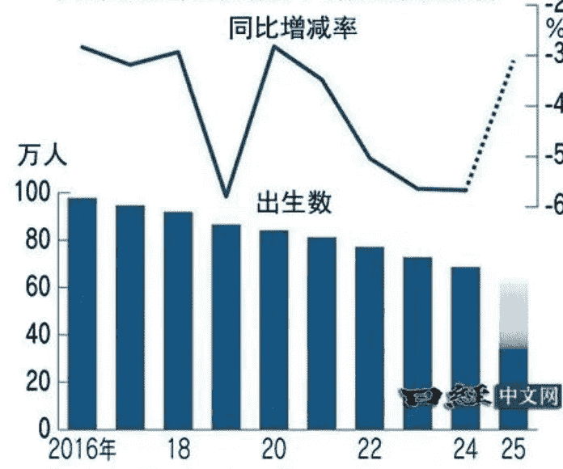

（注）2024年数据为概数（仅日本人）。2025年为上半年快报（包括外国人）。

# 提升知识学习群365年（365天服务期），微信扫码或微信:281836845

欢迎进群看更多资源，老客户进群享折扣。学习群包含全部资源：

## 财经知识博（财经会员群258元，包含7个主内容每天更新）：

- 灵犀财富星球（原价3310元/年）/ 单买149元
- 鉴蓝财经星球（原价3510元/年）/ 单买149元
- 血仆之家知识星球（原价2280元/年）/ 单买199元
- 卢虞元微博+会员（原价1000元/年）/ 单买79元
- 智谷趋势内部分研（原价1999元/年）/ 单买19.9元
- 南半球联鲤财经（原价404元/年）单买19.9元
- 洪渊的宏观策略及众筹的其他财经博主付费免费专享

## 时事博主（时事会员群119元，包含11个主题天天更新）：

- 子明私享仁（原价568元/年）/ 单买29.9元
- 米莉米联锦间（原价599元/年）/ 单买29.9元
- 大树奇奇星球（原价199元/年）/ 单买19.9元
- 酷霸的世界知识星球（原价299元/年）/ 单买19.9元
- 砂叽瓦广厂阿Q的内部文档（原价400元/年）/ 单买19.9元
- 卢克文识星球+青友会员群（原价268元/年）/ 单买19.9元
- 卢克文云读书会（原价699元/年）/ 单买59.9元
- 倍俗会员群文章和对话（原价365元/年）/ 单买29.9元
- 欧洲周金会群文章（原价328元/年）/ 单买19.9元

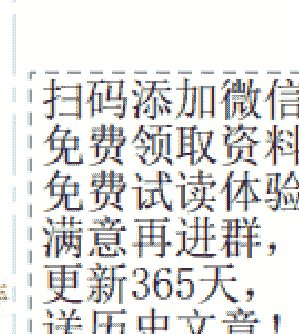
