# Jason-Jason

2025-09-09 02:40
巴克:我们回访了2025Q2的财电话会，从中了解到关税对美股公司总体影响有限，但行业分化明显。工业、科技板块受益于较均衡的定价权，消费板块受压更大。投资者目前已将关税视为首要风险，但在消费零售等板块，未来仍可能放大市场波动。

目前几乎没有明显的需求破坏，原因是大部分被吸收、提前采购（尤其是周期性消费终端市场）以及部分被关税转嫁。大部分公司没有受到量化关税对利润率的打击；有限样本显示中位数利润直接击中为60~70bp。美股

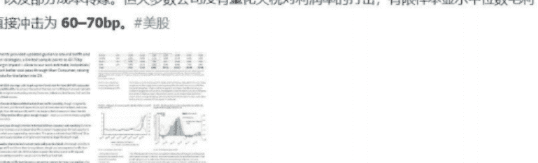

## 分类

最后更新:2025-09-09 02:41

加微信：2818363845，提升知识学习群，看更多优质资源

# U.S. Equity Insights

## How are S&P 500 companies dealing with tariffs?

Managements provided updated guidance around tariffs and mitigation strategies; a limited sample points to 60-70bp gross margin impact - close to our own estimate; Industri/Tech report better cost pass-through than Consumer, raising margin risks for the latter into 2H.

- We reviewed 2Q25 earnings calls to get a ground level view for how S&P 500 companies dealing with tariffs that our own tariff impact analysis highlight vulnerability to tighter trade policy, namely Consumer, Industrials, Healthcare, Tech and the commodity-linked sectors.

- Few signs of material destruction from tariffs currency, though mitigated by absorption of costs, pull-forward (especially in cyclical consumer end markets), and some pass-through. Most did not quantify tariff hit to margins; limited sample of those that point to 60-70bp median gross margin impact - close to our own estimate via BEA US Census data.

- Pricing power/pass-through is better in industrial than in consumer end markets; the latter reported inventory pull-in ahead of tariffs to margins given limited capacity to push price, which was supported by macro data. This poses a risk into fiscal 2H25 and '26 as pull-forward supply depletes and higher-cost inventories begin flowing through.

- Many companies have characterized current tariff policy as de-risked with enough visibility to manage tariffs and factor them into guidance, though any new/expanded tariffs from here would comprise a tail risk. 2H25 revisions support this view; several tariff-exposed industries are seeing worse-than-usual cuts in the fiscal back half.

- Valuations indicate tariffs have become a secondary concern for large-cap equities after gidedowns and visibility into mitigation, with tariff-exposed sectors trading other market themes (e.g., rate cuts, fiscal spending, regulatory reform, commodity oversupply, data center investment).

- Still, potential valuation upside could be materially impacted in some areas. For example, holiday quarter estimates for retailers remain relatively intact vs. historical trends despite worsening price/cost dynamics reported by several consumer-facing companies, increasing the possibility that have yet to see the last tariff-related cut.

加微信：2818363845，提升知识学习群，看更多优质资源

| Country | Tariff | 0.5x | 0.7x | 1.5x | 2x | 2.5x | 3.0x |
| --- | --- | --- | --- | --- | --- | --- | --- |
| China | 30% | (1.39) | (2.08) | (2.77) | (4.16) | (5.54) | (6.93) | (8.31) |
| Europe | 20% | (0.99) | (1.30) | (1.80) | (2.70) | (3.59) | (4.49) | (5.39) |
| Canada | 10% | (0.57) | (0.85) | (1.13) | (1.70) | (2.27) | (2.83) | (3.40) |
| Mexico | 10% | (0.60) | (0.98) | (1.31) | (1.97) | (2.62) | (3.28) | (3.93) |
| ROWN | 10% | (1.40) | (2.10) | (2.80) | (4.20) | (5.60) | (7.00) | (8.40) |
| Total | 21% | (4.31) | (7.36) | (9.81) | (14.67) | (19.63) | (24.54) | |

The above figures represent the impact of tariff changes on profit margins of various companies across different industries, and we estimate the loss for each S&P 500 company by leveraging Census data. We assume companies will be able to pass through half of the tariff costs to their customers and will hit profit on margins. Commentary around inventory levels varies by industry, with consumer-facing companies and their suppliers showing more pull-in in response to tariffs and industrial markets - the latter appears to be entering the side of conservative inventory adjustment following a general slowdown and an ongoing effort to revert post-COVID oversupply. These actions are backed out market data, which shows importers of goods are spiking just before tariff took off in April, and after a further buildup of inventories YTD (compared to wholesale).

FIGURE 3. US importers of goods spiked just before tariff effect

FIGURE 4. Inventories are increasing faster than wholesale, depleted supply

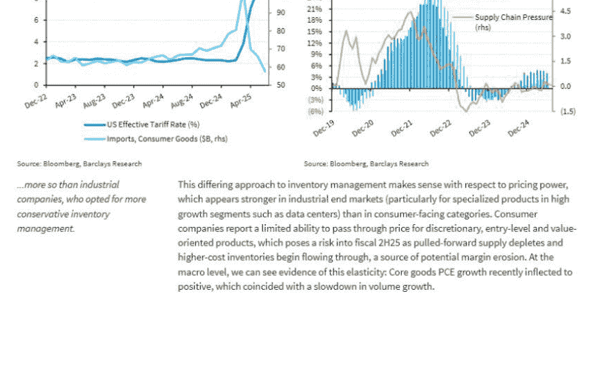

Source: Bloomberg, Bloomberg Research

industrial-companies opted for conservative inventory management. This differing approach to inventory management makes sense with pricing power, which appears stronger in industrial markets (particularly for specialized products in consumer-facing categories such as data centers). Consumer companies report a limited ability to pass through price for discretionary, entry-level and value-oriented products. CPI is followed by lower supply and higher-cost inventories flowing through, a source of potential margin erosion. At a macro level, we can see evidence of this elasticity: core PCE growth recently inclined to positive, which coincided with a slowdown in volume growth.

# Jason-蕴
2025-09-09 02:52

JPM: 8月政策松动带来底部改善，但价格和信心依然缓慢，市场企业的持续性仍，CPI 下行加大，PPI 受基数和部分大商品支撑，但整体通胀格局未变。

## 经济数据

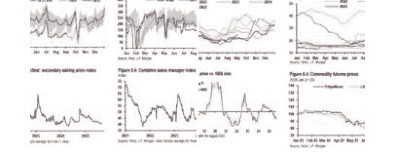
经济数据

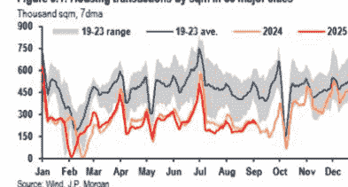
经济数据

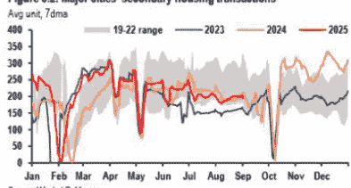
经济数据

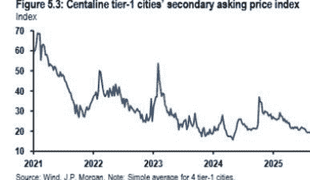
经济数据

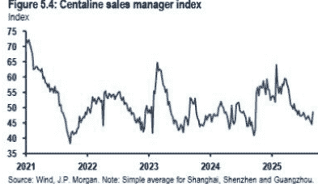
经济数据

加微信：2818363845，提升知识学习群，看更多优质资源

### Figure 6.1: Agricultural product wholesale price

index --- 2019 --- 2020 --- 2021 --- 2022 --- 2023 --- 2024

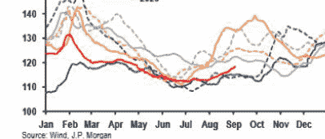

Source: Wind, J.P. Morgan, EBS

### Figure 6.2: Pork wholesale price

yuan/kg --- 2019 --- 2020 --- 2021 --- 2022 --- 2023 --- 2024

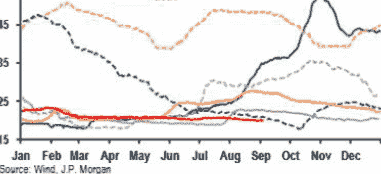
Source: Wind, J.P. Morgan, EBS

### Figure 6.3: Pork wholesale prices vs. NBS data

--- Daily tracking 1/
--- Monthly from NBS

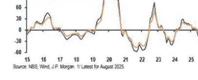

Source: Wind, J.P. Morgan; 1: for August 2021

### Figure 6.4: Commodity futures

2025 Jan=100 --- Lithium carbon

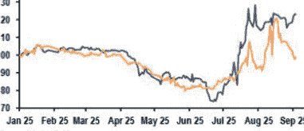
Source: Wind, J.P. Morgan

# Jason-离
2025-09-09 02:58

长江：出口维持增长，同比增长4.4%，低于5%的预期，年内来看，前期抢出的出口需在未来几个月释放，9-12月出口具有风险。#经济数据

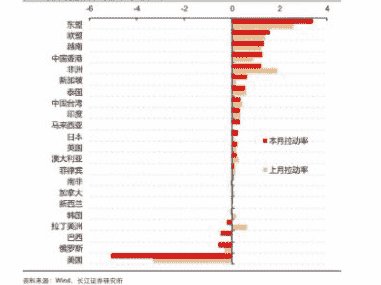

加微信：2818363845，提升知识学习群，看更多优质资源

## 图 8：我国主要国家/地区出口动率(pct)

| | -6 | -4 | 0 | 2 | 4 |
| --- | --- | --- | --- | --- | --- |
| 东亚 | | | | | |
| 欧盟 | | | | | |
| 越南 | | | | | |
| 中国香港 | | | | | |
| 新加坡 | | | | | |
| 泰国 | | | | | |
| 中国台湾 | | | | | |
| 印度 | | | | | |
| 马来西亚 | | | | | |
| 日本 | | | | | |
| 英国 | | | | | |
| 澳大利亚 | | | | | |
| 菲律宾 | | | | | |
| 南非 | | | | | |
| 加拿大 | | | | | |
| 新西兰 | | | | | |
| 拉美洲 | | | | | |
| 巴西 | | | | | |
| 俄罗斯 | | | | | |
| 美国 | | | | | |

■ 本月动率
■ 上月动率
资料来源：Wind，长江证券

Jason-磊
2025-09-09 02:59

2025年第35周，上海二手房成交4616套，环比跌12.5%。虽2025年8月26日执行新政之后，上海二手房成交量有所回升，连5000套都未站，便向下，又哑。房价

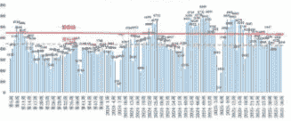
房价

微信：2818363845，提升知识学习群，看更多优质资源

## 上海二手房周成交量（2025年第3周）

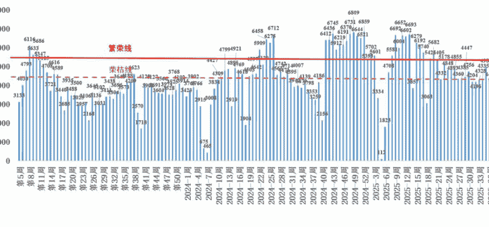

Jason-晓
2025-09-09 03:01

方注：截至2025年6月30日报告初，全国社保基金合计现568家上市公司半年报前十大流通股东，市值合计约为651亿元。从底层来看，全国社保基金持仓市值在10亿元以上的个股有30只。全国社保基金在二季度的布局已把握了下半年的机遇。截至2025年9月3日数据，按半年报披露的全国社保基金持仓测算，二季度持仓组合当前市值约1862亿元，相比6月30日披露市值增长211亿元，环比增长约12.8%，同期上证指数涨幅为11.4%。

| 证券代码 | 证券名称 | 上市日 | 行业 | 股本 | 总市值 | 市盈率 | 净资产率 | 股息率 | 换手率 | 市净率 | PE(TTM) | PB/EPS(TTM) | 本周涨幅 | 本周跌幅 |
| --- | --- | --- | --- | --- | --- | --- | --- | --- | --- | --- | --- | --- | --- |
| 000001 | 平安银行 | 1991-04-01 | 银行 | 24.31亿 | 3125.42亿 | 6.54 | 1.12 | 4.52% | 1.25% | 5.82 | 6.54 | 0.92 | 1.25% | -0.12% |
| 000002 | 中国平安银行 | 1991-02-21 | 银行 | 21.42亿 | 2842.15亿 | 7.12 | 1.05 | 3.88% | 0.98% | 6.15 | 7.12 | 0.85 | 0.45% | 0.05% |
| 000003 | 川发银行 | 1997-04-24 | 银行 | 25.15亿 | 2155.33亿 | 5.88 | 0.98 | 5.12% | 1.12% | 5.22 | 5.88 | 0.88 | 0.33% | -0.15% |
| 000004 | 京华银行 | 1991-03-28 | 银行 | 19.88亿 | 1988.45亿 | 6.25 | 1.10 | 4.25% | 1.05% | 5.55 | 6.25 | 0.91 | 0.22% | 0.08% |
| 000005 | 华夏银行 | 1991-03-28 | 银行 | 23.55亿 | 2455.66亿 | 6.78 | 1.08 | 3.95% | 1.15% | 5.98 | 6.78 | 0.94 | 0.18% | -0.10% |
| 000006 | 招商银行 | 1992-02-29 | 银行 | 28.44亿 | 4555.77亿 | 5.95 | 1.15 | 4.65% | 1.35% | 5.35 | 5.95 | 0.96 | 0.55% | 0.12% |
| 000007 | 农业银行 | 1997-04-28 | 银行 | 35.66亿 | 5855.88亿 | 5.25 | 0.95 | 5.35% | 0.95% | 4.65 | 5.25 | 0.82 | 0.25% | -0.05% |
| 000008 | 工商银行 | 1996-05-28 | 银行 | 38.44亿 | 6555.99亿 | 5.15 | 0.92 | 5.45% | 0.92% | 4.55 | 5.15 | 0.81 | 0.20% | -0.02% |
| 000009 | 交通银行 | 1991-03-28 | 银行 | 30.22亿 | 4255.11亿 | 5.65 | 1.02 | 4.85% | 1.02% | 5.12 | 5.65 | 0.89 | 0.15% | 0.07% |
| 000010 | 浦发银行 | 1992-05-28 | 银行 | 26.77亿 | 3555.22亿 | 6.45 | 1.06 | 4.15% | 1.18% | 5.78 | 6.45 | 0.93 | 0.10% | -0.04% |
| 000011 | 光大银行 | 1997-04-28 | 银行 | 29.55亿 | 3955.33亿 | 5.95 | 1.01 | 4.95% | 1.01% | 5.45 | 5.95 | 0.87 | 0.14% | -0.09% |
| 000012 | 兴业银行 | 1991-10-28 | 银行 | 27.33亿 | 3755.44亿 | 6.15 | 1.04 | 4.75% | 1.10% | 5.65 | 6.15 | 0.90 | 0.19% | 0.06% |
| 000013 | 民生银行 | 1992-05-28 | 银行 | 24.11亿 | 3155.55亿 | 6.85 | 1.09 | 4.05% | 1.22% | 6.05 | 6.85 | 0.95 | 0.11% | -0.06% |
| 000014 | 华夏 | 1991-03-28 | 银行 | 22.88亿 | 2955.66亿 | 6.35 | 1.07 | 4.35% | 1.14% | 5.85 | 6.35 | 0.92 | 0.09% | -0.03% |
| 000015 | 宁波银行 | 1997-04-28 | 银行 | 24.44亿 | 3355.77亿 | 6.05 | 1.03 | 4.55% | 1.08% | 5.55 | 6.05 | 0.89 | 0.13% | 0.04% |
| 000016 | 中信银行 | 1996-05-28 | 银行 | 32.11亿 | 4555.88亿 | 5.75 | 0.99 | 5.25% | 0.99% | 4.95 | 5.75 | 0.84 | 0.21% | -0.01% |
| 000017 | 杭州银行 | 1997-04-28 | 银行 | 28.66亿 | 3855.99亿 | 6.22 | 1.06 | 4.42% | 1.16% | 5.72 | 6.22 | 0.91 | 0.17% | -0.07% |
| 000018 | 广发银行 | 1992-05-28 | 银行 | 27.22亿 | 3655.11亿 | 6.32 | 1.07 | 4.32% | 1.13% | 5.92 | 6.32 | 0.94 | 0.12% | -0.05% |
| 000019 | 国民银行 | 1996-05-28 | 银行 | 34.33亿 | 5555.22亿 | 5.32 | 0.96 | 5.42% | 0.96% | 4.72 | 5.32 | 0.83 | 0.23% | -0.03% |
| 000020 | 建设银行 | 1991-03-28 | 银行 | 31.44亿 | 4855.33亿 | 5.52 | 1.00 | 5.02% | 1.00% | 5.22 | 5.52 | 0.86 | 0.16% | 0.01% |
| 000021 | 浙商银行 | 1992-05-28 | 银行 | 26.55亿 | 3455.44亿 | 6.12 | 1.04 | 4.62% | 1.09% | 5.62 | 6.12 | 0.89 | 0.10% | -0.04% |
| 000022 | 南京银行 | 1991-03-28 | 银行 | 23.11亿 | 3055.55亿 | 6.42 | 1.08 | 4.22% | 1.21% | 6.02 | 6.42 | 0.96 | 0.08% | -0.06% |
| 000023 | 贵州银行 | 1997-04-28 | 银行 | 24.88亿 | 3255.66亿 | 6.02 | 1.02 | 4.52% | 1.07% | 5.52 | 6.02 | 0.90 | 0.14% | 0.03% |
| 000024 | 兴业银行 | 1992-05-28 | 银行 | 27.44亿 | 3755.77亿 | 6.15 | 1.04 | 4.75% | 1.10% | 5.65 | 6.15 | 0.90 | 0.19% | 0.06% |
| 000025 | 招商银行 | 1992-02-29 | 银行 | 28.44亿 | 4555.88亿 | 5.95 | 1.15 | 4.65% | 1.35% | 5.35 | 5.95 | 0.96 | 0.55% | 0.12% |
| 000026 | 广发银行 | 1992-05-28 | 银行 | 27.22亿 | 3655.99亿 | 6.32 | 1.07 | 4.32% | 1.13% | 5.92 | 6.32 | 0.94 | 0.12% | -0.05% |
| 000027 | 宁波银行 | 1997-04-28 | 银行 | 25.44亿 | 3355.11亿 | 6.05 | 1.03 | 4.55% | 1.08% | 5.55 | 6.05 | 0.89 | 0.13% | 0.04% |
| 000028 | 中信银行 | 1996-05-28 | 银行 | 32.11亿 | 4555.22亿 | 5.75 | 0.99 | 5.25% | 0.99% | 4.95 | 5.75 | 0.84 | 0.21% | -0.01% |
| 000029 | 交通银行 | 1991-03-28 | 银行 | 30.22亿 | 4255.33亿 | 5.65 | 1.02 | 4.85% | 1.02% | 5.12 | 5.65 | 0.89 | 0.15% | 0.07% |
| 000030 | 浦发银行 | 1992-05-28 | 银行 | 26.77亿 | 3555.44亿 | 6.45 | 1.06 | 4.15% | 1.18% | 5.78 | 6.45 | 0.93 | 0.10% | -0.04% |

### 图表1:全国基金组合市值于 10 亿元的个股

| 股票名称 | 市值(万份) 本期 | 市值(万份) 上期 | 市值(万份) 上动 | 市值(万元) 本期 | 市值(万元) 上期 | 市值(万元) 上动 | 行业 |
| :--- | :--- | :--- | :--- | :--- | :--- | :--- | :--- |
| 三一重工 | 17,139 | 17,578 | -439 | 307,653 | 335,221 | -27,568 | 机械设备 |
| 传音控股 | 3,826 | 3,189 | 637 | 304,964 | 289,115 | 15,849 | 电子 |
| 华升控股 | 13,268 | 10,596 | 1,088 | 287,526 | 234,318 | 53,347 | 基础化工 |
| 云岭股份 | 15,579 | 14,490 | 1,048 | 558 | 52 | 251 | -2,317 | 有色金属 |
| 分众股份 | 33,412 | 31,283 | 2,130 | 243,910 | 219,603 | 24,307 | 传媒 |
| 常行银行 | 27,779 | 25,539 | 2,380 | 204,772 | 177,034 | 27,698 | 银行 |
| 太阳控股 | 15,111 | 16,346 | -1,235 | 203,395 | 204,450 | -37,060 | 轻制造 |
| 正宝电子 | 8,698 | 8,698 | 0 | 197,911 | 204,845 | -7,655 | 电力设备 |
| 汇川技术 | 2,800 | 2,870 | -72 | 180,796 | 195,778 | -14,982 | 机械设备 |
| 招商云端 | 18,042 | 17,036 | 1,006 | 158,527 | 152,616 | 2,011 | 房地产 |
| 聚星科技 | 5,869 | 4,034 | 1,834 | 149,710 | 119,458 | 30,251 | 机械设备 |
| 金信诗 | 3,195 | 2,199 | 966 | 146,686 | 81,777 | 59,509 | 有色金属 |
| 安井碧特 | 4,301 | 3,650 | 651 | 137,691 | 132,422 | 5,339 | 食品饮料 |
| 亚安克创 | 1,115 | 889 | 226 | 126,681 | 91,664 | 5,339 | 电子 |
| 顺邦科技 | 2,598 | | 2,598 | 126,681 | | 126,681 | 68,874 | 交通运输 |
| 海大国际 | 2,103 | 1,088 | 1,015 | 123,240 | 54,367 | | 农牧行业 |
| 中国建设 | 20,517 | 20,517 | 0 | 118,383 | 109,719 | 10,464 | 建筑装饰 |
| 新东方股份 | 6,253 | 6,253 | 0 | 118,190 | 105,525 | 公用事业 |
| 万华信泰 | 2,121 | 2,121 | 2 | 115,085 | 142,522 | -27,467 | 基础化工 |
| 新产业 | 1,950 | 1,850 | 100 | 110,604 | 107,707 | 2,897 | 医药 |
| 宁时代 | 4,425 | 4,425 | 0 | 110,015 | 107,117 | -7,302 | 汽车 |
| 海信视讯 | 4,763 | 4,454 | 309 | 109,641 | 110,549 | -902 | 家用电器 |
| 长城汽车 | 5,104 | 4,360 | 744 | 109,633 | 113,796 | -4,162 | 汽车 |
| 山东黄金 | 3,389 | 2,939 | 455 | 108,206 | 78,996 | 29,210 | 有色金属 |
| 望孚东 | 2,058 | 2,029 | 30 | 106,774 | 94,022 | 12,752 | 国防 |
| 通信股份 | 6,360 | 3,075 | 3,285 | 106,533 | 58,822 | 47,711 | 电力设备 |
| 亚洲钢铁 | 15,828 | 15,828 | 0 | 104,306 | 113,961 | -9,655 | 钢铁 |
| 亿联网络 | 2,911 | 2,431 | 480 | 101,172 | 99,257 | 1,914 | 通信 |
| 赤峰黄金 | 4,022 | 4,656 | -634 | 100,072 | 106,623 | -6,551 | 有色金属 |

资料来源：东方、证券研究所
注：本期数据为2025年6月30日数据，上期数据为2025年3月31日。

# Jason Insights
2025-09-09 03:14

## 银河：外资在配置中国内地股票时，偏好具备增长预期和政策支持的行业。#A股

![img/889862d13f1c4f7f0d524201ea7b52a_8_0.png]

## A股
图1：外资流向中国内地市场动能较强(EPFR 周度数据)

![img/889862d13f1c4f7f0d524201ea7b52a_8_1.png]

数据来源：EPFR，中国财富研究院

### 图2: 外资流向内地股市趋势统计 (EPFR 月度口径整理)
(百万美元)

![img/889862d13f1c4f7f0d524201ea7b52a_9_0.png]

资料来源: EPFR，中国证券研究院

### 图4: 外资流向中国内地市场聚焦“新动能+金融”(EPFR 季度数据)
(百万美元)

![img/889862d13f1c4f7f0d524201ea7b52a_9_1.png]

资料来源: EPFR，中国证券研究院

从外资配置来看，中国境内股市在2025年初已吸引大量资金流入，尤其在7月至8月期间，外资对中国资产的获益意愿提升。被动型资金主导这一趋势，主动型资金在8月初也出现了与去年10月以来的首次逆流。

逻辑上，外资倾向于产业领先的行业，因此，对中国本地资产的关注主要集中在以下几个方向：
(1) 与AI相关行业：如半导体、大模型、机器人等；
(2) 高息资产：如银行、公用事业等；
(3) 高制造与新兴资产：如新能源、创新药、光伏等。

图6：外资流向中国股市市场趋势
![img/889862d13f1c4f7f0d524201ea7b52a_10_0.png]
资料来源：EPFR，中国研究院

# Jason Insights
2025-09-09 03:25

zhedge：美联对持有者预期的调查显示，与年前相比，对家庭当前财务状况的看法有所恶化，根据家庭报告财务状况更新，8月份显示三个月以来找到新工作的进展下降了近60个分点，为美联2013年开始以来推出这个问题的最低数据。目前Me普提到9月份50bp的概率为11.76%，比昨天高。摩根士丹利表示我们现在倾向于从9月开始下降，到2026年底，最终目标区间为2.75-3.0%。澳大利亚联首席策略师在给客户的报告中写，美元可能重置其年内低位。“由于美联首席策略师近期对劳动力市场的关注，参与者可能会对下周利率下50个基点的定价。”

华西鑫：美联储降息，市场受影响，美元仍然强势，但下行波动剧烈。短期关注美联储是否下行，建议布局一次流动性驱动的资产泡沫。

![img/889862d13f1c4f7f0d524201ea7b52a_10_1.png]

## Data on Births and the Fertility Rate (TFR) 2025

| Country | Births 2025 | Child Men | Child Women | TFR (per Woman) 2024 | 2023 |
| :--- | :--- | :--- | :--- | :--- | :--- | :--- |
| United States | 2,072,650 | 2,092,754 | 7 | 1.8 | 1.6 | 1.6 |
| Canada | | | | | | |
| New Zealand | 28,938 | 28,063 | 5 | 2.0 | 1.7 | 1.7 |
| Iceland | 13,480 | 13,100 | 5 | 1.7 | 1.7 | 1.7 |
| Ireland | 135,000 | 130,000 | 6 | 1.9 | 1.6 | 1.6 |
| Norway | 107,518 | 105,000 | 7 | 1.7 | 1.4 | 1.4 |
| Sweden | 118,000 | 115,000 | 7 | 1.6 | 1.5 | 1.5 |
| Denmark | 96,738 | 95,000 | 6 | 1.6 | 1.5 | 1.5 |
| United Kingdom | 960,000 | 950,000 | 7 | 1.6 | 1.6 | 1.6 |
| Switzerland | 810,000 | 800,000 | 6 | 1.5 | 1.5 | 1.5 |
| Austria | 710,000 | 700,000 | 6 | 1.5 | 1.4 | 1.4 |
| Germany | 760,000 | 750,000 | 6 | 1.5 | 1.4 | 1.4 |
| Spain | 350,000 | 340,000 | 5 | 1.3 | 1.2 | 1.2 |
| France | 680,000 | 670,000 | 7 | 1.8 | 1.7 | 1.7 |
| Greece | 465,000 | 450,000 | 5 | 1.3 | 1.2 | 1.2 |
| Portugal | 105,000 | 100,000 | 5 | 1.4 | 1.3 | 1.3 |
| Estonia | 6,830 | 6,700 | 5 | 1.6 | 1.5 | 1.5 |
| Latvia | 19,000 | 18,000 | 5 | 1.6 | 1.5 | 1.5 |
| Lithuania | 115,000 | 110,000 | 6 | 1.7 | 1.6 | 1.6 |
| Czech Republic | 300,000 | 290,000 | 6 | 1.7 | 1.6 | 1.6 |
| Slovakia | 80,000 | 75,000 | 6 | 1.7 | 1.6 | 1.6 |
| Hungary | 300,000 | 290,000 | 6 | 1.6 | 1.5 | 1.5 |
| Poland | 660,000 | 650,000 | 6 | 1.6 | 1.5 | 1.5 |
| Romania | 580,000 | 570,000 | 6 | 1.7 | 1.6 | 1.6 |
| Bulgaria | 200,000 | 190,000 | 5 | 1.5 | 1.4 | 1.4 |
| Croatia | 50,000 | 45,000 | 5 | 1.6 | 1.5 | 1.5 |
| Slovenia | 25,000 | 24,000 | 5 | 1.7 | 1.6 | 1.6 |
| Albania | 120,000 | 110,000 | 6 | 1.9 | 1.8 | 1.8 |
| Serbia | 220,000 | 210,000 | 5 | 1.6 | 1.5 | 1.5 |
| Montenegro | 20,000 | 19,000 | 5 | 1.8 | 1.7 | 1.7 |
| Bosnia and Herzegovina | 30,000 | 29,000 | 5 | 1.7 | 1.6 | 1.6 |
| North Macedonia | 80,000 | 75,000 | 5 | 1.7 | 1.6 | 1.6 |
| Kosovo | 40,000 | 35,000 | 5 | 1.8 | 1.7 | 1.7 |
| Georgia | 270,000 | 260,000 | 5 | 1.8 | 1.7 | 1.7 |
| Ukraine | 700,000 | 650,000 | 5 | 1.4 | 1.3 | 1.3 |
| Armenia | 240,000 | 230,000 | 5 | 1.7 | 1.6 | 1.6 |
| Azerbaijan | 400,000 | 390,000 | 5 | 1.8 | 1.7 | 1.7 |
| Turkey | 2,000,000 | 1,900,000 | 5 | 2.1 | 2.0 | 2.0 |
| Iran | 1,000,000 | 950,000 | 5 | 1.9 | 1.8 | 1.8 |
| Iraq | 1,000,000 | 950,000 | 6 | 3.0 | 2.9 | 2.9 |
| Jordan | 800,000 | 750,000 | 5 | 2.5 | 2.4 | 2.4 |
| Lebanon | 50,000 | 40,000 | 5 | 2.0 | 1.9 | 1.9 |
| Egypt | 2,500,000 | 2,400,000 | 4 | 2.7 | 2.6 | 2.6 |
| Libya | 1,000,000 | 950,000 | 5 | 2.4 | 2.3 | 2.3 |
| Tunisia | 900,000 | 850,000 | 5 | 2.3 | 2.2 | 2.2 |
| Algeria | 4,500,000 | 4,400,000 | 5 | 2.8 | 2.7 | 2.7 |
| Morocco | 7,000,000 | 6,900,000 | 5 | 2.4 | 2.3 | 2.3 |
| Saudi Arabia | 1,000,000 | 950,000 | 5 | 2.5 | 2.4 | 2.4 |
| UAE | 500,000 | 450,000 | 5 | 2.2 | 2.1 | 2.1 |
| Qatar | 200,000 | 150,000 | 5 | 2.3 | 2.2 | 2.2 |
| Kuwait | 150,000 | 140,000 | 5 | 2.4 | 2.3 | 2.3 |
| Oman | 800,000 | 750,000 | 5 | 2.3 | 2.2 | 2.2 |
| Bahrain | 100,000 | 90,000 | 5 | 2.2 | 2.1 | 2.1 |
| Yemen | 5,000,000 | 4,500,000 | 6 | 3.5 | 3.4 | 3.4 |
| South Africa | 5,500,000 | 5,400,000 | 5 | 2.2 | 2.1 | 2.1 |
| Nigeria | 25,000,000 | 24,000,000 | 6 | 4.0 | 3.9 | 3.9 |
| Kenya | 4,000,000 | 3,500,000 | 5 | 3.4 | 3.3 | 3.3 |
| Ethiopia | 9,000,000 | 8,000,000 | 5 | 4.1 | 4.0 | 4.0 |
| Tanzania | 8,000,000 | 7,500,000 | 5 | 4.5 | 4.4 | 4.4 |
| Uganda | 10,000,000 | 9,500,000 | 5 | 4.6 | 4.5 | 4.5 |
| DR Congo | 12,000,000 | 11,000,000 | 6 | 5.1 | 5.0 | 5.0 |
| Ghana | 2,000,000 | 1,900,000 | 5 | 3.9 | 3.8 | 3.8 |
| Ivory Coast | 1,500,000 | 1,400,000 | 5 | 4.1 | 4.0 | 4.0 |
| Senegal | 2,500,000 | 2,400,000 | 5 | 4.2 | 4.1 | 4.1 |
| Mali | 4,000,000 | 3,500,000 | 6 | 4.8 | 4.7 | 4.7 |
| Niger | 5,500,000 | 5,000,000 | 6 | 5.5 | 5.4 | 5.4 |
| Mozambique | 3,500,000 | 3,000,000 | 5 | 4.3 | 4.2 | 4.2 |
| Angola | 2,000,000 | 1,900,000 | 5 | 4.1 | 4.0 | 4.0 |
| Zimbabwe | 3,000,000 | 2,900,000 | 5 | 3.6 | 3.5 | 3.5 |
| Zambia | 7,000,000 | 6,500,000 | 5 | 4.4 | 4.3 | 4.3 |
| Malawi | 8,000,000 | 7,500,000 | 5 | 4.1 | 4.0 | 4.0 |
| Madagascar | 3,000,000 | 2,900,000 | 5 | 4.1 | 4.0 | 4.0 |
| Burundi | 2,500,000 | 2,400,000 | 5 | 4.0 | 3.9 | 3.9 |
| India | 140,000,000 | 135,000,000 | 5 | 2.2 | 2.1 | 2.1 |
| Pakistan | 70,000,000 | 65,000,000 | 5 | 3.8 | 3.7 | 3.7 |
| Bangladesh | 35,000,000 | 34,000,000 | 5 | 2.4 | 2.3 | 2.3 |
| Afghanistan | 9,000,000 | 8,500,000 | 6 | 4.5 | 4.4 | 4.4 |
| Indonesia | 30,000,000 | 29,000,000 | 5 | 2.3 | 2.2 | 2.2 |
| Thailand | 5,000,000 | 4,500,000 | 5 | 1.1 | 1.0 | 1.0 |
| Vietnam | 15,000,000 | 14,000,000 | 5 | 1.9 | 1.8 | 1.8 |
| Philippines | 25,000,000 | 24,000,000 | 5 | 2.4 | 2.3 | 2.3 |
| Malaysia | 3,000,000 | 2,900,000 | 5 | 1.8 | 1.7 | 1.7 |
| Myanmar | 5,000,000 | 4,500,000 | 5 | 2.5 | 2.4 | 2.4 |
| Cambodia | 2,000,000 | 1,900,000 | 5 | 2.3 | 2.2 | 2.2 |
| Laos | 1,000,000 | 900,000 | 5 | 2.8 | 2.7 | 2.7 |
| China | 20,000,000 | 19,000,000 | 5 | 1.0 | 0.9 | 0.9 |
| Japan | 7,000,000 | 6,500,000 | 5 | 1.2 | 1.1 | 1.1 |
| South Korea | 300,000 | 250,000 | 5 | 0.8 | 0.7 | 0.7 |
| Taiwan | 400,000 | 350,000 | 5 | 0.9 | 0.8 | 0.8 |
| Australia | 400,000 | 350,000 | 5 | 1.7 | 1.6 | 1.6 |
| Canada | 300,000 | 250,000 | 5 | 1.4 | 1.3 | 1.3 |
| Mexico | 2,000,000 | 1,500,000 | 5 | 1.9 | 1.8 | 1.8 |
| Argentina | 1,000,000 | 900,000 | 5 | 1.8 | 1.7 | 1.7 |
| Chile | 300,000 | 250,000 | 5 | 1.6 | 1.5 | 1.5 |
| Peru | 3,000,000 | 2,900,000 | 5 | 2.8 | 2.7 | 2.7 |
| Colombia | 2,500,000 | 2,400,000 | 5 | 2.3 | 2.2 | 2.2 |
| Brazil | 25,000,000 | 24,000,000 | 5 | 1.7 | 1.6 | 1.6 |
| Venezuela | 1,000,000 | 900,000 | 5 | 2.2 | 2.1 | 2.1 |
| Ecuador | 1,000,000 | 900,000 | 5 | 2.4 | 2.3 | 2.3 |
| Bolivia | 400,000 | 350,000 | 5 | 3.5 | 3.4 | 3.4 |
| Paraguay | 800,000 | 700,000 | 5 | 2.4 | 2.3 | 2.3 |
| Uruguay | 300,000 | 250,000 | 5 | 1.5 | 1.4 | 1.4 |
| Russia | 2,000,000 | 1,800,000 | 5 | 1.5 | 1.4 | 1.4 |
| Turkey | 800,000 | 750,000 | 5 | 1.9 | 1.8 | 1.8 |
| Iran | 900,000 | 800,000 | 5 | 1.9 | 1.8 | 1.8 |
| Israel | 200,000 | 180,000 | 5 | 2.0 | 1.9 | 1.9 |
| Saudi Arabia | 600,000 | 550,000 | 5 | 2.3 | 2.2 | 2.2 |
| UAE | 300,000 | 250,000 | 5 | 2.1 | 2.0 | 2.0 |
| South Africa | 3,000,000 | 2,800,000 | 5 | 2.3 | 2.2 | 2.2 |
| Nigeria | 15,000,000 | 14,000,000 | 6 | 4.1 | 4.0 | 4.0 |
| Kenya | 4,000,000 | 3,500,000 | 5 | 3.4 | 3.3 | 3.3 |
| Ethiopia | 9,000,000 | 8,000,000 | 5 | 4.1 | 4.0 | 4.0 |
| Tanzania | 8,000,000 | 7,500,000 | 5 | 4.5 | 4.4 | 4.4 |
| Uganda | 10,000,000 | 9,500,000 | 5 | 4.6 | 4.5 | 4.5 |
| DR Congo | 12,000,000 | 11,000,000 | 6 | 5.1 | 5.0 | 5.0 |
| Ghana | 2,000,000 | 1,900,000 | 5 | 3.9 | 3.8 | 3.8 |
| Ivory Coast | 1,500,000 | 1,400,000 | 5 | 4.1 | 4.0 | 4.0 |
| Senegal | 2,500,000 | 2,400,000 | 5 | 4.2 | 4.1 | 4.1 |
| Mali | 4,000,000 | 3,500,000 | 6 | 4.8 | 4.7 | 4.7 |
| Niger | 5,500,000 | 5,000,000 | 6 | 5.5 | 5.4 | 5.4 |
| Mozambique | 3,500,000 | 3,000,000 | 5 | 4.3 | 4.2 | 4.2 |
| Angola | 2,000,000 | 1,900,000 | 5 | 4.1 | 4.0 | 4.0 |
| Zimbabwe | 3,000,000 | 2,900,000 | 5 | 3.6 | 3.5 | 3.5 |
| Zambia | 7,000,000 | 6,500,000 | 5 | 4.4 | 4.3 | 4.3 |
| Malawi | 8,000,000 | 7,500,000 | 5 | 4.1 | 4.0 | 4.0 |
| Madagascar | 3,000,000 | 2,900,000 | 5 | 4.1 | 4.0 | 4.0 |
| Burundi | 2,500,000 | 2,400,000 | 5 | 4.0 | 3.9 | 3.9 |
| India | 140,000,000 | 135,000,000 | 5 | 2.2 | 2.1 | 2.1 |
| Pakistan | 70,000,000 | 65,000,000 | 5 | 3.8 | 3.7 | 3.7 |
| Bangladesh | 35,000,000 | 34,000,000 | 5 | 2.4 | 2.3 | 2.3 |
| Afghanistan | 9,000,000 | 8,500,000 | 6 | 4.5 | 4.4 | 4.4 |
| Indonesia | 30,000,000 | 29,000,000 | 5 | 2.3 | 2.2 | 2.2 |
| Thailand | 5,000,000 | 4,500,000 | 5 | 1.1 | 1.0 | 1.0 |
| Vietnam | 15,000,000 | 14,000,000 | 5 | 1.9 | 1.8 | 1.8 |
| Philippines | 25,000,000 | 24,000,000 | 5 | 2.4 | 2.3 | 2.3 |
| Malaysia | 3,000,000 | 2,900,000 | 5 | 1.8 | 1.7 | 1.7 |
| Myanmar | 5,000,000 | 4,500,000 | 5 | 2.5 | 2.4 | 2.4 |
| Cambodia | 2,000,000 | 1,900,000 | 5 | 2.3 | 2.2 | 2.2 |
| Laos | 1,000,000 | 900,000 | 5 | 2.8 | 2.7 | 2.7 |
| China | 20,000,000 | 19,000,000 | 5 | 1.0 | 0.9 | 0.9 |
| Japan | 7,000,000 | 6,500,000 | 5 | 1.2 | 1.1 | 1.1 |
| South Korea | 300,000 | 250,000 | 5 | 0.8 | 0.7 | 0.7 |
| Taiwan | 400,000 | 350,000 | 5 | 0.9 | 0.8 | 0.8 |
| Australia | 400,000 | 350,000 | 5 | 1.7 | 1.6 | 1.6 |
| Canada | 300,000 | 250,000 | 5 | 1.4 | 1.3 | 1.3 |
| Mexico | 2,000,000 | 1,500,000 | 5 | 1.9 | 1.8 | 1.8 |
| Argentina | 1,000,000 | 900,000 | 5 | 1.8 | 1.7 | 1.7 |
| Chile | 300,000 | 250,000 | 5 | 1.6 | 1.5 | 1.5 |
| Peru | 3,000,000 | 2,900,000 | 5 | 2.8 | 2.7 | 2.7 |
| Colombia | 2,500,000 | 2,400,000 | 5 | 2.3 | 2.2 | 2.2 |
| Brazil | 25,000,000 | 24,000,000 | 5 | 1.7 | 1.6 | 1.6 |
| Venezuela | 1,000,000 | 900,000 | 5 | 2.2 | 2.1 | 2.1 |
| Ecuador | 1,000,000 | 900,000 | 5 | 2.4 | 2.3 | 2.3 |
| Bolivia | 400,000 | 350,000 | 5 | 3.5 | 3.4 | 3.4 |
| Paraguay | 800,000 | 700,000 | 5 | 2.4 | 2.3 | 2.3 |
| Uruguay | 300,000 | 250,000 | 5 | 1.5 | 1.4 | 1.4 |
| Russia | 2,000,000 | 1,800,000 | 5 | 1.5 | 1.4 | 1.4 |
| Turkey | 800,000 | 750,000 | 5 | 1.9 | 1.8 | 1.8 |
| Iran | 900,000 | 800,000 | 5 | 1.9 | 1.8 | 1.8 |
| Israel | 200,000 | 180,000 | 5 | 2.0 | 1.9 | 1.9 |
| Saudi Arabia | 600,000 | 550,000 | 5 | 2.3 | 2.2 | 2.2 |
| UAE | 300,000 | 250,000 | 5 | 2.1 | 2.0 | 2.0 |
| South Africa | 3,000,000 | 2,800,000 | 5 | 2.3 | 2.2 | 2.2 |
| Nigeria | 15,000,000 | 14,000,000 | 6 | 4.1 | 4.0 | 4.0 |
| Kenya | 4,000,000 | 3,500,000 | 5 | 3.4 | 3.3 | 3.3 |
| Ethiopia | 9,000,000 | 8,000,000 | 5 | 4.1 | 4.0 | 4.0 |
| Tanzania | 8,000,000 | 7,500,000 | 5 | 4.5 | 4.4 | 4.4 |
| Uganda | 10,000,000 | 9,500,000 | 5 | 4.6 | 4.5 | 4.5 |
| DR Congo | 12,000,000 | 11,000,000 | 6 | 5.1 | 5.0 | 5.0 |
| Ghana | 2,000,000 | 1,900,000 | 5 | 3.9 | 3.8 | 3.8 |
| Ivory Coast | 1,500,000 | 1,400,000 | 5 | 4.1 | 4.0 | 4.0 |
| Senegal | 2,500,000 | 2,400,000 | 5 | 4.2 | 4.1 | 4.1 |
| Mali | 4,000,000 | 3,500,000 | 6 | 4.8 | 4.7 | 4.7 |
| Niger | 5,500,000 | 5,000,000 | 6 | 5.5 | 5.4 | 5.4 |
| Mozambique | 3,500,000 | 3,000,000 | 5 | 4.3 | 4.2 | 4.2 |
| Angola | 2,000,000 | 1,900,000 | 5 | 4.1 | 4.0 | 4.0 |
| Zimbabwe | 3,000,000 | 2,900,000 | 5 | 3.6 | 3.5 | 3.5 |
| Zambia | 7,000,000 | 6,500,000 | 5 | 4.4 | 4.3 | 4.3 |
| Malawi | 8,000,000 | 7,500,000 | 5 | 4.1 | 4.0 | 4.0 |
| Madagascar | 3,000,000 | 2,900,000 | 5 | 4.1 | 4.0 | 4.0 |
| Burundi | 2,500,000 | 2,400,000 | 5 | 4.0 | 3.9 | 3.9 |
| India | 140,000,000 | 135,000,000 | 5 | 2.2 | 2.1 | 2.1 |
| Pakistan | 70,000,000 | 65,000,000 | 5 | 3.8 | 3.7 | 3.7 |
| Bangladesh | 35,000,000 | 34,000,000 | 5 | 2.4 | 2.3 | 2.3 |
| Afghanistan | 9,000,000 | 8,500,000 | 6 | 4.5 | 4.4 | 4.4 |
| Indonesia | 30,000,000 | 29,000,000 | 5 | 2.3 | 2.2 | 2.2 |
| Thailand | 5,000,000 | 4,500,000 | 5 | 1.1 | 1.0 | 1.0 |
| Vietnam | 15,000,000 | 14,000,000 | 5 | 1.9 | 1.8 | 1.8 |
| Philippines | 25,000,000 | 24,000,000 | 5 | 2.4 | 2.3 | 2.3 |
| Malaysia | 3,000,000 | 2,900,000 | 5 | 1.8 | 1.7 | 1.7 |
| Myanmar | 5,000,000 | 4,500,000 | 5 | 2.5 | 2.4 | 2.4 |
| Cambodia | 2,000,000 | 1,900,000 | 5 | 2.3 | 2.2 | 2.2 |
| Laos | 1,000,000 | 900,000 | 5 | 2.8 | 2.7 | 2.7 |
| China | 20,000,000 | 19,000,000 | 5 | 1.0 | 0.9 | 0.9 |
| Japan | 7,000,000 | 6,500,000 | 5 | 1.2 | 1.1 | 1.1 |
| South Korea | 300,000 | 250,000 | 5 | 0.8 | 0.7 | 0.7 |
| Taiwan | 400,000 | 350,000 | 5 | 0.9 | 0.8 | 0.8 |
| Australia | 400,000 | 350,000 | 5 | 1.7 | 1.6 | 1.6 |
| Canada | 300,000 | 250,000 | 5 | 1.4 | 1.3 | 1.3 |
| Mexico | 2,000,000 | 1,500,000 | 5 | 1.9 | 1.8 | 1.8 |
| Argentina | 1,000,000 | 900,000 | 5 | 1.8 | 1.7 | 1.7 |
| Chile | 300,000 | 250,000 | 5 | 1.6 | 1.5 | 1.5 |
| Peru | 3,000,000 | 2,900,000 | 5 | 2.8 | 2.7 | 2.7 |
| Colombia | 2,500,000 | 2,400,000 | 5 | 2.3 | 2.2 | 2.2 |
| Brazil | 25,000,000 | 24,000,000 | 5 | 1.7 | 1.6 | 1.6 |
| Venezuela | 1,000,000 | 900,000 | 5 | 2.2 | 2.1 | 2.1 |
| Ecuador | 1,000,000 | 900,000 | 5 | 2.4 | 2.3 | 2.3 |
| Bolivia | 400,000 | 350,000 | 5 | 3.5 | 3.4 | 3.4 |
| Paraguay | 800,000 | 700,000 | 5 | 2.4 | 2.3 | 2.3 |
| Uruguay | 300,000 | 250,000 | 5 | 1.5 | 1.4 | 1.4 |

## 提升学习群365年（365天服务期），微信扫码或加微信：2818363845

欢迎进群看更多优质资源，客户进群享折扣。学习群包含以下全部资源：

### 一、财经领主播（财经会员群258一年，包含以下7个主主每天更新）：

- 1、灵财富财运知识星球（原价3310元/年）/ 单买 149 元
- 2、鉴财财经知识星球（原价3510元/年）/ 单买 149 元
- 3、雪亿家知识星球（原价2280元/年）/ 单买 199 元
- 4、护簇元微V+会员（原价1000元/年）/ 单买 79 元
- 5、智谷局内部研训（原价199元/年）/ 单买 19.9 元
- 6、南半球星球财经（原价404元/年）/ 单买 19.9 元
- 7、洪袭的宏观策略以及群众其他的财经领主播付费免费分享

### 二、时事领主（时会会员群119一年，包含以下11个主主每天更新）：

- 1.子明私享（原价568元/年）/ 单买 29.9 元
- 2.莉米联研见（原价599元/年）/ 单买 29.9 元
- 3.大树才识星球（原价199元/年）/ 单买 19.9 元
- 4.蕾蕾的世界星球（原价299元/年）/ 单买 19.9 元
- 5.碎石七起呵Q的内部文章（原价400元/年）/ 单买 19.9 元
- 6.卢克知识星球·青会会员群（原价268元/年）/ 单买 19.9 元
- 7.卢克青青读书书（原价699元/年）/ 单买 59.9 元
- 8.诸倍倍含会员群和对话（原价365元/年）/ 单买 29.9 元
- 9.欧洲瀚会会员群（原价328元/年）/ 单买 19.9 元
- 10.碧树西风公众群付费费享，单买 29.9 元
- 11.江宁广公众群付费费享，单买 29.9 元

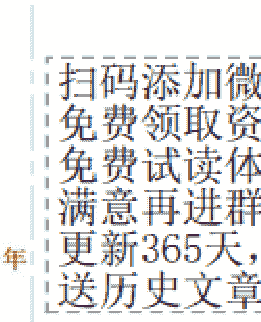

### 三、各种公众付费费享：

金政通、局外的视野、源泽异语、雪花虾老夫、幻幻诸知你、A视野、NEO捞鱼湖、冷眼局中人、观测等五行对股市的粉、财经的小茶馆等，内容丰富，不一而列！

雷涵明、盛世剑剑、第三章视级等各种公众付费费享文章不实时更新，

提升知识学习群包含以上全部内容，加入，赠送历史文章！

加微信：2818363845，提升知识学习群，看更多优质资源
