FT: 一张最近传的图显示，各国央行的黄金超过了美国国债。一下fact check: IMF季度对各国央行进行调查，并发布被引用的《黄金外汇储备结构报告》。从储备最新数据来看，在全球已分配的11.6亿美元外汇储备中，美元占了6.7亿美元，约为58%。

根据美国财政部截至6月的国际资本投资变动报告（TIC），外国投资者持有9.1万亿美国国债，其中黄金占3.9万亿美元外汇储备。

再次黄金，IMF公布了各国央行的黄金储备可能可靠，这也包括黄金在内的储备系列数据，金额高达黄金储备，得到的黄金占比并没有图中所示的28%，但黄金按汇率算出来的比例高达222%。

根据TIC所示的黄金的3.9万亿美元美国国债，仍恰于6月黄金金价计算出的黄金持金市值3.86亿美元。

不过，从6月起，金价上涨了10.5%。世界黄金协会预计各国央行继续增持黄金。即便继续，金价的上涨也将黄金储备总量推至942亿美元。

两者的交叉点是否如正，还需要等到10月10日数据发布才能确认。但非各国央行在7月和8月买入200亿美元美国国债，否则交叉点可能已经迟。

但是指出的，关于央行“撤离”黄金市场的说法可能被夸大了。这两条曲线的交叉，主要是因为2025年以来金价上涨了38%，这本身部分受到央行购买黄金的推动。各国央行的黄金持有量在2009年3月之后，此后一直缓慢增缓慢，没有从官方数据中发现速度加快的迹象，换句话说，各国央行储备的变化是近期价格变化造成的，而不是根本上从规模转向黄金，抛美美元

最后，真的在美债购黄金吗？
确实存在这种趋势。人们将曾对政府经济的短期，与长期以来对美元“武器化”的担忧放在在一起。但实际情况没有图中所示的酷性性。

# 深度视野大文集k255 有温度的高质量社群k255

## Foreign Central Banks Hold More Gold Than Treasuries

Central Banks' Gold vs. US Treasuries Holdings As a % of International Reserves

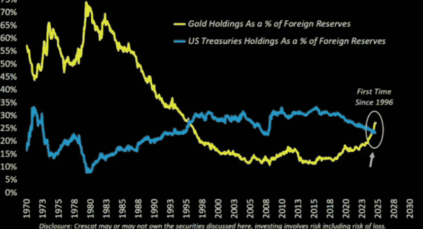

Disclosure: Crescent may or may not own the securities discussed here, investing involves risk including risk of loss.

Source: Bloomberg; Tavi Costa Chart As of 8/27/2025 © 2025 Crescent Capital LLC

The chart © @TaviCosta

Not quite, but almost

Gold share of reserves | US-Tills (TIC)

### Reserve holdings

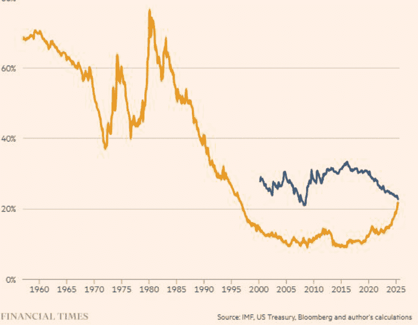

FINANCIAL TIMES | Source: IMF, US Treasury, Bloomberg and author's calculations

| USD | UST | US T-Bills | Gold |
|---|---|---|---|--|
| reserve assets (IMF COFER) | | | | |
| Foreign Official holdings of USTs (TIC) | | | | |
| Central bank gold (end-June) | | | | |
| Central bank gold (September 9) | | | | |

FINANCIAL TIMES | Source: IMF, US Treasury, Bloomberg. End June 2025.

深度视野大V文集cuk255 有温度高质量社群cuk255 watermark

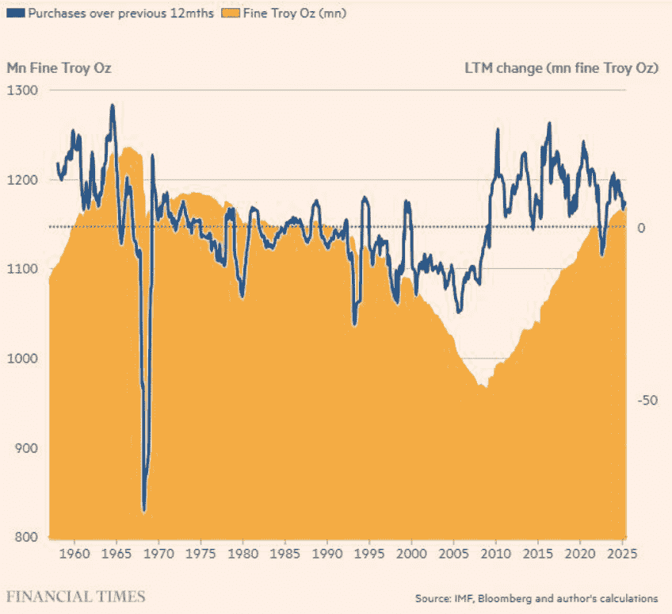

Jason不离

2025-09-10 05:42

**bloomberg: 看来特瑞林对俄罗斯总是很艺术，但对其他就不那么艺术，下手还是很很快#其他国家经济**

由于乌克兰危机爆发，西方国家对俄罗斯实施了严厉制裁，包括将俄罗斯银行踢出SWIFT系统、冻结其外汇储备等。这些制裁措施导致俄罗斯的金融体系面临严峻挑战。为了应对制裁，俄罗斯加大了对黄金和能源出口的依赖。数据显示，2022上半年，俄罗斯黄金出口量在经历下降后有所回升。此外，俄罗斯的出口策略对全球黄金供应格局也产生了影响。

与此同时，由于市场对黄金避险资产的需求增加，俄罗斯的黄金储备价值也面临压力。在复杂的地缘政治背景下，俄罗斯的经济走向和黄金市场表现值得持续关注。

其他国家经济

## 唐纳德·特朗普总统告诉欧洲官员，他愿意对中国征收全面的新关税，以推动弗拉基米尔·普京总统走上与乌克兰的谈判桌——但前提是欧盟国家也这样做。

知情人士透露，特朗普在华盛顿与美国和欧盟高级官员会面提出了这一要求，他要求不透露身份，讨论私下审。其中一位知情人士表示，美国愿意对任何一个国家征收的关税。

鉴于包括匈牙利在内的几个国家曾试图阻止欧盟针对俄罗斯能源部门的更严厉制裁，该提案构成了项挑战。这些措施需要所有成员国的支持。

知情人士并称，美国和欧盟官员讨论的其他潜在措施包括对俄罗斯影子油轮船队实施到位，以及限制其银行、金融部门主要的石油公司。特朗普的建议，首先英国《金融时报》报道，此前普京与乌克兰总统弗拉基米尔·泽连斯基举行双边会会，最后期限已过，但没有迹象表明这位总统月底在阿拉斯加会真的有兴趣面对面的谈判。

相反，莫斯科加强了对乌克兰的袭击，一次袭击造成至少二十名养老金者，他们正在乌克兰东部领取。任何行动将取决于特朗普决定，尽管他已经完成了自我设定的最后期限，但特朗普仍然就结束战争进行谈判，但逗直接惩罚俄罗斯。然而，特朗普已经继续购买石油价格高了，到50%。周两次后，特朗普在社交媒体上发帖，美国和印度继续试图解决贷款问题。他说，期待在未来与我的朋友”总理纳伦德·莫迪交谈。阅读更多：随着平民增加，俄罗斯袭击导致养老金者。

Jason
2023-09-10 05:51

bloomberg: 根据美国周二发布的初步修订，工资发放人数可能会创造纪录的911000人，月均增长为之前的每月149000的一半！之前对月度就业数据大幅调整引发了白宫的慌，并导致特朗普在8月份惊讶了美国劳工统计局。彭博首席经济学家纳克尔人称：修正后的数据反映其实经济退缓特朗普对“雇用高利率”持续到2024年。

根据此份报告，其未来增长需要考虑、特朗普对“雇用高利率”推来的说法没错，最新预测显示特朗普将基率联系为高人为服务。

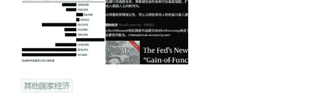

其他国家经济
最后编辑：2023-09-10 06:00

## 寻求合作### 过去几年美国就业标准的规模修订

美国劳工统计局的最新调整2025年3月的就业人数减少了911000人。

| Year | Preliminary payrolls revision for March of that year |
|---|---|
| 2015 | -208,000 |
| 2016 | -150,000 |
| 2017 | 95,000 |
| 2018 | 43,000 |
| 2019 | -501,000 |
| 2020 | -173,000 |
| 2021 | -166,000 |
| 2022 | 462,000 |
| 2023 | -306,000 |
| 2024 | -81,000 |
| 2025 | -911,000 |

资料来源：彭博编制的美国劳工统计数据

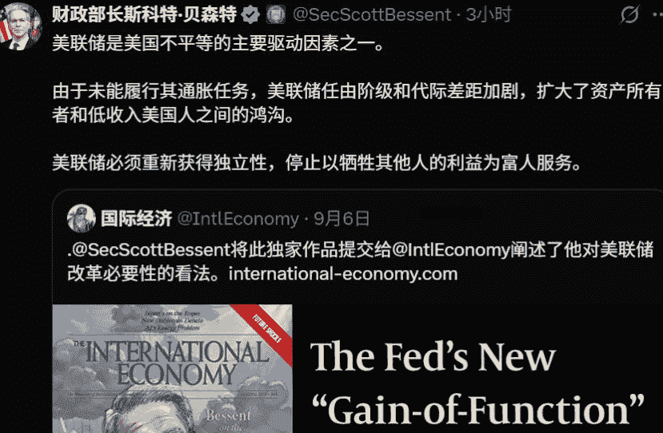

bloomberg: 中国汽车制造的产能远大于产量，导致今年上半年月均价格折扣（不含进口车）在15%至17%之间，为最高。小型参与者的基利攻击让市场领先者亚迪措手使其年度销售额目标下调16%，重创其股价。汽车制造业是经济的支柱，用约560万人，在经济低迷期发挥着核心作用。

经济数据

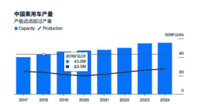

### 中国乘用车产量产能远远超过产量 Capacity / Production

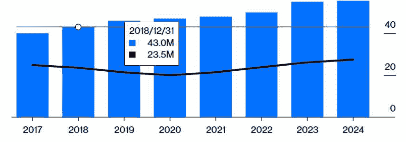

资料来源：盖世汽车、CATARC、彭博资讯

Jason-不咖
2025-09-10 06:14

高葛：黄金在本月已成为投资者最舞头的交易，其受宠程度已经超过了热门股票。当前景资金的规模达到了以来高的水平，看金价走的投资者与空者的比例接近81%，凸市场的情绪极理性。无论市场的多头还是空头，都将做多黄金为首选交易。

推动这一趋势的背后有几个关键因素。其中包括市场对多头情绪即将将带来意的回调周期的预期，对市场独立性持续存在的事实，以及来自各国央行和私人投资者的强烈需求。

三种金价预测：基线预测2026年可能升到4000美元，尾部风险预期下达到5000美元，而更极端情况下若仅1%私人持有性资金流入黄金市场，金价接近5000美元关口。

交易策略 (执行区间)

- 多头关注区域：3626-3632美元 → 目标3660+ | 止损3623美元
- 备用多头区间：3612-3618美元 → 目标3660+ | 止损3608美元
- 逆势空区间：3660-3666美元 → 目标3640-3630美元 | 止损3669美元

- 第一目标：+50点
- 第二目标：+100点
- 第三目标：+150点
- 第四目标：+200点
- 第五目标：浮动停止（根据市场情况灵活调整）

- 第三目标：+150点
- 第四目标：+200点
- 第五目标：浮动停止（根据市场情况灵活调整）

展望与操作行情与宏观经济不确定性继续挤压黄金逻辑。交易者需保持谨慎：过度的涨势往往倾向于回调在低价区间买入，当前策略应侧重回调区间买入。中期来看，若金价持续突破3600美元将打开行情，目标3700美元关口。相反，若跌破3600美元关键支撑，则宣告回调阶段开启。

What is your favorite trade into end year?

- Bearish Risk Assets
- Neutral Risk Assets
- Bullish Risk Assets

Jason-Weiss
2023-09-10 06:22

bloomberg: 将天然气送到中国的项目首可能严格遵循甲烷计划。在过去五年中，天然气出口了国内天然气增长的三分之一，超过了美国对天然气增长的主要来源。在条件下，液化天然气市场将维持美国天然气供应，从而抑制天然气价格。这类似于能源部在其长期预测中将天然气价格高的情况，即2030年和2035年的天然气价格比低25%和37%。美国《华尔街日报》的一份报告称，康菲石油、雪龙和荷牌宣布了规模缩减，但仍可能搁置或退出天然气行业的一个潜在的红信号。到2020年，欧洲改变了产量以重新夺市场份额，此举进一步增加了压力。此水平，原油价格可能会破60美元，并可能长达65美元低于每桶。根据拉斯联的数据，钻井探需要美国项目进行支持。

对美国来说，更关键的是，这将加剧和延续特朗普主导议程。美国已经是世界上最大的液化天然气出口国，并且正在大幅扩张液化产能。能源部长克拉克斯·赖特上周在事务委员会的一次活动中显示，他预计液化天然气将成为该国最大的出口产品。国际能源署去年年底发布的最新展望显示，2023年至2030年间，全球液化天然气需求将增加440亿立方米。然而，供应能力将增加近倍。该行业的最大希望是，随着需求的持续增长和出口能力的繁荣衰减，这种过剩将消除。580亿立方米有效浅等式使这一希望破灭。

Forecast for profits are falling in both the US and Europe

Aggregate consensus net income, fwd-one year ($bn)

Source: FactSet * Europe = BP, Shell, TotalEnergies, Eni and Equinor. US = ExxonMobil, ConocoPhillips and Chevron

Jason不易
2023-09-10 06:36

华尔街：近期未售债券长期有所抬头，但是美国政府的利息支出压力有所缓解。截至今年二季度，未售债券长期升至72个月，触及6个季度以来最高水平，未售债券收益率高达3.3%，利息支出占比升至35%，触及5个季度以来最低水平，其中国内私人部门的利息占占比为9.2%。

另外，拜登政府一直刺激美国国内制造业投资，并基于此创造更多制造业岗位，从企业投资方向上也可以看到制造业投资占比的持续下降。截至今年二季度，制造业占比下降至51.7%，而非住宅投资占比升至.4%，触及3个季度以来最高水平。

### 图3 美国政府支出占GDP比例降至5个季度低点

资料来源：Bloomberg, 创研添

### 图9 铜金价格与美元人民币汇率走势相关度更新

资料来源：Bloomberg, 创研添

Jason-不泡
2025-09-10 06:41

中信建投：今年来人民币汇率跌破7还是比较均衡。年初人民币汇率波动深刻影响出口企业（尤其是利润薄的中小企业）利润。过去两国人民币涨幅非常快，是鲍威尔特朗普回流、中国资产震荡、集中结汇、月中调升等等多重影响结果。这些因素虽在未来仍继续胶，所以短期来看，人民币汇率将有利于秦收。

## 唐纳德·特朗普总统告诉欧洲官员，他愿意对中国征收全面的新关税，以推动弗拉基米尔·普京总统走上与乌克兰的谈判桌——但前提是欧盟国家也这样做。

知情人士透露，特朗普在华盛顿与美国和欧盟高级官员会面提出了这一要求，他要求不透露身份，讨论私下审。其中一位知情人士表示，美国愿意对任何一个国家征收的关税。

鉴于包括匈牙利在内的几个国家曾试图阻止欧盟针对俄罗斯能源部门的更严厉制裁，该提案构成了项挑战。这些措施需要所有成员国的支持。

知情人士并称，美国和欧盟官员讨论的其他潜在措施包括对俄罗斯影子油轮船队实施到位，以及限制其银行、金融部门主要的石油公司。特朗普的建议，首先英国《金融时报》报道，此前普京与乌克兰总统弗拉基米尔·泽连斯基举行双边会，最后期限已过，但没有迹象表明这位总统月底在阿拉斯加会真的有兴趣面对面的谈判。

相反，莫斯科加强了对乌克兰的袭击，一次袭击造成至少二十名养老金者，他们正在乌克兰东部领取。任何行动将取决于特朗普决定，尽管他已经完成了自我设定的最后期限，但特朗普仍然就结束战争进行谈判，但逗直接惩罚俄罗斯。然而，特朗普已经继续购买石油价格高了，到50%。周两次后，特朗普在社交媒体上发帖，美国和印度继续试图解决贷款问题。他说，期待在未来与我的朋友总理纳伦德·莫迪交谈。阅读更多：随着平民增加，俄罗斯袭击导致养老金者。

Jason
2023-09-10 05:51

bloomberg: 根据美国周二发布的初步修订，工资发放人数可能会创造纪录的911000人，月均增长为之前的每月149000的一半！之前对月度就业数据大幅调整引发了白宫的慌，并导致特朗普在8月份惊讶了美国劳工统计局。彭博首席经济学家纳克尔人称：修正后的数据反映其实经济退缓特朗普对“雇用高利率”持续到2024年。

根据此份报告，其未来增长需要考虑、特朗普对“雇用高利率”推来的说法没错，最新预测显示特朗普将基率联系为高人为服务。

### 寻求合作### 过去几年美国就业标准的规模修订

美国劳工统计局的最新调整2025年3月的就业人数减少了911000人。

| Year | Preliminary payrolls revision for March of that year |
|---|---|---|
| 2015 | -208,000 |
| 2016 | -150,000 |
| 2017 | 95,000 |
| 2018 | 43,000 |
| 2019 | -501,000 |
| 2020 | -173,000 |
| 2021 | -166,000 |
| 2022 | 462,000 |
| 2023 | -306,000 |
| 2024 | -81,000 |
| 2025 | -911,000 |

资料来源：彭博编制的美国劳工统计数据

bloomberg: 中国汽车制造的产能远大于产量，导致今年上半年月均价格折扣（不含进口车）在15%至17%之间，为最高。小型参与者的基利攻击让市场领先者亚迪措手使其年度销售额目标下调16%，重创其股价。汽车制造业是经济的支柱，用约560万人，在经济低迷期发挥着核心作用。

### 中国乘用车产量产能远远超过产量 Capacity / Production

资料来源：盖世汽车、CATARC、彭博资讯

Jason-不咖
2025-09-10 06:14

高葛：黄金在本月已成为投资者最舞头的交易，其受宠程度已经超过了热门股票。当前景资金的规模达到了以来高的水平，看金价走的投资者与空者的比例接近81%，凸市场的情绪极理性。无论市场的多头还是空头，都将做多黄金为首选交易。

推动这一趋势的背后有几个关键因素。其中包括市场对多头情绪即将将带来意的回调周期的预期，对市场独立性持续存在的事实，以及来自各国央行和私人投资者的强烈需求。

三种金价预测：基线预测2026年可能升到4000美元，尾部风险预期下达到5000美元，而更极端情况下若仅1%私人持有性资金流入黄金市场，金价接近5000美元关口。

交易策略 (执行区间)

- 多头关注区域：3626-3632美元 → 目标3660+ | 止损3623美元
- 备用多头区间：3612-3618美元 → 目标3660+ | 止损3608美元
- 逆势空区间：3660-3666美元 → 目标3640-3630美元 | 止损3669美元

- 第一目标：+50点
- 第二目标：+100点
- 第三目标：+150点
- 第四目标：+200点
- 第五目标：浮动停止（根据市场情况灵活调整）

- 第三目标：+150点
- 第四目标：+200点
- 第五目标：浮动停止（根据市场情况灵活调整）

展望与操作行情与宏观经济不确定性继续挤压黄金逻辑。交易者需保持谨慎：过度的涨势往往倾向于回调在低价区间买入，当前策略应侧重回调区间买入。中期来看，若金价持续突破3600美元将打开行情，目标3700美元关口。相反，若跌破3600美元关键支撑，则宣告回调阶段开启。

What is your favorite trade into end year?

- Bearish Risk Assets
- Neutral Risk Assets
- Bullish Risk Assets

Jason-Weiss
2023-09-10 06:22

bloomberg: 将天然气送到中国的项目首可能严格遵循甲烷计划。在过去五年中，天然气出口了国内天然气增长的三分之一，超过了美国对天然气增长的主要来源。在条件下，液化天然气市场将维持美国天然气供应，从而抑制天然气价格。这类似于能源部在其长期预测中将天然气价格高的情况，即2030年和2035年的天然气价格比低25%和37%。美国《华尔街日报》的一份报告称，康菲石油、雪龙和荷牌宣布了规模缩减，但仍可能搁置或退出天然气行业的一个潜在的红信号。到2020年，欧洲改变了产量以重新夺市场份额，此举进一步增加了压力。此水平，原油价格可能会破60美元，并可能长达65美元低于每桶。根据拉斯联的数据，钻井探需要美国项目进行支持。

Forecast for profits are falling in both the US and Europe

Aggregate consensus net income, fwd-one year ($bn)

Source: FactSet * Europe = BP, Shell, TotalEnergies, Eni and Equinor. US = ExxonMobil, ConocoPhillips and Chevron

Jason不易
2023-09-10 06:36

华尔街：近期未售债券长期有所抬头，但是美国政府的利息支出压力有所缓解。截至今年二季度，未售债券长期升至72个月，触及6个季度以来最高水平，未售债券收益率高达3.3%，利息支出占比升至35%，触及5个季度以来最低水平，其中国内私人部门的利息占占比为9.2%。

另外，拜登政府一直刺激美国国内制造业投资，并基于此创造更多制造业岗位，从企业投资方向上也可以看到制造业投资占比的持续下降。截至今年二季度，制造业占比下降至51.7%，而非住宅投资占比升至.4%，触及3个季度以来最高水平。

### 图3 美国政府支出占GDP比例降至5个季度低点

资料来源：Bloomberg, 创研添

### 图9 铜金价格与美元人民币汇率走势相关度更新

资料来源：Bloomberg, 创研添

Jason-不泡
2025-09-10 06:41

中信建投：今年来人民币汇率跌破7还是比较均衡。年初人民币汇率波动深刻影响出口企业（尤其是利润薄的中小企业）利润。过去两国人民币涨幅非常快，是鲍威尔特朗普回流、中国资产震荡、集中结汇、月中调升等等多重影响结果。这些因素虽在未来仍继续胶，所以短期来看，人民币汇率将有利于秦收。

## 唐纳德·特朗普总统告诉欧洲官员，他愿意对中国征收全面的新关税，以推动弗拉基米尔·普京总统走上与乌克兰的谈判桌——但前提是欧盟国家也这样做。

知情人士透露，特朗普在华盛顿与美国和欧盟高级官员会面提出了这一要求，他要求不透露身份，讨论私下审。其中一位知情人士表示，美国愿意对任何一个国家征收的关税。

鉴于包括匈牙利在内的几个国家曾试图阻止欧盟针对俄罗斯能源部门的更严厉制裁，该提案构成了项挑战。这些措施需要所有成员国的支持。

知情人士并称，美国和欧盟官员讨论的其他潜在措施包括对俄罗斯影子油轮船队实施到位，以及限制其银行、金融部门主要的石油公司。特朗普的建议，首先英国《金融时报》报道，此前普京与乌克兰总统弗拉基米尔·泽连斯基举行双边会，最后期限已过，但没有迹象表明这位总统月底在阿拉斯加会真的有兴趣面对面的谈判。

相反，莫斯科加强了对乌克兰的袭击，一次袭击造成至少二十名养老金者，他们正在乌克兰东部领取。任何行动将取决于特朗普决定，尽管他已经完成了自我设定的最后期限，但特朗普仍然就结束战争进行谈判，但逗直接惩罚俄罗斯。然而，特朗普已经继续购买石油价格高了，到50%。周两次后，特朗普在社交媒体上发帖，美国和印度继续试图解决贷款问题。他说，期待在未来与我的朋友总理纳伦德·莫迪交谈。阅读更多：随着平民增加，俄罗斯袭击导致养老金者。

Jason
2023-09-10 05:51

bloomberg: 根据美国周二发布的初步修订，工资发放人数可能会创造纪录的911000人，月均增长为之前的每月149000的一半！之前对月度就业数据大幅调整引发了白宫的慌，并导致特朗普在8月份惊讶了美国劳工统计局。彭博首席经济学家纳克尔人称：修正后的数据反映其实经济退缓特朗普对“雇用高利率”持续到2024年。

根据此份报告，其未来增长需要考虑、特朗普对“雇用高利率”推来的说法没错，最新预测显示特朗普将基率联系为高人为服务。

### 寻求合作### 过去几年美国就业标准的规模修订

美国劳工统计局的最新调整2025年3月的就业人数减少了911000人。

| Year | Preliminary payrolls revision for March of that year |
|---|---|---|
| 2015 | -208,000 |
| 2016 | -150,000 |
| 2017 | 95,000 |
| 2018 | 43,000 |
| 2019 | -501,000 |
| 2020 | -173,000 |
| 2021 | -166,000 |
| 2022 | 462,000 |
| 2023 | -306,000 |
| 2024 | -81,000 |
| 2025 | -911,000 |

资料来源：彭博编制的美国劳工统计数据

bloomberg: 中国汽车制造的产能远大于产量，导致今年上半年月均价格折扣（不含进口车）在15%至17%之间，为最高。小型参与者的基利攻击让市场领先者亚迪措手使其年度销售额目标下调16%，重创其股价。汽车制造业是经济的支柱，用约560万人，在经济低迷期发挥着核心作用。

### 中国乘用车产量产能远远超过产量 Capacity / Production

Jason-不咖
2025-09-10 06:14

高葛：黄金在本月已成为投资者最舞头的交易，其受宠程度已经超过了热门股票。当前景资金的规模达到了以来高的水平，看金价走的投资者与空者的比例接近81%，凸市场的情绪极理性。无论市场的多头还是空头，都将做多黄金为首选交易。

推动这一趋势的背后有几个关键因素。其中包括市场对多头情绪即将将带来意的回调周期的预期，对市场独立性持续存在的事实，以及来自各国央行和私人投资者的强烈需求。

三种金价预测：基线预测2026年可能升到4000美元，尾部风险预期下达到5000美元，而更极端情况下若仅1%私人持有性资金流入黄金市场，金价接近5000美元关口。

交易策略 (执行区间)

- 多头关注区域：3626-3632美元 → 目标3660+ | 止损3623美元
- 备用多头区间：3612-3618美元 → 目标3660+ | 止损3608美元
- 逆势空区间：3660-3666美元 → 目标3640-3630美元 | 止损3669美元

- 第一目标：+50点
- 第二目标：+100点
- 第三目标：+150点
- 第四目标：+200点
- 第五目标：浮动停止（根据市场情况灵活调整）

- 第三目标：+150点
- 第四目标：+200点
- 第五目标：浮动停止（根据市场情况灵活调整）

展望与操作行情与宏观经济不确定性继续挤压黄金逻辑。交易者需保持谨慎：过度的涨势往往倾向于回调在低价区间买入，当前策略应侧重回调区间买入。中期来看，若金价持续突破3600美元将打开行情，目标3700美元关口。相反，若跌破3600美元关键支撑，则宣告回调阶段开启。

What is your favorite trade into end year?

- Bearish Risk Assets
- Neutral Risk Assets
- Bullish Risk Assets

Jason-Weiss
2023-09-10 06:22

bloomberg: 将天然气送到中国的项目首可能严格遵循甲烷计划。在过去五年中，天然气出口了国内天然气增长的三分之一，超过了美国对天然气增长的主要来源。在条件下，液化天然气市场将维持美国天然气供应，从而抑制天然气价格。这类似于能源部在其长期预测中将天然气价格高的情况，即2030年和2035年的天然气价格比低25%和37%。美国《华尔街日报》的一份报告称，康菲石油、雪龙和荷牌宣布了规模缩减，但仍可能搁置或退出天然气行业的一个潜在的红信号。到2020年，欧洲改变了产量以重新夺市场份额，此举进一步增加了压力。

Forecast for profits are falling in both the US and Europe

Aggregate consensus net income, fwd-one year ($bn)

Source: FactSet * Europe = BP, Shell, TotalEnergies, Eni and Equinor. US = ExxonMobil, ConocoPhillips and Chevron

Jason不易
2023-09-10 06:36

华尔街：近期未售债券长期有所抬头，但是美国政府的利息支出压力有所缓解。截至今年二季度，未售债券长期升至72个月，触及6个季度以来最高水平，未售债券收益率高达3.3%，利息支出占比升至35%，触及5个季度以来最低水平，其中国内私人部门的利息占占比为9.2%。

另外，拜登政府一直刺激美国国内制造业投资，并基于此创造更多制造业岗位，从企业投资方向上也可以看到制造业投资占比的持续下降。截至今年二季度，制造业占比下降至51.7%，而非住宅投资占比升至5.4%，触及3个季度以来最高水平。

### 图3 美国政府支出占GDP比例降至5个季度低点

资料来源：Bloomberg, 创研添

### 图9 铜金价格与美元人民币汇率走势相关度更新

资料来源：Bloomberg, 创研添

Jason-不泡
2025-09-10 06:41

中信建投：今年来人民币汇率跌破7还是比较均衡。年初人民币汇率波动深刻影响出口企业（尤其是利润薄的中小企业）利润。过去两国人民币涨幅非常快，是鲍威尔特朗普回流、中国资产震荡、集中结汇、月中调升等等多重影响结果。这些因素虽在未来仍继续胶，所以短期来看，人民币汇率将有利于秦收。

## 唐纳德·特朗普总统告诉欧洲官员，他愿意对中国征收全面的新关税，以推动弗拉基米尔·普京总统走上与乌克兰的谈判桌——但前提是欧盟国家也这样做。

知情人士透露，特朗普在华盛顿与美国和欧盟高级官员会面提出了这一要求，他要求不透露身份，讨论私下审。其中一位知情人士表示，美国愿意对任何一个国家征收的关税。

鉴于包括匈牙利在内的几个国家曾试图阻止欧盟针对俄罗斯能源部门的更严厉制裁，该提案构成了项挑战。这些措施需要所有成员国的支持。

知情人士并称，美国和欧盟官员讨论的其他潜在措施包括对俄罗斯影子油轮船队实施到位，以及限制其银行、金融部门主要的石油公司。特朗普的建议，首先英国《金融时报》报道，此前普京与乌克兰总统弗拉基米尔·泽连斯基举行双边会，最后期限已过，但没有迹象表明这位总统月底在阿拉斯加会真的有兴趣面对面的谈判。

相反，莫斯科加强了对乌克兰的袭击，一次袭击造成至少二十名养老金者，他们正在乌克兰东部领取。任何行动将取决于特朗普决定，尽管他已经完成了自我设定的最后期限，但特朗普仍然就结束战争进行谈判，但逗直接惩罚俄罗斯。然而，特朗普已经继续购买石油价格高了，到50%。周两次后，特朗普在社交媒体上发帖，美国和印度继续试图解决贷款问题。他说，期待在未来与我的朋友总理纳伦德·莫迪交谈。阅读更多：随着平民增加，俄罗斯袭击导致养老金者。

## 百城各线城市二手住房均价趋势走势 (元/m²)

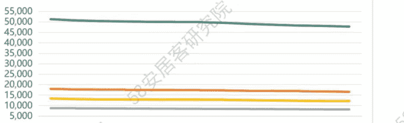

| 城市等级 | 城市 | 均价 | 同比 | 城市等级 | 均价 | 同比 |
| :--- | :--- | :--- | :--- | :--- | :--- | :--- |
| 一线城市 | 北京 | 52061 | -4.30% | 安庆 | 5717 | -9.80% |
| | 广州 | 32148 | -8.15% | 鞍山 | 4417 | -7.57% |
| | 上海 | 48063 | -8.01% | 泉州 | 6394 | -13.32% |
| | 深圳 | 58462 | -7.60% | 海州 | 6414 | -7.34% |
| | 成都 | 15269 | -2.24% | 常德 | 5300 | -6.44% |
| | 东莞 | 16912 | -12.22% | 大庆 | 5225 | -1.76% |
| | 杭州 | 34017 | -3.41% | 大同 | 5381 | -4.42% |
| | 合肥 | 14965 | -15.58% | 德阳 | 5658 | -4.33% |
| | 南京 | 21347 | -5.94% | 东营 | 6639 | -5.45% |
| | 宁波 | 20474 | -10.67% | 赣州 | 8828 | -9.11% |
| | 苏州 | 14933 | -10.11% | 桂林 | 5932 | -3.93% |
| | 天津 | 16066 | -7.07% | 鄂阜 | 9416 | -5.17% |
| | 无锡 | 14593 | -2.87% | 三城市 | 8674 | -6.73% |
| | 武汉 | 11934 | -13.30% | 湖州 | 7771 | -6.99% |
| | 西安 | 13904 | -8.55% | 淮安 | 7214 | -14.58% |
| | 长春 | 10690 | -7.62% | 吉林 | 7384 | -5.89% |
| | 郑州 | 11546 | -9.75% | 江门 | 6659 | -9.24% |
| | 重庆 | 10121 | -9.15% | 昆山 | 15563 | 12.54% |
| | 定州 | 8259 | -9.62% | 益安 | 8252 | -6.67% |
| | 常州 | 15255 | -9.85% | 连云港 | 9444 | -8.48% |
| 二线城市 | 大连 | 12049 | -7.90% | 临市 | 7688 | -10.60% |
| | 佛山 | 12133 | -7.23% | 柳州 | 6584 | -7.53% |
| | 福州 | 20654 | -6.43% | 洛阳 | 7596 | -2.33% |
| | 绍德 | 8080 | -3.00% | 蚌绵 | 7746 | -0.48% |

## 深度视觉大V文集 有温度高质群

国债：长期收益显示，全球范围内年收益率8%-10%左右。其中美债收益率最高，达到10.8%，新兴市场的美元收益率也较高，1988-2021年为10.5%。

我国大型资产的收益率出现回升趋势，2005-2024年，万得全A（权重加分）年收益率为9.8%，沪深300指数（权重加分）的年收益率达到9.0%，以全国房地产销售额以销售面积计算的资产价格化约为6.6%，考虑养老金年收益率为8.2%，其中中国十年内国债收益率为8.9%，商品代表的大宗商品年收益率为4.4%。

虽然市场报告收益率高于美国资产，但波动较大，A股收益表现更为显著。1990年以来趋势性行业的波动幅度（最高/最低-1）指数为35%，7次车年化涨幅幅度为20%，股权价格化波动幅度为32%，A股波动。1990年以来万得全A年度收益幅度为83%，7次车年化涨幅为59%，7次车年化幅度为48%。

市场长期收益率高、波动大，A股收益率低，如何平衡？简单的资产配置模型：投资者在初始阶段配置股票、债券、商品、现金四类资产比例都是25%，若投资组合少于15%或至35%以上，则重置使得每一类资产配置回到初始。

根据这一想法，我们结合中国收益进行分析。采用沪深300指数作为股票，用国债指数作为债券，商品方面，普通投资者熟悉的资产为黄金，按照人民币汇率调整后的现金作为商品。2005年至收益率为8.1%。资产配置的有效是投资组合，回报分为四个阶段。加入名义利率（代表收益）和实际利率（名义利率+通胀）两个指标，动态养成七个阶段，遵循债券收益-股票收益-现金联动。

改进的增强投资策略是我们提供的服务，如果能在投资中配置高比例的收益率较高的资产，低比例的增强资产，配置低比例的通胀资产，可以实现收益的增长和波动率的降低。但是配置需要考虑：

1. 第一，基于投资策略选择经济周期；
2. 第二，根据投资策略对各类资产按不同比例配置高增强资产（如比例为35%），低增强资产（如25%），其他资产（如25%）。
3. 第三，例如在震荡期配置债券35%、股票35%、商品15%、现金15%。

以及后的损失，在期间的收益是有明显的界限的，但分析在真实中和未来还需要通过回测来验证，只有足够的数据来证明从而更容易更新，对于投资的专业性越高。

2005/01/01-2005/06/30期间增强型配置年收益率为8.8%，权益收益率为7%（下同）。从最大回撤来看，2005年以来增强型配置的最大回撤为18.3%，与股市的回撤为-70.8%。2005年以来增强型配置的最大回撤为18.3%，与股市的回撤为-40.7%，高于单配置的回撤为-27.7%，优于单配置组合。

中国过去20年的数据显示，增强资产配置年化收益率为8.1%，增强资产配置年化收益率为9.8%。这两个数字在股市涨起来太快了，居民的盈利点是最终实现收益。股市的收益很高，但波动大，普通的非专业资金更适合持有增强资产，一旦在股市波动过程中操作不当，最终收益可能不可能。增强资产配置回撤为-8.1%-7.4%，优于沪深300的-65.9%。这种配置策略比较稳健，更容易坚持，对于长期资金而言更重要，因为复利的力量很大。比如为20年后孩子储备或自己养老，假设需要500万，按每月投入8844元（7251元），按年化收益8.1%计算。

## 深度视野大集 有温度高质群

### 图1：1990-2020年不同国家股票和债券实际化收益率
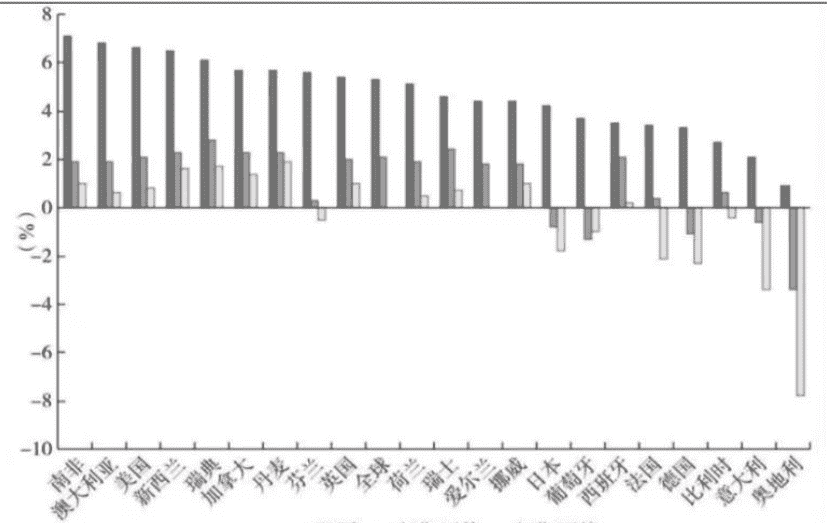
数据来源：西格尔《股市长线投资法》，国信证券研究所整理

### 图2：美国股票长期收益优于其他国家产
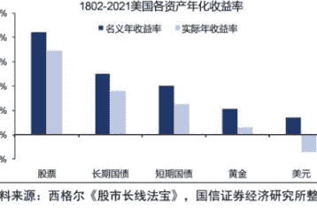

### 图3：考虑分红后2005-2024年美国类资产年化收益率
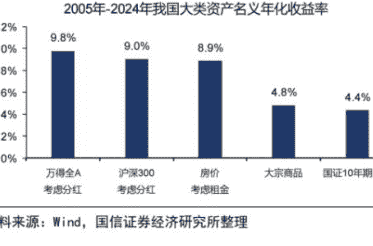
数据来源：西格尔《股市长线投资法》，国信证券研究所整理
数据来源：Wind，国信证券研究所整理

### 图8:简单资产组合再均衡模型分析

| 初始配置 | 触发条件 | 再平衡 |
| :--- | :--- | :--- | :--- |
| 股票: 25% | | 股票: 35% | 调整资产比例 |
| 债券: 25% | 触发条件1:任意资产占比到35% | 债券: 30% | 股票: 25% |
| 现金: 25% | | 现金: 20% | |
| | 触发条件2:任意资产占比到15% | 商品: 35% | |
| | | 现金: 25% | |
| | | 商品: 25% | |
| | | 股票: 15% | |
| | | 债券: 15% | |
| | | 商品: 20% | |
| | | 现金: 30% | |
| | | 商品: 25% | |
| | | 现金: 35% | |

### 图10: 美林投资时钟的阶段划分

#### 通胀上升
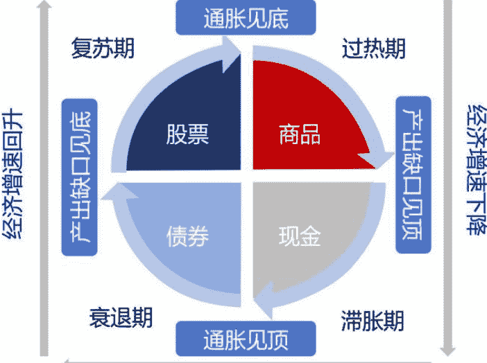
#### 通胀下降
数据来源：Merill Lynch, 国信证券研究所

增长和通胀的定义为若干阶段，但是政策生效后，我们将衰退分为衰退前期（阶段①）和衰退后期（阶段②）。衰退前期启动，并延续至衰退期，即通胀：阶段①→②。衰退后期上涨，并延续至过热期，即股市：阶段②→③。随着政策生效，我们将衰退期划衰退前期（阶段③）和衰退后期（阶段④），即实际利率（名义利率）。见顶后，进入过热期，即股市：阶段⑤→⑥。政策生效一段时间，经济开始转向后期，但通胀按照速度分为慢前期（阶段⑦），由于通胀的增长而回升。通胀以现金为主。

### 图1：改进通胀的阶段划分
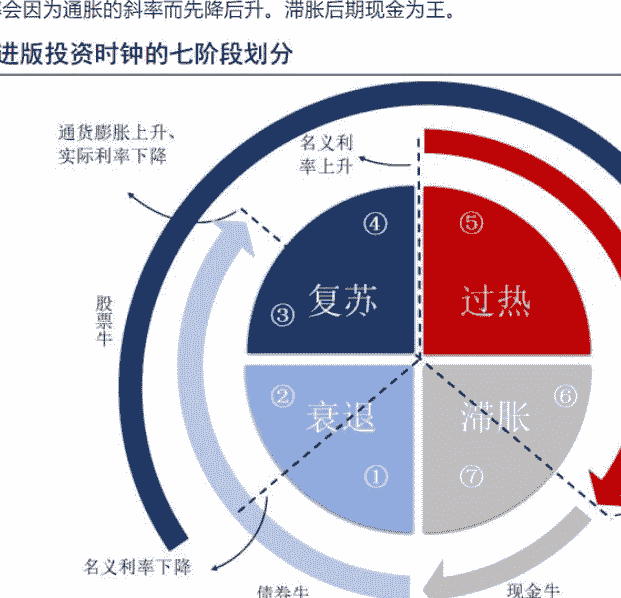
资料来源：国信证券研究所

### 表4：1973/4-2004/7 美国各阶段大类资产收益率

| 经济周期 | 债券 | 股票 | 大宗商品 | 现金 |
| :--- | :--- | :--- | :--- | :--- |
| 回退 | 9.8% | 6.4% | -11.9% | 3.3% |
| 复苏 | 7.0% | 19.9% | -7.9% | 2.1% |
| 过热 | 0.2% | 6.0% | | 1.2% |
| 通胀 | -1.9% | -11.7% | 28.6% | -0.3% |
资料来源：Merill Lynch，国信证券研究所整理

### 表5：改进模型框架下经济表现（区间通胀，%）

| 经济阶段 | 债务 | 股票 | 商品 | 现金 |
| :--- | :--- | :--- | :--- | :--- |
| 回退前期 (①) | (中10年国债指数划分) | (万全部划分) | (南华商品指数划分) | (货币基金指数划分) | 2.2 |
| 回退后期 (②) | 3.6 | -23.8 | -17.1 | 1.9 |
| 复苏前期 (③) | 7.4 | 32.8 | 16.1 | 1.5 |
| 复苏后期 (④) | -1.2 | 14.4 | 8.3 | 1.6 |
| 过热期 (⑤) | -1.0 | 31.5 | 28.4 | 1.9 |
| 通胀前期 (⑥) | 2.4 | -10.7 | 6.0 | 2.2 |
| 通胀后期 (⑦) | 2.6 | -18.8 | 4.2 | 2.2 |
资料来源：Wind，国信证券研究所整理，整体区间为 04/12-25/06

### 表6：改进版投资时钟分类详情

| 阶段 | 起点 | 终点 |
| :--- | :--- | :--- |
| 第一轮 | 复苏前期③ | 04/12 | 06/04 |
| | 复苏后期④ | 06/04 | 07/03 |
| | 过热期⑤ | 07/03 | 07/10 |
| | 滞胀前期② | 07/10 | 08/03 |
| | 滞胀后期⑦ | 08/03 | 08/07 |
| 第二轮 | 衰退前期① | 08/07 | 08/09 |
| | 衰退后期② | 08/09 | 09/03 |
| | 复苏前期③ | 09/03 | 09/07 |
| | 复苏后期④ | 09/07 | 10/01 |
| | 过热期⑤ | 10/01 | 11/03 |
| | 滞胀前期⑥ | 11/03 | 11/06 |
| | 滞胀后期⑦ | 11/06 | 11/08 |
| 第三轮 | 衰退前期① | 11/08 | 11/11 |
| | 衰退后期② | 11/11 | 12/09 |
| | 复苏前期③ | 12/09 | 13/05 |
| | 复苏后期④ | 13/05 | 13/11 |
| | 衰退前期① | 13/11 | 14/04 |
| | 衰退后期② | 14/04 | 15/12 |
| 第四轮 | 复苏后期④ | 15/12 | 16/08 |
| | 过热期⑤ | 16/08 | 17/03 |
| | 滞胀前期⑥ | 17/03 | 17/08 |
| | 滞胀后期⑦ | 17/08 | 18/02 |
| | 衰退前期① | 18/02 | 18/10 |
| | 衰退后期② | 18/10 | 20/03 |
| 第五轮 | 复苏前期③ | 20/03 | 20/05 |
| | 复苏后期④ | 20/05 | 20/10 |
| | 过热期⑤ | 20/10 | 21/02 |
| | 滞胀前期⑥ | 21/02 | 21/10 |
| | 滞胀后期⑦ | 21/10 | 22/06 |
| 第六轮 | 衰退前期① | 22/06 | 22/10 |
| | 衰退后期② | 22/10 | 22/12 |
| | 复苏前期③ | 22/12 | 23/06 |
| | 复苏后期④ | 23/06 | 24/02 |
| 第七轮 | 衰退前期① | 24/02 | 24/09 |
| | 衰退后期② | 24/09 | 25/06 |
资料来源：Wind，国信证券研究所整理

## 增强版产品配置思路

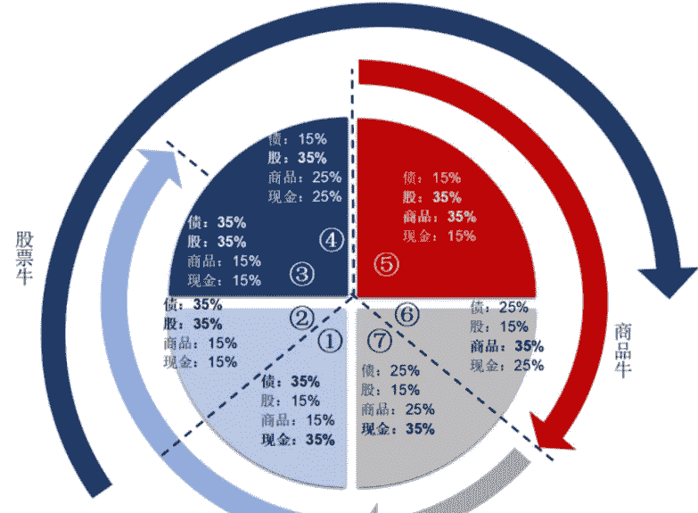

刘尚希：在高质量发展，经济增长成为当前的主要任务，只有保持一定的经济增长，名义增速达到5%以上，财政收入、企业经营和工资才有空间。财政政策要更加积极，货币政策要更加宽松，其首要在于实现增速，这是一个关键的节点。

当前宏观环境复杂，中国经济面临需求不足、供给性结构调整、外需压力等多重压力。外部环境更加严峻复杂，一方面是地缘政治冲突加剧、贸易保护主义抬头，另一方面是全球经济复苏低迷。从总体来看，我们面临的困难是长期性的、艰性的、复杂的，但我国总体是向好的、韧性的、可控的。面对国际形势的严峻性，我们正面临着前所未有的重大挑战，但我们有信心有底气。

在当前形势下，我们要保持战略定力，增强政策效力，做到精准发力。既要扩大政策空间，又要增强政策力度。虽然形势复杂，但我们有准备、有能力、有办法，有克服一切困难的信心。

我们要坚持做好长期经济规划，统筹发展和安全，在防范风险的同时，确保经济平稳健康增长。当前和未来，都是充满挑战的时期，这也是一个关键的考验。

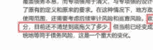

## 深度视野大集 有温度高质社区

从2024开始，中央下了一揽增量政策，其重心发生了巨大的转变。对于财政预算认知的转变变为“三个变化”：其一，政府不再为债务负责，债务与风险不再对钩。在经济运行下行的压力下，债务不能还要增加，如果债务风险不断推高，通胀压力会越缩越小，反而加大风险。当前，地方政府的压力一部分来自于自身。

# 25-54yr/old Population, 25-54yr/old Employees Marketable Federal Debt, ...Change per Period

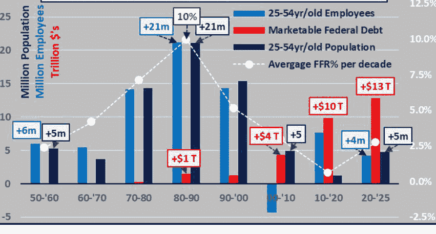

Jason/不能
2025-09-10 12:24

# 《好用的博论》论文或书籍推荐

捕鼠公司的广告：我想让你们过上更好的的生活，没有老鼠。真的当没有老鼠的时候，公司为了生存，又会去购买老鼠来跑在路上。

- 《好用的博论》谭斌一.pdf

《好用的博论》是著名的人学专家、社会学者谭斌一教授的作品。谭斌一教授在书中对中国当代的人际关系和社会问题进行了深刻的观察和分析。他试图通过这本书，帮助读者理解我们在社会生活中的各种困惑，并提供一些实用的建议和指导。

论文或书籍推荐

博论推荐：2025.9.10 12:24

深视视大V文集cuk255 有温度高质社群cuk255

家庭也是一个小，小不不起的社会。除了在现实生活中接触到的社会形态，还有通过互联网将一切联系在一起的社会形态。

所谓社会，就是人与人之间会产生某种联系的。

身处社会中的我们常常会忽略一件事，那就是除了我们自己，社会中其他人也在思考、在烦恼着。我们总是感觉，好像只有自己人在烦恼焦虑。

我们有一门学科的研究对象就像我们一样思考并烦恼着的人。它研究人们在各自的社会中是如何思考，做出一些决策的。这门学科被称为“博弈论”。

事实上，人们常用博弈论来分析隐藏在我们日常生活各个角落的各种问题。运用博弈论就可以分析这种小范围内的问题，也可以分析更为复杂的问题，比如股票买卖、政治团体的利益。

无论是经济问题、社会问题、商业问题，还是人关系问题等，博弈论都能给我们提供一些启示。当面对这些问题时，如果不懂博弈论，如同没有指南就开始航海一样。所以，将博弈论看作大学经济理论中最重要的部分也不过是为了任何经济学理论都多或少以博弈论的思维方式为基础。

1. 在社会中思考时，重要的是思维在做些什么、想什么。这不仅是故事中的关键所在，也是设定故事舞台、确定主题的依据。

2. 本书涉及许多大数博弈研究者所认同的、在博弈论中为重要的话题。

3. 博弈论广泛应用于经济学、政治学，本书中所涉及的话题不仅具有极高的理论价值，同时也具有重要的应用价值。例如，在本书的第一章中述了让位于委员会博弈的经过。故事运用的博弈论理论对政治的分析产生了巨大的影响。

4. 为了有效传递博弈论的精髓，本书没有选择与国家政策、税金等相关的“大社会”问题，而是选择了浅显易懂的“小社会”问题。需要说明的是，无论问题是否是社会问题，我们需要的思考方法是相同的。虽然在文中提到本书并不是教科书，但我仍希望通过故事，让读者对博弈论产生兴趣。因此，为了让读者理解每个故事隐含的知识，我在每章的结尾处添加了“博弈论工具”，用于对本章的内容与博弈论的关系进行更为详细的解答。若在此基础上再次看一遍故事，也是一种乐趣吧！

深度视野大文集cuk255 有温度高质社群cuk255

读了《博弈论》之后，感受如何呢？通过本书的六个故事，你对于“社会中的思考”是不是产生了不同的看法？每个故事中出现的形式，都是基于博弈的研究成果得到的。希望故事末尾部分的“博弈论工具”能让你感受到这些故事背后的原理。如果你想从不同的角度去了解博弈论，应该怎么做呢？首先想推荐我的著作，《博弈论入门》。这是一本尽可能系统且易懂地解释博弈论的书籍，或许会让读者……

接下来要介绍的不是书，而是一部电影——1957年的美国电影《十二怨》。这是一部悬疑电影，讲述了12名陪审员通过讨论达成意见。《十二怨》是一部被多次改编的作品，有电影、电视、剧本等多种版本。或许很多读者知道这部电影，但如果从故事中主角在委员会投票的基础上，那么再看这部电影的话，你可能会有不同的看法。自己在理解辩论的时候读过这个剧本，好像是在高中的时候，为了介绍这部电影，我又看了一遍，重复阅读很有趣。

如果你想用这类书与不同的方法进入学习世界，推荐你阅读刘野涛的《思考！》。这本书是从哲学的角度讲述“思考”与读者关系的，书中也有非常棒的插图，虽然我认为是一个“思考”专家，还是从这本书里学了很多。

正如我在前景中提到的，博论是经济学的一部分。当然，经济学还涉及其他领域，特别是“社会中的数据”这一重要内容。如果您读了本书后对经济学产生了兴趣，不妨试着了解一下经济学书籍我想推荐伊藤公一的《数据分析的力量：探索因果关系的思考方法》，这是一本难的好书，作者通过自己的研究，浅描述了数据分析的方法。

最后我们将视线回到博论领域。我在第三个故事“博弈论工具”中介绍了重复博弈。我最后要介绍的是一位活跃在该理论前沿的学者，《微观经济学的力量》。作为世界闻名的博论理论家，他一位能够均衡分析并解释博论的理论知识而名于世。我把这本由他编写的微观经济学教科书推荐各位读者。

## 深度视野优质圈（优质社群，助你成功）

全部包含以下内容：限时年费188/年 加微信cuk255

- 吃瓜群众倍帝圈加时群对话（原价 365 元/年）
- 子明私享汇（含）内部文章
- 政事室（顾子明）付费内容加送额外顾子明群
- 米联储寂美【作者米安】（原价 599 元/年）
- 欧洲金雀会员专属文章（原价 328 元/年）
- 砖瓦折内部圈（原价 400 元/年）
- 卢克文青读书会专属文章（原价 699 元/年）
- 鉴茶财经知识星球（原价 3310 元/年）
- 猫哥的视界知识星球文章（原价 299 元/年）
- 财经新周【独家新闻】（原价 1498 元/年）
- 杨世光在金圈（原价 2200 元/年）
- 森淼财经知识星球（原价 1600 元/年）
- 激赛异译付费文章（持续更新）
- 司马林解读毛选全套音频和全套书籍无割（原价 2.3 万）
- 虚三三曲[民国梦、帝国战争、不被理解的MAO]（原价 599 元）
- 卢祺知识星球文章（原价 268 元/年）
- 额外再送：卢祺元新微博付费专栏、三村边老王、三花九洞文集
