# Jason-不遇

2025-09-11 03:15

zerohedge: 8月美国PPI意外下降，环比-0.1%，数据发布后，交易加大了对美联储降息的押注，与美联储政策领先密切的两年期美国国债利率下降3个基点至3.52%。但对预期将发布的CPI将会上升，特格施称：“没有通胀！”鲍先生必须立即大幅暂停。鲍威尔简直是个灾实，他什么都不准确！!! #其他国家经济

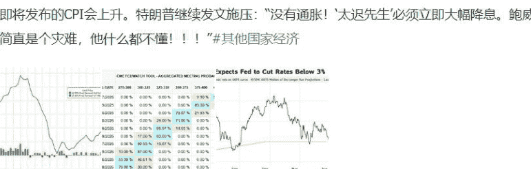

## 其他国家经济

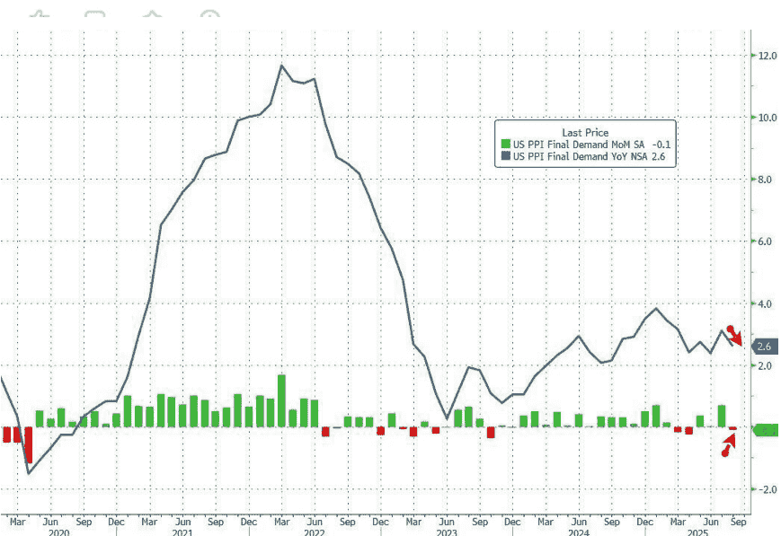

微信：2818363845，提升知识学习群，看更多优质资源

| MEETING DATE | 275-300 | 300-325 | 325-350 | 350-375 | 375-400 | 400-425 |
|---|---|---|---|---|---|---|
| 9/17/2025 | 0.00 % | 0.00 % | 0.00 % | 0.00 % | 9.90 % | 90.10 % |
| 10/29/2025 | 0.00 % | 0.00 % | 0.00 % | 78.07 % | 89.00 % | 11.00 % |
| 12/10/2025 | 0.00 % | 0.00 % | 29.00 % | 71.00 % | 21.93 % | 0.00 % |
| 1/28/2026 | 0.00 % | 0.00 % | 85.97 % | 14.03 % | 0.00 % | 0.00 % |
| 3/18/2026 | 0.00 % | 0.00 % | 83.00 % | 0.00 % | 0.00 % | 0.00 % |
| 4/29/2026 | 0.00 % | 17.00 % | 0.00 % | 0.00 % | 0.00 % | 0.00 % |
| 6/17/2026 | 0.00 % | 80.93 % | 19.07 % | 0.00 % | 0.00 % | 0.00 % |
| 7/29/2026 | 13.00 % | 87.00 % | 0.00 % | 0.00 % | 0.00 % | 0.00 % |
| 9/16/2026 | 53.39 % | 46.61 % | 0.00 % | 0.00 % | 0.00 % | 0.00 % |
| 10/28/2026 | 70.00 % | 30.00 % | 0.00 % | 0.00 % | 0.00 % | 0.00 % |
| 12/9/2026 | 84.09 % | 15.91 % | 0.00 % | 0.00 % | 0.00 % | 0.00 % |

# Bond Market Expects Fed to Cut Rates Below 3%

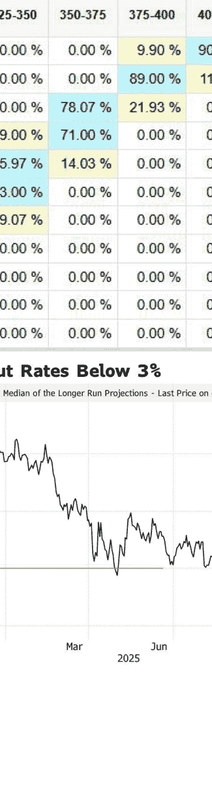

微信：2818363845，提升知识学习群，看更多优质资源

# Jason-不遇

2023-09-11 03:18 bloom：尽管中国CPI再次破零，但中国的PPI萎缩六个月首次缓解——8月份生产者指数下跌2.9%，连续5个月处于负值，较7月份降幅3.6%有所收窄。市场对该数据的反应平稳。中国30年国债收益率在2%左右变化不大，人民币对美元维持平稳。

## 中国看到通缩压力缓解的早期迹象

随着食品成本下降，消费者价格增长至零。月度CPI（同比）、核心CPI（同比）、中国PPI对比来源：国家统计局微信：2818363845，提升知识学习群，看更多优质资源

# Jason-不遇

2025-09-11 03:21 国盛：8月PPI结束连续8个月下行，持平季节性均值（近十年同比为-0.1%）。归因于8月PPI同比，但价格攀升后回落，主要有两点支撑：一是“反差”导致煤、玻璃等行业价格上涨，由于原料开采、煤炭加工、黑色胶漆、玻璃造成整体涨；二是宏观因素，2024年8月PPI同比回落一个点。此外，国际油价导致石油价格下跌，出口占比回落反映关税冲击下出口需求“以量换量”，如汽车和出口设备价格环比下降0.2%、9月CPI可能为负，上半年仍受制于，预计明年内PPI大概收窄，但出口价格低迷，产量仍瓶颈，消费需求仍制约，预计明年内低位震荡、难以中枢。全年可能在-2%左右。

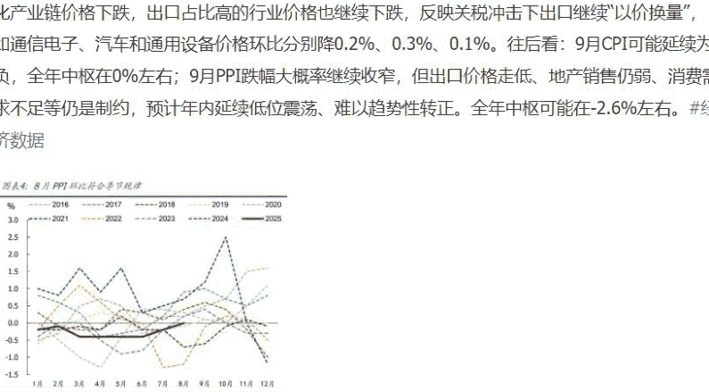

图表4：8月 PPI环比符合季节规律

| | 2016 | 2017 | 2018 | 2019 | 2020 | 2021 | 2022 | 2023 | 2024 | 2025 |
|---|---|---|---|---|---|---|---|---|---|---|

资料来源：Wind，国盛证券微信：2818363845，提升知识群，看更多优质资源

## Jason-不离

2025-09-11 03:23 行业：近一年上涨的50.66%中，股息贡献1.85%，盈利贡献6.5%，无风险利率贡献14.1%，风险溢贡献28.2%。近一年指指数上涨的55.47%中，股息贡献2.99%，盈利贡献10.56%，无风险利率贡献25.34%，风险溢贡献16.59%。

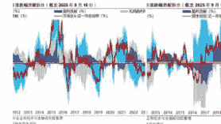

图1、全A近一年涨幅贡献拆解（截至2025年9月10日）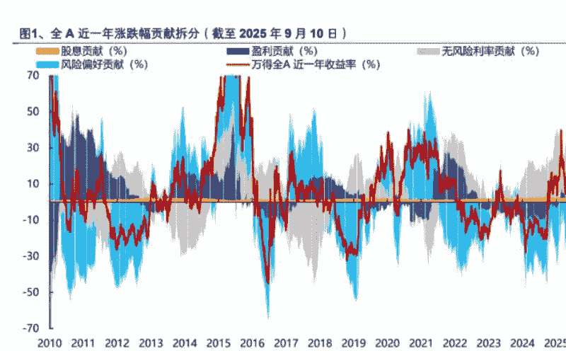 数据来源：Wind，江苏证券经济与金融研究院整理注：为画面效果，纵轴不完全显示微信：2818363845，提升知识学习群，看更多优质资源

## 图2、恒生指数近一年通胀贡献拆分（截至2025年9月10日）

| 股息贡献 (%) | 膨胀贡献 (%) | 风险偏好贡献 (%) | 恒生指数近一年收益率 (%) |
|---|---|---|---|

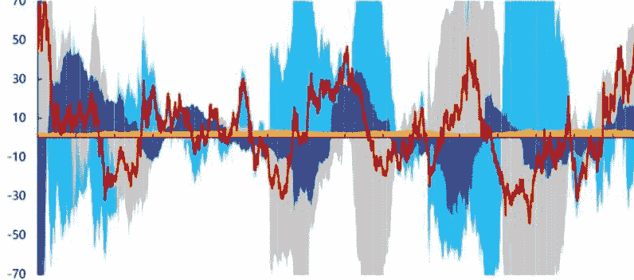 数据来源：Wind，华泰经济与金融研究部整理注：作为操作数据，可能未完全显示

## Jason均

2025-09-11 03:27 Statista: 从2021年1月到2025年7月，美国平均时通胀增长了21.8%。与此同时，同期消费者价格指数（CPI）上涨了22.7%，实际工资（经过通胀调整后的金额）累计下降了0.7%。自2023年5月以来，出现了通胀——以名义工资再次超过通胀，导致实际工资上涨。这还不足以2021年开始的通胀中完全恢复过来。其他国家经济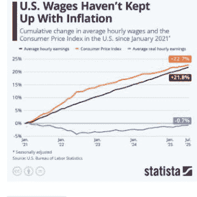 其他国家经济微信：2818363845，提升知识学习圈，看更多优质资源

## U.S. Wages Haven’t Kept Up With Inflation

Cumulative change in average hourly wages and the Consumer Price Index in the U.S. since January 2021*
- Average hourly earnings
- Consumer Price Index
- Average real earnings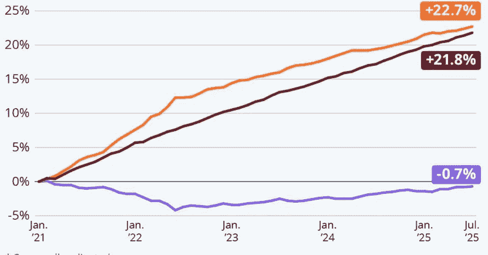 *Seasonally adjusted Source:U.S. Bureau of Labor Statistics

## Jason-不离

2025-09-11 03:30 华章：自7月以来，在内政策的影响下，光伏行业价格反弹，7月份至今，光伏价格指数上涨25%，品种中硅片、多晶硅、电池片和组件上涨了37%、23%。商品市场中，多晶硅连续涨幅达65%。根据历史数据，光伏价格指数同比涨1%，电池片及控制设备同比涨0.1%。我们估计，从2022年的高点至6月的低点，光伏价格指数累计下跌80%，对PPI基数的拖累0.2%，而在期间，PPI基指数下跌了7%。如果在内政策带动下，光伏行业价格翻倍，对PPI基指数的影响约为0.3%。img/b231a1139ab69b89a923359ff28f5_7_0.png) 图表1 7月以来，光伏价格反弹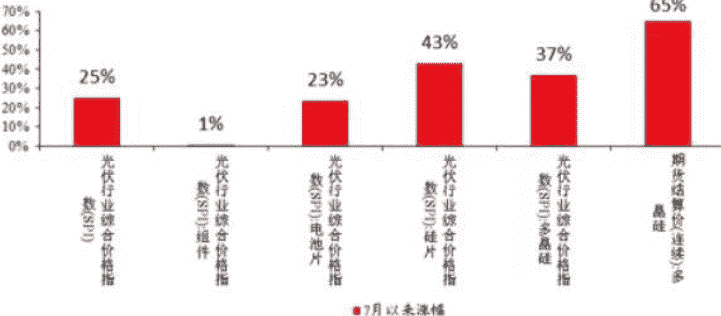 资料来源：Wind，华创数据微信：2818363845，提升知识学习群，看更多优质资源

## 图表2 行业价格与配电行业制造的对比趋势 # 图表3 行业价格与配电行业制造的数据关系img/bcf7231a1139ab69b89a923359ff28f5_8_0.pngimg/bcf7231a1139ab69b89a923359ff28f5_8_1.png)

- 中国2023年PPI配电行业制造指数同比
- 光伏行业组件指数（同比）同比（%）
- 光伏价格指数（SPI）对比，来源：Wind，行业报告数据来源：Wind，行业报告；图中数据为2021年8月数据不难

zerohedge: 8月美国NIX乐观指数升至100.8，利润创2023年3月以来的最高水平，平均短期利率降至8.1%，为2023年5月以来的最低水平，随着计划在未来三个月内上涨的企业越来越少，特朗普关税禁令的影响正在迅速消失#其他国家经济img/bcf7231a1139ab69b89a923359ff28f5_8_2.png 其他国家经济img/bcf7231a1139ab69b89a923359ff28f5_8_3.png) # PRICES Actual Last Three Months and Planned Next Three Months January 1986 to August 2025 (Seasonally Adjusted)img/bcf7231a1139ab69b89a923359ff28f5_8_4.png) 加微信：2818363845，提升知识学习群，看更多优质资源

## Jason-不是

2025-09-11 03:35 bloomberg: 中国今年将超越美国成为世界上最大的天然气进口国，因为它加大了从俄罗斯的进口。根据俄罗斯Energy的数据，今年中国的管道气进口量将升至790亿立方米，德国的进口量少于710亿立方米。2024年分别为700亿和710亿立方米。相比之下，根据彭博今年编制的船舶数据，今年中国对液化天然的需求偏软，中国可能会在2025年失去对日本最大进口国的地位。中国石油储备似乎也不在增加。如果没有中国的采购，石油需求将锐减img/bcf7231a1139ab69b89a923359ff28f5_9_0.png) # 2024年全球最大的天然气净进口国 数字以十亿立方米为单位

| Top LNG importers | | | |
|---|---|---|---|
| China | 105 | Germany | 71 |
| Japan | 89 | China | 70 |
| South Korea | 89 | Mexico | 67 |
| India | 36 | Italy | 44 |
| Chinese Taipei | 30 | Turkey | 39 |
| France | 26 | UK | 31 |

资料来源：IGU; Rystad 的2025年全球天然气报告微信：2818363845，提升知识群，看更多优质资源 # 2025年石油储备稳步升下跌的时期提供了买入img/bcf7231a1139ab69b89a923359ff28f5_10.png) + Onshore commercial and strategic inventories资料来源：Kpler注：SPR库存的水平基于现有的市场预测。Jason-不离

2025-09-11 03:39 均值9日平均指数再度触及历史最高，股市延续了美股创新高的走势。这可能受益于从2025年增长率上调至7.1%。但是国际投资者仍然远离市场。8月外机构净出股票占比接近20年来的低点，卢比也面临贬值的压力，9月美元创历史最低，菲律宾在低位区间。FT:复杂的投资路径不如简单的60/40img/bcf7231a1139ab69b89a923359ff28f5_11_0.png) 冯鸿:这个策略略没毛。有些地方的二级市场是个变现黑洞，巴哈特加微信：281836845，提升知识圈，看更多优质资源 在投资这个行业，人类往往高估了自己的能力，无论是专业人士还是基金经理，都是普通投资者。大家都有自己的执着，觉得自己的东西比别人更聪明、更靠谱，但能否带来更好的回报？最近《华尔街日报》做了对比，经典的60/40组合（60%股票+40%债券）拉出来和几个其他“平衡资产策略”，结果如何？过去去年，60/40组合的回是6.89%，而瑞基金还是亏了钱。再看看其他策略，把资产分成四份（股票、债券、大宗商品、现金）的“永久组合”，长期的年化回报只有4.5%，而那些“安全”的30/70组合（30%股票+70%债券）的回也只有5.5%，且不包含暴跌，长期胜在60/40或许就是“保守式”的赢家。这让我想起一个生活的类比：投资的就像一顿满汉，有山珍味，有光荣，单一种是不行的，必须有变化，用一锅的常常胜以往。关键在于多样化，单靠不能预期长期的回报为投资带来收益。具有持有资产会被配置，一些大机构，优美的美国股票、大学基金，其实是他们的“老实”。一个经理研究了美国股票和债券在2008-2023年的长期回报：表现平均年化回报6.89%，而与其风险匹配的市场波动高达78.4%的长期回报。大学基金年化回报6.88%，而与其风险匹配的策略组合回报为9.22%。差别虽然只有1-2个点，但长期持有14年后，结果如此，研究者发现，这些策略反而造成了成本，而在最终的收益表现中是现在的1.5%。也就是说，那些所谓的“资产配置”可能反而造成了投资者的“推撤”。这背后的世界其实不投资，市场本身已经变得复杂，充分了人类的耐心和恐惧，人类的判断能力有限，总是想要规律，用规律来寻找财富，然而往往在双倍中收获，结果是，投资者在不确定性中搜得利润，终是这样的结论，但还是如此回报。大多数投资者，60%股票+40%债券的投资组合，看似有些。
## GDP平减指数连续9个季度为负

财经：GDP平减指数连续9个季度为负，创史长纪录，截至2025年7月，我国出口价格指数连续26个月增长，同时实体部门行为微观转型风险最小化。内卷并非非充分要素化的跨度竞争，而是社会“不平等竞争不充分”主要源于微观层面的集中。本轮内卷竞争的需求在于需求不足，且2024年上市企业盈利率仍未达到2016年的刚以上，显示企业面临的压力更为严重。地方政府“越位”干预市场扭曲资源配置，又增加存量负担，是本轮内卷竞争的重要性，其深层原因在于能力下降导致的短期套利，以及行业考核体系对市场扩张的路径依赖，必须对体制进行改革，有效约束政府“有形之手”，让市场“无形之手”真正发挥决定作用。其中，税制改革与绩效评价体系化是首项核心环节。

记者财经数据报告：2023-08-3

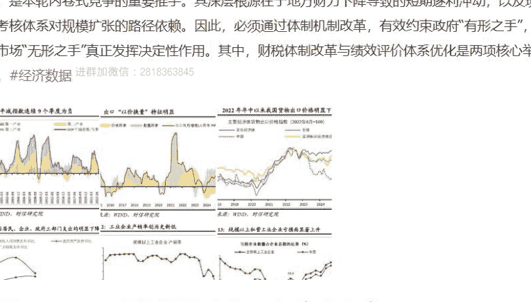

图 1：GDP平减指数连续9个季度为负

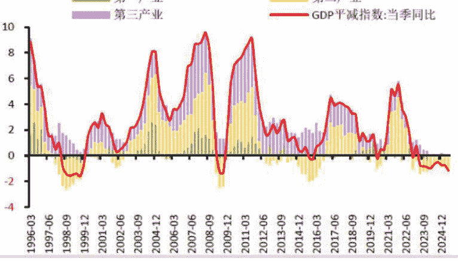

资料来源：WIND，财信研究院

加微信：2818363845，进阶知识群，看更多优质资源

## 图 4: 出口“以价换量” 特征明细

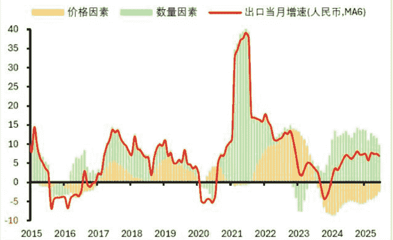

资料来源:WIND, 财信研究院

## 图 5: 2022 年以来我国货物出口价格指数明显下降

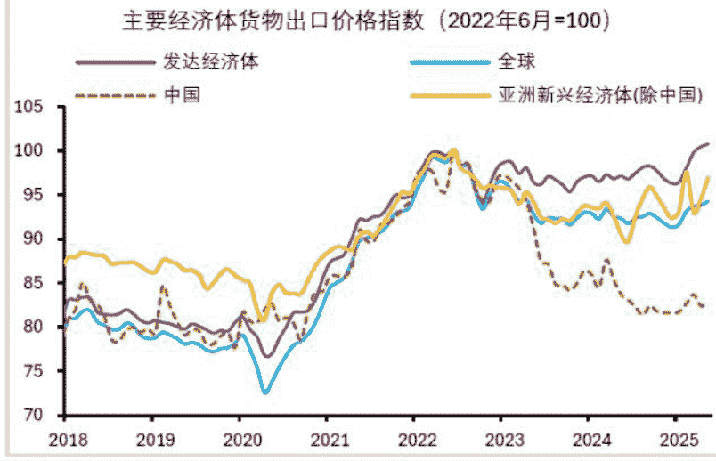

资料来源：WIND, 财信研究院

## 图 6：疫后居民、企业、政府部门支出三均明显下降

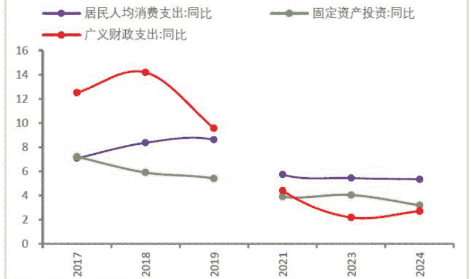

资料来源：WIND, 财信研究院

注：2021年、2023年为两年半平均值

## 图 12：工业企业产销率创新低

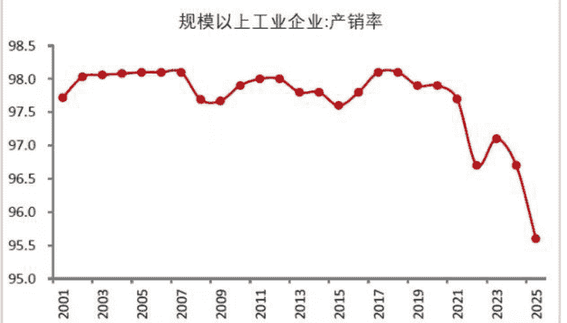

资料来源：WIND, 财信研究院

注：2025年为1-6月份数据

## 图 13：规模以上私营工业企业亏损面显著上升

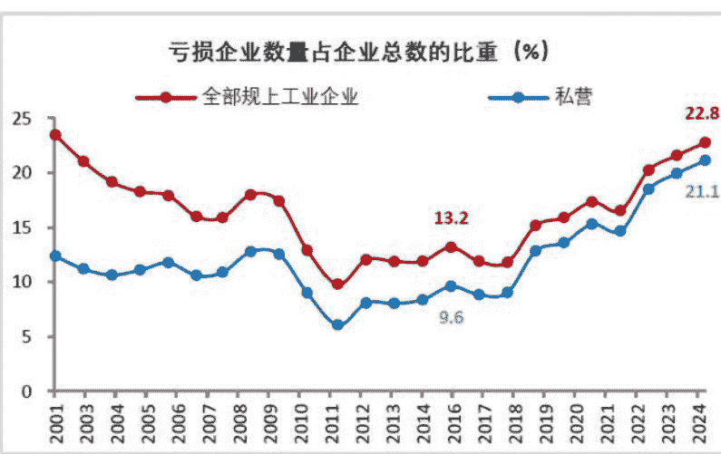

资料来源：WIND, 财信研究院

注：2007-2010年为1-11月数据

## 图 19：高技术制造业与传统制造业 PPI 价格指数

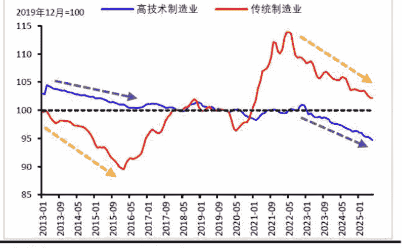

资料来源：WIND, 财信研究院

## 国达：2025年第36期，全国二手房挂牌价环比-0.36%#房价

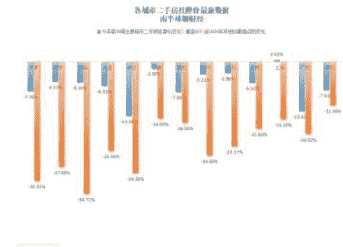

最后更新：2025-09-11 04:04

## 各城市：二手房挂牌价最新数据 南优球财经

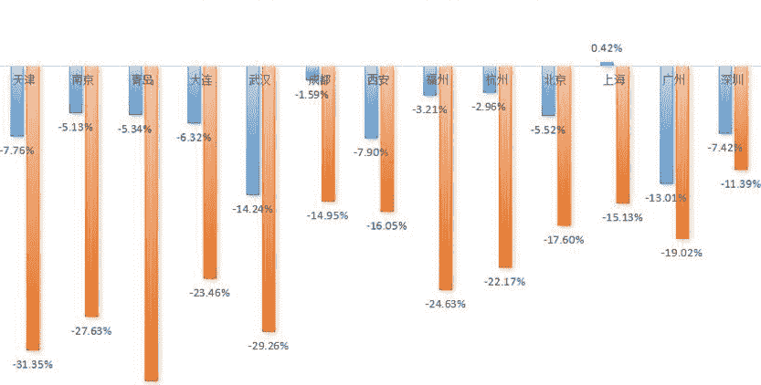

Jason不离
2025-09-11 04:14

wolfstreet：美联储8月份资产负债表下降-390亿美元，至6.60万亿美元，为2022年4月来的最低水平。自2022年4月达到峰值以来，美联储已将其资产减少了-2.36万亿美元，即-26.64%，抵消了COVID疫情期间资产负债表扩张的+4.81万亿美元中的49.2%。#金融

Fed's Total Assets, $ Trillion:
From Crisis to Raging Inflation to QT

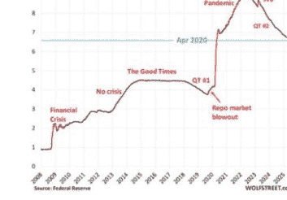

## Fed's Total Assets, $ Trillion:
From Crisis to Crisis to Raging Inflation to QT Raging Inflation

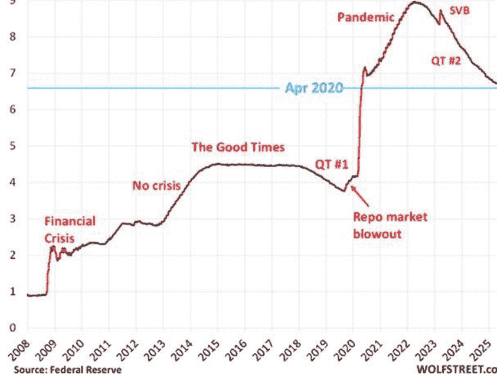

TaviCosta: 今年，黄金股砸破了标准普尔500指数的每一个板块，这是经典的滞胀行为#美股

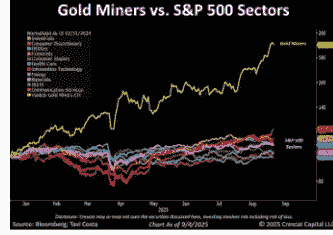

## Gold Miners vs. S&P 500 Sectors

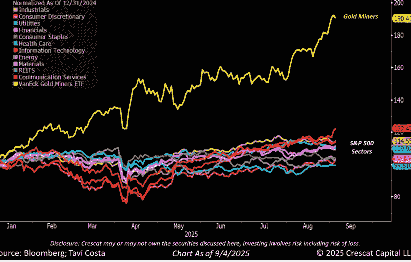

Jason不离
2025-09-11 04:14

美联储8月份资产负债表下降-390亿美元，至6.60万亿美元，为2022年4月来的最低水平。自2022年4月达到峰值以来，美联储已将其资产减少了-2.36万亿美元，即-26.64%，抵消了COVID疫情期间资产负债表扩张的+4.81万亿美元。

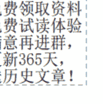
