# 深度视野文集
进群微信cuk255

Jason-Jason
2025-09-12 03:42

bloomberg: 美国8月基本通胀如期上升，并会对美储降息造成困扰。10年期国债收益率自4月初以来首次跌破4%，股市的波动非常火热。

另外黄金已经超过了45年前低下的通胀调整后的峰值，它在2025年已经创造了30多项新纪录。1980年1月，当黄金跌至850美元时，美国正在努力对付美元贬值、通胀膨胀和正在展开的危机。在美国总统吉米·卡特（Jimmy Carter）应对德国黑人危机导致伊朗人质危机后，黄金在过去两个月里几乎翻了一番，这增加了一些外国持有美元资产的风险。与美国股票相比，黄金看起来越来越便宜，如果联邦开始生效作用，黄金价格可能会一步上涨。

美储周四的一份报告显示，国家财富资产较上季度增长了7.1万亿美元，或4.2%，达176.3万亿美元。美国持有的股票价值上涨了5.5万亿美元，房地产价值也涨了。其其他国家经济

## Fed Rate-Cut Bets Accelerate After CPI, Claims Data

Add to rate-cut expectations by end-2025 and beyond

- Rate cuts priced by FOMC meeting

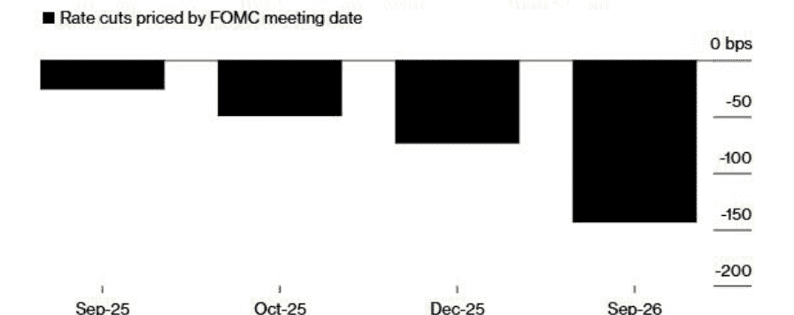

Source: Bloomberg
Note: Prices as 8:39 a.m. ET, Sept. 11

# 深度视野文集
进群微信cuk255

## 深度视野大V文集cuk255 有温度高质群cuk255

十五不

## 深度视野文章
进群微信cuk255

### 摄影与通胀的要点

- 总体 CPI环比上涨 0.4%，对于经济学家预测的 0.3% 中值，是 7 月份的两倍。
- 排除食物和能源成本的核心 CPI 上涨 0.3%，符合预期，与上月持平。
- 通胀的两个关键基础指标显示价格压力放缓，不包括新车和二手车的核心商品价格上涨 0.13%，超级核心服务成本上涨 0.33%。

以下是四周发布的 8 月消费者价格指数报告的五个关键点：

- 总体 CPI环比上涨 0.4%，对于经济学家预测的 0.3% 中值，是 7 月份的数字。像往一样，住房成本是最大的因素，尽管零售货价格是一个显著的贡献者。家庭食品上涨 0.6%，对于 2022 年以来的最大涨幅，其中牛肉和关税敏感的红肉转型是驱动因素之一。总体年率为2.9%，高于 2.7%。
- 排除食物和能源成本的核心 CPI 上涨 0.3%，符合预期。机票、服装以及新车和二手车价格回升，但医疗保健和娱乐下降。同比涨幅为 3.1%，与上月持平。
- 通胀的两个关键基础指标显示价格压力放缓。不包括新车和二手车的核心商品价格上涨 0.13%，为 3 月份以来的最低水平，表明整体性压力有限。排除住房的超级核心服务成本上涨 0.33%，低于 7 月的 0.48%。

然而报告强调通胀仍高于美联储的目标，但对高关税显然不会引发价格压力升级。保证了美联储政策制定者在 9 月 16 日的会议上持息 2 个基点的预测。周四的另一份报告显示，首次申请业保险人数跃至近四来的最高水平，也增加了美储官员可能注意到的市场趋势的迹象。

- 美国债上涨，而股票期货保持上涨。截至纽约上午 3 点 9 分，两年期美国国债收益率下跌 13 个基点，标准普尔 500 指数期货上涨 0.2%。彭博集团现指指数变化不大。

## 深度视野文章
进群微信cuk255

## 深度视野大文集cuk255 有温度高质cuk255

| MEETING DATE | 275-300 | 300-325 | 325-350 | 350-375 | 375-400 | 400-425 |
| :--- | :--- | :--- | :--- | :--- | :--- | :--- |
| 9/17/2025 | 0.00% | 0.00% | 0.00% | 0.00% | 7.21% | 92.79% |
| 10/29/2025 | 0.00% | 0.00% | 0.00% | 0.00% | 97.00% | 3.00% |
| 12/10/2025 | 0.00% | 0.00% | 0.00% | 89.86% | 10.14% | 0.00% |
| 1/28/2026 | 0.00% | 0.00% | 43.00% | 57.00% | 0.00% | 0.00% |
| 3/18/2026 | 0.00% | 0.00% | 98.03% | 1.97% | 0.00% | 0.00% |
| 4/29/2026 | 0.00% | 27.00% | 73.00% | 0.00% | 0.00% | 0.00% |
| 6/17/2026 | 0.00% | 87.07% | 12.93% | 0.00% | 0.00% | 0.00% |
| 7/29/2026 | 17.00% | 83.00% | 0.00% | 0.00% | 0.00% | 0.00% |
| 9/16/2026 | 53.50% | 46.50% | 0.00% | 0.00% | 0.00% | 0.00% |
| 10/28/2026 | 69.00% | 31.00% | 0.00% | 0.00% | 0.00% | 0.00% |
| 12/9/2026 | 80.27% | 19.73% | 0.00% | 0.00% | 0.00% | 0.00% |

## 美国国债 10 年收益率突破 4%
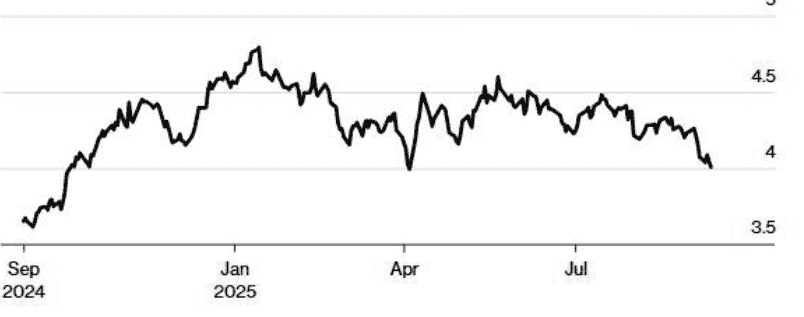

资料来源:彭博社

# 随着牛市的持续，黄金创经胀调整后的新高
Spot gold price / Inflation-adjusted price
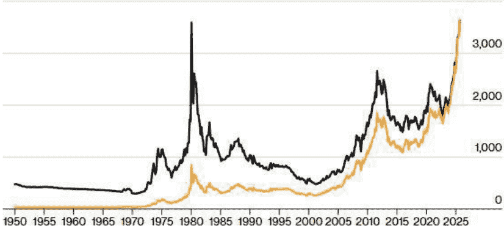

资料来源：彭博社、路博新闻
注：基于美国城市价格指数，经过季节性调整。

Jason
2025-09-12 12:03:46

bloomberg:欧洲选择维持成本不变，认为通胀压力得到控制，经济危险有所缓解。易储对加税的言论做出了回应，限制了进一步推进的呼吁。当前的定价意味着这个周期不会进一步一步。这推高了欧洲债券收益率，德国10年期收益率上涨3个基点至2.69%，欧元回升至1.174元，同样受到美元的支持

 经济学家认为欧洲银行已完成减息
预计明年6月将首次再次加息

- 认为存款利率为2.25%的经济学家比例 | 2.25% | 1.75% | 1.5%
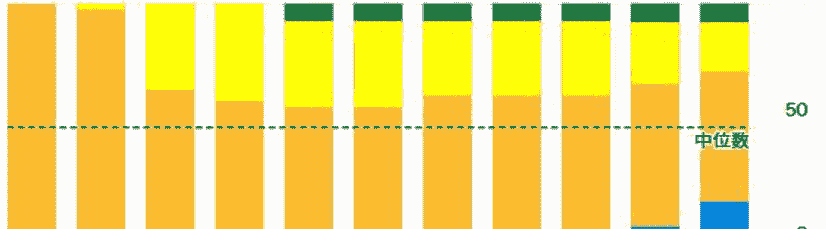

## 马斯克说实话
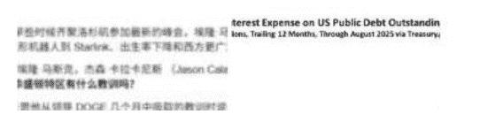

All-In Podcast的风险曾“我们开始的时候奎尔·斯坦里克分享最新的趋势，后来埃隆·马斯克（Elon Musk）通过视频接，开始讨论狗狗（DOGE）和负责人斯坦里克、史华·卡斯纳克，出生率下降等热门话题。”所以，“我们不再准备了吗？All-In Podcast 主持人视频迎接马斯克、史华·卡斯纳克（Jason Calacis）询问：“你又到了什么地方？马斯克有什么新的教训？”事实上，DOGE的大部分已经清缴。由于债务规模目前处于下位，未来可能需要支付20万亿美元的利息，目前看来，这个数字约为2000亿美元。事实上，DOGE可能是对民主党政府的渗透，通过卖金，例如国际开发者，并告诉外界鲁比（Marco Rubio）按照进行。回到马斯克。他告诉A-In持人：“如果我们的国家，它将高通胀，利息超过了国部”——我想对不起，而且不再上涨。

## Interest Expense on US Public Debt Outstanding ($Billions, Trailing 12 Months, Through August 2025 via Treasury.gov)
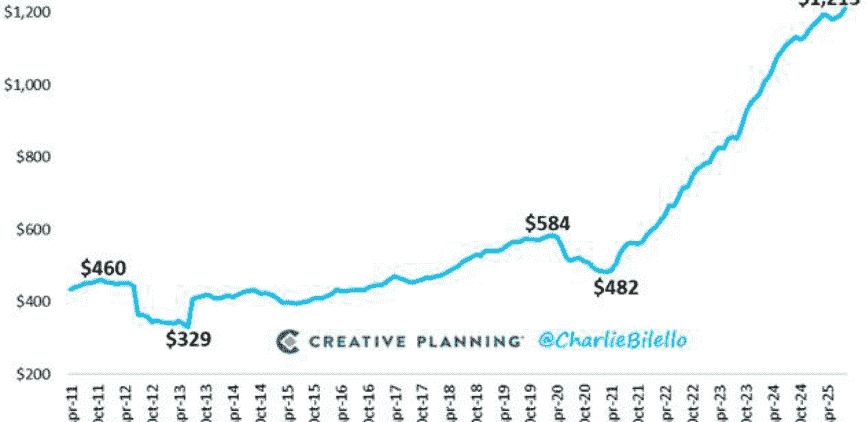

德根: 将标普500指数调整到7000点。周五收盘时标普500报6532点。今年关税对核心商品价格直接影响仍在进行，大一半已经显现。尽管通胀可能进一步上行，但通胀将低于2021至2022期间，且将暂性的。对于硬件板块，德意志将对配置，对科技板块保持中性态度——他们认为科技板块的涨幅从主头向其他板块扩散，由于此前上涨收获正处于消化期”。同时，他们看许多金属板块，认为利好因素在集中释放，也对消费者类周期性板块，消费支出保持“强势”。

```
SP 500 trend since Oct 2022
Trend growth rate (Oct 2022 to Mar 2025) = 22.7% (annualized)
Range = +-4.6%
```
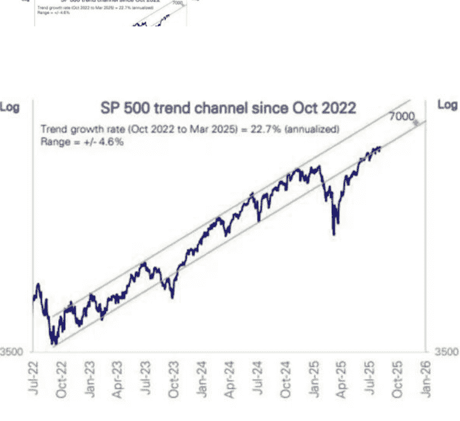人口危机与债务危机遭遇极不幸运，日本下一任领导人将接手国债这颗爆炸弹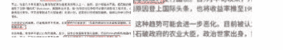 随着石债务破裂，日本的债务负担可能进一步扩大。石破政仅持续了1个月，未能赢得选民的信任，也未能改革财政。他不过，他几十年来对财政政策的谨慎自认为是自民党之一。显然，这个标准并不高。但石破的谨慎避免了“口袋政策”（Pick-hare），美国政治界指出，指定特定区域争取是不必要的工程或项目。为了赢得选民信任，常常通过宽松财政来刺激经济，这种做法增加债务，可能会带来经济危机，他也试图反抗削减，但却措手不从。他在5月曾直言：“我的财政状况毫无稳健，比希还要糟糕。”综合来说，东京并不是2011年的难剧。虽然日本是公共债务发行国，且超过90%的日本债务由国内持有。不过，石破的债务风险并无后患。目前，日本的债务GDP比例约为260%。人口没有减少，高龄化加剧，或者出生率没有下降。这种，比例看起来还不错吗？2024年，日本出生人数减少70万，创下史来的最低记录。2023年下降5.7%。这个数字让自民党所说的“人口的无声状态”——而这对经济与国家安全都将产生深远影响 Google 提供广告为什么显示此？劳动力面临减少，石破组中非自民派系首次占据了29位，债务压力增大，由于近期意外影响，自月初以来，几次十年期和四十年期国债需求激增，使得日本收益率回升到1999年。随着石破政府增加，这种压力可能会恶化。目前被认为是热门的包括石破某些政治世家出身，参政作为温和，可能会延续其父时期（2001年至2006）以及纯泉（2012年至2020年初）的宏观政策。而石破表现为保守，“是安倍哲学的”坚定者，主张扩张。分析师大卫·博林指出：“投资者将密切关注市场，因为公开批评日本银行计划，并支持更大扩张。”

## 人民币国际化
美联储3月发布的研究显示，由于中国没有海外流入资金有限。许多学者认为，这些限制了人民币真正实现国际化。研究报告显示，中国占五分之一，全球外汇储备中人民币占比仅2%（美元占比6%）。这一大转变，很大程度上是由于实际流动幅度依旧，使人民币承受压力。三月，中国支付中的使用比例可能增加。自此，已有超过1700个国家以人民币结算。CIPS交易量增长近43%，达到175万人民币（约25亿美元）。中国下一个任务是，如何进一步开发资本市场。今年7月，英国《金融报》报道，英国银行业尝试发行人民币计价。肯尼亚也可能将多元化为人民币。与此同时，中国指出，全球金融体系正在走向“多极化”，未来货币将不再包括人民币在内的货币竞争。中国希望，通过这种竞争，自身无需过多对美元的依赖，也不必完全开放资本流动和汇率机制，人民币或有望成长为“中国特色”的全球货币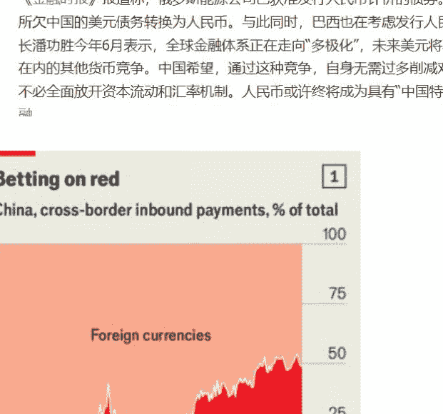 Source: State Administration of Foreign Exchange CHART: THE ECONOMIST

朱诚：每一波周期都很相似，去年是硬件，今年是AI Infra，明天肯定是大爆发，一个字母、手、小的今年应该已经成立了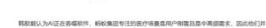 Agent宁：初创企业的活跃是创业的，但是复杂创业短周期已经无法取代。不同手机、汽车、AI、PC，人工智能意味着从被动到主动决策。它通透，目前在眼镜领域郭毅锐认为AI在医药领域集团专注的医疗市场是用户刚且高端需求，因此他们不担心商业化，而是重点放在了高质量的数据、抑制智能、医学伦理三大痛点。张嵩认为，Agent在单一、明确的领域已经取代App，但复杂创业短周期无法取代。不同以手机、AI为核心，人工智能意味着从被动到主动决策。它通透，目前在眼镜领域眼镜让同学学会操作的眼镜的66-7。朱诚认为AI和软件会有困难，大不愿意的活跃就是创业Agent的企业。从创业者角度，他们首先要面对从头到尾的协调问题，这个机会会很难，更容易商业化的就是创业技术，如去年当年会议记得，今年Voice(语音Agent)而中国企业是否适合To C，明天将要爆发很多AI应用，中国企业将会有机会。


[content]

## 深视视野文章

群律微信cuk255

Jason·不离
2025-09-12 12:05:09

高溢：日本到北美的汽车价格暴跌。4月份以来的累计跌幅目前为-20%。以减轻关税对美国当地销售价格的影响，4月以来征收了27.5%的关税。出口到北美以外的车辆价格基本持平。#其他国家统计

## Exhibit 3: Passenger Car Export Prices (Contract Currency Basis)

## Exhibit 3: Passenger Car Export Prices (Contract Currency Basis)

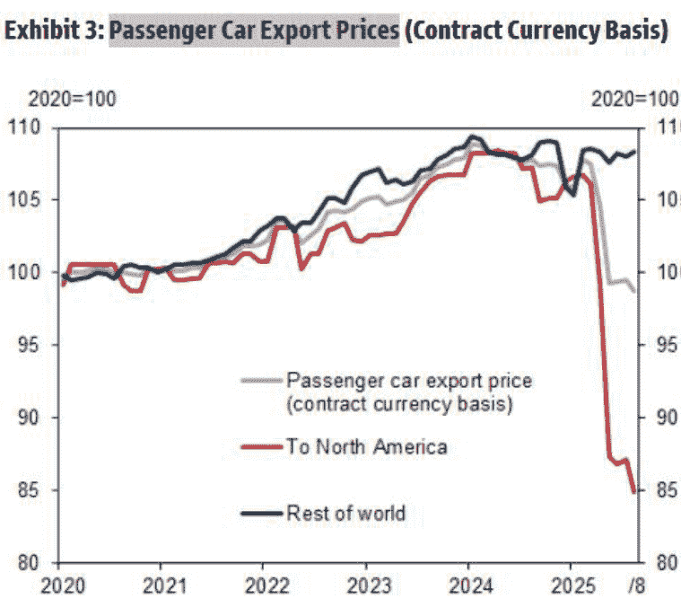

Source: BoJ

Jason·不离
2025-09-12 05:17:12

IIF：8月份投资者转向新兴市场股票和债务投资组合投入了近448亿美元（7月为流入了381亿美元），为近以来的最高水平。中国债券和股市市场流入超过390亿美元，而中国以外债市市场吸纳了132亿美元的资金流入。中国以外股市市场在连续3个月后，出现74亿美元的流出。#金融

Firstpulse add $50bn to EM portfolio in August
Portfolio flows to emerging markets by destination and asset class
* China * Emerging Markets * China

深视视野文章

群律微信cuk255

## 深视视野大文集cuk255 有温度高质市场cuk255

## Foreigners add $45 bln to EM portfolios in August

Portfolio flows to emerging markets by destination and asset class

+   * China Equity Ex-China Equity * China Debt Ex-China Debt

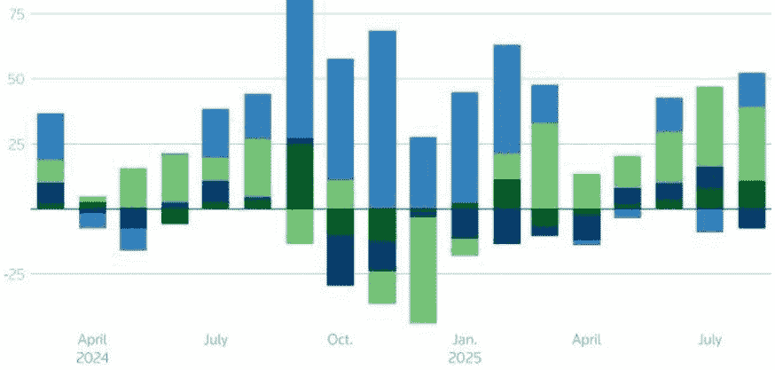

April 2024 July Oct. Jan. 2025 April July

Note: values in billions of USD
Source: IIF | Rodigo Campos | Reuters

## 早报：对华未来五年商业发展前景的美国企业连续四年新低#美股

(上海信讯) 中英投资集团董事长表示在中国发展业务的美国企业日益悲观。一项调查显示，对中国未来五年商业发展前景持有乐观态度的美国企业，连续四年新低，仅有41%的受访者表示乐观，较减少六百分点。

(上海信讯) 中英投资集团董事长表示在中国发展业务的美国企业日益悲观。一项调查显示，对中国未来五年商业发展前景持有乐观态度的美国企业，连续四年新低，仅有41%的受访者表示乐观，较减少六百分点。

根据美国华会期三（9月10日）发布的调查，对前景乐观的制造业企业占比最低（36%），零售业最高（51%）。有254家美国企业会员参与的此项调查，是在美国对华关税等措施后进行的。

64%的企业预期美国新关将影响它们今年的收益表现，45%预期今年收益有望增长。若成真，这将是以来最低水平。

## 深度视野大文集cuk255 有温度高质合集cuk255

Jason-不离
2025-09-12 05:23

深度视野文学
进群微信cuk255

## 高盛：欧洲基金持有的股票中有超过 40% 在美国，而 2009 年为15%#美股

## Exhibit 6: Over 40% of equity holdings by European funds are in the US vs. 15% in 2009
Euro Area Investment Funds' holdings in US and Euro Area equities (2% of total equity holdings). Data to 2Q 2025. Total Holdings of Euro Area Funds in Equities: EUR 7.5 billion

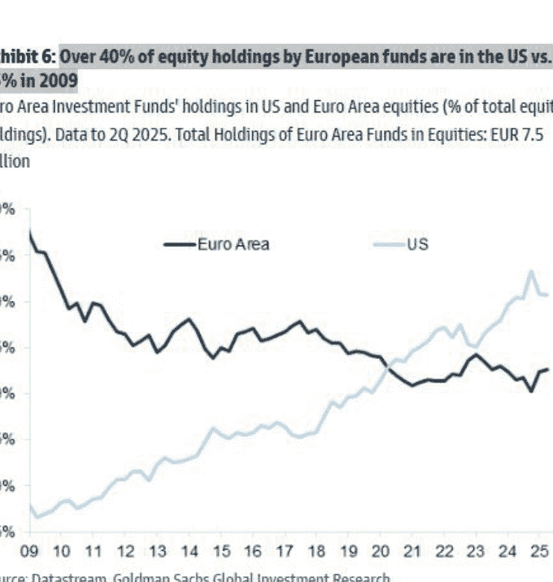

Jason-不离
2025-09-12 05:23

## 深度视野大文集cuk255 有温度高质市场cuk255

## Median Age

Median age is the age that divides a population into two equal groups; half are younger and half are older than this age. It is a single index that summarizes the distribution.

Note: values in billions of USD
Source: IIF | Rodigo Campos | Reuters

## Nepal's Median Age

Nepal's median age is 25.

Data source: United Nations

## Nepal's Median Age

Nepal's median age is 25.

Data source: United Nations

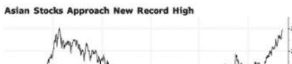

## Nepal's Median Age

Nepal's median age is 25.

Data source: United Nations

[/content]
