Jason-凯迪
2025-09-18 03:13

美联储加息25bp，并计划在今年将再度两次，这比6月份的预测多了一次。在经济预测中，政策制定者大幅上调了2026年增长预测值。他们还预测年通胀率将有所上升。鲍威尔会在新闻发布会上指出，劳动力市场趋缓的态势悬而未决。联储公开市场委员会以1比1的投票结果将联储利率的目标区间下调至4%-4.25%，米兰是唯一不同意见的官员，他更愿意大调削减半百分点。“金融”

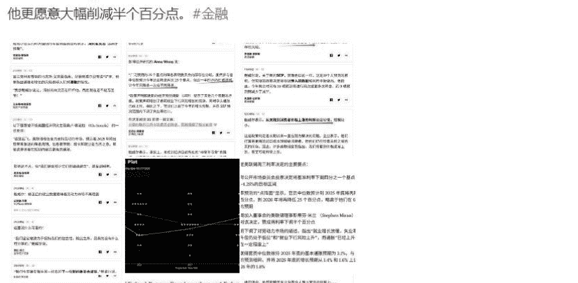

加微信：2818363845，提升知识学习群，看更多优质资源

鲍威尔在谈到昨天强劲的零售销售报告时表示，消费支出“远高于预期”。

克里斯·安斯蒂斯
高级记者

富兰克林·林普顿的马克斯·戈克曼指出，尽管鲍威尔没有“S”字，但他指出通胀和增长的风险表明人们对通胀的担忧。

> “我想鲍威尔说过，通胀的幽灵正在破坏，而且现在还不是万圣节！”

艾米·格拉希莉
资产报告记者

以下是惠誉评级美国经济研究主管奥卢·索诺拉（Olu Sonola）的一些反应：

> “这是起飞，美联储现在全力支持劳动力市场，预示着2025年将出现果实性的降息周期。信息很明确：增长和就业是当务之急，这意味着要在短期内忍受更高的通胀。”

曼达·柯兰
全球经济记者

最终，异议落到了米兰身上，而联邦公开市场委员会的其他成员则加入进来。这意味着鲍威尔仍然控制着叙事，至少目前是这样。

恩达·柯兰
全球经济记者

8分钟前 06:55

## 彭博研究的 Anna Wong 说：

“对于预期的25个基点的降息，委员会内部存在分歧。虽然参与者中位数预计今年将降息两次25个基点，但近一期的FOMC成员预计今年仅降息一次或不再降息。

“政策声明和更新的经济预测摘要(SEP)显示了其他几个有趣的矛盾。政策声明增加了就业风险增加的措辞，同时承认通胀已经上升。相比之下，官员们调整了今年的增长预期，并在 SEP 范围内下调了失业率预计。”

在这里阅读本 的第一篇文章：

分裂的联邦公开市场委员会降息，同时提了增长前景

迈·阿霍德
彭博经济记者

8分钟前 06:53

鲍威尔表示，事实上，考虑到经济目前所处的“非常不寻常”的情况，如果目前对政策前景的看法没有很大分歧，那将是令人惊异的。

克里斯·安斯蒂
高级记者

加微信：2818363485，提升知识学习群，看更多优质资源

11分钟前 06:52

鲍威尔表示，美联储“没有无风险的道路”，因为通胀和就业市场都存在风险。

克莱斯·安斯普
高级编辑

11分钟前 06:52

鲍威尔说，关于新的SEP，就像他以前一样，这是19个人预测的累积。实际的政策决定将根据传入的数据和风险平衡做出。他指出，今年剩余时间有10项预测将进行两次或更多次降息，而9项预测则减少了半点。

克莱斯·安斯普
高级编辑

12分钟前 06:52

鲍威尔表示，从关税到消费者价格上涨的转嫁速度较慢，规模较小。

这是政策长期以来一直在努力解决的问题。企业表示，他们打算将更高的进口成本转嫁给消费者，他们仍在检查关税之前购买库存。因此，许多美联储官员指出，我们将看到价格逐渐上涨，甚至可能持续上涨。

玛丽亚·埃尔伊-卡普罗斯
美联储记者

加微信：2818363845，提升知识学习群，看更多优质资源

23分钟前 06:41

鲍威尔表示，“我们已经开始看到”商品价格上涨转化为通胀。影响不大，但“我们确实预计它们将继续建立”，甚至到明年。

克里斯·安斯蒂
高级编辑

24分钟前 06:41

鲍威尔：修正后的就业数据意味着劳动力市场不再稳固

安普普·邓思
TOPLive 编辑器

更新于 21m前

25分钟前 06:40

这里没有什么可以看的：

我们坚定地致力于保持我们的独立性，除此之外，我真的没有什么可分享的，”鲍威尔说。

恩达·柯兰
全球经济记者

“我们今天确实像往一样欢迎了一位新的委员会成员，”鲍威尔说。

恩达·柯兰
全球经济记者

加微信：2818363845，提升知识学习群，看更多优质资源

# The Fed's September Dot Plot

Fed members' dot projections for meeting date 09/17/2023
FOMC range
Fed funds futures - Latest value

以下是美联储周三决定的要点：

- 联邦公开市场委员会投票将基准利率下调分之一基点至4%-4.25%
- 利率预测的“点图”显示，官员位数预计2025年将降低半个百分点，2026年将再降低25个基点，高于6月预期
- 本周加入董事会的斯蒂芬·米兰（Stephen Miran）反对决定将利率下调半个百分点
- 声明调整了对劳动力市场的描述，指出增长放缓，失业率略有上升但处于低位，而通胀已经上升并保持在一定程度上
- 美联储官员中位数维持2025年底通胀预期为3.1%，与6月份相同，并将2025年的增长预期从1.4%上调至2026年的1.8%

Table 1. Economic projections of Federal Reserve board members and Federal Reserve presidents, under their individual assumptions of appropriate monetary policy, September 2025

| Variable | Median Forecast | 2025 | 2026 | 2027 |
| :--- | :--- | :--- | :--- | :--- |
| Change in real GDP | 1.6 | 1.8 | 1.8 | 1.4-1.7 |
| Unemployment rate | 4.5 | 4.3 | 4.2 | 4.2-4.5 |
| Nominal growth rate | 5.3 | 5.1 | 5.0 | 4.8-5.2 |
| PCE inflation | 2.5 | 2.3 | 2.2 | 2.0-2.3 |
| Core PCE inflation | 2.3 | 2.1 | 2.0 | 1.8-2.0 |
| Mean Proportional terminal rate | 3.5 | 3.4 | 3.1 | 3.0-3.6 |
| Federal funds rate | 3.5 | 3.4 | 3.1 | 3.0-3.6 |
| Size projection | 3.5 | 3.3 | 3.1 | 3.0-3.6 |

3分钟前 07:07

这句话的含义可以解读为这些成本最终将走向消费者。

恩达·柯兰
全球经济记者

3分钟前 07:07

鲍威尔说，大多“没有”支付。他说，它们主要由出口商和消费者支付。

3分钟前 07:07

关于，最近对联邦储备银行的调查显示，企业中正在增加对劳动力市场的影响可能相对有限。

玛丽亚·埃尔伊-卡普罗斯
美联储记者

4分钟前 07:07

Dario 表示：“毫无疑问，经济即将停滞。”

恩达·柯兰
全球经济记者

3分钟前 07:07

鲍威尔说，大多没有支付。这不是政府所想要的。

2分钟前 07:07

鲍威尔：修正后的就业数据意味着劳动力市场不再稳固。

安普普·邓思
TOPLive 编辑器

克莱斯·安斯普
高级编辑

请记住，鲍威尔早些时候表示，联邦公开市场委员会 (FOMC)成员对降息半百分点没有广泛支持。换句话，他可能暗示米兰没有令人信服的力。

克里斯·安斯蒂
高级编辑

鲍威尔说，一个选择改变局面的唯一方法就是提出令人信服的论点。“该机构不会改变。”

恩达·柯兰
全球经济记者

彭博的卡塔娜·萨拉伊（Catarina Saraiva）向鲍威尔询问政治背景对联邦公开市场委员会的影响。鲍威尔表示，关于他是否会在5月结束任期结束后留在美联储，“没有什么新消息。”

克莱斯·安斯蒂
高级编辑

# Jason不聪
2025-09-18 03:30

Bloomberg: 自然语言处理显示，鲍威尔开场比去年美联储加50基点更加激进，但其反击、捍卫独立性的行为让美元指数反弹，美元下跌。鲍威尔表示，周三降息是一项风险管理，并补充说他认为没有快速调整利率%。

3分钟前 07:18

美国利率策略自然语言处理显示，鲍威尔开场比去年美联储加50基点更鸽派。“我们的模型显示，最近几次会议的新闻发布相当中立，”他指出，“今天非常鸽派的举动符合我们的测试，并向我们表明这将至少是另外一次降息。”

里克·史普斯
彭博资讯编辑

US Rates Dashboard位于终端上: {FOMCRS}

# 鲍威尔被问及美联储的第三任务，即温和的长期利率。

他说，美联储认为本质上是实现前两项任务——稳定物价和充分就业的结果。因此，没有将长期利率目标视为一项独特的努力。

克里斯·安斯蒂
高级编辑

5分钟前 07:17

他非常礼貌，但鲍威尔对白宫进行了相当全面的反击：

- 他说，今天降息50个基点“根本没有广泛支持”。
- 他没有直接回应贝塞尔要求独立审查的呼吁，称他不会对“国务院所说的任何事情”发表评论。
- 对于他是否计划在5月完全退出美联储，他继续保持沉默。
- 他拒绝鲍力·鲍克发表评论。
- 他说，美联储的决策完全基于数据和经济理解做出，“这就是它的工作方式”。

克莱斯·安斯塞尔
高级编辑

6分钟前 07:16

“我不预测市场正在做的事情，”鲍威尔在回答中说，他指的是预期的利率路径。尽管过去一小时市场反应来看，但这一信息可能需要一些时间才能完全反映，因为交易员正在等待未来几个月的就业报告。

Columbia Threadneedle Investment的利率策略师Ed Al-Hussain表示，与预期市场相比，劳动力的焦点还不够倾斜，他表示美国国债“出现了一些偏差”。

“最终，明年的终端利率需要重新定价更高，”他认为其中一项衡量标准——1年期/1年期——将从目前的3.10%回到2.93%。

明凯尔·赛青齐
纽约约财经记者

鲍威尔称：我们面临巨大的通胀压力。

鲍威尔称：我们预计美国利率调整对房地产产生重大影响。

鲍威尔称：我们不选择推迟政策，利率下调可能有助于市场稳定。

鲍威尔称：劳动力市场的风险是今天决定的因素。

鲍威尔称：我们的数据显示通胀预期高于。

鲍威尔称：我们还没有看到足够和通胀稳定。

鲍威尔称：劳动力市场的快速冷却已经引起了有关的关注。

加微信：2818363845，提升知识学习群，看更多优质资源

## FOMC participants' assessments of uncertainty and risks around their economic projections

| Uncertainty about the unemployment rate | Number of Participants | Risks to the unemployment rate | Number of Participants |
| :--- | :--- | :--- | :--- |
| September projections | 20 | September projections | 20 |
| June projections | 18 | June projections | 18 |
| | 16 | | 16 |
| | 14 | | 14 |
| | 12 | | 12 |
| | 10 | | 10 |
| | 8 | | 8 |
| | 6 | | 6 |
| | 4 | | 4 |

| Lower | Broadly similar | Higher | Weighted to downside | Broadly balanced | Weighted to upside |

## FOMC participants' assessments of uncertainty and risks around their economic projections

| Uncertainty about GDP growth | Number of Participants | Risks to GDP growth | Number of Participants |
| :--- | :--- | :--- | :--- |
| September projections | 20 | September projections | 20 |
| June projections | 18 | June projections | 18 |
| | 16 | | 16 |
| | 14 | | 14 |
| | 12 | | 12 |
| | 10 | | 10 |
| | 8 | | 8 |
| | 6 | | 6 |
| | 4 | | 4 |

| Lower | Broadly similar | Higher | Weighted to downside | Broadly balanced | Weighted to upside |

> Jason
2025-09-18 03:45

8月青年失业率18.9%，于去年
1-8月平均青年失业率16.4%，于去年同期的15.4%
且16-24岁青年失业率转向25-29岁青年失业率#自制图表

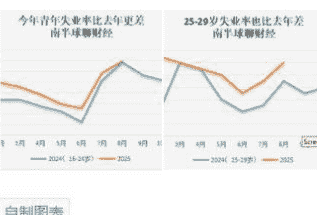

加微信：28188363845， 提升知识学习群，看更多优质资源

## 今年青年失业率比去年更差
南半球财经

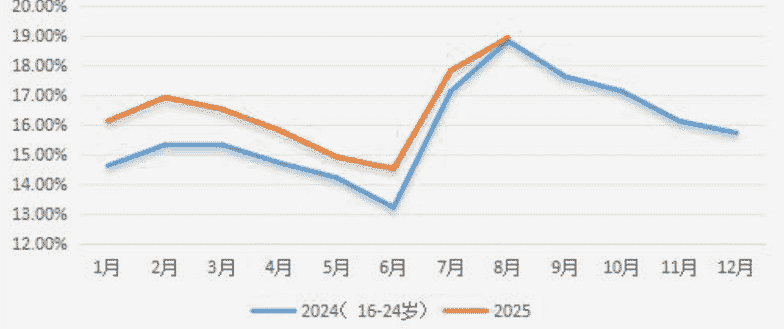

## 25-29岁失业率也去年更差
南半球财经

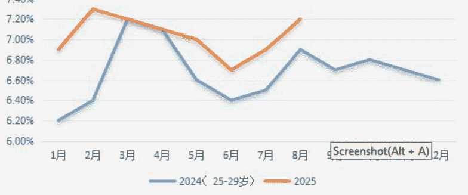

Jason-不离
2025-09-18 05:22

8月前两个月（预算+基金）财政赤字依然历史高#自制图表
2016年前是正的，2016年主要是劳动力20-54岁年龄段

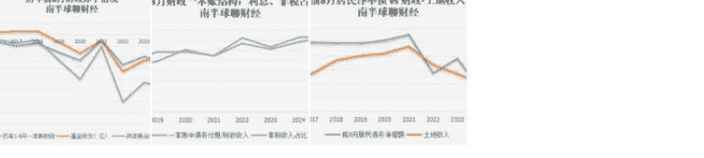

自制图表

最后编辑：2025-09-18 05:22

加微信：2818363845，提升知识学习群，看更多优质资源

## 历年前8月财政赤字情况
南半球联财经

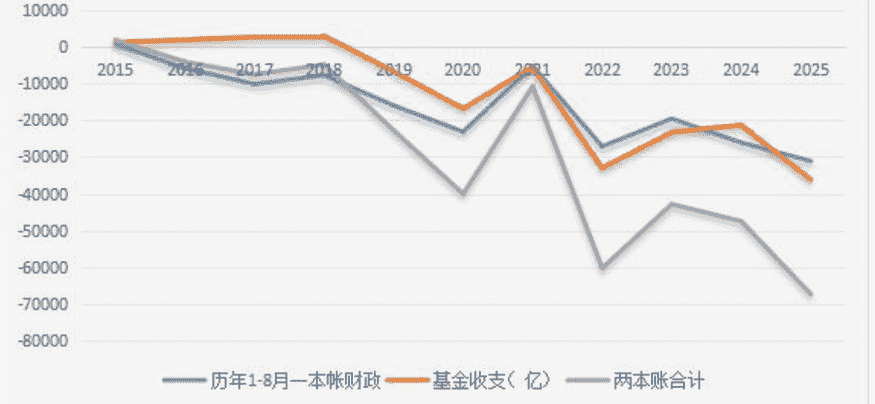

## 前8月财政一本账结构：利息、非税占比
南半球联财经

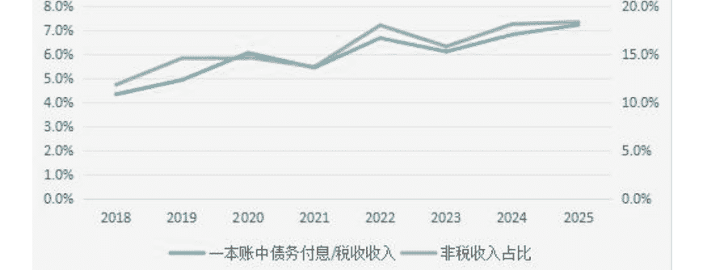

## 前8月居民净增债 vs 财政-土地收入
南半球联财经

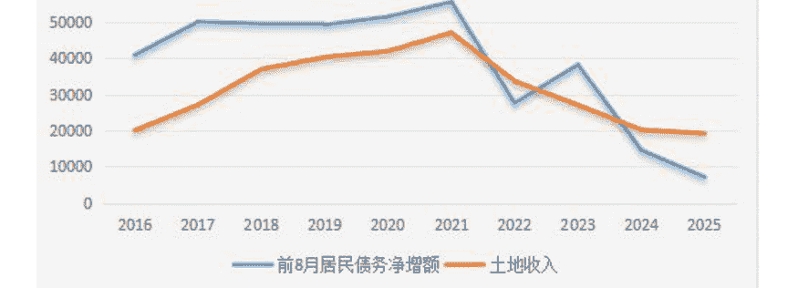

微信：2818363845，提升知识学习力，看更多优质资源

# Jason不离

zerohedge: 两次，恒生科技指数涨4%，创下2021年11月以来的最高收盘价，恒生科技今日涨4%，并连涨至七，蓝宝表示，“中国科技领先者正在明显地增加对人工智能能力和产品输出——模型，机器人汽车，内部芯片——同时也证明他们可以比许多人类预期的速度更快人工智能货币化，由于价值落后于美国，投资者再次开始关注。”#股市

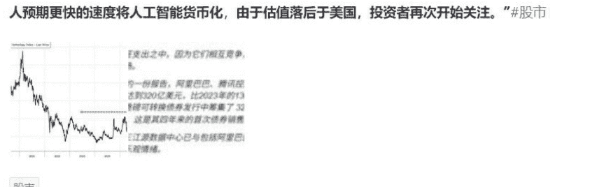

此出中言，引起业内关注。
一分钟后，同样色彩也跟涨，Nasdaq在周五小幅反弹
可转换债券发行者遭遇了压力
近四年来的暴涨信号包括阿里也

## 股市

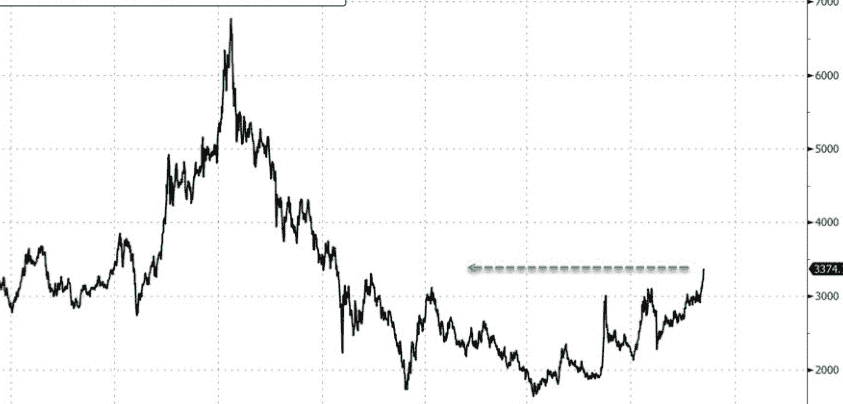

中国最大的科技公司正处于人工智能狂热支出中，因为它们相互竞争，也与美国公司竞争，以引起一个将改变人们的生活和工作的方式。彭博社（2022年）报道，一份报告称，阿里巴巴、腾讯控股、百度和JD.com等巨头预计其年度支出将在2025年达到2200亿美元，较2023年增加一倍。这有助于投资者在市场中维持信心。阿里巴巴上月通过可转换债券发行了90亿美元人民币，这是其四年来的首次。周二晚，国家电视台报道，中国联通等头部部门签署了芯片合同，从而推动了增长。

### 不同

当前黄金14日RSI达78，已经接近10年来90%的分位，意味着部分获利离场。重要的是，相较于全球ETF、现货和期货持有仓位等并没有那么热。所以我们把黄金交易结束，存在回调风险，我们认为长牛逻辑仍在，主要看美国经济是否崩。

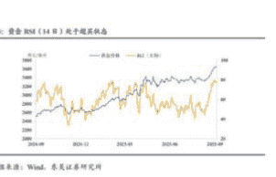

图3：黄金RSI（14日）处于超买状态

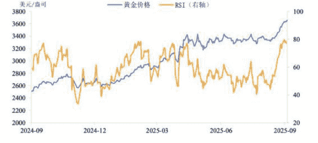

数据来源：Wind，东亮证券

加微信：2818363845，提升知识学习群，看更多优质资源

# 不遇

日经：中国“一带一路”的相关投资再度扩大。澳大利亚亚格菲斯特大学和中国复旦大学的研究调查，1-6月投资额已超过1240亿美元，与过去全年相比，这是2013年扩大“一带一路”以来的最高值。其中对非洲的投资有所增加，投资额达到400亿美元，比2024年增长了37%，占投资总额的3成以上。#金融

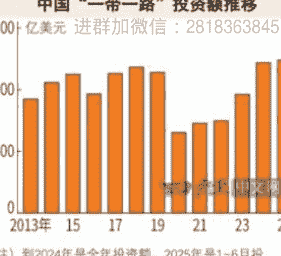

(注）2024年是全年投资额。2025年是1-6月投资额。包括（数据来源：澳大利亚亚格菲斯特大学研究院、中国复旦大学国际金融研究中心）

## 中国“一带一路”投资额推移

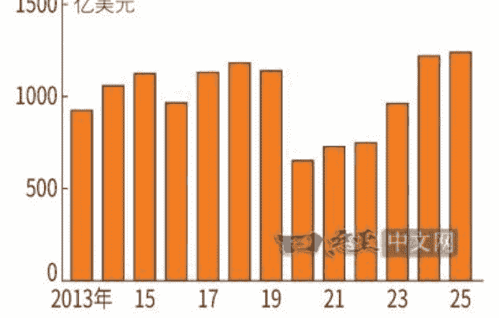

(注）2024年是全年投资额。2025年是1-6月投资额。包括（数据来源）：澳大利亚亚格菲斯特大学研究院、中国复旦大学国际金融研究中心）

加微信：2818363485，提升知识学习，看更多优质资源

## 国信达：2025年第37周，全国二手房挂牌指数151.88，环比下降0.17%#房价

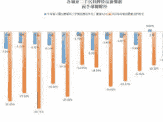

## 各城市：二手房挂牌价最新数据 南球财经

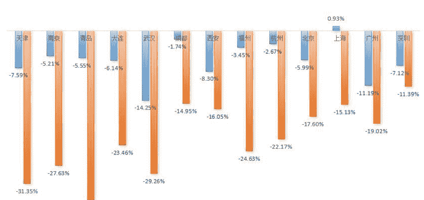

加微信：2818363845，提升知识学习群，看更多优质资源

## 正方：从历史经验，美联储降息周期开启，对资产总体利好，股弹性值得关注，债券端大概获超额收益，美元局调迎来反转，国内主要大类资产权益资产收益并不相对相同，尤其价值风格领先。从市场风格角度来看，美联储降息落地后，成长风格领先。#金融 群微信：281386345

图8：预留式结束后的大类资产表现

| 类别 | 美元 | 新兴市场 | 债券 | 美国政府(2年) | 美国政府(10年) | 外国公司 | 欧元 | 黄金 | 原油 |
|---|---|---|---|---|---|---|---|---|
| T-6M | 6.7% | -0.12% | -10.8% | -0.2% | -3.3% | 7.7% | -0.2% | 1.0% | -4.3% |
| T-3M | 1.3% | -5.9% | -0.5% | -2.2% | 3.8% | 8.9% | 6.4% | -0.4% | -1.1% |
| T-1M | 1.8% | -1.0% | 2.5% | -4.0% | 1.2% | 2.6% | 1.8% | -1.9% | 2.1% |
| T-1Y | 1.9% | 1.9% | 4.8% | 2.3% | 14.2% | 0.8% | -0.2% | 1.2% | -0.9% |
| T-3Y | 6.4% | 10.2% | 9.8% | 16.1% | 14.2% | 1.2% | 1.5% | 0.3% | -4.0% |
| T-6M | 9.4% | 21.1% | 7.8% | 22.2% | 3.8% | 3.5% | 3.6% | 2.9% | -2.7% |

数据来源：Wind，正研究所；图中数据为美国债收益率，每月更新

图9：预留式结束后的美债

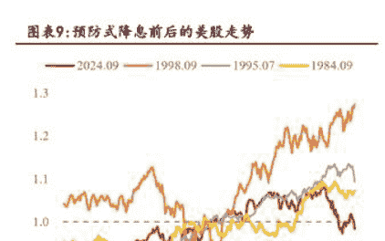

图10：预留式结束后10年收益率趋势

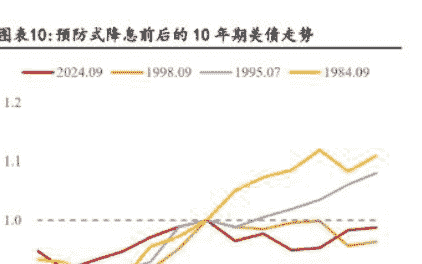

## 图表11：预储跌势后的十期美债走势

## 图表12：预储跌势后的美元走势

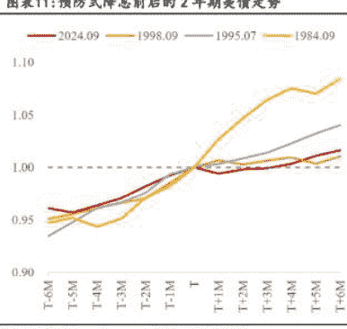

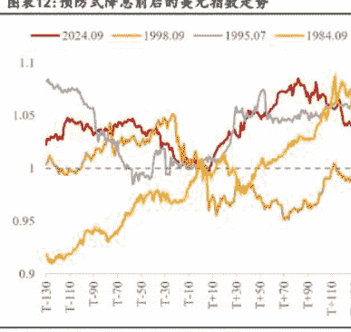

数据来源：Bloomberg，正研究所

数据来源：Bloomberg，正研究所

## 图表13：预储跌势后的黄金走势

## 图表14：预储跌势后的股市走势

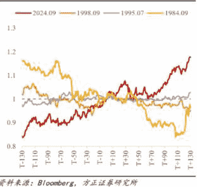

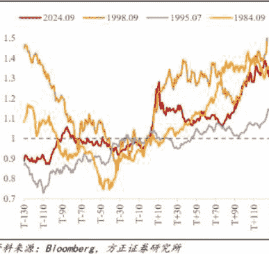

数据来源：Bloomberg，正研究所

数据来源：Bloomberg，正研究所

## 图表18：年末联储加息后的A股涨幅

## 图表19：年末联储加息后的A股涨跌

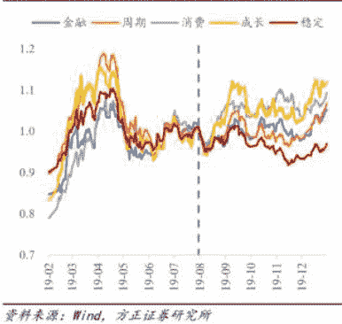

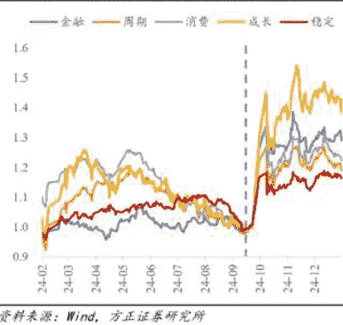

数据来源：Wind，正研究所

数据来源：Wind，正研究所

# Jason涵
2025-09-18 05:56

在房地产市场低迷和贸易不定的背景下，中国正在加快向消费经济增长模式的长期转型。财政和政策上的限制因素例如，在当前的税收框架下，主要消费政策相关措施是在生产和非消费领域落实。这种结构导致地方政府更关注工业增值，而非居民消费。消费的税收规模较大，并由中央统一征收，并未直接为地方政府带来财政收入。此外，社会保障和户籍制度（户口）改革可以改善社会保障体系，但这些改革可能是渐入复杂的。

## TAX 群加微信：2818363845

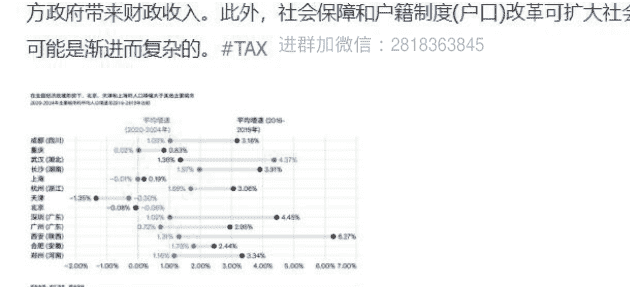

在全国经济放缓形势，北京、天津上海的人口密度大于其他主要城市
2020-2024年主要城市的人口密度与2016-2019年对比

| | 平均增长 (2020-2024年) | 平均增长 (2016-2019年) |
|---|---|---|---|
| 成都（四川） | 1.03% | | |
| 重庆 | 0.83% | | |
| 武汉（湖北） | 1.36% | 4.37% | |
| 长沙（湖南） | 1.97% | 3.91% | |
| 上海 | -0.01% | 0.19% | |
| 杭州（浙江） | 1.69% | 3.06% | |
| 天津 | -1.35% | -0.30% | |
| 北京 | -0.08% | -0.06% | |
| 深圳 | 1.02% | 4.45% | |
| 广州（广东） | 0.72% | 2.95% | |
| 西安（陕西） | 1.31% | 2.44% | |
| 合肥（安徽） | 1.78% | 3.34% | |
| 郑州（河南） | -2.00% | -1.00% | 0.00% | 2.00% | 4.00% | 5.00% | 7.00% |

数据来源：财财经，转载自

加微信：281836345，提升知识学习群，看更多优质资源

# Jason不懂
2025-09-18 09:03

最近4个月非存款数据，居民、企业存款趋势图

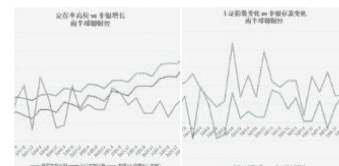

自制图表

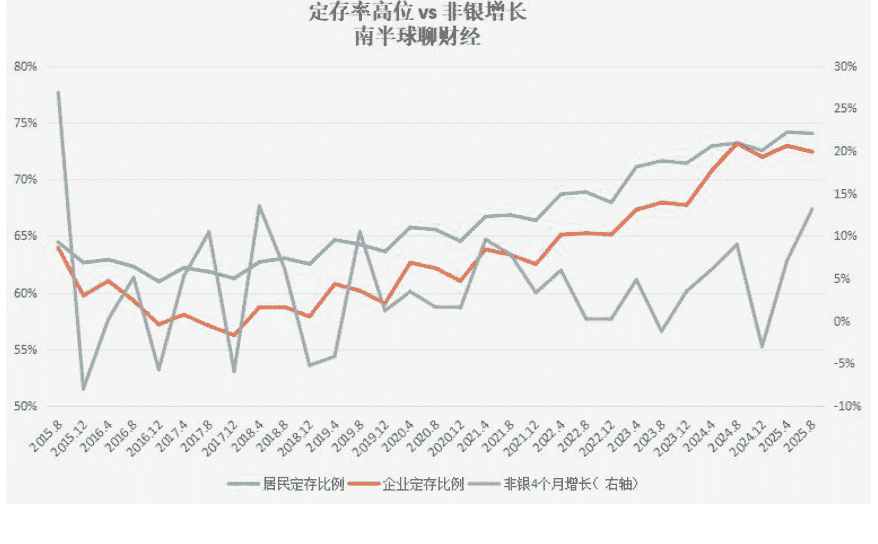

加微信：281836345，提升知识学习群，看更多优质资源

## 上证指数变化 vs 存款
南半球财经

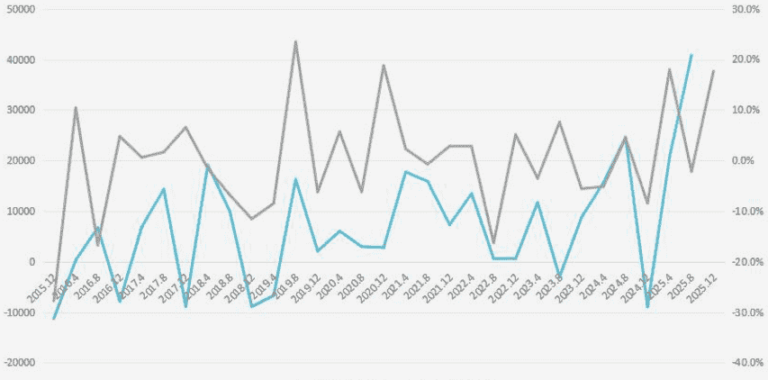

# Jason 不
2025-09-18 09:10

高盛：我们的概率加权美联储比市场定价更昂贵，我们继续预计10月和12月降息25个基点，随后在2026年再降息两次，至3.25%#金融

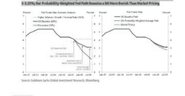

金融

加微信：281836345，提升知识学习群，看更多优质资源

## Exhibit 1: We Continue to Expect 25bp Cuts in October and December Followed by Two More in 2026 to 3-3.25%; Our Probability-Weighted Path Remains a Bit More Dovish Than Market Pricing

| Percent | Fed Funds Scenario Analysis | Percent | Percent | Fed Funds Rate |
|---|---|---|---|---|
| 7 | -- Higher Inflation / Growth / Terminal Rate (10%) | | -- GS Baseline Path | 7 |
| | -- GS Baseline (60%) | 6 | -- GS Probability-Weighted Average | 6 |
| | -- Recession (30%) | 5 | -- Market Pricing | 5 |
| | | | 4 | 4 |
| | | | 3 | 3 |
| | | | 2 | 2 |
| | GS Baseline Path | | 1 | 1 |
| | Costless cut in Step, Oct. and early 2025 | 1 | | 0 |
| | Quarterly cut in March and June 2025 / 5.0-3.25% | 0 | | |
| | Jan-23 Jul-23 Jul-24 Jul-25 Jan-25 Jul-26 | | Jan-23 Jul-23 Jul-24 Jul-25 Jan-25 Jul-26 |

Source: Goldman Sachs Global Investment Research, Bloomberg

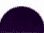

2025-09-18 09:21

bloomberg: 新西兰经济第二季度萎缩0.9%，超过经济学家的预期，这加剧了人们对央行可能要选择降息的呼。新西兰元下滑，对政策敏感的跨期国债收益率下降10个基点至2.81%，凯许宏观对2.5%的终端利率预测的风险也倾向向下行。西太平洋现在在预计下几个个月维持50个基点，11月将降息25个基点。其他国家经济

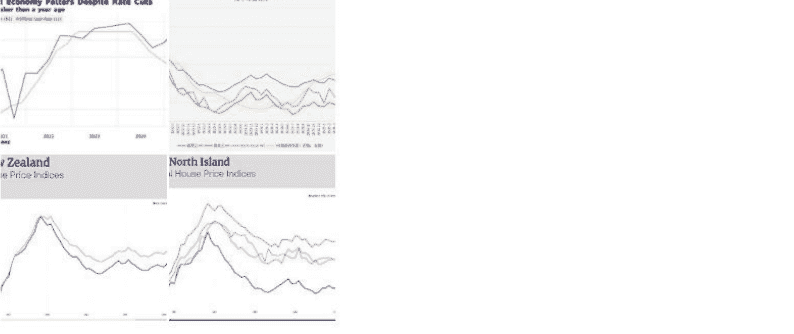

其他国家经济

最后编辑：2025-09-18 09:28

加微信：2818363845，提升知识学习群，看更多优质资源

## New Zealand Economy Falters Despite Rate Cuts

GDP remains weaker than a year ago

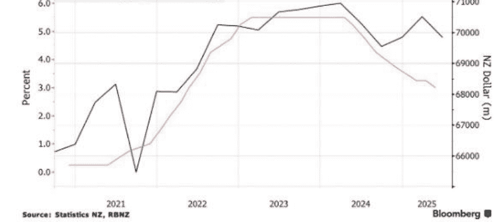

新西兰房价指数 vs 1期房贷利率
南半球联财经

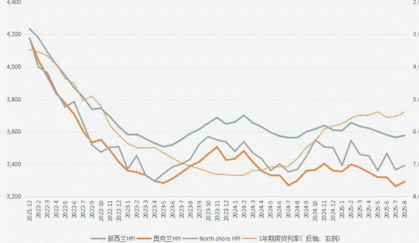

加微信：2818363845，提升知识学习群，看更多优质资源

## New Zealand House Price Indices

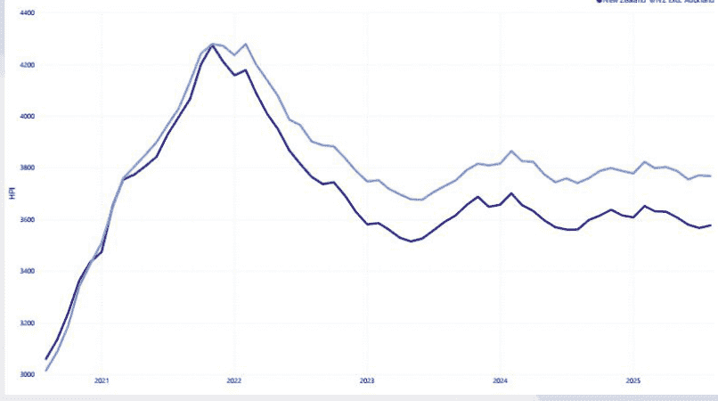

## Upper North Island Regional House Price Indices

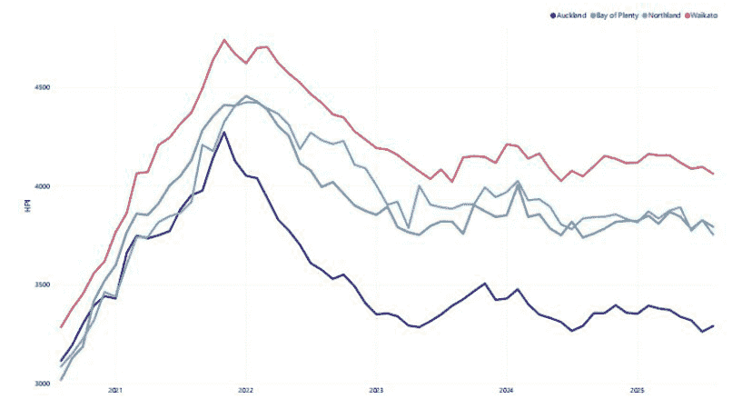

加微信：2818363845，提升知识与学习群，看更多优质资源

# 提升知识学习365一（365天服务期），微信扫码或加微信：欢迎进群查看更多优质资源，客户进群享折扣。学习群包含已全部资源：

### 一、财经博主（财经会员群258一天，包含有7个博主内容当天更新）：

- 1、灵哥哥财富领域知识星球（原价3510元/年）/ 单卖149年
- 2、鉴蜜茶财经领域知识星球（原价3510元/年）/ 单卖149年
- 3、血亿之家的知识星球（原价2280元/年）/ 单卖199年
- 4、咖钛元微V+会员（原价1000元/年）/ 单卖79年
- 5、智哲趋势内部研报（原价404元/年）/ 单卖19.9年
- 6、南半天球犀财经（原价404元/年）/ 单卖19.9年
- 7、洪源的宏观策略以及众的其他财经博主付费免费分享

### 二、时事博主（时事会员群119一天，包含有11个博主当天更新）：

- 1、子明私享汇（原价568元/年）/ 单卖29.9年
- 2、镁米莉锦见闻（原价599元/年）/ 单卖29.9年
- 3、大潮木类知识星球（原价199元/年）/ 单卖19.9年
- 4、霸哥的世界知识星球（原价299元/年）/ 单卖19.9年
- 5、碎瓦虾广后Q的内部研报（原价400元/年）/ 单卖19.9年
- 6、克梵知识星球*青云会会员群（原价268元/年）/ 单卖19.9年
- 7、克文知识读书会（原价699元/年）/ 单卖59.9年
- 8、倍倍绘会员群和对话（原价365元/年）/ 单卖29.9年
- 9、欧洲金锐财经会员群（原价328元/年）/ 单卖19.9年
- 10、翘莉西风风公众号付费文章，单卖29.9年
- 11、江宁予知府公众号付费文章，单卖29.9年

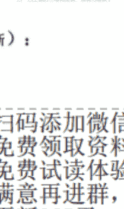

### 三、各种公众号付费文：

金政通鉴、外人的视角、犀译浅、雪花财经老头、幻话诸你、A视野、NEO捞鱼、冷局局人、海汪试行对股市的影响、费变的小茶馆、赢在八小时之外、雷海淼、盛景创造、第三观察眼等等公众号付费文章不定更新，内容很多，一不列举！

提升知识学习群包含以上全部内容，分享365天，赠送历史文章！

加微信：28183638455，提升知识学习，看更多优质资源
