<!-- no content -->

# FOMC participants' assessments of uncertainty and risks around their economic projections

| Uncertainty about the unemployment rate | Number of Participants | Risks to the unemployment rate | Number of Participants |
| --- | --- | --- | --- | --- |
| September projections | 20 | | September projections | 20 |
| June projections | 18 | | June projections | 18 |
| | 16 | | | 16 |
| | 14 | | | 14 |
| | 12 | | | 12 |
| | 10 | | | 10 |
| | 8 | | | 8 |
| | 6 | | | 6 |

| Lower | Broadly similar | Higher | Weighted to downside | Broadly balanced | Weighted to upside |

FOMC participants' assessments of uncertainty and risks around their economic projections

| Uncertainty about GDP growth | Number of Participants | | Risks to GDP growth | Number of Participants |
| --- | --- | --- | --- | --- |
| September projections | 20 | | September projections | 20 |
| June projections | 18 | | June projections | 18 |
| | 16 | | | 16 |
| | 14 | | | 14 |
| | 12 | | | 12 |
| | 10 | | | 10 |
| | 8 | | | 8 |
| | 6 | | | 6 |
| | 4 | | | 4 |

| Lower | Broadly similar | Higher | Weighted to downside | Broadly balanced | Weighted to upside |

> Jason
2025-09-18 03:45

8月青年失业率18.9%，高于去年

1-8月青年失业率16.4%，高于去年同期的15.4%

并且16-24岁青年失业率向25-29岁青年失业率趋势#自制图表

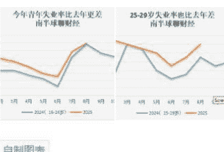

自制图表

加微信：2818363845，提升知识学习群，看更多优质资源

# 今年青年失业率比去年更差
南半球财经

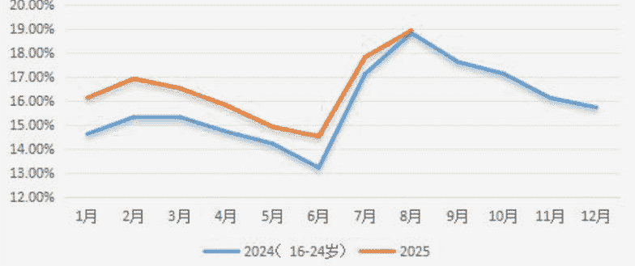

## 25-29岁失业率也去年更差
南半球财经

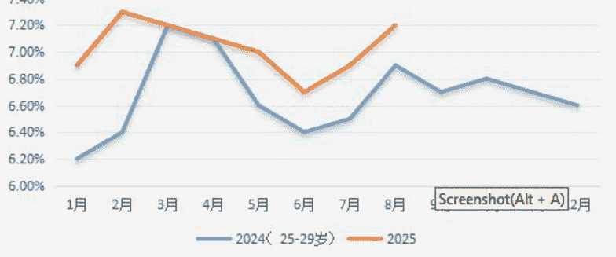

Jason不离
2025-09-18 05:22

8月前两款（财算+基金）财政赤字依然历史高#自制图表
2016年前是正的，2016年是主力劳动人口20-54岁节点

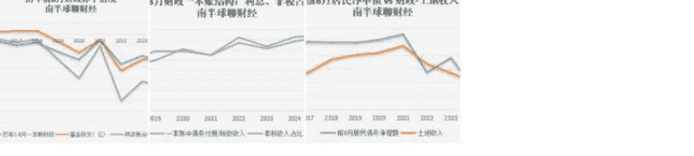

自制图表

最后编辑：2025-09-18 05:22

加微信：2818363845，进知识学习群，看更多优质资源

# 历年8月财政赤字情况
南半球联财经

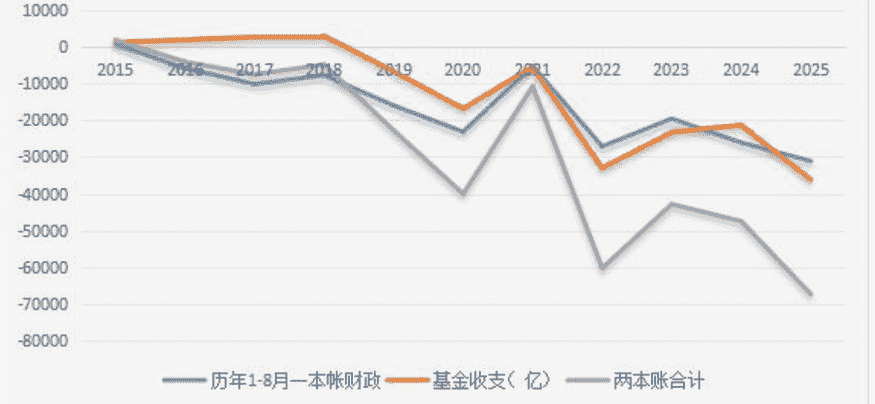

# 前8月财政-一本账结结构：利息、非税占比
南半球联财经

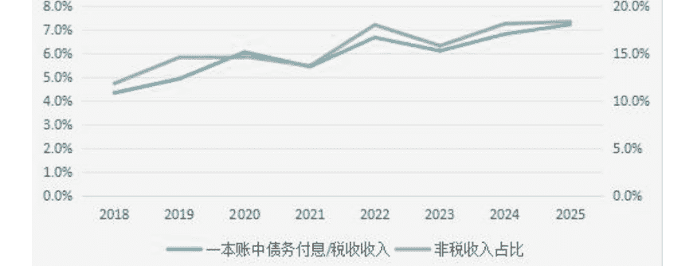

## 前8月居民净增债 vs 财政-土地收入
南半球联财经

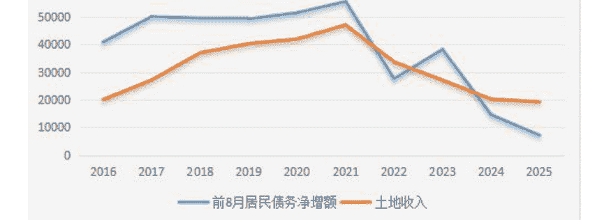

微信：2818363845，提升知识学习能力，看更多优质资源

# Jason不離

2025-09-15 08:22:57

zerohedge: 两三，恒生科技指数涨4%，创下2021年11月以来的最高收盘，恒生科技指数今年仅涨了4%，有望连涨七角，蓝宝表示，“中国科技领先者正在明智地加大人工智能智能和产品输出——模型，机器人汽车，内部芯片——同时也证明他们可以比许多人类预期的更快速实现人工智能货币化，由于价值落后于美国，投资者再次开始关注。”#蓝市

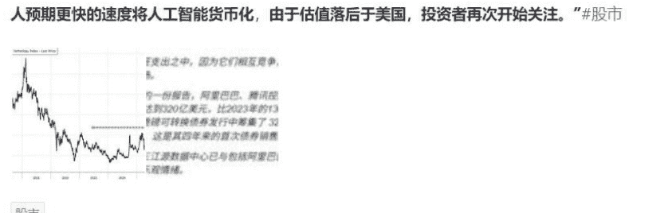

> 此涨之后，蓝市回升。
一个报告显示，阿里股价上涨
由于阿里巴巴的拆分计划
继续转换债券发行者准备了
这近几年的涨信号包括阿里

蓝市

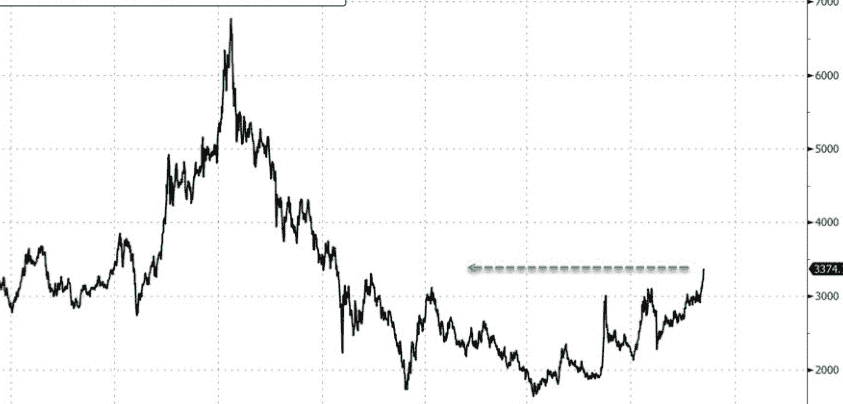

中国最大的科技公司处于人工智能的狂热支出，因为它们相互竞争，也与美国公司竞争，以引起广为预期将改变人们的生活和工作方式。彭博报道（2023年）称，阿里巴巴、腾讯控股、百度和JD.com等巨头其资本支出在2023年增加到200亿美元，增加一倍。这有助于股市缓解资金紧张，阿里巴巴上周通过发行了32亿元，而融90亿人民币（12.7亿美元）向点信市，这是其近年来首次筹措周二，电视台报道，中国联通江苏数据中心已与当地公司签署了芯片部署，从而增长了规模。

加微信：2818363845，提升知识学习

# 东亮：当前黄金14日RSI达到78，已经接近10年来的90%的水平，意味着部分资金离场。重要的是，相较于表现更为极热的RSI，全球ETF、现货和期货持有仓位等并没有那么热。所以我们认为黄金短期存在回调风险，主要看美国牛市逻辑。

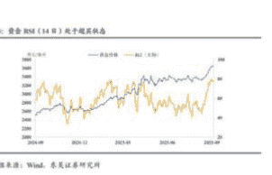

数据来源：Wind，东亮证券

## 图3：黄金 RSI（14日）处于超买状态

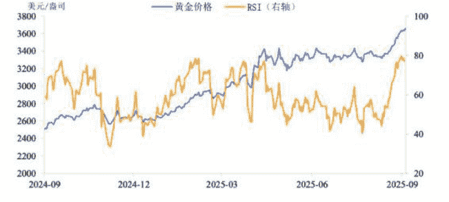

数据来源：Wind，东亮证券

加微信：2818363845，进知识学习

# 对“一路”的相关投资再扩大。据澳大利亚利亚菲斯特大学和中国复旦大学调查，1-6月内的投资额已超过240亿美元，与过去全年相比，这是2013年扩张后“一带”倡议以来的最高值。尤其是对非洲的投资有所增加，达到400亿美元，比2024年增长了37%，占总额的3倍以上。

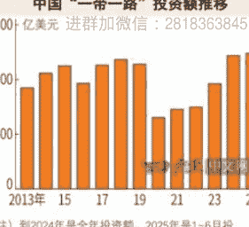

# 中国“一路”投资趋势

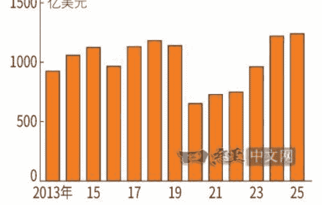

(注）2024年全年投资额。2025年1-6月投资额。数据来源：澳大利亚利亚菲斯特大学、中国复旦大学国际金融学院

# 国信：第37周，全国二手房挂价指数151.88，环比下降0.17%

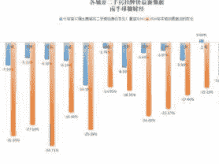

## 各城市：二手房挂价最新数据（至8/24）2024年以来相对最高点的钝化

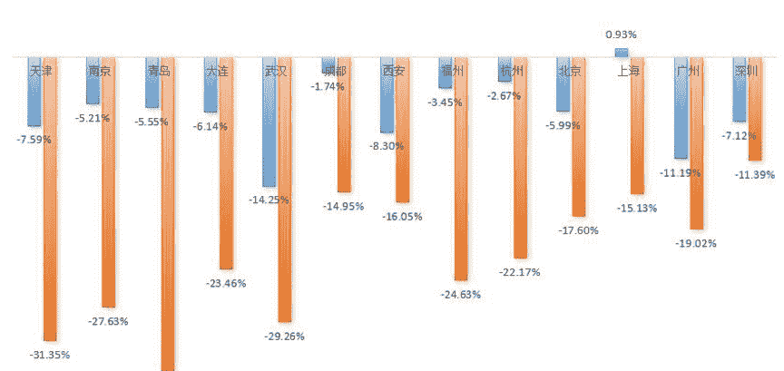

加微信：2818363845，提升知识学习

# 从历史经验，美联储预防周期开启后，对资产总体利好，股弹性为值得关注，债券市场大概获胜；美元波动窄迎来反转，国内大类权益资产超额收益并不明显，尤其价值风格领先。从市场风格角度，美联储降息落地后，成长风格领先。

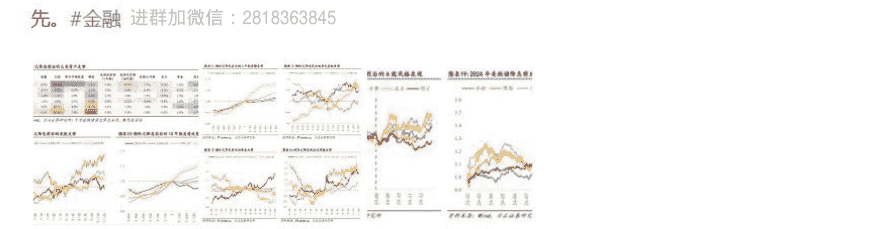

图8：预期调整后的资产表现

| 期限 | 美股 | 大宗 | 新能源 | 国债 | 美国政府(2年期) | 美国政府(10年期) | 美国公司 | 货币 | 黄金 | 原油 |
|---|---|---|---|---|---|---|---|---|---|
| T-6M | 6.7% | -0.5% | -10.0% | -0.2% | -3.5% | | 7.7% | -0.2% | 1.0% | -4.3% | -5.4% |
| T-3M | 1.3% | -0.3% | -8.9% | -0.5% | -2.2% | 3.8% | 8.9% | 6.4% | -0.4% | -1.1% | -3.2% |
| T-1M | 1.8% | -2.5% | 3.0% | -4.8% | 1.2% | 2.6% | 1.8% | -1.9% | 1.8% | 2.1% |
| T-1Y | 1.9% | 1.9% | 0.8% | 2.3% | 14.2% | 0.8% | 14.2% | -1.2% | -0.5% | -0.9% | -4.7% |
| T-2Y | 6.4% | 10.2% | 19.8% | 16.1% | 1.2% | 0.5% | -4.0% | | | | |
| T-6M | 9.2% | 21.1% | 3.8% | 22.8% | 3.5% | | 3.6% | 2.9% | -2.7% | -3.0% |

数据来源：Wind，方正证券；美元债收益率，月底更新

图9：预期调整前的收益

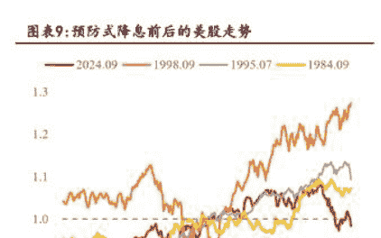

图10：预期调整前的10年期收益

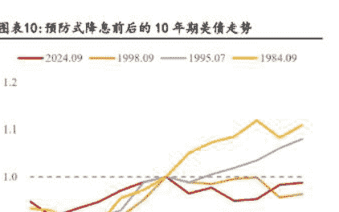

## 图表11：预期调整后的美债走势

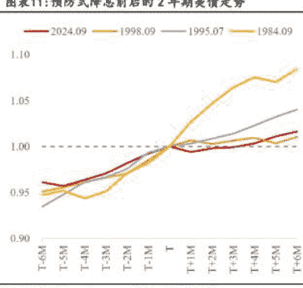

数据来源：Bloomberg，正达证券

## 图表12：预期调整后的美元指数

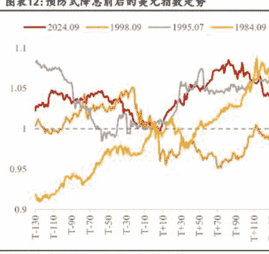

数据来源：Bloomberg，正达证券

## 图表13：预期调整后的黄金走势

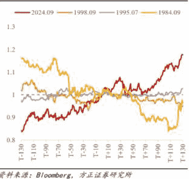

数据来源：Bloomberg，正达证券

## 图表14：预期调整后的股市走势

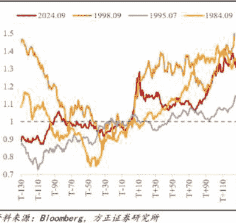

数据来源：Bloomberg，正达证券

## 图表18：2019年末美债A股表现

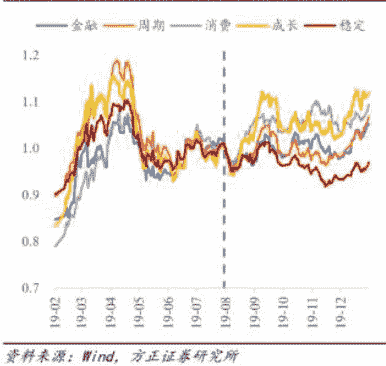

数据来源：Wind，正达证券

## 图表19：2024年末美债A股表现

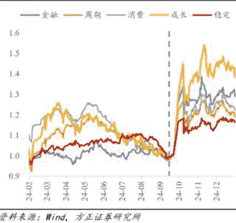

数据来源：Wind，正达证券

在房地产市场波动和贸易不确定背景下，中国正在加快向消费型经济增长的长期转型。在当前的财政框架下，限制了地方政府推动消费增长的能力。这种结构使得地方政府更关注工业增值而非居民需求。消费的税收范围较小，统一征税直接带来地方政府财政赤字。此外，社会保障和户籍改革可以改善社会保障体系，但是这些改革尚未深入。

在全国形势下，北京、天津上海的人口规模大于其他主要城市2020-2024年主要城市的人口增长与2016-2019年对比

| 平均增长 (2020-2024年) | 平均增长 (2016-2019年) |
|---|---|---|
| 成都（四川） | 1.03% | | |
| 重庆 | 0.83% | | |
| 武汉（湖北） | 1.36% | 4.37% | |
| 长沙（湖南） | 1.97% | 3.91% | |
| 上海 | -0.01% | 0.19% | | |
| 杭州（浙江） | | 1.69% | 3.06% | |
| 天津 | -1.35% | -0.30% | | |
| 北京 | -0.08% | -0.06% | | |
| 深圳 | 1.02% | | 4.45% | |
| 广州（广东） | 0.72% | 2.95% | | |
| 西安（陕西） | 1.31% | 2.44% | 6.27% | |
| 合肥（安徽） | 1.78% | | 3.34% | |
| 郑州（河南） | -2.00% | -1.00% | 0.00% | 1.00% | 2.00% | 3.00% | 4.00% | 5.00% | 6.00% | 7.00% |

资料来源：财经资讯，版权所有

加微信：2818363845，提升知识学习群，看更多优质资源

# 最近4个月非储存款数据，居民、企业定存策略微调#自制图

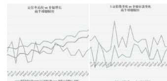

自制图表

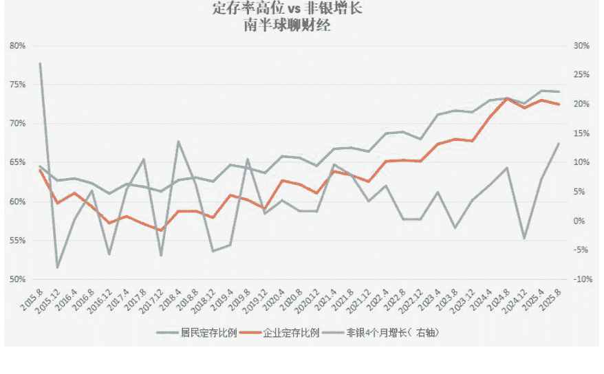

加微信：2818363845，提升知识学习

# New Zealand Economy Falters Despite Rate Cuts
GDP remains weaker than a year ago

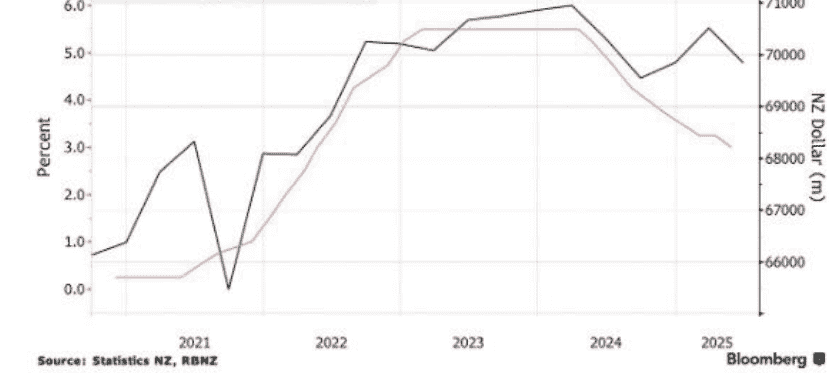

新西兰房价vs1期房贷利率
南半球财经

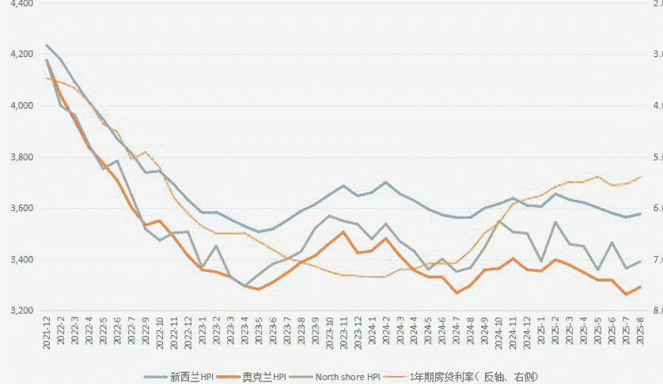

加微信：2818363845，提升知识学习群，看更多优质资源

# New Zealand House Price Indices

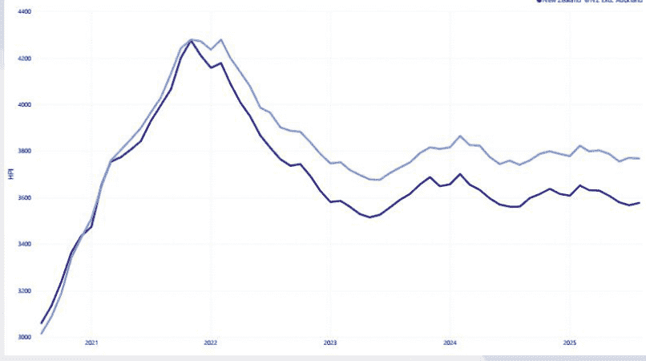

# Upper North Island Regional House Price Indices

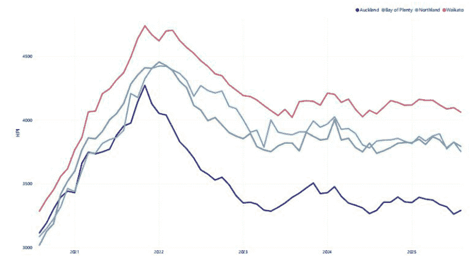

加微信：2818363845， 提升知识学习群，看更多优质资源

提升知识学习365一（365天服务期），微信扫码或加：2818363845
欢迎进群查看更多优质资源，老客户进群享折扣。学习群包含全部资源：

## 一、财经博主（财经群258一天，包含7个博主内容当天更新）：

- 1、灵哥财富智识星球（原价 3510元/年）/ 卖 149 年
- 2、蜜茶财经智识星球（原价 3510元/年）/ 卖 149 年
- 3、血亿之智识星球（原价 2280元/年）/ 卖 199 年
- 4、户鲲元微播V+会员（原价 1000元/年）/ 卖 79 年
- 5、智哥趋势内部研析（原价 199元/年）/ 卖 19.9 年
- 6、南半球球财经（原价 404元/年）/ 卖 19.9 年
- 7、洪源的宏观致略以及众群的其他财经博主付费免费分享

## 二、时事博主（时事群119一天，包含11个博主每天更新）：

- 1、我的私享汇江（原价 568元/年）/ 卖 29.9 年
- 2、米粮米锦见闻（原价 599元/年）/ 卖 29.9 年
- 3、大湖类智识星球（原价 199元/年）/ 卖 19.9 年
- 4、霸霸的世界智星球（原价 299元/年）/ 卖 19.9 年
- 5、碎瓦广Q的内部笔记（原价 400元/年）/ 卖 19.9 年
- 6、户克元智识星球+青云财经（原价 268元/年）/ 卖 19.9 年
- 7、广文财经读书会（原价 699元/年）/ 卖 59.9 年
- 8、皓备备文章和对话（/ 卖 29.9 年
- 9、欧洲金锐会员财经群（原价 328元/年）/ 卖 19.9 年
- 10、翘莉西西风付费文章，/ 卖 29.9 年
- 11、江宁知府付费文章，/ 卖 29.9 年

## 三、各种公众号付费文章：

金政通鉴、外界人的视角、灏译浅、雪花财经老头、幻话诸你、A视野、NE 预测鱼、冷局局、海观箴行对股市的影响、费变的小诸、赢在八小时之外、雷思海、盛京创创、第三观察眼等等公众号付费文章不定期更新，内容很多，一不二列举！

提升知识学习群包含以上全部内容，分享365天，赠送历史文章！

加微信：2818363845，提升知识学习，看更多优质资源
