# Jason-不蜀

2025-10-25 03:09

花旗：看得政策对中产不会再大水漫灌，经济对房产的依赖继续减少，考虑到住房资产居民资产占比约66%，下跌仍会影响信心和消费，需要收入/社保层面的保障才能护居民信心的。#经济数据

# China Property

# Citi Research

24 October 2025

Refer to our previous report on China Property - 15th Five-Year Plan: Accelerate to Establish A New Development Model for details

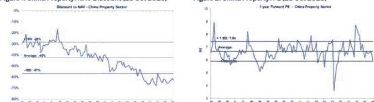

# Jason-不蜀

2025-10-25 03:16

宏汇：规划对市场最相关的两个：①科技自主自强与原始创新协同（直击“卡脖子”）；②提振消费（增强一类市场，民生和收入分配协同）。历史经验（五年规划与A股）：过往四轮FYP，方案正式发布后的一年A股平均收益约16.5%，被规划点名的重点行业，平均收益约17.5%，将“十五五”大抓援建设并将实体、AI、生物医药等基础技术放在优先，同时扩大消费、社保完善、多城协同与保障住房。#A股

# 深度视野文集cuk255 有温度高质量社群cuk255

## The Fourth Plenum: what are the key messages?

A focus on economic planning

According to the official communique, the Fourth Plenum focuses on economic development and modernisation by 2035, and economic planning during the 15th FYP (China 4th Plenum concluded; Strategic direction set later, Jing Liu, 20 October 2025). A list of focuses have been mentioned in the commune innovation and self-sufficiency with boosting consumption being the key areas for the equity market.

- For innovation and self-sufficiency the increasing uncertainty around the external environment, including trade tension with the US, has encouraged China to accelerate its tech advances and self-sufficiency. A difference between the Fourth Plenum this time and the 15th Plenum of Party Congress in 2020 (which guided the 14th Year Plan) is a new focus on strengthening original innovation, which we believe to be target bottleneck issues.
- For boosting consumption the communique mentioned removing barriers to a unified market, improving people's livelihoods, and enhancing income distribution. A comparison against the communique of the 15th Party Congress suggests more deemphasis from “comprehensively promoting consumption” to “vigorously boosting consumption” with focus on elimination of consumption, people's livelihoods and investments.

Moreover, our frequency analysis on the communique suggests there is more focus on modernisation, high-quality development, and technology. Moreover, the communique also outlined 12 important focus areas for the upcoming 15th Year Plan (FYP), including building a modern industrial system and accelerating high-level science and tech-sufficiency.

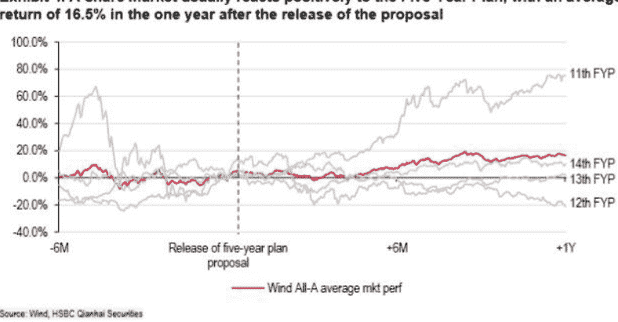

## Exhibit 8. Household income growth is still lower than the pre-pandemic level

## Exhibit 9. China's final consumption to GDP ratio is growing but still lower than other economies

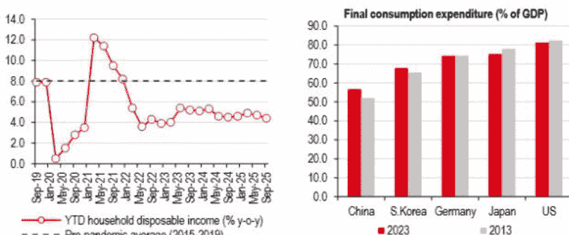

Final consumption expenditure (% of GDP)

YTD household disposable income (% y-o-y)
Pre-pandemic average (2015-2019)
Source: Wind, HSBC Qame Securities
Source: Wind, HSBC Qame Securities

中国：当前房地产市场的现状是房源有价，二手房成交为主，房子正在通过租赁向消费品的转型。租金收益率的调整将成为“泡沫”引发住房危机，房地产市场开始下行，直至2021年，新房销量和价格回落，此时持有成本降至4.75%，高于30年平均水平。全国城镇租金回报率为2.37%，目前50城均值约为3.0%左右。租金回报率成为住房“泡沫”指标。过去几个月涨幅仅为0.26%，租金趋势持续至近期，对于房地产市场至关重要。一方面，租金达到均衡，短期房地产市场面临调整期。另一方面，对于投资者而言，当租金下跌时，策略可能失效，导致回归需谨慎观察。

图16: 美国房地产市场租金收益率走势图
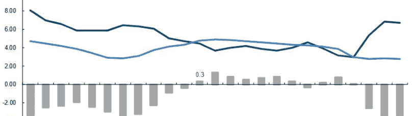

租金收益率 (%) --- 30年固定利率(%)
来源: Wind, Federal Reserve Bank Dallas, Exhibit 4 (2015) 数据 (3.2%)

图 20: 50城市住宅房价指数
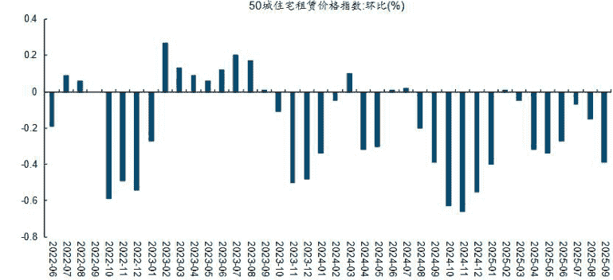

来源：中财、彭博社

Jason-Lee 2025-10-25 03:40

bloomberg: CPI优于预期，美股经历了10月的涨势，标准普尔500指数创新高，鲍储释放宽松将推动企业盈利，交易员押美债将在未来12个月内总增长120个基点，这将使得收益率到2.9%，低于3%大关——被认为是既不衰退也不限制增长的中性水平。

### 其他国家经济

标准普尔500指数意外创历史新高 | 2024年出口额（十亿美元）
- 标准普尔500指数意外创历史新高
- Last Price

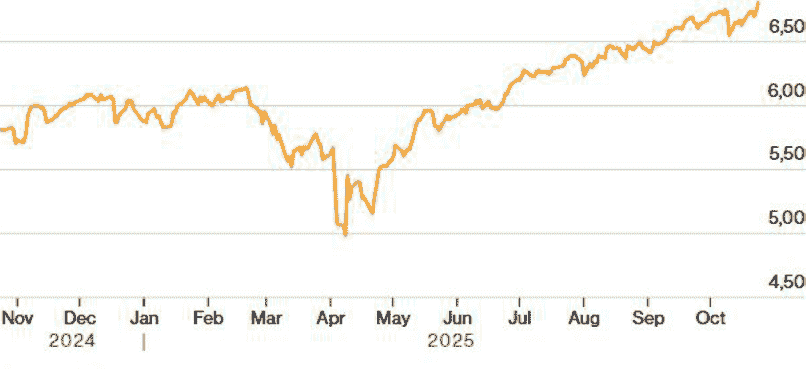

来源：彭博社

### CPI要点

- 总体CPI和核心CPI均比预期十分之一百分点，月度涨幅分别为0.3%和0.2%。
- 经季节调整的油价格上涨导致总体数据增速于核心数据，而住房成本本质上是核心增长后的项目。
- 弱于预期的CPI报告定了美储在下周政策会议上暂停的预期，并增加了12新增可能的。

以下是周五发布的9月美元核心CPI报告的主要要点：

- 总体CPI和剔除核心CPI比预期十分之一百分点，月度涨幅分别为0.3%和0.2%。以12个月为基础，总体CPI涨3.0%，快于8月的2.9%，核心CPI也为3.0%，较3.1%有所缓。
- 经季节调整的油价格上涨导致总体数据增速于核心数据。以往一样，住房成本是核心增长后的项目，尽管近年来相比，0.2%的通胀并不大。机票和娱乐是其他上涨的因素之一，而汽车保险和二手车是少数下降的项目之一。
- 敏感某些类别中家居产品3个月上涨12%，为2023年以来的最高水平。音视频设备上涨1.6%，为2021年以来的最高涨幅。剔除住房成本的“超级核心”服务通胀增速至月0.35%，是现在的最高数之一，与5月的平均涨幅基本平。
- 虽然显然表明通胀仍高于美储2%的目标，但弱于预期的CPI报告锁定了美储在下周政策会议上暂停的预期，并增加了12新增可能的。
- 白宫表示，10月份的通胀报告不太可能在下个月公布，这使得今天的读数与12月美储的决定没有直接相关。

### 美国通胀降温

CPI涨幅较小，美储继续降息

# Change in consumer price index (MoM)

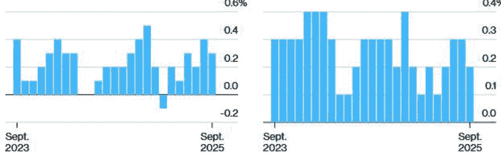

# Change in goods prices ex-fuel, (MoM)

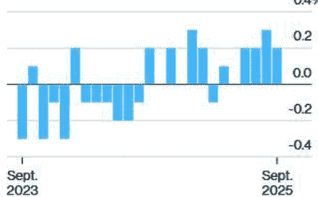

# Change in core services ex-housing (MoM)

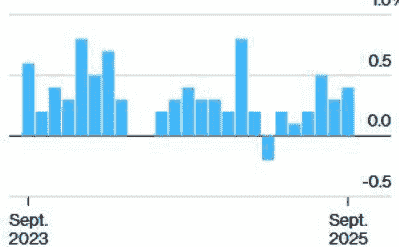

资料来源：劳工统计

bloomberg: 作为商业核心活性成分（API）的全球供应直接贡献了2024年8%的份额。由于环境污染严重，这种转移到环境严格是没有意义的。

### 其他国家经济

| 国家 | 2024年出口额（十亿美元） |
| :--- | :--- |
| USA | 4.5 |
| India | 6.1 |
| Korea | 2.1 |
| Brazil | 2.0 |
| Japan | 1.9 |
| The Netherlands | 1.9 |
| Germany | 1.8 |
| Russia | 1.4 |
| Vietnam | 1.2 |
| Indonesia | 1.1 |

来源：中国

bloomberg: 彭博调查显示，美国消费者对持续的高价感到沮丧，本月对就业市场的预期保持稳定，但仍处于不利水平。

### 美国消费者信心

美国10月份消费者信心跌至五个月低点，原因是物价高及其财务影响的担忧持续。根据霍根大学的数据，10月份的最终情绪从9月份的55.1降至53.6，较初有所恶化。衡量当前状况的指标降至2022年8月以来的最低水平。

- 美国消费者信心跌至5月以来的最低水平
- 当前状况指标跌至三来的最低水平

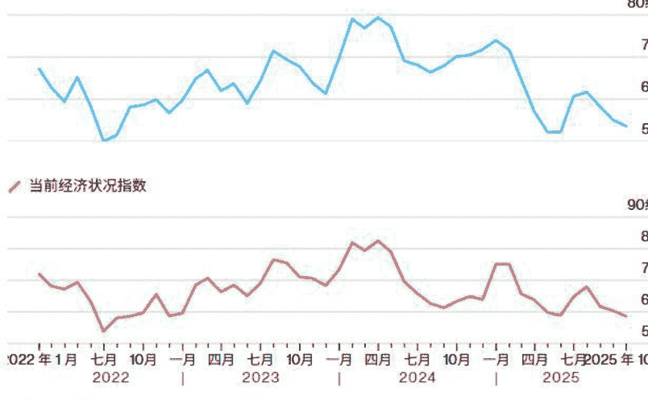

当前经济状况

数据来源：霍根大学

周五公布的数据显示，消费者预计未来五到十年价格上涨3.9%，高于一个月前的3.7%。受访者预计明年价格将以年率上涨4.6%，低于一个月前的4.7%。

### 社会保障支票将增加2.8%

2025年10月25日凌晨2:25 GMT+13

今年，近700万领取社会保障福利的美国人的每月支票将增加2.8%，调整幅度大于2025年。

社会保障管理局周五表示，这项被称为COLA的生活成本调整将从1月开始适用于社会保障福利，并将退休人员的平均福利每月增加56美元，达到2071美元。补充保障收入领取者的更高款项将于12月31日开始。

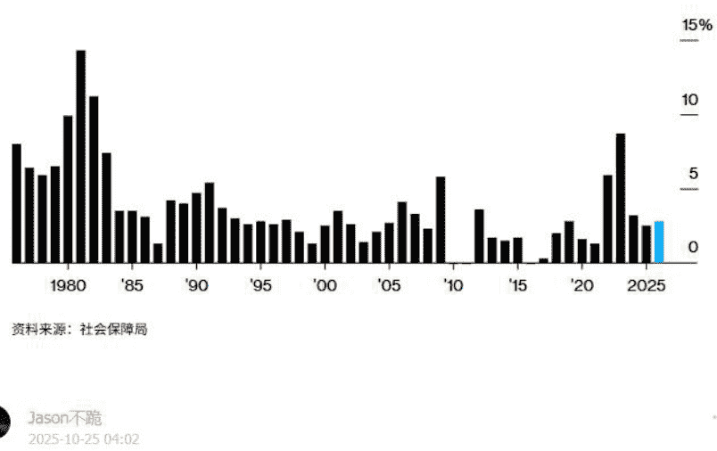

来源：社会保障局

按份计算的社会保障领取者的生活费用调整

Jason Lucas 2025-10-25 04:02

bloomberg: 日元周延续跌势，表现落于十国团体，由于日本领袖访问日本议会，她将奉行具有战略性和责任的“扩张性”财政政策，并承诺实现日本GDP的2%用于国防支出。虽然市场对财政宽松措施的偏好帮助日本股市创下历史新高，但也打压了货币和政府债务。

### 博弈智能的要点

- 日本财政大臣表示，如果现有资源不足，可能有必要扩大援建。
- 这种转移到环境严格是没有意义的。
- 这种转移到环境严格是没有意义的。
- 这种转移到环境的。
- 这种转移到环境严格是没有意义的。
- 这种转移到环境严格是没有意义的。
- 这种转移到环境的。

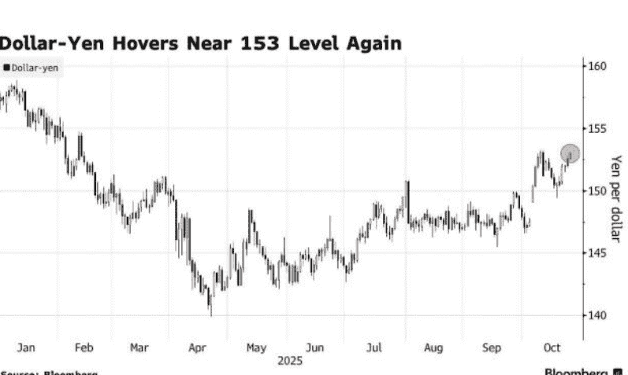

Jason-不蜀 2025-10-25 03:16

### 房地产市场

中国：当前房地产市场的现状是房源有价，二手房成交为主，房子正在通过租赁向消费品的转型。住房资产居民资产占比约66%，下跌仍会影响信心和消费。租金收益率的调整将成为“泡沫”引发住房危机，房地产市场开始下行，直至2021年，新房销量和价格回落，此时持有成本降至4.75%，高于30年平均水平。全国城镇租金回报率为2.37%，目前50城均值约为3.0%左右。租金回报率成为住房“泡沫”指标。过去几个月涨幅仅为0.26%，租金趋势持续至近期，对于房地产市场至关重要。一方面，租金达到均衡，短期房地产市场面临调整期。另一方面，对于投资者而言，当租金下跌时，策略可能失效，导致回归需谨慎观察。

图16: 美国房地产市场租金收益率走势图

租金收益率 (%) --- 30年固定利率(%)
来源: Wind, Federal Reserve Bank Dallas, Exhibit 4 (2015) 数据 (3.2%)

图20: 50城市住宅指数

来源：中财、彭博社

Jason-Lee 2025-10-25 03:40

bloomberg: CPI优于预期，美股经历了10月的涨势，标准普尔500指数创新高，鲍储释放宽松将推动企业盈利，交易员押美债将在未来12个月内总增长120个基点，使得收益率到2.9%，低于3%大关——被认为是既不衰退也不限制增长的中性水平。

### 其他国家经济

| 国家 | 2024年出口额（十亿美元） |
| :--- | :--- |
| USA | 4.5 |
| India | 6.1 |
| Korea | 2.1 |
| Brazil | 2.0 |
| Japan | 1.9 |
| The Netherlands | 1.9 |
| Germany | 1.8 |
| Russia | 1.4 |
| Vietnam | 1.2 |
| Indonesia | 1.1 |

来源：中国

bloomberg: 彭博调查显示，美国消费者对持续的高价感到沮丧，本月对就业市场的预期保持稳定，但仍处于不利水平。

### 美国消费者信心

美国10月份消费者信心跌至五个月低点，原因是物价高及其财务影响的担忧持续。根据霍根大学的数据，10月份的最终情绪从9月份的55.1降至53.6，较初有所恶化。衡量当前状况的指标降至2022年8月以来的最低水平。

- 美国消费者信心跌至5月以来的最低水平
- 当前状况指标跌至三来的最低水平

当前经济状况

数据来源：霍根大学

周五公布的数据显示，消费者预计未来五到十年价格上涨3.9%，高于一个月前的3.7%。受访者预计明年价格将以年率上涨4.6%，低于一个月前的4.7%。

### 社会保障支票将增加2.8%

2025年10月25日凌晨2:25 GMT+13

今年，近700万领取社会保障福利的美国人的每月支票将增加2.8%，调整幅度大于2025年。

社会保障管理局周五表示，这项被称为COLA的生活成本调整将从1月开始适用于社会保障福利，并将退休人员的平均福利每月增加56美元，达到2071美元。补充保障收入领取者的更高款项将于12月31日开始。

来源：社会保障局

Jason Lucas 2025-10-25 04:02

bloomberg: 日元周延续跌势，表现落于十国团体，由于日本领袖访问日本议会，她将奉行具有战略性和责任的“扩张性”财政政策，并承诺实现日本GDP的2%用于国防支出。虽然市场对财政宽松措施的偏好帮助日本股市创下历史新高，但也打压了货币和政府债务。

### 博弈智能的要点

- 日本财政大臣表示，如果现有资源不足，可能有必要扩大援建。
- 这种转移到环境严格是没有意义的。
- 这种转移到环境严格是没有意义的。
- 这种转移到环境的。
- 这种转移到环境严格是没有意义的。
- 这种转移到环境严格是没有意义的。
- 这种转移到环境的。

Jason-不蜀 2025-10-25 03:16

## 房地产

中国：当前房地产市场的现状是房源有价，二手房成交为主，房子正在通过租赁向消费品的转型。住房资产居民资产占比约66%，下跌仍会影响信心和消费。租金收益率的调整将成为“泡沫”引发住房危机，房地产市场开始下行，直至2021年，新房销量和价格回落，此时持有成本降至4.75%，高于30年平均水平。全国城镇租金回报率为2.37%，目前50城均值约为3.0%左右。租金回报率成为住房“泡沫”指标。过去几个月涨幅仅为0.26%，租金趋势持续至近期，对于房地产市场至关重要。一方面，租金达到均衡，短期房地产市场面临调整期。另一方面，对于投资者而言，当租金下跌时，策略可能失效，导致回归需谨慎观察。

图16: 美国房地产市场租金收益率走势图

租金收益率 (%) --- 30年固定利率(%)
来源: Wind, Federal Reserve Bank Dallas, Exhibit 4 (2015) 数据 (3.2%)

图20: 50城市住宅指数

来源：中财、彭博社

Jason-Lee 2025-10-25 03:40

bloomberg: CPI优于预期，美股经历了10月的涨势，标准普尔500指数创新高，鲍储释放宽松将推动企业盈利，交易员押美债将在未来12个月内总增长120个基点，使得收益率到2.9%，低于3%大关——被认为是既不衰退也不限制增长的中性水平。

### 其他国家经济

| 国家 | 2024年出口额（十亿美元） |
| :--- | :--- |
| USA | 4.5 |
| India | 6.1 |
| Korea | 2.1 |
| Brazil | 2.0 |
| Japan | 1.9 |
| The Netherlands | 1.9 |
| Germany | 1.8 |
| Russia | 1.4 |
| Vietnam | 1.2 |
| Indonesia | 1.1 |

来源：中国

bloomberg: 彭博调查显示，美国消费者对持续的高价感到沮丧，本月对就业市场的预期保持稳定，但仍处于不利水平。

### 美国消费者信心

美国10月份消费者信心跌至五个月低点，原因是物价高及其财务影响的担忧持续。根据霍根大学的数据，10月份的最终情绪从9月份的55.1降至53.6，较初有所恶化。衡量当前状况的指标降至2022年8月以来的最低水平。

- 美国消费者信心跌至5月以来的最低水平
- 当前状况指标跌至三来的最低水平

当前经济状况

数据来源：霍根大学

周五公布的数据显示，消费者预计未来五到十年价格上涨3.9%，高于一个月前的3.7%。受访者预计明年价格将以年率上涨4.6%，低于一个月前的4.7%。

### 社会保障支票将增加2.8%

2025年10月25日凌晨2:25 GMT+13

今年，近700万领取社会保障福利的美国人的每月支票将增加2.8%，调整幅度大于2025年。

社会保障管理局周五表示，这项被称为COLA的生活成本调整将从1月开始适用于社会保障福利，并将退休人员的平均福利每月增加56美元，达到2071美元。补充保障收入领取者的更高款项将于12月31日开始。

来源：社会保障局

Jason Lucas 2025-10-25 04:02

bloomberg: 日元周延续跌势，表现落于十国团体，由于日本领袖访问日本议会，她将奉行具有战略性和责任的“扩张性”财政政策，并承诺实现日本GDP的2%用于国防支出。虽然市场对财政宽松措施的偏好帮助日本股市创下历史新高，但也打压了货币和政府债务。

### 博弈智能的要点

- 日本财政大臣表示，如果现有资源不足，可能有必要扩大援建。
- 这种转移到环境严格是没有意义的。
- 这种转移到环境严格是没有意义的。
- 这种转移到环境的。
- 这种转移到环境严格是没有意义的。
- 这种转移到环境严格是没有意义的。
- 这种转移到环境的。

3) 模式。或者说他做了什么样的调整，很大程度上取决于这两个问题。“在2025年后，上海，国际金融四十二人学术委员会主席、中国社会科学委员会郭毅提到我国人口与劳动力市场的新特征，并针对性地提出了养老金改革过程中需要注意的问题建议。

第一，我国养老金的人群中，超过50%的是城乡居民养老保险，但是关于养老保险改革或相关的设置更多地聚焦在职工养老保险，在此基础上又加上第二支柱、第三支柱：“我认为这可能不够巧妙，因为这把很大一部分的人排除了在外。”陈毅说。

第二，城乡居民养老保险覆盖了老人。除之外，很多“非正规就业或灵活就业群体”去哪里寻找城乡养老保险。“现在，在非营（企业）的劳动者、个体劳动者或在单位工作，但不是作为自己员工的人占比越来越大，这个比例超过了60%。职工超过一半。之外还有灵活就业的，也有22万人。还有新的就业形式，也越来越人。”郭华明说，“这些不同群体的共同点是养老金覆盖很低，很多人不在职工养老保险范围内。

“我们不能解决这个问题的养老问题，他们把他们纳入第一支柱，其实第二支柱、第三支柱就不谈。或者，没有好的第一支柱，我们的养老保险就不谈论公平性。而第二支柱、目前的体制是具有临时性的，是不公平的。”陈毅说。

第三，随着数字经济、平台经济，人工智能的发展，灵活就业的倾向日益明显，就业形态越来越多元，这造成了传统的养老保障路径不再有效，所以必须有新的思路。

“人工智能的发展是性的，养老保险的选择和进一步完善也应该与时代同步。”

NIFD; 三季度宏观通率回升至302.3%，由名义 GDP增速下降快于实体经济增速，2025年第三季度，宏观杠杆被动上轨11.6个百分点，超过2024年全年增幅(10.1个百分点)。

间接养老保险被侵噬，只能极大直接连接#金融

# 深度视野集社cuk255 有温度高质量群cuk255

## 提振资产价格/盘活存量资产，修复微观主体资产

报告负责人：张谊晓高

## 债表

### ——2025年三季度宏观杠杆报告

**报告执笔人:**
- 张谊晓：国家金融与发展实验室主任
- 刘翔：国家金融与发展实验室国家资产负债表研究中心中枢研究员
- 曹靖：国家金融与发展实验室国家资产负债表研究中心中枢研究员

### 摘要

- 2025年三季度，实现资产杠杆率上升1.9个百分点，从二季度的300.4%提高至302.3%。前三季度宏观杠杆率共上升11.6个百分点，超过2024年全年增幅（10.1个百分点）。居民部门债务增速再度再创历史低位，政府部门债务增速持续扩张。
- 实体经济信用护有所所有收益。一方面，房地产市场止回回调基础，消费内增长动力不足，自2023年二季度以来，住房连续十个季度负增长，居民部门连续两个季度去杠杆。另一方面，“反内需”政策有利于改善供需衔和企业盈利，但也引起行业投资效益和信用收缩，从而而企业部门债务增速转长。

【NiFD报告】
全球金融市场全球资产

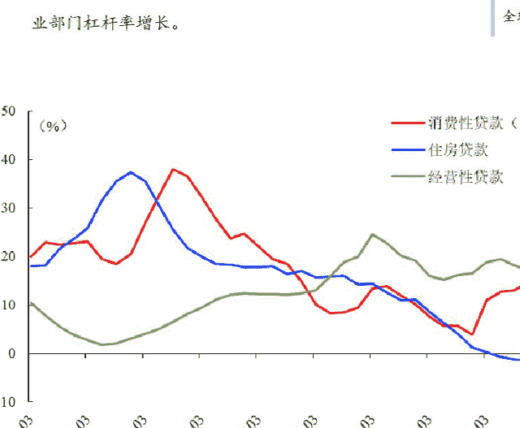

图5 居民部门各类贷款对比增速

数据来源：中国人民银行；国家资产负债表研究中心。

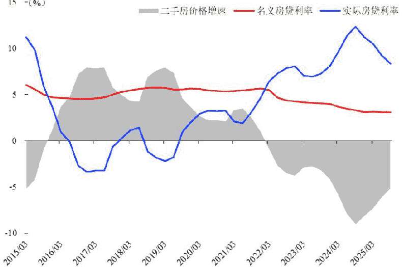

### 图 6 名义和实际房价利率

数据来源：中国银行、国家统计局。

Jason不易
2025-10-25 04:53

财新：10月中旬，生猪肉价格整体疲软，双节（国庆和中秋节）需求并未预期带动价格走强，猪价自假期后后持续下跌。10月上旬全国均价跌破11元/公斤关口，生猪养殖环节再次转入亏损状态。机构统计，行业自养猪亏损135元/头，外购养猪亏损300元/头。

元猪肉分析，双节需求空虚主要来源于两因素。其一、现源消费经济仍在市场上，数据显示，期间国内购肉人数日均涨113.7%，同比下降13%，消费群体继续回暖，费率下持续良好；其二、从基本面来看，生猪供应基本面依然明，4月后遵循周期性下跌，二季度景望良好，但需求端受弱基本面带来的悲观影响，基本回落。4月后二育猪表现平稳，多数处于调整期，截至9月30日全国平均生猪栏利用率降至34%，处于历史低。

# 深度视野集社cuk255 有温度高质量群cuk255

## 双节预期猪价加速下跌

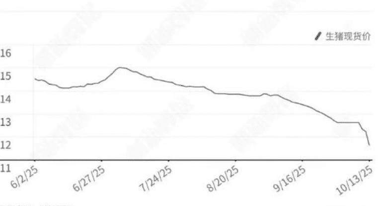

数据来源：NiFD报告
全球金融市场

# 深度视野集社cuk255 有温度高质量群cuk255

## 全部包含以下内容：限时年费1888/年

- 粉丝专属
- 粉丝瓜粉丝专属（原价365元/年）
- 子明宪会内部文集（原价568元/年）
- 米桂【作者米桂】（原价599元/年）
- 欧泊会员专属（原价328元/年）
- 广华内部文集（原价400元/年）
- 卢可见青云书专属（原价699元/年）
- 董蓝财经星球（原价3310元/年）
- 留格的足球星球（原价299元/年）
- 刘新南淮【刘家新刚】（原价1498元/年）
- 格世光在钱缘（原价2200元/年）
- 森森莉星球（原价1600元/年）
- 玛可畅解读全史豪章和全书韩游藏无删减（原价2.3万）
- 卢虔彦三部民国、帝国思想，不被理解的MAO（原价599元/年）
- 卢可见知识留星球（原价268元/年）
- 新微爆辑、村西老老王、三花九农村集

- 粉丝专属
- 粉丝瓜粉丝专属（原价365元/年）
- 子明宪会内部文集（原价568元/年）
- 米桂【作者米桂】（原价599元/年）
- 欧泊会员专属（原价328元/年）
- 广华内部文集（原价400元/年）
- 卢可见青云书专属（原价699元/年）
- 董蓝财经星球（原价3310元/年）
- 留格的足球星球（原价299元/年）
- 刘新南淮【刘家新刚】（原价1498元/年）
- 格世光在钱缘（原价2200元/年）
- 森森莉星球（原价1600元/年）
- 玛可畅解读全史豪章和全书韩游藏无删减（原价2.3万）
- 卢虔彦三部民国、帝国思想，不被理解的MAO（原价599元/年）
- 卢可见知识留星球（原价268元/年）
- 新微爆辑、村西老老王、三花九农村集
